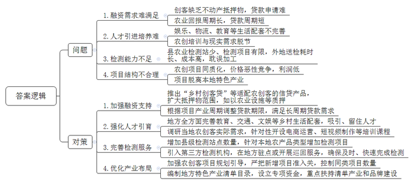
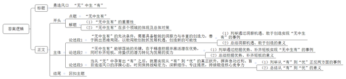

# 2026年四川省公考《申论》题（县乡、普通选调卷）

> 候选采集稿。参考答案及解析来自粉笔页面，不代表官方答案或真实高分答卷；来源使用许可与原卷对应关系仍需人工核实。

## 给定材料

### 材料 material-64606824f6c1a02e

一列绿色的小火车，喷涌着白色的蒸汽，轰鸣着从黄灿灿的油菜花田中蜿蜒而出，吸引了无数游客的目光，他们纷纷举起相机捕捉这激动人心的瞬间。工厂车间里，一场关于汽车知识的讲座正在热烈进行，工程师深入浅出地讲解着“冲压、焊装、涂装、总装”四大工艺，听众们聚精会神地聆听着，不时点头以示理解。这些场景，一处在工业遗产之地，一处在繁忙的工厂车间之中，印象中有趣、火热的文旅，就这样顺着一处处工业遗迹、一条条生产线，与看似严肃、冰冷的工业产生了联系。曾经机器轰鸣、闲人免进的工厂车间，如今正成为热门旅游目的地。从承载厚重历史的工业遗产，到“科技范儿”十足的现代化流水线，再到寓教于乐的研学课堂，“到工厂去旅游”逐渐成为备受欢迎的旅游新热点。

“作为全国为数不多拥有全部41个工业大类、31个制造业大类的省份，我省在发展工业文旅方面具备独特的优势。”S省经济和信息化厅相关负责人表示。目前，S省共有国家级工业遗产20处，数量居全国第一，这为打造工业文化IP，为工业转型升级和文旅融合发展拓宽了想象空间。为推进全省“工业+文旅”发展，S省先后出台了《S省推进工业文化发展行动方案》《S省工业旅游发展规划》，明确支持有条件、有意愿的企业主体充分利用工业企业、工业园区、工业展示区、工业遗产等发展工业旅游。目前，全省共有工业类国家AAAA级景区20个，认定省级工业旅游示范基地41处，获评国家工业旅游示范基地5处。

2009年，D汽车公司将总部之外的首个整车制造基地放到S省C市。十多年后，这家汽车企业与市民的距离更近了：为推进汽车知识普及与工业文化传播，D汽车公司打开大门、开放工厂，每年吸引上万人次的市民游客来到这里体验汽车智造与汽车文化。在这里，游客可以见证从一块钢板到一辆整车的生产全过程：在焊装车间，看机械臂如何精准焊接；在总装车间，见证“55秒下线一辆车”的高效；在质量检测中心，近距离围观一辆车如何经过路试、淋雨试验等严苛测试……在这里，学生们能够参与汽车科普课堂，自己动手拼装汽车模型；企业团队则能够学习涵盖质量管理、精益生产、供应链管理、安全环保等多主题的研学课程。同时，工厂还有特色餐食及文创产品可供自由选购。“在参观内容设计上，我们坚持场景化体验、知识型浸润、沉浸感营造。开放至今，已累计接待社会公众超10万人次，覆盖学校、媒体、企业、公益组织等各类团体。”D汽车公司C市分公司党委书记、总经理高先生介绍，“工业旅游能让游客了解工业文化和工业文明，我们这个制造基地已经成为全省两条‘智造工业体验精品路线’中的必选点位。”

三线建设是20世纪60年代中后期至70年代中期，在中西部13个省区实施的战略性国防工业迁移工程。无数建设者告别繁华，扎根深山，在“无水、无电、无路、无房”的极端困难条件下，靠人拉肩扛、风餐露宿，建起了重要的军工生产基地，为国防建设作出了不可磨灭的贡献，也留下了宝贵的“三线精神”财富。S省是三线建设期间全国国防科技工业投资最多的省份，拥有众多的三线工业遗产。近年来，S省G市以“三线文化”为主题，对3536三线军工遗址建筑进行保护开发，相继打造了红飘带游客服务中心、三线记忆光影馆、记忆老街、三线建设博物馆等。通过鲜活的图片、实物、场景，“三线人”艰苦开拓的拼搏精神和以身许国的赤子情怀在今天得到了传递，“三线文化”正在以多种方式，装点和丰富着人们的精神家园。游客漫步在3536军工厂旧址，看着极富年代感的厂房车间、办公楼、职工宿舍楼等建筑，仿佛回到了那段激情燃烧的岁月。

S省N市六合丝博园内，缫丝机的嗡鸣与游客的笑语交织。六合丝博园，始建于1912年，是我国现存历史最悠久且尚在生产的丝绸工厂，完整保留缫丝设备、民国风格厂房等工业遗存，被誉为“中国丝绸工业活化石”。近年来，当地政府以丝绸文化为核心，依托六合丝博园深耕遗产活化，将老旧厂房改造为“活态博物馆”。修缮后的六合院博物馆、制丝设备展览馆、蒸汽观光小火车等，构建起“从茧到丝”全流程工业观光线。在园区六合染坊，游客不仅可以歇脚喝咖啡，还能体验非遗丝绸织染技艺。结合N市丝绸文化和六合丝厂的百年厂史打造的大型杂技情景剧《东方丝源》，让游客沉浸式感受丝绸魅力。蜀绘非遗传承人常在此展示其作品制作过程，游客驻足观赏，不仅可体验大师定制，还能购买车间生产的各类丝绸文创产品。

“百年六合，作为工业遗产见证了我省近现代工业的发展历程，蕴藏着丰富的历史文化价值，传承和弘扬了中国工业精神。2024年园区接待游客120万人次，旅游收入7000万元，带动5万余人次研学实践。”六合（集团）有限责任公司林总经理说。六合丝博园园区业务覆盖文化、旅游、生产等多领域，产业发展的同时，就业带动效应显著，为本地提供了1200余个稳定岗位。依托省级非遗“丝绸传统织染技艺”开设培训课程，定向培养非遗传承人与手工艺者，为周边群众搭建技能提升和职业发展平台。随着文创集市等特色业态的诞生，催生了大量灵活就业机会，让产业红利惠及更多家庭。

### 材料 material-74f6c585645c9f30

1.晚饭后，市民陈先生和家人一起到小区外散步，发现一处路灯出现故障，他随手拿出手机扫码报修。很快，维护公司的工作人员就来到现场进行处置。工作中，滨河社区网格员小马在智慧系统的帮助下，快速联系上自己负责网格中尚未参加医保的居民，高效地完成上门排查工作……

帮助他们更快解决身边遇到问题的系统，就是J县聚焦智慧社区建设开发的“报表通”。这是J县近年来针对基层反映的台账报表繁多、工作任务繁重等问题而开发的新系统。“报表通”在统一的平台上派发数据采集任务，通过上级回流、本级接入、基层采集，将城市管理、经济发展等数据汇集到数据中台，构建城市数智能力中台，建设“数据底座”；在此基础上，该系统还能实现“一端采集、动态更新、多方复用”功能。“报表通”的应用，实现了从向基层要数据到向中台要数据转变，从数据不新不准向数据及时精准转变，以数据工具支撑助力基层减负增效。

谈起过去社区工作中的“负担”，柳河社区唐书记对着记者打开了话匣子，“为了更好地开展工作，不少部门都需要让我们填报社区的有关情况和数据。但因为终端不同、标准不一，带来了大量‘重复性’的工作。”唐书记回忆，“有时刚刚在一个系统填报完数据，就要重新到另外一个系统填写类似的数据。但不同部门的填报标准并不一样，有的要求40个字段，有的要求39个字段，这样就无法直接把前面的内容和数据复制过来，只能重新填写，无形中增加了我们的工作量。”

“使用‘报表通’后，我们平均每个月要处理的报表从120多张减少到约20张，而且其中6张带数据下发，只需核对即可，这大大缩短了我们的填表时间。”柳河社区网格员小李说。“实际工作中，‘报表通’还能帮助我们快速拿到必要数据，更好地推进社区工作。”唐书记补充道，“比如，我们需要掌握辖区内低保领取情况，只需在系统中点击‘我要数据’，设置筛选条件‘领取低保’，即可一键生成‘辖区低保人员名单’，便于针对性开展工作。”

2.“您有一个数据核实新任务，请及时处理。”滨河社区网格员小马收到一条系统提示，需要梳理社区未参加医保居民的情况。收到任务后，小马立即前往自己负责网格的小区，途中，她打开“报表通”系统，查看系统初步提供的未参保居民地址和电话。

“鼓励居民参保关系到居民的切身利益。但在过去，我们难以掌握居民的实际情况，只能依靠大脚板，一家家上门拜访。”小马说，“那时，要跑完自己对接的所有居民，大约要花一周的时间。部分居民因为我们多次上门询问，还对我们很有意见。”如今，“报表通”能将市上回流的常住人口数据，与市医保局提供的参保缴费信息进行比对，从中精准比对出未参保的居民信息，再通过“报表通”将数据下发至基层一线排查，便于“一对一”开展动员。

小马随即联系了筛选出的未参保居民，对在家的居民逐一拜访，并与暂时外出的居民预约了沟通时间。

居民张大姐远远叫住了小马，“小马，正好遇上，我想跟你打听一件事哈。”原来，张大姐家下水道堵住了，想找人疏通一下，却找不到工人师傅。“这事儿好办，您带了手机吗？”说着，小马让张大姐打开自己手机上的“报表通”，然后指导张大姐找到上面的“百宝箱——JJ百事通”，向其中的问答机器人提问，很快，社区周边维修店地址、联系方式和营业时间都显示出来。张大姐连声道谢：“你瞧，真是的，人一着急，把‘报表通’这么方便的工具给忘了！”

3.最近王女士一家收获了意外之助，这得益于“报表通”的智慧联动。王女士老公早年因病去世，她靠给人修补衣服独自抚养一对双胞胎女儿，日子过得颇为艰难，两个女儿刚考上大学，学费都凑不齐。她们一家在申请低保救助时，竟然额外享受到了2万余元的特殊救助补贴。“感谢党和政府，在我们家最无助的时候送来了及时雨，我们在申请低保的时候，没想到系统针对我们的家庭情况，自动就弹出了特殊救助申请提示。”王女士激动地说。

原来，数据库中有王女士的家庭关联信息，结合她填写的问卷评估，自动触发了“报表通”关联的民政部门“社会救助通”平台的特殊救助事项，上演了从“人找政策”变成“政策找人”的感人一幕。

社会救助是民生工程的重要组成部分，涉及的政策项目多、项目资金量大、廉洁风险高。在纪检部门的助推下，2023年以来，J县聚焦社会救助对象的“急难愁盼”，充分发挥智慧城市建设成果作用，用好城市数字底座和“报表通”工具，集成民政、教育、人社、残联等8个部门24类救助事项，打造了集在线申请、智能评估、信息推送、协同办理、智慧监管等功能为一体的智慧应用场景。

此外，依托“报表通”系统中“基层社会治理数据库”汇集的电力、水务等数据，涉及高龄、独居老人的信息也可进行数据碰撞，及时对可能出现的异常情况发出预警。“如果水、电出现异常使用情况，社区工作者会及时收到推送并上门查看，改变以往主要靠居民报警或邻里反映才发现问题的被动应对。今年，我们已经通过‘报表通’的预警及时救助了两位突发疾病的高龄独居老人。”J县民政部门工作人员说。

### 材料 material-c50f24ae963b0d2e

清晨，青莲县智慧农业试验田笼罩在薄雾里，小周穿着沾着泥土的冲锋衣，蹲在玉米地旁，手里的平板电脑屏幕上，绿色的曲线实时跳动着——这是土壤湿度、光照时长、玉米株高的监测数据。“看，这块用了智能滴灌的玉米，株高比普通田高15厘米，每亩节水30%。”他指着田里插着的传感器，对围过来的农户说。旁边的张大爷凑过来，手里攥着刚摘的玉米棒：“小周，你这技术真管用，我家用了你的‘水肥一体化’，今年不但亩产增加了，还省了雇人浇水的钱！”小周拥有“玉米智能种植系统”专利，现在全县已有5个合作社、91户农户使用他的技术。

像小周这样有着大专及以上学历、在农业农村领域创业创新的年轻人，被称为“农创客”。他们将新的思路、新的技术、新的业态带到乡村，点燃农村“新”的希望，为推进“农业高质高效、乡村宜居宜业、农民富裕富足”注入新的活力，上演了一幕幕双向奔赴的美好场景。为了更好发挥农创客作用，切实解决他们的实际困难，青莲县农业农村局牵头，对全县范围内的156名农创客进行了专项调研。

青莲县大石镇，小吴手里攥着皱巴巴的贷款申请材料，眉头紧锁。“我想进行灌溉系统的升级改造，但钱还没有着落。”小吴对调研组说，他想申请贷款，跑了几家银行都被拒，每家的回复都大同小异：农业项目风险高，小吴没有房产做抵押，暂无足够还款能力。后来，小吴好不容易贷到了款，但贷款周期又很短。“银行最多给1年期贷款，可有机茶要3年才进入采摘期，今年贷的钱明年就要还。我看新闻里报道Z省推出了‘乡村创客贷’，啥时候我们这里也能有呀。”小吴无奈地说。

青莲县农业农村局2024年调研数据显示，当地农创客融资需求满足率仅为38%，89人反映“贷款难”，主要集中在茶叶、竹笋等回报周期3至5年的长周期产业。其中，62%的拒贷原因是“缺乏房屋等不动产抵押物”，另有28%源于“还款周期与产业周期不匹配”。

青莲县电商产业园的直播间里，主播小婷一边做着直播准备，一边对调研组倾诉。为了招聘一名短视频运营人员，她开出了6500元的月薪，但半个月过去，竟没收到一份简历。“之前有个应届大学生来面试，在村里住了一晚就走了。她说村里晚上太无聊，快递要3天才到，不如回城里拿4000块工资。不光我们招不到人，上周那个植保无人机操作员，因为娃娃要回城读书，也离职了。”小婷感叹，“想拍点果园的短视频引流，只能自己对着教程学，结果作品点击量才500。上个月县里组织的农创培训，3天课程都是智能灌溉、无土栽培，没有与电商运营相关的内容，听完还是啥都不会。”

青莲县北界镇的竹笋加工厂里，晓敏指着冷库中的春笋说：“这批2000斤春笋想做成即食笋，得先测亚硝酸盐含量，可我们县没地方测。”雇车去市里的检测机构，货车要沿着蜿蜒的盘山公路开3个多小时才能上高速，往返600里路，耗时3天，春笋的最佳加工期就这样被彻底耽误。“单次检测费800元，加上司机食宿、车辆损耗，总成本高达2000元。”调研组在县科技局了解到，青莲县唯一的县级农业检测站，仅能检测农药残留等基础指标，而像土壤重金属、食品添加剂等专业项目，均需送检外地，平均耗时2至5天。

“去年我家‘茶山民宿’靠一条短视频火了，现在周边3公里内迅速涌现出5家同质化民宿，导致价格恶性竞争，利润大不如前。”曾经担任过企业高管的民宿老板大刘和调研组侃侃而谈，“我们县的特色本是茶叶和竹笋，但近六成的农创项目却都扎堆在民宿、咖啡馆和基础农产品售卖上。我们一个产茶县，咖啡馆遍地开花，整修得蛮有情调，也很‘出片’，但真正来消费的游客却不多。要想从‘扎堆内卷’中突围，还得靠特色、靠品牌。”

“这些困境并非农创客个体能力不足，而是县域农创生态尚未形成。”青莲县农业农村局相关负责人表示，“如何破解这些难题，让农创客‘敢干、会干、干得好’，是我们县推进乡村振兴的关键课题。”

## 题目

### 第 1 题

**请根据****“给定资料**1**”，概括S省在发展工业文旅方面的主要做法。（15分）**

关联材料：material-64606824f6c1a02e

作答要求：

要求：全面、准确、有条理，不超过250字。

### 第 2 题

**J县“报表通”的探索与实践入选“全省基层治理先进典型案例”，将向全省推广。请根据“给定资料**2**”，撰写一份案例摘要。（20分）**

关联材料：material-74f6c585645c9f30

作答要求：

要求：

（1）紧扣资料，内容全面，突出做法；

（2）表述准确，条理清晰；

（3）不超过350字。

### 第 3 题

**农创客是农村创业创新的引领者，也是实施乡村振兴战略的生力军。假如你是参与调研的工作人员，请根据****“给定资料**3**”，梳理农创客在创新创业中面临的问题并提出对策建议。（25分）**

关联材料：material-c50f24ae963b0d2e

作答要求：

要求：

（1）先梳理完所有问题，再提出建议；

（2）问题梳理全面准确，建议具体可行，有针对性；

（3）不超过450字。

### 第 4 题

**“给定资料**4**”中提到“静候风至不如勇造风口，‘无中生有’才会样样都有”。请你对此进行深入思考，参考给定资料，联系实际，自选角度，自拟题目，撰写一篇文章。（40分）**

关联材料：material-64606824f6c1a02e

作答要求：

要求：

（1）观点明确，见解深刻；

（2）参考给定资料，但不拘泥于给定资料；

（3）思路清晰，语言流畅；

（4）限800-1000字。

## 答案与解析

第 1 题

**参考答案（粉笔题库参考内容）**

1.加强顶层设计。出台行动方案和发展规划，明确支持有条件、有意愿的企业主体利用工业资源发展旅游。

2.开放现代工厂。打造智造工业体验精品路线，参观内容设计坚持场景化体验、知识型浸润、沉浸感营造。

3.开发工业遗产。打造主题项目，保护开发工业遗址，打造旅游设施，通过图片、实物、场景，传递精神财富。

4.深耕遗产活化。将老旧厂房改造为活态博物馆，开发全流程工业观光线、丰富的沉浸式体验项目和文创产品。

5.发挥带动效应。依托非遗技艺开设培训课程，培养传承人与手工艺者，为群众搭建技能提升和职业发展平台。

**解析**

**参考答案说明：**本参考答案从“加强顶层设计”“开放现代工厂”“开发工业遗产”“深耕遗产活化”“发挥带动效应”五个方面展开，各条答案要点之间在内容上相互并列，没有交叉。

**考点**：考点概括措施类

**来源**：来源2026年四川省公考《申论》题（县乡、普通选调卷）

粉笔申论页面对本题只提供「解析视频」入口，该入口是会员推广位，页面无视频地址与文字解析。

第 2 题

**参考答案（粉笔题库参考内容）**

关于J县“报表通”的案例摘要

J县针对基层反映的台账报表繁多、工作任务繁重等问题，开发“报表通”系统。具体做法如下：

一、搭建数据底座。在统一平台派发数据采集任务，通过上级回流、本级接入、基层采集，将各类数据汇集到数据中台，构建城市数智能力中台，实现“一端采集、动态更新、多方复用”，助力基层减负增效。二、赋能社区服务。依托系统开展数据核实，精准比对居民信息，下发至基层一线排查，便于“一对一”开展工作；设置问答机器人，提供社区周边生活服务信息，方便群众日常生活。三、强化社会救助。集成8部门24类救助事项，打造集多元功能为一体的智慧应用场景，实现精准救助；依托系统中的电力、水务等数据，对涉及高龄、独居老人的信息进行数据碰撞，异常情况及时预警，让救助更及时。

**解析**

**参考答案说明：**（1）格式方面，本参考答案写到了“标题”“正文”两个部分。（2）正文部分，一方面从内容上来看，围绕“J县‘报表通’”这一主题，本参考答案的开头先写到了J县开发“通报表”的背景信息；主体部分分别从“搭建数据底座”“赋能社区服务”和“强化社会救助”三个方面展开。另一方面，形式上，本参考答案做到了分段、分层撰写，整体上条理较为清晰。

**考点**：考点总结类

**来源**：来源2026年四川省公考《申论》题（县乡、普通选调卷）

粉笔申论页面对本题只提供「解析视频」入口，该入口是会员推广位，页面无视频地址与文字解析。

第 3 题

**参考答案（粉笔题库参考内容）**

问题：

1.融资需求难满足。创客缺乏不动产抵押物，贷款申请难；农业回报周期长，贷款周期短。

2.人才引进培养难。娱乐、物流、教育等生活配套不完善；农创培训与现实需求脱节。

3.检测能力不足。县农业检测站少、检测项目有限，外地送检耗时长、成本高，耽误加工。

4.项目结构不合理。农创项目同质化，价格恶性竞争，利润低；项目脱离本地特色产业。

建议：

1.加强融资支持。推出“乡村创客贷”等适配农创客的信贷产品，扩大抵押物范围，如以农业设施等质押；根据项目产业周期调整贷款期限，满足长周期贷款需求。

2.强化人才引育。地方全方面完善教育、交通、文娱等乡村生活配套，吸引、留住人才；调研当地农创客实际需求，针对性开设电商运营、短视频制作等培训课程。

3.完善检测服务。增加县级检测站点数量，针对本地农产品类型增加检测项目；引入第三方检测机构，在地方驻点或开展巡回服务，确保及时、快速完成检测。

4.优化产业布局。加强农创客项目规划引导，严把新增项目准入关，控制同类项目数量；编制地方特色产业清单目录，设立专项资金，重点扶持清单产业和品牌建设。

**解析**

**参考答案说明：**本参考答案整体分为“问题”和“对策”两个部分，其中“问题”部分从“融资需求难满足”“人才引进培养难”“检测能力不足”“项目结构不合理”这四个方面展开，“对策”部分从“加强融资支持”“强化人才引育”“完善检测服务”“优化产业布局”四个方面展开，且所提对策与问题相对应。各条答案要点之间在内容上相互并列，没有交叉。

**考点**：考点提出对策类

**来源**：来源2026年四川省公考《申论》题（县乡、普通选调卷）

粉笔申论页面对本题只提供「解析视频」入口，该入口是会员推广位，页面无视频地址与文字解析。

第 4 题

**参考答案（粉笔题库参考内容）**

**勇造风口** **“无”中生“有”**

习近平总书记所言“无中生有才会样样都有”，道出了突破发展瓶颈、实现提质跃升的核心密码。无论是县域发展、基层治理，还是产业转型，亦或是其他领域，表面的资源匮乏、条件不足从来不是绝境，若能以创新思维探寻新路径，激活潜在价值扬长补短，守住战略定力持续深耕，就能实现“无中生有”的破局与跃升。

**“无中生有”的先决条件，需要具备敏锐的洞察力与丰富的创造力，善于跳出思维局限，以敢闯敢创抢抓发展机遇，创造新的可能性。**濮院不产羊毛，却精准捕捉市场需求，敢为人先从零起步打造羊毛衫全产业链，成功跃居行业前列。同样，地处浙中山区的横店，原本只是一个交通不便、资源匮乏的小镇，却凭借对影视产业发展的敏锐判断，从零开始搭建影视拍摄基地，造就了“东方好莱坞”。唯有打破思维桎梏，以洞察发现机遇，才能让“无”的虚空孕育出“有”的生机。

**“无中生有”能够落地的关键，在于精准挖掘并激活潜在优势，同时补齐短板，将蛰伏的潜力转化为发展的实力。**漠河漫长严寒的冬季看似于发展无益，其却在看似“一无所有”中发现被忽视的冰雪资源，同时全力补齐交通、住宿等配套短板，如今成为知名的冰雪旅游目的地；贵州地势险峻不利于发展，但其深入挖掘自身气候、地质优势，同时完善电网、光缆等基础设施，建成全球瞩目的数据中心集群。这些生动实践印证了唯有发掘自身潜力、扬长补短，才能让“无中生有”走向现实。

**当从****“无”中孕育出“有”之后，就要实现从“有”到“优”的真正跃升，摒弃急功近利、盲目追逐风口的浮躁心态，时刻保持战略定力，深耕细作、专注提质，持续锻造核心竞争力。**乐视网在视频领域崭露头角后，未能专注主业深耕细作，却疯狂跨界造车、造手机、做体育、搞金融，过度扩张导致资金链断裂，昔日行业新星迅速陨落。反观比亚迪，在新能源汽车尚属概念、无人看好之时毅然入局，之后始终坚守新能源赛道，专注于核心技术研发，哪怕在行业低迷期也从未动摇，最终从“有”向“优”，跻身行业前列。在“有”的基础上持续精进、追求卓越，方能将先发优势淬炼为持久的核心竞争力。

新征程上，唯有以洞察先机之慧眼创造可能，以整合资源之智慧激活潜力，以深耕实干之定力淬炼品质，方能在主动创造中赢得未来，于“无中生有”处成就新辉煌。

**解析**

**文章分析**

**勇造风口** **“无”中生“有”**

【**标题的优点：**首先，范文的标题突出了“无中生有”这一主题。其次，形式上，文字简洁明快。】

（1）习近平总书记所言“无中生有才会样样都有”，道出了突破发展瓶颈、实现提质跃升的核心密码。（2）无论是县域发展、基层治理，还是产业转型，亦或是其他领域，表面的资源匮乏、条件不足从来不是绝境，若能以创新思维探寻新路径，激活潜在价值扬长补短，守住战略定力持续深耕，就能实现“无中生有”的破局与跃升。

【**开头的优点：**★内容方面：范文的开头是紧扣“无中生有”这一主题展开的。首先，开头点出主题，做到了主题明确。其次，对“无中生有”这一主题进行了分析阐述：（1）通过领导人讲话指出“无中生有”的重要性；（2）指出“无中生有”在多个领域的体现及总体对策。★文字表达方面：使用了“无论是……还是……亦或是……”“若能……就能……”等关联词，使语言表达有逻辑性。】

**“无中生有”的先决条件，需要具备敏锐的洞察力与丰富的创造力，善于跳出思维局限，以敢闯敢创抢抓发展机遇，创造新的可能性。**（1）濮院不产羊毛，却精准捕捉市场需求，敢为人先从零起步打造羊毛衫全产业链，成功跃居行业前列。同样，地处浙中山区的横店，原本只是一个交通不便、资源匮乏的小镇，却凭借对影视产业发展的敏锐判断，从零开始搭建影视拍摄基地，造就了“东方好莱坞”。（2）唯有打破思维桎梏，以洞察发现机遇，才能让“无”的虚空孕育出“有”的生机。

【**论述段****1的优点：**★观点句：范文的观点句是紧扣“无中生有”这一文章主题提出的。形式上，它在段首处直接写出，位置突出，容易发现。内容上，关键词突出，内容要点明确，可以明显看出它是从“无中生有”的先决条件入手，指出了“无中生有”的对策。★论述内容：（1）列举了通过洞察机遇、敢于创造实现“无中生有”的事例；（2）总结洞察机遇、敢于创造的意义。注意：以上两个方面的内容都是紧扣“‘无中生有’的先决条件，需要具备敏锐的洞察力与丰富的创造力，善于跳出思维局限，以敢闯敢创抢抓发展机遇，创造新的可能性”这个观点句进行分析论述的，论述的针对性强，内容层次丰富。在论述方法上采用了讲道理和举例子相结合的方式，论述充实清晰。】

**“无中生有”能够落地的关键，在于精准挖掘并激活潜在优势，同时补齐短板，将蛰伏的潜力转化为发展的实力。**（1）漠河漫长严寒的冬季看似于发展无益，其却在看似“一无所有”中发现被忽视的冰雪资源，同时全力补齐交通、住宿等配套短板，如今成为知名的冰雪旅游目的地；贵州地势险峻不利于发展，但其深入挖掘自身气候、地质优势，同时完善电网、光缆等基础设施，建成全球瞩目的数据中心集群。（2）这些生动实践印证了唯有发掘自身潜力、扬长补短，才能让“无中生有”走向现实。

【**论述段****2****的优点：**★观点句：范文的观点句是紧扣“无中生有”这一文章主题提出的。形式上，它在段首处直接写出，位置突出，容易发现。内容上，关键词突出，内容要点明确，可以明显看出它是从“无中生有”的落地关键入手，指出了“无中生有”的对策。★论述内容：（1）列举了通过挖掘优势、补齐短板实现“无中生有”的事例；（2）总结挖掘优势、补齐短板的意义。注意：以上两个方面的内容都是紧扣“‘无中生有’能够落地的关键，在于精准挖掘并激活潜在优势，同时补齐短板，将蛰伏的潜力转化为发展的实力”这个观点句进行分析论述的，论述的针对性强，内容层次丰富。在论述方法上采用了讲道理和举例子相结合的方式，论述充实透彻。】

**当从****“无”中孕育出“有”之后，就要实现从“有”到“优”的真正跃升，摒弃急功近利、盲目追逐风口的浮躁心态，时刻保持战略定力，深耕细作、专注提质，持续锻造核心竞争力。**（1）乐视网在视频领域崭露头角后，未能专注主业深耕细作，却疯狂跨界造车、造手机、做体育、搞金融，过度扩张导致资金链断裂，昔日行业新星迅速陨落。反观比亚迪，在新能源汽车尚属概念、无人看好之时毅然入局，之后始终坚守新能源赛道，专注于核心技术研发，哪怕在行业低迷期也从未动摇，最终从“有”向“优”，跻身行业前列。（2）在“有”的基础上持续精进、追求卓越，方能将先发优势淬炼为持久的核心竞争力。

【**论述段****3****的优点：**★观点句：范文的观点句是紧扣“无中生有”这一文章主题提出的。形式上，它在段首处直接写出，位置突出，容易发现。内容上，关键词突出，内容要点明确，可以明显看出它是从从“有”到“优”入手，指出了从“有”到“优”的对策。★论述内容：（1）列举了从“有”到“优”正反两方面的事例；（2）总结从“有”到“优”的意义。注意：以上两个方面的内容都是紧扣“当从‘无’中孕育出‘有’之后，就要实现从‘有’到‘优’的真正跃升，摒弃急功近利、盲目追逐风口的浮躁心态，时刻保持战略定力，深耕细作、专注提质，持续锻造核心竞争力”这个观点句进行分析论述的，论述的针对性强，内容层次丰富。在论述方法上采用了讲道理和举例子相结合的方式，论述充实到位。】

【**论述段之间的关系：**★内容的内在逻辑：范文的论述段之间是依照“递进”的逻辑展开的。论述段1先写了“‘无中生有’的先决条件，需要具备敏锐的洞察力与丰富的创造力，善于跳出思维局限，以敢闯敢创抢抓发展机遇，创造新的可能性”，论述段2接着写了“‘无中生有’能够落地的关键，在于精准挖掘并激活潜在优势，同时补齐短板，将蛰伏的潜力转化为发展的实力”，论述段3最后写了“当从‘无’中孕育出‘有’之后，就要实现从‘有’到‘优’的真正跃升，摒弃急功近利、盲目追逐风口的浮躁心态，时刻保持战略定力，深耕细作、专注提质，持续锻造核心竞争力”。三个论述段分别从“无中生有”的先决条件、落地关键、从“有”到“优”展开，层层递进，思路清晰。】

新征程上，唯有以洞察先机之慧眼创造可能，以整合资源之智慧激活潜力，以深耕实干之定力淬炼品质，方能在主动创造中赢得未来，于“无中生有”处成就新辉煌。

【**结尾的优点：**范文的结尾回扣了“无中生有”这个主题，并且进行了总结提升。】

**考点**：考点文章写作题

**来源**：来源2026年四川省公考《申论》题（县乡、普通选调卷）

粉笔申论页面对本题只提供「解析视频」入口，该入口是会员推广位，页面无视频地址与文字解析。

