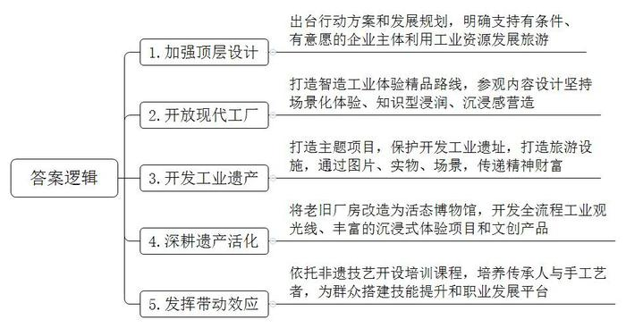
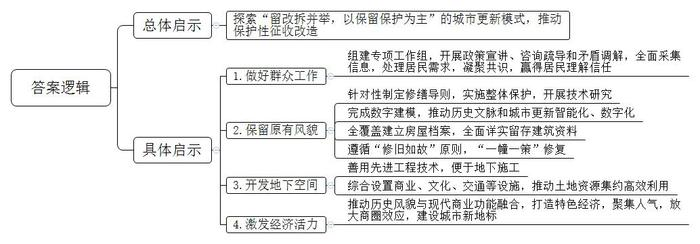
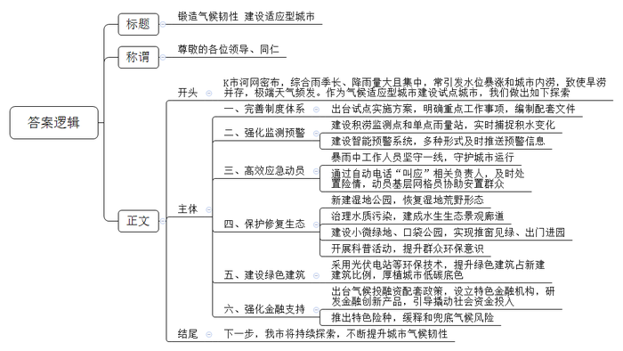
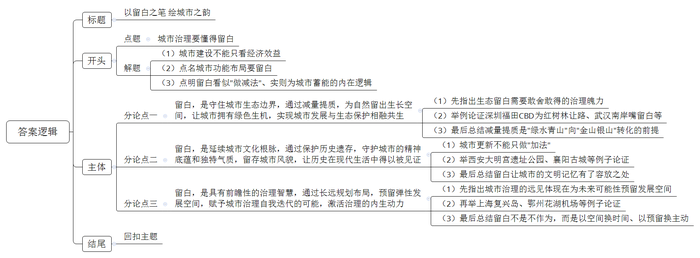

# 2026年四川省公考《申论》题（省市卷）

> 候选采集稿。参考答案及解析来自粉笔页面，不代表官方答案或真实高分答卷；来源使用许可与原卷对应关系仍需人工核实。

## 给定材料

### 材料 material-64606824f6c1a02e

一列绿色的小火车，喷涌着白色的蒸汽，轰鸣着从黄灿灿的油菜花田中蜿蜒而出，吸引了无数游客的目光，他们纷纷举起相机捕捉这激动人心的瞬间。工厂车间里，一场关于汽车知识的讲座正在热烈进行，工程师深入浅出地讲解着“冲压、焊装、涂装、总装”四大工艺，听众们聚精会神地聆听着，不时点头以示理解。这些场景，一处在工业遗产之地，一处在繁忙的工厂车间之中，印象中有趣、火热的文旅，就这样顺着一处处工业遗迹、一条条生产线，与看似严肃、冰冷的工业产生了联系。曾经机器轰鸣、闲人免进的工厂车间，如今正成为热门旅游目的地。从承载厚重历史的工业遗产，到“科技范儿”十足的现代化流水线，再到寓教于乐的研学课堂，“到工厂去旅游”逐渐成为备受欢迎的旅游新热点。

“作为全国为数不多拥有全部41个工业大类、31个制造业大类的省份，我省在发展工业文旅方面具备独特的优势。”S省经济和信息化厅相关负责人表示。目前，S省共有国家级工业遗产20处，数量居全国第一，这为打造工业文化IP，为工业转型升级和文旅融合发展拓宽了想象空间。为推进全省“工业+文旅”发展，S省先后出台了《S省推进工业文化发展行动方案》《S省工业旅游发展规划》，明确支持有条件、有意愿的企业主体充分利用工业企业、工业园区、工业展示区、工业遗产等发展工业旅游。目前，全省共有工业类国家AAAA级景区20个，认定省级工业旅游示范基地41处，获评国家工业旅游示范基地5处。

2009年，D汽车公司将总部之外的首个整车制造基地放到S省C市。十多年后，这家汽车企业与市民的距离更近了：为推进汽车知识普及与工业文化传播，D汽车公司打开大门、开放工厂，每年吸引上万人次的市民游客来到这里体验汽车智造与汽车文化。在这里，游客可以见证从一块钢板到一辆整车的生产全过程：在焊装车间，看机械臂如何精准焊接；在总装车间，见证“55秒下线一辆车”的高效；在质量检测中心，近距离围观一辆车如何经过路试、淋雨试验等严苛测试……在这里，学生们能够参与汽车科普课堂，自己动手拼装汽车模型；企业团队则能够学习涵盖质量管理、精益生产、供应链管理、安全环保等多主题的研学课程。同时，工厂还有特色餐食及文创产品可供自由选购。“在参观内容设计上，我们坚持场景化体验、知识型浸润、沉浸感营造。开放至今，已累计接待社会公众超10万人次，覆盖学校、媒体、企业、公益组织等各类团体。”D汽车公司C市分公司党委书记、总经理高先生介绍，“工业旅游能让游客了解工业文化和工业文明，我们这个制造基地已经成为全省两条‘智造工业体验精品路线’中的必选点位。”

三线建设是20世纪60年代中后期至70年代中期，在中西部13个省区实施的战略性国防工业迁移工程。无数建设者告别繁华，扎根深山，在“无水、无电、无路、无房”的极端困难条件下，靠人拉肩扛、风餐露宿，建起了重要的军工生产基地，为国防建设作出了不可磨灭的贡献，也留下了宝贵的“三线精神”财富。S省是三线建设期间全国国防科技工业投资最多的省份，拥有众多的三线工业遗产。近年来，S省G市以“三线文化”为主题，对3536三线军工遗址建筑进行保护开发，相继打造了红飘带游客服务中心、三线记忆光影馆、记忆老街、三线建设博物馆等。通过鲜活的图片、实物、场景，“三线人”艰苦开拓的拼搏精神和以身许国的赤子情怀在今天得到了传递，“三线文化”正在以多种方式，装点和丰富着人们的精神家园。游客漫步在3536军工厂旧址，看着极富年代感的厂房车间、办公楼、职工宿舍楼等建筑，仿佛回到了那段激情燃烧的岁月。

S省N市六合丝博园内，缫丝机的嗡鸣与游客的笑语交织。六合丝博园，始建于1912年，是我国现存历史最悠久且尚在生产的丝绸工厂，完整保留缫丝设备、民国风格厂房等工业遗存，被誉为“中国丝绸工业活化石”。近年来，当地政府以丝绸文化为核心，依托六合丝博园深耕遗产活化，将老旧厂房改造为“活态博物馆”。修缮后的六合院博物馆、制丝设备展览馆、蒸汽观光小火车等，构建起“从茧到丝”全流程工业观光线。在园区六合染坊，游客不仅可以歇脚喝咖啡，还能体验非遗丝绸织染技艺。结合N市丝绸文化和六合丝厂的百年厂史打造的大型杂技情景剧《东方丝源》，让游客沉浸式感受丝绸魅力。蜀绘非遗传承人常在此展示其作品制作过程，游客驻足观赏，不仅可体验大师定制，还能购买车间生产的各类丝绸文创产品。

“百年六合，作为工业遗产见证了我省近现代工业的发展历程，蕴藏着丰富的历史文化价值，传承和弘扬了中国工业精神。2024年园区接待游客120万人次，旅游收入7000万元，带动5万余人次研学实践。”六合（集团）有限责任公司林总经理说。六合丝博园园区业务覆盖文化、旅游、生产等多领域，产业发展的同时，就业带动效应显著，为本地提供了1200余个稳定岗位。依托省级非遗“丝绸传统织染技艺”开设培训课程，定向培养非遗传承人与手工艺者，为周边群众搭建技能提升和职业发展平台。随着文创集市等特色业态的诞生，催生了大量灵活就业机会，让产业红利惠及更多家庭。

### 材料 material-6577e1f7c1144d55

始建于1882年的章园，是H市现存规模最大、最完整、种类最多的中后期石库门建筑群落，这里曾是我国最早的公共空间之一，不少时髦新鲜的第一次都诞生在这里。

然而，自20世纪初起，章园被逐步改建为石库门里弄住宅。随着时间的推移，这里的居住密度与日俱增，昔日的优雅空间最终沦为拥挤不堪的大杂院，天井阳台处私搭乱建，居住环境极度恶化。一位在此住了30多年的老住户回忆道：“一家6口挤在30多平方米的房间里，吃饭都得轮流上桌；一个石库门住宅门洞里，竟能挤进12户人家，共用楼内唯一的厕所和厨房。尴尬的是，门内是马桶，门外就是厨房，但凡做饭时碰到有人急着上厕所，那种窘迫真是不堪回首。”“旧改”，成了大伙儿共同的期盼。

2018年，辖区政府秉持城市更新理念，对章园地块实施旧区改造，积极探索“留改拆并举，以保留保护为主”的城市更新模式，推动章园的保护性征收改造。改造启动前，居委会与社区民警等组成工作组，设立政策宣讲、咨询疏导和矛盾调解三个专项组，分片入户采集信息，分类处理居民需求。通过召开40场座谈会、开展200余人次谈话，逐步凝聚共识，街道干部连续数月的坚守与付出赢得了居民的理解与信任，促成了首批签约。

韩女士一家是第一批签约的居民，“我从小在这里长大，在我们这些老居民心中，章园不仅浓缩着H市的历史，也承载着邻里间相互守望的温情。要搬离章园，心里肯定舍不得，但时代在发展，城市在更新，章园也需要换一种‘活法’。”

章园整改建筑占地3.8万平方米，42栋历史建筑涵盖28种不同建筑风格。为了保留章园的原有风貌，政府针对性制定了《章园历史建筑保护性修缮导则》，采取整体性保护方式，开展石库门建筑预防保护技术研究。项目团队联合相关高校，运用三维激光扫描技术，完成章园历史建筑的数字建模，完整保留了街道界面、成片保护屋顶平面，对老弄堂名称进行全面保留展示，维持了弄堂原有里弄建筑肌理和空间尺度，推动章园历史文脉和城市更新全生命周期智能化、数字化。此外，通过建筑现状记录、历史资料考证和人文历史挖掘，对范围内42栋、170幢建筑全覆盖建立“一幢一档”房屋档案，包括建筑概述、历史与现状图纸、物业与影像资料、历年修缮记录及工艺工法、保护性修缮控制建议和人文口述等九大类内容，既全面详实地留存了建筑资料，也为延续建筑生命、挖掘建筑故事打下扎实基础。

在修缮过程中，改造部门严格按照“一幢一方案一策”，遵循“修旧如故”原则，实施“拆、洗、修、补、整”五字工作方针，并采用“拆-仓储-保养-复建”运行模式。每幢建筑的门、窗等部位都贴上了“保护标签”，清晰注明建造年代、保护重点及看护责任人等信息，尽可能地保护还原了这片石库门里弄建筑的特色风貌。

更令人惊叹的是，章园改造项目在保护技术上做到了极致。该项目使用了432个小型步履式移位机器人，将重达7500吨的“华严里”建筑群整体平移并归位，这项工程创下了国内最大规模石库门平移纪录。大费周章的移动当然不是为了“炫技”，而是要腾出空间来便于地下施工建设。城市更新建设有限公司陈经理介绍，此次章园地下三层空间开发15米，可释放5.3万平方米空间，将综合设置商业、文化、地下停车场等设施，并实现轨道交通三条线路站内换乘，为中心城区土地资源的集约化、高效化利用提供了示范。

2022年，当韩女士再次回到章园，眼前的景象令她无比欣喜。当年居住的章园16号楼，外墙立面、室内格局、楼梯、马赛克花砖、门窗乃至天花线脚造型，都完整复原了当年的模样。这些被精心保留下来的岁月痕迹使城市文脉得以延续，韩女士从中读懂了保护性改造团队“向史而新、修旧如故”的初心。历经四年的保护性修缮，章园成功实现了历史风貌与现代商业功能的融合，转型成为首发经济的重要载体，吸引了近百个国际品牌在这里开设首店、进行首发、开展首秀。近年来，章园日均人流量超2万人次，年均人流量突破700万人次，旺盛的人气对周边商业起到了辐射作用，商圈效应持续放大，成为城市更新标杆和时尚文化新地标。

### 材料 material-f461c5e508b186d0

这个夏天，黄奶奶每天上午10点就得打开空调，“以前每天下午一两点才需要开空调，今年夏天确实更热了。”从空调使用时间延长到库岸更易坍塌，从航班因极端天气延误到高温干旱农田减产，全球气温持续升高及其伴生的极端天气，影响着人们生活的方方面面。锻造气候韧性，减轻气候变化对产业、城市和居民的影响和风险，成为城市建设发展面临的新课题。

2024年，全国39个市（区）开展深化气候适应型城市建设试点，以防范气候风险为目标建设气候适应型城市，可以最大限度降低气候变化的不利影响和风险，提高城市适应气候变化能力，对保障城市安全运行、提高城市竞争力和可持续发展潜力具有重要意义。

K市地处我国内陆，受亚热带季风气候影响，夏季降水以过程性降水为主，短时强降水、大风和雷电等强对流天气较多。市域内河网密布，综合雨季长、降雨量大且集中，由于水资源时空分布严重不均，常常引发水位暴涨和城市内涝，致其旱涝并存，极端天气频发。

作为首批试点城市之一，根据试点建设要求，K市印发了《K市深化气候适应型城市建设试点实施方案》，提出完善城市适应气候变化治理体系、加强城市适应气候变化能力建设、加强气候事件风险监测预警和应急管理等12项重点工作任务，并编制了《自然灾害救助应急预案》《突发环境事件应急预案》等配套文件。

位于K市龙昆南路的一处单点雨量站前，市气象局工作人员正在检查设备运行状况，并清理雨量器内的落叶和杂物。目前，K市已在易涝点周边区域建成35个积涝监测点和14个单点雨量站，它们就像城市内涝预警的“千里眼”，实时捕捉道路积水变化，定时传回关键数据。

2025年10月11日，K市遭遇大暴雨。“以下路段可能发生积水，请路过市民注意。”早高峰到来前，高风险区域22.8万市民已收到预警短信。依托智能预警信息发布系统，K市实现与通讯运营商、网络媒体平台的高效联动，确保预警信息通过短信、新闻等多种形式及时触达公众。早高峰的车流里，一个个身着反光服的身影在忙碌——他们是交警以及排水、环卫等部门的工作人员，正坚守一线，全力守护城市运行。11时33分，K市气象台发布了暴雨橙色预警；16时15分，预警升级为红色：“受偏东急流影响，我市东部新区近12小时雨量已达211.3毫米，预计今天我市仍有暴雨、局地大暴雨天气，建议有关单位和人员做好防范工作。”此次暴雨过程中，市气象局通过自动电话“叫应”各区三防（防汛防旱防风）、水务、交通、城管等部门及各街道、社区责任人，累计5080人次，及时处置挡土墙倒塌14处、短时积水58处，全市1.9万名基层网格员协助安置危险区域群众4680人。在高效有序的应急动员下，城市的运行秩序未受明显影响。

K市创新建立“湿地+”保护修复模式，在寸土寸金的五源河岸附近，“让”出3000亩土地，新建五源河湿地公园，恢复湿地荒野形态。五源河曾因水质恶化严重，极大影响城市生态和居民生活。为改善这一状况，当地聚焦核心截污，敷设截污管涵、修复病害管网……通过持续治理，流域水质优良率达到100%。河长张毅回忆道：“这里曾经是劣V类水质，河面常有异味。如今水质清澈，鱼儿增多，两岸种上红树，成了贯穿城区南北的重要水生生态景观廊道。”

如今，K市见缝插绿建设小微绿地、口袋公园，推动形成“推窗见绿、出门进园”的城市生活场景。在雅苑小区旁的口袋公园内，绿草如茵，成年人在健身，孩子们在嬉戏。公园北侧，社区正在开展“气候科普进万家”主题活动，活动现场气氛热烈，前来参加活动的王大爷感慨道：“这样的科普活动让我们在轻松愉快的氛围中，学习了知识，提升了环保意识。”

走进位于江东新区的K市能源交易大厦，空中花园、中庭绿谷让人仿佛置身于热带丛林，满目绿色沁人心脾。在K市，这样的绿色建筑并不少见：江东发展大厦楼顶安装有0.8MW分布式光伏电站，产生的绿电不仅能自用还能并网发电；市妇幼保健院异地新建项目部分内墙取消混凝土砌墙，采用预制轻质内隔墙施工工艺，让施工更加环保……2022年，K市绿色建筑占新建建筑比例达83.97%。随着绿色发展理念不断深入，2024年K市新批复绿色建筑141项，总面积约702.23万平方米，城市低碳底色日益浓厚，治理能力持续提升。

“在金融支持方面，我们积极引导和撬动更多社会资金投入应对气候变化领域。”市生态环境局相关负责人表示。作为全国首批、全省首个气候投融资试点城市，K市已出台《K市气候投融资试点工作方案》等20余项配套政策，设立绿色支行、零碳金融网点等特色金融机构47家，研发气候投融资金融创新产品30余个。同时，充分发挥绿色保险对于气候风险的缓释和兜底作用，创新推出巨灾保险、农产品气象指数保险等特色险种，为全市居民提供巨灾风险保障1.75亿元，为农业提供风险保障1.05亿元。

## 题目

### 第 1 题

**请根据****“给定资料**1**”，概括S省在发展工业文旅方面的主要做法。（15分）**

关联材料：材料 material-64606824f6c1a02e

作答要求：

要求：全面、准确、有条理，不超过250字。

### 第 2 题

**请根据****“给定资料**2**”，谈谈章园改造的成功实践为城市更新提供哪些启示。（20分）**

关联材料：材料 material-6577e1f7c1144d55

作答要求：

要求：紧扣资料、分析全面，不超过300字。

### 第 3 题

**K市将在全省气候适应型城市建设经验交流会上发言，假如你是发言材料起草组成员，请根据“给定资料**3**”，拟定发言材料。（25分）**

关联材料：材料 material-f461c5e508b186d0

作答要求：

要求：定位准确、重点突出、语言简洁，不超过500字。

### 第 4 题

**“给定资料**4**”****中提到****“留白就是留出无穷意蕴，留出无限生机”，联系实际，自拟题目，写一篇文章。（40分）**

关联材料：材料 material-64606824f6c1a02e

作答要求：

要求：

（1）观点明确，见解深刻；

（2）参考给定资料，但不拘泥于给定资料；

（3）思路清晰，语言流畅；

（4）限800-1000字。

## 答案与解析

第 1 题

**参考答案（粉笔题库参考内容）**

1.加强顶层设计。出台行动方案和发展规划，明确支持有条件、有意愿的企业主体利用工业资源发展旅游。

2.开放现代工厂。打造智造工业体验精品路线，参观内容设计坚持场景化体验、知识型浸润、沉浸感营造。

3.开发工业遗产。打造主题项目，保护开发工业遗址，打造旅游设施，通过图片、实物、场景，传递精神财富。

4.深耕遗产活化。将老旧厂房改造为活态博物馆，开发全流程工业观光线、丰富的沉浸式体验项目和文创产品。

5.发挥带动效应。依托非遗技艺开设培训课程，培养传承人与手工艺者，为群众搭建技能提升和职业发展平台。

**解析**

**参考答案说明：**本参考答案从“加强顶层设计”“开放现代工厂”“开发工业遗产”“深耕遗产活化”“发挥带动效应”五个方面展开，各条答案要点之间在内容上相互并列，没有交叉。

**考点**：考点概括措施类

**来源**：来源2026年四川省公考《申论》题（省市卷）

粉笔申论页面对本题只提供「解析视频」入口，该入口是会员推广位，页面无视频地址与文字解析。

第 2 题

**参考答案（粉笔题库参考内容）**

探索“留改拆并举，以保留保护为主”的城市更新模式，推动保护性征收改造。

1.做好群众工作。组建专项工作组，开展政策宣讲、咨询疏导和矛盾调解，全面采集信息，处理居民需求，凝聚共识，赢得居民理解信任。

2.保留原有风貌。针对性制定修缮导则，实施整体保护，开展技术研究；完成数字建模，推动历史文脉和城市更新智能化、数字化；全覆盖建立房屋档案，全面详实留存建筑资料；遵循“修旧如故”原则，“一幢一策”修复。

3.开发地下空间。善用先进工程技术，便于地下施工；综合设置商业、文化、交通等设施，推动土地资源集约高效利用。

4.激发经济活力。推动历史风貌与现代商业功能融合，打造特色经济，聚集人气，放大商圈效应，建设城市新地标。

**解析**

**参考答案说明**：本参考答案宏观上分为“总体启示”和“具体启示”两个方面。在“具体启示”方面，又从“做好群众工作”“保留原有风貌”“开发地下空间”“激发经济活力”四个方面展开，各条答案要点之间在内容上相互并列，没有交叉。

**考点**：考点经验启示类

**来源**：来源2026年四川省公考《申论》题（省市卷）

粉笔申论页面对本题只提供「解析视频」入口，该入口是会员推广位，页面无视频地址与文字解析。

第 3 题

**参考答案（粉笔题库参考内容）**

锻造气候韧性 建设适应型城市

尊敬的各位领导、同仁：

K市河网密布，综合雨季长、降雨量大且集中，常引发水位暴涨和城市内涝，致使旱涝并存，极端天气频发。作为气候适应型城市建设试点城市，我们做出如下探索。

一、完善制度体系。出台试点实施方案，明确重点工作事项，编制配套文件。二、强化监测预警。建设积涝监测点和单点雨量站，实时捕捉积水变化；建设智能预警系统，多种形式及时推送预警信息。三、高效应急动员。暴雨中工作人员坚守一线，守护城市运行；通过自动电话“叫应”相关负责人，及时处置险情，动员基层网格员协助安置群众。四、保护修复生态。新建湿地公园，恢复湿地荒野形态；治理水质污染，建成水生生态景观廊道；建设小微绿地、口袋公园，实现推窗见绿、出门进园；开展科普活动，提升群众环保意识。五、建设绿色建筑。采用光伏电站等环保技术，提升绿色建筑占新建建筑比例，厚植城市低碳底色。六、强化金融支持。出台气候投融资配套政策，设立特色金融机构，研发金融创新产品，引导撬动社会资金投入；推出特色险种，缓释和兜底气候风险。

下一步，我市将持续探索，不断提升城市气候韧性！

**解析**

**参考答案说明：**（1）格式方面，本参考答案写到了“标题”“称谓”“正文”三个部分。（2）正文部分，一方面从内容上来看，围绕“气候适应型城市建设”这一主题，开头先介绍了K市面临的气候风险以及作为气候适应型城市建设试点城市的背景；主体部分从“完善制度体系”“强化监测预警”“高效应急动员”“保护修复生态”“建设绿色建筑”“强化金融支持”六个方面介绍了具体做法；结尾进行了总结表态和展望。另一方面，形式上，本参考答案做到了分段、分条撰写，整体上条理较为清晰。

**考点**：考点总结类

**来源**：来源2026年四川省公考《申论》题（省市卷）

粉笔申论页面对本题只提供「解析视频」入口，该入口是会员推广位，页面无视频地址与文字解析。

第 4 题

**参考答案（粉笔题库参考内容）**

**以留白之笔** **绘城市之韵**

城市建设倘若只盯着财政增长这本“经济账”，片面追求短期经济效益，极易陷入“建了拆、拆了建”的建设怪圈。真正高明的治理，懂得在功能布局中刻意“留白”——综合考量城市功能、生态环境、历史文化与群众生活，为可持续发展预留空间。以空纳实、以退为进、以舍换得，这种战略克制看似“做减法”，实则为城市保值增值积蓄着深层能量，让城市在得失权衡中焕发出日新月异的生机。

**留白，是守住城市生态边界，通过减量提质，为自然留出生长空间，让城市拥有绿色生机，实现城市发展与生态保护相融共生****。**牺牲眼前土地收益，换得不可复制的生态资产，需要敢舍敢得的治理魄力。深圳在寸土寸金的福田CBD，将滨海大道整体北移数百米，为红树林自然保护区让路，成就了“城湿共生”的世界级景观；武汉南岸嘴地处两江交汇“黄金宝地”，却坚持“留白”二十余载，六次否定开发规划，最终使其成为长江大保护的标志性样本。减量提质，正是“绿水青山”向“金山银山”转化的前提。

**留白，是延续城市文化根脉，通过保护历史遗存，守护城市的精神底蕴和独特气质，留存城市风貌，让历史在现代生活中****得以****被****见证****。**城市更新不能只做“加法”，有时不做比做更能彰显底蕴。西安大明宫遗址公园采用“留白”式复原，不填补残垣，仅以巨型透卡还原宫殿轮廓，让游客在虚实间凭吊盛唐气象；襄阳古城拆除新城湾占道设施，原址建起小游园，让城墙与汉江之间再无遮挡，城市的历史风貌在开阔视野中重获尊严。历史从不因“退让”而黯淡，留白让城市的文明记忆在时空交汇处有了从容安放的坐标。

**留白，是具有前瞻性的治理智慧，通过长远规划布局，预留弹性发展空间，赋予城市治理自我迭代的可能，激活治理的内生动力****。**城市治理的远见，体现在为未来可能性预留发展空间。上海复兴岛正式启动“全球创客岛”建设，吸引国内外创新创业企业入驻，将长期的“战略留白”激活为创新场域；鄂州花湖机场建设之初预留远期用地，当国际货运需求爆发时，这块“留白”迅速建成货站，让变量变机遇。留白不是不作为，而是以空间换时间、以预留换主动，为城市升级发展留下可编辑的后台。

从国画“计白当黑”到城市“留白赋能”，变的是载体，不变的是舍短谋长的远见。为自然让路、为历史留位、为未来蓄力，城市方能在留白中收获长远的生机与意蕴。

**解析**

**文章分析**

**以留白之笔 绘城市之韵**

**【标题的优点：**首先，范文的标题突出了“城市发展需要留白”这一主题，使文章主题更突出、清晰；其次，采用“以……之笔，绘……之韵”的对仗句式，形式上文字简洁明快、对仗工整，富有文采。】

（1）城市建设倘若只盯着财政增长这本“经济账”，片面追求短期经济效益，极易陷入“建了拆、拆了建”的建设怪圈。（2）真正高明的治理，懂得在功能布局中刻意“留白”——综合考量城市功能、生态环境、历史文化与群众生活，为可持续发展预留空间。（3）以空纳实、以退为进、以舍换得，这种战略克制看似“做减法”，实则为城市保值增值积蓄着深层能量，让城市在得失权衡中焕发出日新月异的生机。

**【开头的优点：**★内容方面：范文的开头是紧扣题目给定的“留白”这一主题展开的。（1）首先，指出城市建设片面追求经济效益、陷入建设怪圈的现实问题；（2）其次，指出高明的治理要在功能布局中刻意“留白”，引出“留白”这一主题；（3）最后，点明留白看似“做减法”、实则为城市蓄能的内在逻辑。★文字表达方面：运用了“以空纳实、以退为进、以舍换得”的排比手法，使语言表达有逻辑性、增强文章气势。】

**留白，是守住城市生态边界，通过减量提质，为自然留出生长空间，让城市拥有绿色生机，实现城市发展与生态保护相融共生。**（1）牺牲眼前土地收益，换得不可复制的生态资产，需要敢舍敢得的治理魄力。（2）深圳在寸土寸金的福田CBD，将滨海大道整体北移数百米，为红树林自然保护区让路，成就了“城湿共生”的世界级景观；武汉南岸嘴地处两江交汇“黄金宝地”，却坚持“留白”二十余载，六次否定开发规划，最终使其成为长江大保护的标志性样本。（3）减量提质，正是“绿水青山”向“金山银山”转化的前提。

**【论述段****1的优点：**★观点句：范文的观点句是紧扣“留白”这一文章主题提出的。形式上，它在段首处直接写出，位置突出，容易发现。内容上，关键词突出，内容要点明确，可以明显看出主要论述从“守住城市生态边界”这个角度入手。★论述内容：（1）先指出生态留白需要敢舍敢得的治理魄力；（2）再举深圳福田CBD为红树林让路、武汉南岸嘴留白等例子论证；（3）最后总结减量提质是“绿水青山”向“金山银山”转化的前提。注意：以上几个方面的内容都是紧扣“留白，是守住城市生态边界，通过减量提质，为自然留出生长空间，让城市拥有绿色生机，实现城市发展与生态保护相融共生”这个观点句进行分析论述的，论述的针对性强，内容层次丰富。在论述方法上主要采用了讲道理与举例子结合的方式，论述深刻透彻。】

**留白，是延续城市文化根脉，通过保护历史遗存，守护城市的精神底蕴和独特气质，留存城市风貌，让历史在现代生活中得以被见证。**（1）城市更新不能只做“加法”，有时不做比做更能彰显底蕴。（2）西安大明宫遗址公园采用“留白”式复原，不填补残垣，仅以巨型透卡还原宫殿轮廓，让游客在虚实间凭吊盛唐气象；襄阳古城拆除新城湾占道设施，原址建起小游园，让城墙与汉江之间再无遮挡，城市的历史风貌在开阔视野中重获尊严。（3）历史从不因“退让”而黯淡，留白让城市的文明记忆在时空交汇处有了从容安放的坐标。

**【论述段****2的优点：**★观点句：范文的观点句是紧扣“留白”这一文章主题提出的。形式上，它在段首处直接写出，位置突出，容易发现。内容上，关键词突出，内容要点明确，可以明显看出主要论述从“延续城市文化根脉”这个角度入手。★论述内容：（1）先指出城市更新不能只做“加法”、有时不做比做更能彰显底蕴；（2）再举西安大明宫遗址公园、襄阳古城等例子论证；（3）最后总结留白让城市的文明记忆有了容放之地。注意：以上几个方面的内容都是紧扣“留白，是延续城市文化根脉，通过保护历史遗存，守护城市的精神底蕴和独特气质，留存城市风貌，让历史在现代生活中得以被见证”这个观点句进行分析论述的，论述的针对性强，内容层次丰富。在论述方法上主要采用了讲道理与举例子结合的方式，论述清晰透彻。】

**留白，是具有前瞻性的治理智慧，通过长远规划布局，预留弹性发展空间，赋予城市治理自我迭代的可能，激活治理的内生动力。**（1）城市治理的远见，体现在为未来可能性预留发展空间。（2）上海复兴岛正式启动“全球创客岛”建设，吸引国内外创新创业企业入驻，将长期的“战略留白”激活为创新场域；鄂州花湖机场建设之初预留远期用地，当国际货运需求爆发时，这块“留白”迅速建成货站，让变量变机遇。（3）留白不是不作为，而是以空间换时间、以预留换主动，为城市升级发展留下可编辑的后台。

**【论述段****3的优点：**★观点句：范文的观点句是紧扣“留白”这一文章主题提出的。形式上，它在段首处直接写出，位置突出，容易发现。内容上，关键词突出，内容要点明确，可以明显看出主要论述从“前瞻性的治理智慧”这个角度入手。★论述内容：（1）先指出城市治理的远见体现在为未来可能性预留发展空间；（2）再举上海复兴岛、鄂州花湖机场等例子论证；（3）最后总结留白不是不作为，而是以空间换时间、以预留换主动。注意：以上几个方面的内容都是紧扣“留白，是具有前瞻性的治理智慧，通过长远规划布局，预留弹性发展空间，赋予城市治理自我迭代的可能，激活治理的内生动力”这个观点句进行分析论述的，论述的针对性强，内容层次丰富。在论述方法上主要采用了讲道理与举例子结合的方式，论述逻辑严谨、内容透彻。】

**【论述段之间的关系：**★内容的内在逻辑：范文的三个论述段之间是依照“生态留白—文化留白—治理留白”的并列逻辑展开的。论述段1先写了“留白是守住城市生态边界”，论述段2接着写了“留白是延续城市文化根脉”，论述段3最后写了“留白是具有前瞻性的治理智慧”。这三个论述段分别按照“生态、文化、治理”三个维度展开，相互并列、层层深入，从具体到抽象，逻辑清晰。】

从国画“计白当黑”到城市“留白赋能”，变的是载体，不变的是舍短谋长的远见。为自然让路、为历史留位、为未来蓄力，城市方能在留白中收获长远的生机与意蕴。

**【结尾的优点：**范文的结尾回扣了“留白”这个主题，并且进行了总结升华。结尾用“为自然让路、为历史留位、为未来蓄力”总结三个分论点，并把“留白”从具体做法升华到“舍短谋长”的发展智慧层面。】

**考点**：考点文章写作题

**来源**：来源2026年四川省公考《申论》题（省市卷）

