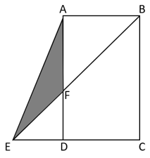
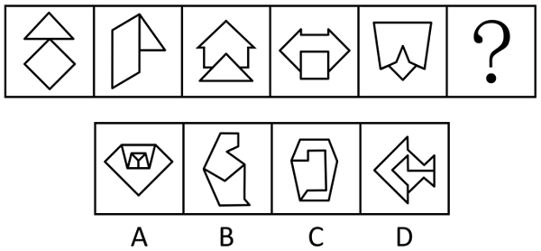
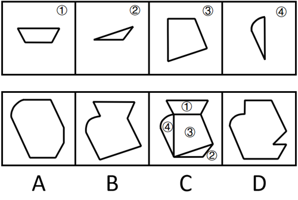
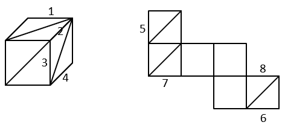
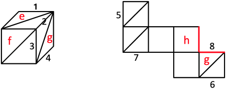
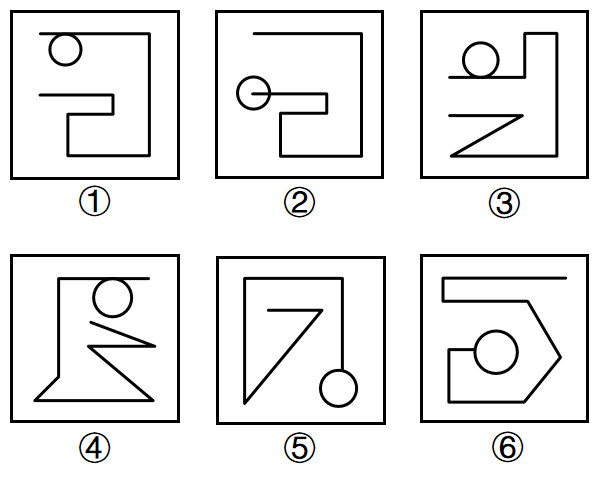
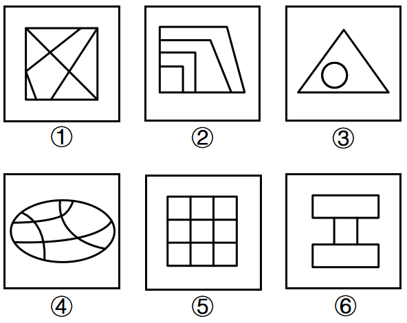
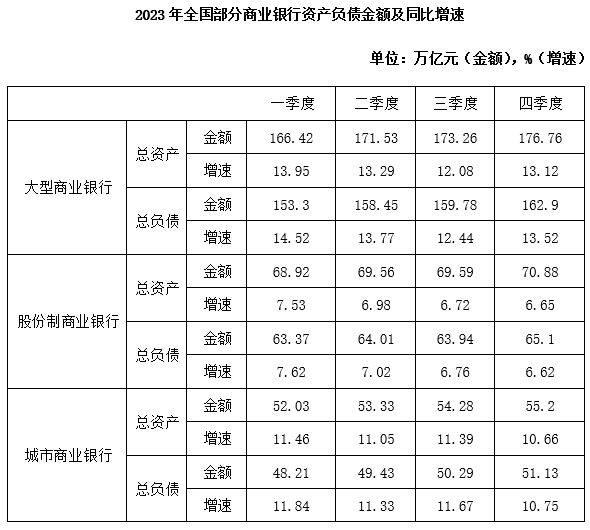
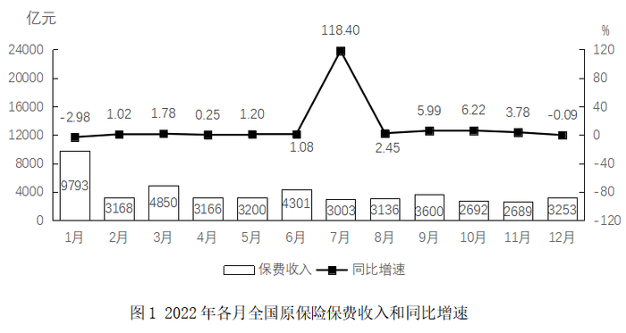
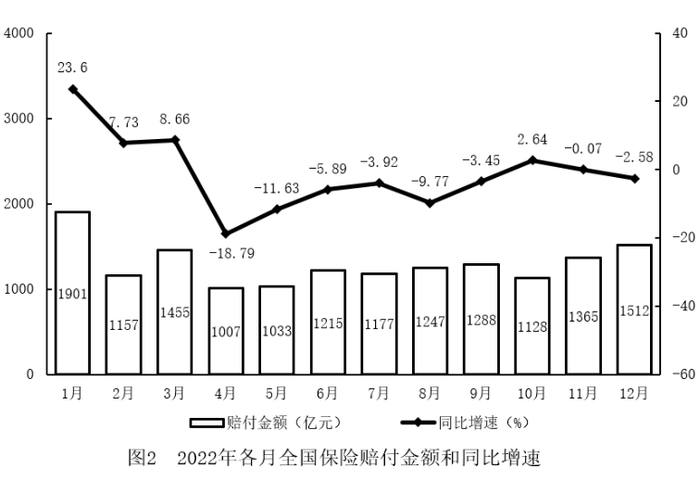

# 2026年四川省考/选调公务员录用考试《行测》试题（网友回忆版）

<!-- gwy:overview:start -->
> **四川 · 2026 · 行测 · 选调生** ｜ 100 题 · 图片 22 处 · 答案随题折叠

| 题型模块 | 题量 | 题号 |
| --- | ---: | ---: |
| 政治理论 | 10 | 1–10 |
| 常识判断 | 10 | 11–20 |
| 言语理解与表达 | 25 | 21–45 |
| 数量关系 | 10 | 46–55 |
| 判断推理 | 30 | 56–85 |
| 资料分析 | 15 | 86–100 |
| **合计** | **100** | |

导航：[题型与作答说明](#题型与作答说明) · [题目](#题目) · [材料 1](#材料-1)
<!-- gwy:overview:end -->

> 候选采集稿。参考答案及解析来自粉笔页面，不代表官方答案或真实高分答卷；来源使用许可与原卷对应关系仍需人工核实。

## 题型与作答说明

政治理论

（10题）

根据题目要求，在四个选项中选出一个最恰当的答案。

常识判断

（10题）

根据题目要求，在四个选项中选出一个最恰当的答案。

言语理解与表达

（25题）

本部分包括表达与理解两方面的内容。请根据题目要求，在四个选项中选出一个最恰当的答案。

数量关系

（10题）

在这部分试题中，每道题呈现一段表述数字关系的文字，要求你迅速、准确地计算出答案。

判断推理

（30题）

本部分包括图形推理、定义判断、类比推理与逻辑判断四种类型的试题，在四个选项中选出一个最恰当的答案。

资料分析

（15题）

所给出的图、表、文字或综合性资料均有若干个问题要你回答。你应根据资料提供的信息进行分析、比较、计算和判断处理。

## 题目

### 第 1 题

《中共中央关于制定国民经济和社会发展第十五个五年规划的建议》强调，实现社会主义现代化是一个阶梯式递进、不断发展进步的历史过程，需要不懈努力、接续奋斗。下列对“十五五”时期重要地位的表述，正确的是：

A. 是开启全面建设社会主义现代化国家新征程的第一个五年

B. 是基本实现社会主义现代化夯实基础、全面发力的关键时期

C. 是全面实现全体人民共同富裕、中国特色社会主义发展的关键时期

D. 是基本实现社会主义现代化的决胜时期

第 1 题 · 答案与解析

**参考答案（粉笔题库参考内容）**

B

**解析**

本题考查理论与政策。

B项正确，A、C、D三项错误，2025年10月23日，中国共产党第二十届中央委员会第四次全体会议通过的《中共中央关于制定国民经济和社会发展第十五个五年规划的建议》中“一、‘十五五’时期是基本实现社会主义现代化的关键时期”部分指出：“（2）‘十五五’时期在基本实现社会主义现代化进程中具有承前启后的重要地位。实现社会主义现代化是一个阶梯式递进、不断发展进步的历史过程，需要不懈努力、接续奋斗。‘十五五’时期是基本实现社会主义现代化夯实基础、全面发力的关键时期，要巩固拓展优势、破除瓶颈制约、补强短板弱项，在激烈国际竞争中赢得战略主动，推动事关中国式现代化全局的战略任务取得重大突破，为基本实现社会主义现代化奠定更加坚实的基础。”

故正确答案为B。

**考点**：经济建设、重要文件

**来源**：2026年四川省考/选调公务员录用考试《行测》试题（网友回忆版）第1题

### 第 2 题

《中共中央关于制定国民经济和社会发展第十五个五年规划的建议》提出，建设现代化产业体系，巩固壮大实体经济根基。下列有关说法不准确的是：

A. 巩固提升矿业、冶金等产业在全球产业分工中的地位和竞争力

B. 加快航空航天、低空经济等战略性新兴产业集群发展

C. 优化产业布局，促进重点产业在国内有序转移

D. 推动人工智能、第五代移动通信等成为新的经济增长点

第 2 题 · 答案与解析

**参考答案（粉笔题库参考内容）**

D

**解析**

本题考查理论与政策。

2025年10月23日，中国共产党第二十届中央委员会第四次全体会议通过《中共中央关于制定国民经济和社会发展第十五个五年规划的建议》（以下简称《建议》）。

A、C两项正确，《建议》在“三、建设现代化产业体系，巩固壮大实体经济根基”部分中指出：“（7）优化提升传统产业。推动重点产业提质升级，巩固提升矿业、冶金、化工、轻工、纺织、机械、船舶、建筑等产业在全球产业分工中的地位和竞争力······优化产业布局，促进重点产业在国内有序转移。”

B项正确，《建议》在“三、建设现代化产业体系，巩固壮大实体经济根基”部分中指出：“（8）培育壮大新兴产业和未来产业······实施产业创新工程，一体推进创新设施建设、技术研究开发、产品迭代升级，加快新能源、新材料、航空航天、低空经济等战略性新兴产业集群发展。”

D项错误，《建议》在“三、建设现代化产业体系，巩固壮大实体经济根基”部分中指出：“前瞻布局未来产业，探索多元技术路线、典型应用场景、可行商业模式、市场监管规则，推动量子科技、生物制造、氢能和核聚变能、脑机接口、具身智能、第六代移动通信等成为新的经济增长点。”故“人工智能、第五代移动通信”表述错误，应为“具身智能、第六代移动通信”。

本题为选非题，故正确答案为D。

**考点**：经济建设、重要文件

**来源**：2026年四川省考/选调公务员录用考试《行测》试题（网友回忆版）第2题

### 第 3 题

2025年4月30日，习近平总书记在上海主持召开部分省区市“十五五”时期经济社会发展座谈会时强调，“十五五”时期，必须把因地制宜发展新质生产力摆在更加突出的战略位置上，科学发展新质生产力。下列说法错误的是：

A. “因地制宜”发展新质生产力强调要注重发展的普遍性、协调性和灵活性

B. 把发展新质生产力“摆在更加突出的战略位置”，源于新质生产力对高质量发展的强劲推动力、支撑力

C. 发展新质生产力，不能因发展战略性新兴产业而忽视传统产业改造升级

D. 发展新质生产力，要形成与新质生产力相适应的生产关系

第 3 题 · 答案与解析

**参考答案（粉笔题库参考内容）**

A

**解析**

本题考查理论与政策。

A项错误，2024年6月11日，人民网文章《因地制宜发展新质生产力》指出：“‘因地制宜’不仅强调发展的特殊性、自主性，也强调发展的协调性、平衡性和灵活性。”“因地制宜”是指立足不同地区的资源禀赋、产业基础、发展阶段等具体实际，采取差异化发展路径，其强调的是发展的特殊性，而非“普遍性”。

B项正确，2024年6月1日，第11期《求是》杂志发表的习近平总书记重要文章《发展新质生产力是推动高质量发展的内在要求和重要着力点》指出：“高质量发展需要新的生产力理论来指导，而新质生产力已经在实践中形成并展示出对高质量发展的强劲推动力、支撑力，需要我们从理论上进行总结、概括，用以指导新的发展实践。”

C项正确，2024年3月5日，习近平总书记在参加十四届全国人大二次会议江苏代表团审议时讲话指出：“牢牢把握高质量发展这个首要任务，因地制宜加快发展新质生产力。面对新一轮科技革命和产业变革，我们必须抢抓机遇，加大创新力度，培育壮大新兴产业，超前布局建设未来产业，加快建设现代化产业体系。当然，发展新质生产力不是要忽视、放弃传统产业，要防止一哄而上、泡沫化，也不要搞一种模式。各地要坚持从实际出发，先立后破、因地制宜、分类指导。要根据本地的资源禀赋、产业基础、科研条件等，有选择地推动新产业、新模式、新动能发展，用新技术改造提升传统产业，积极促进产业高端化、智能化、绿色化。”

D项正确，2024年6月1日，第11期《求是》杂志发表的习近平总书记的重要文章《发展新质生产力是推动高质量发展的内在要求和重要着力点》中指出：“第四，扎实推进体制机制创新。生产关系必须与生产力发展要求相适应。发展新质生产力，必须进一步全面深化改革，形成与之相适应的新型生产关系。”

本题为选非题，故正确答案为A。

**考点**：经济建设、重要会议讲话

**来源**：2026年四川省考/选调公务员录用考试《行测》试题（网友回忆版）第3题

### 第 4 题

下列不属于伟大抗战精神内涵的是：

A. 生命至上、命运与共的必胜信念

B. 不畏强暴、血战到底的英雄气概

C. 视死如归、宁死不屈的民族气节

D. 天下兴亡、匹夫有责的爱国情怀

第 4 题 · 答案与解析

**参考答案（粉笔题库参考内容）**

A

**解析**

本题考查理论与政策。

A项错误，B、C、D三项正确，2020年9月3日，习近平总书记在纪念中国人民抗日战争暨世界反法西斯战争胜利75周年座谈会上的讲话中指出：“中国人民在抗日战争的壮阔进程中孕育出伟大抗战精神，向世界展示了天下兴亡、匹夫有责的爱国情怀，视死如归、宁死不屈的民族气节，不畏强暴、血战到底的英雄气概，百折不挠、坚忍不拔的必胜信念。”故A项中“生命至上、命运与共的必胜信念”表述有误，应为“百折不挠、坚忍不拔的必胜信念”。

本题为选非题，故正确答案为A。

**考点**：其他建设

**来源**：2026年四川省考/选调公务员录用考试《行测》试题（网友回忆版）第4题

### 第 5 题

习近平总书记指出，实现碳达峰碳中和，等不得也急不得，不可能毕其功于一役。必须坚持稳中求进、逐步实现，决不能搞“碳冲锋”“运动式减碳”。下列举措中，符合这一论断主旨的是：

①立足国情，坚持先立后破，加快规划建设新型能源体系，确保能源安全

②对于传统行业，要推动工艺、技术、装备升级，实现绿色低碳转型，而不是简单当成“低端产业”一退了之、一关了之

③优化调整产业结构，大力发展绿色低碳产业，使发展建立在高效利用资源、严格保护生态环境、坚决遏制温室气体排放的基础上

④由我们自己作主确定实现碳达峰碳中和的路径和方式、节奏和力度，决不受他人左右

A. ①②③

B. ②③④

C. ①②④

D. ①③④

第 5 题 · 答案与解析

**参考答案（粉笔题库参考内容）**

C

**解析**

本题考查理论与政策。

2025年8月1日出版的第15期《求是》杂志发表了习近平总书记2023年7月17日《在全国生态环境保护大会上的讲话》，以下简称文章。

①②两项正确，③错误，文章指出：“实现碳达峰碳中和，等不得也急不得，不可能毕其功于一役，必须坚持稳中求进、逐步实现，决不能搞“碳冲锋”、“运动式减碳”。要立足国情，坚持先立后破，加快规划建设新型能源体系，确保能源安全。要优化调整产业结构，大力发展绿色低碳产业，使发展建立在高效利用资源、严格保护生态环境、有效控制温室气体排放的基础上。对于传统行业，不能简单当成‘低端产业’一退了之、一关了之，而是要推动工艺、技术、装备升级，实现绿色低碳转型。要以更加积极的姿态参与全球气候治理，形成更加主动有利的新局面。”③中“坚决遏制温室气体排放”的说法过于绝对，应是“有效控制”。

④正确，文章指出：“推进碳达峰碳中和是党中央经过深思熟虑作出的重大战略决策，是我们对国际社会的庄严承诺······我们承诺的‘双碳’目标是确定不移的，但达到这一目标的路径和方式、节奏和力度则应该而且必须由我们自己作主，决不受他人左右。”

故①②④说法正确。

故正确答案为C。

**考点**：重要会议讲话、生态文明建设

**来源**：2026年四川省考/选调公务员录用考试《行测》试题（网友回忆版）第5题

### 第 6 题

习近平总书记指出，科技兴则民族兴，科技强则国家强，中国式现代化要靠科技现代化作支撑，实现高质量发展要靠科技创新培育新动能。下列有关表述错误的是：

A. 国家最高科学技术奖是中国科技界的最高荣誉，不分等级

B. 党的十八大以来，党中央坚持把科技创新摆在国家发展全局的核心位置

C. 党的十一届三中全会首次作出科学技术是生产力的重要论断

D. 中国科学院、中国工程院是国家科学技术界和工程科技界的最高学术机构

第 6 题 · 答案与解析

**参考答案（粉笔题库参考内容）**

C

**解析**

本题考查理论与政策。

A项正确，国家最高科学技术奖于2000年由国务院设立，是中国科技领域的最高等级奖项。《中华人民共和国国家科学技术奖励条例》第八条第二款规定：“国家最高科学技术奖授予在当代科学技术前沿取得重大突破或在科学技术发展中有卓越建树的中国公民······国家最高科学技术奖不分等级，每年授予人数不超过两名。”

B项正确，《国家创新驱动发展战略纲要》开篇指出：“党的十八大提出实施创新驱动发展战略，强调科技创新是提高社会生产力和综合国力的战略支撑，必须摆在国家发展全局的核心位置。”

C项错误，“科学技术是生产力”这一马克思主义的基本观点，是由邓小平在1978年3月召开的全国科学大会上明确提出的，为后来“科学技术是第一生产力”论断的形成奠定了基础。而党的十一届三中全会于1978年12月召开，其中心议题是讨论把全党工作重点转移到社会主义现代化建设上来。虽然会议也涉及科技发展，但“科学技术是生产力”的重要论断并非由该会议首次作出。

D项正确，《中国科学院章程》第三条规定：“中国科学院是中央人民政府设立的综合性国家科研机构，是国家自然科学最高学术机构、科学技术最高咨询机构、自然科学与高技术综合研究发展中心，是集科研院所、学部、教育机构于一体的国家战略科技力量。”《中国工程院章程》第一条规定：“中国工程院，是中国工程科学技术界的最高荣誉性、咨询性学术机构，由院士组成，是国家战略科技力量，致力于促进工程科学技术事业的发展。”

本题为选非题，故正确答案为C。

**考点**：经济建设、重要文件

**来源**：2026年四川省考/选调公务员录用考试《行测》试题（网友回忆版）第6题

### 第 7 题

就业、教育、医疗、托幼、养老、住房、环境，这些事关民生建设的身边事、贴心事正不断融入国家发展的顶层设计，老百姓的获得感、幸福感、安全感不断增强。下列关于民生建设的表述，不正确的是：

A. 保障和改善民生既要尽力而为，又要量力而行，坚持从实际出发

B. 民生连着内需，连着发展，促进经济社会发展是增进民生福祉的根本目的

C. 做好民生工作，必须坚持人人尽责、人人享有，让所有劳动者在推动发展中分享发展成果

D. 民生工作离老百姓最近，同百姓生活关系最密切，民生是人民幸福之基、社会和谐之本

第 7 题 · 答案与解析

**参考答案（粉笔题库参考内容）**

B

**解析**

本题考查理论与政策。

2023年4月，中央宣传部印发《习近平新时代中国特色社会主义思想学习纲要（2023年版）》，以下简称《纲要》。

A项正确，《纲要》“十二、让现代化成果惠及全体人民——关于新时代中国特色社会主义社会建设”部分指出：“保障和改善民生既要尽力而为，又要量力而行······要坚持从实际出发，根据经济发展和财力状况逐步提高人民生活水平，做那些现实条件下可以做到的事情。”

B项错误，《纲要》“十二、让现代化成果惠及全体人民——关于新时代中国特色社会主义社会建设”部分指出：“民生是人民幸福之基、社会和谐之本。增进民生福祉是发展的根本目的······抓民生也是抓发展。民生连着内需，连着发展。”故“促进经济社会发展是增进民生福祉的根本目的”表述错误，应为“增进民生福祉是发展的根本目的”。

C项正确，《纲要》“十二、让现代化成果惠及全体人民——关于新时代中国特色社会主义社会建设”部分指出：“改善民生既是党和政府工作的方向，也是人民群众自身奋斗的目标。做好民生工作，必须坚持人人尽责、人人享有，让所有劳动者在推动发展中分享发展成果。”

D项正确，《纲要》“十二、让现代化成果惠及全体人民——关于新时代中国特色社会主义社会建设”部分指出：“1.在发展中增进民生福祉。民生是人民幸福之基、社会和谐之本······3.加强普惠性、基础性、兜底性民生建设。民生工作离老百姓最近，同老百姓生活最密切。”

本题为选非题，故正确答案为B。

**考点**：重要文件、社会建设

**来源**：2026年四川省考/选调公务员录用考试《行测》试题（网友回忆版）第7题

### 第 8 题

习近平经济思想创造性运用唯物辩证法，构建起做好经济工作的科学方法论，为整体性推进新时代中国特色社会主义经济建设提供了科学的思考方法和行动指南。下列经济工作方法与马克思主义唯物辩证法原理对应错误的表述是：

A. 坚持稳中求进工作总基调——否定之否定规律

B. 坚持系统观念——事物的普遍联系

C. 坚持问题导向——矛盾具有普遍性

D. 坚持集中精力办好自己的事——事物发展变化是由内因决定的

第 8 题 · 答案与解析

**参考答案（粉笔题库参考内容）**

A

**解析**

本题考查马克思主义。

A项错误，坚持稳中求进工作总基调，“稳”是基础、是前提，是经济运行保持在合理区间的量变积累过程；“进”是方向、是目标，是在“稳”的基础上实现质量提升、结构优化的质变突破，二者是辩证统一的。稳中求进体现的是量变与质变的辩证关系，量变是质变的必要准备，质变是量变的必然结果。否定之否定规律认为事物的发展是肯定→否定→否定之否定的螺旋式上升过程，强调的是前进性与曲折性的统一，与“稳中求进”无关。

B项正确，事物的普遍联系原理认为，世界上没有孤立存在的事物，一切事物、现象、过程都处在相互影响、相互制约、相互作用的联系之中，整个世界是一个普遍联系的有机整体。坚持系统观念，就是要求我们用全面、联系的眼光看问题，避免“头痛医头、脚痛医脚”，统筹兼顾各方面关系，实现系统整体功能的最大化。

C项正确，矛盾的普遍性包含两层含义：一是事事有矛盾，即矛盾存在于一切事物的发展过程中，没有矛盾的事物是不存在的；二是时时有矛盾，即矛盾贯穿每一事物发展过程的始终。经济工作中的“问题”，本质上就是现实存在的矛盾。坚持问题导向，就是承认矛盾的普遍性，不回避、不掩盖经济发展中的矛盾，主动发现问题、分析问题、解决问题。

D项正确，事物发展变化是由内因决定的，内因是变化的根据，是第一位的，决定着事物发展的基本趋向。坚持集中精力办好自己的事，就是要抓住内因这个根本，国家和民族发展主要依靠自己的力量，自力更生。

本题为选非题，故正确答案为A。

**考点**：唯物辩证法

**来源**：2026年四川省考/选调公务员录用考试《行测》试题（网友回忆版）第8题

### 第 9 题

教育强国建设是一项复杂的系统工程，需要我们全面把握教育的政治属性、人民属性、战略属性，坚持和运用系统观念，正确处理几个重大关系。这些重大关系包括以下几项？

①支撑国家战略和满足民生需求的关系

②知识学习和全面发展的关系

③培养人才和满足社会需要的关系

④规范有序和激发活力的关系

⑤扎根中国大地和借鉴国际经验的关系

A. 2项

B. 3项

C. 4项

D. 5项

第 9 题 · 答案与解析

**参考答案（粉笔题库参考内容）**

D

**解析**

本题考查理论与政策。

2025年6月1日，《求是》杂志发表习近平总书记的重要文章《加快建设教育强国》。文章指出，建设教育强国是一项复杂的系统工程，要全面把握教育的政治属性、人民属性、战略属性，正确处理支撑国家战略和满足民生需求的关系、知识学习和全面发展的关系、培养人才和满足社会需要的关系、规范有序和激发活力的关系、扎根中国大地和借鉴国际经验的关系。

①②③④⑤表述正确，共5项。

故正确答案为D。

**考点**：重要会议讲话、社会建设

**来源**：2026年四川省考/选调公务员录用考试《行测》试题（网友回忆版）第9题

### 第 10 题

中共四川省委十二届七次全会通过的《关于推进文化和旅游深度融合发展，做大做强文化旅游业的决定》指出，要全力打造“锦绣天府·安逸四川”文旅品牌。下列关于打造“锦绣天府·安逸四川”文旅品牌的举措，表述不正确的是：

A. 扩大标志性品牌国际影响力，提升三星堆-金沙、九寨沟-黄龙等品牌国际影响力，培育若尔盖湿池、稻城亚丁等世界级文旅新地标

B. 实施天府文艺名作高峰计划，持续打造“文艺川军”品牌，建设一批文艺创作基地、网络视听和影视产业集聚区

C. 打造“川字号”文旅名品，围绕标志性文化知识产权（IP）推进文创产品设计、制造、服务全链发展

D. 实施巴蜀文旅全球推广计划，深化德阳、广元国家文化出口基地建设，推动文化类服务贸易集聚发展

第 10 题 · 答案与解析

**参考答案（粉笔题库参考内容）**

D

**解析**

本题考查理论与政策。

2025年6月17日，中国共产党四川省第十二届委员会第七次全体会议通过《中共四川省委关于推进文化和旅游深度融合发展 做大做强文化旅游业的决定》（以下简称《决定》）。

A项正确，《决定》在“二、全力打造‘锦绣天府·安逸四川’文旅品牌”部分指出：“（一）建设世界级文旅地标。扩大标志性品牌国际影响力，提升三星堆—金沙、九寨沟—黄龙、大熊猫、峨眉山—乐山大佛、青城山—都江堰、翠云廊—剑门关品牌知名度，培育若尔盖湿地、稻城亚丁等世界级文旅新地标，打造享誉全球、来川必游的文旅旗舰项目。”

B、C两项正确，《决定》在“二、全力打造‘锦绣天府·安逸四川’文旅品牌”部分指出：“（二）做靓特色文旅名片。实施天府文艺名作高峰计划，持续打造‘文艺川军’品牌，建设一批文艺创作基地、网络视听和影视产业园区，鼓励开展网络文学、科幻文学、数字文娱、游戏动漫等领域创作，扶持和推出一批文学、影视、舞台艺术、视觉艺术优质作品······打造‘川字号’文旅名品，围绕标志性文化知识产权（IP）推进文创产品设计、制造、服务全链发展，加强文旅领域知识产权保护。”

D项错误，《决定》在“二、全力打造‘锦绣天府·安逸四川’文旅品牌”部分指出：“（三）实施巴蜀文旅全球推广计划······深化成都、自贡国家文化出口基地建设，推动文化类服务贸易集聚发展。”故“德阳、广元”说法错误，应为“成都、自贡”。

本题为选非题，故正确答案为D。

**来源**：2026年四川省考/选调公务员录用考试《行测》试题（网友回忆版）第10题

### 第 11 题

新中国成立以来，党领导人民开展了波澜壮阔的水利建设，建成了世界上规模最大、范围最广、受益人口最多的水利基础设施体系。下列有关说法错误的是（ ）。

A. 葛洲坝水电站是长江干流上第一座大型水电工程

B. 环北部湾广东水资源配置工程是广东历史上输水线路最长的跨流域引调水工程

C. 南水北调工程是迄今为止世界上规模最大的调水工程

D. 红旗渠又称“引漳入林”工程，位于我国冀鲁豫三省交界处

第 11 题 · 答案与解析

**参考答案（粉笔题库参考内容）**

D

**解析**

本题考查地理国情。

A项正确，葛洲坝水利枢纽是我国在长江干流上自主设计、施工、制造安装、运行管理的第一座大型水利枢纽工程，也是世界上最大的低水头大流量、径流式水电站，被誉为“万里长江第一坝”。

B项正确，环北部湾广东水资源配置工程是国家水网骨干工程，是广东省委、省政府为支撑湛江、茂名、阳江、云浮等4市未来经济社会可持续发展，谋划建设的重大民生工程，也是广东省迄今为止投资规模最大、输水线路最长、建设条件最复杂、影响范围最广的重大水利工程，覆盖人口1800万。

C项正确，南水北调工程是世界上最大的调水工程，跨越长江、淮河、黄河、海河四大流域，分为东、中、西三条线路，东线工程起点位于江苏扬州江都水利枢纽。中线工程起点位于汉江中上游丹江口水库，受水区域为河南、河北、北京和天津。

D项错误，红旗渠位于河南省林州市（原林县），是20世纪60年代林县（今林州市）人民在极其艰难的条件下，从太行山腰修建的引漳入林的水利工程（又称“引漳入林”工程），被人称之为“人工天河”。林州市处于河南、山西、河北三省交界处，与山东无关。

本题为选非题，故正确答案为D。

**考点**：中国地理

**来源**：2026年四川省考/选调公务员录用考试《行测》试题（网友回忆版）第11题

### 第 12 题

下列行为不符合法律规定的是：

A. 15岁的赵某独自去电脑城购买了一台价值6000元的笔记本电脑，次日其父母找到商家要求退货退款

B. 崔某与钟某相约打球，两人无意间发生身体碰撞，导致钟某骨折，钟某治疗产生的3500元费用应当自行承担

C. 张某为其200万财产立下一份代书遗嘱，邀请其儿子及儿子女友作为见证人在场见证，该遗嘱有效

D. 林某2018年从其亲戚手中购买了一套房子，5年后增值100万元，由于买房时不动产权证并未改名，现林某要求亲戚按合同协助其更名

第 12 题 · 答案与解析

**参考答案（粉笔题库参考内容）**

C

**解析**

本题考查法律常识。

A项正确，根据《中华人民共和国民法典》第十九条规定：“八周岁以上的未成年人为限制民事行为能力人，实施民事法律行为由其法定代理人代理或者经其法定代理人同意、追认；但是，可以独立实施纯获利益的民事法律行为或者与其年龄、智力相适应的民事法律行为。”15岁的赵某为限制民事行为能力人，以6000元购买笔记本电脑的行为需由其法定代理人代理或者经其法定代理人同意、追认，因此，赵某父母找到商家要求退货退款符合法律规定。

B项正确，根据《中华人民共和国民法典》第一千一百七十六条第一款规定：“自愿参加具有一定风险的文体活动，因其他参加者的行为受到损害的，受害人不得请求其他参加者承担侵权责任；但是，其他参加者对损害的发生有故意或者重大过失的除外。”崔某与钟某打球是具有一定风险的体育活动，同时双方无意间发生身体碰撞排除参加者对损害的发生有故意或者重大过失的情形，因此，钟某因骨折产生的3500元治疗费用应当由钟某自行承担符合法律规定。

C项错误，根据《中华人民共和国民法典》第一千一百三十五条规定：“代书遗嘱应当有两个以上见证人在场见证，由其中一人代书，并由遗嘱人、代书人和其他见证人签名，注明年、月、日。”第一千一百四十条规定：“下列人员不能作为遗嘱见证人：（一）无民事行为能力人、限制民事行为能力人以及其他不具有见证能力的人；（二）继承人、受遗赠人；（三）与继承人、受遗赠人有利害关系的人。”代书遗嘱应当有两个以上见证人在场见证，张某儿子作为张某的继承人不能作为遗嘱见证人，因此，该代书遗嘱有效的说法不符合法律规定。

D项正确，根据《中华人民共和国民法典》第五百零九条第一、二款规定：“当事人应当按照约定全面履行自己的义务。当事人应当遵循诚信原则，根据合同的性质、目的和交易习惯履行通知、协助、保密等义务。”因此，林某亲戚作为房屋买卖合同当事人有协助林某办理过户登记的义务，林某要求亲戚按合同协助其更名符合法律规定。

本题为选非题，故正确答案为C。

**考点**：民法典

**来源**：2026年四川省考/选调公务员录用考试《行测》试题（网友回忆版）第12题

### 第 13 题

下列关于我国金融市场功能的描述，错误的是：

A. 引导众多分散小额资金汇聚成可投入社会再生产的资金集合功能

B. 通过规范合理的市场化运作为社会民众带来收益的财富创造功能

C. 能够有效地实现资源配置、财富再分配、风险再分配的配置功能

D. 是公认的国民经济信号系统，对国家宏观经济具有显著调节功能

第 13 题 · 答案与解析

**参考答案（粉笔题库参考内容）**

B

**解析**

本题考查经济常识。

金融市场是指用于支持金融交易的地方，其主要职能是提供资金流动、价格形成和风险转移。金融市场具有聚敛、配置、调节和反映等功能。

A项正确，金融市场的聚敛功能是指引导小额分散资金汇聚成能够投入社会再生产的资金集合功能。金融市场起着资金“蓄水池”的作用。不同经济部门的资金收入和支出在时间上并不总是对称的，一些部门可能会存在闲置资金，而另一些部门可能会有融资缺口。金融市场为两者的相互融通提供了便利。

B项错误，通过规范合理的市场化运作为社会民众带来收益的财富创造功能不属于金融市场的功能。

C项正确，金融市场的配置功能能够有效地实现资源的配置、财富的再分配和风险的再分配作用。（1）资源配置功能：促使资源从低效率部门转移到高效率部门，提高整个社会的资源利用效率。（2）财富再分配功能：当金融产品市场价格变化时，经济主体持有的金融资产价值发生变化，最终影响其财富。（3）风险再分配功能：金融资产投资和回报存在时间间隔，会导致风险，不同金融资产风险不同，可满足不同风险承受能力投资者的需要，风险规避者选择风险小的资产，风险偏好者选择风险大的资产。

D项正确，金融市场被称为国民经济的“晴雨表”和“气象台”，它是公认的国民经济信号系统，体现了金融市场的反映功能。调节功能是指金融市场对宏观经济的调节作用。金融市场一边连着储蓄者，另一边连着投资者，金融市场的运行机制经过对储蓄者和投资者的影响而发挥着调节宏观经济的作用。

本题为选非题，故正确答案为B。

**考点**：市场经济

**来源**：2026年四川省考/选调公务员录用考试《行测》试题（网友回忆版）第13题

### 第 14 题

与苏轼光彩夺目的文学艺术成就比起来，他的仕宦之旅却跌宕起伏。在40年的仕宦之旅中，他任职过的地方就多达十五处。在这些地方任上，他给我们留下了许多脍炙人口的千古诗篇。下列诗词涉及地点从北到南顺序正确的是：

①九死南荒吾不恨，兹游奇绝冠平生

②日啖荔枝三百颗，不辞长作岭南人

③大江东去，浪淘尽，千古风流人物

A. ①③②

B. ③①②

C. ②③①

D. ③②①

第 14 题 · 答案与解析

**参考答案（粉笔题库参考内容）**

D

**解析**

本题考查人文常识。

①项“九死南荒吾不恨，兹游奇绝冠平生”出自苏轼的《六月二十日夜渡海》，意思是被贬南荒（儋州）虽然九死一生我也不遗憾，因为这次远游是我平生最奇绝的经历。诗句里“兹游 ”指这次海南游历，实指贬谪海南（儋州）。儋州市位于海南岛西北部，其地理坐标范围为北纬19°11′至19°52′之间。

②项“日啖荔枝三百颗，不辞长作岭南人”出自宋代苏轼的《惠州一绝》，意思是如果每天吃三百颗荔枝，我愿意永远都做岭南的人。本诗所提的岭南，即惠州，地理坐标范围为北纬22°24′至23°57′之间。

③项“大江东去，浪淘尽，千古风流人物”出自《念奴娇・赤壁怀古》，意思是大江之水滚滚不断向东流去，滔滔巨浪淘尽千古英雄人物。这首词是公元1082年（宋神宗元丰五年）苏轼被贬黄州时所写。黄州即现在湖北省黄冈市黄州区，在中国中部地区，长江沿岸，地理坐标范围为北纬29°45´至31°40´之间。

诗词涉及地点从北到南分别是黄州、惠州，最后海南儋州。因此从北到南顺序正确的是③②①。

故正确答案为D。

**考点**：文学常识

**来源**：2026年四川省考/选调公务员录用考试《行测》试题（网友回忆版）第14题

### 第 15 题

道家思想强调“整体论”“机体论”的世界观，重视人的自由。下列语句体现了这一思想的是：

A. 且举世誉之而不加劝，举世非之而不加沮

B. 唯仁者能好人，能恶人

C. 君子怀德，小人怀土；君子怀刑，小人怀惠

D. 不患人之不己知，患不知人也

第 15 题 · 答案与解析

**参考答案（粉笔题库参考内容）**

A

**解析**

本题考查人文常识。

道家思想强调“整体论”“机体论”的世界观，核心是将宇宙万物视为一个相互关联、有机统一、动态平衡的整体。

A项正确，“且举世誉之而不加劝，举世非之而不加沮”出自庄子的《逍遥游》，意思是（宋荣子）是那种世上的人们都赞誉他也不会让他感到鼓舞，世上的人们都批评他也不会让他感到沮丧的那种人。这句话是对宋荣子境界的描述，体现了不将个体看作独立于世界的“孤岛”，也不将外界评价当作衡量自我的唯一标准；同时，个体作为宇宙机体的一部分，其精神也具备“自我调适”的能力，而非依赖外部反馈来维持稳定。体现了道家“整体论”“机体论”的世界观。

B项错误，“唯仁者能好人，能恶人”出自《论语·里仁篇》，意思是只有有仁德的人，才能够公正地喜爱应当喜爱的人，才能够公正地厌恶应当厌恶的人。不属于道家思想。

C项错误，“君子怀德，小人怀土；君子怀刑，小人怀惠”出自《论语·里仁篇》，意思是君子考虑的是德行，小人只顾眼前的安逸生活；君子思刑法而治国，小人贪小利而为家。不属于道家思想。

D项错误，“不患人之不己知，患不知人也”出自《论语·学而篇》，意思是不要担心别人不了解自己，应该担心的是自己不了解别人。不属于道家思想。

故正确答案为A。

**考点**：文化常识

**来源**：2026年四川省考/选调公务员录用考试《行测》试题（网友回忆版）第15题

### 第 16 题

很多世界名画中，医学与艺术相互交融，共同构成人类文化的瑰宝，下列与之相关的说法错误的是：

A. 达芬奇的《维特鲁威人》展示了人体的黄金分割比例，体现文艺复兴时期艺术家对人体比例的探索

B. 伦勃朗的《杜普教授的解剖学课》描绘了人体解剖教学现场，反映当时在欧洲解剖课已是医学教育的一部分

C. 张择端的《清明上河图》绘有鳞次栉比的药铺、医铺、走方医和药摊等，展现了宋代医疗市场的繁荣景象

D. 拉斐尔的《雅典学院》描绘了柏拉图与米开朗基罗等人进行平等讨论的场景，二人都是思想成就的集大成者

第 16 题 · 答案与解析

**参考答案（粉笔题库参考内容）**

D

**解析**

本题考查人文常识。

A项正确，达芬奇的《维特鲁威人》是文艺复兴时期艺术与医学、几何学结合的经典之作。这幅作品以古罗马建筑师维特鲁威的理论为基础，精准呈现了人体的黄金分割比例与对称结构，既体现了当时艺术家对人体比例的极致探索，也融入了达芬奇通过解剖实践积累的人体医学认知，实现了艺术审美与科学认知的统一。

B项正确，伦勃朗的《杜普教授的解剖学课》真实复刻了17世纪荷兰的人体解剖教学现场。17世纪欧洲医学教育已突破中世纪宗教对人体解剖的限制，解剖课成为医学人才培养的核心课程，这幅画不仅是艺术创作，更直观反映了当时医学教育的发展现状。

C项正确，张择端的《清明上河图》全方位展现了北宋汴京的市井繁荣，其中多处绘有药铺、医铺、走方医和药摊等医疗相关场景，比如“赵太丞家”“刘家香药铺”“杨家应诊”等，既体现了宋代官方与民间医疗体系的完善，也反映出当时医疗市场的普及与繁荣。

D项错误，拉斐尔的《雅典学院》主要描绘了古希腊哲学先贤的学术辩论场景，画面中心人物为柏拉图与亚里士多德，二者是古希腊哲学思想的集大成者。而米开朗基罗是意大利文艺复兴时期的雕塑家、画家，并非古希腊学者，也并未出现在这幅作品中。

本题为选非题，故正确答案为D。

**考点**：文化常识

**来源**：2026年四川省考/选调公务员录用考试《行测》试题（网友回忆版）第16题

### 第 17 题

下列文字中画横线部分存在错误的是：

信风形成的根本原因是太阳辐射在不同纬度带分布不均匀，赤道地区受热最多，气流上升，在近地面形成赤道低气压带，高空产生高气压区，受水平气压梯度力影响，气体在高空从赤道向南北两极移动，在南北纬30度附近时堆积下沉，在近地面形成副热带高气压带，在低空，风从副热带高气压带吹向赤道低气压带，并在地转偏向力的影响下发生偏转，最终在北半球形成东北信风、在南半球形成西南信风。

A. 水平气压梯度力

B. 南北纬30度

C. 东北信风

D. 西南信风

第 17 题 · 答案与解析

**参考答案（粉笔题库参考内容）**

D

**解析**

本题考查地理国情。

A、B、C三项正确，D项错误，信风的形成与地球三圈环流密切相关，具体原理如下：太阳长期照射下，赤道地区受热最多，近地面空气受热上升，在近地面形成赤道低气压带，同时在高空形成相对高气压区；受水平气压梯度力影响，高空高气压向南北高纬度低气压区流动，途中受地转偏向力作用，在南北纬30度附近偏转成与等压线平行的气流，大气在此处堆积被迫下沉，在近地面形成副热带高气压带。此时，赤道低气压带与副热带高气压带两者间产生气压差，气流从副热带高气压带流向赤道低气压带，北半球气流向南运行时，受地转偏向力向右偏转，形成东北信风；南半球气流向北运行时，受地转偏向力向左偏转，形成东南信风。因此，“在南半球形成西南信风”的表述有误，应为“在南半球形成东南信风”。

本题为选非题，故正确答案为D。

**考点**：自然地理

**来源**：2026年四川省考/选调公务员录用考试《行测》试题（网友回忆版）第17题

### 第 18 题

下列关于天文知识的说法错误的是：

A. 羲和号是中国首颗太阳探测科学技术试验卫星

B. 2006年海王星被降为矮行星，从九大行星中除名

C. 小行星可以根据发现者的提议来进行命名

D. 射电望远镜观测不受阴雨天及黑夜的限制

第 18 题 · 答案与解析

**参考答案（粉笔题库参考内容）**

B

**解析**

本题考查地理国情。

A项正确，羲和号是中国首颗太阳探测科学技术试验卫星，2021年10月14日，搭载长征二号丁运载火箭成功发射，专门开展太阳Hα波段光谱成像观测，分析太阳耀斑、日珥等活动的高分辨率数据，为研究太阳磁场、太阳大气动力学提供支撑。

B项错误，2006年国际天文学联合会（IAU）通过行星新定义，从九大行星被降为矮行星的是冥王星，而非海王星，海王星仍是太阳系八大行星之一。太阳系八大行星中，水星、金星、地球、火星是类地行星；木星、土星是气态巨行星；天王星、海王星是冰态巨行星。

C项正确，小行星是指太阳系内类似行星环绕太阳运动，但体积和质量远小于行星的天体。小行星的发现者（个人、团队或机构）拥有命名提议权，发现者提交命名提案，经国际天文学联合会（IAU）下属的小行星中心审核批准后，正式列入《小行星命名公报》，名称永久生效。

D项正确，射电望远镜通过接收天体发射的电磁波（无线电波）来观测天体，射电信号能穿透云层、尘埃，且不受光照条件影响，因此不受阴雨天、黑夜等天气和光照条件限制，能全天候观测。如“中国天眼”FAST，是全球最大单口径射电望远镜，其优势就包括全天候观测、超高灵敏度。

本题为选非题，故正确答案为B。

**考点**：自然地理

**来源**：2026年四川省考/选调公务员录用考试《行测》试题（网友回忆版）第18题

### 第 19 题

下列军事名言与其出处对应正确的是：

A. 天时不如地利，地利不如人和——《孟德新书》

B. 上兵伐谋，其次伐交，其次伐兵，其下攻城——《孙膑兵法》

C. 夫战，勇气也。一鼓作气，再而衰，三而竭。彼竭我盈，故克之——《战国策》

D. 用兵之道，攻心为上，攻城为下，心战为上，兵战为下——《三国志》

第 19 题 · 答案与解析

**参考答案（粉笔题库参考内容）**

D

**解析**

本题考查人文常识。

A项错误，“天时不如地利，地利不如人和”出自《孟子·公孙丑下》。这句话的意思是：有利于作战的天气、时令，比不上有利于作战的地理形势。有利于作战的地理形势，比不上作战中的人心所向、内部团结。

B项错误，“上兵伐谋，其次伐交，其次伐兵，其下攻城”出自《孙子兵法·谋攻篇》。这句话的意思是：用兵的最高策略是用谋略挫败敌人的战略意图或计划，其次是通过外交手段瓦解敌人联盟、争取有利态势，再次是动用军事力量与敌人直接作战（伐兵），最下等的策略是强行攻打敌人的城池。它核心强调用兵应优先以非武力方式取胜，最大程度减少战争损耗。

C项错误，“夫战，勇气也。一鼓作气，再而衰，三而竭。彼竭我盈，故克之”出自《左传·庄公十年》中的《曹刿论战》。这句话的意思是：作战是靠勇气的。第一次击鼓能振作士兵们的勇气，第二次击鼓可以使士兵们的勇气低落，第三次击鼓士兵们的勇气就消失了。他们的勇气消失了，我军的勇气正旺盛，所以战胜了他们。

D项正确，“用兵之道，攻心为上，攻城为下，心战为上，兵战为下”出自《三国志·蜀书·马谡传》裴松之注引《襄阳记》。这句话的意思是：用兵的原则，从心理上瓦解敌人，使对手投降是上策，强攻城池是下策；以攻心战为目标才是上策，以武力取胜却是下策。

故正确答案为D。

**考点**：文学常识

**来源**：2026年四川省考/选调公务员录用考试《行测》试题（网友回忆版）第19题

### 第 20 题

下列与食品安全有关的说法正确的是：

A. 无公害蔬菜禁止使用化学农药和化肥

B. 常用的矿泉水瓶由聚氯乙烯材质制成

C. 葡萄存放时间过久会有氧发酵产生乙醇

D. 臭氧水能够分解果蔬表面的农药残留

第 20 题 · 答案与解析

**参考答案（粉笔题库参考内容）**

D

**解析**

本题考查科技常识。

A项错误，无公害蔬菜其生产过程中并非完全禁止使用化学农药和化肥，而是允许使用低毒、低残留的化学农药和符合国家标准的化肥，但必须严格遵守使用剂量、使用时期和安全间隔期的规定，确保最终产品的农药残留、重金属等指标符合无公害标准。

B项错误，聚氯乙烯（3号，PVC）是一种含氯塑料，当高温或接触油脂时易释放有毒物质，且生产过程中添加的增塑剂也可能具有毒性，因此不能用于食品和饮用水包装，常用于制作排水管、电线外皮、非食品级塑料袋等。而常用矿泉水瓶的主要制作材料是聚对苯二甲酸乙二醇酯（1号，PET），是食品级塑料，具有无毒、透明、耐冲击、气密性好的特点。

C项错误，葡萄存放时间过久时，若果粒破损、密封环境良好（无氧条件），则果皮上的天然酵母菌会启动无氧发酵，产生乙醇；若存放环境通风良好（有氧条件），则会发生有氧呼吸，葡萄会腐烂变质（霉菌繁殖、糖分分解），产生二氧化碳和水等，不会产生乙醇。

D项正确，臭氧是强氧化剂，具有极强的氧化分解能力，其溶于水形成的臭氧水能与果蔬表面的农药残留发生氧化还原反应。臭氧水降解蔬菜农残的主要理论依据就是依靠强氧化能力切断农药分子的强极性键，进而生成小分子成分，再逐步降解成更小分子而挥发掉或溶解到水里。

故正确答案为D。

**考点**：生活常识

**来源**：2026年四川省考/选调公务员录用考试《行测》试题（网友回忆版）第20题

### 第 21 题

我国疆域辽阔，各地区资源禀赋各有特点，经济互补性强、依存度高。各民族始终保持            、互利共赢的经济联系，有力增强了国家整体实力，促进了中华民族共同体的形成和发展。

填入画横线部分最恰当的一项是：

A. 礼尚往来

B. 守望相助

C. 互通有无

D. 和衷共济

第 21 题 · 答案与解析

**参考答案（粉笔题库参考内容）**

C

**解析**

横线处所填成语搭配“经济联系”，通过“、”与“互利共赢”构成并列关系，语义相近，且根据前文“我国疆域辽阔，各地区资源禀赋各有特点，经济互补性强、依存度高”可知，所填成语应体现各民族在经济上相互合作，互动互补，对彼此皆有利。C项“互通有无”指拿出自己多余的东西给对方，与之进行交换，以得到自己所缺少的东西，符合文意，当选。

A项“礼尚往来”指礼节上应该有来有往，现也指以同样的态度或做法回答对方。强调人际交往中的礼节应对，与“经济联系”搭配不当，排除；

B项“守望相助”指为了对付来犯的敌人或意外的灾祸，邻近各村落互相警戒，互相援助。强调面对困难时的互相帮助，而非经济上的互补交流，与文意不符，排除；

D项“和衷共济”比喻同心协力，共同克服困难。强调团结协作共渡难关，而非经济上的互补交流，与文意不符，排除。

故正确答案为C。

【文段出处】求是网《中华民族共同体的形成和发展是人心所向、大势所趋、历史必然》

**考点**：词的辨析-搭配对象、对应关系-前后呼应、成语填空、关联关系-并列关系

**来源**：2026年四川省考/选调公务员录用考试《行测》试题（网友回忆版）第21题

### 第 22 题

尽管寄主并没有针对寄生植物进化出特别的反抗手段，但这并不代表寄主会对寄生植物            。人们已经发现，寄主某些偶然进化出的特性（抗性反应）竟能有效抵御寄生植物的寄生行为。例如，菟丝子可以寄生在野生番茄上，却不能寄生在栽培番茄上。存在天然抗性的这些物种为人们防治寄生植物提供了宝贵的遗传资源。

填入画横线部分最恰当的一项是：

A. 听之任之

B. 退避三舍

C. 熟视无睹

D. 却之不恭

第 22 题 · 答案与解析

**参考答案（粉笔题库参考内容）**

A

**解析**

根据横线前转折关联词“但”可知，横线处所填成语应与前文语义相反，且根据横线后“寄主某些偶然进化出的特性（抗性反应）竟能有效抵御寄生植物的寄生行为”可知，横线处句子应表达寄主不会对寄生植物放任不管的意思。A项“听之任之”指任凭事物存在发展而不去过问，符合文意，当选。

B项“退避三舍”比喻对人让步，避免冲突，文段并未体现寄主有主动退让的行为，与文意不符，排除；

C项“熟视无睹”指对某一事物漠不关心，侧重态度上的忽视，与后文“抗性反应抵御寄生行为”的文意不符，排除；

D项“却之不恭”指对别人的邀请、赠与等，如果拒绝接受，就显得不恭敬，与文段语境无关，排除。

故正确答案为A。

【文段出处】知网《奇特的寄生植物》

**考点**：对应关系-前后呼应、成语填空、关联关系-转折关系

**来源**：2026年四川省考/选调公务员录用考试《行测》试题（网友回忆版）第22题

### 第 23 题

“不谋万世者，不足谋一时；不谋全局者，不足谋一域。”这是存在于中国人性格中的大局观。围棋也与大局观            。下围棋一定要        全局，围棋博弈是一系列战役战斗相连、组合而成的一场全局性博弈。全局利益高于一切，棋理也说“急所重于大场”。

依次填入画横线部分最恰当的一项是:

A. 息息相关 照应

B. 一脉相承 反映

C. 互为表里 掌控

D. 水乳交融 谋划

第 23 题 · 答案与解析

**参考答案（粉笔题库参考内容）**

A

**解析**

第一空，根据“围棋博弈是一系列战役战斗相连、组合而成的一场全局性博弈”可知，横线处应体现围棋与大局观关系紧密，A项“息息相关”指呼吸相关联，形容关系密切，符合文意，保留。B项“一脉相承”指从同一个血统或派别传下来，侧重继承关系，但围棋是一种博弈活动，大局观是一种思维理念，二者并非继承关系，与文意不符，排除；C项“互为表里”指甲为乙的外表，乙为甲的内里，比喻互相依存，互相接受，围棋和大局观并不是一个表一个里的互相依存关系，与文意不符，排除；D项“水乳交融”指像水和乳汁融合在一起，形容关系非常融洽或结合十分紧密，“交融”有融合成整体，合二为一的意思，但围棋与大局观是两个不同的主体，不能相互交融，与文意不符，且置于此处程度过重，排除。

第二空，代入验证，根据“围棋博弈是一系列战役战斗相连、组合而成的一场全局性博弈。全局利益高于一切”可知，横线处应体现下围棋时要兼顾全局、考虑全局。A项“照应”指配合，呼应，“照应全局”即在下棋过程中，每一步落子都要考虑与全局的配合，兼顾各局部之间的关联，符合围棋“全局性博弈”的特点，当选。

故正确答案为A。

【文段出处】中国日报-中文网《从围棋看中国人的思维与决策》

**考点**：词的辨析-程度轻重、对应关系-前后呼应、混搭填空

**来源**：2026年四川省考/选调公务员录用考试《行测》试题（网友回忆版）第23题

### 第 24 题

文学批评作为一种特别的文体，具有主体性。文学批评家作为文学的          、创造者，同样具有主体性。这种主体性就表现在遵循文学批评的学术原则、规律和方法，        来自社会、市场、人情方面的“异化”，准确、深入、创造性地解读作家作品，充分发挥文学批评的多重功能与作用。

依次填入画横线部分最恰当的一项是：

A. 建设者 规避

B. 旁观者 警惕

C. 参与者 摆脱

D. 阐释者 抵抗

第 24 题 · 答案与解析

**参考答案（粉笔题库参考内容）**

D

**解析**

第一空，根据“准确、深入、创造性地解读作家作品”可知，文学批评家的主要作用是对作家作品进行解读，D项“阐释者”中“阐释”指通过说明、陈述对事物进行深入解释，符合文意，保留。A项“建设者”、C项“参与者”置于此处均可指亲自参与到作家作品创作中的人，文段并非强调创作作品，而是对已有作品进行解读，与文意不符，排除；B项“旁观者”指在一旁观看的人，无法体现出对作品进行解读，与文意不符，排除。

第二空，代入验证，搭配“异化”，D项“抵抗‘异化’”指排除社会、市场、人情等方面的干扰，更准确的解读作品，符合文意，当选。

故正确答案为D。

【文段出处】光明日报《学术性是文学批评的生命线》

**考点**：词的辨析-搭配对象、实词填空、对应关系-前后呼应

**来源**：2026年四川省考/选调公务员录用考试《行测》试题（网友回忆版）第24题

### 第 25 题

东汉晚期至宋代，中国瓷器的制造工艺相对成熟，烧造工艺稳定。到了宋代，单色釉水平            ，出现了如玉似冰一样精美的单色釉瓷器。这一时期，还出现了大量的窑口，瓷器的产量大大提高。瓷器外销出现高潮。到了元明清时期，以青花瓷为代表的釉下彩瓷            ，出现了著名的瓷都景德镇。

依次填入画横线部分最恰当的一项是：

A. 有目共睹 欣欣向荣

B. 突飞猛进 光彩夺目

C. 一马当先 异军突起

D. 登峰造极 大放异彩

第 25 题 · 答案与解析

**参考答案（粉笔题库参考内容）**

D

**解析**

第一空，根据“出现了如玉似冰一样精美的单色釉瓷器”可知，横线处需体现宋代的单色釉水平很高之意，B项“突飞猛进”形容事业、学问等进展非常迅速，D项“登峰造极”比喻水平达到最高点，均符合文意，保留。Ａ项“有目共睹”形容事实极其明显，文段并非强调明显，而是强调水平高，与文意不符，排除；C项“一马当先”比喻领先或带头，文段并未涉及与其他时期或工艺的比较，并非强调比较之后处于领先地位，而是强调自身水平较高，与文意不符，排除。

第二空，根据“出现了著名的瓷都景德镇”可知，横线处需体现元明清时期釉下彩瓷发展很好之意，Ｄ项“大放异彩”比喻人或事物展现出优异表现，符合文意，当选。B项“光彩夺目”指光彩鲜明耀眼，多用于形容具体事物外观的光彩，而文段强调的是一种工艺、一个品类的整体发展与成就，与文意不符，排除。

故正确答案为D。

【文段出处】科技日报《中国瓷器：用泥与火演绎超凡脱俗的智慧》

**考点**：对应关系-前后呼应、成语填空

**来源**：2026年四川省考/选调公务员录用考试《行测》试题（网友回忆版）第25题

### 第 26 题

人才振兴是乡村全面振兴的        ，加强乡村人才队伍建设是推进乡村全面振兴的题中应有之义。要聚焦“引、留、育”关键环节，在“引贤、留才、育苗”上        发力，凝聚人才扎根美丽乡村，高效培育融入乡村全面振兴，激活动能赋能乡村全面振兴，让现代化人才在乡村全面振兴的        中建功立业。

依次填入画横线部分最恰当的一项是：

A. 标杆 集中 温床

B. 源头 精准 蓝图

C. 核心 切实 画卷

D. 基础 持续 沃土

第 26 题 · 答案与解析

**参考答案（粉笔题库参考内容）**

D

**解析**

第一空，根据“加强乡村人才队伍建设是推进乡村全面振兴的题中应有之义”可知，横线处应体现人才振兴的重要性。B项“源头”指水流的发源地，引申为事物的本源，C项“核心”本义为中心或主要部分，可指事物关系的枢纽部分，D项“基础”原指建筑物底部与地基接触的承重构件，承担传递上部荷载至地基的作用，后引申为事物发展的根本或起点，均能够体现出人才振兴的基础性作用，保留。A项“标杆”指学习的榜样，文段并无此意，排除。

第二空，搭配“发力”，B项“精准”指非常准确、精确，C项“切实”指符合事实，D项“持续”指延续、继续、无间隔、连续不断，均与“发力”搭配得当，且符合语境，保留。

第三空，根据文意，横线处意在指出通过“引、留、育”一系列措施，让乡村环境更利于人才建功立业。D项“沃土”指肥沃的土壤，在文中把“乡村”比喻成“沃土”，指乡村能够成为人才发展的土壤，且与“育”构成形象对应，当选。B项“蓝图”借指建设计划，C项“画卷”比喻壮丽的自然或人文场景，侧重场景壮丽动人，相比“沃土”均无法体现出乡村环境有利于人才建功立业的特点，也无法与“育”构成形象对应，排除。

故正确答案为D。

【文段出处】人民论坛网《“引、留、育”筑牢乡村全面振兴人才基础》

**考点**：词的辨析-搭配对象、实词填空、对应关系-前后呼应、对应关系-形象表达

**来源**：2026年四川省考/选调公务员录用考试《行测》试题（网友回忆版）第26题

### 第 27 题

员工就关乎切身利益的事项发表批评意见，其实是希望获得企业善待。一定程度上说，这也可能是诸多劳动者共同的        ，进而关乎企业管理效能、制度完善和人心向背。所以，对企业来说，明智的做法是以此为切入点，            地深思自身存在的问题，有针对性地解决。这不仅是在回应个体的诉求，也是企业管理和发展的一次自我        。

依次填入画横线部分最恰当的一项是：

A. 心声 举一反三 校准

B. 希望 闻过则喜 更新

C. 愿望 虚怀若谷 升华

D. 追求 博采众长 验证

第 27 题 · 答案与解析

**参考答案（粉笔题库参考内容）**

A

**解析**

本题可从第二空入手，根据“对企业来说，明智的做法是以此为切入点，            地深思自身存在的问题，有针对性地解决”可知，企业应从员工的意见入手，更为深入地反思自身存在的问题，A项“举一反三”意为从一件事类推而知道许多事情，其中“一”对应前文“切入点”，“三”对应后文“深思自身存在的问题”，与文意相符，保留。B项“闻过则喜”意为听到别人指出自己的缺点、错误就感到高兴，形容虚心，C项“虚怀若谷”意为胸怀像山谷那样深且宽广，形容十分谦虚，二者均强调虚心接受建议之意，并未体现通过一件事为切入点，深入反思自身存在的其他问题之意，排除；D项“博采众长”意为广泛地采纳各家的长处，强调广泛学习，文段并无此意，与文意无关，排除。

第一空，代入验证，根据“进而关乎企业管理效能、制度完善和人心向背”可知，横线处应体现此事是员工内心想要的之意。A项“心声”意为发自内心的声音，与文意相符，保留。

第三空，代入验证，根据文意可知，横线处应体现企业通过反思纠正自身存在的问题使企业管理和发展回归正常之意。A项“校准”意为校对机器仪器等，使准确，置于横线处能体现企业通过纠正本身存在的问题使企业管理发展回归正常之意，当选。

故正确答案为A。

【文段出处】《学会包容批评意见是企业管理的一门学问》

**考点**：对应关系-前后呼应、混搭填空

**来源**：2026年四川省考/选调公务员录用考试《行测》试题（网友回忆版）第27题

### 第 28 题

西方传统上否认人与自然有着任何        的道德关系。在生态伦理中，这种理念既            又非全无所据，因为我们即人类，故本能地从人的立场来思考问题。但是，这种所谓人类中心主义如果恶性膨胀、            ，不仅会危害自然界的各种物种、破坏地球生态，人类自己最终也将自掘坟墓。

依次填入画横线部分最恰当的一项是：

A. 固定 大行其道 有恃无恐

B. 连续 行之有效 甚嚣尘上

C. 直接 根深蒂固 泛滥成灾

D. 明确 牢不可破 肆无忌惮

第 28 题 · 答案与解析

**参考答案（粉笔题库参考内容）**

C

**解析**

本题可从第三空入手，根据横线前“、”可知，所填成语应与“恶性膨胀”构成近义并列关系，“恶性膨胀”在文中指人类中心主义向有害方向的过度扩张与发展，且会产生严重负面影响，同时结合横线后“不仅会危害自然界的各种物种、破坏地球生态，人类自己最终也将自掘坟墓”可知，横线处所填成语需体现人类中心主义因过度发展而造成危害的含义。C项“泛滥成灾”比喻事物过度发展引发负面影响，符合文意，保留。A项“有恃无恐”指因为有倚仗就无所畏惧，文段并未提及人类中心主义存在可依仗的势力，与文意不符，排除；B项“甚嚣尘上”形容对传闻之事议论纷纷，现多形容某种言论十分嚣张，侧重于议论、言论，与“人类中心主义”这一理念搭配不当，排除；D项“肆无忌惮”指任意妄为，没有一点儿顾忌，侧重行为的肆意妄为、毫无顾忌，未体现过度发展会带来严重的危害之意，与文意不符，排除。

第一空，代入验证。C项“直接”指不经过中间事物发生关系的，置于横线处表达西方否认人与自然有直接的道德关系，与后文“人的立场”形成对应，符合文意，保留。

第二空，代入验证。C项“根深蒂固”比喻基础稳固，不容易动摇，对应前文“传统上否认”以及后文“本能地从人的立场来思考”，说明这种观念影响深远且牢固，符合文意，当选。

故正确答案为C。

【文段出处】《中国古代的天人观念与生态伦理——兼论王阳明“天地一体之仁”》

**考点**：词的辨析-搭配对象、对应关系-前后呼应、混搭填空、关联关系-并列关系

**来源**：2026年四川省考/选调公务员录用考试《行测》试题（网友回忆版）第28题

### 第 29 题

大数据、人工智能和区块链技术使篡改、隐瞒、垄断、删除、抵赖等恶习，都变得            。在同样的数字信息条件下，谁更能反应敏捷、决策果断、出手迅捷、执行坚决，谁就能赢得竞争，这减少了过去那种信息不对等的情况和凭信息优势而        获利的现象。这就要求决策者能够对数字信息较        地掌控和利用，尊重事物的客观和发展的规律，减少和防止主观武断和权力任性。

依次填入画横线部分最恰当的一项是：

A. 难以为继 侥幸 全面

B. 一目了然 持续 辩证

C. 无足轻重 轻易 系统

D. 无处遁形 过度 尽力

第 29 题 · 答案与解析

**参考答案（粉笔题库参考内容）**

A

**解析**

第一空，搭配“恶习”，根据“大数据、人工智能和区块链技术使篡改、隐瞒、垄断、删除、抵赖等恶习，都变得······”可知，横线处所填成语表示这些恶习受技术影响而减弱之意。A项“难以为继”指难于继续下去，D项“无处遁形”指没有地方可以隐藏形迹、身影，二者均符合文意，保留。B项“一目了然”主要强调对事物的清晰认知，让人一眼就能看明白，与“恶习”搭配不当，排除；C项“无足轻重”指无关紧要，文中强调的是这些技术对恶习的抑制作用，而非技术使恶习变得无关紧要，与文意不符，排除。

第二空，根据“减少了过去那种信息不对等的情况和凭信息优势而······获利的现象”可知，横线处所填词语表达过去凭借信息优势获利的特点。A项“侥幸”指由于偶然的原因而获得成功或免去灾害，D项“过度”指超过适当的限度，两项均符合文意，保留。

第三空，根据“尊重事物的客观和发展的规律，减少和防止主观武断和权力任性”可知，横线处所填词语应体现决策者对数字信息的掌控比较到位、充分。A项“全面”意味着涵盖所有方面，符合文意，当选。D项“尽力”指尽自己最大的努力，强调的是努力程度，无法体现出对数字信息的掌控比较到位、充分，与文意不符，排除。

故正确答案为A。

【文段出处】中国智库网《邵春堡：抗疫中的数字化治理对未来的积极影响》

**考点**：词的辨析-搭配对象、对应关系-前后呼应、混搭填空

**来源**：2026年四川省考/选调公务员录用考试《行测》试题（网友回忆版）第29题

### 第 30 题

不少网红产品都有类似的营销        ：针对年轻人喜好开发设计产品，加强网络营销推广产品，特别是采用直播带货、在社交平台分享帖文等方式，吸引流量、刺激消费者购买。在这样的商业链条中，产品本身的品质和服务反而容易被        。因此，一些网红产品看似能在短时间内创造可观的销售业绩，却经不起时间的        。

依次填入画横线部分最恰当的一项是：

A. 策略 蔑视 拷问

B. 路径 忽视 检验

C. 理念 无视 磨炼

D. 方法 漠视 推敲

第 30 题 · 答案与解析

**参考答案（粉笔题库参考内容）**

B

**解析**

第一空，根据“：”和“针对年轻人喜好开发设计产品，加强网络营销推广产品，特别是采用直播带货、在社交平台分享帖文等方式，吸引流量、刺激消费者购买”可知，后文是对横线处的解释说明，横线处应体现网红产品都有相似的营销方式或手段之意。A项“策略”指根据形势发展而制定的行动方针和斗争方式，B项“路径”指道路、门路，D项“方法”指关于解决思想、说话、行动等问题的门路、程序等，均可体现出网红产品的营销方式，符合文意，保留。C项“理念”指思想观念，信念，与文意不符，排除。

第二空，搭配“品质和服务”，且根据“在这样的商业链条中，产品本身的品质和服务反而容易被······”可知，横线处应体现在网红产品的营销过程中，产品本身的品质和服务不被重视之意。B项“忽视”指不注意，不重视，D项“漠视”指冷淡地对待，不注意，均符合文意，保留。A项“蔑视”指轻视，小看，多搭配人或人的行为，与“品质和服务”搭配不当，且文段并未体现主观故意贬低，排除。

第三空，搭配“时间”，且根据“因此”可知，横线处与前文构成因果关系，体现网红产品经不起时间的考验之意。B项“检验”指检查验看，符合文意，当选。D项“推敲”比喻斟酌字句，反复琢磨，与“时间”搭配不当，排除。

故正确答案为B。

【文段出处】人民日报《人民时评：网红产品放松品质走营销捷径，无异于舍本逐末》

**考点**：词的辨析-搭配对象、实词填空、对应关系-前后呼应、关联关系-因果关系、对应关系-解释说明

**来源**：2026年四川省考/选调公务员录用考试《行测》试题（网友回忆版）第30题

### 第 31 题

一方面，                    。习近平总书记指出：“必须充分尊重人民所表达的意愿、所创造的经验、所拥有的权利、所发挥的作用。”要通过落实新发展理念，激发人民的活力，鼓励基层群众先行先试，大胆探索新路子，调动各方面积极性、主动性、创造性，推动新技术、新产业、新业态加快发展。另一方面，要从人民群众中汲取智慧和力量。坚持问政于民、问需于民、问计于民，动员和依靠全体人民积极支持和参与，共同担负起推动发展的责任。

填入画横线部分最恰当的一项是：

A. 要发挥人民的首创精神

B. 发展需人民的积极参与

C. 必须保持同人民的血肉联系

D. 落实新发展理念要依靠人民

第 31 题 · 答案与解析

**参考答案（粉笔题库参考内容）**

A

**解析**

横线出现在开头，且横线前出现“一方面”，需重点关注后文对应“一方面”部分的内容。后文先引用习总书记的话，指出要充分尊重人民所表达的意愿、所创造的经验等，随后通过“要”给出对策，强调应激发人民的活力，鼓励群众先行先试，大胆探索新路子，从而推动新产业、新业态等发展，接着通过“另一方面”引导并列，指出要从人民群众中汲取智慧和力量。故“一方面”后强调的是要激发人民群众积极探索与主动创新的精神，A项“首创精神”可体现出人民群众的探索与创新精神，当选。

B项侧重强调人民的参与、C项侧重强调与人民群众保持紧密联系、D项侧重强调依靠人民落实新发展理念，均无法明确体现出激发人民群众积极探索与主动创新的精神，排除。

故正确答案为A。

【文段出处】经济日报《深刻理解“以人民为中心”的题中之义》

**考点**：横线在开头

**来源**：2026年四川省考/选调公务员录用考试《行测》试题（网友回忆版）第31题

### 第 32 题

任何一个民族的艺术家在建构异域民族的艺术形象时，都必然会从本民族的文化性格、文化心理和价值观出发，这种典型建构行为是无可厚非的。但从实际效果来看，常常会出现两种截然相反的情形，一种是建构，一种则是解构。                    。如果一个艺术形象在被异域民族进行典型建构的过程中，未改变其所标志的原民族文化价值观，就是典型建构行为，反之则是解构行为。异域建构主体携带着异域民族文化因素，会使典型建构行为变得复杂而不确定，但不可否认，异域民族因素具有丰富、拓展和传播原创艺术形象的作用。

填入画横线部分最恰当的一项是：

A. 立足本民族文化来建构异域民族的艺术形象是正常的

B. 对异域民族艺术形象的解构在于改变其价值观

C. 建构或解构异域民族艺术形象取决于艺术家的价值观

D. 二者的分水岭便是建构主体的价值观

第 32 题 · 答案与解析

**参考答案（粉笔题库参考内容）**

D

**解析**

横线出现在文段中间，需结合前后文进行分析。横线前指出艺术家建构异域民族艺术形象的出发点是本民族的文化性格、文化心理和价值观，接着通过“但”转折，指出实际过程中会出现建构与解构两种情形。横线后指出建构行为和解构行为的区别为是否改变了原民族文化价值观，随后指出异域建构主体携带的异域民族文化因素会对建构行为和艺术形象产生重要影响。结合横线前后文内容可知，横线处既要承接前文的“建构”和“解构”两种情形，又要引出后文“异域建构主体”自身的民族文化价值观所产生的作用，对应D项。

A项，仅提及“建构”，未提及前文的“解构”情形，衔接不当，排除；

B项，仅提及“解构”，未提及前文的“建构”情形，衔接不当，排除；

C项，“取决于艺术家的价值观”与后文衔接不及D项准确，后文强调区分“建构行为”与“解构行为”是以“是否改变其所标志的原民族文化价值观”为标准，而非“取决于艺术家的价值观”，排除。

故正确答案为D。

【文段出处】中国文艺评论《典型建构论：从艺术形象到文化符号》

**考点**：横线在中间

**来源**：2026年四川省考/选调公务员录用考试《行测》试题（网友回忆版）第32题

### 第 33 题

永久冻土主要分布在南极、北极和一些临近北极圈的国家，以及中国、俄罗斯和欧洲的高海拔地区。国际冻土协会提供的数据显示，永久冻土大约占据北半球陆地的25%，63%的俄罗斯领土位于永久冻土层之上。我国永久冻土面积占全国面积的21.5%，多数分布在大兴安岭、青藏高原、祁连山和喜马拉雅山等地。与想象中荒凉的景象不同，永久冻土层蕴含着丰富的淡水、矿产及森林等资源，其含水量占地球可用淡水资源的69%。

这段文字没有提及：

A. 永久冻土的主要分布地区

B. 永久冻土层所蕴含的矿产种类

C. 永久冻土层的淡水含量

D. 我国永久冻土的分布区域

第 33 题 · 答案与解析

**参考答案（粉笔题库参考内容）**

B

**解析**

A项，根据“永久冻土主要分布在南极、北极和一些临近北极圈的国家，以及中国、俄罗斯和欧洲的高海拔地区”可知，“永久冻土的主要分布地区”文段有所提及，排除；

B项，文段并未提及“永久冻土层所蕴含的矿产种类”，无中生有，当选；

C项，根据“永久冻土层蕴含着丰富的淡水、矿产及森林等资源，其含水量占地球可用淡水资源的69%”可知，“永久冻土层的淡水含量”文段有所提及，排除；

D项，根据“我国永久冻土面积占全国面积的21.5%，多数分布在大兴安岭、青藏高原、祁连山和喜马拉雅山等地”可知，“我国永久冻土的分布区域”文段有所提及，排除。

本题为选非题，故正确答案为B。

【文段出处】阅读（科学探秘）《探秘永久冻土》

**考点**：细节判断题

**来源**：2026年四川省考/选调公务员录用考试《行测》试题（网友回忆版）第33题

### 第 34 题

上世纪一段时期内，工艺传承大多还停留在师徒传授等传统方式中，许多人没有经历提升创造力的系统训练，很难赋予作品符合时代的思想内涵。新中国教育事业的发展，让“匠二代”得到比老一辈工艺人更多的文化雨露滋养。如今的中国，不仅义务教育已全面普及，随着世界上最大的高等教育体系的建成，尤其是有关部门正式启动“中国非物质文化遗产传承人群研修研习培训计划”，让包括非遗传承人在内的工艺人能够进入高校学习，提高了传承水平，拓展了他们的视野和眼界。工艺人从手工劳作者到创业者的华丽转身成为可能。

这段文字意在说明：

A. 工艺传承方式的改变促进了传统工艺与现代文化的融合

B. 教育事业的发展促使工艺人的创造能力显著提升

C. 我国正着力提升非物质文化遗产传承实践能力

D. 高等教育体系的建立推动了工艺传承的系统化和专业化

第 34 题 · 答案与解析

**参考答案（粉笔题库参考内容）**

B

**解析**

文段开篇介绍过去工艺传承停留在师徒传授等传统方式中，许多人缺乏提升创造力的系统训练，难以赋予作品时代内涵，接着阐述新中国教育事业发展，让“匠二代”得到更多文化雨露滋养，然后介绍我国义务教育全面普及与高等教育体系建成提升了工艺人的传承水平，拓展了其视野和眼界，最后介绍工艺人可从手工劳作者转变为创业者，体现其创造力的增强。故文段层层递进，强调教育事业的发展使得工艺人的创造力增强，对应B项。

A项，缺少文段主题词“教育事业”“工艺人”，偏离文段核心，排除；

C项，缺少文段主题词“教育事业”“工艺人”，偏离文段核心，且“非物质文化遗产”范围缩小，文段介绍的是包括非遗在内的“工艺”领域，排除；

D项，“高等教育体系的建立”表述片面，文段还介绍了“义务教育全面普及”，且缺少文段主题词“工艺人”，偏离文段核心，排除。

故正确答案为B。

【文段出处】人民日报《工艺人应成为创造者（艺坛走笔）》

**考点**：主题词

**来源**：2026年四川省考/选调公务员录用考试《行测》试题（网友回忆版）第34题

### 第 35 题

一个完善的生活垃圾分类处理流程，至少要经历五个环节：严格分类、准确投放、分类运输、分类利用、对难以利用者的无害化处理。五个环节相互衔接回收利用的效果一直不够理想。要破解这个难题，我们首先必须做好规划设计，强化环保意识，明确各方责任，落实各环节的具体措施，唯有如此，才能让这项工作真正收到实效。

最适合做这段文字标题的是：

A. 入户宣传零距离，垃圾分类入人心

B. 垃圾分类我先行，绿色环保伴我行

C. 明确各方责任，让垃圾分类有章可循

D. 做好规划设计，让生活垃圾各归其位

第 35 题 · 答案与解析

**参考答案（粉笔题库参考内容）**

D

**解析**

文段开篇指出完善的生活垃圾分类处理流程需要经历五个环节，并对各个环节进行介绍，接着指出问题，即五个环节相互衔接回收利用的效果不够理想，后通过“必须”强调我们应做好规划设计，并论述了规划设计的具体内容，最后文段通过“唯有······才”进一步论证应做好规划设计，故文段重点强调应做好规划设计，解决生活垃圾分类问题，对应D项。

A项，“入户宣传”文段并未提及，无中生有，且缺少文段核心话题“生活垃圾”，排除；

B项，偏离文段中心，文段强调应做好规划设计来解决生活垃圾分类问题，且缺少文段核心话题“生活垃圾”，排除；

C项，“明确各方责任”为文段解释说明部分内容，非重点，且缺少文段核心话题“生活垃圾”，排除。

故正确答案为D。

【文段出处】中国循环经济协会网《温宗国：生活垃圾分类处理必备的5个环节》

**考点**：标题填入题

**来源**：2026年四川省考/选调公务员录用考试《行测》试题（网友回忆版）第35题

### 第 36 题

中国从东北到西南文化—生态交错带是一个弹性变化的区域，大致以400毫米降水线为中心分布，是森林与草原的交错地带。对于史前的狩猎采集者来说，生活在这个区域，意味着可以利用两个地带的资源。但交错地带也存在一个问题——“森林边缘效应”，即这个边缘是不稳定的。狩猎采集群体需要适应这种变化不定的环境条件。历史上，这里是农耕与游牧群体的交接地带，是双方争夺的战场。气候条件较为温暖湿润的时候，农耕群体向北扩散；气候转为相对干冷的时候，游牧群体南下。这个地带决定了农业人口密集分布的范围，早年地理学家胡焕庸注意到这条从黑龙江黑河到云南腾冲的分界线，东部人口稠密，西部人烟稀疏。

这段文字以“中国从东北到西南文化—生态交错带”为例，意在说明：

A. 文化—生态交错带的历史变迁

B. 森林边缘效应对人口分布的作用

C. 文化—生态交错带的分布与影响

D. 黑河腾冲分界线与人口密度的关系

第 36 题 · 答案与解析

**参考答案（粉笔题库参考内容）**

C

**解析**

文段首先介绍了中国从东北到西南文化—生态交错带的含义及分布，接着阐述了该交错带对史前狩猎采集者的影响：既让他们能利用两个地带资源，又因“森林边缘效应”存在不稳定问题，需要群体适应变化环境；随后介绍这个交错地带对农耕和游牧群体的影响：气候温暖湿润时农耕群体向北扩散，气候干冷时游牧群体南下；尾句又指出这个地带决定了农业人口密集分布的范围。故文段以“中国从东北到西南文化—生态交错带”为例，先介绍了其含义和分布，又分别阐述了该交错带对史前狩猎采集者、农耕与游牧群体及农业人口密集分布三方面的影响，对应C项。

A项，“历史变迁”文段并未提及，无中生有，排除；

B项“人口分布”及D项“黑河腾冲分界线与人口密度”均仅对应文段尾句内容，为影响的一个方面，表述片面，排除。

故正确答案为C。

【文段出处】《文化—生态交错带：中国史前文化格局的重要一环》

**考点**：特殊问法

**来源**：2026年四川省考/选调公务员录用考试《行测》试题（网友回忆版）第36题

### 第 37 题

不管从哪个维度界定中国式现代化的里程碑意义，其不可或缺的一点就是实现了中华民族从传统的农业社会向现代工业社会的大变革、大转型。我们仅用几十年时间就走完西方发达国家几百年走过的工业化历程，创造了经济快速发展和社会长期稳定的奇迹。对于中华民族的历史命运而言，中国式现代化的根本意义就在于，它是实现中华民族伟大复兴的正确道路，是使传统文明体整体转型、进入现代文明的成功通道。中华民族借助于极其快速的现代化，逐步从落后时代、赶上时代走向引领时代，从世界边缘走向中心，从依附走向独立。

这段文字主要介绍中国式现代化的：

A. 重要意义

B. 本质要求

C. 实践路径

D. 基本特征

第 37 题 · 答案与解析

**参考答案（粉笔题库参考内容）**

A

**解析**

文段开篇点明中国式现代化的里程碑意义之一，是推动中华民族实现从传统农业社会到现代工业社会的重大转型，随后通过“仅用几十年时间走完西方几百年工业化历程”“创造经济快速发展和社会长期稳定的奇迹”，对此意义进行了具体阐释。后文进一步以“是实现中华民族伟大复兴的正确道路”“使传统文明体整体转型、进入现代文明的成功通道”以及“从落后时代到引领时代、从世界边缘到中心，从依附到独立”等内容，阐释了其对中华民族历史命运的根本意义。故全文围绕中国式现代化的重要意义展开论述，对应A项。

B项，“本质要求”是指实现中国式现代化需遵循的准则与要求，文段未提及，无中生有，排除；

C项，“实践路径”是指实现中国式现代化的具体举措和方法，文段未提及，无中生有，排除；

D项，“基本特征”是指中国式现代化自身具备的特质，文段未提及，无中生有，排除。

故正确答案为A。

【文段出处】学习强国《理论前沿|中国式现代化的里程碑意义》

**考点**：主题词

**来源**：2026年四川省考/选调公务员录用考试《行测》试题（网友回忆版）第37题

### 第 38 题

近年来全球野火肆虐，引发人们普遍关注。野火在加拿大森林中很常见，但2023年的火灾严重程度历史罕见，一个主要原因就是气候变化导致的极端火险天气。地中海盆地也面临气候变化带来的野火风险，高温热浪和干旱引发周边国家近年来野火肆虐。毛伊岛大火是典型的城市-郊外交界域火灾，城市建筑物和植被的复合燃烧对野火蔓延起到一定促进作用，社区周围的可燃物管理和火灾扑救能力不足是造成惨重损失的重要原因。

这段文字意在说明：

A. 全球多个国家和地区近年来都出现了野火肆虐的情形

B. 气候变化加剧了高温、干旱，是野火频发的主要原因

C. 野火肆虐是气候、植被、火源等因素共同作用的结果

D. 野火蔓延使多国受到不同程度的影响，造成严重损失

第 38 题 · 答案与解析

**参考答案（粉笔题库参考内容）**

C

**解析**

文段开篇引出近年来全球野火肆虐这一话题，然后指出加拿大2023年野火严重程度历史罕见，主要原因在于气候变化导致的极端火险天气。随后通过关联词“也”指出地中海盆地的野火风险同样与气候变化密切相关，接着又提及毛伊岛大火的原因在于城市建筑物和植被的复合燃烧、社区周围的可燃物管理及火灾扑救能力不足等。故文段为并列结构，重点讨论了全球野火肆虐是气候、植被、火源等多种因素共同作用的结果，对应C项。

A项，仅指出多个国家和地区野火肆虐的现象，对应背景引入部分的内容，非重点，排除；

B项，“气候变化”只是文中指出的部分原因，表述片面，排除；

D项，“野火蔓延造成严重损失”文段没有提及，无中生有，排除。

故正确答案为C。

【文段出处】人民日报《全球野火为何频发（科技大观）》

**考点**：关联词-并列

**来源**：2026年四川省考/选调公务员录用考试《行测》试题（网友回忆版）第38题

### 第 39 题

额尔齐斯河是一条奇特的河，它并不像中国的大多数河流那样自西向东流，而是一路向西流出国境。更为奇特的是，其支流哈巴河发源于哈萨克斯坦境内，流入中国并与中哈界河——阿拉克别克河汇合，汇流成哈巴河后又融入额尔齐斯河再次西行，流入哈萨克斯坦境内的斋桑泊，再向北汇流，最终成为我国唯一流向北冰洋的国际性河流。这条不走寻常路的河流，不但给哈巴河和乌伦古湖送来了五道黑、青黄鱼、鲤鱼、红鱼、东方真鳊、梭鲈鱼、白斑狗鱼等稀有鱼种，更养育了沿岸的哈萨克民族。

这段文字提及了哪一信息？

A. 额尔齐斯河流出国境的位置

B. 阿拉克别克河河流的长度

C. 乌伦古湖所在地的气候类型

D. 哈巴河的发源地

第 39 题 · 答案与解析

**参考答案（粉笔题库参考内容）**

D

**解析**

A项，“位置”指具体地理坐标，文段仅提及额尔齐斯河“一路向西流出国境”，并未提及其流出国境的具体地理坐标，无中生有，排除；

B项，“阿拉克别克河河流的长度”文段并未提及，无中生有，排除；

C项，根据“不但给哈巴河和乌伦古湖送来了五道黑、青黄鱼、鲤鱼、红鱼、东方真鳊、梭鲈鱼、白斑狗鱼等稀有鱼种，更养育了沿岸的哈萨克民族”可知，文段仅提及乌伦古湖中的稀有鱼种，并未提及“乌伦古湖所在地的气候类型”，无中生有，排除；

D项，根据“其支流哈巴河发源于哈萨克斯坦境内”可知，“哈巴河的发源地”文段已提及，当选。

故正确答案为D。

**考点**：细节判断题

**来源**：2026年四川省考/选调公务员录用考试《行测》试题（网友回忆版）第39题

### 第 40 题

巴氏芽孢杆菌是一种生活在火山周围极碱性湖泊中的顽强细菌，在有氧和无氧的环境中都能生存。在无氧的干燥环境中，它会形成芽孢，进入休眠状态；一旦遇到15~37℃的有氧环境，它就可以重新萌发成营养体，并产生制造水泥的原料-方解石。巴氏芽孢杆菌在没有食物和氧气的情况下能休眠存活200年之久，因此添加了这种细菌的混凝土建筑物，即使出现裂痕，也能自愈。

最适合做这段文字标题的是：

A. 细菌——建筑师的助手

B. 帮助建筑自愈的混凝土新材料

C. 细菌赋予建筑新生命

D. 巴氏芽孢杆菌——建筑修复师

第 40 题 · 答案与解析

**参考答案（粉笔题库参考内容）**

D

**解析**

文段开篇引出“巴氏芽孢杆菌”的话题，介绍其生存环境及特点，随后具体阐述巴氏芽孢杆菌在无氧和有氧环境中的生存状态，并说明其在有氧环境中能产生制造水泥的原料，尾句通过“因此”得出结论，强调添加了巴氏芽孢杆菌的混凝土建筑物出现裂痕可自愈。故文段重点讨论巴氏芽孢杆菌对建筑裂痕的修复作用，对应D项。

A、C两项，“细菌”范围扩大，文段主题词为“巴氏芽孢杆菌”，均排除；

B项，“新材料”表述不明确，未突出“巴氏芽孢杆菌”的修复作用，排除。

故正确答案为D。

【文段出处】知识就是力量《微米级的“生物建筑师”》

**考点**：标题填入题

**来源**：2026年四川省考/选调公务员录用考试《行测》试题（网友回忆版）第40题

### 第 41 题

在莫高窟考古中，可以找到很多古印度、叙利亚地区传来的文化元素。有一些宗教最初是相互排斥的，但在斗争之后逐渐融合，也就和平共处、一起发展。比如在汉代至魏晋南北朝初期，佛教与中国传统道教、儒家思想都有过斗争，在斗争中也都在改变，在融合中中国化，在中国化中创新，在创新中中国化。佛教中国化的创新形成即是典型。这些发现，足以证明中华文化的包容性，它没有排斥外来文化，而是不断将其吸收进来。在敦煌石窟里，可以看到中国传统神仙思想文化与外来佛教文化共同融合，最后形成包容性比较强的敦煌文化。

这段文字主要：

A. 介绍近些年来莫高窟考古成果的多样性

B. 概述佛教在汉代传入中国后的嬗变过程

C. 解释历史上外来宗教在中国的发展情况

D. 说明中华传统文化具有包容性和创新性

第 41 题 · 答案与解析

**参考答案（粉笔题库参考内容）**

D

**解析**

文段开篇指出在莫高窟考古中可以找到很多外来文化元素，并指出一些宗教从互相排斥到逐渐融合、共同发展，接着通过“比如”列举佛教的例子，指出其在与中国道教、儒家思想的斗争中逐渐改变，并在融合中逐渐中国化，在中国化中又不断创新且继续中国化。随后通过“这些发现”总结前文，指出中国文化具有包容性，不会排斥反而是不断吸收外来文化。尾句再次列举了敦煌石窟的例子，指出中国传统文化与佛教外来文化融合，最终形成敦煌文化。故文段重在强调中国文化具有包容性，可吸收外来文化，并可以在融合吸收中不断创新产生新的文化成果，对应D项。

A项，“莫高窟考古成果”对应首句引出话题部分，非重点，排除；

B项，“佛教”属于举例子部分，非重点，排除；

C项，“外来宗教在中国的发展情况”属于举例子部分，意在通过“外来宗教在中国的发展情况”突出中国文化包容性与创新性的特征，非重点，排除。

故正确答案为D。

【文段出处】中国新闻网《东西问·中国石窟|赵声良：敦煌石窟中有多少东西方元素“共处一室”？》

**考点**：分述句特征-举例子、分述句特征-多角度论述

**来源**：2026年四川省考/选调公务员录用考试《行测》试题（网友回忆版）第41题

### 第 42 题

在肿瘤的不同阶段，患者体重丢失和营养不良发生率高达31%~87%，更有20％患者是直接死于营养不良。这是因为肿瘤细胞迅速扩张生长，需要大量的营养物质，必然与正常细胞争夺营养，在这场争夺战中，正常细胞永远是“失败者”。没有充足的营养支持，正常细胞、组织、器官会首先受损，难以发挥其正常的生理功能，而肿瘤细胞仍然会掠夺正常细胞的营养，结果受到损害的只能是患者自己。

这段文字驳斥了哪一观点？

A. 加强营养是战胜肿瘤的重要条件

B. 可以通过饥饿去“饿”死肿瘤

C. 肿瘤细胞会和正常细胞争夺营养

D. 营养不良是肿瘤患者死亡的重要原因

第 42 题 · 答案与解析

**参考答案（粉笔题库参考内容）**

B

**解析**

文段开篇介绍在肿瘤不同阶段，患者体重丢失和营养不良发生率高，甚至部分患者直接死于营养不良，并解释原因，随后指出没有足够的营养支持，正常细胞、组织、器官会首先受损，而肿瘤细胞仍然会掠夺正常细胞的营养，最终使患者受到损害，故文段重在强调营养摄入对肿瘤患者的重要性，因此驳斥了可以通过饥饿去“饿”死肿瘤的观点，对应B项。

A项“加强营养是战胜肿瘤的重要条件”、C项“肿瘤细胞会和正常细胞争夺营养”、D项“营养不良是肿瘤患者死亡的重要原因”均与文段观点相符，排除。

故正确答案为B。

【文段出处】光明网《肿瘤患者是否需要更多营养》

**考点**：特殊问法

**来源**：2026年四川省考/选调公务员录用考试《行测》试题（网友回忆版）第42题

### 第 43 题

地球上的铁陨石一般来自小行星的内核，说明其在形成时，小行星曾因大量的热量熔融，铁和硅酸盐等物质分离，分别形成核与幔。铁陨石中有一种钨同位素182W，它是灭绝核素铪的衰变产物。铪的半衰期只有890万年，几十亿年的时间，足以让它在太阳系里消失无踪。但182W非常亲铁，在小行星熔融分层时，182W被“封印”进了小行星核，其在核内的丰度标示着小行星的形成时间。不过，经过上亿年宇宙射线的辐射，铁陨石内182W的丰度受到一定影响。

下列说法与原文不符的是：

A. 182W在小行星核内的丰度标示着小行星的形成时间

B. 铁陨石内182W的丰度会受到宇宙射线辐射的影响

C. 小行星的内核是地球上铁陨石的主要来源

D. 182W的半衰期是890万年

第 43 题 · 答案与解析

**参考答案（粉笔题库参考内容）**

D

**解析**

A项，根据“在小行星熔融分层时，182W被‘封印’进了小行星核，其在核内的丰度标示着小行星的形成时间”可知，表述正确，排除；

B项，根据“不过，经过上亿年宇宙射线的辐射，铁陨石内182W的丰度受到一定影响”可知，表述正确，排除；

C项，根据“地球上的铁陨石一般来自小行星的内核”可知，表述正确，排除；

D项，根据“铪的半衰期只有890万年”可知，“182W”偷换概念，当选。

本题为选非题，故正确答案为D。

【文段出处】《秦礼萍（9607）：她有一把丈量太阳系时间的尺子》

**考点**：细节判断题

**来源**：2026年四川省考/选调公务员录用考试《行测》试题（网友回忆版）第43题

### 第 44 题

①如何对数字经济进行精确的统计核算将是我国面临的重大课题

②我国数字经济的核算体系目前重点放在了产业视角，容易落入“唯产值论”的误区中

③总的来说，数字经济核算体系对满足数字经济发展要求还有较大距离，亟需构建具有中国实践特色并适用于国际比较的核算体系

④数字技术在生活中的普惠运用、数字生态环境的建设、数字技术的创新与突破，在当前核算体系下被准确衡量有较大困难

⑤除此之外，在对数字产业进行核算时，由于需要从传统的经济活动中分离出数字化成分，因此相比于数字产业化部分，产业数字化部分的核算难度较高

⑥随着数字经济对传统经济的渗透，所有生产生活都将包含数字化成分

将以上6个句子重新排列，语序正确的一项是：

A. ①②⑤⑥③④

B. ②③④①⑥⑤

C. ④⑤⑥①③②

D. ⑥①②④⑤③

第 44 题 · 答案与解析

**参考答案（粉笔题库参考内容）**

D

**解析**

对比选项，确定首句。①句指出数字经济精确统计核算是我国面临的重大课题，②句具体分析我国现有数字经济核算体系中存在的问题，④句分析当前数字经济核算体系存在的具体困难，整体来看，①句引出数字经济核算的话题，②、④两句均是对数字经济核算体系问题的具体阐述，故①句在②、④两句之前，排除B、C两项。⑥句引出数字经济这一话题，按照写作思路，应先引出数字经济话题，再论述数字经济核算，故⑥句应在①句之前，排除A项。

验证D项，⑥句点出背景，引出数字经济的话题，紧接着①句承接背景，指出数字经济精确统计核算这一重大课题，随后②、④、⑤三句论述了我国当前数字经济核算体系存在的问题，最后③句以“总的来说”收尾，指出解决这一问题的对策，逻辑恰当，当选。

故正确答案为D。

【文段出处】人民网《从数字大国走向数字强国的关键》

**考点**：确定首句-首句特征、确定顺序

**来源**：2026年四川省考/选调公务员录用考试《行测》试题（网友回忆版）第44题

### 第 45 题

①如果肾功能继续恶化，就会发生肾衰竭

②未经治疗的肾衰竭可能危及生命

③如果这种损害持续下去，导致越来越多的肾单位关闭，当超过一定的阈值，剩下的肾单位就不能很好地过滤血液以保持健康

④这种经过数月或数年的肾功能逐步丧失，就是慢性肾脏病

⑤我们的每个肾脏都有大约一百万个称为肾单位的微小过滤器，肾单位如果受损，就会停止工作

⑥早期的慢性肾脏疾病常常没有任何症状，甚至在出现任何症状之前，一个人最多可能会丧失90%的肾功能

将以上6个句子重新排列，语序正确的一项是：

A. ⑤⑥③①②④

B. ⑤③④①②⑥

C. ⑥①③④⑤②

D. ⑥①②④⑤③

第 45 题 · 答案与解析

**参考答案（粉笔题库参考内容）**

B

**解析**

观察选项，对比首句。⑤句介绍肾脏的核心结构——肾单位，说明其过滤器的功能和受损后果，⑥句介绍早期慢性肾脏病没有任何症状，即早期慢性肾脏病的特点，均可作为首句，不易判断。

寻找其他解题线索，发现④句通过“······就是慢性肾脏病”引出了“慢性肾脏病”的概念，而⑥句介绍早期慢性肾脏病的特点，根据行文逻辑，应先介绍“慢性肾脏病”的概念，再具体阐述其特点，故④句应在⑥句之前，排除A、C、D三项。

故正确答案为B。

【文段出处】北京青年报《留神！这两个病正在“暗算”你的肾》

**考点**：确定顺序

**来源**：2026年四川省考/选调公务员录用考试《行测》试题（网友回忆版）第45题

### 第 46 题

一位顾客购买1件A商品和3件B商品，结账时错误地按3件A商品和1件B商品的价格进行计算，总价是实际总价的0.8倍。问A商品的单价是B商品的（ ）。

A. 不到0.7倍

B. 0.7~1.0倍之间

C. 1.0~1.4倍之间

D. 1.4倍以上

第 46 题 · 答案与解析

**参考答案（粉笔题库参考内容）**

A

**解析**

方法一：赋值实际总价为100，则错误总价为100×0.8=80，根据题意可列式：A+3B=100······①，3A+B=80······②，联立①②两式，解得A=17.5，B=27.5，所求倍数= 17.5/27.5 = 0.6^+，在A项范围内。

方法二：设A商品的单价为x，B商品的单价为y。“购买1件A商品和3件B商品”的实际总价=x+3y；“按3件A商品和1件B商品的价格进行计算”的错误总价=3x+y。根据题意，可列方程：0.8（x+3y）=3x+y；化简得2.2x=1.4y，故所求=x/y=1.4/2.2＜0.7。

故正确答案为A。

**考点**：和差倍比问题

**来源**：2026年四川省考/选调公务员录用考试《行测》试题（网友回忆版）第46题

### 第 47 题

军事演习中，某排35名战士要携带11台设备利用1条小艇过河。已知小艇最多可以乘坐5名战士，每2台设备需要占用1个人员位置，且返程时至少要留1名战士驾驶。如从河一侧行驶到另一侧需要5分钟，则整个排的战士和设备渡河至少需要多长时间？

A. 1小时15分

B. 1小时25分

C. 1小时35分

D. 1小时45分

第 47 题 · 答案与解析

**参考答案（粉笔题库参考内容）**

C

**解析**

根据题意，若要用时最短，则每次渡河小艇尽量满员，由于每2台设备需要占用1个人员位置，则11台设备需占用11/2 = 5.5个位置，由于位置数是整数，故11台设备共需占6个人员位置，即渡河需要的总位置数=35+6=41个。小艇每次最多容纳5个位置，且最后一次渡河无需返回，那么去掉最后一次运输5个位置，还剩41-5=36个位置。由于返程时需要驾驶员，则让1人一直充当驾驶员，小艇每次渡河还有4个位置，故需要36/4 = 9次往返，总用时为（9×2+1）×5=95分钟，即1小时35分。

故正确答案为C。

**考点**：统筹规划问题

**来源**：2026年四川省考/选调公务员录用考试《行测》试题（网友回忆版）第47题

### 第 48 题

甲、乙2人进行射箭训练，开始时分别分到12支和16支箭，甲每中靶一次额外奖励2支箭，乙每中靶一次额外奖励3支箭，且两人均消耗完所有的箭时训练结束。已知训练全程两人射出箭数相同，且甲中靶17次。问乙全程的命中率在以下哪个范围内？

A. 不到20%

B. 20%~25%之间

C. 25%~30%之间

D. 30%以上

第 48 题 · 答案与解析

**参考答案（粉笔题库参考内容）**

B

**解析**

已知甲初始有12支箭，中靶17次，且每中靶一次奖励2支箭，甲全程射出的箭数=12+17×2=46支。因甲、乙两人射出箭数相同，则乙全程射出46支箭。设乙中靶x次，根据题意，可列方程：16+3x=46，解得x=10。根据命中率=中靶次数/总射箭数×100%，则乙全程的命中率=10/46×100%≈21.7%，在B项范围内。

故正确答案为B。

**考点**：和差倍比问题

**来源**：2026年四川省考/选调公务员录用考试《行测》试题（网友回忆版）第48题

### 第 49 题

甲生产线每天可加工25台A设备或20台B设备，乙生产线每天可加工15台A设备或10台B设备。现要生产600台A设备和100台B设备，如乙生产线最多工作36天，问甲生产线最少要工作多少天（不足1天算1天）？

A. 8

B. 9

C. 10

D. 11

第 49 题 · 答案与解析

**参考答案（粉笔题库参考内容）**

A

**解析**

要求甲工作时间最少，任务分配时优先让乙承担高适配任务，最大化减少甲的工作量。根据题意可知，甲生产线生产A、B设备的效率比为25/20 = 1.25，乙生产线生产A、B设备的效率比为15/10 = 1.5，由于1.5>1.25，则乙生产A设备效率相对更优，故先让乙全力生产A设备，结合乙最多工作36天则可生产36×15=540台A设备。根据“甲生产线每天可加工25台A设备或20台B设备”，剩余600-540=60台A设备、100台B设备，那么甲总工作时间合计60/25+100/20 = 2.4+5 = 7.4天，不足1天算1天，则甲最少要工作8天。

故正确答案为A。

**考点**：工程问题-其他

**来源**：2026年四川省考/选调公务员录用考试《行测》试题（网友回忆版）第49题

### 第 50 题

某中学调查学生对篮球、足球、乒乓球三项运动的参与情况。随机抽取了150名学生，其中有86人喜欢打篮球，53人喜欢踢足球，76人喜欢打乒乓球；25人三项运动都喜欢，20人三项运动都不喜欢。问这150名学生中，仅喜欢其中两项运动的有多少人？

A. 60

B. 55

C. 40

D. 35

第 50 题 · 答案与解析

**参考答案（粉笔题库参考内容）**

D

**解析**

设仅喜欢其中两项运动的有x人，根据三集合容斥原理非标准型公式：A+B+C-满足两项-2×满足三项=总数-都不，可得：86+53+76-x-2×25=150-20，解得x=35。

故正确答案为D。

**考点**：三集合

**来源**：2026年四川省考/选调公务员录用考试《行测》试题（网友回忆版）第50题

### 第 51 题

两辆测试用新能源微型汽车A和B在10.8千米长的环形跑道上沿相反方向匀速行驶，每两次相遇之间正好间隔3分钟。已知A的速度是B的0.8倍，问A的速度为多少千米/小时？

A. 76

B. 96

C. 108

D. 120

第 51 题 · 答案与解析

**参考答案（粉笔题库参考内容）**

B

**解析**

设B的速度为x千米/小时，则A的速度为0.8x千米/小时。每两次相遇之间正好间隔3分钟，可得两车每3分钟（等于3/60小时）共同走完一圈，根据相遇问题公式：S和=(V_A+V_B)×T相遇，10.8=(0.8x+x)×3/60，解得x=120，则A的速度= 0.8x = 0.8 × 120 = 96千米/小时。

故正确答案为B。

**考点**：相遇追及

**来源**：2026年四川省考/选调公务员录用考试《行测》试题（网友回忆版）第51题

### 第 52 题

工厂有甲、乙两个车间，如果从甲车间调90人到乙车间，则乙车间人数是甲车间的2倍；如果从乙车间调9人到甲车间，则甲车间人数是乙车间的6倍。问甲车间原来有多少人？

A. 144

B. 153

C. 169

D. 197

第 52 题 · 答案与解析

**参考答案（粉笔题库参考内容）**

B

**解析**

设甲车间原来有x人，乙车间原来有y人。根据题意可得（x-90）×2=y+90······①，（y-9）×6=x+9······②，分别化简可得y=2x-270······③，6y=x+63······④，联立③④两式，解得x=153，y=36，即甲车间原来有153人。

故正确答案为B。

**考点**：和差倍比问题

**来源**：2026年四川省考/选调公务员录用考试《行测》试题（网友回忆版）第52题

### 第 53 题

某小剧场有4排座位，第一排有6个座位，往后每排比前一排多2个。张某和郭某随机选择小剧场的2个座位就坐，问他们坐在同一排的概率在以下哪个范围内？

A. 低于0.15

B. 在0.15-0.2之间

C. 在0.2-0.25之间

D. 高于0.25

第 53 题 · 答案与解析

**参考答案（粉笔题库参考内容）**

C

**解析**

根据题意可知，第一排有6个座位，第二排有8个座位，第三排有10个座位，第四排有12个座位，共有6+8+10+12=36个座位。可得张某和郭某就坐的总情况数为A36^2=36×35=1260种，两人均坐第一排情况数为A_6^2 = 6 × 5 = 30种；均坐第二排情况数为A_8^2 = 8×7 = 56种；均坐第三排情况数为A10^2=10×9=90种；均坐第四排情况数为A_12^2=12×11=132种；则坐同一排的情况数为30+56+90+132=308种，根据概率P = 满足条件的情况数/总的情况数，可得所求概率=308/1260≈24.4%，在C项范围内。

故正确答案为C。

**考点**：给情况求概率

**来源**：2026年四川省考/选调公务员录用考试《行测》试题（网友回忆版）第53题

### 第 54 题

一批志愿者向灾区背运一批物资。如果每人背20千克，则余下100千克物资；如果每人多背4千克，则还能比原计划多背运5%的物资。问如在原计划基础上增加400千克物资且每人背25千克，至少还需要增加多少名志愿者?

A. 9

B. 11

C. 13

D. 15

第 54 题 · 答案与解析

**参考答案（粉笔题库参考内容）**

C

**解析**

设原计划总人数为x人，物资总量为y千克。则y=20x+100······①；y×（1+5%）=（20+4）x······②。

根据上式，联立方程组，解得x=35，y=800。

根据“如在原计划基础上增加400千克物资且每人背25千克”，则现在物资总量=800+400=1200千克。设至少还需要增加n名志愿者。

则1200=（35+n）×25，解得n=13。因此至少还需要增加13名志愿者。

故正确答案为C。

**考点**：和差倍比问题

**来源**：2026年四川省考/选调公务员录用考试《行测》试题（网友回忆版）第54题

### 第 55 题

在下图直角梯形ABCE的花圃中，AD ⊥ CE，阴影部分（面积为300平方米）种植郁金香，梯形内其他部分种植水仙花。已知AB为30米，BC为50米。问水仙花的种植面积为多少平方米？

A. 1700

B. 2000

C. 2300

D. 2500

第 55 题 · 答案与解析

**参考答案（粉笔题库参考内容）**

A

**解析**

根据AB=30米，BC=50米，可得S_△ABE = 1/2 × AB × BC= 1/2 × 30 × 50 = 750平方米。则S_△ABF=S_△ABE−S_阴影△AFE=750−300=450平方米。根据S_△ABF = 1/2 × AB × AF，可得AF=30米，则DF=AD-AF=20米。根据四边形ABCE为直角梯形，则AB // CE，∠EFD = ∠BFA，故△DEF~△ABF，即DE：AB=DF：AF，可得DE=20米。S水仙花 = S梯形ABCE - S阴影△AFE=1/2(AB+CE)×BC−300=1/2×(30+20+30)×50-300=1700平方米。

故正确答案为A。

**考点**：几何公式类-平面图形、几何结论类-相似图形

**来源**：2026年四川省考/选调公务员录用考试《行测》试题（网友回忆版）第55题

### 第 56 题

从所给的四个选项中，选择最合适的一个填入问号处，使之呈现一定的规律性：

A. A

B. B

C. C

D. D

第 56 题 · 答案与解析

**参考答案（粉笔题库参考内容）**

D

**解析**

元素组成不同，且无明显属性规律，考虑数量规律。观察发现，题干图形分割明显，可考虑面数量，但题干及所有选项均为3个白色面和3个灰色面，无法排除。继续观察发现，题干图形均由多个面拼接而成，可考虑图形间关系。题干图形均可划分为左侧白色区域与右侧灰色区域，分别观察，左侧白色区域内均存在一个面将另外两个面完全分隔开，即有两个面相离，其余面两两相交于边，排除B、C两项；右侧灰色区域内所有面均两两相交于边，只有D项符合。

故正确答案为D。

**考点**：特殊规律-图形间关系

**来源**：2026年四川省考/选调公务员录用考试《行测》试题（网友回忆版）第56题

### 第 57 题

从所给的四个选项中，选择最合适的一个填入问号处，使之呈现一定的规律性:

A. A

B. B

C. C

D. D

第 57 题 · 答案与解析

**参考答案（粉笔题库参考内容）**

D

**解析**

元素组成不同，且每幅图均为两个图形拼合而成，优先考虑图形间关系。观察发现，图1中两个图形相交于点，而图2、3、4、5中两个图形均相交于线，且相交于线的数量依次为1、2、3、4。由此可知，题干中两个图形的公共边数量依次为0、1、2、3、4，故问号处两个图形公共边的数量应为5，只有D项符合。

故正确答案为D。

**考点**：特殊规律-图形间关系

**来源**：2026年四川省考/选调公务员录用考试《行测》试题（网友回忆版）第57题

### 第 58 题

从所给的四个选项中，选择最合适的一个填入问号处，使之呈现一定的规律性：

A. A

B. B

C. C

D. D

第 58 题 · 答案与解析

**参考答案（粉笔题库参考内容）**

B

**解析**

元素组成相似，优先考虑样式规律。图形中有相同线条重复出现，考虑加减同异。九宫格优先看横行，第一行中，图1和图2求异后再顺时针旋转90°得到图3；经验证，第二行满足此规律；第三行应用此规律，故“？”处应选择一个图1和图2先求异再顺时针旋转90°得到的图形，只有B项符合。

故正确答案为B。

**考点**：样式规律-加减同异

**来源**：2026年四川省考/选调公务员录用考试《行测》试题（网友回忆版）第58题

### 第 59 题

下面四个图形，可以拼合（只可上下左右平移）成选项中的哪一个图形？

A. A

B. B

C. C

D. D

第 59 题 · 答案与解析

**参考答案（粉笔题库参考内容）**

C

**解析**

本题考查平面拼合，可采用平行且等长相消的方式解题。消去平行且等长的线段后进行组合即可得到轮廓图，即为C项。平行且等长相消的方式如下图所示：

故正确答案为C。

**来源**：2026年四川省考/选调公务员录用考试《行测》试题（网友回忆版）第59题

### 第 60 题

左图给定的是纸盒的外表面，下列哪一项能由它所折叠而成？

A. A

B. B

C. C

D. D

第 60 题 · 答案与解析

**参考答案（粉笔题库参考内容）**

C

**解析**

将题干展开图标上序号，如下图所示，逐一进行分析。

A项：选项由面f和面h组成，将两个面公共边的中点标记为M点，选项中面f的M点引出的线与题干展开图不一致，排除；

B项：选项由面f和面h组成，将两个面公共边的中点标记为M点，选项中面h的M点引出的线与题干展开图不一致，排除；

C项：选项由面f和面h组成，选项与题干展开图一致，当选；

D项：选项左侧面在题干展开图中未出现，选项与题干展开图不一致，排除。

故正确答案为C。

**考点**：空间类-空间重构-四面体

**来源**：2026年四川省考/选调公务员录用考试《行测》试题（网友回忆版）第60题

### 第 61 题

下图为给定的多面体及其外表面展开图，问数字1、2、3、4、5、6、7、8代表的棱的对应关系为：

A. 1——7，2——5，3——6，4——8

B. 1——6，2——5，3——8，4——7

C. 1——7，2——6，3——5，4——8

D. 1——8，2——6，3——5，4——7

第 61 题 · 答案与解析

**参考答案（粉笔题库参考内容）**

C

**解析**

将多面体的面分别标为e、f、g，如下图所示：

在多面体中g面中有两条边2、4为相对边关系，展开图中只有6、8在同一个面中且符合相对边关系，因而6、8所在面即为g面，且2、4与6、8对应，展开图中8与h面的空白边是公共边，而多面体中2与e面的边是公共边，所以8应该对应4，6应该对应2，观察选项，只有C项满足。

故正确答案为C。

**考点**：空间类-空间重构-六面体

**来源**：2026年四川省考/选调公务员录用考试《行测》试题（网友回忆版）第61题

### 第 62 题

把下面的六个图形分为两类，使每一类图形都有各自的共同特征或规律，分类正确的一项是：

A. ①④⑤，②③⑥

B. ①③④，②⑤⑥

C. ①②⑤，③④⑥

D. ①②⑥，③④⑤

第 62 题 · 答案与解析

**参考答案（粉笔题库参考内容）**

B

**解析**

本题为分组分类题目。元素组成不同，且无明显属性规律，考虑数量规律。观察发现，每幅图形均有曲线与直线，且题干图形相切明显，考虑切点数量。图①③④的切点数均为1，图②⑤⑥的切点数均为0。即图①③④为一组，图②⑤⑥为一组。

故正确答案为B。

**考点**：数量规律-点

**来源**：2026年四川省考/选调公务员录用考试《行测》试题（网友回忆版）第62题

### 第 63 题

把下面的六个图形分为两类，使每一类图形都有各自的共同特征或规律，分类正确的一项是：

A. ①②⑥，③④⑤

B. ①②⑤，③④⑥

C. ①③⑤，②④⑥

D. ①⑤⑥，②③④

第 63 题 · 答案与解析

**参考答案（粉笔题库参考内容）**

A

**解析**

本题为分组分类题目。元素组成不同，且无明显属性规律，考虑数量规律。观察发现，题干图形均存在多个面，图①②⑥中，所有面都与外框有公共边，图③④⑤中，中间的1个面与外框没有公共边，其余面都与外框有公共边，即图①②⑥为一组，图③④⑤为一组。

故正确答案为A。

注：图6外框可以理解为：，因此其三个面均与外框有公共边。

**考点**：特殊规律-图形间关系、数量规律-面

**来源**：2026年四川省考/选调公务员录用考试《行测》试题（网友回忆版）第63题

### 第 64 题

长期岛屿化效应是指随着自然保护区日益变成岛屿状以及种源地日益变得稀少和遥远，生物迁入率会随之减少，迁入和绝灭的平衡被打破，可能导致一些物种的绝灭，直到迁入和绝灭再次达到平衡。

根据上述定义，下列属于长期岛屿化效应的是：

A. 千岛湖名胜区有上千个岛屿，岛屿边缘的环境为喜高温、多湿的乌桕种群的存活提供了良好条件。但岛屿内部，马尾松的荫蔽作用使得乌桕种群很难生存

B. 国家自然保护区内次生林在10年时间内被农田、村落等隔离，形成面积不一的“岛屿”，原先生活在大面积“斑块”中的松鸦等鸟类逐渐难寻踪迹

C. 红树林保护区每年有数十万只候鸟停留，数量多时有的候鸟只能栖息到保护区红线边缘。但近几年周边噪音影响鸟儿栖息，保护区逐渐不复往日热闹

D. 各级政府在横断山地区建立了大量自然保护区，但河谷和边缘带没有得到相关保护，在过度放牧的影响下，许多物种濒临灭绝

第 64 题 · 答案与解析

**参考答案（粉笔题库参考内容）**

B

**解析**

第一步：找出定义关键词。

“自然保护区日益变成岛屿状以及种源地日益变得稀少和遥远”、“生物迁入率会随之减少”、“迁入和绝灭的平衡被打破”、“可能导致一些物种的绝灭”、“直到迁入和绝灭再次达到平衡”。

第二步：逐一分析选项。

A项：岛屿边缘的环境为乌桕种群的存活提供了良好条件，但岛屿内部环境使得乌桕种群很难生存，强调的是边缘和内部坏境对乌桕种群生存的影响，未体现保护区的改变和生物迁入率的变化，不符合“自然保护区日益变成岛屿状以及种源地日益变得稀少和遥远”、“生物迁入率会随之减少”，不符合定义，排除；

B项：自然保护区内次生林被农田、村落等隔离成“岛屿”，符合“自然保护区日益变成岛屿状以及种源地日益变得稀少和遥远”，原先生活在大面积“斑块”中的松鸦等鸟类变少，符合“生物迁入率会随之减少”、“迁入和绝灭的平衡被打破”、“可能导致一些物种的绝灭”、“直到迁入和绝灭再次达到平衡”，符合定义，当选；

C项：红树林周边噪音影响了候鸟的栖息，未涉及保护区变成岛屿状，不符合“自然保护区日益变成岛屿状以及种源地日益变得稀少和遥远”，不符合定义，排除；

D项：因未保护好河谷和边缘带，过度放牧导致草场退化，从而影响了珍稀物种的生存空间，未涉及保护区变成岛屿状，不符合“自然保护区日益变成岛屿状以及种源地日益变得稀少和遥远”，不符合定义，排除。

故正确答案为B。

**考点**：原因结果

**来源**：2026年四川省考/选调公务员录用考试《行测》试题（网友回忆版）第64题

### 第 65 题

互惠焦虑是指在接受别人的帮助或恩惠后，出于礼尚往来的想法，会感到“欠了人情债”，从而产生焦虑情绪。

根据上述定义，下列没有体现互惠焦虑的是：

A. 小王和几个新入职的同事聚餐时，有人抢先买了单，他感到有些局促

B. 小刘经常开车顺路送同事回家，有次因为加班让同事等了很久，他感到很不好意思

C. 小林收到朋友送的昂贵礼物，但因自己经济条件欠佳担心无法回赠价值相当的礼物，感到非常自卑

D. 小吴在某餐厅用餐时受到服务员的热情服务，临走时感觉过意不去，于是给了其小费

第 65 题 · 答案与解析

**参考答案（粉笔题库参考内容）**

B

**解析**

第一步：找出定义关键词。

“在接受别人的帮助或恩惠后”、“出于礼尚往来的想法”、“产生焦虑情绪”。

第二步：逐一分析选项。

A项：小王因被新同事抢先买单而感到局促，符合“在接受别人的帮助或恩惠后”、“出于礼尚往来的想法”、“产生焦虑情绪”，符合定义，排除；

B项：小刘经常开车送同事回家，有次因加班让同事等了很久而感到不好意思，小刘是提供帮助的一方，并未接受该同事的帮助或恩惠，不符合“在接受别人的帮助或恩惠后”，不符合定义，当选；

C项：小林因收到朋友送的昂贵礼物并担心自己无法回赠价值相当的礼物，而感到自卑，符合“在接受别人的帮助或恩惠后”、“出于礼尚往来的想法”、“产生焦虑情绪”，符合定义，排除；

D项：小吴因在餐厅接受了服务员的热情服务而感到过意不去并给了其小费，符合“在接受别人的帮助或恩惠后”、“出于礼尚往来的想法”、“产生焦虑情绪”，符合定义，排除。

本题为选非题，故正确答案为B。

**考点**：大前提

**来源**：2026年四川省考/选调公务员录用考试《行测》试题（网友回忆版）第65题

### 第 66 题

相关群体是指能够直接或间接影响消费者购买行为的群体。相关群体有三种形式：一是主要团体，即对消费者的购买行为发生直接和主要影响的亲近群体；二是次要团体，即消费者所参加的社会团体和业余组织；三是期望群体，虽然消费者一般不属于这一群体，但这一群体成员的态度或行为对消费者有着很大影响。

根据上述定义，下列相关群体中属于期望群体的是：

A. 独立开展商品测评的网络博主

B. 教育子女要节俭消费的父母

C. 消费者自主加入的网上团购群

D. 经常一起购物的同事和朋友

第 66 题 · 答案与解析

**参考答案（粉笔题库参考内容）**

A

**解析**

第一步：找出定义关键词。

相关群体：“能够直接或间接影响消费者购买行为的群体”；

主要团体：“对消费者的购买行为发生直接和主要影响的亲近群体”；

次要团体：“消费者所参加的社会团体和业余组织”；

期望群体：“消费者一般不属于这一群体，但这一群体成员的态度或行为对消费者有着很大影响”。

第二步：逐一分析选项。

A项：独立开展商品测评的网络博主，测评博主关于商品的评价通常会对消费者产生影响，符合“消费者一般不属于这一群体，但这一群体成员的态度或行为对消费者有着很大影响”，符合“期望群体”定义，当选；

B项：教育子女要节俭消费的父母，父母属于会影响子女消费习惯的亲人，符合“对消费者的购买行为发生直接和主要影响的亲近群体”，符合“主要团体”定义，不符合“期望群体”定义，排除；

C项：消费者自主加入的网上团购群，购物群是消费者自发参加的业余组织，符合“消费者所参加的社会团体和业余组织”，符合“次要团体”定义，不符合“期望群体”定义，排除；

D项：经常一起购物的同事和朋友，同事和朋友属于影响消费者购买行为的亲近群体，符合“对消费者的购买行为发生直接和主要影响的亲近群体”，符合“主要团体”定义，不符合“期望群体”定义，排除。

故正确答案为A。

**考点**：常规问法

**来源**：2026年四川省考/选调公务员录用考试《行测》试题（网友回忆版）第66题

### 第 67 题

在企业公共关系领域，外部监察法是指聘请企业外部专家对本企业公共关系活动进行调查和评价的方法，通过调查、访问和分析，对企业公共关系活动及其效果给予较客观的衡量和评价，并就未来的活动提出建议和咨询；内部监察法是指由企业内部人员，如公共关系部的负责人或上级负责人对公共关系部的表现进行调查和评价的方法，范围涉及现行工作和成果、存在问题、将来的计划安排等。

根据上述定义，下列最能体现内部监察法的是：

A. 公司经理就公共关系部本季度的工作情况询问客户

B. 汽车行业协会人员对某汽车公司公共关系开展访谈

C. 公共关系部总监对本部门下年度工作任务做出计划

D. 管理专家访问企业后，对其公共关系活动给予指导

第 67 题 · 答案与解析

**参考答案（粉笔题库参考内容）**

A

**解析**

第一步：找出定义关键词。

外部监察法：“聘请企业外部专家对本企业公共关系活动进行调查和评价”、“对企业公共关系活动及其效果给予较客观的衡量和评价”、“就未来的活动提出建议和咨询”；

内部监察法：“企业内部人员，如公共关系部的负责人或上级负责人”、“对公共关系部的表现进行调查和评价”、“范围涉及现行工作和成果、存在问题、将来的计划安排等”。

第二步：逐一分析选项。

A项：公司经理可能是该公司公共关系部的负责人或上级负责人，可能符合“企业内部人员，如公共关系部的负责人或上级负责人”，就公共关系部本季度的工作情况询问客户，符合“对公共关系部的表现进行调查”、“范围涉及现行工作”，符合定义，当选；

B项：汽车行业协会人员不属于企业内部人员，不符合“企业内部人员，如公共关系部的负责人或上级负责人”，不符合定义，排除；

C项：公共关系部总监，符合“企业内部人员，如公共关系部的负责人或上级负责人”，但是该总监只是做出计划，并没有调查和评价，不符合“对公共关系部的表现进行调查和评价”，不符合定义，排除；

D项：管理学家不属于企业内部人员，不符合“企业内部人员，如公共关系部的负责人或上级负责人”，不符合定义，排除。

故正确答案为A。

**考点**：常规问法

**来源**：2026年四川省考/选调公务员录用考试《行测》试题（网友回忆版）第67题

### 第 68 题

冷读术是一种心理学技巧，它基于人类心理的共同点，利用言语和非言语信息，推测出对方可能感兴趣的话题、潜在的心理需求以及他们可能认同的观点。

根据上述定义，下列最能体现冷读术的是：

A. 小肖刚认识了一个朋友，想知道对方的工作，于是说：“你在软件园上班吗？”对方脱口而出：“不，我在金融街上班。”

B. 小杨为探知客户是否想要购买产品，说：“根据贵公司情况，先订4套就差不多了。”客户接过话题说：“要不先订1套吧。”

C. 小曹和客户见面时，发现客户穿了一件球衣，于是主动聊起上周末的球赛，成功打开了话题

D. 小杜对朋友说：“打网球要重视体能训练，不然打不好拉锯战。”朋友从此就注意加强体能训练

第 68 题 · 答案与解析

**参考答案（粉笔题库参考内容）**

C

**解析**

第一步：找出定义关键词。

“基于人类心理的共同点，利用言语和非言语信息”、“推测出对方可能感兴趣的话题、潜在的心理需求以及他们可能认同的观点”。

第二步：逐一分析选项。

A项：小肖是直接询问对方的工作，并不是基于心理上的共同点而给出推测，不符合“基于人类心理的共同点”，也没有体现“推测出对方可能感兴趣的话题、潜在的心理需求以及他们可能认同的观点”，不符合定义，排除；

B项：小杨根据已知的对方公司情况而给出建议，并不是基于心理上的共同点而给出推测，不符合“基于人类心理的共同点，利用言语和非言语信息”、“推测出对方可能感兴趣的话题、潜在的心理需求以及他们可能认同的观点”，不符合定义，排除；

C项：小曹通过观察对方穿着球衣，属于非言语信息，推测对方可能对球赛感兴趣，从而主动聊起球赛，打开话题，符合“基于人类心理的共同点，利用言语和非言语信息”、“推测出对方可能感兴趣的话题、潜在的心理需求以及他们可能认同的观点”，符合定义，当选；

D项：小杜建议朋友加强体能训练，对方听从了他的建议，没有体现“基于人类心理的共同点，利用言语和非言语信息”，也没有体现“推测出对方可能感兴趣的话题、潜在的心理需求以及他们可能认同的观点”，不符合定义，排除。

故正确答案为C。

**考点**：方式目的

**来源**：2026年四川省考/选调公务员录用考试《行测》试题（网友回忆版）第68题

### 第 69 题

划界谬误是一种非形式逻辑谬误，即在事实上并无必要精确划线的场合，坚持认为要在某个精确的点上划这样一条线，以此实现划界的目的。如果不能精确划线，就认为事物没有变化。

根据上述定义，下列不属于划界谬误的是：

A. 如果我们一块钱一块钱地连续给某个不富有的人，也不可能使他变得富有。因为我们无论给他多少钱，都不能精确指出是哪一块钱使其富有，因此他也不可能富有起来

B. 一头骆驼不可能因为最后一根稻草而被压垮，因为我们不能精确指出哪根稻草压垮骆驼，其实前面压在它背上的稻草也起了作用

C. 一个习惯在黑夜里长时间看手机的人不可能因此而变得视力差。因为我们不能精确指出是哪一天夜里看手机导致其视力差，因此他的视力就不会差

D. 一个长期懒惰的人不会因为不锻炼而变得肥胖，因为我们不能精确指出是哪一天不锻炼导致其肥胖，所以他就不会变得肥胖

第 69 题 · 答案与解析

**参考答案（粉笔题库参考内容）**

B

**解析**

第一步：找出定义关键词。

“如果不能精确划线，就认为事物没有变化”。

第二步：逐一分析选项。

A项：不能精确指出哪一块钱使其富有，认为他不可能富有，其逻辑是“找不到精确点→直接否认会发生”，符合“如果不能精确划线，就认为事物没有变化”，符合定义，排除；

B项：不能精确指出哪根稻草压垮骆驼，认为前面压的稻草也起了作用，其逻辑是“找不到精确点→承认有作用”，不符合“如果不能精确划线，就认为事物没有变化”，不符合定义，当选；

C项：不能精确指出哪一天夜里看手机导致视力差，认为他的视力就不会差，其逻辑是“找不到精确点→直接否认会发生”，符合“如果不能精确划线，就认为事物没有变化”，符合定义，排除；

D项：不能精确指出哪一天不锻炼导致肥胖，认为他不会变肥胖，其逻辑是“找不到精确点→直接否认会发生”，符合“如果不能精确划线，就认为事物没有变化”，符合定义，排除。

本题为选非题，故正确答案为B。

**考点**：单定义-其他句式

**来源**：2026年四川省考/选调公务员录用考试《行测》试题（网友回忆版）第69题

### 第 70 题

有限空间是指封闭或者部分封闭，未被设计为固定工作场所，人员可以进入作业，自然通风不良，易造成有毒有害、易燃易爆物质积聚或者氧含量不足的空间。

根据上述定义，下列不属于有限空间的是：

A. 种植蔬菜的温室

B. 大型建筑的烟道

C. 煤矿的地下矿洞

D. 仅有观察孔的储罐

第 70 题 · 答案与解析

**参考答案（粉笔题库参考内容）**

D

**解析**

第一步：找出定义关键词。

“封闭或者部分封闭”、“人员可以进入作业”、“易造成有毒有害、易燃易爆物质积聚或者氧含量不足”。

第二步：逐一分析选项。

A项：种植蔬菜的温室，通常出入口较为狭窄，符合“封闭或者部分封闭”，人员可以进入温室进行工作，符合“人员可以进入作业”，如果通风不畅，会导致氧气浓度降低或有害气体积聚，符合“易造成有毒有害、易燃易爆物质积聚或者氧含量不足”，符合定义，排除；

B项：大型建筑的烟道，通常是封闭的管道结构，符合“封闭或者部分封闭”，人员可以进入烟道进行清理工作，符合“人员可以进入作业”，烟道本身通风不良，会导致氧气不足及一氧化碳、二氧化碳等有害气体积聚，符合“易造成有毒有害、易燃易爆物质积聚或者氧含量不足”，符合定义，排除；

C项：煤矿的地下矿洞，位于地下空间，出入口受限，符合“封闭或者部分封闭”，人员可以进入矿洞进行工作，符合“人员可以进入作业”，矿洞往往自然通风不良，容易积聚有害气体、出现缺氧以及发生燃爆，符合“易造成有毒有害、易燃易爆物质积聚或者氧含量不足”，符合定义，排除；

D项：仅有观察孔的储罐，只有观察孔，开口尺寸不足以让人员进入，不符合“人员可以进入作业”，不符合定义，当选。

本题为选非题，故正确答案为D。

**考点**：单定义-其他句式

**来源**：2026年四川省考/选调公务员录用考试《行测》试题（网友回忆版）第70题

### 第 71 题

现状偏好指的是人类倾向于维持现有的状态，即便当现状客观上劣于其他选项或者信息不完整时，人们还是会作出维持现状的决定，而且倾向于将任何改变都视为一种损失。

根据上述定义，下列不属于现状偏好现象的是：

A. 小明的数学成绩在班级排名中游，虽然他也很努力学习数学，可是考试成绩仍没有明显提升

B. 汽车销售商允许顾客免费试用一个月，满意才付款，不满意则支付使用费后退货，即便部分消费者并不满意，但仍最终选择购买了该汽车

C. 调查发现，某市各个小区的业主虽然对物业服务评价普遍偏低，但是通过投票表示主动更换物业的不多

D. 小强虽然对现在工作不满意，但是考虑到重新找工作还需适应新环境，遂打消了跳槽想法

第 71 题 · 答案与解析

**参考答案（粉笔题库参考内容）**

A

**解析**

第一步：找出定义关键词。

“倾向于维持现有的状态”、“当现状客观上劣于其他选项或者信息不完整时”、“还是会作出维持现状的决定”、“而且倾向于将任何改变都视为一种损失”。

第二步：逐一分析选项。

A项：小明很努力学习数学，考试成绩仍没有明显提升，“很努力学习数学”说明他希望改变现状，不符合“倾向于维持现有的状态”和“还是会作出维持现状的决定”，不符合定义，当选；

B项：部分消费者试用汽车，虽然并不满意，但仍最终选择购买了该汽车，说明现状是正在使用车辆，且最终购买车辆，符合“倾向于维持现有的状态”、“还是会作出维持现状的决定”，符合定义，排除；

C项：业主对物业服务评价普遍偏低，但是通过投票表示主动更换物业的不多，说明物业服务现状较差，但是依然不更换物业，符合“倾向于维持现有的状态”、“当现状客观上劣于其他选项或者信息不完整时”、“还是会作出维持现状的决定”，符合定义，排除；

D项：小强虽然对现在工作不满意，但是考虑到重新找工作还需适应新环境，后打消跳槽想法，说明对现在工作不满，重新找工作需要付出更多，符合“倾向于维持现有的状态”、“当现状客观上劣于其他选项或者信息不完整时”、“还是会作出维持现状的决定”、“而且倾向于将任何改变都视为一种损失”，符合定义，排除。

本题为选非题，故正确答案为A。

**考点**：主客体

**来源**：2026年四川省考/选调公务员录用考试《行测》试题（网友回忆版）第71题

### 第 72 题

第三方利他行为是指与事件无直接关系的旁观者付出一定的代价去惩罚违规者，或者利用自身资源对受害者提供支持和帮助的行为。

根据上述定义，下列属于第三方利他行为的是：

A. 甲在其组织的足球比赛中义务当裁判

B. 乙在其朋友圈里转发寻找走失儿童的新闻链接

C. 某保险公司为被保险人赔付巨额保险金

D. 某餐饮协会负责人谴责当地个别餐馆的宰客行为

第 72 题 · 答案与解析

**参考答案（粉笔题库参考内容）**

B

**解析**

第一步：找出定义关键词。

“与事件无直接关系的旁观者”、“付出一定的代价去惩罚违规者”、“利用自身资源对受害者提供支持和帮助”。

第二步：逐一分析选项。

A项：甲在其组织的足球比赛中义务当裁判，甲是足球比赛的组织者，不符合“与事件无直接关系的旁观者”，不符合定义，排除；

B项：乙在其朋友圈里转发寻找走失儿童的新闻链接，乙与走失儿童并无直接关系，符合“与事件无直接关系的旁观者”，且通过在朋友圈转发链接帮助受害者，符合“利用自身资源对受害者提供支持和帮助”，符合定义，当选；

C项：某保险公司为被保险人赔付巨额保险金，保险公司与被保险人存在合同关系，不符合“与事件无直接关系的旁观者”，不符合定义，排除；

D项：某餐饮协会负责人谴责当地个别餐馆的宰客行为，餐饮协会与餐馆是行业组织与成员的关系，不符合“与事件无直接关系的旁观者”，不符合定义，排除。

故正确答案为B。

**考点**：主客体

**来源**：2026年四川省考/选调公务员录用考试《行测》试题（网友回忆版）第72题

### 第 73 题

整理收纳师：新兴职业

A. 五公里越野：军事演习

B. 高人气主播：网络营销

C. 高科技人才：人才资源

D. 中小学教育：义务教育

第 73 题 · 答案与解析

**参考答案（粉笔题库参考内容）**

C

**解析**

第一步：判断题干词语间逻辑关系。

整理收纳师是新兴职业，二者为种属关系。

第二步：判断选项词语间逻辑关系。

A项：军事演习是想定情况诱导下进行的作战指挥和行动的演练，是部队在完成理论学习和基础训练之后实施的，近似实战的综合性训练。五公里越野和军事演习不是种属关系，与题干逻辑关系不一致，排除；

B项：网络营销是以现代营销理论为基础，借助网络、通信和数字媒体技术等实现营销目标的商务活动。高人气主播和网络营销不是种属关系，与题干逻辑关系不一致，排除；

C项：高科技人才是人才资源，二者为种属关系，与题干逻辑关系一致，当选；

D项：中小学教育包含初小、高小、初中、高中四个学段，义务教育阶段是指从小学到初中九年教育阶段，二者不是种属关系，与题干逻辑关系不一致，排除。

故正确答案为C。

**考点**：逻辑关系-包容关系

**来源**：2026年四川省考/选调公务员录用考试《行测》试题（网友回忆版）第73题

### 第 74 题

喉：舌：喉舌

A. 领：袖：领袖

B. 色：彩：色彩

C. 音：乐：音乐

D. 房：屋：房屋

第 74 题 · 答案与解析

**参考答案（粉笔题库参考内容）**

A

**解析**

第一步：判断题干词语间逻辑关系。

喉和舌是人体的两个器官，二者为并列关系。喉舌泛指说话的器官，也比喻发表言论的工具或人，含有比喻象征义。

第二步：判断选项词语间逻辑关系。

A项：领和袖是衣服的领子和袖子，为衣服的两个不同部分，二者为并列关系。领袖指能为人表率的人，也比喻同类人或物中之突出者，含有比喻象征义，与题干逻辑关系一致，当选；

B项：色和彩都表达颜色，二者为近义关系，与题干逻辑关系不一致，排除；

C项：音是乐的基础，乐是经过道德和秩序提升后的音，二者不是并列关系，且音乐不含有比喻象征义，与题干逻辑关系不一致，排除；

D项：房和屋都指屋子，二者为近义关系，且房屋不含有比喻象征义，与题干逻辑关系不一致，排除。

故正确答案为A。

**考点**：语义关系-比喻象征义、逻辑关系-并列关系

**来源**：2026年四川省考/选调公务员录用考试《行测》试题（网友回忆版）第74题

### 第 75 题

纸币：纸张：货币

A. 木椅：木材：椅子

B. 电扇：电器：扇子

C. 陶瓷：陶土：白瓷

D. 面食：面粉：美食

第 75 题 · 答案与解析

**参考答案（粉笔题库参考内容）**

A

**解析**

第一步：判断题干词语间逻辑关系。

纸张是制作纸币的原材料，二者为原材料和成品的对应关系；纸币是货币的一种，二者为种属关系。

第二步：判断选项词语间逻辑关系。

A项：木材是制作木椅的原材料，二者为原材料和成品的对应关系；木椅是椅子的一种，二者为种属关系，与题干逻辑关系一致，当选；

B项：电扇是电器的一种，二者为种属关系；电扇和扇子为并列关系，与题干逻辑关系不一致，排除；

C项：陶土是制作陶瓷的原材料，二者为原材料和成品的对应关系；白瓷是陶瓷的一种，二者为种属关系，但词语顺序相反，与题干逻辑关系不一致，排除；

D项：面粉是制作面食的原材料，二者为原材料和成品的对应关系；但面食和美食为交叉关系，与题干逻辑关系不一致，排除。

故正确答案为A。

**考点**：逻辑关系-包容关系、逻辑关系-对应关系

**来源**：2026年四川省考/选调公务员录用考试《行测》试题（网友回忆版）第75题

### 第 76 题

交通标志：疏散图示：指示

A. 隐形眼镜：近视眼镜：装饰

B. 会议纪要：课堂笔记：记录

C. 借记卡：信用卡：储蓄

D. 暖水瓶：热水器：保温

第 76 题 · 答案与解析

**参考答案（粉笔题库参考内容）**

B

**解析**

第一步：判断题干词语间逻辑关系。

交通标志是用文字或符号传递引导、限制、警告或指示信息的道路设施；疏散图示是用图示的方式标出建筑物内的安全通道、出口、疏散路线以及各类紧急设备位置的平面图。交通标志和疏散图示都可以用来指示，前两词为并列关系，与第三词均为功能对应关系，且为主要功能。

第二步：判断选项词语间逻辑关系。

A项：隐形眼镜和近视眼镜为交叉关系，与题干逻辑关系不一致，排除；

B项：会议纪要和课堂笔记都可以用来记录，前两词为并列关系，与第三词均为功能对应关系，且为主要功能，与题干逻辑关系一致，当选；

C项：借记卡和信用卡为并列关系，但储蓄不是信用卡的功能，第二词与第三词不是功能对应关系，与题干逻辑关系不一致，排除；

D项：暖水瓶和热水器为并列关系，与第三词为功能对应关系，但保温不是热水器的主要功能，与题干逻辑关系不一致，排除。

故正确答案为B。

**考点**：逻辑关系-并列关系、逻辑关系-对应关系

**来源**：2026年四川省考/选调公务员录用考试《行测》试题（网友回忆版）第76题

### 第 77 题

（ ） 对于 蒙昧时代 相当于 机器生产 对于 （ ）

A. 启蒙运动；现代社会

B. 偏远地区；文明城市

C. 氏族部落；蒸汽时代

D. 科技时代；手工作坊

第 77 题 · 答案与解析

**参考答案（粉笔题库参考内容）**

C

**解析**

逐一代入选项。

A项：启蒙运动是蒙昧时代下进步的思想运动，二者为变革运动和时代的对应关系；机器生产是现代社会的生产方式，二者为生产方式和时代的对应关系，前后逻辑关系不一致，排除；

B项：蒙昧时代指原始社会早期阶段，对应旧石器时代至中石器时代，与偏远地区没有必然的逻辑关系；机器生产形成时期主要在18世纪下半期，与文明城市没有必然的逻辑关系，前后逻辑关系不一致，排除；

C项：氏族部落指以血缘关系为纽带结成的原始社会组织，是蒙昧时代的典型社会形态，二者为典型事物和时代的对应关系；机器生产指以机器体系为核心工具进行商品制造的生产方式，是蒸汽时代的典型生产方式，二者为典型事物和时代的对应关系，前后逻辑关系一致，保留；

D项：蒙昧时代和科技时代是两种不同的时代，二者为并列关系；机器生产和手工作坊是两种不同的生产模式，二者为并列关系，前后逻辑关系一致，保留。

比较C、D两项，C项中氏族部落是蒙昧时代的典型事物，机器生产是蒸汽时代的典型事物，二者从典型事物和时代上对应一致，而D项中蒙昧时代是按社会发展阶段划分，科技时代是按科技发展水平划分，机器生产和手工作坊都是按生产方式划分，前后对应的不如C项更好，因此择优选择C项。

故正确答案为C。

**考点**：逻辑关系-对应关系

**来源**：2026年四川省考/选调公务员录用考试《行测》试题（网友回忆版）第77题

### 第 78 题

研究者发现，习惯食用腌制菜地区的人患食道癌的风险是其他地区的2倍，而腌制菜中检测出亚硝酸盐的含量较高。由此，有科学家推断腌制菜中亚硝酸盐是导致习惯食用腌制菜地区食道癌高发的主要原因，建议减少腌制菜的食用。

以下哪项如果为真，最能支持上述论证？

A. 腌制菜中含有丰富的活性乳酸菌，可抑制肠道中腐败菌的生长，有助于消化，防便秘的作用

B. 腌制菜属于高盐食物，频繁食用高盐食物会损伤胃黏膜和食管黏膜，诱发癌症

C. 亚硝酸盐可与胃中蛋白质的分解产物胺类反应生成具有极强致癌性、致病性的亚硝胺类化合物

D. 腌制菜的亚硝酸盐含量在十天左右最高，二十五至三十天后含量会大幅降低

第 78 题 · 答案与解析

**参考答案（粉笔题库参考内容）**

C

**解析**

第一步：找出论点和论据。

论点：腌制菜中亚硝酸盐是导致习惯食用腌制菜地区食道癌高发的主要原因，建议减少腌制菜的食用。

论据：习惯食用腌制菜地区的人患食道癌的风险是其他地区的2倍，而腌制菜中检测出亚硝酸盐的含量较高。

本题论点和论据都在讨论“腌制菜中的亚硝酸盐”和“食道癌”之间的关系，二者话题一致，加强优先考虑补充论据。

第二步：逐一分析选项。

A项：该项指出腌制菜中的活性乳酸菌助消化、防便秘，而论点说的是亚硝酸盐导致食道癌，话题不一致，无法加强，排除；

B项：该项指出频繁食用腌制菜这种高盐食物会致癌，但没有明确指出是腌制菜中的亚硝酸盐还是其他盐类成分会致癌，为不明确项，无法加强，排除；

C项：该项指出亚硝酸盐可与胃中蛋白质的分解产物反应生成极强致癌性物质，解释了腌制菜中的亚硝酸盐确实会导致食道癌，补充论据，可以加强，当选；

D项：该项指出腌制菜的亚硝酸盐含量随时间变化的关系，而论点说的是亚硝酸盐导致食道癌，话题不一致，无法加强，排除。

故正确答案为C。

**考点**：补充论据

**来源**：2026年四川省考/选调公务员录用考试《行测》试题（网友回忆版）第78题

### 第 79 题

随着人工智能的快速发展，数学家们开始探索人工智能如何帮助他们完成工作，机器学习等AI工具已经帮助数学家创建新的理论并解决棘手的问题，也正以超越单纯计算的方式改变数学领域，有学者认为，这可能会使一些数学家失业。

以下哪项如果为真，最能反驳部分学者的观点？

A. AI可能会更好地给出正确的数学陈述和证明，但其中大多数陈述和证明会令人不感兴趣或者无法理解

B. 当前对于“机器是否会改变数学”的问题研究热度空前，已经引起许多著名数学家的浓厚兴趣和高度关注

C. AI无法从具体信息中提取抽象概念，无法识别数学背后的定律，更无法识别数学与其他科学之间的关系

D. 2020年，德国著名数学家、菲尔兹奖得主彼得·舒尔茨遇到的难题被数学定理证明器Lean证明了，Lean如今已经得到许多数学家的支持

第 79 题 · 答案与解析

**参考答案（粉笔题库参考内容）**

C

**解析**

第一步：找出论点和论据。

论点：AI可能会使一些数学家失业。

论据：机器学习等AI工具已经帮助数学家创建新的理论并解决棘手的问题，也正以超越单纯计算的方式改变数学领域。

本题论点和论据均在讨论AI对数学家和数学领域的影响，二者话题一致，削弱优先考虑削弱论点。

第二步：逐一分析选项。

A项：该项指出AI的大多数陈述和证明会令人不感兴趣或者无法理解，与论点讨论的AI是否会使一些数学家失业无关，话题不一致，无法削弱，排除；

B项：该项指出数学家对“机器是否会改变数学”这个问题的关注，与论点讨论的AI是否会使一些数学家失业无关，话题不一致，无法削弱，排除；

C项：该项指出AI在数学领域的一些局限性，说明AI确实无法完全替代数学家的工作，即AI的使用不会使一些数学家失业，削弱论点，可以削弱，当选；

D项：该项指出德国数学家遇到的难题被数学定理证明器证明了，举例说明AI确实能帮助数学家解决一些复杂的问题，加强项，无法削弱，排除。

故正确答案为C。

**考点**：削弱论点

**来源**：2026年四川省考/选调公务员录用考试《行测》试题（网友回忆版）第79题

### 第 80 题

沙漠蝗自古便是北非、西亚和印度等热带荒漠地区河谷和绿洲上的农业害虫。某年阿拉伯半岛沙漠蝗数量在6个月内暴涨了400倍。由于强降雨过后地表植被大量增加，沙漠蝗会更容易获取充足的食物，因此有专家认为，沙漠蝗的数量激增可能与阿拉伯半岛去年先后2次遭遇飓风带来的强降雨有关。

以下哪项如果为真，最能削弱上述结论？

A. 强降雨导致沙漠蝗的天敌数量大量减少

B. 没有遭遇强降雨的地区也出现了沙漠蝗数量激增的现象

C. 沙漠蝗经常会为了寻找食物而迁飞至食物充足的地区

D. 全球气候变暖致使沙漠蝗迁飞范围明显扩大

第 80 题 · 答案与解析

**参考答案（粉笔题库参考内容）**

B

**解析**

第一步：找出论点和论据。

论点：沙漠蝗的数量激增可能与阿拉伯半岛去年先后2次遭遇飓风带来的强降雨有关。

论据：某年阿拉伯半岛沙漠蝗数量在6个月内暴涨了400倍。由于强降雨过后地表植被大量增加，沙漠蝗会更容易获取充足的食物。

本题论据在分析沙漠蝗数量增加和强降雨的关系，论点在分析沙漠蝗的数量激增和强降雨的关系，论点与论据话题一致，削弱优先考虑削弱论点。

第二步：逐一分析选项。

A项：选项指出强降雨会导致沙漠蝗天敌数量大量减少，而天敌数量大量减少会导致沙漠蝗数量激增，说明沙漠蝗数量激增可能与强降雨有关，加强选项，无法削弱，排除；

B项：选项指出没有强降雨的地区，也出现了沙漠蝗数量激增的现象，说明强降雨并不是沙漠蝗数量激增的原因，削弱论点，可以削弱，当选；

C项：选项指出沙漠蝗会为了寻找食物而迁飞至食物充足的地区，而强降雨过后地表植被大量增加，沙漠蝗会更容易获取充足的食物，说明沙漠蝗数量激增可能与强降雨有关，加强选项，无法削弱，排除；

D项：选项指出全球变暖致使沙漠蝗迁飞范围明显扩大，而论点讨论的是沙漠蝗数量激增与强降雨的关系，无关选项，无法削弱，排除。

故正确答案为B。

**考点**：削弱-实验类

**来源**：2026年四川省考/选调公务员录用考试《行测》试题（网友回忆版）第80题

### 第 81 题

推行“共享病历”，虽然可以让医生实现跨医院、跨地域调取患者信息，减少无谓的重复登记、检查、诊疗手续，提高看病效率，降低患者看病费用，减轻医疗负担，但将患者数据分享给其他医疗机构，意味着存在多个调阅环节，增加了患者信息被泄露、盗取的风险。有信息安全专家指出：保护患者信息数据的安全关键在于加强医疗机构对信息系统的管理。

以下哪项如果为真，最能支持专家的观点？

A. 某医院的医疗服务信息系统遭“黑客”入侵，大量患者信息被泄露

B. 医疗系统涉及到数据泄露的漏洞多属于高级漏洞，不容易遭到外部攻击

C. 泄露、盗取患者信息事件的发生，多是医疗机构对信息数据管理不严所致

D. “共享病历”普及后，医疗机构普遍增加了对信息安全系统的资金投入

第 81 题 · 答案与解析

**参考答案（粉笔题库参考内容）**

C

**解析**

第一步：找出论点和论据。

论点：保护患者信息数据的安全关键在于加强医疗机构对信息系统的管理。

论据：将患者数据分享给其他医疗机构，意味着存在多个调阅环节，增加了患者信息被泄露、盗取的风险。

论据讨论的是 “患者数据分享存在信息泄露盗取的风险”，论点说的是“保护患者信息数据的安全关键在于加强医疗机构对信息系统的管理”，论点是针对于论据的问题提出的解决对策，论点与论据联系较为紧密，故论据和论点话题一致，加强优先考虑补充论据，即优先考虑解释原因或举例证明。

第二步：逐一分析选项。

A项：该项指出某医疗服务信息系统遭到入侵，导致信息泄露，举例说明医疗服务信息系统存在问题确实会对患者信息安全造成影响，举例证明，可以加强，保留；

B项：该项指出外部攻击漏洞的方式不易获得患者信息，不存在安全问题，无法说明保护患者信息数据的安全为什么关键在于加强医疗机构对信息系统的管理，无法加强，排除；

C项：该项指出确实是因为信息数据管理不严，患者信息才被泄露、盗取，加强对信息系统的管理，可以从根源解决问题，解释了为什么保护患者信息数据的安全关键在于加强医疗机构对信息系统的管理，解释原因，可以加强，保留；

D项：该项指出医疗机构增加了对信息安全系统的资金投入，并不能说明加强信息系统管理能否解决信息泄露、盗取问题，话题不一致，无法加强，排除。

对比A、C两项，A项为举例加强，C项为解释原因，解释原因力度大于举例加强，C项当选。

故正确答案为C。

**考点**：补充论据

**来源**：2026年四川省考/选调公务员录用考试《行测》试题（网友回忆版）第81题

### 第 82 题

低温下人体胃黏膜小血管先痉挛后扩张会导致出血，所以冻死的尸体的胃黏膜下有帽针头至豌豆大弥漫性斑点状出血，呈褐色或深褐色。某具遗体经检查后发现胃黏膜下有褐色或深褐色出血点，因此，这个人一定是被冻死的。

以下哪项所包含的推理错误与上述推理最为相似？

A. 正如静置不动的水容易变臭一样，没有活力的店铺也会衰败。这家店铺经常用特价优惠等活动带动店铺的人气和销售，所以这家店铺肯定不会衰败

B. 包容度高的城市必然能吸引各类人才聚集，某市人才吸引力指数连年名列前茅，所以该市的包容度一定很高

C. 人经常饮酒会导致咽喉痛及消化道患病率明显增加，老李因生意失败沉迷喝酒，身体抵抗力下降，一定是得了咽喉炎或消化道疾病

D. 成熟的西瓜一般花纹更清晰，这些西瓜花纹整齐且界限清晰，所以这些西瓜很有可能是熟了

第 82 题 · 答案与解析

**参考答案（粉笔题库参考内容）**

B

**解析**

第一步：分析题干推理形式。

题干翻译为：冻死的尸体→胃黏膜下有褐色或深褐色出血；

推理为：某具遗体胃黏膜下有褐色或深褐色出血点，因此，这个人一定是被冻死的。

推理形式是“肯后推肯前”。

第二步：逐一分析选项。

A项：翻译为：没有活力的店铺→会衰败，这家店铺经常用特价优惠等活带动店铺的人气和销售（说明有活力），所以这家店铺肯定不会衰败，推理形式是“否前推否后”，与题干推理形式不一致，排除；

B项：翻译为：包容度高的城市→吸引各类人才聚集，某市人才吸引力指数连年名列前茅，所以该市的包容度一定很高，推理形式是“肯后推肯前”，与题干推理形式一致，当选；

C项：翻译为：人经常饮酒→咽喉痛及消化道患病率明显增加，老李因生意失败沉迷喝酒，身体抵抗力下降，一定是得了咽喉炎或消化道疾病，“患病率增加”不等同于“一定得病”，偷换概念，与题干推理形式不一致，排除；

D项：翻译为：成熟的西瓜→花纹更清晰，这些西瓜花纹整齐且界限清晰，所以这些西瓜很有可能是熟了，结论为“可能性判断”，而题干是“必然性判断”，与题干推理形式不一致，排除。

故正确答案为B。

**考点**：推理形式

**来源**：2026年四川省考/选调公务员录用考试《行测》试题（网友回忆版）第82题

### 第 83 题

睡眠类型或昼夜节律偏好，指的是一个人偏好的睡觉和醒来时间。有的人是“早起鸟”，喜欢早睡早起，而有的人是“夜猫子”，喜欢晚睡晚起，一项研究认为，与那些拥有早睡早起习惯的人相比，晚睡晚起的人患糖尿病的风险增加了19%。

以下哪项如果为真，不能支持上述观点？

A. 晚睡晚起的人中大多有不规律的睡眠模式，睡眠模式不规律的人患糖尿病和心血管疾病的风险更高

B. 晚睡晚起的人更多地存在饮酒量较高、饮食质量较低、体重超标等情况，而存在这些情况都已被证明患糖尿病的风险更高

C. 早睡早起或晚睡晚起在一定程度上是由基因决定的，个人很难改变，而患糖尿病的风险与遗传因素有很大的关联

D. 生活方式最健康的人中，只有6%的人属于晚睡晚起型；生活方式最不健康的人中，35%是晚睡晚起型，而健康的生活方式能有效预防糖尿病

第 83 题 · 答案与解析

**参考答案（粉笔题库参考内容）**

C

**解析**

第一步：找出论点和论据。

论点：与那些拥有早睡早起习惯的人相比，晚睡晚起的人患糖尿病的风险更高。

论据：无。

本题只有论点没有论据，加强优先考虑补充论据，且本题为选非题，排除可以加强的选项即可。

第二步：逐一分析选项。

A项：该项指出晚睡晚起的人中大多有不规律的睡眠模式，这样的人患糖尿病和心血管疾病的风险更高，解释了为什么晚睡晚起的人患糖尿病的风险更高，解释原因，可以加强，排除；

B项：该项指出晚睡晚起的人存在饮酒量高、饮食质量低、体重超标等情况，这些情况会导致患糖尿病的风险更高，解释了为什么晚睡晚起的人患糖尿病的风险更高，解释原因，可以加强，排除；

C项：该项指出患糖尿病的风险与遗传因素有关，而不是因为睡眠与起床的早晚，属于削弱项，不能加强，当选；

D项：该项指出生活方式最不健康的人中，35%是晚睡晚起型，而健康的生活方式能有效预防糖尿病，说明晚睡晚起确实会增加患糖尿病的风险，补充论据，可以加强，排除。

本题为选非题，故正确答案为C。

**考点**：加强选非题

**来源**：2026年四川省考/选调公务员录用考试《行测》试题（网友回忆版）第83题

### 第 84 题

研究者招募40名大学生志愿者做隔离实验。志愿者需待在校园里一间没有窗户的房间里10小时，期间志愿者不允许使用手机，在实验中也见不到其他人。研究发现，那些在实验前就长期感觉孤单的人，在隔离期后会表现出更弱的社交欲望。而对于那些原本感觉生活中充满了令人满意的社交活动的人，他们在隔离期后产生了更强的社交欲望。

由此可以推出：

A. 隔离对志愿者的社交行为都产生了正向影响作用

B. 隔离使得平常感觉孤单的志愿者更渴望社交活动

C. 人们平常的社交状况会影响他们在隔离后的反应

D. 大学生对隔离的反应具有不同于其他群体的特点

第 84 题 · 答案与解析

**参考答案（粉笔题库参考内容）**

C

**解析**

日常结论题，根据题干信息逐一分析选项。

A项：根据题干中“那些在实验前就长期感觉孤单的人，在隔离期后会表现出更弱的社交欲望”可知，隔离对长期感觉孤单的志愿者的社交行为产生了消极的影响作用，无法推出，排除；

B项：根据题干中“那些在实验前就长期感觉孤单的人，在隔离期后会表现出更弱的社交欲望”可知，隔离使得平常感觉孤单的志愿者更不渴望社交活动，无法推出，排除；

C项：根据题干中“那些在实验前就长期感觉孤单的人，在隔离期后会表现出更弱的社交欲望”“而对于那些原本感觉生活中充满了令人满意的社交活动的人，他们在隔离期后产生了更强的社交欲望”可知，平常社交状况不同的志愿者在隔离之后有不同的社交欲望，说明人们平常的社交状况确实会影响他们在隔离后的反应，可以推出，当选；

D项：题干中只涉及到大学生志愿者一个群体，不清楚其他群体对隔离的反应，无法推出，排除。

故正确答案为C。

**考点**：日常结论

**来源**：2026年四川省考/选调公务员录用考试《行测》试题（网友回忆版）第84题

### 第 85 题

中秋节快到了，老江去超市购买月饼，他在五仁、蛋黄、云腿、果脯、豆沙5种月饼中选购了3种。他在选购时有如下考虑：

（1）如果购买五仁月饼，就购买蛋黄月饼；

（2）如果购买云腿月饼，就购买蛋黄月饼和果脯月饼；

（3）如果购买五仁月饼或购买云腿月饼，就购买豆沙月饼。

根据上述信息，可以得出老江购买的月饼至少有：

A. 蛋黄月饼和豆沙月饼

B. 五仁月饼和果脯月饼

C. 蛋黄月饼和云腿月饼

D. 果脯月饼和豆沙月饼

第 85 题 · 答案与解析

**参考答案（粉笔题库参考内容）**

A

**解析**

第一步：分析题干条件。

（1）购买五仁月饼→购买蛋黄月饼；

（2）购买云腿月饼→购买蛋黄月饼 且 购买果脯月饼；

（3）购买五仁月饼 或 购买云腿月饼→购买豆沙月饼；

（4）在五仁、蛋黄、云腿、果脯、豆沙5种月饼中选购了3种。

第二步：根据题干条件进行推理。

题干条件中，“五仁月饼”和“云腿月饼”提及次数最多，因此可优先从这两个信息入手进行推理。

根据条件（2）（3）可知，如果购买云腿月饼，那么购买蛋黄月饼、果脯月饼、豆沙月饼，共购买4种月饼，与条件（4）矛盾，因此一定不会购买云腿月饼。

根据条件（1）（3）分情况进行假设。

情况一：购买五仁月饼。结合条件（1）可得，购买蛋黄月饼；结合条件（3）可得，购买豆沙月饼，此时购买的是五仁月饼、蛋黄月饼、豆沙月饼；

情况二：不购买五仁月饼。已知一定不会购买云腿月饼，结合条件（4）可得，此时购买的是蛋黄月饼、果脯月饼、豆沙月饼。

综上，老江购买的月饼至少有蛋黄月饼、豆沙月饼。

故正确答案为A。

**考点**：假设

**来源**：2026年四川省考/选调公务员录用考试《行测》试题（网友回忆版）第85题

## 材料 1

### 第 86 题

2023年四个季度中，三类商业银行总负债同比增速均快于同期总资产同比增速的季度有几个？

A. 1

B. 2

C. 3

D. 4

第 86 题 · 答案与解析

**参考答案（粉笔题库参考内容）**

C

**解析**

根据题干可知，需要逐一对比每个季度三类商业银行的总负债同比增速和总资产同比增速，定位统计表可知：

一季度：大型商业银行总负债同比增速14.52%>总资产同比增速13.95%；股份制商业银行总负债同比增速7.62%>总资产同比增速7.53%；城市商业银行总负债同比增速11.84%>总资产同比增速11.46%，三类商业银行均满足，一季度符合题意；

二季度：大型商业银行总负债同比增速13.77%>总资产同比增速13.29%；股份制商业银行总负债同比增速7.02%>总资产同比增速6.98%；城市商业银行总负债同比增速11.33%>总资产同比增速11.05%，三类商业银行均满足，二季度符合题意；

三季度：大型商业银行总负债同比增速12.44%>总资产同比增速12.08%；股份制商业银行总负债同比增速6.76%>总资产同比增速6.72%；城市商业银行总负债同比增速11.67%>总资产同比增速11.39%，三类商业银行均满足，三季度符合题意；

四季度：大型商业银行总负债同比增速13.52%>总资产同比增速13.12%；股份制商业银行总负债同比增速6.62%<总资产同比增速6.65%，股份制商业银行不满足，四季度不符合题意。

综上，2023年四个季度中，三类商业银行总负债同比增速均快于同期总资产同比增速的季度有3个。

故正确答案为C。

**考点**：统计表、直接找数

**来源**：2026年四川省考/选调公务员录用考试《行测》试题（网友回忆版）第86题

### 第 87 题

2023年四季度与二季度相比，大型商业银行总资产增量是股份制商业银行的多少倍？

A. 2

B. 4

C. 6

D. 8

第 87 题 · 答案与解析

**参考答案（粉笔题库参考内容）**

B

**解析**

根据题干“2023年······是······的多少倍”，结合材料时间为2023年，可判定本题为现期倍数问题。定位统计表可知大型商业银行总资产四季度、二季度分别为176.76万亿元、171.53万亿元；股份制商业银行总资产四季度、二季度分别为70.88万亿元、69.56万亿元。根据公式：增长量=现期量-基期量，则大型商业银行总资产增长量=176.76-171.53=5.23万亿元，股份制商业银行总资产增长量=70.88-69.56=1.32万亿元，所求倍数=5.23/1.32≈4倍。

故正确答案为B。

**考点**：现期倍数、统计表

**来源**：2026年四川省考/选调公务员录用考试《行测》试题（网友回忆版）第87题

### 第 88 题

已知资产负债率= 总负债/总资产，则2023年第一季度，城市商业银行比股份制商业银行资产负债率：

A. 高不到5个百分点

B. 高5个百分点以上

C. 低不到5个百分点

D. 低5个百分点以上

第 88 题 · 答案与解析

**参考答案（粉笔题库参考内容）**

A

**解析**

根据题干“······2023年第一季度······资产负债率（总负债/总资产）”，结合材料时间为2023年，可判定本题为现期比重问题。定位表格材料可得：2023年一季度，城市商业银行总负债、总资产分别为48.21万亿元、52.03万亿元，股份制商业银行总负债、总资产分别为63.37万亿元、68.92万亿元。根据公式：资产负债率= 总负债/总资产，则2023年一季度城市商业银行资产负债率= 48.21/52.03 ≈ 48.21/52 ≈ 93%，股份制商业银行资产负债率= 63.37/68.92 ≈ 63.37/69 ≈ 92%，故题干所求=93%-92%=1%<5%，即高不到5个百分点。

故正确答案为A。

**考点**：现期比重、统计表

**来源**：2026年四川省考/选调公务员录用考试《行测》试题（网友回忆版）第88题

### 第 89 题

2023年一季度，大型商业银行总负债比上季度约：

A. 增长了3%

B. 增长了7%

C. 减少了3%

D. 减少了7%

第 89 题 · 答案与解析

**参考答案（粉笔题库参考内容）**

B

**解析**

根据题干“2023年一季度······比上季度约”，结合选项为增长/减少+百分数，可判定本题为一般增长率问题。定位表格材料可知：2023年一季度大型商业银行总负债为153.3万亿元，四季度大型商业银行总负债金额及同比增速分别为162.9万亿元和13.52%。根据公式：基期量=现期量/(1+增长率)，可得2022年四季度大型商业银行总负债为162.9/(1 + 13.52%) ≈ 162.9/1.14 ≈ 142.9万亿元。根据公式：增长率= (现期量 − 基期量)/基期量，则所求= (153.3-142.9)/142.9 ≈ 10.4/140 ≈ 7.4%，即增长了7.4%，与B项最接近。

故正确答案为B。

**考点**：一般增长率、统计表

**来源**：2026年四川省考/选调公务员录用考试《行测》试题（网友回忆版）第89题

### 第 90 题

以下柱状图反映了2023年后三季度全国商业银行哪项指标环比增量的变化趋势（横轴位置表示增量为0）？

A. 大型商业银行总资产

B. 大型商业银行总负债

C. 股份制商业银行总负债

D. 城市商业银行总资产

第 90 题 · 答案与解析

**参考答案（粉笔题库参考内容）**

C

**解析**

根据题干“······环比增量的变化趋势······”，可判定本题为增长量比较问题。定位表格材料可得2023年全国每个季度不同商业银行资产负债的数据。根据公式：增长量=现期量-基期量，可得：

A项：二季度：171.53-166.42=5.11万亿元；三季度：173.26-171.53>0。与柱状图趋势不同，排除；

B项：二季度：158.45-153.3=5.15万亿元；三季度：159.78-158.45>0。与柱状图趋势不同，排除；

C项：二季度：64.01-63.37=0.64万亿元；三季度：63.94-64.01=-0.07万亿元；四季度：65.1-63.94=1.16万亿元。与柱状图趋势相同，当选；

D项：二季度：53.33-52.03=1.3万亿元；三季度：54.28-53.33>0。与柱状图趋势不同，排除。

故正确答案为C。

**考点**：增长量比较、统计表

**来源**：2026年四川省考/选调公务员录用考试《行测》试题（网友回忆版）第90题

## 材料 2

### 第 91 题

2022年，全国原保险保费收入和全国保险赔付金额均高于上年同期水平的月份有几个?

A. 2

B. 3

C. 4

D. 5

第 91 题 · 答案与解析

**参考答案（粉笔题库参考内容）**

B

**解析**

定位图1可得：2022年全国原保险保费收入同比增长率大于0的月份有2月、3月、4月、5月、6月、7月、8月、9月、10月、11月；定位图2可得：2022年全国保险赔付金额同比增长率大于0的月份有1月、2月、3月、10月。综上可知，2022年全国原保险保费收入和全国保险赔付金额均高于上年同期水平的有2月、3月、10月，共3个月份。

故正确答案为B。

**考点**：统计图、直接找数

**来源**：2026年四川省考/选调公务员录用考试《行测》试题（网友回忆版）第91题

### 第 92 题

2022年，全国原保险保费当年累计收入第一次超过3万亿元是哪个月的？

A. 7月

B. 8月

C. 9月

D. 10月

第 92 题 · 答案与解析

**参考答案（粉笔题库参考内容）**

A

**解析**

定位图1可得：2022年1-10月各月全国原保险保费收入分别为9793亿元、3168亿元、4850亿元、3166亿元、3200亿元、4301亿元、3003亿元、3136亿元、3600亿元、2692亿元。则：

1-7月全国原保险保费累计收入为9793+3168+4850+3166+3200+4301+3003≈9800+3200+4900+3200+3200+4300+3000=31600亿元>3万亿元。

因此，2022年全国原保险保费当年累计收入第一次超过3万亿元是7月。

故正确答案为A。

**考点**：统计图、简单加减计算

**来源**：2026年四川省考/选调公务员录用考试《行测》试题（网友回忆版）第92题

### 第 93 题

将2022年四个季度按全国保险赔付金额从高到低排序，正确的是：

A. 第一季度>第四季度>第二季度>第三季度

B. 第四季度>第一季度>第三季度>第二季度

C. 第一季度>第四季度>第三季度>第二季度

D. 第四季度>第一季度>第二季度>第三季度

第 93 题 · 答案与解析

**参考答案（粉笔题库参考内容）**

C

**解析**

定位图2可得2022年1-12月全国保险赔付金额分别为：1901亿元、1157亿元、1455亿元、1007亿元、1033亿元、1215亿元、1177亿元、1247亿元、1288亿元、1128亿元、1365亿元、1512亿元。则2024年第一季度的全国保险赔付金额为：1901+1157+1455=4513亿元；第二季度为：1007+1033+1215=3255亿元；第三季度为：1177+1247+1288=3712亿元；第四季度为：1128+1365+1512=4005亿元。故2022年四个季度按全国保险赔付金额从高到低排序为：第一季度>第四季度>第三季度>第二季度。

故正确答案为C。

**考点**：统计图、排序类

**来源**：2026年四川省考/选调公务员录用考试《行测》试题（网友回忆版）第93题

### 第 94 题

2022年下半年全国保险赔付金额与全国原保险保费收入比值最高的月份，当月保费收入同比约增加了多少亿元？

A. 98

B. 158

C. 209

D. 1628

第 94 题 · 答案与解析

**参考答案（粉笔题库参考内容）**

A

**解析**

根据题干“······同比约增加了多少亿元”，可判定本题为增长量计算问题。定位图1、2可得，2022年各月全国原保险保费收入、保险赔付金额。则2022年下半年全国保险赔付金额与全国原保险保费收入比值各月分别为：7月，1177/3003 ＜ 1/2；8月，1247/3136＜1/2；9月，1288/3600 ＜ 1/2；10月，1128/2692 ＜ 1/2；11月，1365/2689＞1/2；12月，1512/3253 ＜ 1/2，比较可得比值最高的月份是11月。定位图1可得11月全国原保险保费收入为2689亿元，同比增速为3.78%。根据公式：增长量=现期量/(1+r)×r，可得题干所求为2689/(1+3.78%)×3.78%＜2700×4%=108亿元，只有A项符合。

故正确答案为A。

**考点**：增长量计算、统计图

**来源**：2026年四川省考/选调公务员录用考试《行测》试题（网友回忆版）第94题

### 第 95 题

下列柱状图反映了2022年哪一段时间内，全国保险赔付金额环比增量的变化关系（横轴位置表示增量为0）？

A. 3月-6月

B. 6月-9月

C. 8月-11月

D. 9月-12月

第 95 题 · 答案与解析

**参考答案（粉笔题库参考内容）**

D

**解析**

根据题干“······环比增量的变化关系”，可判定本题为增长量比较问题。定位图2可得2022年1月-12月各月全国的保险赔付金额。根据题干柱状图可得，第二个月份的环比增长量为负数，其余均为正数，结合材料数据，9月为正增长，排除C项；

其余选项中各月份环比增长量分别为：

A项：3月，1455-1157=298；4月，1007-1455=-448；5月，1033-1007=26，3月环比增量＞5月环比增量，不符合柱状图变化趋势，排除；

B项：6月，1215-1033=182；7月，1177-1215=-38，6月环比增量＞|7月环比增量|，不符合柱状图变化趋势，排除；

D项：9月，1288-1247=41；10月，1128-1288=-160；11月，1365-1128=237；12月，1512-1365=147，符合柱状图变化趋势，当选。

故正确答案为D。

**考点**：增长量比较、统计图

**来源**：2026年四川省考/选调公务员录用考试《行测》试题（网友回忆版）第95题

## 材料 3

2024年一季度，全国规模以上文化及相关产业企业（以下简称“文化企业”）实现营业收入31057亿元，比上年同期增长8.5%；实现利润总额2116亿元；营业收入利润率（实现利润总额/实现营业收入）为6.81%，同比下降0.17个百分点。其中，文化新业态特征较为明显的16个行业小类实现营业收入12633亿元。增速快于全部规模以上文化企业3.4个百分点。

分产业类型看，文化制造业实现营业收入9240亿元，比上年同期增长5.4%；文化批发和零售业5485亿元，增长6.8%；文化服务业16331亿元，增长10.9%。

分领域看，文化核心领域实现营业收入20921亿元，比上年同期增长10.3%；文化相关领域实现营业收入10136亿元。

分行业类别看，新闻信息服务实现营业收入4101亿元，比上年同期增长11.1%；内容创作生产7054亿元，增长12.0%；创意设计服务5219亿元，增长10.4%；文化传播渠道4026亿元，增长6.8%：文化投资运营145亿元，增长10.4%；文化娱乐休闲服务375亿元，增长10.5%；文化辅助生产和中介服务3583亿元，增长7.3%；文化装备生产1378亿元，增长6.0%；文化消费终端生产5175亿元，增长2.7%。

分区域看，东部地区实现营业收入24759亿元，比上年同期增长9.2%；中部地区3491亿元，增长6.5%；西部地区2524亿元，增长4.9%；东北地区282亿元，增长5.0%。

### 第 96 题

2024年第一季度，东部地区规模以上文化企业实现营业收入同比增量约占全国规模以上文化企业营业收入同比增量的：

A. 86%

B. 79%

C. 73%

D. 68%

第 96 题 · 答案与解析

**参考答案（粉笔题库参考内容）**

A

**解析**

根据题干“2024年······约占······”，可判定本题为现期比重问题。定位文字材料第一段可得：2024年一季度，全国规模以上文化企业实现营业收入31057亿元，比上年同期增长8.5%。定位文字材料第五段可得：东部地区实现营业收入24759亿元，比上年同期增长9.2%。根据公式：增长量= 现期/(1+r) × r，则2024年一季度，全国规模以上文化企业营业收入同比增量为31057/(1+8.5%) × 8.5%≈ (31057/(1+1/12)) × 1/12= 31057/13 = 2389亿元，东部地区规模以上文化企业实现营业收入同比增量为24759/(1+9.2%) × 9.2%≈ 24759/(1+1/11) × 1/11= 24759/12 = 2063.25亿元。则有东部地区规模以上文化企业实现营业收入同比增量/全国规模以上文化企业营业收入同比增量= 2063.25/2389 ≈ 86.4%。

故正确答案为A。

**考点**：文字资料、现期比重

**来源**：2026年四川省考/选调公务员录用考试《行测》试题（网友回忆版）第96题

### 第 97 题

2024年一季度，新闻信息服务业实现营业收入占全国规模以上文化企业实现营业收入的比重比上年同期：

A. 下降了不到1个百分点

B. 下降了1个百分点以上

C. 上升了不到1个百分点

D. 上升了1个百分点以上

第 97 题 · 答案与解析

**参考答案（粉笔题库参考内容）**

C

**解析**

根据题干“2024年一季度，······占······比重比上年同期”，可判定本题为两期比重问题。定位文字材料第一段可得：2024年一季度全国规模以上文化企业实现营业收入31057亿元（B），比上年同期增长8.5%（b），定位文字材料第四段可得：新闻信息服务实现营业收入4101亿元（A），比上年同期增长11.1%(a)。根据两期比重比较结论：部分增长率（a）>整体增长率（b），比重上升，则11.1%＞8.5%，故比重上升，排除A、B两项。根据两期比重公式：两期比重=A/B×(a−b)/(1+a)，可得所求两期比重= 4101/31057 × (11.1% - 8.5%)/(1 + 11.1%)≈ 4100/31000 × 2.6%/1.1 ≈ 0.3%，对应C项。

故正确答案为C。

**考点**：文字资料、两期比重

**来源**：2026年四川省考/选调公务员录用考试《行测》试题（网友回忆版）第97题

### 第 98 题

将①创意设计服务业、②文化娱乐休闲服务业和③文化辅助生产和中介服务业按2024年一季度实现营业收入同比增量从高到低排序，正确的是：

A. ①>②>③

B. ①>③>②

C. ②>③>①

D. ②>①>③

第 98 题 · 答案与解析

**参考答案（粉笔题库参考内容）**

B

**解析**

根据题干“将······按2024年一季度实现营业收入同比增量从高到低排序”，可判定本题为增长量比较问题。定位文字材料第四段可得：（2024年一季度）创意设计服务5219亿元，增长10.4%；文化娱乐休闲服务375亿元，增长10.5%；文化辅助生产和中介服务3583亿元，增长7.3%。根据公式：增长量=现期量/(1+r)×r，则所求同比增量分别为：

①创意设计服务业：5219/(1+10.4%) × 10.4% ≈ 5219/(1+1/9.5) × 1/9.5 = 5219/10.5 ≈ 497亿元；

②文化娱乐休闲服务业：375/(1 + 10.5%) × 10.5% ≈ 375/(1 + 1/9.5) × 1/9.5 = 375/10.5 ≈ 36亿元；

③文化辅助生产和中介服务业：3583/(1+7.3%)×7.3% ≈ 3583/(1+1/14)×1/14 = 3583/15 ≈ 239亿元。

则同比增量从高到低排序为①>③>②。

故正确答案为B。

**考点**：增长量比较、文字资料

**来源**：2026年四川省考/选调公务员录用考试《行测》试题（网友回忆版）第98题

### 第 99 题

下列饼图中，最能准确反映2024年一季度全国规模以上文化企业实现营业收入中，文化制造业（黑色）、文化批发和零售业（斜线）和文化服务业（白色）占比关系的是：

A. 

B. 

C. 

D. 

第 99 题 · 答案与解析

**参考答案（粉笔题库参考内容）**

B

**解析**

根据题干“······2024年一季度······占比关系的是”，结合材料时间为2024年一季度，可判定本题为现期比重问题。定位文字材料第二段可得：分产业类型看，文化制造业实现营业收入9240亿元，文化批发和零售业5485亿元，文化服务业16331亿元。9240+5485<16331，即文化服务业（白色）占比>1/2，排除C、D。文化批发和零售业实现营业收入最少，故其占比最低，则斜线部分面积应为最小，排除A项。

故正确答案为B。

**考点**：文字资料、现期比重

**来源**：2026年四川省考/选调公务员录用考试《行测》试题（网友回忆版）第99题

### 第 100 题

在①2023年一季度全国规模以上文化企业实现利润总额、②2023年一季度文化新业态特征较为明显的16个行业小类实现营业收入、③2024年一季度文化相关领域实现营业收入同比增速这3项指标中，能够从上述资料中推出的有几项？

A. 0

B. 1

C. 2

D. 3

第 100 题 · 答案与解析

**参考答案（粉笔题库参考内容）**

D

**解析**

①：定位文字材料第一段可得：2024年一季度，全国规模以上文化企业实现营业收入31057亿元，比上年同期增长8.5%；实现利润总额2116亿元；营业收入利润率（实现利润总额/实现营业收入）为6.81%，同比下降0.17个百分点。根据公式：部分=整体×比重，基期量= 现期量/(1 + r)，则2023年一季度全国规模以上文化企业实现利润总额= 31057/(1+8.5%) × (6.81%+0.17%)亿元，可以推出；

②：定位文字材料第一段可得：2024年一季度，全国规模以上文化企业实现营业收入31057亿元，比上年同期增长8.5%；其中文化新业态特征较为明显的16个行业小类实现营业收入12633亿元，增速快于全部规模以上文化企业3.4个百分点。根据公式：基期量= 现期量/(1 + r)，则2023年一季度文化新业态较为明显的16个行业小类实现营业收入= 12633/(1+(8.5%+3.4%))亿元，可以推出；

③：定位文字材料第一段和第三段可得：2024年一季度，全国规模以上文化企业实现营业收入31057亿元，比上年同期增长8.5%；分领域看，文化核心领域实现营业收入20921亿元，比上年同期增长10.3%；文化相关领域实现营业收入10136亿元。若2024年一季度文化相关领域实现营业收入同比增速为r，根据混合增长率的结论：总体增长率居中但不正中，偏向基数大的，距离与量成反比，则(10.3%−8.5%):(8.5%−r)=10136/(1+r):20921/(1+10.3%)，可以推出。

综上可知，①②③均可推出，共3项。

故正确答案为D。

**考点**：文字资料、综合分析

**来源**：2026年四川省考/选调公务员录用考试《行测》试题（网友回忆版）第100题

