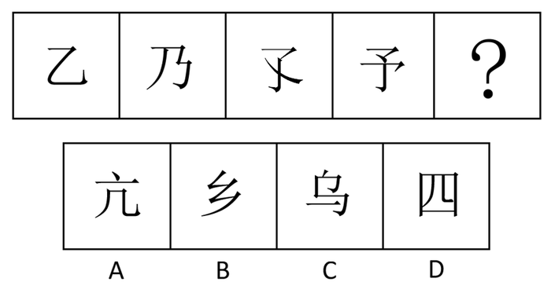
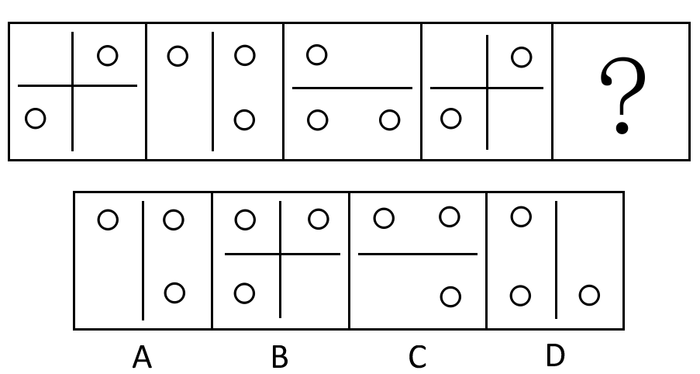
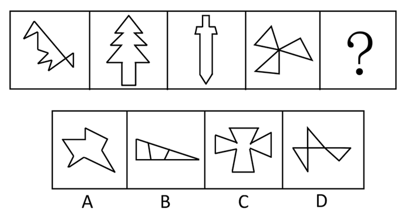
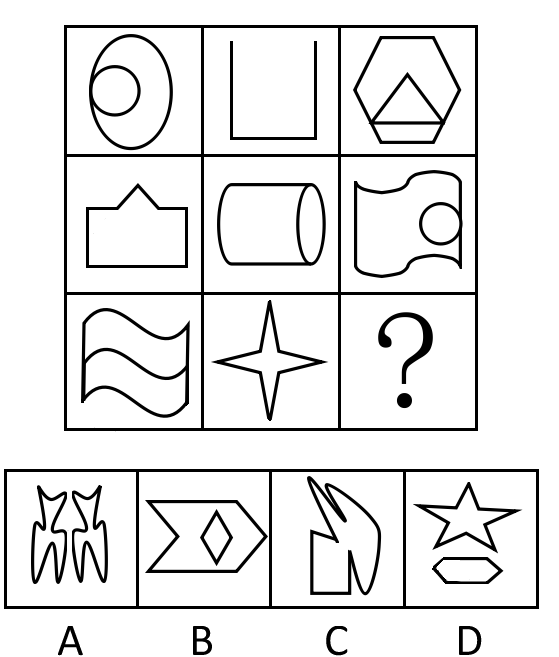
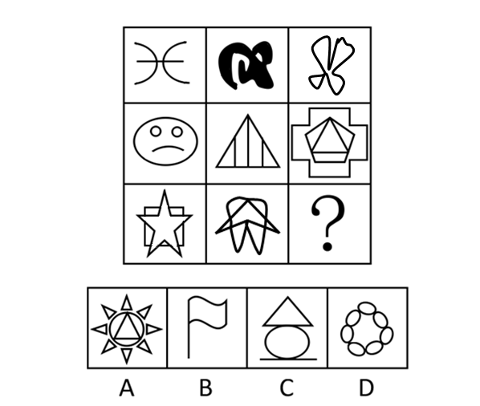
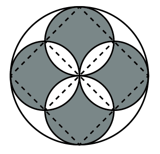
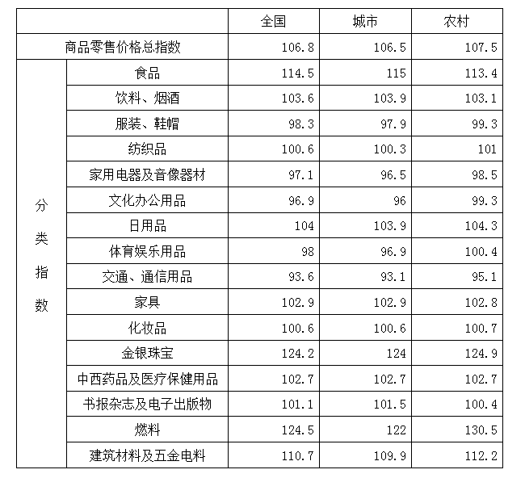
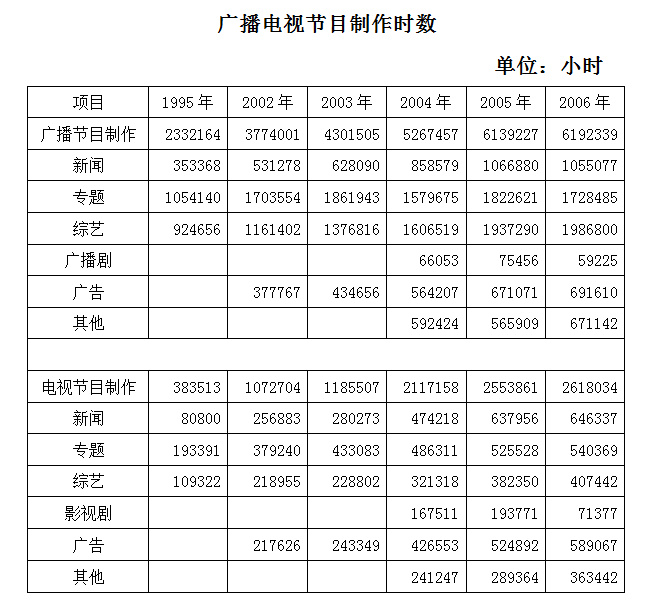
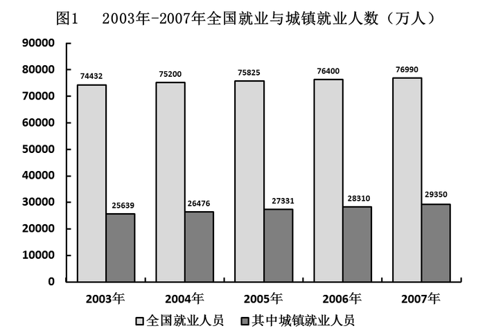
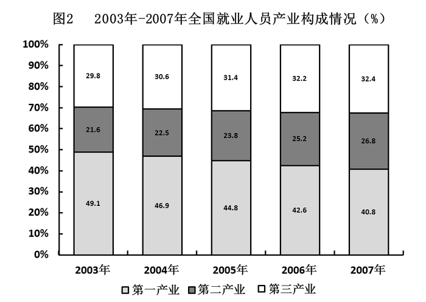

# 2009年426联考《行测》题（天津/陕西/湖北）

<!-- gwy:overview:start -->
> **天津 · 2009 · 行测 · 统考** ｜ 120 题 · 图片 11 处 · 答案随题折叠

| 题型模块 | 题量 | 题号 |
| --- | ---: | ---: |
| 常识判断 | 20 | 1–20 |
| 言语理解与表达 | 30 | 21–50 |
| 判断推理 | 35 | 51–85 |
| 数量关系 | 15 | 86–100 |
| 资料分析 | 20 | 101–120 |
| **合计** | **120** | |

导航：[题型与作答说明](#题型与作答说明) · [题目](#题目) · [材料 1](#材料-1)
<!-- gwy:overview:end -->

> 候选采集稿。参考答案及解析来自粉笔页面，不代表官方答案或真实高分答卷；来源使用许可与原卷对应关系仍需人工核实。

## 题型与作答说明

常识判断

（20题）

根据题目要求，在四个选项中选出一个最恰当的答案。

言语理解与表达

（30题）

本部分包括表达与理解两方面的内容。请根据题目要求，在四个选项中选出一个最恰当的答案。

判断推理

（35题）

本部分包括图形推理、定义判断、类比推理与逻辑判断四种类型的试题。

数量关系

（15题）

本部分包括数字推理与数学运算两种类型的试题。

资料分析

（20题）

所给出的图、表、文字或综合性资料均有若干个问题要你回答。你应根据资料提供的信息进行分析、比较、计算和判断处理。

## 题目

### 第 1 题

古代“子时”指的是：

A. 晚上9点～晚上11点

B. 晚上10点～晚上12点

C. 晚上11点～凌晨1点

D. 晚上12点～凌晨2点

第 1 题 · 答案与解析

**参考答案（粉笔题库参考内容）**

C

**解析**

我国古有十二地支计时法。具体如下：

1、子时：夜半，又名子夜、中夜，是十二时辰的第一个时辰（北京时间23时至01时）。

2、丑时：鸡鸣，又名荒鸡，是十二时辰的第二个时辰（北京时间01时至03时）。

3、寅时：平旦，又称黎明、早晨、日旦等，是夜与日的交替之际（北京时间03时至05时）。

4、卯时：日出，又名日始、破晓、旭日等，指太阳刚刚露脸，冉冉初升的那段时间（北京时间05时至07时）。

5、辰时：食时，又名早食等，古人“朝食”之时也就是吃早饭时间（北京时间07时至09时）。

6、巳时：隅中，临近中午的时候称为隅中（北京时间09时至11时）。

7、午时：日中，又名日正、中午等（北京时间11时至13时）。

8、未时：日昳，又名日跌、日央等，太阳偏西为日跌（北京时间13时至15时）。

9、申时：哺时，又名日铺、夕食等（北京时间15时至17时）。

10、酉时：日入，又名日落、日沉、傍晚，意为太阳落山的时候（北京时间17时至19时）。

11、戌时：黄昏，又名日夕、日暮、日晚等：此时太阳已经落山，天将黑未黑。天地昏黄，万物朦胧，故称黄昏（北京时间19时至21时）。

12、亥时：人定，又名定昏等，此时夜色已深，人们也已经停止活动，安歇睡眠了。人定也就是人静（北京时间21时至23时）。

故正确答案为C。

**考点**：文化常识

**来源**：2009年426联考《行测》题（天津/陕西/湖北）第1题

### 第 2 题

在汉字的形体演变过程中，位于小篆和楷书之间的字体是：

A. 金文

B. 大篆

C. 隶书

D. 草书

第 2 题 · 答案与解析

**参考答案（粉笔题库参考内容）**

C

**解析**

汉字经历了6000多年的发展过程。其形体演变是从甲骨文、金文变为小篆，再变为隶书、楷书、行书，其总的趋势是从繁到简。

故正确答案为C。

**考点**：文化常识

**来源**：2009年426联考《行测》题（天津/陕西/湖北）第2题

### 第 3 题

第29届奥运会与历届奥运会相比，下列说法错误的是：

A. 设置的比赛大项最多

B. 打破的世界纪录最多

C. 金牌和奖牌分布最广

D. 参加国家和地区最多

第 3 题 · 答案与解析

**参考答案（粉笔题库参考内容）**

A

**解析**

第29届奥运会共有204个国家和地区的1万多名运动员参加，是参加国家和地区最多的一届奥运会，共打破了43项世界纪录，创下了历届奥运会破纪录之最。而奖牌分布，也比上一届更广泛，共有56个国家和地区的选手获得金牌，86个国家和地区的选手获得奥运会奖牌。本届奥运会比赛共设28个大项，和历届奥运会设置的大项数量一样。

本题为选非题，故正确答案为A。

**考点**：文化常识

**来源**：2009年426联考《行测》题（天津/陕西/湖北）第3题

### 第 4 题

剧烈运动后，人们常常满脸通红，大汗淋漓，这主要是因为皮肤的什么功能？

A. 保护和排泄

B. 排泄和调节体温

C. 排泄和感受外界刺激

D. 保护和感受外界刺激

第 4 题 · 答案与解析

**参考答案（粉笔题库参考内容）**

B

**解析**

皮肤有汗腺组织，能排除一些体内代谢物，并以排汗的形式表现出来，人剧烈运动后，人体内的温度升高，为保持体温的恒定，皮肤表面血管扩张，毛孔增大，排汗增多，汗液蒸发可以带走一定的热量，起到降温的作用，即排泄和调节体温的作用。

故正确答案为B。

**本题相关知识点：**

皮肤的主要功能可概括为以下几种：保护功能、感觉功能、调节体温功能、分泌与排泄功能、吸收功能、代谢功能和免疫功能。

**考点**：生活常识

**来源**：2009年426联考《行测》题（天津/陕西/湖北）第4题

### 第 5 题

春秋战国时期的成语故事与故事中的主人公对应有误的一项是：

A. 立木取信——商鞅

B. 卧薪尝胆——勾践

C. 围魏救赵——孙武

D. 图穷匕见——荆轲

第 5 题 · 答案与解析

**参考答案（粉笔题库参考内容）**

C

**解析**

围魏救赵的提出者是孙膑，它是指采用包抄敌人的后方来迫使它撤兵的战术。其他三个选项对应正确。

本题为选非题，故正确答案为C。

**考点**：文化常识

**来源**：2009年426联考《行测》题（天津/陕西/湖北）第5题

### 第 6 题

下列说法中，所含光学知识原理达两种以上的是：

A. 镜中花，水中月

B. 猪八戒照镜子

C. 海市蜃楼

D. 潭清疑水浅

第 6 题 · 答案与解析

**参考答案（粉笔题库参考内容）**

C

**解析**

“海市蜃楼”是一种光学幻影，是地球上的物体反射的光经大气折射而形成的虚像。海市蜃楼是由于不同的空气层有不同的密度，而光在不同密度的空气中有不同的折射率，也就是因地面上的暖空气与高空中的冷空气之间密度不同，对光的折射率不同而形成的。

A项错误，光的反射现象，只包含一种光学知识；

B项错误，光的反射现象，只包含一种光学知识；

D项错误，光的折射现象，与筷子插入水中看上去变弯是一个道理，只包含一种光学知识。

故正确答案为C。

**考点**：生活常识

**来源**：2009年426联考《行测》题（天津/陕西/湖北）第6题

### 第 7 题

对于古代称谓说法错误的是：

A. 阁下是对长辈的尊称

B. 足下是下级对上级或同辈之间相互尊敬的称呼

C. 内子用于丈夫对别人称自己的妻子

D. “舍”用以谦称自己的家或自己的卑幼亲属

第 7 题 · 答案与解析

**参考答案（粉笔题库参考内容）**

A

**解析**

“阁下”多用于书信中，是对那些具有显赫的地位、尊严或价值的人，用作对某些高级的显要人物（如罗马天主教主教、国家的统治者、大使、总督）的尊称或称呼，属敬词。一般不用来称呼长辈。

本题为选非题，故正确答案为A。

**考点**：文化常识

**来源**：2009年426联考《行测》题（天津/陕西/湖北）第7题

### 第 8 题

下列关于我国传统节日的描述，与古代的说法或传说不相符的是：

A. 元宵节挂灯最早跟佛教仪式有关联

B. 清明节吃寒食最早是为了纪念一位先皇

C. 中秋节吃月饼曾与反抗元朝的统治有关

D. 古代的春节叫元旦，意为一年的第一天

第 8 题 · 答案与解析

**参考答案（粉笔题库参考内容）**

B

**解析**

冬至后一百零五天谓之寒食。从前这天禁火，冷食，故又称“冷节”、“禁烟节”。民间传说寒食是为了纪念春秋时的介子推被火焚于绵山，晋文公下令禁火。介子推是山西人，所以冷食习俗在山西首先流行。旧时寒食断火，次日宫中有钻木取新火的仪式，民间也多以柳条互相乞取新火。

本题为选非题，故正确答案为B。

**考点**：文化常识

**来源**：2009年426联考《行测》题（天津/陕西/湖北）第8题

### 第 9 题

下列说法错误的是：

A. 大兴安岭在我国黑龙江省境内，是全国面积最大的林区

B. 内蒙古是中国发现岩画最丰富的地区

C. 松辽平原是我国重要的粮食生产基地，是世界著名的玉米带

D. 辽宁省在中华民国时期被称为奉天省

第 9 题 · 答案与解析

**参考答案（粉笔题库参考内容）**

A

**解析**

大兴安岭位于我国内蒙古自治区东北部和黑龙江北部，是我国最北、面积最大的现代化国有林区，总面积8.46万平方公里，所以并非全部位于黑龙江省境内。其他三个选项都是正确的。

本题为选非题，故正确答案为A。

**考点**：中国地理

**来源**：2009年426联考《行测》题（天津/陕西/湖北）第9题

### 第 10 题

以下不可能成为非物质文化遗产的是：

A. 针灸

B. 济公的传说

C. 绍兴黄酒的酿制

D. 青岛“啤酒节”

第 10 题 · 答案与解析

**参考答案（粉笔题库参考内容）**

D

**解析**

“非物质文化遗产”指被各群体、团体、有时为个人所视为其文化遗产的各种实践、表演、表现形式、知识体系和技能及其有关的工具、实物、工艺品和文化场所。各个群体和团体随着其所处环境、与自然界的相互关系和历史条件的变化不断使这种代代相传的非物质文化遗产得到创新，同时使他们自己具有一种认同感和历史感，从而促进了文化多样性和激发人类的创造力。

A、B、C项都有悠久的历史和社会认同感，唯有D项除外。

本题为选非题，故正确答案为D。

**考点**：文化常识

**来源**：2009年426联考《行测》题（天津/陕西/湖北）第10题

### 第 11 题

下列选项中，英语是其国家或地区的官方语言之一的是：

A. 印度、新加坡、南非

B. 澳大利亚、香港、芬兰

C. 美国、丹麦、津巴布韦

D. 新西兰、瑞士、菲律宾

第 11 题 · 答案与解析

**参考答案（粉笔题库参考内容）**

A

**解析**

A项中南非的官方语言有11种，其中包括英语；英语、华语、马来语和泰米尔语都是新加坡的官方语言；英语和印地语同为印度的官方语言。

B项中芬兰的官方语言为芬兰语和瑞典语；

C项中丹麦的官方语言为丹麦语；

D项中瑞士的官方语言有德语、法语、意大利语及拉丁罗曼语。

故正确答案为A。

**考点**：文化常识

**来源**：2009年426联考《行测》题（天津/陕西/湖北）第11题

### 第 12 题

某县为朝鲜族自治县，依照宪法，关于该县人大常委会主任或副主任说法正确的是：

A. 由朝鲜族公民担任主任

B. 由朝鲜族公民担任副主任

C. 主任或副主任中有朝鲜族公民即可

D. 主任必须由朝鲜族公民担任，副主任可由其他民族的公民担任

第 12 题 · 答案与解析

**参考答案（粉笔题库参考内容）**

C

**解析**

根据《宪法》第一百一十三条第二款规定，自治区、自治州、自治县的人民代表大会常务委员会中应当由实行区域自治的民族的公民担任主任或者副主任。

故正确答案为C。

**考点**：宪法

**来源**：2009年426联考《行测》题（天津/陕西/湖北）第12题

### 第 13 题

下列历史事件的时间顺序排序正确的一组是：

A. 戊戌变法—马关条约—五四运动

B. 郑和下西洋—戚继光抗击倭寇—郑成功收复台湾

C. 张衡发明地动仪—诸葛亮写《出师表》—张骞出使西域

D. 虎门销烟—中日甲午战争—第一次鸦片战争

第 13 题 · 答案与解析

**参考答案（粉笔题库参考内容）**

B

**解析**

本题考查人文历史。

A项错误，戊戌变法，1898年；马关条约，1895年；五四运动，1919年；

B项正确，郑和下西洋，1405年开始；戚继光抗击倭寇，1560年左右；郑成功收复台湾，1662年初；

C项错误，张衡发明地动仪，公元132年；诸葛亮写《出师表》，建兴五年，227年春天；张骞出使西域，公元前138年；

D项错误，虎门销烟，1839年；甲午中日战争，1894年～1895年；第一次鸦片战争，1840年～1842年。

故正确答案为B。

**考点**：中国历史

**来源**：2009年426联考《行测》题（天津/陕西/湖北）第13题

### 第 14 题

根据《立法法》的规定，我国的法律解释权属于：

A. 全国人民代表大会

B. 全国人民代表大会常务委员会

C. 全国人民代表大会法律委员会

D. 国务院

第 14 题 · 答案与解析

**参考答案（粉笔题库参考内容）**

B

**解析**

《立法法》第四十二条规定，法律解释权属于全国人民代表大会常务委员会。

故正确答案为B。

**考点**：宪法

**来源**：2009年426联考《行测》题（天津/陕西/湖北）第14题

### 第 15 题

根据我国现行宪法和有关法律的规定，下列选项中构成违宪行为的是：

A. 国家主席代表中华人民共和国接见外国使节

B. 国务院根据全国人民代表大会常务委员会的授权决定，对储蓄存款利息所得减征个人所得税

C. 国务院某部发布《关于认真学习贯彻&lt;行政机关公务员处分条例>的通知》

D. 某自治区人民代表大会常务委员会制定本自治区的《自治条例》

第 15 题 · 答案与解析

**参考答案（粉笔题库参考内容）**

D

**解析**

A项正确，《宪法》第八十一条规定：“中华人民共和国主席代表中华人民共和国，进行国事活动，接受外国使节；根据全国人民代表大会常务委员会的决定，派遣和召回驻外全权代表，批准和废除同外国缔结的条约和重要协定。”

B项正确，《宪法》第八十五条规定：“中华人民共和国国务院，即中央人民政府，是最高国家权力机关的执行机关，是最高国家行政机关。”而全国人大常委会是全国人大的常设机关，因此国务院根据全国人民代表大会常务委员会的授权决定，对储蓄存款利息所得减征个人所得税。

C项正确，通知是用来发布法规、规章，转发上级机关、同级机关和不相隶属机关的公文。

D项错误，《立法法》第七十五条规定：“民族自治地方的人民代表大会有权依照当地民族的政治、经济和文化的特点，制定自治条例和单行条例。自治区的自治条例和单行条例，报全国人民代表大会常务委员会批准后生效。”

本题为选非题，故正确答案为D。

**考点**：宪法

**来源**：2009年426联考《行测》题（天津/陕西/湖北）第15题

### 第 16 题

国家对超标准排放污水的单位收取排污费，属于：

A. 行政征购

B. 行政处罚

C. 行政征用

D. 行政征收

第 16 题 · 答案与解析

**参考答案（粉笔题库参考内容）**

D

**解析**

行政征收是指行政机关或者法定授权的组织根据法律、法规的规定，向公民、法人或者其他组织无偿收取一定财物的行政行为。行政征收须以公民、法人或者其他组织负有行政法上的缴纳义务为前提，其实质是国家以强制方式无偿取得管理相对人一定财产所有权。行政征收的主要内容有税收征收、资源费征收、建设资金征收、排污费征收及其他法定征收。

故正确答案为D。

**考点**：行政法

**来源**：2009年426联考《行测》题（天津/陕西/湖北）第16题

### 第 17 题

政府机构和工作人员把制订的计划方案付诸实施的活动过程，是政府的：

A. 计划职能

B. 领导职能

C. 组织职能

D. 控制职能

第 17 题 · 答案与解析

**参考答案（粉笔题库参考内容）**

C

**解析**

政府的运行职能，是按照行政管理的过程来划分的行政职能。从我国的行政管理来看，运行职能可划分以下四种职能：

（1）计划职能。是指政府为完成某一时期内的任务或某一项任务，制定战略目标并确定实施步骤的管理行为过程。它是政府的管理运行职能中的首要职能。

（2）组织职能。是指政府针对计划目标，落实机构与人员，划分权力与责任，配备财力与物力，将组织内部各个要素联结成为一个有机整体的活动过程。

（3）协调职能。是指政府在管理过程中为保证有效利用人力、财力、物力等各种行政资源，保证行政管理过程的统一、和谐与效率，而引导各行政机构之间，各行政职位上的人员之间相互协同、互相配合、相互沟通与相互补充的活动过程。

（4）控制职能。是指行政机关或人员为按计划完成组织目标，在执行计划过程中对计划进行检查、督促与纠偏的管理活动。

故正确答案为C。

**来源**：2009年426联考《行测》题（天津/陕西/湖北）第17题

### 第 18 题

《行政许可法》规定，对于有数量限制的行政许可，两个以上申请人申请均符合法定要求的，行政机关应当：

A. 根据发出申请的先后顺序作出许可决定

B. 根据受理申请的先后顺序作出许可决定

C. 均不给予行政许可

D. 抽签决定许可决定

第 18 题 · 答案与解析

**参考答案（粉笔题库参考内容）**

B

**解析**

根据《行政许可法》第五十七条规定，有数量限制的行政许可，两个或者两个以上申请人的申请均符合法定条件、标准的，行政机关应当根据受理行政许可申请的先后顺序作出准予行政许可的决定。

故正确答案为B。

**考点**：行政法

**来源**：2009年426联考《行测》题（天津/陕西/湖北）第18题

### 第 19 题

孙某丈夫外出做买卖五年未归，也没有任何音讯，孙某欲改嫁，下面说法正确的是：

A. 孙某丈夫视为死亡，孙某可以直接改嫁

B. 孙某丈夫不论是生还是死，孙某均可以改嫁

C. 孙某丈夫经人民法院宣告失踪后，孙某可以改嫁

D. 孙某丈夫经人民法院宣告死亡后，孙某可以改嫁

第 19 题 · 答案与解析

**参考答案（粉笔题库参考内容）**

D

**解析**

宣告失踪指经利害关系人申请，由人民法院对下落不明满一定期间的人宣告为失踪人的制度。它是一种不明确的自然事实状态的法律确认，目的在于结束失踪人财产关系的不确定状态，保护失踪人的利益，兼及利害关系人的利益。宣告失踪的法律后果：①失踪人的财产由他的配偶、父母、成年子女或者关系密切的其他亲属、朋友代管；②没有以上人选或者有争议的由法院指定代管；③代管人负责管理失踪人的财产职责，代管人不履行代管职责或者侵犯失踪人财产的，失踪人的利害关系人可以向法院请求代管人承担民事责任，也可以申请变更代管人。

宣告死亡是指经利害关系人申请，由法院宣告下落不明一定期间的自然人为死亡的制度。根据《民法总则》可知，公民下落不明满四年的，利害关系人可以向人民法院申请宣告他死亡，宣告死亡与自然死亡具有相同法律后果。被宣告死亡的人与配偶的婚姻关系，自死亡宣告之日起消灭。

本题中，孙某丈夫外出做买卖五年未归，也没有任何音讯，因此孙某可以向人民法院申请宣告他死亡，且经人民法院宣告死亡后，孙某可以改嫁。

故正确答案为D。

**考点**：民法典

**来源**：2009年426联考《行测》题（天津/陕西/湖北）第19题

### 第 20 题

下列关于死刑的说法中，错误的是：

A. 死刑只适用于罪行极其严重的犯罪分子

B. 犯罪时不满18周岁的人和审判时怀孕的妇女不适用死刑

C. 判决死刑立即执行的，由最高人民法院和最高人民法院授权的部分高级人民法院核准

D. 判处死刑缓期执行的，在死刑缓期执行期间，如果没有故意犯罪，两年期满后减为无期徒刑

第 20 题 · 答案与解析

**参考答案（粉笔题库参考内容）**

C

**解析**

A项正确，死刑是剥夺犯罪分子生命的刑罚方法，这是最严厉的一种刑罚方法，死刑只适用于罪行极其严重的犯罪分子；

B项正确，犯罪的时候不满18周岁的人和审判的时候怀孕的妇女，不适用死刑（包括不适用死缓）；

C项错误，死刑有两种执行制度，一种是判处死刑立即执行，另一种是判处死刑同时宣告缓期2年执行（简称死缓）。死刑立即执行除由最高人民法院直接判决的外，依法都应当报最高人民法院核准，对于被判死刑缓期执行的各高级人民法院有权直接核准，无需上报；

D项正确，《中华人民共和国刑法》规定：“判处死刑缓期执行的，在死刑缓期执行期间，如果没有故意犯罪，二年期满以后，减为无期徒刑”。

本题为选非题，故正确答案为C。

**考点**：刑法

**来源**：2009年426联考《行测》题（天津/陕西/湖北）第20题

### 第 21 题

人生是一个容器，可这个容器的容量实在是非常＿＿＿＿。愁苦和畏惧多了，欢乐与＿＿＿＿就少了。

依次填入划横线部分最恰当的一项是：

A. 庞大 胆量

B. 可观 轻松

C. 有限 勇气

D. 莫测 勇敢

第 21 题 · 答案与解析

**参考答案（粉笔题库参考内容）**

C

**解析**

本题考查实词填空。

第一空，由第二句话中的“······多了，······就少了”可知，题干是在说人生这个容器是有限的，庞大、可观、莫测这三个词语填入第一空都不符合语境，排除A、B、D三项；

第二空，“欢乐”对应“愁苦”，第二空应填入与“畏惧”对应的词语，所以选择“勇气”，C项当选。

故正确答案为C。

**考点**：关联关系-并列关系、实词填空、词的辨析-搭配对象

**来源**：2009年426联考《行测》题（天津/陕西/湖北）第21题

### 第 22 题

煤炭与石油、天然气相比价格低廉，以同等发热量计算，目前石油价格是煤炭的5倍，天然气价格是煤炭的3倍，所以，在石油价格居高不下的背景下，煤炭价格必然＿＿＿＿＿＿。

填入划横线部分最恰当的一项是：

A. 水涨船高

B. 相形见绌

C. 如影随形

D. 随波逐流

第 22 题 · 答案与解析

**参考答案（粉笔题库参考内容）**

A

**解析**

第一空，由“所以”引导结论，前文指出，在同等发热量下石油价格是煤炭的5倍、天然气是煤炭的3倍，说明煤炭相对价格最低。在石油价格居高不下的背景下，其替代需求会向煤炭转移，从而推动煤炭价格上升。A项“水涨船高”比喻事物随着它所凭借的基础的提高而提高，符合煤炭价格随石油价格上涨而上涨的语境，当选。

B项“相形见绌”指和同类事物相比显出不足，C项“如影随形”比喻两个人关系亲密，常在一起，D项“随波逐流”比喻没有坚定的立场，缺乏判断是非的能力，只能随着别人走，均与价格变动趋势的逻辑不符，排除。

故正确答案为A。

**考点**：关联关系-因果关系、成语填空

**来源**：2009年426联考《行测》题（天津/陕西/湖北）第22题

### 第 23 题

“笼屉”作为寻常百姓家必备的炊具，从来没有登上过大雅之堂。据说最＿＿＿＿的待遇是在旧社会曾用笼屉作为饭店门口的幌子，食客们只要一看到门口悬挂的笼屉层数，就知道饭店的档次。

填入划横线部分最恰当的一项是：

A. 优厚

B. 体面

C. 优惠

D. 特殊

第 23 题 · 答案与解析

**参考答案（粉笔题库参考内容）**

B

**解析**

本题考查实词填空。

通读整个句子可知，横线处所填的词应与句子中的“大雅之堂”相对应。

B项“体面”形容光荣、有光彩，符合文意，当选；

A项“优厚”是优裕丰厚的意思，C项“优惠”指优待照顾，D项“特殊”指特别对待，题干并没有评价这种待遇特殊与否，均不符合文意，排除。

故正确答案为B。

**考点**：实词填空、对应关系-前后呼应

**来源**：2009年426联考《行测》题（天津/陕西/湖北）第23题

### 第 24 题

循环经济实质上是一种自觉的经济形态，需要公共部门、经济主体和金融界的三方转变观念，共同＿＿＿＿，在全社会形成发展循环经济的良好＿＿＿＿。

依次填入划横线部分最恰当的一项是：

A. 营建 环境

B. 努力 氛围

C. 营造 局面

D. 建造 局势

第 24 题 · 答案与解析

**参考答案（粉笔题库参考内容）**

C

**解析**

第一空，根据前文可知，循环经济作为一种经济形态，需要三方共同完成，故横线处搭配“循环经济”，并体现三方共同、主动地促成这一经济形态，B项“努力”指把力量尽量使出来，C项“营造”指有计划、有目的地造，均符合文意，保留；A项“营建”指修建、D项“建造”指建筑，修建，二者通常用于具体建筑、工程的修建，搭配不当，均排除。

第二空，根据“在全社会形成发展循环经济的良好\_\_\_\_\_\_\_\_”可知，横线处应体现形成循环经济良好的状态，C项“局面”指事物的形势、情景，符合文意，且“形成良好局面”为常见搭配，当选。B项的“氛围”多指气氛、情调，而“发展循环经济”更强调一种整体态势或形势，不符合文意，排除。

故正确答案为C。

**考点**：实词填空、对应关系-前后呼应、词的辨析-搭配对象

**来源**：2009年426联考《行测》题（天津/陕西/湖北）第24题

### 第 25 题

体操是一个结合了杂技和舞蹈的体育运动。它的魅力，在于那种刀锋上的平衡与美感，在于每一秒都让人＿＿＿＿＿＿。运动员在空中翻腾的时候，即使不在现场的观众，也会不由自主地屏住呼吸，直到运动员稳稳落地。

填入划横线部分最恰当的一项是：

A. 心旷神怡

B. 赏心悦目

C. 战战兢兢

D. 如痴如醉

第 25 题 · 答案与解析

**参考答案（粉笔题库参考内容）**

C

**解析**

根据横线前“刀锋”以及横线后“不由自主地屏住呼吸，直到运动员稳稳落地”可知，观众看体操时内心是紧张的，是提心吊胆的，C项“战战兢兢”形容恐惧得发抖或小心谨慎的样子，符合文意，当选。

A项“心旷神怡”指心情愉快，精神舒畅，B项“赏心悦目”指看到美好的景物而心情舒畅、愉快，D项“如醉如痴”形容入迷于某种事物而失去自制的神态，均未体现出紧张的感觉，排除。

故正确答案为C。

**考点**：对应关系-前后呼应、成语填空

**来源**：2009年426联考《行测》题（天津/陕西/湖北）第25题

### 第 26 题

好莱坞商业大片宣传的是一种普世价值，它往往故事简单，＿＿＿＿的道理也很浅显，这一点常常为西方的知识分子所＿＿＿＿。但不可否认的是，正是这种浅显的东西，往往才可能被普遍的大众接受。

依次填入划横线部分最恰当的一项是：

A. 蕴含 不屑

B. 包含 轻视

C. 渗透 鄙夷

D. 传达 唾弃

第 26 题 · 答案与解析

**参考答案（粉笔题库参考内容）**

A

**解析**

第一空，横线处搭配“道理”。A项“蕴含”指包含在内，B项“包含”指里边含有，D项“传达”指把一方的意思告诉给另一方，均与“道理”搭配恰当，保留；C项“渗透”比喻一种事物或势力逐渐进入到其他方面，与“道理”搭配不当，排除。

第二空，根据“但不可否认的是，正是这种浅显的东西，往往才可能被普遍的大众接受”可知，横线处应体现西方知识分子对好莱坞商业大片宣传的浅显道理持否定态度之意。A项“不屑”指认为不值得，符合文意，当选。B项“轻视”指小看、不重视，“轻视”通常表主动，较少用于“为······所轻视”这样的被动结构，搭配不当且“不屑”更能体现出西方知识分子的一种态度，排除；D项“唾弃”指鄙弃、厌恶，程度过重，西方知识分子只是对这种浅显的道理不认同，不至于达到厌恶的程度，排除。

故正确答案为A。

**考点**：实词填空、对应关系-前后呼应、词的辨析-搭配对象、词的辨析-程度轻重

**来源**：2009年426联考《行测》题（天津/陕西/湖北）第26题

### 第 27 题

对于如何维持在孩子面前的权威性有很多不同观点，这使得父母有点儿＿＿＿＿＿＿。

填入划横线部分最恰当的一项是：

A. 独断专行

B. 不知所措

C. 无所适从

D. 顾此失彼

第 27 题 · 答案与解析

**参考答案（粉笔题库参考内容）**

C

**解析**

根据“使得”可知，横线处应与前文构成因果关系，体现父母面对维持权威的多种不同观点，陷入难以选择、不知该遵循哪种的困境之意。C项“无所适从”指面对多种选择或指令，不知该依从哪一个，符合文意，当选。

A项“独断专行”指行事专横、不听取他人意见，与文意不符，排除；

B项“不知所措”侧重突发情况下慌乱无措，缺乏应对办法，文段是面对多元观点选择困难，并非突发情况，与文意不符，排除；

D项“顾此失彼”指顾了这头丢了那头，侧重兼顾不周，文段未涉及多个事务的兼顾问题，与文意不符，排除。

故正确答案为C。

**考点**：关联关系-因果关系、成语填空

**来源**：2009年426联考《行测》题（天津/陕西/湖北）第27题

### 第 28 题

究竟国家与个人对个人的医疗健康应分别承担多大比例，是一个＿＿＿＿选择问题，而不是政府可以任意决定的事项。要让民众有机会参与这一重大财政决策。透过人大的审议机制，将自己的意愿＿＿＿＿到长期的财政安排中。

依次填入划横线部分最恰当的一项是：

A. 公共 体现

B. 公众 融合

C. 大众 反映

D. 集体 表达

第 28 题 · 答案与解析

**参考答案（粉笔题库参考内容）**

A

**解析**

第一空，搭配“选择问题”，且根据文意可知，横线处应体现对个人医疗健康承担的比例问题而言，需要政府和个人共同商议来确定，不能只偏听某一方的意见之意。A项“公共”指属于社会的、公有公用的，且公共选择是一个固定术语，D项“集体”指许多人合起来的有组织的整体，均符合文意，保留。B项“公众”指社会上大多数的人、C项“大众”指群众、民众，均为名词词性，与 “选择问题”搭配不当，排除。

第二空，根据“要让民众有机会参与这一重大财政决策，透过人大的审议机制，将自己的意愿（ ）到长期的财政安排中”可知，横线处需体现把民众意愿在长期财政安排中呈现出来之意。A项“体现”指某种性质或现象通过某一事物具体表现出来，符合文意，当选。D项“表达”多搭配“观点、诉求”， “表达”一般不接“到······中”搭配不当，排除。

故正确答案为A。

【文段出处】爱思想《秋风：应当重建医疗福利制度》

**考点**：实词填空、对应关系-前后呼应、词的辨析-搭配对象

**来源**：2009年426联考《行测》题（天津/陕西/湖北）第28题

### 第 29 题

构成中华文明的各支源流各有其成长、壮大、迁徙、融合的历史。把各支主要源流的历史给予相对充分的阐发，更能表现中华民族万流入海的历史＿＿＿＿。

填入划横线部分最恰当的一项是：

A. 事实

B. 潮流

C. 趋势

D. 进程

第 29 题 · 答案与解析

**参考答案（粉笔题库参考内容）**

C

**解析**

根据文意可知，横线处应体现构成中华文明的各支源流有其发展过程，把各支源流历史充分阐发能表现中华民族万流入海的情况之意。C项“趋势”指事物发展的动向，这里中华民族万流入海体现的是一种发展的动向，符合文意，当选。

A项“事实”指事情的真实情况，“万流入海”强调的是一种动向而非单纯的事实，与文意不符，排除；B项“潮流”指社会上的一种趋势，多形容某一时期的社会发展大势，与各支源流逐步融合汇聚的长期历史走向的语境不符，排除；D项“进程”指事物发展变化或进行的过程，文段强调的是源流汇聚的最终走向这一结果，而非具体过程，与文意不符，排除。

故正确答案为C。

**考点**：实词填空、对应关系-前后呼应

**来源**：2009年426联考《行测》题（天津/陕西/湖北）第29题

### 第 30 题

《权谋书》成书于汉成帝鸿嘉四年，是刘向在校书的过程中＿＿＿＿而成的。他编辑此书的目的也是有感于当时社会风俗的奢靡荒淫，礼教零落，用历史上古圣先贤的事迹和流传下来的格言警句来引起皇帝的＿＿＿＿。

依次填入划横线部分最恰当的一项是：

A. 整理 兴趣

B. 总结 反思

C. 编写 警戒

D. 分析 警惕

第 30 题 · 答案与解析

**参考答案（粉笔题库参考内容）**

C

**解析**

第一空，根据“他编辑此书”及“用历史上古圣先贤的事迹和流传下来的格言警句”可知，横线处所填词语应体现刘向是对已有的内容进行整理、编撰。A项“整理”指使有条理有秩序，C项“编写”就现成的材料加以整理，写成书或文章，两项均符合文意，保留。B项“总结”指把一阶段内的工作、学习或思想中的各种经验或情况分析研究，做出有指导性的结论，D项“分析”指把一件事、一种现象、一个概念分成较简单的组成部分，找出这些部分的本质属性和彼此之间的关系，两项均与文意无关，排除。

第二空，根据“此书的目的也是有感于当时社会风俗的奢靡荒淫、礼教零落，用历史上古圣先贤的事迹和流传下来的格言警句来引起”可知，横线处所填词语应体现刘向编辑此书的目的是通过历史经验教训，让皇帝有所触动和警醒。C项“警戒”指告诫人使注意改正错误，符合文意，当选。A项“兴趣”指对事物喜好或关切的情绪，与文意不符，排除。

故正确答案为C。

**考点**：实词填空、对应关系-前后呼应

**来源**：2009年426联考《行测》题（天津/陕西/湖北）第30题

### 第 31 题

物质文化、技术文化的传播，其意义不仅仅局限于物质的和技术的领域，它们还可能影响人们的精神世界和生活方式，甚至产生意料之外的效果。因为这些物质产品和技术发明，还体现了创造者、发明者的精神理念、审美情趣和价值追求，体现了他们作为某一文化共同体成员所接受的文化传统的濡染和教育，而物质文化和技术文化的输出，间接地传达了这种物质产品所包含的精神内容和文化内涵，因而也就使其成为文化整体的代表而传播并发生影响。

这段文字的主旨是：

A. 物质产品的文化内涵来自于文化传统

B. 物质文化与技术文化也能影响人们的精神文化

C. 不同文化中共有的文化传统促进了物质文化的传播

D. 物质文化与技术文化是在与不同文化的碰撞中发展的

第 31 题 · 答案与解析

**参考答案（粉笔题库参考内容）**

B

**解析**

文段开篇指出物质文化、技术文化的传播意义不仅局限于物质和技术领域，还可能影响人们的精神世界和生活方式甚至产生意外效果，接着通过“因为”对其进行原因解释，说明物质产品和技术发明体现了创造者等的精神理念等，物质文化和技术文化输出会传达精神内容和文化内涵从而产生影响。故文段重点强调物质文化、技术文化对人们精神文化的影响，对应B项。

A项，“物质产品的文化内涵来自于文化传统”只是原因解释部分内容，非重点，排除；

C项，“不同文化中共有的文化传统”文段未提及，无中生有，排除；

D项，“在不同文化的碰撞中发展”文段未提及，无中生有，排除。

故正确答案为B。

**考点**：分述句特征-多角度论述

**来源**：2009年426联考《行测》题（天津/陕西/湖北）第31题

### 第 32 题

随着社会老龄化的日益加剧，许多社区空巢老人越来越多，他们生活小事不能自理，需要社会特殊照顾。目前，社会对一些独居老人的关照仍显欠缺。逢年过节，虽然有关部门上门送粮油、衣物、金钱等进行慰问，但对于空巢老人来说，关心还不到位，措施还不得力。在这种情况下，需要成立一些传统的养老院、敬老院、社区互助会等更加适合空巢老人欢度晚年的场所，既可以满足老年人的生活需要，还解除子女的后顾之忧，同时也加强了社区群众之间的交流与互助，使越来越多的老人晚年生活得丰富多彩。

这段文字主要说明了：

A. 空巢老人的出现并非仅来自于老龄化

B. 社区是解决空巢老人现象的最佳途径

C. 在解决空巢问题时子女应发挥更大作用

D. 空巢老人需要生活与精神上的多方帮助

第 32 题 · 答案与解析

**参考答案（粉笔题库参考内容）**

D

**解析**

文段开篇通过“随着”指出在社会老龄化的日益加剧背景下，空巢老人增多且社会对独居老人关照欠缺，接着通过“虽然······但是”提出问题，最后用“在这种情况下”指代前文，通过“需要”引出对策，成立一些传统的养老院、敬老院、社区互助会等场所既满足老年人的生活需要，同时也使老人晚年生活得丰富多彩。故文段重点强调应该给予空巢老人生活和精神上的帮助，对应D项。

A项文段并非探讨“空巢老人”出现的原因，而是涉及对策，排除；

B项“社区是最佳途径”无中生有，且“最”字过于绝对，排除；

C项，“子女应发挥更大作用”无中生有，排除。

故正确答案为D。

**考点**：关联词-对策

**来源**：2009年426联考《行测》题（天津/陕西/湖北）第32题

### 第 33 题

从本质上说，人类文明的进程就是不断脱离动物界的过程，这一过程主要包括人类体质的进化和心性的进化两个方面。从猿到人的体质进化，人类用了上百万年的时间才完成，而人类心性的进化则还要缓慢。当人类跨越石器时代、青铜时代进入铁器时代之后，动物性依然顽强地在人类身上闪现着。如何管理好人类的情感，使带有动物性的人变成理性的人，是儒家最为关注的重要课题。如果把儒家的答卷归结为一个字，那就是“礼”。

对这段文字的主旨概括最准确的是：

A. 描述人类文明发展进化的大致过程

B. 对比人类体质与心性两方面的进化

C. 阐述儒家强调礼仪作用的社会原因

D. 说明儒家思想的产生根源与现实意义

第 33 题 · 答案与解析

**参考答案（粉笔题库参考内容）**

C

**解析**

本题属于中心理解题。文段是分-总结构，文段首先介绍人类文明的进程包括体质和心性两方面的进化，并着重强调心性的进化更加缓慢，文段后半部分的观点是若要完成人类心性的进化，就需要管理好人类的情感，恰恰儒家的“礼”能帮助人类管好自己的情感。故文段主要强调的是儒家思想中的“礼”，对应C项。

A、B两项，均未涉及“儒家”的“礼”，偏离文段中心，排除；

D项，文段主要介绍儒家的“礼”，该项将范围扩大至“儒家思想”，不符合文意，排除。

故正确答案为C。

**考点**：分述句特征-引入铺垫

**来源**：2009年426联考《行测》题（天津/陕西/湖北）第33题

### 第 34 题

随着通讯技术的进步，当今社会，政府执政的舆论环境已发生了明显的变化，各种舆论可以借助网络、短信等现代传播工具，跨越时空迅速传递，使意见空间加大，意见力度增强，而决策透明度的增加和公民民主参与意识的增强，又加大了政府的舆论压力。在这样的背景下，政府对“舆情危机”的处理需要改变以往被动方式，针对新出现的情况，及时采用新的方式来应对。

对这段文字概括最准确的是：

A. 说明政府在新舆论环境下有必要转变应对方式

B. 对比不同时期政府舆论宣传的客观环境与方式

C. 剖析政府执政的舆论压力不断增大的外在原因

D. 分析通讯技术发展与舆论环境变化之间的关系

第 34 题 · 答案与解析

**参考答案（粉笔题库参考内容）**

A

**解析**

文段开篇“随着”引出背景，文段开篇阐述通讯技术进步使政府执政舆论环境变化，意见空间、力度加大，决策透明度与公民参与意识增强又加大了政府舆论压力。接着通过“在这样的背景下”进行总结，并用“需要”引出对策，即政府对“舆情危机”的处理要改变以往被动方式，及时采取新方式应对。故文段重点强调政府在新舆论环境下需转变应对“舆情危机”的方式，对应A项。

B项，文段重点并非对比不同时期政府舆论宣传的客观环境与方式，非重点，排除；C项，“剖析政府执政舆论压力增大的外在原因”属于问题内容，非重点，排除；D项，“分析通讯技术发展与舆论环境变化之间的关系”属于背景引入内容，非重点，排除。

故正确答案为A。

**考点**：关联词-对策

**来源**：2009年426联考《行测》题（天津/陕西/湖北）第34题

### 第 35 题

联合国教科文组织将2008年定为“马铃薯年”，俗名“土豆”的马铃薯被联合国的专家们称为“隐藏的宝贝”。联合国用一种农作物命名一个年份，在历史上只出现过一次，就是2003年——国际水稻年。2008年的主角为什么不是“玉米”、“苹果”，偏偏是土豆这个深埋地下、不起眼儿的小东西呢？因为解决全球粮食安全问题需要土豆。

对这段文字概括最准确的是：

A. 土豆和水稻都是重要的农作物

B. 全球粮食安全问题应引起重视

C. 土豆被提到粮食安全的战略高度

D. 土豆潜在的巨大价值有待进一步开发

第 35 题 · 答案与解析

**参考答案（粉笔题库参考内容）**

C

**解析**

文段指出联合国教科文组织将2008年命名为“马铃薯年”，然后提出历史上类似的“国际水稻年”，最后通过设问的形式引出文段重点，强调土豆可以解决全球粮食安全问题。故文段重在强调土豆对于解决粮食安全问题的重要性，对应C项。

A项，“水稻”非重点，且没有提及“粮食安全”，偏离文段中心，排除；

B项，缺少主题词“土豆”，偏离文段中心，排除；

D项，“巨大价值有待进一步开发”，文段并未提及，无中生有，且没有提及“粮食安全”，排除。

故正确答案为C。

**考点**：主题词

**来源**：2009年426联考《行测》题（天津/陕西/湖北）第35题

### 第 36 题

古人写诗“二句三年得，一吟双泪流”；写小说动辄“闭门谢客，披阅十载”。现在许多作家每年出好几部长篇，几十万字，个把月就写成了。没有对生活的日积月累，没有对人生的深思熟虑，没有对写作的精心布局，没有对文字的字斟句酌，反复修改，怎么会有精品？又怎能抵抗时间的淘汰？“创作”如果说不同于别的工作，就在于一个“创”字；如果说有难度，也在于一个“创”字，既不同于前人，又不同于自己。

这段文字主要表明：

A. 生活是创作的源泉

B. 时间是艺术作品的试金石

C. 今人的创作态度不如古人严肃

D. 长期潜心创作，才会出高质量的作品

第 36 题 · 答案与解析

**参考答案（粉笔题库参考内容）**

D

**解析**

文段开篇介绍古人写诗、写小说耗时久，对比现在许多作家创作速度快，接着以反问句强调没有对生活的积累、对人生的思考、对写作的精心布局和对文字的反复修改，就不会有精品，也经不起时间的考验，最后指出创作的关键在于“创”，要不同于前人及自己。故文段重点强调长期潜心创作对于产出高质量作品的重要性，对应D项。

A项“生活是创作的源泉”、B项“时间是艺术作品的试金石”仅对应文段部分内容，表述片面，排除；

C项“今人的创作态度不如古人严肃”对应文段对比引入部分，并非重点，排除。

故正确答案为D。

【文段出处】浙江日报《书谭 书话》

**考点**：分述句特征-引入铺垫

**来源**：2009年426联考《行测》题（天津/陕西/湖北）第36题

### 第 37 题

地球上的岩石可以分为火成岩、沉积岩、变质岩。由硅酸盐溶浆凝结而成的火成岩构成了地壳的主体，按体积和重量计算都最多。但地面最常见到的则是沉积岩，它是早先形成的岩石破坏后，又经过物理或化学作用在地球表面的低凹部位沉积，经过压实、胶结再次硬化。形成具有层状结构特征的岩石。在地壳中，在大大高于地表的温度和压力作用下，岩石的结构、构造或化学成分发生变化，形成不同于火成岩和沉积岩的变质岩。

这段文字主要介绍了地球上各类岩石的：

A. 形成条件

B. 结构特征

C. 地质分布

D. 化学成分

第 37 题 · 答案与解析

**参考答案（粉笔题库参考内容）**

A

**解析**

文段开篇指出地球上的岩石分为火成岩、沉积岩、变质岩，接着分别阐述了火成岩由硅酸盐溶浆凝结而成，沉积岩是早先形成的岩石被破坏后，经物理或化学作用在地表低凹处沉积、压实、胶结硬化而成，变质岩是在高于地表的温度和压力作用下，岩石结构、构造或化学成分发生变化而形成。故文段重点讨论地球上各类岩石的形成条件，对应A项。

B项“结构特征”、C项“地质分布”仅对应沉积岩部分，均表述片面，排除；

D项“化学成分”仅对应变质岩部分，表述片面，排除。

故正确答案为A。

【文段出处】化石网《地质学的研究对象》

**考点**：关联词-并列

**来源**：2009年426联考《行测》题（天津/陕西/湖北）第37题

### 第 38 题

真实的历史事实及其史料依据，是历史叙事的基本要素。历史学的任务不仅是考证历史事实，还应该完整地还原出历史人物、历史事件和历史过程的面貌。为此，历史研究者需要把各种历史事实加以联结和组合。而主张后现代主义史学理论的学者认为，历史研究者可以在不违反学科规范的前提下，对历史事实进行不同的联结和组合。而这些不同的联结和组合，会形成不同的人物、事件或者过程的历史面貌。

依据后现代主义史学理论的学者观点，历史描写：

A. 并不等同于事实

B. 可以有虚构成分

C. 可以有不同的版本

D. 其中的事实是不确定的

第 38 题 · 答案与解析

**参考答案（粉笔题库参考内容）**

C

**解析**

A项，根据“而主张后现代主义史学理论的学者认为，历史研究者可以在不违反学科规范的前提下，对历史事实进行不同的联结和组合”可知，题干重点在于阐述历史事实的联结组合会产生不同历史面貌，并未直接表明历史描写不等同于事实，“并不等同于事实”无中生有，排除；

B项，根据“历史研究者可以在不违反学科规范的前提下，对历史事实进行不同的联结和组合”可知，“可以有虚构成分”无中生有，排除；

C项，根据“而主张后现代主义史学理论的学者认为······会形成不同的人物、事件或者过程的历史面貌”可知，不同的联结组合会形成不同的历史面貌，即历史描写可以有不同的版本，符合文意，当选；

D项，根据“真实的历史事实及其史料依据，是历史叙事的基本要素”“对历史事实进行不同的联结和组合”可知，历史事实是确定的，变化的是联结组合的方式，“其中的事实是不确定的”与文意不符，排除。

故正确答案为C。

【文段出处】人民日报《张耕华：史学与文学有别之外的思考》

**考点**：细节判断题

**来源**：2009年426联考《行测》题（天津/陕西/湖北）第38题

### 第 39 题

文物价值观具有相对的稳定性和持久性，但也会随着社会环境、个人人生观、世界观的改变而发生变化。由于社会地位、文化差异、利益关系等原因，使得人们的文物价值观在不同的时间、地点、场合都会表现出很大的不同。政府的文物价值观可能取决于决策人员、文物工作者的文物价值观，通常会表现出相对的先进性、积极性和稳定性，一般民众的文物价值观则依赖于国家政策、社会舆论导向、个人文化素质等因素。

这段文字主要谈论的是：

A. 文物价值观变迁的原因

B. 不同文物价值观的优缺点

C. 文物价值观差异性的表现形式

D. 文物价值观存在差异的原因

第 39 题 · 答案与解析

**参考答案（粉笔题库参考内容）**

D

**解析**

文段开篇指出文物价值观具有相对稳定性和持久性，但会发生变化，接着阐述由于社会地位、文化差异等原因，人们的文物价值观在不同时间、地点、场合表现出很大不同，后文分别说明政府和一般民众文物价值观受不同因素影响。故文段重点讨论文物价值观存在差异的原因，对应D项。

A项“变迁的原因”、C项“表现形式”均非文段重点，文段重点讨论文物价值观存在差异的原因，排除；

B项“优缺点”在文段中未提及，无中生有，排除。

故正确答案为D。

**考点**：分述句特征-其他

**来源**：2009年426联考《行测》题（天津/陕西/湖北）第39题

### 第 40 题

经济学家曾打过一个有趣的比方：股市就像一杯啤酒，如果没有一点泡沫，说明它不新鲜（没有活力）；可如果泡沫太多，啤酒就少了。事实也是如此，一个繁荣的市场自然交易活跃，当然也就不可避免地会存在一些投机现象，但是如果投机盛行，成为市场的“规律”，那么这个市场一定要出问题。因为说到底，＿＿＿＿＿＿＿＿＿＿。

填入划横线部分最恰当的一项是：

A. 啤酒的总量是有限的

B. 理性抑制了泡沫的产生

C. 泡沫是由执着的投机者造成的

D. 支撑市场的是“啤酒”而非“泡沫”

第 40 题 · 答案与解析

**参考答案（粉笔题库参考内容）**

D

**解析**

横线在文段结尾，需结合前文内容分析。文段开篇指出股市像啤酒，适量泡沫意味着有活力，但泡沫太多啤酒就少了，接着表明事实也是这样，繁荣市场会存在投机现象，然而若投机盛行成为“规律”，市场就会出问题，尾句通过“因为说到底”对前文进行总结。故文段将股市中的正常交易比作“啤酒”，投机比作“泡沫”，强调市场要正常运行，不能让投机（泡沫）过度，需以正常交易（啤酒）为支撑，因此横线处应体现市场要以“啤酒”为支撑，对应D项。

A项“啤酒的总量是有限的”、C项“泡沫是由执著的投机者造成的”均偏离文段重点，排除；

B项，文段未提及理性与泡沫产生的关系，“理性抑制了泡沫的产生”无中生有。

故正确答案为D。

**考点**：横线在结尾

**来源**：2009年426联考《行测》题（天津/陕西/湖北）第40题

### 第 41 题

每100克巧克力中含40~500毫克可可碱，可可碱能刺激平滑肌，还能加速神经传导。但和咖啡因不同的是，可可碱对中枢神经系统几乎没有任何影响。每100克巧克力中含70毫克咖啡因，咖啡因的作用在于提高警觉性，促使人超常发挥、提升观察力，抵抗疲劳，提高脑力活动的效率，巧克力中还含苯丙胺，也具有提神醒脑的作用，能刺激下丘脑中的去甲肾上腺素分泌。

这段文字主要说明了：

A. 巧克力具有促进神经兴奋的作用

B. 巧克力和咖啡对人体的影响不同

C. 可可碱比咖啡因对人体更加有益

D. 咖啡因会对人体的中枢神经系统产生影响

第 41 题 · 答案与解析

**参考答案（粉笔题库参考内容）**

A

**解析**

这段文字主要介绍巧克力中含有可可碱、咖啡因和苯丙胺，可可碱加速神经传导，咖啡因提高脑力活动，苯丙胺提神醒脑。故文段为并列结构，强调含有可可碱、咖啡因和苯丙胺这三种物质的巧克力均具有促进神经兴奋的作用，对应A项。

B项，文段只提到了咖啡因，没有提到咖啡，偷换概念，排除；

C项，文段提到了巧克力中的三种物质，该项只提到两种，表述片面，排除；

D项，该项仅对应文段中咖啡因的部分作用，未提及可可碱和苯丙胺，表述片面，排除。

故正确答案为A。

**考点**：关联词-并列

**来源**：2009年426联考《行测》题（天津/陕西/湖北）第41题

### 第 42 题

外资银行进入新兴市场国家，新兴市场国家银行业的各主体为了维持自身的生存，会尽可能争取较大的市场份额，充分拓展自身竞争优势，努力向客户提供质优价廉的金融产品和金融服务，这个过程必然带动银行业微观效率的提升。

“这个过程”指的是：

A. 外资银行进入新兴市场国家的过程

B. 新兴市场国家银行业发展的过程

C. 外资银行提供优质服务的过程

D. 新兴市场国家银行业扩大市场份额的过程

第 42 题 · 答案与解析

**参考答案（粉笔题库参考内容）**

D

**解析**

“这个过程”位于文段句尾，重点关注“这”之前指代的内容。文段开篇先交代“外资银行进入新兴市场国家”这一背景，接下来着重强调在此背景下，新兴市场国家银行业为争取市场份额做出了一系列针对性行动，而在这些行动影响下银行业微观效率必将得以提升。故“这个过程”即为新兴市场国家银行业为扩大市场份额而采取行动的过程，对应D项。

A、C两项的“外资银行”均对应背景引入部分内容，非重点，排除；

B项，“发展的过程”表述过于笼统，不够具体，文段明确指出是新兴市场国家银行业为扩大市场份额而提供优质产品和服务的过程，排除。

故正确答案为D。

**考点**：代词

**来源**：2009年426联考《行测》题（天津/陕西/湖北）第42题

### 第 43 题

在不同的国家，不同的时期，科技管理制度可以不同，可以创新，但有一项制度特别重要并具有普适性：那就是创新主体的泛化，或曰创新战略的全民化或人民性。换言之，让每个人都有求变创新之心，让每一个发明不论大小都有展示的机会，应当是构建自主创新大制度、大环境的基本出发点。

这段文字意在强调：

A. 科技管理制度的重要性

B. 创新需要良好的环境作支撑

C. 创新需要制度支持

D. 科技管理制度应保证创新的全民性

第 43 题 · 答案与解析

**参考答案（粉笔题库参考内容）**

D

**解析**

文段开篇指出科技管理制度可以创新，接着通过“但”进行转折，指出创新主体的泛化或创新战略的全民化这一制度特别重要且具有普适性。接着用“换言之”对该核心制度进行总结，强调让每个人都有创新之心、让每个发明都有展示机会，是构建自主创新制度与环境的基本出发点。故文段意在强调创新主体的泛化这一制度特别重要且具有普适性，对应D项。

A项，文段意在强调创新主体的泛化特别重要，而非单纯强调“科技管理制度的重要性”，偏离文段核心重点，排除；

B项，“创新需要良好的环境作支撑”是对文段“构建自主创新大制度、大环境”的片面解读，文段重点并非强调“环境支撑”，而是明确构建环境的“基本出发点”是创新全民化，非重点，排除；

C项，文段已明确指出支持创新的制度核心是“创新主体泛化、全民化”，“创新需要制度支持”表述不明确，排除。

故正确答案为D。

**考点**：关联词-因果、关联词-转折

**来源**：2009年426联考《行测》题（天津/陕西/湖北）第43题

### 第 44 题

“点击此处设为首页”，这句提示在2000年的时候遍布各个网站。不论中文网站还是英文网站，都会习惯性地在右上角添加上这么一条，生怕电脑白丁们不知道如何设置首页。可2005年之后，这种“善意”的提示仿佛一夜之间消失了，就如同一份报纸省略掉了自己的征订热线一样，大网站们不再过分热情地推荐首页设置。

这段文字接下来最可能谈论的是：

A. 网页形式变迁的原因

B. 首页设置的提醒并非善意

C. 如何避免网络陷阱

D. 网络行为更具跟风的特点

第 44 题 · 答案与解析

**参考答案（粉笔题库参考内容）**

A

**解析**

据提问方式可知本题为接语选择题，应在通读全文的基础上，重点关注文段最后论述的核心话题。

文段首先给我们提出了一种现象，即2000年开始不论中文网站还是英文网站，都会在右上角添加“点击此处设为首页”这样一句提示，但是2005年之后，这种提示就消失了，故文段接下来文段所要论述的应该是出现这种现象的原因，对应A项。

B、C、D三项的内容前文并未提及，无中生有，均排除。

故正确答案为A。

**考点**：接语选择题

**来源**：2009年426联考《行测》题（天津/陕西/湖北）第44题

### 第 45 题

7年前，瑞士生物学家伯特利库斯登上了《时代》的封面，他发明的转基因稻米被认为能够改善世界上几百万贫困人口的生活。但是7年过去了，市场上还看不到转基因稻米的踪影。欧洲人一直对转基因食品持怀疑态度，超市里标明他们出售的商品是“非转基因”的。欧盟规定任何转基因成分超过0.9%的产品都要在包装上注明。西方人错置的道德观正夺去数百万穷国人口的生命。

这段文字意在表明：

A. 转基因食品事实上是安全的

B. 市场呼吁转基因食品早日亮相

C. 转基因稻米的发明具有重大意义

D. 欧洲人对转基因食品的歧视造成的影响很大

第 45 题 · 答案与解析

**参考答案（粉笔题库参考内容）**

D

**解析**

据提问方式可知本题属于中心理解题。

文段中说转基因稻米早在7年前就被发明了，却迟迟没有出现在市场上。联系后文可知，转基因稻米没有上市的原因就在于“欧洲人一直对转基因食品持怀疑态度”。文段最后一句明确指出“西方人错置的道德观正夺去数百万穷国人口的生命。”可见作者写此文的目的并不在于讨论转基因食品是否安全，而在于指出欧洲人对转基因食品的歧视造成了转基因稻米的迟迟不能面市，从而影响了数百万穷国人口的生命，从而排除A项。

因此，结合选项应该选择D。

B、C两项不是文段的重点，均排除。

故正确答案为D。

**考点**：分述句特征-数据资料

**来源**：2009年426联考《行测》题（天津/陕西/湖北）第45题

### 第 46 题

音乐是真正的世界语，是感情的语言。当两个国家愿意通过音乐交流，其中或许就含有某种政治善意，即双方想以彼此都能了解、都可接受的音乐语言进行对话，而且“乐与情通”。音乐往往可以给人带来精神愉悦，从而为人际交往创造良好的气氛。

这段文字强调音乐是：

A. 化解文化冲突的有效方法

B. 各国普遍采用的一种外交手段

C. 人际交往的一种手段

D. 国家之间进行政治沟通与交流的一种工具

第 46 题 · 答案与解析

**参考答案（粉笔题库参考内容）**

D

**解析**

文中首句提到了音乐是世界语，是感情语言。接着指出当两个国家愿意用音乐交流时可能还有政治善意并详细解释，“而且”表示并列，随后指出音乐可以带来精神愉悦、为人际交往创造良好的气氛，此处虽然提到了“人际交往”，但文段是以国家间交流为主。故文段为并列结构，全面概括即音乐可以促进国家间进行政治沟通与交流，对应D项。

A项，无中生有，“化解文化冲突”在文中并无明确表述，排除；

B项，“一种外交手段”偷换概念，文段仅提及“两个国家愿意通过音乐交流”，排除；

C项，“人际交往”表述片面，排除。

故正确答案为D。

**考点**：关联词-并列

**来源**：2009年426联考《行测》题（天津/陕西/湖北）第46题

### 第 47 题

孔子常曰：“未知生，焉知死？”生与死自孔子时起便是中国人始终关注的问题，并得到各种回答。尤其在汉代，人们以空前的热情讨论这两个问题，不仅是出于学者的学术乐趣，亦出于普通民众生存的需要。然而，正如孔子所说，在中国思想史上，对生的问题的关注似乎远胜于对死的问题的追问。有时候人们确实觉得后者更重要，但这并非由于死本身，而是因为人们最终分析认为，死是生的延续。

这段文字的核心观点是：

A. 孔子关于生死的看法对中国人产生深远影响

B. 生与死是中国思想史上长期受到关注的问题

C. 中国人对生与死的问题的讨论实际以生为旨归

D. 对生死问题的不同答案源自讨论者的不同观念

第 47 题 · 答案与解析

**参考答案（粉笔题库参考内容）**

C

**解析**

文段开篇通过孔子的话引出生与死的话题，指出生与死的问题一直都是人们关注的问题，随后通过汉代举例说明人们对生与死的问题讨论激烈，并指出这不仅是因为兴趣更是需要。接下来，文段通过转折关联词“然而”强调中国人对生的关注似乎远胜于对死的追问，即便是有人觉得死的问题更重要，也是因为死是生的延续。故文段重点在转折后，强调生的问题更加重要，对应C项。

A项，“产生深远影响”表述不明确，文段明确指出生的问题更重要，排除；

B项，“长期受到关注的问题”对应首句非重点，排除；

D项，“不同答案源自讨论者的不同观念”文段未提及，无中生有，排除。

故正确答案为C。

**考点**：关联词-转折

**来源**：2009年426联考《行测》题（天津/陕西/湖北）第47题

### 第 48 题

我国农业发展到今天，其中的任何一项工作都很难单项突进，现在结构调整引起了高度重视，但不能忽视其他方面的配套改革，尤其是必须加快市场化改革，建立全国的统一大市场，促进农村要素和产品自由流动。如果市场机制得不到应有的发育，那么以市场为导向的结构调整就失去了最重要的基础，区域化布局和比较优势的发挥也就无从谈起。

这段文字主要讨论的是：

A. 市场是农村结构调整的导向

B. 市场机制的优势未充分发挥

C. 农业市场化改革需要加快进行

D. 农业结构调整不可能一蹴而就

第 48 题 · 答案与解析

**参考答案（粉笔题库参考内容）**

C

**解析**

文段开篇表明我国农业发展各项工作难以单项突进，结构调整受重视但不能忽视其他配套改革，随后通过程度词“尤其是，对策标志词“必须”，强调要加快市场化改革，建立全国统一大市场，促进要素和产品自由流动，接着通过反面论证说明若市场机制不发育，以市场为导向的结构调整就失去基础等一系列不好的结果。故文段重点是对策，强调通过加快农业市场化改革可以解决农业发展中结构调整等相关问题，对应C项。

A项，“市场是农村结构调整的导向” 偏离重点，未突出加快市场化改革这一对策，排除；

B项，“市场机制优势未充分发挥”对应解释说明部分，非重点，排除；

D项，“农业结构调整不可能一蹴而就”文段未提及，无中生有，排除。

故正确答案为C。

**考点**：关联词-对策、关联词-转折

**来源**：2009年426联考《行测》题（天津/陕西/湖北）第48题

### 第 49 题

与相声在传媒中的冷清相比，周末相声俱乐部的火爆与人气，颇耐人寻味。在民众中诞生和成长的艺术，只有回到群众、回归生活，才能获得新的生命力。这种回归，如果没有与观众面对面的交流与切磋，失去了舞台的实践和锤炼，没有观众心领神会的捧腹大笑和心心相印的理解沟通，是不会达到的。

对这段文字概括最准确的是：

A. 生活实践是相声创作的源泉

B. 传统的相声表演形式亟须改变

C. 回归观众是相声俱乐部火爆的原因

D. 相声只有重返民间舞台才能重获新生

第 49 题 · 答案与解析

**参考答案（粉笔题库参考内容）**

D

**解析**

文段开篇将传媒中的冷清与周末相声俱乐部的火爆进行对比，引出相声这一话题。接着通过“只有······才”提出对策，指出在民众中诞生和成长的艺术只有回到群众、回归生活才能获得新的生命力，随后强调这种回归需要与观众面对面交流、有舞台实践等。故重点为对策，讨论相声只有回到群众、回归生活才能重获新生，对应D项。

A项，“相声创作的源泉” 文段未提及，无中生有，排除；

B项，“传统相声表演形式亟须改变” 文段未提及，无中生有，排除；

C项，“相声俱乐部火爆的原因” 非重点，文段重点强调的是相声整体要重返民间舞台才能重获新生，排除。

故正确答案为D。

**考点**：关联词-对策

**来源**：2009年426联考《行测》题（天津/陕西/湖北）第49题

### 第 50 题

地震短期、临震预报仍是世界性难题。目前，精确预测地震的震级和时间还无法做到。国外地震学家普遍认为，地壳下层的塑性岩石或蛇纹岩被挤进地壳上层的裂缝中时，就会引发地震。这些容易滑动的蛇纹岩是由富含铁、镁的矿物与水作用而生成的，在此过程中会产生氢气。一旦该层发生断裂，氢气就经由断层的裂隙冒出，致使正常空气中的氢气浓度剧增。

这段文字的主旨是：

A. 说明地震并非不可预测

B. 描述地震发生的大致过程

C. 介绍一种地震预测的方法

D. 揭示地震与地层断裂的关系

第 50 题 · 答案与解析

**参考答案（粉笔题库参考内容）**

C

**解析**

据提问方式可知本题属于中心理解题。

文段先是说精确预测地震的震级和时间很难，接着着重介绍了国外地震学家普遍认可的一种地震预测方法。文段论述的核心是地震可以预测及其预测方法。

因此，结合选项应该选择C。

A项“并非不可预测”只提到了可以预测的一个方面，没有提及预测方法，表述片面，排除；B、D两项均未提到“预测”，排除。

故正确答案为C。

**考点**：主题词、关联词-对策

**来源**：2009年426联考《行测》题（天津/陕西/湖北）第50题

### 第 51 题

从所给的四个选项中，选择最合适的一个填入问号处，使之呈现一定的规律性：

A. A

B. B

C. C

D. D

第 51 题 · 答案与解析

**参考答案（粉笔题库参考内容）**

D

**解析**

元素组成不同，无明显的属性规律，考虑数量规律。观察发现，题干图形均为简单汉字，优先考虑笔画数，题干图形中的汉字笔画数分别是1、2、3、4，问号处汉字应为5笔画，ABCD笔画数分别为4、3、4、5，D项符合题意。

故正确答案为D。

**考点**：数量规律-线、文字/字母/数字类

**来源**：2009年426联考《行测》题（天津/陕西/湖北）第51题

### 第 52 题

从所给的四个选项中，选择最合适的一个填入问号处，使之呈现一定的规律性：

A. A

B. B

C. C

D. D

第 52 题 · 答案与解析

**参考答案（粉笔题库参考内容）**

A

**解析**

组成元素相似，叠加。观察发现，第一个图形和第二个图形元素去同存异得到第三个图形，第二个图形和第三个图形元素去同存异得到第四个图形。依次规律，未知图形应为第三个图形和第四个图形元素去同存异得到。

故正确答案为A。

**考点**：样式规律-加减同异

**来源**：2009年426联考《行测》题（天津/陕西/湖北）第52题

### 第 53 题

从所给的四个选项中，选择最合适的一个填入问号处，使之呈现一定的规律性：

A. A

B. B

C. C

D. D

第 53 题 · 答案与解析

**参考答案（粉笔题库参考内容）**

D

**解析**

图形元素组成不同，且无明显属性规律，优先考虑数量规律。观察发现点、线、面均无规律，考虑角数量。题干图形均有9个内角，只有D项满足规律。

故正确答案为D。

注：本题的内角是指小于180°且位于多边形内部的角，这个规律不够严谨，同学们了解即可，不用作为重点掌握。

**考点**：数量规律-角

**来源**：2009年426联考《行测》题（天津/陕西/湖北）第53题

### 第 54 题

从所给的四个选项中，选择最合适的一个填入问号处，使之呈现一定的规律性：

A. A

B. B

C. C

D. D

第 54 题 · 答案与解析

**参考答案（粉笔题库参考内容）**

C

**解析**

元素组成凌乱，考虑数数。

已知题干中各个图形均可以一笔画成，未知图形也应一笔画成，ABD三项均不是连通的图形，只有C项可以一笔画成。

故正确答案为C。

**考点**：数量规律-线

**来源**：2009年426联考《行测》题（天津/陕西/湖北）第54题

### 第 55 题

从所给的四个选项中，选择最合适的一个填入问号处，使之呈现一定的规律性：

A. A

B. B

C. C

D. D

第 55 题 · 答案与解析

**参考答案（粉笔题库参考内容）**

D

**解析**

元素组成凌乱，考查数量。

第一行三个图形封闭空间数分别有0、1、2，第二行三个图形封闭空间数分别有3、4、5。依此规律，那么第三行三个图形封闭空间数应分别有6、7、（8）。ABC三项分别为12，1，2个封闭空间，只有D项有8个封闭空间。

故正确答案为D。

**考点**：数量规律-面

**来源**：2009年426联考《行测》题（天津/陕西/湖北）第55题

### 第 56 题

核心技术能力是企业通过特有的技术要素和技能或各种要素和技能的独特的组合来创造具有自身特性的技术，以产生稀缺的、不可模仿的技术资源（包括技术和知识等）的企业能力。

根据上述定义。下列不属于企业核心技术能力的是：

A. Google公司掌握网络搜索的关键技术

B. 微软公司掌握操作系统的开发技术

C. 原IBM公司掌握大型超级计算机的制造技术

D. 联想公司掌握个人计算机的制造技术

第 56 题 · 答案与解析

**参考答案（粉笔题库参考内容）**

D

**解析**

第一步：找出定义关键词。

“创造具有自身特性的技术”、“产生稀缺的、不可模仿的技术资源”。

第二步：逐一分析选项。

A项中的“网络搜索的关键技术”、B项“操作系统的开发技术”、C项“大型超级计算机的制造技术”均属于“创造具有自身特性的技术”，且A、B、C三项技术均符合“产生稀缺的、不可模仿的技术资源”定义，排除。

而D项中“个人计算机的制造技术”不是“创造具有自身特性的技术”，可能被模仿，不符合“产生稀缺的、不可模仿的技术资源”，当选。

本题为选非题，故正确答案为D。

**考点**：方式目的

**来源**：2009年426联考《行测》题（天津/陕西/湖北）第56题

### 第 57 题

外部不经济性是指经济活动主体在生产和消费过程中，给他人带来的损失或额外费用，而他人并未因此得到补偿。

下列属于外部不经济性的是：

A. 某项新技术发明被他人使用，没有得到使用费

B. 桃树花开时，行人都可以享受到花香，但并未向种桃树的人交钱

C. 上游居民大量植树，自己收获了木材又改善了下游居民的水源质量，却未收取费用

D. 农民使用农药过量造成污染，却并没有赔偿受害者

第 57 题 · 答案与解析

**参考答案（粉笔题库参考内容）**

D

**解析**

第一步：抓住定义中的关键词。

外部不经济性强调“给他人带来的损失或额外费用”，且“他人并未因此得到补偿”，两个条件缺一不可。

第二步：逐一判断选项。

A项“某项新技术发明被他人使用”、B项“行人都可以享受到花香”、C项“上游居民大量植树改善了下游居民的水源质量”都是给他人带来好处或收益，不符合“给他人带来的损失或额外费用”，均排除。

而D项“农民使用农药过量造成污染”给环境造成污染，也给他人带来不利影响，符合“给他人带来的损失或额外费用”，同时“却并没有赔偿受害者”体现了定义“他人并未因此得到补偿”，两个条件均符合，当选。

故正确答案为D。

**考点**：原因结果

**来源**：2009年426联考《行测》题（天津/陕西/湖北）第57题

### 第 58 题

脑科学的研究表明，在人脑的发育中存在“关键期”，即人在发展过程中，某一方面在某一阶段发展得最快，比如，3岁以前是动作发展的“关键期”，1—3岁是语言发展的“关键期”，4岁左右是感知图形的“关键期”。在这一时期，脑在结构和功能上都具有很强的适应和重组的能力，易于受到环境的影响，关键期内适宜的刺激和经验是运动、感觉、语言及其他脑功能正常发展的重要前提。

下列利用了“关键期”理论的是：

A. 狼孩10岁时回归社会，学会了简单的语言

B. 先天失聪的聋儿在2岁时接受语言康复训练，最终学会了说话

C. 母亲在怀孕期间给腹中的胎儿听音乐

D. 某体操冠军在3岁时就已经被认为具有体操天赋

第 58 题 · 答案与解析

**参考答案（粉笔题库参考内容）**

B

**解析**

第一步：抓住定义中的关键词。

“关键期”理论强调“某一方面在某一阶段发展得最快”，3岁以前是动作发展，1-3岁是语言发展，4岁左右是感知图形。

第二步：逐一判断选项。

A项，“狼孩10岁时回归社会”已经错过了1-3岁语言发展的“关键期”，因此没有利用“关键期”理论，排除；

B项，“2岁时接受语言康复训练，最终学会了说话”符合1-3岁是语言发展的“关键期”，利用了“关键期”理论，当选；

C项，“怀孕期间给腹中的胎儿听音乐”中怀孕期间属于出生之前，不属于关键期任何一阶段，不符合定义要求，排除；

D项，“3岁时就已经被认为具有体操天赋”中天赋一般都是先天形成的，而不是靠后天发展的，因此也没有利用“关键期”理论，排除。

故正确答案为B。

**考点**：单定义-其他句式

**来源**：2009年426联考《行测》题（天津/陕西/湖北）第58题

### 第 59 题

耕作是指作物种植以前，或在作物生长期间，为了改善植物生长条件而对土壤进行的机械操作，耕作的基本目的有三个：1、改良土壤结构；2、把作物残茬和有机肥料掩埋并掺和到土壤中去；3、清除杂草或其他不需要的植株。

根据上述定义，以下属于耕作的是：

A. 在果园里挖排水沟

B. 喷洒除草剂以清除杂草

C. 将雨后板结的表土破碎

D. 冬季在农田里种植绿肥作物

第 59 题 · 答案与解析

**参考答案（粉笔题库参考内容）**

C

**解析**

第一步：抓住定义中的关键词。

定义强调“机械操作”。前提是作物种植以前，或在作物生长期间。基本目的有三个，（1）改良土壤结构；（2）把作物残茬和有机肥料掩埋并掺和到土壤中去；（3）清除杂草或其他不需要的植株。

第二步：逐一判断选项。

A项，“挖排水沟”属于“机械操作”，但不符合耕作目的的任何一个，因此不属于耕作，排除；

B项，“喷洒除草剂以清除杂草”没有体现“对土壤进行的机械操作”，因此不属于耕作，排除；

C项，“将雨后板结的表土破碎”是为了“改良土壤结构”而进行的“机械操作”，符合定义，当选；

D项，“种植绿肥作物”，而不是在作物种植以前或作物生长期间进行的机械操作，不符合耕作的前提条件，排除。

故正确答案为C。

**考点**：方式目的

**来源**：2009年426联考《行测》题（天津/陕西/湖北）第59题

### 第 60 题

战略决策是指在企业内贯彻的一种决策活动。通常包括组织目标、方针的确定，组织机构的调整，企业产品的更新换代、技术改造等，这些决策牵涉组织的方方面面，具有长期性和方向性。

下列属于战略决策的是：

A. 我国的神舟七号载人航天计划

B. 某公司决定开发新技术，在十年内推出神经网络电脑

C. 某大公司经理决定招聘一位有多年工作经验并能熟练讲英语的主管

D. 某公司用蓝皮书规定全国分公司经理行为

第 60 题 · 答案与解析

**参考答案（粉笔题库参考内容）**

B

**解析**

第一步：抓住定义中的关键词。

定义强调“在企业内贯彻的”、“具有长期性和方向性”，包括组织目标、方针的确定、组织机构的调整、企业产品的更新换代、技术改造等。

第二步：逐一判断选项。

A项，“神舟七号载人航天计划”的主体不是企业，不符合“在企业内贯彻的”，排除；

B项，“开发新技术，在十年内推出神经网络电脑”是关于“企业产品的更新换代、技术改造”的决策活动，符合定义，当选；

C项，是企业招聘行为，是短期的决定，不属于战略决策的各个部分，也不符合“具有长期性和方向性”，排除；

D项，是管理公司人员的规定，不符合“具有长期性和方向性”，不符合定义，排除。

故正确答案为B。

**考点**：单定义-其他句式

**来源**：2009年426联考《行测》题（天津/陕西/湖北）第60题

### 第 61 题

生产销售伪劣产品罪是指生产者或销售者故意在产品中掺杂、掺假、以次充好、以假充真或者以不合格产品冒充合格产品，销售金额5万以上的行为。

下列属于生产销售伪劣产品罪的是：

A. 赖某、宣某经商量用化工原料二氧化硒掺过硫酸氨后当作纯二氧化硒出售，以每公斤430元的合同价格售出425公斤

B. 陈某以假金项链冒充纯金项链出售，每条金项链24克，价值人民币4600元，共售出三条

C. 某建筑公司承建价值300万元的住宅楼，为了降低成本，使用了不合格的建筑材料，导致住宅楼还没有验收就有了裂缝

D. 孟某以二手车冒充新车，与肖某以30万元的价格签订汽车销售合同，但孟某在车款到手后携款逃匿

第 61 题 · 答案与解析

**参考答案（粉笔题库参考内容）**

A

**解析**

第一步：抓住定义中的关键词。

定义主体是“生产者或销售者”，行为是“故意在产品中掺杂、掺假、以次充好、以假充真”、“以不合格产品冒充合格产品”、“销售金额5万以上”。

第二步：逐一判断选项。

A项，经商量将二氧化硒掺过硫酸氨后的二氧化硒当作纯二氧化硒出售，获得超过五万元，符合“故意在产品中掺杂、掺假、以次充好、以假充真”、“销售金额五万以上”，当选；

B项，销售金额不足五万，排除；

C项，使用了不合格建筑材料的建筑公司不是建筑材料“生产者或销售者”，排除；

D项，“孟某在车款到手后携款逃匿”构成诈骗，并没有完成销售环节，不符合生产销售伪劣产品罪定义，排除。

故正确答案为A。

**考点**：单定义-其他句式

**来源**：2009年426联考《行测》题（天津/陕西/湖北）第61题

### 第 62 题

风险转移是指通过合同或非合同的方式将风险转嫁给另一个人或单位的一种风险处理式。风险转移是对风险造成的损失的承担的转移。

根据上述定义，以下属于风险转移的是：

A. 医院在给垂危病人施行手术之前，要求病人家属签字同意

B. 某人看到近期股票大跌，于是将本要投资股市的钱存入银行

C. 为避免泄密可能带来的损失，甲单位要求相关人员签订保密协议

D. 某企业产品出现了质量问题，声称是因原料供应商所供原料不合格

第 62 题 · 答案与解析

**参考答案（粉笔题库参考内容）**

A

**解析**

第一步：抓住定义中的关键词。

风险转移手段是“通过合同或非合同的方式”，目的是“将风险转嫁给另一个人或单位”。

第二步：逐一判断选项。

A项，医院通过家属签字同意把手术失败的风险转移给家属，符合“通过合同或非合同的方式”、“将风险转嫁给另一个人或单位”，属于风险转移，当选；

B项，“将本要投资股市的钱存入银行”是对风险的回避，并非转移，不符合“将风险转嫁给另一个人或单位”，排除；

C项，“签订保密协议”并没有将风险转移出去，承担风险的仍是甲单位，不符合“将风险转嫁给另一个人或单位”，排除；

D项，“产品出现了质量问题”是以借口转移责任，风险的承担者仍是该企业，并没有实现风险的转移，排除。

故正确答案为A。

**考点**：方式目的

**来源**：2009年426联考《行测》题（天津/陕西/湖北）第62题

### 第 63 题

关键个案抽样指的是选择那些可以对事情产生决定性影响的个案进行的研究。目的是将这些个案中获得的结果逻辑地推论至其他个案。

下列属于关键个案抽样的是：

A. 对所有购买产品的顾客进行电子邮件调查以了解产品可以从哪些方面进行改进

B. 对若干6岁儿童进行访问以剔除专门为6岁儿童开发但不受欢迎的糖果口味

C. 制定严格的电话抽样方案，要求调查员电话访问顾客搜集对产品包装的反馈

D. 在居民区中随机寻找符合产品香味调查的对象，邀请测试完成一份调查问卷

第 63 题 · 答案与解析

**参考答案（粉笔题库参考内容）**

B

**解析**

第一步：抓住定义中的关键词。

定义强调“对事情产生决定性影响的个案进行的研究”，目的是“将这些个案中获得的结果逻辑地推论至其他个案”。

第二步：逐一判断选项。

A项，“所有购买产品的顾客进行电子邮件调查”是全部抽样，不是针对个体的，排除；

B项，“对若干6岁儿童进行访问”说明将若干6岁儿童作为关键个案进行研究，“剔除专门为6岁儿童开发但不受欢迎的糖果口味”体现了目的是“将这些个案中获得的结果逻辑地推论至其他个案”，当选；

C项，“电话抽样”没有体现“对事情产生决定性影响的个案进行的研究”，排除；

D项，“随机寻找符合产品香味调查的对象”属于随即抽样，并不能说明抽样样本“对事情产生决定性影响”，排除。

故正确答案为B。

**考点**：方式目的

**来源**：2009年426联考《行测》题（天津/陕西/湖北）第63题

### 第 64 题

选择性注意是指在外界诸多刺激中，人们仅仅注意到某些刺激或刺激的某些方面，而忽略了其他刺激。

根据上述定义，下列属于选择性注意的一项是：

A. 志愿者小张在奥运会期间，每天忙于奥运赛场的服务，无暇观看奥运比赛

B. 奥运结束后，一些学生仍对奥运精彩纷呈的赛事感到意犹未尽，无法投入到新学期的学习生活中

C. 意大利小伙子马克观看完北京奥运会开幕式后，对中国文化产生了浓厚兴趣，于是留在北京学习汉语

D. 北京奥运会期间，原本闹离婚的夫妻俩。由于一起收看奥运会节目，交流增多，关系缓和，不再闹离婚了

第 64 题 · 答案与解析

**参考答案（粉笔题库参考内容）**

D

**解析**

第一步：抓住定义中的关键词。

定义强调“仅注意到某些刺激或刺激的某些方面”、“忽略了其他刺激”。

第二步：逐一判断选项。

A项，小张“忙于奥运赛场的服务无暇观看奥运比赛”，并不是没有注意到奥运比赛，不符合选择性注意定义，排除；

B项，“无法投入到新学期的学习生活中”并不能说明忽略了新学期的学习生活，且奥运精彩纷呈的赛事和新学期的学习生活出现在不同时期，不符合定义，排除；

C项，意大利小伙子马克对中国文化产生了浓厚兴趣，没有体现“忽略了其他刺激”，排除；

D项，“由于一起收看奥运会节目，交流增多，关系缓和，不再闹离婚了”说明夫妻俩忽略了他们之间的矛盾，符合“仅注意到某些刺激或刺激的某些方面”，“忽略了其他刺激”，符合选择性注意定义，当选。

故正确答案为D。

**考点**：单定义-其他句式

**来源**：2009年426联考《行测》题（天津/陕西/湖北）第64题

### 第 65 题

转继承是指继承人在继承开始后遗产分割前死亡的，其继承的遗产转由其法定继承人（包括配偶、子女、父母、兄弟姐妹、祖父母和外祖父母）继承的制度。

下列属于转继承的是：

A. 老王与其妻子生有两个儿子，二儿子早年去世，留有一女，未满十八岁。老王去世后，在未立有遗嘱的情况下，该女孩要求继承老王的部分遗产

B. 老李有价值50万元的房产一处。老李去世的当天，儿子小李在赶往医院办理后事的途中不幸遭遇车祸死亡，小李的儿子当即表示要继承老李的房产

C. 孤寡老人老刘一直由邻居老张照顾，老刘在生前立下遗嘱，将其全部财产留给老张。老刘去世后不久，老张心脏病发去世，老张的妻子要求继承老张应继承的部分份额

D. 老黄生前一直由其外甥小赵照顾，老黄立下遗嘱，将全部财产留给小赵。老黄去世后，老黄的子女向法院提起争夺遗产的诉讼，法院作出判决前，小赵不幸去世，老黄的子女继承了这笔遗产

第 65 题 · 答案与解析

**参考答案（粉笔题库参考内容）**

B

**解析**

第一步：抓住定义中的关键词。

定义强调“继承人在继承开始后遗产分割前死亡”、“其有权继承的遗产转由其法定继承人继承”。

第二步：逐一判断选项。

A项中“二儿子早年去世”并非在继承开始后死亡，不符合定义“继承人在继承开始后遗产分割前死亡”；

C项“老刘去世后不久，老张心脏病发去世”说明老张的死亡并不是发生在继承开始后遗产分割前，不符合定义要求；

D项中“小赵不幸去世”是法院作出判决前死亡的，且不是老黄法定继承人，不符合定义“其有权继承的遗产转由其法定继承人继承”。只有B选项完全符合定义，小李符合“在继承开始后遗产分割前死亡”，“小李的儿子”是小李的法定继承人。

故正确答案为B。

**考点**：单定义-其他句式

**来源**：2009年426联考《行测》题（天津/陕西/湖北）第65题

### 第 66 题

竹简：书籍

A. 竖笛：排笛

B. 沙漏：钟表

C. 毛笔：电笔

D. 缶：鼓

第 66 题 · 答案与解析

**参考答案（粉笔题库参考内容）**

B

**解析**

第一步：判断题干词语间逻辑关系。

竹简和书籍都是用来阅读和书写材料的，二者为并列关系，且前者是古代的，后者是现代的，二者存在发展上的时间先后顺序。

第二步：判断选项词语间逻辑关系。

A项：竖笛和排笛是两种不同的乐器，二者为并列关系，不存在时间发展上的先后顺序，与题干逻辑关系不一致，排除；

B项：沙漏和钟表都是用来记录时间的，二者为并列关系，且前者是古代的，后者是现代的，二者存在发展上的时间先后顺序，与题干逻辑关系一致，当选；

C项：毛笔是古代的书写工具，而电笔又称验电笔，是一种常用的电工工具，不是现代的书写工具，二者不是并列关系，与题干逻辑关系不一致，排除；

D项：缶原为古代盛水或酒的器皿，后演化成为乐器，鼓也是乐器，二者为并列关系，但缶和鼓不存在时间发展上的先后顺序，与题干逻辑关系不一致，排除。

故正确答案为B。

**考点**：逻辑关系-并列关系

**来源**：2009年426联考《行测》题（天津/陕西/湖北）第66题

### 第 67 题

石头：钻石

A. 汽车：劳斯莱斯轿车

B. 舞蹈：国标

C. 水：眼泪

D. 音乐：钢琴曲

第 67 题 · 答案与解析

**参考答案（粉笔题库参考内容）**

A

**解析**

第一步：判断题干词语间第一重逻辑关系，并在选项中进行选择。

题干两词是包容关系和社会属性对应，钻石是经过琢磨过的金刚石，金刚石是石头的一种。且钻石是最昂贵的石头。

第二步：答案不唯一时，再判断题干词语间第二重逻辑关系，并在选项中选择。

A、B、C、D四个选项都是包容关系。

A项劳斯莱斯轿车是世界顶级豪华汽车，满足社会属性的对应关系；

B、C、D三项均只满足包容，不满足社会属性的对应。

故正确答案为A。

**考点**：逻辑关系-包容关系

**来源**：2009年426联考《行测》题（天津/陕西/湖北）第67题

### 第 68 题

愤怒：驳斥

A. 微笑：高兴

B. 可爱：纯真

C. 详尽：陈述

D. 善良：魅力

第 68 题 · 答案与解析

**参考答案（粉笔题库参考内容）**

C

**解析**

第一步：判断题干词语间逻辑关系。

愤怒地驳斥，二者为偏正结构。

第二步：判断选项词语间逻辑关系。

A项，二者为近义关系，与题干逻辑关系不一致，排除；

B项，二者为近义关系，与题干逻辑关系不一致，排除；

C项，详尽地陈述，二者为偏正结构，与题干逻辑关系一致，当选；

D项，二者无明显逻辑关系，与题干逻辑关系不一致，排除。

故正确答案为C。

**考点**：语法关系

**来源**：2009年426联考《行测》题（天津/陕西/湖北）第68题

### 第 69 题

水：冰

A. 米：饭

B. 铁：锈

C. 云：雨

D. 树：木

第 69 题 · 答案与解析

**参考答案（粉笔题库参考内容）**

C

**解析**

第一步：判断题干词语间逻辑关系。

题干中水和冰是同一物体的两不同形态，同属于一类，水在一定条件下可以变成冰。

第二步：判断选项词语间逻辑关系。

A项米是一种饭，是包容关系；

B项锈可以由铁演变而来，是对应关系；

C项云和雨是同一物体的两不同形态，也同属于一类，云在一定条件下可以变成雨；

D项树和木是包容关系。

故正确答案为C。

**考点**：逻辑关系-对应关系

**来源**：2009年426联考《行测》题（天津/陕西/湖北）第69题

### 第 70 题

伞：雨衣

A. 现金：支票

B. 空调：暖气

C. 钢笔：铅笔

D. 蚊香：蚊帐

第 70 题 · 答案与解析

**参考答案（粉笔题库参考内容）**

B

**解析**

第一步：判断题干词语间逻辑关系。

题干两词是并列关系，“伞”和“雨衣”都可以用来遮雨，功能相同，且“伞”不仅可以遮雨，还可以遮阳。

第二步：判断选项词语间逻辑关系。

A项：现金和支票都有支付功能，且前者只有一种功能，与题干逻辑关系不一致，排除；

B项：空调和暖气都有取暖的功能，且空调不仅可以制热，还能制冷，与题干逻辑关系一致，当选；

C项：钢笔和铅笔都有写字的功能，与题干逻辑关系不一致，排除；

D项：蚊香和蚊帐都有防蚊的功能，与题干逻辑关系不一致，排除。

故正确答案为B。

**考点**：逻辑关系-并列关系

**来源**：2009年426联考《行测》题（天津/陕西/湖北）第70题

### 第 71 题

青蛙：庄稼

A. 律师：被告

B. 树木：城市

C. 合同：买方

D. 空气：健康

第 71 题 · 答案与解析

**参考答案（粉笔题库参考内容）**

B

**解析**

第一步：判断题干词语间逻辑关系。

题干两词是对应关系，且是事物及其作用对象之间的或然关系。

第二步：判断选项词语间逻辑关系。

题干中有青蛙，庄稼更好，没有青蛙，庄稼不一定不好；

A项是人物之间的并列关系；

B项中树木和城市也是或然关系；

C项是事物的包容关系，“合同”中包含了“买方”和“卖方”；

D项空气和健康是必然关系，有优质空气，更健康，没有优质空气，肯定不健康。

故正确答案为B。

**考点**：逻辑关系-对应关系

**来源**：2009年426联考《行测》题（天津/陕西/湖北）第71题

### 第 72 题

班门弄斧 对于 （    ） 相当于 （    ） 对于 五谷丰登

A. 贻笑大方 风调雨顺

B. 无妄之灾 国富民强

C. 无奇不有 国泰民安

D. 东施效颦 天从人愿

第 72 题 · 答案与解析

**参考答案（粉笔题库参考内容）**

A

**解析**

第一步：将选项逐一代入，判断各选项前后部分的逻辑关系。

A项代入前一组为因果关系，班门弄斧导致贻笑大方；后一组词也是因果关系，风调雨顺导致五谷丰登；

B项代入前一组不构成逻辑关系，后一组构成近义词关系，前后逻辑关系不一致；

C项中前一组不构成逻辑关系，后一组构成近义词关系，前后逻辑关系不一致；

D中前一组均为贬义词，后一组不构成逻辑关系，前后逻辑关系不一致。

第二步：前后逻辑关系一致的为正确答案。

综上分析可知，A项前后逻辑关系一致。

故正确答案为A。

**考点**：逻辑关系-对应关系

**来源**：2009年426联考《行测》题（天津/陕西/湖北）第72题

### 第 73 题

鼓舞 对于 （    ） 相当于 （    ） 对于 捏造

A. 士气 谎言

B. 打击 欺骗

C. 煽动 创作

D. 语言 文书

第 73 题 · 答案与解析

**参考答案（粉笔题库参考内容）**

C

**解析**

第一步：将选项逐一代入，判断各选项前后部分的逻辑关系。

A项代入前一组构成动宾结构，鼓舞士气；后一组词不构成逻辑关系，前后逻辑关系不一致；

B项代入前一组构成反义词关系，后一组构成近义词关系，前后逻辑关系不一致；

C项中前一组词义相近，词性相反，鼓舞是褒义词，煽动是贬义词；后一组词义相近，词性相反，创作是褒义词，捏造是贬义词，前后逻辑关系一致；

D中前一组语言为名词，通过语言达到鼓舞目的；后一组捏造为贬义词，前后逻辑关系不一致。

第二步：前后逻辑关系一致的为正确答案。

故正确答案为C。

**考点**：语义-其他、语义关系-近义关系

**来源**：2009年426联考《行测》题（天津/陕西/湖北）第73题

### 第 74 题

机动 对于 （    ） 相当于 （    ） 对于 清澈

A. 固定 浑浊

B. 有机 透明

C. 活泼 洁净

D. 灵活 明亮

第 74 题 · 答案与解析

**参考答案（粉笔题库参考内容）**

A

**解析**

第一步：将选项逐一代入，判断各选项前后部分的逻辑关系。

A项代入前一组为反义词关系；后一组浑浊和清澈也是反义词关系，前后逻辑关系一致；

B项代入前一组不构成逻辑关系，后一组构成近义词关系，前后逻辑关系不一致；

C项中前一组不构成逻辑关系，后一组构成近义词关系，前后逻辑关系不一致；

D项前一组为近义词关系，后一组不构成逻辑关系，前后逻辑关系不一致。

第二步：前后逻辑关系一致的为正确答案。

故正确答案为A。

**考点**：语义关系-反义关系

**来源**：2009年426联考《行测》题（天津/陕西/湖北）第74题

### 第 75 题

（    ） 对于 血液循环 相当于 引擎 对于 （    ）

A. 血管 汽车

B. 血管 车速

C. 心脏 汽车

D. 心脏 车速

第 75 题 · 答案与解析

**参考答案（粉笔题库参考内容）**

C

**解析**

C项是条件关系，心脏的跳动是血液循环的必要条件，而引擎的启动是汽车发动的必要条件。也可以理解为：心脏是血液循环的动力系统，引擎是汽车的动力系统。

故正确答案为C。

**考点**：逻辑关系-对应关系

**来源**：2009年426联考《行测》题（天津/陕西/湖北）第75题

### 第 76 题

动物的冬眠，完全是一项对付不利环境的保护性行动，引起动物冬眠的主要因素，一是环境温度的降低，二是食物的缺乏。科学家们通过实验证明：动物冬眠会引起甲状腺素和肾上腺功能的降低，与此同时，生殖腺却发育正常，冬眠后的动物抗菌抗病能力反而比平时有所增加，显然冬眠对它们是有益的，使它们到翌年春天苏醒以后动作更加灵敏，食欲更加旺盛，而身体内的一切器官更会显出返老还童现象，由此可见，动物在冬眠时期神经系统的肌肉仍然保持充分的活力，而新陈代谢却降到最低限度。

以下如果为真，最能削弱上述结论的是：

A. 很多昆虫，不是以“成虫”或“幼虫”，而是以“蛹”或“卵”的形式进行冬眠

B. 刺猬，一次冬眠能睡上200多天，醒来后要经过很长时间才能恢复到原来的精神和体力

C. 在加拿大有些山鼠冬眠长达半年，冬眠期间脉搏变得极为微弱，体温更直线下降到5°

D. 雌熊仔冬眠中，让雪覆盖着身体，一旦醒来，它身旁就会躺着一两只小熊，这是冬眠时生产的仔

第 76 题 · 答案与解析

**参考答案（粉笔题库参考内容）**

B

**解析**

第一步：找到论点和论据。

论点是科学家们通过实验证明冬眠对动物是有益的，醒以后动作更加灵敏，食欲更加旺盛，在冬眠时期神经系统的肌肉仍然保持充分的活力，而新陈代谢却降到最低限度。没有明显的论据。

第二步：判断削弱方式。

提问句是最能反驳这一观点，所以本题削弱论点。

第三步：逐一判断选项的作用。

A项“以‘蛹’或‘卵’的形式进行冬眠”符合环境温度的降低以及食物的缺乏的需要，不对题干结论构成削弱；

B项“刺猬一次冬眠能睡上200多天，醒来后要经过很长时间才能恢复到原来的精神和体力”明显与结论“醒以后动作更加灵敏，食欲更加旺盛”不符合，直接削弱了论点；

C项“冬眠期间脉搏变得极为微弱，体温更直线下降到5°”也是适应了环境温度的降低以及食物的缺乏的需要，与题干论点没有明显的关系；

D项“雌熊仔冬眠中产仔”的行为是无关项，与题干“冬眠时期神经系统的肌肉仍然保持充分的活力，新陈代谢却降到最低限度”没有关系。

故正确答案为B。

**考点**：削弱论点

**来源**：2009年426联考《行测》题（天津/陕西/湖北）第76题

### 第 77 题

文学院有学生为优秀奖学金获得者，除非各学院有学生为优秀奖学金获得者，否则任何学院都不能从学校领取奖学金，计算机学院可以从学校领取奖学金。

由此可以推出：

A. 文学院可以从学校领取奖学金

B. 文学院有的学生不是优秀奖学金获得者

C. 计算机学院有的学生是优秀奖学金获得者

D. 计算机学院有的学生不是优秀奖学金获得者

第 77 题 · 答案与解析

**参考答案（粉笔题库参考内容）**

C

**解析**

第一步：利用充分必要条件翻译题干。

任何学院都能从学校领取奖学金⇒各学院有学生为优秀奖学金获得者。

文学院：有学生为优秀奖学金获得者。

计算机学院：可以从学校领取奖学金。

第二步：从事实信息开始推导。

文学院有学生为优秀奖学金获得者是肯定题干推导关系的后件，根据逆否规则，肯后件无法推出任何绝对表达的结论，只能推出可能性结论，即可推出文学院可能从学校领取奖学金。计算机学院可以从学校领取奖学金，肯定题干推导关系的前件，肯前件可以推出肯后件，即可推出计算机学院有学生为优秀奖学金获得者。故A项错误，C项正确。

第三步：逐一判断选项。

由上一步的推导可知，A项错误，C项正确。

B项，“文学院有学生为优秀奖学金获得者”和“文学院有的学生不是优秀奖学金获得者”构成下反对关系，其中一个为真无法推出另一个的真假，故B项不能推出；

D项，同理，从第二步推出的“计算机学院有学生为优秀奖学金获得者”，无法断定“计算机学院有的学生不是优秀奖学金获得者”的真假，D项无法推出。

故正确答案为C。

**考点**：常规翻译

**来源**：2009年426联考《行测》题（天津/陕西/湖北）第77题

### 第 78 题

财政专家指出，公共风险不仅产生于因政府政策不当导致的国有资产流失，而且由于政府直接积极参与经济生活，如政府直接参与国有企业、调控金融机构，这些重要经济领域一旦发生大面积损失，将会直接酿成公共风险，从而造成财政赤字、债务偿还压力。因此，如果要想实施稳健的财政和货币政策，仅仅调整财政政策是不够的。

从这段文字可以推出：

A. 只要政府保证国有资产不流失，即使决策失误，也不会产生公共风险

B. 只要政府不直接参与经济生活，或者国有企业、金融机构这些重要的经济领域不发生大面积损失，就不会产生公共风险

C. 如果能够防范公共风险的产生，就可以实施稳健的财政和货币政策

D. 由于重要经济领域发生大面积损失，所以即使政策决策正确，仍有可能产生公共风险

第 78 题 · 答案与解析

**参考答案（粉笔题库参考内容）**

D

**解析**

第一步：翻译题干。

由题干信息可知，政府政策不当⇒国有资产可能流失，政府直接积极参与经济生活⇒重要经济领域可能发生大面积损失，国有资产流失∨重要经济领域发生大面积损失⇒产生公共风险，要想实施稳健的财政和货币政策⇒仅仅调整财政政策是不够的，因此实施稳健的财政和货币政策⇒防范公共风险的产生。

第二步：根据充分必要条件逐一判断选项。

A项翻译为：﹣国有资产流失⇒﹣产生公共风险，根据逆否规则可知，否前不能推出绝对化结论，排除；

B项翻译为：﹣政府直接积极参与经济生活∨﹣重要经济领域可能发生大面积损失⇒﹣产生公共风险，根据逆否规则可知，否前不能推出绝对化结论，产生公共风险的还可能由于国有资产流失，因此B项不符合推断，排除；

C项翻译为：防范公共风险的产生⇒要想实施稳健的财政和货币政策不符合推断，因为防范公共风险的产生是实施稳健的财政和货币政策的必要条件而非充分条件，排除；

D项翻译为：重要经济领域发生大面积损失∧﹣政策不当⇒仍有可能产生公共风险，符合题干推论，产生公共风险的任何原因发生，都有可能造成公共风险，当选。

故正确答案为D。

**考点**：常规翻译

**来源**：2009年426联考《行测》题（天津/陕西/湖北）第78题

### 第 79 题

越来越多的人处于亚健康状态，究其原因是睡得不好，睡眠时间太少，会引发种种不适，甚至导致疾病，研究指出∶每晚睡眠不足四小时的成年人，其死亡率比每晚能睡七八个小时的人要高180%。但是美国加利福尼亚大学的研究人员在对100多万人观察后得出结论：那些每天睡八小时以上的人，他们的死亡率比每晚睡六至七个小时的人高120%。

如果这段文字表述的内容是正确的，以下断定最不可能正确的是：

A. 每晚睡眠时间太多或太少，都会使人的寿命缩短

B. 每晚睡眠时间少于四小时的人的死亡率比每晚睡眠时间多于八小时的人要高

C. 有时睡眠时间少于四小时，有时睡眠时间多于八小时的人的死亡率比每晚睡眠时间为七小时的人高150%

D. 每晚睡眠八小时以上的人如果改为每晚睡眠不足四小时，所受的危害要加大

第 79 题 · 答案与解析

**参考答案（粉笔题库参考内容）**

C

**解析**

第一步：抓住每句话中的对象及其关系。

第一句话指出睡眠不足四小时的人的死亡率比睡七八个小时要高180％，第二句话指出睡八小时以上的人的死亡率比睡六至七个小时的高120％。

第二步：判断整体关系。

两句话均说明了亚健康的两种不同类型，说明睡眠时间太多或太少都会使人的寿命缩短。因此A项可以得出。

第三步：逐一判断选项。

题干中并没有涉及有时睡眠时间少于四小时或多于八小时的死亡率信息，因此C项不能由题干推出；

根据第一句话可知，B项符合推断。由于180％大于120％，因此D项也符合推断。

本题为选非题，故正确答案为C。

**考点**：日常结论

**来源**：2009年426联考《行测》题（天津/陕西/湖北）第79题

### 第 80 题

美国科学家发现，雄性非洲慈鲷鱼能通过观察其他雄性成员在抢占地盘争斗的表现而评估对手的实力，在加入战斗时总是挑战那些最弱的对手。这是科学家首次发现鱼类具有这种推理能力。

由此可以推知：

A. 雄性非洲慈鲷鱼逻辑能力比雌性强

B. 雄性非洲慈鲷鱼具有人类的某些理性认识特点

C. 逻辑推理能力较强的鱼能够占有较大的地盘

D. 人类是逻辑推理能力最强的高等动物

第 80 题 · 答案与解析

**参考答案（粉笔题库参考内容）**

B

**解析**

第一步：抓住每句话中的对象及其关系。

题干指出雄性非洲慈鲷鱼具有推理能力，但推理能力是人类的理性认识特点之一。

第二步：逐一判断选项。

根据第一步分析可知，雄性非洲慈鲷具有推理能力和人类的某些理性认识特点相似，因此B项符合推断。

A项中“雌性”非洲慈鲷鱼在题干中没有涉及；

C项，题干强调雄性非洲慈鲷鱼可以根据推理能力来分析对手，并不能得出C项“逻辑推理能力较强的鱼能够占有较大的地盘”；

D项在题干中没有涉及。

故正确答案为B。

**考点**：日常结论

**来源**：2009年426联考《行测》题（天津/陕西/湖北）第80题

### 第 81 题

某国最大的方便面生产企业计划于4月份把方便面价格提高一至两成。这将是该国方便面价格自2006年度以来又一次大幅上涨，逼近历史最高价。该企业表示，之所以要提高方便面价格，主要是为了应对粮食等原材料价格的上涨。

最能支持上述论断的一项是：

A. 面对国际市场粮食等原材料价格上涨的趋势，甲国政府出台政策，禁止国内粮食加工企业提高粮食产品价格，以防止甲国人民生活成本增加，负担加重

B. 乙国国内粮食等原料供应充足，但由于劳动力价格上涨，导致粮食加工企业生产成本增加，因而造成方便面等粮食产品价格上涨

C. 丙国国内粮食等原料供应一直非常充足，近来又大规模提高农业生产技术，提高粮食产量，该国的方便面等粮食产品价格平稳

D. 丁国粮食加工企业工人举行大罢工，导致该国粮食加工企业瘫痪，国内方便面等粮食产品供应不足，丁国不得不依赖进口粮食产品

第 81 题 · 答案与解析

**参考答案（粉笔题库参考内容）**

A

**解析**

第一步：找到论点和论据。

论点为某国最大的方便面生产企业提高方便面价格以应对粮食等原材料价格的上涨。没有明显的论据。

第二步：判断加强方式。

由于题干只有论点，因此需加强论点。

第三步：逐一判断选项。

A项“国际市场粮食等原材料价格上涨”，且这些原材料价格的上涨可能导致粮食产品价格的上涨，支持了题干论断，当选；

B项“由于劳动力价格上涨，导致粮食加工企业生产成本增加”而不是粮食等原材料价格的上涨，削弱了结论，排除；

C项“粮食产品价格平稳”与题干“粮食等原材料价格的上涨”不符，不能支持题干论断，排除；

D项由于“加工企业工人举行大罢工”的影响导致国内方便面等粮食产品供应不足，削弱了题干结论，排除。

故正确答案为A。

**考点**：补充论据

**来源**：2009年426联考《行测》题（天津/陕西/湖北）第81题

### 第 82 题

气候变暖后，一般中高纬度地区粮食产量增加，而热带和亚热带只能以一些耐高温作物为主，产量下降，尤其是非洲和拉丁美洲。全球最贫穷的地区饥荒危机将增加，饥饿和营养不良引起机体免疫力下降，增加人们对疾病的易感性。

由此能推出：

A. 中高纬度并非是全球最贫困的地区

B. 非洲和拉丁美洲存在全球最贫困地区

C. 全球变暖对中高纬度气候的影响小于对热带和亚热带气候的影响

D. 全球变暖对非洲和拉丁美洲粮食产量的影响高于世界平均水平

第 82 题 · 答案与解析

**参考答案（粉笔题库参考内容）**

A

**解析**

第一步：抓住每句话中的对象及主要内容。

第一句说明气候变暖导致中高纬度地区粮食产量增加，非洲和拉丁美洲等热带和亚热带地区产量下降；第二句说明全球最贫穷的地区饥荒危机将增加。

第二步：逐一判断选项的作用。

A项，由题干可知，中高纬度地区粮食产量增加，全球最贫穷的地区饥荒危机将增加。根据“最贫穷的地区饥荒危机将增加”可以推出，中高纬度地区不会是最贫困地区，正确，当选；

B项，粮食产量下降的地方有很多，包括非洲和拉丁美洲，通过“尤其”可知非洲和拉丁美洲的产量下降较为严重，但是最贫困地区，题干没有提及，也有可能是位于热带和亚热带的其他洲的地区，排除；

C项，题干提及的是全球变暖对粮食的影响，不是气候，无关选项，排除；

D项，根据题干，不知道全球变暖对粮食产量的世界平均水平的影响，所以不能推出是否全球变暖对非洲和拉丁美洲粮食产量的影响高于世界平均水平，排除。

故正确答案为A。

**考点**：日常结论

**来源**：2017年重庆市选调优秀大学生到基层工作考试《行测》题第79题

### 第 83 题

某联邦议院规定，只有在联邦议院中占有至少5%议席的政党才能组成议会党团。只有议员人数不足5%的政党，在征得绝大多数议员同意后，可以组成议会集团。议会集团只享有部分议会党团被赋予的权利。

根据这段文字可推知，在该联邦议院：

A. 能组成议会党团的政党不能组成议会集团

B. 能否组成党团或集团最终需由联邦议会进行裁决

C. 少于联邦议院议席5%的政党不可能组成议会集团

D. 该制度避免了议员们过于集中于某一议会党团或集团

第 83 题 · 答案与解析

**参考答案（粉笔题库参考内容）**

A

**解析**

第一步：翻译题干。

①组成议会党团⇒占有至少5%议席的政党；②组成议会集团⇒议席少于5%的政党。

第二步：逐一翻译选项并判断正确答案。

A项，由题干可知，能组成议会党团的政党是占有至少5%议席的政党，“占有至少5%议席的政党”是对“议席少于5%的政党”的否定，可翻译为“－议席少于5%的政党”，根据逆否规则，从“－议席少于5%的政党”可推出“－组成议会集团”，即不能组成议会集团，当选；

B项，“能否组成党团或集团最终需由联邦议会进行裁决”在题干中没有体现，排除；

C项，可翻译为“议席少于5%的政党⇒－组成议会集团”，“议席少于5%的政党”是对题干推导关系②中后件的肯定，肯后件不能推出任何绝对表达的结论，排除；

D项，该制度的作用在题干中没有涉及，属于无关项，排除。

故正确答案为A。

**考点**：常规翻译

**来源**：2009年426联考《行测》题（天津/陕西/湖北）第83题

### 第 84 题

莱姆病，像许多其它的人兽共患病一样，是由通过吸食脊椎动物类宿主血液从而携带病原体的昆虫进行传播的。长久以来，科学家们认为白脚鹿的种群密度是莱姆病发病率最好的预报因素。然而，在纽约东南部一个莱姆病高发区，一项历时13年的对莱姆病生态学中的决定因素进行的研究中，推翻了这一观点，因为在莱姆病发病率高的年份中，白脚鹿的种群数量一般比莱姆病发病率低的年份低。

上述论述基于以下哪一种假设：

A. 从未爆发过莱姆病的地区通常白脚鹿的种群数量比较低

B. 莱姆病爆发之前白脚鹿的种群数量不会显著降低

C. 其他物种的种群数量也可作为莱姆病发病的预报因素

D. 白脚鹿的种群数量提高是其他疾病爆发的先兆

第 84 题 · 答案与解析

**参考答案（粉笔题库参考内容）**

B

**解析**

第一步：找出论点和论据。

论点是一项历时13年的对莱姆病生态学中的决定因素进行的研究中推翻了科学家们认为“白脚鹿的种群密度是莱姆病发病率最好的预报因素”的观点。

论据是在莱姆病发病率高的年份中，白脚鹿的种群数量一般比莱姆病发病率低的年份低。

第二步：逐一判断选项。

A、D项作为假设条件，对论据和论点关系，影响不大。对题干论证支持力度较B项弱；

B项若为真，那么根据论据可以推翻科学家们认为的观点，否则如果莱姆病爆发之前白脚鹿的种群数量会显著降低，用题干的论据就无法推翻科学家的观点，题干论述不成立，因此B项是必须假设的；

C项“其他物种的种群数量也可作为莱姆病发病的预报因素”对于反驳科学家们的观点没有关系，属于无关项。

故正确答案为B。

**考点**：必要条件

**来源**：2009年426联考《行测》题（天津/陕西/湖北）第84题

### 第 85 题

阿尔迪、里德尔等德国超市折扣连锁店在全球食品涨价潮中逆市走俏。德国模式的折扣连锁店经营方式不同于普通超市、家庭店铺或法国特色的农民市场。它的店面一般仅有两三百平方米，过道狭窄，商品包装简单，80%以上的商品都是食品和饮料，其价格一般要比普通超市低30%到50%。分析人士认为，德国折扣连锁模式在食品涨价潮中逆市走俏的原因是多方面的。除了其“低价”优势外。折扣店品种少、规模大的采购模式使新开店成本很低。

以下哪项对上述分析人士的解释有所削弱：

A. 德国折扣连锁商店在法国零售业的市场份额已经从一年前的10.5％上升到11.2％，与此同时家乐福等大型超市的市场份额却在下降

B. 低成本战略和低价战略是所有超市都在尽可能使用的经营战略，即力求在“价格优势”上压倒竞争对手

C. 里德尔折扣连锁店在挪威被当地一家超市连锁店收购，挪威本土的这家连锁店，恰恰是德国折扣连锁模式的翻版

D. 家乐福等大型超市多年来有自己的经营模式、经营理念并且形成了其特有的企业文化

第 85 题 · 答案与解析

**参考答案（粉笔题库参考内容）**

B

**解析**

第一步：找出论点和论据。

论点：阿尔迪、里德尔等德国超市折扣连锁店在全球食品涨价潮中逆市走俏。

论据：分析人士认为德国折扣连锁模式在食品涨价潮中逆市走俏的原因是多方面的，除了其“低价”优势外折扣店品种少、规模大的采购模式使新开店成本很低。

第二步：逐一判断选项。

A项：德国折扣连锁商店在法国零售业的市场份额的上升与题干论题讨论的无关，排除；

B项：“低成本战略和低价战略是所有超市都在尽可能使用的经营战略”若为真，那么德国折扣连锁商店的优势就没有了，直接削弱了论据中分析人员的解释，当选；

C项：“挪威本土的这家连锁店恰恰是德国折扣连锁模式的翻版”，只能知道德国折扣连锁模式挺好的，但好的原因具体是什么，分析人士解释的对不对，都没有提到，无关项，排除；

D项：提到的“家乐福等大型超市”企业文化与题干德国超市折扣连锁店无关，属于无关项，排除。

故正确答案为B。

**考点**：削弱论点

**来源**：2009年426联考《行测》题（天津/陕西/湖北）第85题

### 第 86 题

5，12，21，34，53，80，（    ）

A. 121

B. 115

C. 119

D. 117

第 86 题 · 答案与解析

**参考答案（粉笔题库参考内容）**

D

**解析**

数列无特征规律，优先考虑多级数列。后项减前项可得：7，9，13，19，27，再次作差得：2，4，6，8，构成公差为2的等差数列。则所求项为8+2+27+80=117。

故正确答案为D。

**来源**：2009年426联考《行测》题（天津/陕西/湖北）第86题

### 第 87 题

1，4，11，30，85，（    ）

A. 248

B. 250

C. 256

D. 260

第 87 题 · 答案与解析

**参考答案（粉笔题库参考内容）**

A

**解析**

方法一：数列变化幅度较大，且均为幂次数周围的数，考虑幂次修正数列。观察发现：3^0 + 0 = 1，3^1 + 1 = 4，3^2 + 2 = 11，3^3 + 3 = 30，3^4+4=85。底数为3，指数和修正项为自然数列，因此所求项为3^5 + 5 = 248。

方法二：考虑多级数列。后项减前项可得新数列为3，7，19，55，无明显特征，考虑二次作差。二次作差后数列为4，12，36，是公比为3的等比数列，则二次作差后数列的下一项为36×3=108。新数列的下一项为55+108=163，所求项为85+163=248。

故正确答案为A。

**来源**：2009年426联考《行测》题（天津/陕西/湖北）第87题

### 第 88 题

187，259，448，583，754，（    ）

A. 847

B. 862

C. 915

D. 944

第 88 题 · 答案与解析

**参考答案（粉笔题库参考内容）**

B

**解析**

数列变化幅度较大，且均为多位数，考虑机械划分。观察发现：1+8+7=16，2+5+9=16，4+4+8=16，5+8+3=16，7+5+4=16，即每项的三个数字之和均为16，只有B项8+6+2=16符合规律。

故正确答案为B。

**来源**：2009年426联考《行测》题（天津/陕西/湖北）第88题

### 第 89 题

2，2，0，7，9，9，（    ）

A. 13

B. 15

C. 18

D. 20

第 89 题 · 答案与解析

**参考答案（粉笔题库参考内容）**

C

**解析**

观察数列无明显特征，作差无规律，考虑作和。将数列中的相邻三项加和：2+2+0=4，2+0+7=9，0+7+9=16，7+9+9=25，为连续自然数的平方。因此所求项为6^2 - 9 - 9 = 18。

故正确答案为C。

**来源**：2009年426联考《行测》题（天津/陕西/湖北）第89题

### 第 90 题

1，2，8，28，100，（    ）

A. 196

B. 248

C. 324

D. 356

第 90 题 · 答案与解析

**参考答案（粉笔题库参考内容）**

D

**解析**

观察数列无明显特征，作差加和无规律，考虑递推。圈三数，找规律。观察发现：1×2+2×3=8，2×2+8×3=28，8×2+28×3=100，即相邻三项中，第一项×2+第二项×3=第三项。因此所求项为28×2+100×3=356。

故正确答案为D。

**来源**：2009年426联考《行测》题（天津/陕西/湖北）第90题

### 第 91 题

计算1/4+3/8+7/16+15/32+31/64+63/128+127/256+255/512+511/1024=

A. 3 513/1024

B. 3 1023/1024

C. 4 1/1024

D. 4 511/1024

第 91 题 · 答案与解析

**参考答案（粉笔题库参考内容）**

C

**解析**

原式 = (1/2 − 1/4) + (1/2 − 1/8) + (1/2 − 1/16)+ … + (1/2 − 1/512) + (1/2 − 1/1024)= 9/2 − (1/4 + 1/8 + 1/16 + 1/32 + 1/64)+ 1/128 + 1/256 + 1/512 + 1/1024)= 9/2 − (1/4)(1 − (1/2)^9)/(1 − 1/2)= 9/2 - (1/2-1/1024) = 4 + 1/1024=4 1/1024

故正确答案为C。

**来源**：2009年426联考《行测》题（天津/陕西/湖北）第91题

### 第 92 题

任意取一个大于50的自然数，如果它是偶数，就除以2；如果它是奇数，就将它乘3之后再加1。这样反复运算，最终结果是多少：

A. 0

B. 1

C. 2

D. 3

第 92 题 · 答案与解析

**参考答案（粉笔题库参考内容）**

B

**解析**

用特殊值法，任取一个数，例如取60，60 ÷ 2 = 30，30 ÷ 2 = 15，15×3+1=46，46 ÷ 2 = 23，23×3+1=70，70 ÷ 2 = 35，35×3+1 = 106，106 ÷ 2 = 53，53 × 3 + 1 = 160，160 ÷ 2 = 80，80 ÷ 2 = 40，40 ÷ 2 = 20，20 ÷ 2 = 10，10÷2=5，5×3+1=16，16 ÷ 2 = 8，8 ÷ 2 = 4，4 ÷ 2 = 2，2 ÷ 2 = 1，1 × 3 + 1 = 4，继续计算结果以4、2、1循环，故最终得到的结果为1，再取一个数验证，64 ÷ 2 = 32，32 ÷ 2 = 16，16 ÷ 2 = 8，8 ÷ 2 = 4，4 ÷ 2 = 2，2 ÷ 2 = 1，最终结果仍然为1。

故正确答案为B。

**来源**：2009年426联考《行测》题（天津/陕西/湖北）第92题

### 第 93 题

赵先生34岁，钱女士30岁，一天，他们碰上了赵先生的三个邻居，钱女士问起了他们的年龄，赵先生说：他们三人的年龄各不相同，三人的年龄之积是2450，三人的年龄之和是我俩年龄之和。问三个邻居中年龄最大的是多少岁？

A. 42

B. 45

C. 49

D. 50

第 93 题 · 答案与解析

**参考答案（粉笔题库参考内容）**

C

**解析**

年龄问题考虑代入排除法。三个人的年龄之积为2450，对2450做因式分解得2450＝2×5×5×7×7，没有因子3，则三人年龄均不可能为3的倍数，排除A、B两项。三人年龄之和为34+30=64，代入C项：最大49岁，剩余两人年龄之和为64-49=15岁，年龄之积为2×5×5，即两人为5岁和10岁，满足题意，当选。

故正确答案为C。

**考点**：年龄问题

**来源**：2009年426联考《行测》题（天津/陕西/湖北）第93题

### 第 94 题

甲乙两人从相距1350米的地方，以相同的速度相对行走，两人在出发点分别放下1个标志物。再前进10米后放下3个标志物。前进10米放下5个标志物，再前进10米放下7个标志物，以此类推。当两个相遇时，一共放下了几个标志物：

A. 4489

B. 4624

C. 8978

D. 9248

第 94 题 · 答案与解析

**参考答案（粉笔题库参考内容）**

D

**解析**

根据“两人在出发点分别放下1个标志物”可知为两端植树问题，因此放标志物的点一共有总长/间隔距离 + 1 = 1350/10 + 1 = 136个，则甲、乙各在136/2=68个点放下标志物。由题意可知，甲、乙两人分别在最后一个点放下68×2-1=135个标志物。根据等差数列求和公式，可知甲、乙两人一共放下了(1+135)/2×68×2=9248个标志物。

故正确答案为D。

备注：

可根据条件和选项的特点猜题。本题全程被分为135个间隔，放置标志物的点为135+1=136个，则甲、乙各在68个点放下标志物，即每组放置标志物的点为偶数，注意到每次放下标志物都为奇数，从而可知每组的标志物总数必然为偶数。又考虑到甲乙两组是相同的，而选项中C、D分别为A、B的两倍，而A、B中B为偶数，故可猜测B为一人放下的标志物数，而D为答案。

**考点**：数列问题

**来源**：2009年426联考《行测》题（天津/陕西/湖北）第94题

### 第 95 题

有4支队伍进行4项比赛，每项比赛的第一、第二、第三、第四名分别得到5、3、2、1分。每队的4项比赛得分之和算作总分，如果已知各队的总分不相同，并且A队获得了三项比赛的第一名，问总分最少的队伍最多得多少分？

A. 7

B. 8

C. 9

D. 10

第 95 题 · 答案与解析

**参考答案（粉笔题库参考内容）**

B

**解析**

问题问“最少······最多······”，判断本题是最值问题中的反向构造数列问题，欲使总分最少的队伍得分最多，使其他队伍得分尽量少，根据题意可得，A队得分最少为5×3+1=16分，设总分最少的队伍最多得x分，则总分第三的队伍最少得x+1分，第二的队伍最少得x+2分。四队总分之和为(1+2+3+5)×4=44，则16+x+x+1+x+2=44，解得x≈8.3，求最多向下取整，则最多得8分。

故正确答案为B。

**考点**：构造数列

**来源**：2009年426联考《行测》题（天津/陕西/湖北）第95题

### 第 96 题

一个人到书店购买了一本书和一本杂志，在付钱时，他把书的定价中的个位上的数字和十位上的看反了，准备付21元取货。售货员说：“您应该付39元才对。”

请问书比杂志贵多少钱：

A. 20

B. 21

C. 23

D. 24

第 96 题 · 答案与解析

**参考答案（粉笔题库参考内容）**

C

**解析**

设书价为10A＋B，看反后相差18元，则10A＋B－18＝10B＋A，解得A－B＝2，即十位数比个位数多2。因为书和杂志的总价格为39元，这样数字有可能是20和31，但十位数和个位数都不能为零，否则价格看反后价格变成了2元，没有十位数，所以书价只能为31，杂志为39－31＝8元，因此书比杂志贵31－8＝23元。

故正确答案为C。

**来源**：2009年426联考《行测》题（天津/陕西/湖北）第96题

### 第 97 题

甲乙两个工厂的平均技术人员比例为45%，其中甲厂的人数比乙厂多12.5%，技术人员的人数比乙厂的多25%，非技术人员人数比乙厂多6人。甲乙两厂共有多少人：

A. 680

B. 840

C. 960

D. 1020

第 97 题 · 答案与解析

**参考答案（粉笔题库参考内容）**

A

**解析**

由题干中“甲厂的人数比乙厂多12.5%”可知，甲、乙两厂总人数之比为9:8，则可假设甲厂总人数有9n，乙厂总人数有8n，甲乙两厂总人数为17n，故总人数一定能被17整除，排除B、C两项；剩二代一直接代入A项，则有680＝17n，n＝40，则甲厂共9n=9×40=360人，乙厂共8n = 8×40 = 320人，两厂的技术人员总数为680×45%＝306人，又因为技术人员的人数甲厂比乙厂的多25%，则乙厂有技术人员306×1/(1+1.25)=136人，甲厂技术人员有306-136=170人。甲非技术人员为360-170=190人，乙厂非技术人员320-136=184人，甲乙两厂的非技术人员相差190-184=6人，满足题意，验证成立。

故正确答案为A。

**考点**：和差倍比问题

**来源**：2009年426联考《行测》题（天津/陕西/湖北）第97题

### 第 98 题

一本100多页的书，被人撕掉了4张，剩下的页码总和为8037，则该书最多有多少页：

A. 134

B. 136

C. 138

D. 140

第 98 题 · 答案与解析

**参考答案（粉笔题库参考内容）**

A

**解析**

撕掉一张纸，其正反两面的两个页码之和为奇数，则撕掉4张，页码总数必为偶数，剩余页码和为8037，所以原书的页码总和必然为奇数，由此排除B、D（B、D选项能被4整除，而连续4页的页码和必然为偶数）。代入C，可知整书的页码总和为(1＋138) ÷2×138＝9591，于是撕掉的页码和为9591－8037＝1554，那么撕掉的8页的页码平均值为194.25，显然与最多138页矛盾。

故正确答案为A。

**考点**：数列问题

**来源**：2009年426联考《行测》题（天津/陕西/湖北）第98题

### 第 99 题

用1个70毫升和1个30毫升的容器盛取20毫升的水到水池A中，并盛取80毫升的酒精到水池B中，倒进或倒出某个容器都算一次操作，则最少需要经过几次操作：

A. 15

B. 16

C. 17

D. 18

第 99 题 · 答案与解析

**参考答案（粉笔题库参考内容）**

A

**解析**

根据题意，只要构造出15步即可。先装入酒精。为方便叙述，记70毫升容器为甲，30毫升容器为乙。具体操作步骤如下：

将甲容器装满70毫升酒精；从甲容器中倒入乙容器30毫升酒精；

将乙容器30毫升酒精倒掉；从甲容器中再倒入乙容器30毫升酒精；

将乙容器30毫升酒精倒掉；将甲容器剩余10毫升酒精倒入水池B；

将甲容器装满70毫升酒精；将甲容器70毫升酒精倒入水池B；

将乙容器装满30毫升水；将乙容器30毫升水倒入甲容器；

将乙容器装满30毫升水；将乙容器30毫升水倒入甲容器；

将乙容器装满30毫升水；从乙容器中再倒出10毫升水到甲容器；

将乙容器剩余20毫升水倒入水池A。

故正确答案为A。

**考点**：统筹规划问题

**来源**：2009年426联考《行测》题（天津/陕西/湖北）第99题

### 第 100 题

在下图中，大圆的半径是8。求阴影部分的面积是多少：

A. 120

B. 128

C. 136

D. 144

第 100 题 · 答案与解析

**参考答案（粉笔题库参考内容）**

B

**解析**

做出辅助线，方便观察，如上图所示。对图形进行割补平移，阴影部分的面积等于正方形的面积，大圆的直径为正方形的对角线，故阴影面积S=(16/√2)^2=128。

故正确答案为B。

**考点**：几何公式类-平面图形

**来源**：2009年426联考《行测》题（天津/陕西/湖北）第100题

## 材料 1

一、根据所给图表、文字资料完成各题。

        **2008年7月商品零售价格指数表（上年同月：100）**

### 第 101 题

2008年7月城市商品价格较上年同月上涨幅度最大的是：

A. 食品

B. 燃料

C. 日用品

D. 金银珠宝

第 101 题 · 答案与解析

**参考答案（粉笔题库参考内容）**

D

**解析**

定位表格材料可得：2008年7月城市食品、燃料、日用品、金银珠宝的价格指数分别为115、122、103.9、124；上年同月的价格指数都为100。因此食品、燃料、日用品、金银珠宝的上涨幅度依次为15%、22%、3.9%、24%，故上涨幅度最大的是金银珠宝。

故正确答案为D。

**考点**：简单加减计算、统计表

**来源**：2009年426联考《行测》题（天津/陕西/湖北）第101题

### 第 102 题

较上年同期，2008年7月城市跟农村商品价格涨幅相差最小的商品是：

A. 化妆品

B. 服装、鞋帽

C. 建筑材料及五金电料

D. 书报杂志及电子出版物

第 102 题 · 答案与解析

**参考答案（粉笔题库参考内容）**

A

**解析**

定位表格材料可得：2008年7月化妆品、服装鞋帽、建筑材料及五金电料、书报杂志及电子出版物的城市价格指数分别为100.6、97.9、109.9、101.5；农村价格指数分别为100.7、99.3、112.2﹑100.4。化妆品相差100.7-100.6=0.1%，服装鞋帽相差99.3-97.9=1.4%，建筑材料及五金电料相差112.2-109.9=2.3%，书报杂志及电子出版物相差101.5-100.4=1.1%，故价格涨幅相差最小的商品是化妆品。

故正确答案为A。

**考点**：简单加减计算、统计表

**来源**：2009年426联考《行测》题（天津/陕西/湖北）第102题

### 第 103 题

2008年7月农村各类商品零售价格与上年同月相比上涨的有：

A. 11种

B. 12种

C. 13种

D. 14种

第 103 题 · 答案与解析

**参考答案（粉笔题库参考内容）**

B

**解析**

定位表格材料可得：2008年7月农村商品零售价格指数大于100的有食品（113.4）、饮料烟酒（103.1）、纺织品（101）、日用品（104.3）、体育娱乐用品（100.4）、家具（102.8）、化妆品（100.7）、金银珠宝（124.9）、中西药品及医疗保健用品（102.7）、书报杂志及电子出版物（100.4）、燃料（130.5）、建筑材料及五金电料（112.2）。故商品零售价格与上年同月相比上涨的一共有12种。

故正确答案为B。

**考点**：直接找数、统计表

**来源**：2009年426联考《行测》题（天津/陕西/湖北）第103题

### 第 104 题

2008年7月较上年同月涨幅最大是：

A. 全国燃料

B. 城市食品

C. 农村体育娱乐用品

D. 全国书报杂志及电子出版物

第 104 题 · 答案与解析

**参考答案（粉笔题库参考内容）**

A

**解析**

定位表格材料可得：2008年7月全国燃料、城市食品、农村体育娱乐用品、全国书报杂志及电子出版物价格指数分别为124.5、115、100.4、101.1；上年同月的价格指数都为100。因此全国燃料涨幅=124.5-100=24.5%，城市食品涨幅=115-100=15%，农村体育娱乐用品涨幅=100.4-100=0.4%，全国书报杂志及电子出版物涨幅=101.1-100=1.1%，故2008年7月较上年同月涨幅最大的是全国燃料。

故正确答案为A。

**考点**：简单加减计算、统计表

**来源**：2009年426联考《行测》题（天津/陕西/湖北）第104题

### 第 105 题

下列关于2008年7月商品价格的描述正确的是：

A. 饮料、烟酒在城市的价格更高

B. 燃料价格涨幅对商品零售价格整体上涨的贡献最大

C. 只有体育娱乐用品的价格走势在城乡是相反的

D. 城市中西药品及医疗保健用品涨幅最接近全国商品零售价格平均涨幅

第 105 题 · 答案与解析

**参考答案（粉笔题库参考内容）**

C

**解析**

A项：表格材料中未给出饮料、烟酒的具体价格，因此无法比较饮料、烟酒在城市和农村的价格，错误；

B项：表格材料中未给出各类商品的具体价格，因此无法计算哪种商品对商品零售价格整体上涨的贡献最大，错误；

C项：定位表格材料可得：城市体育娱乐用品的价格指数为96.9，农村体育娱乐用品的价格指数为100.4。城市：96.9＜100，价格下降；农村：100.4＞100，价格上升；因此只有体育娱乐用品的城乡价格走势相反，其它商品的城乡价格走势相同，正确；

D项：定位表格材料可得：全国商品零售价格总指数为106.8，城市中西药品及医疗保健用品价格指数为102.7，农村日用品的价格指数为104.3。城市中西药品及医疗保健用品（102.7）＜农村日用品（104.3）＜全国商品零售价格总指数（106.8），因此农村日用品的价格涨幅更接近全国商品零售价格平均涨幅，错误。

故正确答案为C。

**考点**：统计表、综合分析

**来源**：2009年426联考《行测》题（天津/陕西/湖北）第105题

## 材料 2

二、根据以下资料，回答106—110题。

        2007年前三季度，我国全社会固定资产投资91529亿元，同比增长25.7%。其中，城镇固定资产投资78247亿元，增长26.4%；农村投资13282亿元，增长21.2%。在城镇投资中，国有及国有控股完成投资33951亿元，增长16.2%∶房地产开发完成投资16814亿元，增长30.3%。从项目隶属关系看，中央项目投资7749亿元，同比增长15.4%；地方项目投资70497亿元，增长27.8%。从产业看，第一、二、三产业分别完成投资938亿元、34522亿元和42787亿元，同比分别增长41.1%、29.3%和24.0%。从行业看，煤炭开采及洗选业投资1103亿元，同比增长24.9%；电力、热力的生产与供应业投资5348亿元，增长10.6%∶石油和天然气开采业投资1232亿元，增长13.7%；铁路运输业投资1395亿元，增长7.1%∶非金属矿制品业投资1890亿元，增长50.9%；黑色金属矿冶炼及压延加工业投资1741亿元，增长13.0%；有色金属矿冶炼及压延加工业投资864亿元，增长31.2%。从注册类型看。内资企业投资69502亿元，同比增长26.8%∶港澳台商投资和外商投资分别完成3742亿元和4648亿元，分别增长31.5%和18.7%。从施工和新开工项目情况看，截止到9月底.城镇50万元以上施工项目累计259083个，同比增加27901个；施工项目计划总投资222439亿元，同比增长18.2%；新开工项目170123个，同比增加18151个；新开工项目计划总投资60309亿元，同比增长24.2%，从到位资金情况看，城镇投资到位资金88764亿元，同比增长27.8%。其中，国内贷款增长14.5%，利用外资增长15.5%，自筹资金增长32.2%。

### 第 106 题

2006年前三季度城镇固定资产投资是：

A. 60479亿元

B. 61904亿元

C. 69104亿元

D. 72815亿元

第 106 题 · 答案与解析

**参考答案（粉笔题库参考内容）**

B

**解析**

根据“2006年前三季度城镇固定资产投资”，结合材料时间为2007年前三季度，可判断本题为基期计算问题。定位文字材料可得，2007年前三季度，我国城镇固定资产投资78247亿元，增长26.4%。代入公式：基期=现期量/(1+增长率)= 78247/(1+26.4%) ≈ 78247/1.26≈62000亿元，与B项最接近。

故正确答案为B。

**考点**：基期计算、文字资料

**来源**：2009年426联考《行测》题（天津/陕西/湖北）第106题

### 第 107 题

下列各项投资中，2007年前三季度增幅最大的一项是：

A. 石油和天然气开采业投资

B. 煤炭开采及洗选业投资

C. 房地产开发完成投资

D. 有色金属矿冶炼及压延加工业投资

第 107 题 · 答案与解析

**参考答案（粉笔题库参考内容）**

D

**解析**

定位文字材料可得，石油和天然气开采业、煤炭开采及洗选业、房地产开发、有色金属矿冶炼及压延加工业完成投资额同比增长率分别为13.7%、24.9%、30.3%、31.2%，则增幅最大的一项为有色金属矿冶炼及压延加工业。

故正确答案为D。

**考点**：文字资料、直接找数

**来源**：2009年426联考《行测》题（天津/陕西/湖北）第107题

### 第 108 题

就2007年前三季度而言，下面说法正确的是：

A. 第二产业投资增长率高于第一、第三产业投资增长率

B. 第三产业投资增长额大于第一、第二产业投资增长额

C. 第一、第二产业的投资总值要超过第三产业

D. 上述说法都不正确

第 108 题 · 答案与解析

**参考答案（粉笔题库参考内容）**

B

**解析**

A项：定位文字材料可得，2007年前三季度，第一、二、三产业分别完成投资同比增长率分别为长41.1%、29.3%和24.0%，则第一产业增长率＞第二产业增长率，错误，排除；

B项：定位文字材料可得，2007年前三季度，第一、二、三产业分别完成投资938亿元、34522亿元和42787亿元，分别同比增长41.1%、29.3%和24.0%，根据公式：增长量=(现期/(1+增长率))×增长率可得，第一、二、三产业分别完成投资增长量分别为938/(1+41.1%) × 41.1%≈938/(1+1/2.5)×1/2.5= 938/(1+2.5)=9.38/3.5=200+、34522/(1+29.3%)×29.3%≈ 34522/(1+1/3.3)×1/3.3= 34522/(1+3.3)=34522/4.3≈8000、43787/(1+24.0%)×24.0%≈ 42787/(1+1/4) × 1/4=42787/(1+4)=42787/5≈8600，则第三产业投资增长量高于第一、第二产业，正确，当选；

C项：定位文字材料可得，2007年前三季度，第一、二、三产业分别完成投资938亿元、34522亿元和42787亿元，938+34522=35460&lt;42787，错误，排除；

D项：B项正确，D项错误，排除。

故正确答案为B。

**考点**：文字资料、综合分析

**来源**：2009年426联考《行测》题（天津/陕西/湖北）第108题

### 第 109 题

下列说法与资料相符的是：

A. 与其他行业相比，2007年前三季度有色金属投资增长率最大

B. 2006年前三季度，非金属矿制品投资已经超过铁路运输业投资

C. 2007年前三季度石油和天然气业的投资额度已经超过煤炭开采及洗选业投资

D. 2007年前三季度黑色金属矿工业增长率超过石油和天然气行业增长率

第 109 题 · 答案与解析

**参考答案（粉笔题库参考内容）**

C

**解析**

A项：定位文字材料可得，2007年前三季度，有色金属矿冶炼及压延加工业投资增长率31.2%＜非金属矿制品业投资增长率50.9%，错误，排除；

B项：定位文字材料可得，2007年前三季度，非金属矿制品业投资1890亿元，增长50.9%，铁路运输业投资1395亿元，增长7.1%，根据公式：基期= 现期/(1+增长率)可得，2016年非金属矿制品业、铁路运输业投资分别为1890/(1+50.9%) ≈ 1890/1.51 ≈ 1250亿元，1395/(1+7.1%) ≈ 1395/1.07 ≈ 1300亿元，前者小于后者，错误，排除；

C项：定位文字材料可得，2007年前三季度，石油和天然气开采业投资1232亿元＞煤炭开采及洗选业投资1103亿元，正确，当选；

D项：定位文字材料可得，2007年前三季度，黑色金属矿冶炼及压延加工业投资增长率13.0%＜石油和天然气开采业投资增长率13.7%，错误，排除。

故正确答案为C。

**考点**：文字资料、综合分析

**来源**：2009年426联考《行测》题（天津/陕西/湖北）第109题

### 第 110 题

关于2007年前三季度，城镇50万元以上的项目，下面说法正确的是：

A. 施工项目增加个数小于新开工项目增加个数

B. 新开工项目平均每个项目投资858万元

C. 平均每个新开工项目的金额大于施工项目平均金额

D. 施工项目增速大于新开工项目增速

第 110 题 · 答案与解析

**参考答案（粉笔题库参考内容）**

D

**解析**

A项：定位文字材料可得，2007年前三季度，城镇50万元以上施工项目同比增长量27901个＞新开工项目同比增长量18151个，错误；

B项：定位文字材料可得，2007年前三季度，城镇50万元以上新开工项目170123个，新开工项目计划总投资60309亿元，平均每个新开工项目投资约为60309/170123≈60309/170000≈0.355亿元，即3550万元，错误；

C项：根据B项可知平均每个新开工项目投资为0.355亿元，而定位文字材料可得，2007年前三季度，城镇50万元以上施工项目累计259083个，施工项目计划总投资222439亿元，平均每个施工项目投资约为222439/259083 ≈ 222439/260000 ≈ 0.86亿元，前者小于后者，错误；

D项：定位文字材料可得，2007年前三季度，城镇50万元以上施工项目累计259083个，同比增加27901个，新开工项目170123个，同比增加18151个，根据公式增长率=增长量/(现期量−增长量)可得，施工项目增速27901/(259083-27901) ≈ 27901/231000 ≈ 12.1% ＞新开工项目增速18151/(170123 − 18151) ≈ 18151/152000 ≈ 11.9%，正确。

故正确答案为D。

**考点**：文字资料、综合分析

**来源**：2009年426联考《行测》题（天津/陕西/湖北）第110题

## 材料 3

三、根据以下资料，完成各题。

### 第 111 题

2003～2006年间，广告类节目较上一年增幅最大的是：

A. 2004年广告类广播节目

B. 2005年广告类广播节目

C. 2004年广告类电视节目

D. 2005年广告类电视节目

第 111 题 · 答案与解析

**参考答案（粉笔题库参考内容）**

C

**解析**

根据题干“······较上一年增幅最大的是”，可判定本题为一般增长率比较问题。定位表格材料可得：2003年-2005年，广告类广播节目时数分别为434656小时、564207小时、671071小时；广告类电视节目时数分别为243349小时、426553小时、524892小时。根据公式：增长率= (现期量−基期量)/基期量，可知2004年广告类广播节目同比增幅= (564207 − 434656)/434656 ≈ 129551/430000 ≈ 30%，2005年广告类广播节目同比增幅= (671071-564207)/564207 ≈ 106864/560000 ≈ 20%，2004年广告类电视节目同比增幅=(426553−243349)/243349≈183203/240000≈75%，2005年广告类电视节目同比增幅=(524892−426553)/426553≈92339/430000≈23%。故2004年广告类电视节目较上一年增幅最大。

故正确答案为C。

**考点**：一般增长率、统计表

**来源**：2009年426联考《行测》题（天津/陕西/湖北）第111题

### 第 112 题

2006年新闻类电视节目时数相对于1995年的增幅是：

A. 699.9%

B. 718.9%

C. 899%

D. 789%

第 112 题 · 答案与解析

**参考答案（粉笔题库参考内容）**

A

**解析**

根据题干“2006年······相对于1995年的增幅是”，可判定本题为一般增长率问题。定位表格材料可得：1995年和2006年新闻类电视节目时数分别为80800小时、646337小时。根据公式：增长率= (现期量−基期量)/基期量，可知2006年新闻类电视节目时数相对于1995年的增幅是(646337-80800)/80800≈565537/81000≈698%，与A项最接近。

故正确答案为A。

**考点**：一般增长率、统计表

**来源**：2009年426联考《行测》题（天津/陕西/湖北）第112题

### 第 113 题

2003年广告类节目时数中，广播要比电视多出：

A. 56.18%

B. 66.78%

C. 78.61%

D. 81.72%

第 113 题 · 答案与解析

**参考答案（粉笔题库参考内容）**

C

**解析**

根据题干“2003年······广播要比电视多出”，可判定本题为现期倍数问题。定位表格材料可得：2003年广告类广播和电视节目时数分别为434656小时和243349小时。因此2003年广告类节目时数中，广播要比电视多出(434656−243349)/243349≈191307/240000≈79%，C项最接近。

故正确答案为C。

**考点**：现期倍数、统计表

**来源**：2009年426联考《行测》题（天津/陕西/湖北）第113题

### 第 114 题

在2005年、2006年中，下列哪些节目时数增幅下降最明显：

A. 其他类电视节目

B. 综艺类广播节目

C. 专题类电视节目

D. 广告类电视节目

第 114 题 · 答案与解析

**参考答案（粉笔题库参考内容）**

B

**解析**

根据题干“······增幅下降最明显”，可判定本题为一般增长率比较问题。定位表格材料可得：2004年-2006年其他类电视节目时数分别为241247小时、289364小时、363442小时，综艺类广播节目时数分别为1606519小时、1937290小时、1986800小时，专题类电视节目时数分别为486311小时、525528小时、540369小时，广告类电视节目时数分别为426553小时、524892小时、589067小时。根据公式：增长率=(现期量−基期量)/基期量=现期量/基期量−1，可知在2005年、2006年中，各节目时数增幅下降分别为：

其他类电视节目：289364/241247 − 1 − (363442/289364 − 1) ≈ 29/24 − 36/29 ＜ 0，增幅上升；

综艺类广播节目：1937290/1606519 − 1 − (1986800/1937290 − 1) ≈ 19/16 − 20/19 ≈ 13%；

专题类电视节目：525528/486311−1−(540369/525528−1)≈53/49−54/53≈6%；

广告类电视节目：524892/426553 − 1 − (589067/524892 − 1) ≈ 52/43 − 59/52 ≈ 7%；

综上，综艺类广播节目时数增幅下降最明显。

故正确答案为B。

**考点**：一般增长率、统计表

**来源**：2009年426联考《行测》题（天津/陕西/湖北）第114题

### 第 115 题

下列说法与资料相符的是：

A. 2004年、2005年专题类广播节目占年广播节目的比重非常接近

B. 广播剧节目与影视节目时数呈不同增长趋势

C. 新闻类节目时数呈逐年递增趋势

D. 各年度综艺类电视节目中，2004年的时数占年电视节目总时数的比重最小

第 115 题 · 答案与解析

**参考答案（粉笔题库参考内容）**

A

**解析**

A项：定位表格材料可得：2004年和2005年专题类广播节目时数为1579675小时和1822621小时；广播节目时数为5267457小时和6139227小时。根据公式：比重=部分/整体，可知2004年专题类广播节目占广播节目的比重= 1579675/5267457 ≈ 1579675/5300000 ≈ 30%，2005年专题类广播节目占广播节目的比重=1822621/6139227≈1822621/6100000≈30%，非常接近，正确；

B项：定位表格材料可得：2004-2006年，广播剧节目时数分别为66053小时、75456小时、59225小时，影视剧节目时数分别为167511小时、193771小时、71377小时。广播剧节目与影视剧节目时数都是先增长后下降，趋势相同，错误；

C项：定位表格材料可得：2005年和2006年，新闻类广播节目时数为1066880小时和1055077小时，新闻类电视节目时数为637956小时和646337小时。2005年新闻类节目总时数=1066880+637956=1704836小时，2006年新闻类节目总时数=1055077+646337=1701414小时，2005年＞2006年，并非逐年递增，错误；

D项：定位表格材料可得：2004年和2005年，综艺类电视节目时数为321318小时和382350小时，电视节目总时数为2117158小时和2553861小时。根据公式：比重=部分/整体，可知2004年综艺类电视节目所占比重=321318/2117158≈321318/2120000≈15.2%，2005年综艺类电视节目所占比重= 382350/2553861 ≈ 382359/2550000 ≈ 15%，2005年＜2004年，2004年所占比重并非最小，错误。

故正确答案为A。

**考点**：统计表、综合分析

**来源**：2009年426联考《行测》题（天津/陕西/湖北）第115题

## 材料 4

四、根据以下资料，完成各题。

        2007年末全国就业人员76990万人，比上年末增加590万人。其中，第一产业就业人员31444万人，占全国就业人员的40.8％；第二产业20629万人，占26.8％；第三产业24917万人，占32.4％。年末城镇就业人员29350万人，比上年末净增加1040万人。其中，城镇单位就业人员12024万人，比上年末增加311万人；城镇私营个体就业人员7891万人，比上年末增加924万人。在城镇单位就业人员中，在岗职工11427万人，比上年末增加266万人。

### 第 116 题

2007年我国第三产业就业人员比第二产业约多多少万人：

A. 1600

B. 4100

C. 4300

D. 10800

第 116 题 · 答案与解析

**参考答案（粉笔题库参考内容）**

C

**解析**

定位文字材料可得：2007年末全国就业人员······第二产业20629万人······第三产业24917万人。故2007年我国第三产业就业人员比第二产业多24917-20629=4288万人，与C项最接近。

故正确答案为C。

**考点**：简单加减计算、综合资料

**来源**：2009年426联考《行测》题（天津/陕西/湖北）第116题

### 第 117 题

2007年和2003年相比，第一产业的就业人数约下降了：

A. 8%

B. 14%

C. 16%

D. 无法计算

第 117 题 · 答案与解析

**参考答案（粉笔题库参考内容）**

B

**解析**

根据题干“2007年和2003年相比······下降了”，结合选项为百分数，可判定本题为一般增长率问题。定位文字材料可得：2007年末······第一产业就业人员31444万人；定位图1可得：2003年全国就业人员74432万人；定位图2可得：2003年第一产业就业人员占比为49.1%。根据公式：部分=总体×比重，增长率=现期量/基期量−1，可知2007年和2003年相比，第一产业的就业人数增长了31444/(74432 × 49.1%) - 1 ≈ 31/(74 × 0.49) - 1 ≈ -14.5%，即下降了14.5%，与B项最接近。

故正确答案为B。

**考点**：一般增长率、综合资料

**来源**：2009年426联考《行测》题（天津/陕西/湖北）第117题

### 第 118 题

2007年末城镇就业人员中私营个体就业人员所占比重比2006年末增加了约：

A. 2%

B. 27%

C. 0.4%

D. 4%

第 118 题 · 答案与解析

**参考答案（粉笔题库参考内容）**

A

**解析**

根据题干“2007年末······所占比重比2006年末增加了约”，可判定本题为两期比重问题。定位文字材料可得：（2007年）城镇私营个体就业人员7891万人，比上年末增加924万人；定位图1可得：2006年和2007年城镇就业人员分别为28310万人和29350万人。根据公式：比重=部分/整体，可知2007年末城镇就业人员中私营个体就业人员所占比重比2006年末增加了7891/29350 − (7891 − 924)/28310≈7891/29000−6967/28000≈ 27%-25% = 2%，对应A项。

故正确答案为A。

**考点**：两期比重、综合资料

**来源**：2009年426联考《行测》题（天津/陕西/湖北）第118题

### 第 119 题

从以上图表中无法得到的推论是：

A. 2004年一2007年第二产业就业人员增幅始终高于第三产业

B. 我国城镇单位就业人员在绝对量上增长趋势明显

C. 第一产业依然是我国国民经济的重要产业

D. 近年来我国从第一产业流出的劳动力大部分被第二产业吸收

第 119 题 · 答案与解析

**参考答案（粉笔题库参考内容）**

B

**解析**

A项：定位图2可得：2003年-2007年第二产业就业人员占比分别为21.6%、22.5%、23.8%、25.2%、26.8%，第三产业就业人员占比分别为29.8%、30.6%、31.4%、32.2%、32.4%。根据公式：部分= 比重×总体，增长率=现期量/基期量−1，可知第二产业就业人员增幅和第三产业相差(现期第二产业占比 × 现期全国就业人数)/(基期第二产业占比 × 基期全国就业人数) - 1((现期第三产业占比×现期全国就业人数)/(基期第三产业占比×基期全国就业人数)−1)= 现期全国就业人数/基期全国就业人数×(现期第二产业占比/基期第二产业占比-现期第三产业占比/基期第三产业占比)，比较第二产业就业人员增幅是否高于第三产业，只需比较现期第二产业占比/基期第二产业占比 − 现期第三产业占比/基期第三产业占比是否大于0。2004年：22.5%/21.6% − 30.6%/29.8% ＞ 0，2005年：23.8%/22.5% - 31.4%/30.6% ＞ 0，2006年：25.2%/23.8% − 32.2%/31.4% ＞ 0，2007年：26.8%/25.2% - 32.4%/32.2% ＞ 0，因此2004年-2007年第二产业就业人员增幅始终高于第三产业，正确；

B项：定位文字材料可得：（2007年末）城镇单位就业人员12024万人，比上年末增加311万人。材料中未给出其它年份的城镇单位就业人员相关数据，无法推出对应趋势，错误；

C项：定位图2可得：2007年我国第一产业就业人员占比为40.8%，第二产业就业人员占比为26.8%，第三产业就业人员占比为32.4%。第一产业就业人员占比是最多的，因此第一产业依然是我国国民经济的重要产业，正确；

D项：定位文字材料可得：2007年末······第二产业20629万人······第三产业24917万人。定位图1可得：2006年全国就业人数分别为76400万人。定位图2可得：2006年第二产业就业人员占比分别为25.2%，第三产业就业人员占比分别为32.2%。根据公式：部分= 比重×总体，增长量=现期量-基期量，可知2007年第二产业就业人数同比增长了20629-76400×25.2%≈1376万人，第三产业就业人数同比增长了24917-76400×32.2%≈316万人。因此近年来我国从第一产业流出的劳动力大部分被第二产业吸收，正确。

本题为选非题，故正确答案为B。

**考点**：综合分析、综合资料

**来源**：2009年426联考《行测》题（天津/陕西/湖北）第119题

### 第 120 题

以下关于2003-2007年我国就业状况的描述不正确的是：

A. 2003-2007年间全国就业人员数年均增长率约为0.85%

B. 2006年末城镇单位就业人员中在岗职工比重超过95.1%

C. 2007年和2003年相比城镇就业人数约增长了14.6%

D. 2007年比2005年第一产业就业人数减少4%，绝对量减少3033万人

第 120 题 · 答案与解析

**参考答案（粉笔题库参考内容）**

D

**解析**

A项：定位图1可得：2003年和2007年全国就业人员数分别为74432万人和76990万人。根据年均增长率公式：(1+r)^n=现期/基期，可知2003-2007年间全国就业人员数年均增长率= (76990/74332)^(1/4) − 1 ≈ 1/4 × (1.034 − 1) − 1 = 0.85%，正确；

B项：定位文字材料可得：（2007年末）城镇单位就业人员12024万人，比上年末增加311万人。在城镇单位就业人员中，在岗职工11427万人，比上年末增加266万人。故2006年末城镇单位就业人员中在岗职工比重= 部分/整体 = (11427−266)/(12024−311) = 11161/11713 ≈ 95.3% ＞ 95.1%，正确；

C项：定位图1可得：2003年和2007年我国城镇就业人员分别为25639万人和29350万人。故2007年和2003年相比城镇就业人数增长了(现期量 - 基期量)/基期量 = (29350 - 25639)/25639 ≈ 3711/25600 ≈ 14.5%，接近14.6%，正确；

D项：定位文字材料可得：（2017年末）第一产业就业人员31444万人。定位图1可得：2005年全国就业人数为75825万人；定位图2可得：2005年第一产业就业人员占比为44.8%。故2007年比2005年第一产业就业人数绝对量减少75825×44.8%-31444≈33970-31444=2526万人，错误。

本题为选非题，故正确答案为D。

**考点**：综合分析、综合资料

**来源**：2009年426联考《行测》题（天津/陕西/湖北）第120题

