# 2010年425联考《行测》题（云南/湖南/海南/山东/内蒙古/重庆/广西/辽宁/宁夏/陕西/天津）

<!-- gwy:overview:start -->
> **天津 · 2010 · 行测 · 统考** ｜ 120 题 · 图片 11 处 · 答案随题折叠

| 题型模块 | 题量 | 题号 |
| --- | ---: | ---: |
| 数量关系 | 15 | 1–15 |
| 判断推理 | 35 | 16–50 |
| 言语理解与表达 | 30 | 51–80 |
| 资料分析 | 20 | 81–100 |
| 常识判断 | 20 | 101–120 |
| **合计** | **120** | |

导航：[题型与作答说明](#题型与作答说明) · [题目](#题目) · [材料 1](#材料-1)
<!-- gwy:overview:end -->

> 候选采集稿。参考答案及解析来自粉笔页面，不代表官方答案或真实高分答卷；来源使用许可与原卷对应关系仍需人工核实。

## 题型与作答说明

数量关系

（15题）

本部分包括数字推理与数学运算两种类型的题目。

判断推理

（35题）

本部分包括图形推理、定义判断、类比推理与逻辑判断四种类型的题目。

言语理解与表达

（30题）

本部分包括表达与理解两方面的内容。请根据题目要求，在四个选项中选出一个最恰当的答案。

资料分析

（20题）

所给出的图、表、文字或综合性资料均有若干个问题要你回答。你应根据资料提供的信息进行分析、比较、计算和判断处理。

常识判断

（20题）

根据题目要求，在四个选项中选出一个最恰当的答案。

## 题目

### 第 1 题

0，0，6，24，60，120，( )。

A. 180

B. 196

C. 210

D. 216

第 1 题 · 答案与解析

**参考答案（粉笔题库参考内容）**

C

**解析**

方法一：项数较多，优先考虑分组，无规律。选择作差得到新数列：0， 6，18，36，60，（  ），再次作差可得：6，12，18，24，（  ），是公差为6的等差数列，则未知项为 24+6+60+120=210。

方法二：数列中除“0”以外，其他各项均为合数，考虑因式分解，原数列转化为0×（–1）， 1×0，2×3，3×8，4×15，5×24，（  ）； 其 中0，1，2，3，4，5 构成等差数列，-1，0，3，8，15，24 为二级等差数列，则未知项为 6×（24+11）=210。

故正确答案为 C。

**来源**：2010年425联考《行测》题（云南/湖南/海南/山东/内蒙古/重庆/广西/辽宁/宁夏/陕西/天津）第1题

### 第 2 题

2，3，7，45，2017，( )。

A. 4068271

B. 4068273

C. 4068275

D. 4068277

第 2 题 · 答案与解析

**参考答案（粉笔题库参考内容）**

B

**解析**

平方递推，等比数列修正，具体的规律为2^2 - 1 = 3，3^2 − 2 = 7，7^2 − 4 = 45，45^2 − 8 = 2017，因此数列下一项为2017^2-16，用尾数法可知答案为B。

故正确答案为B。

**来源**：2010年425联考《行测》题（云南/湖南/海南/山东/内蒙古/重庆/广西/辽宁/宁夏/陕西/天津）第2题

### 第 3 题

2，2，3，4，9，32，( )。

A. 129

B. 215

C. 257

D. 283

第 3 题 · 答案与解析

**参考答案（粉笔题库参考内容）**

D

**解析**

数列中相邻两项之积，用等差数列修正，等于下一项。具体的规律为2×2−1=3，3×2-2=4，4×3−3=9，9×4-4=32，则未知项为32 × 9 - 5 = 283。

故正确答案为D。

**来源**：2010年425联考《行测》题（云南/湖南/海南/山东/内蒙古/重庆/广西/辽宁/宁夏/陕西/天津）第3题

### 第 4 题

0，4，16，48，128，( )。

A. 280

B. 320

C. 350

D. 420

第 4 题 · 答案与解析

**参考答案（粉笔题库参考内容）**

B

**解析**

原数列各项做因数分解：

0 = 0×2，4 = 1 × 4，16 = 2 × 8，48 = 3 × 16，128=4×32。

乘式左侧：0、1、2、3、4 成等差数列；

乘式右侧：2、4、8、16、32 成等比数列；

则未知项为5×64=320。

故正确答案为B。

**来源**：2010年425联考《行测》题（云南/湖南/海南/山东/内蒙古/重庆/广西/辽宁/宁夏/陕西/天津）第4题

### 第 5 题

0.5，1，2，5，17，107，( )。

A. 1947

B. 1945

C. 1943

D. 1941

第 5 题 · 答案与解析

**参考答案（粉笔题库参考内容）**

C

**解析**

前两项之积加上前两项之和等于第三项。具体的规律为0.5×1+0.5+1=2，1 × 2 + 1 + 2 = 5，2×5+2+5=17，= 5 × 17 + 5 + 17 = 107，因此下一项为17×107+17+107=1943。

故正确答案为C。

**来源**：2010年425联考《行测》题（云南/湖南/海南/山东/内蒙古/重庆/广西/辽宁/宁夏/陕西/天津）第5题

### 第 6 题

一个正三角形和一个正六边形周长相等，则正六边形面积为正三角形的：

A. √2倍

B. 1.5倍

C. √3倍

D. 2倍

第 6 题 · 答案与解析

**参考答案（粉笔题库参考内容）**

B

**解析**

设正三角形和正六边形周长均为6，则正三角形边长为2，正六边形边长为1。将正六边形分成6个边长为1的小正三角形，则边长为1的小正三角形与边长为2的正三角形的边长之比为1：2，即面积之比为1：4，故正六边形与正三角形的面积之比=6×1/4=3:2。

故正确答案为B。

**考点**：几何公式类-平面图形、几何结论类-三角形相关、几何结论类-相似图形

**来源**：2010年425联考《行测》题（云南/湖南/海南/山东/内蒙古/重庆/广西/辽宁/宁夏/陕西/天津）第6题

### 第 7 题

n为100以内的自然数，那么能令2^n-1被7整除的n有多少个：

A. 32

B. 33

C. 34

D. 35

第 7 题 · 答案与解析

**参考答案（粉笔题库参考内容）**

C

**解析**

20\-1=0（7的倍数)；21\-1=1；22\-1=3；

23\-1=7（7的倍数）；24\-1=15；25\-1=31；

26\-1=63（7的倍数）······通过枚举可知，当n=3的整数倍时，2n\-1为7的倍数，

100以内是3的整数倍的数有0，3，6······99，共计34个。

故正确答案为C。

**来源**：2010年425联考《行测》题（云南/湖南/海南/山东/内蒙古/重庆/广西/辽宁/宁夏/陕西/天津）第7题

### 第 8 题

甲乙两个乡村阅览室，甲阅览室科技类书籍数量的1/5相当于乙阅览室该类书籍的1/4，甲阅览室文化类书籍数量的2/3相当于乙阅览室该类书籍的1/6，甲阅览室科技类和文化类书籍的总量比乙阅览室两类书籍的总量多1000本，甲阅览室科技类书籍和文化类书籍的比例为20：1，问甲阅览室有多少本科技类书籍：

A. 15000

B. 16000

C. 18000

D. 20000

第 8 题 · 答案与解析

**参考答案（粉笔题库参考内容）**

D

**解析**

假设甲阅览室科技类书籍有20a本，文化类书籍有a本，则乙阅览室科技类书籍有16a本，文化类书籍有4a本，由题意可得(20a+a)-(16a+4a)=1000，解得a=1000，则甲阅览室有科技类书籍20000本。

故正确答案为D。

**考点**：和差倍比问题

**来源**：2010年425联考《行测》题（云南/湖南/海南/山东/内蒙古/重庆/广西/辽宁/宁夏/陕西/天津）第8题

### 第 9 题

单独完成某项工作，甲需要16小时，乙需要12小时，如果按照甲、乙、甲、乙······的顺序轮流工作，每次1小时，那么完成这项工作需要多长时间：

A. 13小时40分钟

B. 13小时45分钟

C. 13小时50分钟

D. 14小时

第 9 题 · 答案与解析

**参考答案（粉笔题库参考内容）**

B

**解析**

设工作总量为48，则甲、乙的工作效率分别为3、4，因此甲、乙工作一轮的工作量为7，因此甲、乙可以先轮流6轮。完成6轮后，还剩工作量为6，此后甲又工作了一小时，完成工作量为3，还剩3，需要乙用45分钟。因此完成这项工作需要13小时45分钟。

故正确答案为B。

**考点**：周期余数问题、给完工时间型

**来源**：2010年425联考《行测》题（云南/湖南/海南/山东/内蒙古/重庆/广西/辽宁/宁夏/陕西/天津）第9题

### 第 10 题

甲乙两人相约见面，并约定第一人到达后，等15分钟不见第二人来就可以离去。假设他们都在10点至10点半的任一时间来到见面地点，则两人能见面的概率有多大：

A. 37.5%

B. 50%

C. 62.5%

D. 75%

第 10 题 · 答案与解析

**参考答案（粉笔题库参考内容）**

D

**解析**

本题为几何概率问题。设甲到达的时间为10点x分，乙到达的时间为10点y分，则只有｜x−y｜ ≤ 15，甲乙才能相遇。本题可以采用作图法求解，甲、乙到达约定地点的情况(0≤x≤30,0≤y≤30)如下图，则只有在阴影部分区域甲乙能够相遇，也就是求阴影部分的面积的比例。由图中可以看出，阴影部分占总面积的3/4，即两人能见面的概率为75%。

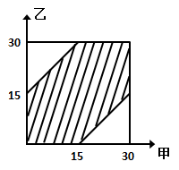

故正确答案为D。

**考点**：概率问题-其他

**来源**：2010年425联考《行测》题（云南/湖南/海南/山东/内蒙古/重庆/广西/辽宁/宁夏/陕西/天津）第10题

### 第 11 题

有一排长椅总共有65个座位，其中已经有些座位上有人就坐。现在又有一人准备找一个位置就坐，但是此人发现，无论怎么选择座位，都会与已经就坐的人相邻。

问原来至少已经有多少人就坐：

A. 13

B. 17

C. 22

D. 33

第 11 题 · 答案与解析

**参考答案（粉笔题库参考内容）**

C

**解析**

无论怎么选择座位，都会与已经就坐的人相邻，则长椅两端最靠边的位置上最多只空了1个座位，而中间人与人之间最多只空了2个座位。 从至少已经有多少人就坐的角度来看，假设第2个座位上有人的话，第5、8、11······62、65个座位分别有人，这样的结果需要人最少。 从总人数来说，也就是说每3个位置坐1人，所以很显然是22人。

故正确答案为C。

**考点**：周期余数问题、非典型最值问题

**来源**：2010年425联考《行测》题（云南/湖南/海南/山东/内蒙古/重庆/广西/辽宁/宁夏/陕西/天津）第11题

### 第 12 题

将边长为1的正方体一刀切割为2个多面体，其表面积之和最大为：

A. 6+2√2

B. 6 + 2√3

C. 6+√2

D. 6+√3

第 12 题 · 答案与解析

**参考答案（粉笔题库参考内容）**

A

**解析**

原正方体表面积为6，若切割后两个多面体表面积之和最大，切割方式如下图所示。切割后两个多面体的表面积之和为6+2√2。

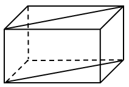

故正确答案为A。

**考点**：几何公式类-立体图形

**来源**：2010年425联考《行测》题（云南/湖南/海南/山东/内蒙古/重庆/广西/辽宁/宁夏/陕西/天津）第12题

### 第 13 题

254个志愿者来自不同的单位，任意两个单位的志愿者人数之和不少于20人，且任意两个单位志愿者的人数不同，问这些志愿者所属的单位数最多有几个：

A. 17

B. 15

C. 14

D. 12

第 13 题 · 答案与解析

**参考答案（粉笔题库参考内容）**

B

**解析**

已知总人数，要求满足所属的单位数最多，则每个单位的人数从允许范围的最小值开始取值且尽量接近。考虑到任意两个单位的人数和不少于20人，那么每个单位的平均人数不小于10，而10+11+12+…+24=(10+24) × 15 ÷ 2=255，则取9、11、12、13······24时刚好满足题意，所属的单位数最多有15个。

故正确答案为B。

**考点**：最不利构造

**来源**：2010年425联考《行测》题（云南/湖南/海南/山东/内蒙古/重庆/广西/辽宁/宁夏/陕西/天津）第13题

### 第 14 题

A、B、C、D、E是5个不同的整数，两两相加的和共有8个不同的数值，分别是17、25、28、31、34、39、42、45，则这5个数中能被6整除的有几个：

A. 0

B. 1

C. 2

D. 3

第 14 题 · 答案与解析

**参考答案（粉笔题库参考内容）**

C

**解析**

设A&lt;B&lt;C&lt;D&lt;E，则必有A+B=17，A+C=25，C+E=42，D+E=45。两两相加，应该有10个数值，因此必有两个重复值。这10个数值相加，必为4的倍数，将题中8个数值相加得261，除以4余1，因此另外两个加和必然除以4余3，重复的两个数在28、31、34、39中，因此这两个数为28、39或28、31，28必为重复值，可知B+C=A+D=28，所以，A=7，B=10，C=18，D=21，E=24，能被6整除的有18、24两个。

故正确答案为C。

**考点**：和差倍比问题

**来源**：2010年425联考《行测》题（云南/湖南/海南/山东/内蒙古/重庆/广西/辽宁/宁夏/陕西/天津）第14题

### 第 15 题

一列队伍沿直线匀速前进，某时刻一传令兵从队尾出发，匀速向队首前进送命令，他到达队首后马上原速返回，当他返回队尾时，队伍行进的距离正好与整列队伍的长度相等。

问传令兵从出发到最后到达行走的整个路程是队伍长度的多少倍：

A. 1.5

B. 2

C. 1+√2

D. 1+√3

第 15 题 · 答案与解析

**参考答案（粉笔题库参考内容）**

C

**解析**

假设队伍长度为S，传令兵、队伍的速度分别为v_1、12，根据题意可得S/(v_1 − v_2) + S/(v_1 + v_2) = S/v_2，解得v_1 = (1+√2)v_2。传令兵的速度是队伍速度的1+√2倍，则传令兵的路程也是队伍行进距离的1+√2倍，而队伍行进距离恰好为队伍的长度。

故正确答案为C。

**考点**：相遇追及

**来源**：2010年425联考《行测》题（云南/湖南/海南/山东/内蒙古/重庆/广西/辽宁/宁夏/陕西/天津）第15题

### 第 16 题

请从所给的四个选项中，选择最适合的一项填在问号处，使之呈现一定的规律性。

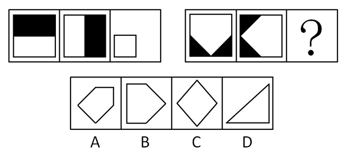

A. A

B. B

C. C

D. D

第 16 题 · 答案与解析

**参考答案（粉笔题库参考内容）**

A

**解析**

组成相似，元素叠加运算。题干第一组中，第三幅图是由前两幅图叠加后对空白部分的求同而得到的。因此第二组中的前两幅图叠加并求同后得到A中的图形。

故正确答案为A。

**考点**：样式规律-加减同异、样式规律-黑白运算

**来源**：2010年425联考《行测》题（云南/湖南/海南/山东/内蒙古/重庆/广西/辽宁/宁夏/陕西/天津）第16题

### 第 17 题

从所给四个选项中，选择最合适的一个填入问号处，使之呈现一定规律性：

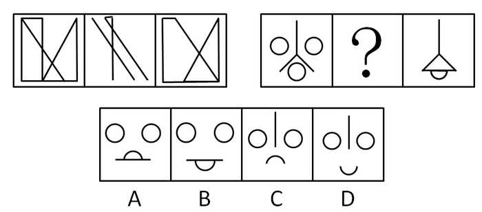

A. A

B. B

C. C

D. D

第 17 题 · 答案与解析

**参考答案（粉笔题库参考内容）**

A

**解析**

元素组成相似，元素叠加运算。题干第一组中，第三幅图是由前两幅图叠加后去同存异而得到的。要使第二组中的第二幅图和第一幅图叠加并去同存异后可以得到第三幅图，符合条件的只有A。

故正确答案为A。

**考点**：样式规律-加减同异

**来源**：2010年425联考《行测》题（云南/湖南/海南/山东/内蒙古/重庆/广西/辽宁/宁夏/陕西/天津）第17题

### 第 18 题

从所给四个选项中，选择最合适的一个填入问号处，使之呈现一定规律性：

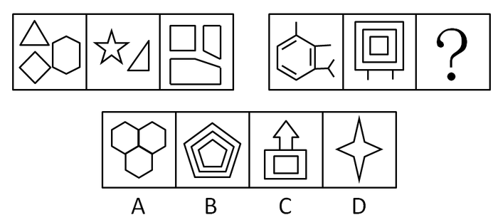

A. A

B. B

C. C

D. D

第 18 题 · 答案与解析

**参考答案（粉笔题库参考内容）**

C

**解析**

元素组成凌乱，考查数数。题干第一组中的三幅图各有13条直线。第二组中的前两幅图各有14条直线，因此第三幅图也应有14条直线。A、B为15条线，D项8条，C项14条。

故正确答案为C。

**考点**：数量规律-线

**来源**：2010年425联考《行测》题（云南/湖南/海南/山东/内蒙古/重庆/广西/辽宁/宁夏/陕西/天津）第18题

### 第 19 题

从所给四个选项中，选择最合适的一个填入问号处，使之呈现一定规律性：

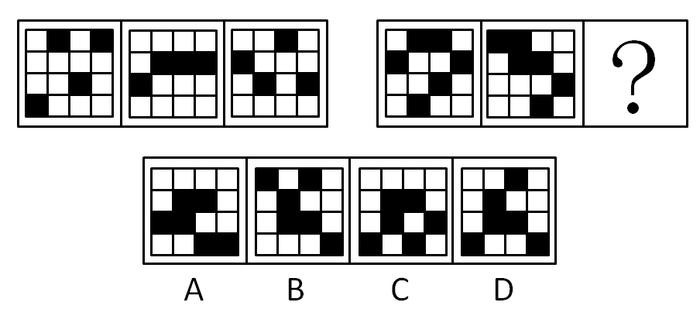

A. A

B. B

C. C

D. D

第 19 题 · 答案与解析

**参考答案（粉笔题库参考内容）**

D

**解析**

元素组成相同，考查位置规律。题干第一组的三幅图中，第一列和第三列中的黑块每次向上移动一格；第二列和第四列中的黑块每次向下移动一格。第二组的前两幅图中，第一列中的黑块每次向上移动一格；第二列，第三列和第四列中的黑块每次向下移动一格。根据此规律，第二组中第三幅图应该是D。

故正确答案为D。

**考点**：位置规律-平移

**来源**：2010年425联考《行测》题（云南/湖南/海南/山东/内蒙古/重庆/广西/辽宁/宁夏/陕西/天津）第19题

### 第 20 题

从所给四个选项中，选择最合适的一个填入问号处，使之呈现一定规律性：

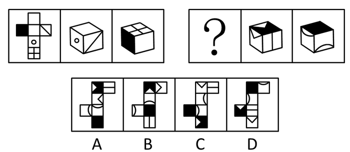

A. A

B. B

C. C

D. D

第 20 题 · 答案与解析

**参考答案（粉笔题库参考内容）**

B

**解析**

第一组中，第二、三幅图是由第一幅图折叠而得到的。因此，第二组中，折叠第一幅图能得到第二、三幅图。

根据“立体图形两个面之间的相对关系和相邻关系”做题。第二组中，第二幅折叠图中“黑底白三角所在面”和“白底白三角所在面”之间是相邻关系，由此可知公共边是“白底白三角”的底边，而A、D中公共边不是“白底白三角”的底边，所以A、D错误；第二幅折叠图中“横线所在面”和“黑底白三角所在面”之间是相邻关系，并且“横线”和“白底白三角所在面”的对称轴方向平行，而C中“横线”和“白底白三角所在面”的对称轴方向垂直，所以C错误。

综上，只有B能够折叠出第二组中的第二、三幅图。

故正确答案为B。

**考点**：空间类-空间重构-六面体

**来源**：2010年425联考《行测》题（云南/湖南/海南/山东/内蒙古/重庆/广西/辽宁/宁夏/陕西/天津）第20题

### 第 21 题

第一次刺激能缓解第二次的小刺激，这种规律称为“贝勃规律”。它表明当人经历强刺激后，之后施与的刺激对他来说会变得微不足道。

根据上述定义，下列能用贝勃规律进行解释的是：

A. 当人们从一个明亮的地方进入一个光线很差的地方时，一开始会看不清任何物体，但过了一会儿后能很快适应黑暗

B. 得知公司将进行第三次裁员时，小王没有前两次时那么担心，能够比较平静地对待了

C. 甲公司向乙公司出售整套设备，开始时报价很优惠，谈判即将结束时，却提出加收安装服务费，乙公司认为不可以接受

D. 小李刚开始工作时兢兢业业，熟悉环境后慢慢松懈下来，但周围人仍觉得他很敬业

第 21 题 · 答案与解析

**参考答案（粉笔题库参考内容）**

B

**解析**

第一步：抓住定义中的关键词。

贝勃规律强调经历“多次相同的刺激”，人对“之前的强刺激”感觉最强烈，对之后的刺激感觉微不足道。

第二步：逐一判断选项。

A中“明亮”和“光线很差”，C中“报价优惠”和“加收服务费”和D中“兢兢业业”和“松懈”都是前后不同的刺激，A、C、D错误；

B中“多次听到裁员的消息”是“相同的刺激”，小王对前两次裁员感觉强烈，对第三次裁员感觉微不足道，B正确。

故正确答案为B。

**考点**：故事类

**来源**：2010年425联考《行测》题（云南/湖南/海南/山东/内蒙古/重庆/广西/辽宁/宁夏/陕西/天津）第21题

### 第 22 题

外包是一种战略管理模式，是指企业为维持核心竞争能力，将非核心业务委托给外部的专业公司，以降低营运成本、提高顾客满意度。离岸外包是外包的一种形式，是指企业将某项业务委托给海外的某个服务提供商或者公司在海外的子公司。

根据上述定义，下列不属于外包的是：

A. 某家企业的一个项目需要5名高级电子工程师，它请国内一家人力资源公司帮助招聘

B. 美国某家公司的一个项目有大量文字资料需要转为电子文本，它请一家中国的公司来完成

C. 某公司承建中东某个国家的钢厂，工程的运输部分由这个公司的海外子公司--海运公司承担

D. 某家建筑工程公司承建某学校的一座教学楼，该校委托另外一家公司进行教学楼的室内装修工作

第 22 题 · 答案与解析

**参考答案（粉笔题库参考内容）**

D

**解析**

第一步：找出定义关键词。

外包：“企业”、“将非核心业务委托给外部的专业公司”、“以降低营运成本、提高顾客满意度”；

离岸外包：“企业将某项业务”、“委托给海外的某个服务提供商或者公司在海外的子公司”。

第二步：逐一分析选项。

A项：“人才”是企业发展的核心竞争力，企业为了维持核心竞争力，将“招聘”这一“非核心业务”委托给别的公司，符合定义，排除；

B项：美国企业将“文字资料电子化”这一“非核心业务”委托给中国公司完成，体现了离岸外包，符合定义，排除；

C项：公司将“运输部分”这一“非核心业务”委托给海外子公司完成，体现了离岸外包，符合定义，排除；

D项：委托人是“学校”，而“学校”不能成为外包的主体，不符合定义，当选。

本题为选非题，故正确答案为D。

**考点**：常规问法

**来源**：2010年425联考《行测》题（云南/湖南/海南/山东/内蒙古/重庆/广西/辽宁/宁夏/陕西/天津）第22题

### 第 23 题

前苏联研制的米格—25喷气式战斗机的许多零部件与同时期美国的战机相比都要落后得多，但因设计者考虑了整体性能，对各零部件进行了更为协调的设计，使该机在升降、速度、应急反应等方面达到当时世界一流水平。这一因组合协调而产生的令人意想不到的结果，被后人称为“米格—25效应”。

根据上述定义，下列属于米格—25效应的是：

A. 一家礼品店礼品样式齐全、定价也不高，因此生意非常不错

B. 小方学习服装设计后，着装时从丝巾到鞋都搭配得当，给人以美感

C. 机关举行乒乓球混双比赛，某处的两人配合默契，以绝对优势战胜了男女单打冠军的组合

D. 某电脑公司开发了一款笔记本电脑，虽然内部配置不高但外观小巧精美，上市后销售情况很好

第 23 题 · 答案与解析

**参考答案（粉笔题库参考内容）**

C

**解析**

第一步：抓住定义中的关键词。

米格-25效应关键在于“零件并非最先进”，但由于“组合协调”而产生了令人意想不到的“整体效果”。

第二步：逐一判断选项。

A中并非因“礼品”组合协调而产生意外效果，而是因为“礼品”本身货全价廉，错误；

B中虽然体现了“组合协调”和“整体效果”，但是“丝巾”和“鞋”原先“不具美感”这一点并未体现，错误；

C中“某处两人水平并非最高”，但是由于“配合默契”最终“出人意料的战胜了男女单打冠军的组合”，正确；

D中“笔记本电脑的销售情况很好”是因为外观小巧精美，并非是将“配置不高的零件”通过组合协调提高了性能来吸引顾客，错误。

故正确答案为C。

**考点**：故事类

**来源**：2010年425联考《行测》题（云南/湖南/海南/山东/内蒙古/重庆/广西/辽宁/宁夏/陕西/天津）第23题

### 第 24 题

自我防御性归因是指通过强调自己对积极的、合乎期望的好结果的作用，缩小对消极的、不合乎期望的坏结果的责任来保护自尊。

根据上述定义，下列属于自我防御性归因的是：

A. 很多家长认为，孩子能否具有创造力关键在于学校的教育理念是否先进

B. 某公司管理者在总结企业成功经验时说，一个成功的企业离不开优秀的员工和先进的管理方法

C. 某国GDP水平屡创新低，该国领导人表示，这是受到世界经济持续低迷的影响

D. 某企业因经营不善而面临破产，该企业领导承认企业领导班子在经营决策上存在失误

第 24 题 · 答案与解析

**参考答案（粉笔题库参考内容）**

C

**解析**

第一步：找出定义关键词。

“强调自己对好结果的作用”、“缩小自己对坏结果的责任”。

第二步：逐一分析选项。

A项：“能否具有创造力”是一个不确定事项并非“好结果”或“坏结果”，因此谈不上“强调作用”或者“缩小责任”，不符合定义，排除；

B项：管理者并未强调自己对于企业成功这一好结果的作用，而是强调“优秀的员工和先进的管理方法”的作用，未体现“强调作用”或者“缩小责任”，不符合定义，排除；

C项：某国的领导人将GDP水平屡创新低归因于世界经济持续低迷的影响，缩小了该国领导人对坏结果的责任，符合定义，当选；

D项：“承认自我责任”与题干中“缩小自己对坏结果的责任”截然不同，不符合定义，排除。

故正确答案为C。

**考点**：方式目的

**来源**：2010年425联考《行测》题（云南/湖南/海南/山东/内蒙古/重庆/广西/辽宁/宁夏/陕西/天津）第24题

### 第 25 题

价格歧视实质上是一种价格差异，通常指商品或服务的提供者在同一时间向不同的接受者提供相同等级、相同质量的商品或服务时，在接受者之间实行不同的销售价格或收费标准。

根据上述定义，下列属于价格歧视的是：

A. 经销商将过季商品打五折出售

B. 电信运营商对网内和网外通话实行区别定价

C. 北京某电影院对其会员实行票价八折的优惠

D. 香港四星级酒店的价格高于内地很多四星级酒店

第 25 题 · 答案与解析

**参考答案（粉笔题库参考内容）**

C

**解析**

第一步：找出定义关键词。

价格歧视强调“同一时间”向“不同接受者”提供“相同等级、相同质量的商品或服务”并实行“不同的销售价格或收费标准”。

第二步：逐一分析选项。

A 项：“过季商品”不符合“同一时间”，排除；

B 项：“网内和网外通话”不符合相同服务，排除；

C 项：“会员”和“普通观众”是“不同接受者”，同时观看同样的电影符合“同一时间”“相同等级、相同质量的商品或服务”，“八折优惠”和“原价”是价格差别，符合定义，当选；

D 项：两种酒店不符合“相同服务和相同等级、相同质量”，排除。

故正确答案为C。

**考点**：大前提

**来源**：2010年425联考《行测》题（云南/湖南/海南/山东/内蒙古/重庆/广西/辽宁/宁夏/陕西/天津）第25题

### 第 26 题

企业战略联盟是两个或两个以上的经济实体（一般指企业，如果企业间的某些部门达成联盟关系，也适用此定义）为了实现特定的战略目标而采取的共担风险、共享利益的长期联合与合作协议。

根据上述定义，下列属于企业战略联盟的是：

A. 某人将自己的专利授权某工厂长期使用，所得利润按协议分配

B. 某汽车配件公司和某汽车制造厂签订合同，长期以优惠价格向该厂提供优质配件

C. 为储备人才，某公司与某名牌大学计算机系达成协议，该系每年的毕业生可参加该公司的招聘面试

D. 为应对国外手机生产商的挑战，国内3家手机生产商达成10年合作协议，共同研发高端手机

第 26 题 · 答案与解析

**参考答案（粉笔题库参考内容）**

D

**解析**

第一步：抓住定义中的关键词。

题干的关键在于“两个或两个以上的企业（或企业内部门）”、“为实现特定战略目标”、“共担风险，共享利益”、“长期”。

第二步：逐一判断选项。

A中“某人”和“某工厂”并非两个经济实体，不符合于“两个或两个以上的企业（或企业内部门）”，错误；

B中“关于优惠价格的协议”并无共担风险，不符合“共担风险，共享利益”，错误；

C中“某公司”和“某名牌大学计算机系”并非两个经济实体，不符合“两个或两个以上的企业（或企业内部门）”，错误；

D中“3家手机生产商”符合“两个或两个以上的企业（或企业内部门）”，“应对挑战”符合“为实现特定战略目标”，“共同研发高端手机”符合“共担风险，共享利益”，“10年”符合“长期”，正确。

故正确答案为D。

**考点**：方式目的

**来源**：2010年425联考《行测》题（云南/湖南/海南/山东/内蒙古/重庆/广西/辽宁/宁夏/陕西/天津）第26题

### 第 27 题

环境承载力是生态系统在维持生命机体的再生能力、适应能力和更新能力的前提下，承受有机体数量的限度。

根据上述定义，下列不属于保护环境承载力措施的是：

A. 政府规定每平方公顷草场放牧的牧畜数量

B. 某地政府出资修缮年久失修的道路，并规定载重超过20吨的车辆禁止通行

C. 为防止外人随意游牧，政府将草场划分给牧民个人并在边界安装围栏

D. 某风景区旅游区规定，每天进入景区的旅游人数不得超过1000人

第 27 题 · 答案与解析

**参考答案（粉笔题库参考内容）**

B

**解析**

第一步：抓住定义中的关键词。

环境承载力强调“生态系统”承受“有机体数量”的限度。

第二步：逐一判断选项。

B中“道路”并非“生态系统”，“20吨”不是“数量”，“车辆”也不是“有机体”，因此政府对道路的维修、限行不属于保护“环境承载力”的措施。

A中“草场”、“牧畜数量”，C中“草场”、“牧民数量”，D中“景区”、“旅游人数”均符合“环境承载力”的定义，因此A、C、D三项中的措施都属于保护“环境承载力”的措施。

故正确答案为B。

**考点**：主客体

**来源**：2010年425联考《行测》题（云南/湖南/海南/山东/内蒙古/重庆/广西/辽宁/宁夏/陕西/天津）第27题

### 第 28 题

角色过载冲突是指一个人的角色要求太多，工作量太大，不可能完成所有角色所要求的工作时所面临的冲突。

根据上述定义，下列属于角色过载冲突的是：

A. 节目主持人黄女士在主持节目的同时还接拍电影、撰写剧本、参加社会公益活动，她觉得力不从心

B. 保险业务员张先生为人热情，经常帮助客户解决生活上的困难，很多人都找他办理保险业务，因而张先生每个月都能超额完成任务

C. 李女士是单位的业务骨干，又是一位孩子的母亲，同时还要照顾老人，但乐观的性格和充沛的精力使她在工作和家庭之间游刃有余

D. 小刘是一名实验员，每天都要高度集中注意力，与各种危险的化学品打交道，还要防止化学品外泄，这让他感到身心疲惫

第 28 题 · 答案与解析

**参考答案（粉笔题库参考内容）**

A

**解析**

第一步：抓住定义中的关键词。

角色过载冲突强调由于“角色要求太多，工作量太大”导致“不可能完成所有工作”并且因此“面临冲突”。

第二步：逐一判断选项。

A中黄女士身兼多职，多项活动符合“角色要求太多，工作量太大”，“力不从心”说明黄女士“不可能完成所有工作”并且“面临冲突”，正确；

B中“超额完成任务”说明张先生“完成了所有工作”，没有“面临冲突”，错误；

C中“游刃有余”说明李女士没有“面临冲突”，错误；

D中小张只是“实验员”不符合“角色要求太多”，错误。

故正确答案为A。

**考点**：原因结果

**来源**：2010年425联考《行测》题（云南/湖南/海南/山东/内蒙古/重庆/广西/辽宁/宁夏/陕西/天津）第28题

### 第 29 题

诉前证据保全，是指依诉讼参加人的申请，人民法院对有可能灭失或者以后难以取得对案件有证明意义的证据，在诉讼前对证据加以固定和保护的制度。

根据上述定义，下列对诉前证据保全的申请可能获得人民法院批准的是：

A. 债务人未能按期偿还债务，债权人申请对作为抵押品的厂房申请诉前证据保全

B. 水果商贩李某与供货商王某发生合同纠纷，胜诉后王某仍拒不交付货物，李某申请对该批水果进行诉前证据保全

C. 货主因怀疑运输公司在运输途中出卖其货物，诉前申请对运输车辆予以证据保全

D. 某公司在市场上发现有商店出卖假冒其品牌的商品，申请对这些商品诉前证据保全

第 29 题 · 答案与解析

**参考答案（粉笔题库参考内容）**

D

**解析**

第一步：抓住定义中的关键词。

题干强调“可能灭失或以后难以取得的”，“对案件有证明意义的”证据。

第二步：逐一判断选项。

A中“厂房”不符合可能灭失，排除；

B中“水果”对案件没有证明意义，排除；

C中“运输车”对案件没有证明意义，排除；

D中“商品”正在售卖，卖出后难以取得，且该“商品”对“假冒其他品牌”这个案件有证明意义，当选。

故正确答案为D。

**考点**：主客体

**来源**：2010年425联考《行测》题（云南/湖南/海南/山东/内蒙古/重庆/广西/辽宁/宁夏/陕西/天津）第29题

### 第 30 题

滥用市场支配地位，是指在相关市场内具有能够控制商品价格、数量或者其他交易条件，或者能够阻碍、影响其他经营者进入相关市场的经营者，利用其市场支配地位危害竞争，损害竞争对手和社会公共利益及其他私人利益的行为。

根据上述定义，下列行为构成滥用市场支配地位行为的是：

A. 甲公司通过取得股权或者资产方式取得对其他很多经营者的控制权，使自己该地的市场占有率达50%以上

B. 在某地食用油市场占有率达55%的甲公司，要求当地某超市在购物车上为其免费做广告，遭到超市拒绝，甲公司停止向该超市供货

C. 某市电力公司称很多用户的电表不准，要求用户必须购买该公司指定的几种品牌的电表，经查，电力公司与指定品牌的生产厂家并无利益关系

D. 在某市打火机市场占有率达70%的甲乙二厂，为缓解由于经济不景气而导致的销售量严重下降，就限定生产数量和销售价格达成协议，造成很多小厂家破产

第 30 题 · 答案与解析

**参考答案（粉笔题库参考内容）**

D

**解析**

第一步：抓住定义中的关键词。

题干强调行为为“利用其市场支配地位”并且“损害竞争对手和社会公共利益及其他私人利益”。

第二步：逐一判断选项。

A项：甲公司通过取得股权或者资产这些合法方式提高自己的市场占有率，不存在“利用其市场支配地位”的情况，排除；

B项：甲公司“要求免费做广告”是“利用其市场支配地位”的行为，但是“停止供货”并非“损害竞争对手和社会公共利益及其他私人利益”的行为，排除；

C项：由于“无利益关系”，所以电力公司的“指定购买行为”是出于对该公司产品质量的信任而不是蓄意危害竞争损害他人利益，排除；

D项：甲乙二厂利用他们的市场占有率，“限定生产数量和销售价格”导致“小厂家破产”，甲乙二厂的行为符合“利用支配地位危害竞争对手，损害利益”，当选。

故正确答案为D。

**考点**：方式目的

**来源**：2010年425联考《行测》题（云南/湖南/海南/山东/内蒙古/重庆/广西/辽宁/宁夏/陕西/天津）第30题

### 第 31 题

手术刀：外科医生（    ）。

A. 渔网：渔民

B. 讲台：教师

C. 打火机：抽烟者

D. 望远镜：科学家

第 31 题 · 答案与解析

**参考答案（粉笔题库参考内容）**

A

**解析**

第一步：判断题干词语间逻辑关系。

手术刀是外科医生做手术的必备工具，两者是职业与其必备工具的对应关系。

第二步：判断选项词语间逻辑关系。

A项，渔网是渔民捕鱼的必备工具，与题干逻辑关系一致，当选。

B项，讲台是教师讲课需要的基础设施，不是讲课工具，与题干逻辑关系不一致，排除。

C项，抽烟者不是一种职业，与题干逻辑关系不一致，排除。

D项，科学家的范围过于广泛，望远镜并非是所有科学家的必备工具，与题干逻辑关系不一致，排除。

故正确答案为A。

**考点**：逻辑关系-对应关系

**来源**：2010年425联考《行测》题（云南/湖南/海南/山东/内蒙古/重庆/广西/辽宁/宁夏/陕西/天津）第31题

### 第 32 题

树木：砍伐（    ）。

A. 汽车：驾驶

B. 山泉：流淌

C. 酵母：分解

D. 石油：开采

第 32 题 · 答案与解析

**参考答案（粉笔题库参考内容）**

D

**解析**

第一步：判断题干词语间逻辑关系。

题干两个词，砍伐树木，构成动宾短语，且树木是自然资源。

第二步：判断选项词语间逻辑关系。

A项，驾驶汽车，构成动宾短语，但汽车不是资源，与题干逻辑关系不一致，排除。

B项，山泉流淌，构成主谓短语，与题干逻辑关系不一致，排除。

C项，酵母分解，构成主谓短语，与题干逻辑关系不一致，排除。

D项，开采石油，构成动宾短语，石油是自然资源，与题干逻辑关系一致，当选。

故正确答案为D。

**考点**：语法关系

**来源**：2010年425联考《行测》题（云南/湖南/海南/山东/内蒙古/重庆/广西/辽宁/宁夏/陕西/天津）第32题

### 第 33 题

世界地图：地球仪

A. 一元纸币：一元硬币

B. 纸飞机：飞机模型

C. 肖邦画像：肖邦雕塑

D. 楼房平面图：楼房三维图

第 33 题 · 答案与解析

**参考答案（粉笔题库参考内容）**

C

**解析**

第一步：判断题干词语间逻辑关系。

 “世界地图”是地球的二维图形，“地球仪”是地球的三维图形，二者的图案相同，属于二维和三维的对应关系。

第二步：判断选项词语间逻辑关系。

A项：“纸币”和“硬币”图案不同，与题干逻辑关系不一致，排除；

B项：“纸飞机”和“飞机模型”都是三维模型，与题干逻辑关系不一致，排除；

C项：“肖邦画像”是肖邦的二维肖像，“肖邦雕塑”是肖邦的三维模型，二者图案相同，属于二维和三维的对应关系，与题干逻辑关系一致，当选；

D项：“楼房平面图”和“楼房三维图”都是二维的，与题干逻辑关系不一致，排除。

故正确答案为C。

**考点**：逻辑关系-对应关系

**来源**：2010年425联考《行测》题（云南/湖南/海南/山东/内蒙古/重庆/广西/辽宁/宁夏/陕西/天津）第33题

### 第 34 题

水：农业

A. 消费：经济

B. 婚姻：人生

C. 文字：文化

D. 娱乐：生活

第 34 题 · 答案与解析

**参考答案（粉笔题库参考内容）**

A

**解析**

第一步：判断题干词语间逻辑关系。

水是农业当中必不可少的，二者为必要条件的对应关系。

第二步：判断选项词语间逻辑关系。

A项：消费是经济当中必不可少的，二者为必要条件的对应关系，与题干逻辑关系一致，当选；

B项：婚姻不是人生当中必不可少的，与题干逻辑关系不一致，排除；

C项：文字不是文化当中必不可少的，与题干逻辑关系不一致，排除；

D项：娱乐不是生活当中必不可少的，与题干逻辑关系不一致，排除。

故正确答案为A。

**考点**：逻辑关系-对应关系

**来源**：2010年425联考《行测》题（云南/湖南/海南/山东/内蒙古/重庆/广西/辽宁/宁夏/陕西/天津）第34题

### 第 35 题

文物：博物馆：展示

A. 显示器：主机：办公

B. 灯塔：探照灯：导航

C. 医生：病房：手术

D. 学生：学校：学习

第 35 题 · 答案与解析

**参考答案（粉笔题库参考内容）**

D

**解析**

第一步：判断题干词语间逻辑关系。

文物放在博物馆进行展示，博物馆是文物展示的地点，两词为场所对应关系。

第二步：判断选项词语间逻辑关系。

A项：显示器是电脑的组成部分，而主机也是电脑的组成部分，两词是并列关系，与题干逻辑关系不一致，排除；

B项：灯塔上有探照灯，探照灯是灯塔的一部分，不是灯塔导航的地点，两词是组成关系，与题干逻辑关系不一致，排除；

C项：病房不是医生进行手术的地点，不存在场所对应关系，与题干逻辑关系不一致，排除；

D项：学生在学校里进行学习，学校是学生学习的场所，两词为场所对应关系，与题干逻辑关系一致，当选。

故正确答案为D。

**考点**：语法关系、逻辑关系-对应关系

**来源**：2009年国家公务员录用考试《行测》题第87题

### 第 36 题

田野：小麦：麦粒（    ）。

A. 水塘：鲤鱼：鱼籽

B. 林场：树木：枯枝

C. 牧场：牛群：牛尾

D. 海洋：鱼鳍：鲨鱼

第 36 题 · 答案与解析

**参考答案（粉笔题库参考内容）**

A

**解析**

第一步：判断题干词语间逻辑关系。

题干三个词语是对应关系。小麦生长在田野里，所以“小麦”与“田野”是产物和场所的对应关系；小麦产出麦粒，且麦粒是小麦的种子。

第二步：判断选项词语间逻辑关系。

A项，鲤鱼生长在水塘里，鲤鱼产出鱼籽，且鱼籽是鲤鱼的鱼种，逻辑关系与题干相符。

B项，树木生长在林场里，但枯枝不是树木的种子，逻辑关系与题干不符。

C项，牛群生长在牧场里，但牛尾不能繁殖成牛，逻辑关系与题干不符。

D项，鲨鱼的位置与题干不符，并且鱼鳍也不是鲨鱼的鱼种，逻辑关系与题干不符。

故正确答案为A。

**考点**：逻辑关系-对应关系

**来源**：2010年425联考《行测》题（云南/湖南/海南/山东/内蒙古/重庆/广西/辽宁/宁夏/陕西/天津）第36题

### 第 37 题

妻子：母亲：社会角色（    ）。

A. 水：冰：液体

B. 父亲：儿子：家庭

C. 冰糖：砂糖：糖精

D. 石墨：金刚石：化学物质

第 37 题 · 答案与解析

**参考答案（粉笔题库参考内容）**

D

**解析**

第一步：判断题干词语间逻辑关系。

妻子和母亲是一个人的不同角色，前两者是对应关系；妻子和母亲都是社会角色的一种，最后一项与前两者构成包含关系，题干属于双重逻辑。

第二步：判断选项词语间逻辑关系。

A项，冰不是液体，不构成包含关系，与题干逻辑关系不一致。

B项，父亲和儿子是家庭成员，而不是“家庭”，不构成包含关系，与题干逻辑关系不一致。

C项，冰糖是砂糖的结晶再制品，两者不是同一种糖；糖精是石油化工产品制成的人工合成的甜味剂，与前两者不构成包含关系，与题干逻辑关系不一致。

D项，石墨和金刚石是碳的不同表现形式，两者是对应关系；石墨和金刚石属于化学物质，构成包含关系，与题干逻辑关系一致。

故正确答案为D。

**考点**：逻辑关系-包容关系、逻辑关系-对应关系

**来源**：2010年425联考《行测》题（云南/湖南/海南/山东/内蒙古/重庆/广西/辽宁/宁夏/陕西/天津）第37题

### 第 38 题

（  ） 对于 效益 相当于 经营 对于 （  ）

A. 投入 利润

B. 成本 税收

C. 生产 规划

D. 资本 管理

第 38 题 · 答案与解析

**参考答案（粉笔题库参考内容）**

A

**解析**

第一步：将选项逐一代入，判断各选项前后部分的逻辑关系。

A中前面部分是因果关系，后面部分是因果关系；

B中前面部分是对应关系，后面部分是因果关系；

C中前面部分是因果关系，后面部分是包容关系；

D中前面部分是因果关系，后面部分是包容关系。

第二步：逻辑关系相同即为答案。

根据第一步可知，逻辑关系完全相同的是A。

故正确答案为A。

**考点**：逻辑关系-对应关系

**来源**：2010年425联考《行测》题（云南/湖南/海南/山东/内蒙古/重庆/广西/辽宁/宁夏/陕西/天津）第38题

### 第 39 题

乐手  对于  （  ）  相当于  车厢  对于（  ）

A. 钢琴 铁轨

B. 乐队 火车

C. 舞台 站台

D. 乐谱 乘客

第 39 题 · 答案与解析

**参考答案（粉笔题库参考内容）**

B

**解析**

第一步：将选项逐一代入，判断各选项前后部分的逻辑关系。

A中前面部分是对应关系，后面部分无明显逻辑关系；

B中前面部分是包容关系中的组成关系，后面部分是组成关系；

C中前面部分是对应关系，后面部分无明显逻辑关系；

D中前面部分是职业和工具间对应关系，后面部分是场所和人物间的对应关系。

第二步：逻辑关系相同即为答案。

根据第一步可知，逻辑关系完全相同的是B。

故正确答案为B。

**考点**：逻辑关系-包容关系

**来源**：2010年425联考《行测》题（云南/湖南/海南/山东/内蒙古/重庆/广西/辽宁/宁夏/陕西/天津）第39题

### 第 40 题

血管  对于  （  ）  相当于  （  ）对于  城市

A. 血液 国家

B. 健康 居民

C. 循环 运输

D. 身体 道路

第 40 题 · 答案与解析

**参考答案（粉笔题库参考内容）**

D

**解析**

逐一代入选项。

A项：血液在血管内流动，二者为对应关系，城市是国家的组成部分，二者为组成关系，前后逻辑关系不一致，排除；

B项：健康是血管的一种状态，二者为对应关系，居民是城市的组成部分，二者为组成关系，前后逻辑关系不一致，排除；

C项：血管的功能之一是参与循环，运输与城市无功能对应关系，前后逻辑关系不一致，排除；

D项：血管是身体的一部分，二者为组成关系，道路是城市的组成部分，二者为组成关系，前后逻辑关系一致，当选。

故正确答案为D。

**考点**：逻辑关系-包容关系

**来源**：2010年425联考《行测》题（云南/湖南/海南/山东/内蒙古/重庆/广西/辽宁/宁夏/陕西/天津）第40题

### 第 41 题

相关研究发现，每天睡眠不足7小时的人普遍比睡眠时间更长的人胖。这是因为睡眠不足影响了新陈代谢功能，使刺激食欲的荷尔蒙增加，同时产生饱胀感的荷尔蒙水平降低。

由此不能推出：

A. 胖人的食欲比体重正常的人好

B. 睡眠状况影响新陈代谢

C. 荷尔蒙水平影响食欲

D. 胖人的荷尔蒙水平可能异于常人

第 41 题 · 答案与解析

**参考答案（粉笔题库参考内容）**

A

**解析**

第一步：判断题干整体关系。

题干指出睡眠不足会影响新陈代谢，进而使人长胖。由此可以得到睡眠不足⇒荷尔蒙水平降低⇒长胖。

第二步：逐一判断题干中各句话的作用。

A项，题干中说“普遍”，而选项说“胖人的食欲比体重正常的人好”，过于绝对化，无法推出；

B项，题干第二句中“睡眠不足影响了新陈代谢功能”说明新陈代谢和睡眠时间有关，可以推出；

C项，题干第二句中“刺激食欲的荷尔蒙”以及“产生饱腹感的荷尔蒙”说明食欲和荷尔蒙有关，可以推出；

D项，已知胖人存在肥胖的情况，肯定题干的后件，可能得到荷尔蒙水平异常的结论，可以推出。

本题为选非题，故正确答案为A。

**考点**：日常结论

**来源**：2010年425联考《行测》题（云南/湖南/海南/山东/内蒙古/重庆/广西/辽宁/宁夏/陕西/天津）第41题

### 第 42 题

一个外地品牌为进入本地市场进行广告宣传效果的调查。结果显示，在用电视广告宣传时，当地每百人有15人知晓该品牌，而后选用报纸广告，每百人有26人表示对其有印象。据此，为提高该品牌的知晓率，该公司决定将全部广告资金投入报纸广告。

以下如果为真，最能削弱该公司决定的是：

A. 电视是当地人获取信息的最主要途径

B. 报纸广告容易给观众留下“产品过于廉价”的负面印象

C. 若不采用报纸广告而继续采用电视广告宣传，相同时间后，每百人有45人知晓该品牌

D. 通过电视知晓该品牌的人中，八成有购买意愿，而通过报纸广告知晓者，仅两成有此意愿

第 42 题 · 答案与解析

**参考答案（粉笔题库参考内容）**

C

**解析**

第一步：找到论点和论据。

本题的论点是“全部广告资金投入报纸广告”，本题的论据是“用电视广告宣传时，每百人有15人知晓，而后用报纸广告，每百人有26人知晓”。

第二步：判断削弱方式。

本题中的论点和论据间有因果联系，需要削弱论点。

第三步：逐一判断选项的作用。

A提出“电视是获取信息的主要途径”，但这并不意味着电视广告是知晓该品牌的主要途径，无关项，错误；

B“负面影响”，D“购买率”，B、D都没对“提高知晓率”做出削弱，错误；

C提出“采用电视广告，相同时间后每百人有45人知晓”，这说明用电视广告使品牌“知晓率”更高，用数字直接削弱了论点，正确。

故正确答案为C。

**考点**：削弱-实验类、削弱论点

**来源**：2010年425联考《行测》题（云南/湖南/海南/山东/内蒙古/重庆/广西/辽宁/宁夏/陕西/天津）第42题

### 第 43 题

某公司所有的销售人员都是男性，所有的文秘都是女性，所有的已婚者都是文秘，公司的总经理尚未结婚。

据此，我们可以知道：

A. 总经理是男性

B. 已婚者中有男性

C. 女员工中可能有未婚者

D. 销售人员中有的已经结婚

第 43 题 · 答案与解析

**参考答案（粉笔题库参考内容）**

C

**解析**

第一步：翻译题干。利用充分必要条件。

（1）：所有销售人员⇒男性。

（2）：所有已婚⇒所有文秘⇒女性。

（3）：总经理⇒未婚。

第二步：对翻译后的题干进行推导，并判断选项。

A项，否定（2）的前件不能得到否定（2）的后件的结论，因此“未婚的不都是男性”。又因为总经理未婚，所以不能推出总经理是男性，错误；

B项，对（2）利用逆否规则可得到：所有男性⇒不是文秘⇒未婚，即男性都未婚。“男性都未婚”意味着已婚者中并没有男性，错误；

C项，“女员工”属于肯定（2）的后件，不能推出必然性结论但是可以推出可能性结论，即“可能已婚也可能未婚”。由于“可能未婚”，所以“女员工中可能有未婚者”，正确；

D项，对（2）利用逆否规则可得到：所有男性⇒不是文秘⇒未婚，又因为“所有销售人员⇒男性”，所以可以推出：所有销售人员⇒未婚，即“所有销售人员都未婚”。“所有销售人员都未婚”意味着销售人员中不可能有已婚者，错误。

故正确答案为C。

**考点**：集合推理

**来源**：2010年425联考《行测》题（云南/湖南/海南/山东/内蒙古/重庆/广西/辽宁/宁夏/陕西/天津）第43题

### 第 44 题

研究证明，吸烟所产生烟雾中的主要成分丙烯醛，是眼睛健康的“慢性杀手”，而橄榄油提取物羟基酪醇，能有效减缓这个“慢性杀手”给眼睛带来的伤害。由此得出结论，常吃橄榄油能够让吸烟者眼睛远离伤害。以下如果为真，最能支持上述论证的是（    ）。

A. 羟基酪醇易于被人体吸收

B. 橄榄油含有其他有益于人体的物质

C. 常吃橄榄油的人视力优于不经常吃的人

D. 烟雾中还含有其他对视力有伤害的物质

第 44 题 · 答案与解析

**参考答案（粉笔题库参考内容）**

A

**解析**

第一步：找出论点论据。

论点：常吃橄榄油能够让吸烟者眼睛远离伤害。

论据：吸烟所产生烟雾中的主要成分丙烯醛，是眼睛健康的“慢性杀手”，而橄榄油提取物羟基酪醇，能有效减缓这个“慢性杀手”给眼睛带来的伤害。

第二步：逐一判断选项。

A项，若“羟基酪醇易于被人体吸收”，则常吃橄榄油，可吸收较多的羟基酪醇，减缓吸烟产生的烟雾的伤害。若“羟基酪醇不易被人体吸收”则常吃橄榄油不能让吸烟者眼睛远离伤害。即该项为论点成立的必要条件，可以加强，当选；

B项，“其他有益的物质”，与题干讨论话题无关，无法加强，排除；

C项，“常吃橄榄油的人视力优于不经常吃的人”，说明吃橄榄油有益于视力，但视力只是眼睛健康的一个方面，加强力度较弱，排除；

D项，“其他有害物质”，即除了“丙烯醛”外，吸烟者视力还要受到其他因素的影响。该项通过引入他因，削弱了论据与论点的联系，无法加强，排除。

故正确答案为A。

**考点**：必要条件

**来源**：2010年425联考《行测》题（云南/湖南/海南/山东/内蒙古/重庆/广西/辽宁/宁夏/陕西/天津）第44题

### 第 45 题

春节期间，贩卖伪造火车票已经成为社会的一大公害。公安部门对此进行了多次突击整治，捣毁了一批制造和贩卖伪造火车票的窝点，抓捕和惩治了一批以此牟取暴利的不法分子。但是，社会上贩卖伪造火车票的现象依然存在。

如果上述断定为真，以下哪项不可能是贩卖伪造火车票现象依然存在的原因：

A. 假火车票的买方市场依然存在

B. 所破获的制假窝点只占其很小的比例

C. 火车票缺乏有效的防伪标识

D. 铁路运输部门仍在出售站票

第 45 题 · 答案与解析

**参考答案（粉笔题库参考内容）**

D

**解析**

第一步：找出题干矛盾。

公安部门对贩卖伪造火车票进行了多次突击整治，但社会上贩卖伪造火车票的现象依然存在。

第二步：逐一分析选项。

A项：“买方市场依然存在”可能导致贩假现象依然存在，因为有买方就有卖方，可以解释题干矛盾，排除；

B项：“破获的制假窝点所占比例小”说明整治不全面存在漏网，导致贩假现象仍有存在，可以解释题干矛盾，排除；

C项：“火车票缺乏有效的防伪标识”使贩假者能够成功卖出假火车票并获利，导致贩假现象依然存在，可以解释题干矛盾，排除；

D项：“火车站出售站票”与假火车票并无直接关系，无法说明为什么贩卖伪造火车票的现象依然存在，不能解释题干矛盾，当选。

本题为选非题，故正确答案为D。

**考点**：原因解释

**来源**：2010年425联考《行测》题（云南/湖南/海南/山东/内蒙古/重庆/广西/辽宁/宁夏/陕西/天津）第45题

### 第 46 题

大量研究表明，几乎所有的合成色素都不能向人体提供营养物质，某些合成色素甚至会危害人体健康，导致生育力下降、畸胎等，有些甚至在人体内可能转换成致癌物质。因此，应该使用天然色素代替合成色素。

以下如果为真，最能削弱上述结论的是：

A. 人体的解毒功能和排泄功能可消解合成色素中的一些毒素

B. 天然色素成分复杂，加工过程中可能因结构改变而生成有害物质

C. 天然色素的着色力一般不如合成色素强，比较容易褪色或变色

D. 天然色素的提取并不容易，成本消耗大，技术上也不好操作

第 46 题 · 答案与解析

**参考答案（粉笔题库参考内容）**

B

**解析**

第一步：找到论点和论据。

本题的论点是“应该用天然色素代替合成色素”。论据是“合成色素对人体有害”。

第二步：逐一判断选项的作用。

A中“解毒功能和排泄功能”与题干没有关系，为无关项，错误；

B中“天然色素成分复杂，加工过程中可能因结构改变而生成有害物质”说明天然色素像合成色素一样都对人体有害，因此不应该用天然色素代替合成色素，削弱了论点，正确；

C中“着色力”与论述的核心“健康”没有直接关系，为无关项，错误；

D中“天然色素的提取并不容易”在一定程度上说明了天然色素不能代替合成色素，有一定的削弱作用，但与论述的核心“健康”没有直接关系，削弱力度小于B项，错误。

故正确答案为B。

**考点**：削弱论点

**来源**：2010年425联考《行测》题（云南/湖南/海南/山东/内蒙古/重庆/广西/辽宁/宁夏/陕西/天津）第46题

### 第 47 题

快递公司服务范围即服务网络所能覆盖或到达的范围，是衡量快递公司竞争能力的最重要因素，也是快递企业提供快递服务的物质基础。服务范围决定了快递公司快件所能到达的服务区域。对于客户来说，快递公司能提供的服务范围当然是越大越好。

以下哪项如果为真，不能支持上述判断：

A. 许多服务范围小的快递公司在激烈的市场竞争下举步维艰

B. 大中型客户的业务范围往往非常广泛，覆盖全国各地

C. 服务网络覆盖面广的快递公司，如EMS、中铁快运等四家的营业总额超过国内市场总额的50％

D. 划分为省内和省外快件后，快递公司主要以重量计费，并不以距离计费

第 47 题 · 答案与解析

**参考答案（粉笔题库参考内容）**

D

**解析**

第一步：找到题干核心内容。

本题题干谈及两方面，一是“快递公司提供的服务范围越大，竞争能力越强，经营越好”，二是“服务范围决定快件到达区域，范围越大客户越满意”。

第二步：逐一判断选项的作用。

A中“范围小的公司举步维艰”说明“范围小”使客户不满意从而导致经营困难，B中“大中型客户的范围非常广泛”说明“范围大”使客户满意并吸引到大中型客户从而导致经营良好，这从正面加强了论证，都是通过事实证明服务范围与竞争力的关系，加强了第一个方面；

C中“服务范围广的四家快递公司占有大量的市场份额”说明“范围大”能吸引客户从而扩大经营并占有市场，加强了题干第二个方面；

D中“以重量计费”并不涉及服务范围与快递公司经营状况的关系，并未加强论证，不能支持题干判断。

本题为选非题，故正确答案为D。

**考点**：加强选非题

**来源**：2010年425联考《行测》题（云南/湖南/海南/山东/内蒙古/重庆/广西/辽宁/宁夏/陕西/天津）第47题

### 第 48 题

几位同学对物理竞赛的名次进行猜测。小钟说：“小华第三，小任第五。”小华说：“小闽第五，小宫第四。”小任说：“小钟第一，小闽第四。”小闽说：“小任第一，小华第二。”小宫说：“小钟第三，小闽第四。”已知本次竞赛没有并列名次，并且每个名次都有人猜对。

那么，具体名次应该是：

A. 小华第一、小钟第二、小任第三、小闽第四、小宫第五

B. 小闽第一、小任第二、小华第三、小宫第四、小钟第五

C. 小任第一、小华第二、小钟第三、小宫第四、小闽第五

D. 小任第一、小闽第二、小钟第三、小宫第四、小华第五

第 48 题 · 答案与解析

**参考答案（粉笔题库参考内容）**

C

**解析**

第一步：找突破口。

由题干“已知本次竞赛没有并列名次，并且每个名次都有人猜对”可知，如果有一个名次只被提到一次，那么该名次必然被猜对。由题干中五人的话可以看出第二名只被提到一次，因此小华第二。

第二步：把题干信息列于表中，根据突破口进行判断。

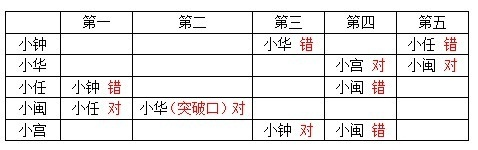

综上所述，小任第一、小华第二、小钟第三、小宫第四、小闽第五。

故正确答案为C。

**考点**：代入法

**来源**：2010年425联考《行测》题（云南/湖南/海南/山东/内蒙古/重庆/广西/辽宁/宁夏/陕西/天津）第48题

### 第 49 题

关于基本粒子目前最被认可的理论是“标准理论”。它约在30年前确立，已发现的基本粒子都可以根据这一理论进行解释。100多年来，质子、中子、电子等基本粒子陆续被发现。面对这些成绩，有人认为，宇宙间的基本粒子被发现得差不多了，即使有，也可以用现有的理论解释，因而不会给人们带来太大的惊奇。

以下哪项如果为真，最能反驳以上观点？（    ）。

A. 基于“标准理论”而被发现的基本粒子很少

B. 基于“标准理论”做出的某些预测未在实验中得到证实

C. 新发现的基本粒子与“标准理论”做出的预测不相符

D. 有科学家提出了颠覆人们以往对基本粒子认识的新理论

第 49 题 · 答案与解析

**参考答案（粉笔题库参考内容）**

C

**解析**

第一步：找到论点和论据。

论点：宇宙间的基本粒子被发现得差不多了，即使有，也可以用标准理论解释，不会给人们带来太大的惊奇。

论据：已发现的基本粒子都可以根据标准理论进行解释；质子、中子、电子等基本粒子陆续被发现。

第二步：逐一分析选项。

A项，题干的论述旨在表明已发现的和未发现的基本粒子都能用标准理论解释，与基于理论发现的基本粒子数量多少无关，不能削弱。

B项，这些预测未得到证实，并不代表它们不会被得到证实，不能削弱。

C项，新发现的粒子与“标准理论”做出的预测不符，即新发现的粒子不能用“标准理论”解释，直接否定了题干的观点，可以削弱。

D项，新理论在未得到证实之前不能否定现有的“标准理论”，不能削弱。

故正确答案为C。

**考点**：削弱论点

**来源**：2010年425联考《行测》题（云南/湖南/海南/山东/内蒙古/重庆/广西/辽宁/宁夏/陕西/天津）第49题

### 第 50 题

据史料记载，唐贞观十九年，玄奘从印度取经归来后，亲自设计建造了大雁塔，用以供奉带回的佛经、金银佛像、舍利等宝物。但直到现在，玄奘所带回的珍宝到底藏在哪里，却无人知晓。考古专家认为，就像法门寺古塔下面存在千年地宫一样，大雁塔地下肯定也藏有地宫，只是尚未发掘而已，并由此推测，大雁塔下的地宫里极有可能藏有玄奘当初带回的珍宝。

以下哪项如果为真，最不能质疑上述推测？

A. 玄奘所画的大雁塔图纸上没有地宫

B. 已发掘的其他几座古塔下的地宫里并没有发现宝物

C. 考古学家已经在其他地点发现了玄奘带回的佛经

D. 根据史籍记载，玄奘带回的宝物已全部进献到皇宫

第 50 题 · 答案与解析

**参考答案（粉笔题库参考内容）**

B

**解析**

第一步：分析题干，找到论点和论据。

论点：大雁塔的地宫可能藏有玄奘带回的珍宝。

论据：像法门寺古塔下面存在千年地宫一样，大雁塔地下肯定也藏有地宫。

第二步：逐一分析选项。

A项：“玄奘画的大雁塔图纸上没有地宫”，说明大雁塔地下没有地宫，因此珍宝不在地宫里，削弱论据，排除；

B项：“已发掘的其他几座古塔下的地宫里没有发现宝物”，其他古塔与大雁塔无关，未削弱题干，当选；

C项：“考古科学家在其他地点发现了玄奘带回的佛经”，说明珍宝可能在其他地方而不在地宫里，削弱论点，排除；

D项：“宝物已全部进献到皇宫”，说明珍宝不在地宫里，削弱论点，排除。

本题为选非题，故正确答案为B。

**考点**：削弱选非题

**来源**：2010年425联考《行测》题（云南/湖南/海南/山东/内蒙古/重庆/广西/辽宁/宁夏/陕西/天津）第50题

### 第 51 题

有研究表明，生物的灭绝在历史上发生过二十几次，大约每2600万年发生一次，似乎具有＿＿＿＿＿。对于物种大灭绝的发生是否真的如此频繁和有规律，还有争议。但即便是最＿＿＿＿＿的估计，也认为至少有5次物种大灭绝是非常明显的。

从下列选项中选择最恰当的一组填入横线中：

A. 必然性 乐观

B. 规律性 简单

C. 突发性 粗略

D. 周期性 保守

第 51 题 · 答案与解析

**参考答案（粉笔题库参考内容）**

D

**解析**

此题考查实词的语境搭配。

第一空，材料中说生物的灭绝大约每2600万年发生一次，并且发生过二十几次。所以可以看出生物的灭绝具有一定的规律性和周期性。“必然性”指事物发展、变化中的不可避免和一定不移的趋势，“突发性”是说突然发生，均不符合语境，所以应在B、D中寻找答案。

第二空，根据语境，“至少有5次物种大灭绝”中的“至少”，是“保守”的估计，而不是“简单”的估计。

所以应选D不选B。

故正确答案为D。

**考点**：实词填空、对应关系-前后呼应

**来源**：2010年425联考《行测》题（云南/湖南/海南/山东/内蒙古/重庆/广西/辽宁/宁夏/陕西/天津）第51题

### 第 52 题

19世纪的西方建筑师大多满足于把钢铁作为一种＿＿＿＿＿手段应用于当时流行的古典式或哥特式建筑。很久以后，建筑师才＿＿＿＿＿了古典和哥特模式，充分发挥了钢铁构架结构的各种潜能。

从下列选项中选择最恰当的一组填入横线中：

A. 次要 放弃

B. 补充 摆脱

C. 主要 超越

D. 典型 淘汰

第 52 题 · 答案与解析

**参考答案（粉笔题库参考内容）**

B

**解析**

此题考查实词的语境搭配。

第一空，从材料中“很久以后······才充分发挥了钢铁构架结构的各种潜能”可知，19世纪的时候钢铁的潜能并没有被充分发挥，所以可以判断那时钢铁是作为一种“次要”或“补充”的手段，而不是“主要”或“典型”手段，所以排除C、D，在A、B中寻找答案。

第二空，“放弃”一般指主观方面，而“摆脱”有种客观意味，是被动中寻求主动。而材料中的意思是建筑师跳出了古典和哥特模式的约束，使钢铁发挥其本身潜能，所以选“摆脱”，选择B项。

故正确答案为B。

**考点**：实词填空、对应关系-前后呼应、词的辨析-词义侧重

**来源**：2010年425联考《行测》题（云南/湖南/海南/山东/内蒙古/重庆/广西/辽宁/宁夏/陕西/天津）第52题

### 第 53 题

根据历史上的真人真事进行文艺创作时，为了使人物表现的更为＿＿＿＿＿，可以对人物进行符合本身和时代背景的“适当”创作，但是大的历史事实、人物命运、主要矛盾、重要事件都必须符合历史，不能对历史人物的“人生层面”进行＿＿＿＿＿和歪曲。

从下列选项中选择最恰当的一组填入横线中：

A. 完整 杜撰

B. 真实 虚构

C. 形象 改编

D. 丰满 臆造

第 53 题 · 答案与解析

**参考答案（粉笔题库参考内容）**

D

**解析**

此题考查实词的语境搭配。

第一空，题干提到对人物进行“适当”创作，意味着合理的加工，所以是会使人物表现得更丰满、有血有肉的。“丰满”可以表达此意，人物塑造本身就是“形象”；“完整”是指不片面，没有语境支撑；“真实”是不虚假，不符合“适当创作”的语境，锁定D项。

第二空，根据与第二个空并列的“歪曲”一词可知，第二个空从感情色彩上看应是个贬义词，“臆造”是无根据的创造，含贬义。其他词语都是中性词，排除。

故正确答案为D。

**考点**：实词填空、对应关系-前后呼应、词的辨析-感情色彩

**来源**：2010年425联考《行测》题（云南/湖南/海南/山东/内蒙古/重庆/广西/辽宁/宁夏/陕西/天津）第53题

### 第 54 题

坐在餐桌前，举筷享用食物，我们早已司空见惯，却浑然不知盘中美餐在全球范围内＿＿＿＿＿的利害关系。现代社会高度分工，我们远离春耕秋收，只有食品价格飙升的时候，粮食生产才会引起我们关注。去年，粮价一路攀升，为我们的长期＿＿＿＿＿敲响了警钟。

从下列选项中选择最恰当的一组填入横线中：

A. 盘根错节 漠然

B. 纷繁芜杂 冷淡

C. 扑朔迷离 无视

D. 眼花缭乱 疏忽

第 54 题 · 答案与解析

**参考答案（粉笔题库参考内容）**

A

**解析**

此题考查成语和实词的混搭。

第一空，需要填入跟“利害关系”搭配的成语。“盘根错节”指树木的根盘曲，枝节交错，比喻很复杂；“纷繁芜杂”是指多而杂；“扑朔迷离”指难辨兔的雌雄。形容事情错综复杂，难以辨别清楚。均可以搭配“关系”，“眼花缭乱”形容眼前的景象复杂纷繁，使人感到迷乱，不能和“关系”搭配，所以排除D，在A、B、C中选择。

第二空，由于前文提到了我们对美餐的利害关系“浑然不知”，即完全没有觉察到，所以我们的长期态度应是“漠视”或者“无视”，而非“冷淡”，所以排除B，在A、C中选择。“漠然”是看到却没引起重视的意思，而材料前边也谈到食品价格飙升的时候才引起注意，可见只是不重视。“无视”指根本没看到，所以应选“漠然”。

故正确答案为A。

**考点**：对应关系-前后呼应、混搭填空、词的辨析-搭配对象

**来源**：2010年425联考《行测》题（云南/湖南/海南/山东/内蒙古/重庆/广西/辽宁/宁夏/陕西/天津）第54题

### 第 55 题

无论当下的生活多么衣食无忧，中国人还是爱假想将来可能遇到的＿＿＿＿＿，即使这些真正发生的几率接近于零。这只能从中国人＿＿＿＿＿的传统心理方面进行解释。

从下列选项中选择最恰当的一组填入横线中：

A. 灾难 任劳任怨

B. 困难 克勤克俭

C. 变故 未雨绸缪

D. 麻烦 居安思危

第 55 题 · 答案与解析

**参考答案（粉笔题库参考内容）**

C

**解析**

本题考查实词和成语的混搭。

先看第二空，根据“这些真正发生的几率接近于零”可知，是人们在事情发生前做准备或有所知晓，所以“未雨绸缪”和“居安思危”均符合语境，排除A、B两项。

再看第一空，D项的“麻烦”语意较轻，与材料中“即使这些真正发生的几率接近于零”的语意相矛盾，排除。

故正确答案为C。

**考点**：对应关系-前后呼应、混搭填空、词的辨析-程度轻重

**来源**：2010年425联考《行测》题（云南/湖南/海南/山东/内蒙古/重庆/广西/辽宁/宁夏/陕西/天津）第55题

### 第 56 题

战争文化研究运用了多种学科、多种理论和多种研究方法来解释战争与社会文化之间的互动关系，远比运用单一学科解释要＿＿＿＿＿得多，可以修正过去一些错误或存在＿＿＿＿＿的观点，也可以对历史进行另外一种角度的解释或观察。

从下列选项中选择最恰当的一组填入横线中：

A. 合理 偏差

B. 科学 误会

C. 深刻 误差

D. 客观 分歧

第 56 题 · 答案与解析

**参考答案（粉笔题库参考内容）**

A

**解析**

此题考查实词的语境搭配和填空。

第二空，可从搭配范围的角度来考虑：第二空前面有一个动词“修正”，而“误会”“分歧”不能与之搭配，所以排除B、D，在A、C中做选择；“偏差”和“误差”相比较，“偏差”是指偏离了事物原本的面貌，而“误差”多用来形容一些具体的数字等，与“误差”搭配的动词，可以是“不能避免”“缩小”等，而不能是“修正”。修正“偏差”语义通顺，搭配合理，所以C错A对。

第一空，“合理”放入第一空语义通顺，且符合语境。验证A正确。

故正确答案为A。

**考点**：实词填空、词的辨析-搭配对象、词的辨析-词义侧重

**来源**：2010年425联考《行测》题（云南/湖南/海南/山东/内蒙古/重庆/广西/辽宁/宁夏/陕西/天津）第56题

### 第 57 题

事后控制不如事中控制，事中控制不如事前控制，可惜大多数事业经营者均未能＿＿＿＿＿到这一点，等到错误的决策造成了重大的损失才如梦方醒，结果往往是请来了名气很大的“空降兵”也＿＿＿＿＿。

从下列选项中选择最恰当的一组填入横线中：

A. 意识 于事无补

B. 体会 无力回天

C. 观察 无济于事

D. 认识 一事无成

第 57 题 · 答案与解析

**参考答案（粉笔题库参考内容）**

A

**解析**

此题考查实词和成语的混搭。

第一空，可从前后照应和搭配范围的角度来考虑。“经营者”与“决策”中存在的风险或隐患之间不能用“观察”和“体会”，所以B、C排除，在A、D中选择。

第二空，题干的意思是错误的决策造成了重大的损失，就算请来名气很大的人帮忙也对事情毫无补益，“于事无补”完整表达了这个意思，当选。“一事无成”是指连一件事情都做不成，形容毫无成就，不符合文意，排除。

故正确答案为A。

**考点**：对应关系-前后呼应、混搭填空

**来源**：2010年425联考《行测》题（云南/湖南/海南/山东/内蒙古/重庆/广西/辽宁/宁夏/陕西/天津）第57题

### 第 58 题

亚洲有中印两个人口大国，然而人口的庞大却与人才是否＿＿＿＿＿没有必然关系。人才供应缺口在一些国际化的行业中尤为＿＿＿＿＿，例如金融从业人员、工程研发人员等在全亚洲都供不应求。

从下列选项中选择最恰当的一组填入横线中：

A. 饱和 突出

B. 充裕 明显

C. 过剩 严峻

D. 流失 巨大

第 58 题 · 答案与解析

**参考答案（粉笔题库参考内容）**

B

**解析**

此题考查实词的语境搭配和词义辨析。

材料首句提到中国和印度都是人口大国，第一空填入的词语应与“庞大”构成照应。“充裕”是指充足丰富，人口庞大，与人才充足构成语义上的前后照应。符合语境，当选。

D项“流失”不符合语境，排除；A项“饱和”是指在一定温度和压强下，溶液中所含溶质达到最高限度，比喻事物达到最大限度；C项“过剩”是指数量超过标准、限度或惯常界限，均有超过必要限度的意思，不符合语境，排除。

故正确答案为B。

**考点**：实词填空、对应关系-前后呼应、词的辨析-词义侧重

**来源**：2010年425联考《行测》题（云南/湖南/海南/山东/内蒙古/重庆/广西/辽宁/宁夏/陕西/天津）第58题

### 第 59 题

全方位开发风险保障产品，仅靠保险业自身的＿＿＿＿＿还不够。因为这类产品往往保险面广、赔付金额多，巨大的经营风险令保险公司难以承受，大面积开发和经营这类产品显得＿＿＿＿＿。

依次填入画横线部分最恰当的一项是：

A. 条件 前途未卜

B. 努力 力不从心

C. 资源 得不偿失

D. 积累 捉襟见肘

第 59 题 · 答案与解析

**参考答案（粉笔题库参考内容）**

B

**解析**

本题考查实词和成语的混搭。第二空，题干的意思是因为全方位开发风险保障产品存在巨大的经营风险令保险公司难以承受，因此单靠保险业自身的力量是不够的。“力不从心”表示心里想做，可是力量够不上，符合语境，B 项当选。“前途未卜”是指不知道未来发展如何，不符合文意，排除 A 项。“得不偿失”指所得的利益抵偿不了所受的损失，此处题干中没有提及损失，排除 C 项。“捉襟见肘”比喻顾此失彼、应付不过来的一种客观状态，并不能体现出文段中主观上想要开发但是能力不足以及难以承受风险之意，排除 D 项。

第一空，代入验证，自身的努力搭配恰当。

故正确答案为B。

**考点**：对应关系-前后呼应、混搭填空、词的辨析-搭配对象

**来源**：2010年425联考《行测》题（云南/湖南/海南/山东/内蒙古/重庆/广西/辽宁/宁夏/陕西/天津）第59题

### 第 60 题

当我们在谈论创意的时候，大多会认为这没有什么规律可循，或者说，创意应该是＿＿＿＿＿的。我们会说：如果给创意制定一个框架的话，可能会束缚创意，让创意变成＿＿＿＿＿的工匠活。

从下列选项中选择最恰当的一组填入横线中：

A. 天马行空 按部就班

B. 稍纵即逝 循规蹈矩

C. 自由自在 循序渐进

D. 标新立异 熟能生巧

第 60 题 · 答案与解析

**参考答案（粉笔题库参考内容）**

A

**解析**

此题考查成语的语义辨析和语境搭配。

第一空，根据“或者说”可知，其前后的语义应是相近的，所以空格处的词应表示与“没什么规律可循”相近的语义，“天马行空”是天马奔腾神速，像是腾起在空中飞行一样，指思维的不同寻常的跳跃，符合语境，保留。“自由自在”指没有约束，符合语境，但是不能与“创意”相搭配，排除；“稍纵即逝”形容时间或机会很容易过去，“标新立异”指提出新奇的主张，表示与众不同，均不符合语境，排除。

第二空，“按部就班”按照一定的步骤、顺序进行，也指按老规矩办事，缺乏创新精神，符合语境，且语义通顺，锁定A项。

故正确答案为A。

**考点**：对应关系-前后呼应、成语填空、词的辨析-搭配对象

**来源**：2010年425联考《行测》题（云南/湖南/海南/山东/内蒙古/重庆/广西/辽宁/宁夏/陕西/天津）第60题

### 第 61 题

古希腊和古代中国相似的经验知识曾产生了相似的理论洞察力，比如亚里士多德和《墨经》对杠杆原理的认识。但是，古希腊的初始力学理论很快发展成理论知识的综合体，而中国墨家的力学传统在战国之后就中断了。不擅长观察、认识物体运动并形成系统的理论，这是中国古代科学传统中一个明显的“软肋”。相比之下，中国人在解决实际问题方面的建树更加突出。

这段文字意在说明：

A. 中国古代科学发展的特点

B. 中国古代科学传统中断的原因

C. 古代中国对于力学最初的研究不逊于古希腊

D. 力学理论的不完备是中国古代科学研究的弱点

第 61 题 · 答案与解析

**参考答案（粉笔题库参考内容）**

A

**解析**

材料先通过古希腊和古代中国对力学理论的认识和发展的对比，指出中国古代科学不擅长观察认识并形成系统的理论，这是古代科学的“软肋”，接着又说中国人在解决实际问题方面很突出。可以看出，作者是从正反两个方面阐述中国古代科学发展的特点的，A项正确。

B项“古代科技传统中断”表述片面，且“原因”非重点，排除。C项为转折前的表述，非重点，排除。D项仅提到弱点，文段还指出中国古代科学研究的优点，表述片面，排除。

故正确答案为A。

**考点**：关联词-并列、关联词-转折

**来源**：2010年425联考《行测》题（云南/湖南/海南/山东/内蒙古/重庆/广西/辽宁/宁夏/陕西/天津）第61题

### 第 62 题

人口密度是单位面积土地上居住的人口数，它是表示世界各地人口的密集程度的指标。但人口密度只反映人口与土地面积的一般数量关系，不能体现单位面积土地上的人口成分，也不能体现人口与实际供养他的土地面积的关系。为了弥补这些缺陷，出现了一些新的补充性密度指标，如生理密度、农业密度等，而以面积计算的人口密度称为人口的数学密度。

这段文字意在说明：

A. 人口密度含义演变的原因

B. 补充性密度指标的产生过程

C. 人口密度的具体表现形式

D. 土地面积和人口成分的关系

第 62 题 · 答案与解析

**参考答案（粉笔题库参考内容）**

A

**解析**

文段开篇介绍了“人口密度”的定义、作用，后通过转折词“但”指出“人口密度”的缺陷，而为了弥补这些缺陷，才出现了新的补充性密度指标。故文段描绘了从“人口密度”到“人口的数学密度”概念的衍生、演变的过程，作者想强调的是人口密度含义演变的原因。A项正确。

B项仅对应了尾句“补充性密度指标”，表述片面，排除；C项强调表现人口密度的方法、形式，在材料中仅阐述人口密度含义演变，没有提到人口密度如何表现，无中生有，排除；D项偷换概念，作者想强调的是“人口密度含义演变的原因”而非“土地面积和人口成分的关系”，排除。

故正确答案为A。

**考点**：主题词

**来源**：2010年425联考《行测》题（云南/湖南/海南/山东/内蒙古/重庆/广西/辽宁/宁夏/陕西/天津）第62题

### 第 63 题

当年韩愈被贬到潮州做刺史，虽然只有8个月的时间，却不怕费力，大力兴办州学，捐出所有的俸银，用作办学费用，并积极推广唐朝的普通话，“以正音为潮人诲”。8个月后，韩愈就调离了潮州，几乎没有什么“政绩”可言，然而他给潮州留下了巨大的精神财富。到南宋时，潮州已是文化名城，有了“海滨邹鲁”的美誉。

这段文字意在说明：

A. 语言规范化是一项长期的工作

B. 潮州成为历史文化名城的原因

C. 文化建设对城市有深刻的影响

D. 评价官员不应只看短期的政绩

第 63 题 · 答案与解析

**参考答案（粉笔题库参考内容）**

C

**解析**

文段讲述了韩愈通过兴办州学，推广唐朝的普通话给潮州留下了巨大的精神财富，使潮州在南宋时成了文化名城。通过这个历史故事意在告诉我们文化建设对于城市的发展有巨大的作用，对应C项。

A项，“语言规范化”表述片面，排除；

B项，“潮州成为历史文化名城”非文段重点，排除；

D项，“评价官员不应只看短期的政绩”表述不明确，排除。

故正确答案为C。

**来源**：2010年425联考《行测》题（云南/湖南/海南/山东/内蒙古/重庆/广西/辽宁/宁夏/陕西/天津）第63题

### 第 64 题

现代社会中，人们是在相对统一的时间里交往活动，这有利于节约社会成本，提高社会效率，推动社会发展。但全社会的“步调一致”容易导致交通的堵塞，由此引发的一系列社会问题不容忽视。从另一方面来看，人们的需要、社会发展的需求，又对作息时间提出了不同的要求。但作息时间不统一，也会给人们的交往、社会的发展带来一定障碍。

这段文字意在说明：

A. 作息时间应在统一与差异中寻找平衡

B. 小问题可能会引起社会发展中的大矛盾

C. 调整作息时间是解决交通堵塞的有效措施

D. 作息时间需随着人们生活习惯的改变而调整

第 64 题 · 答案与解析

**参考答案（粉笔题库参考内容）**

A

**解析**

据提问“意在”可知此题是中心理解题。

根据关键句“从另一方面”可以看出其前后是并列的，前半部分强调了时间的统一会引发一系列问题，后半部分提到时间不统一也会给人们的交往和社会的发展带来一定障碍。综合来看，是强调在统一与协调中达到平衡，所以选择A项。

B项表述过于宽泛，没有点出材料的主体“作息时间”；C项不是材料想要表达的主要内容，“交通堵塞”只是材料表述的一个方面；D项“随着人们生活习惯的改变”在材料中没有体现出来。

故正确答案为A。

**考点**：关联词-对策、关联词-转折

**来源**：2010年425联考《行测》题（云南/湖南/海南/山东/内蒙古/重庆/广西/辽宁/宁夏/陕西/天津）第64题

### 第 65 题

毫无疑问，电视节目主持人是当今社会颇具影响力的人群之一。借助大众传媒的影响，主持人成为公众人物。他们的角色因此不同于普通人，而是集社会角色、媒介角色及个人角色于一体的特殊角色。选择了这一职业，不仅仅意味着选择了鲜花和掌声，财富和荣耀，更意味着选择了媒体和社会必然赋予他们的责任。

这段文字意在强调：

A. 大众传媒的发展使主持人具备特殊的影响力

B. 主持人作为公众人物发挥着特殊的社会作用

C. 职业的特殊性决定了主持人所应肩负的责任

D. 主持人应借助传媒的影响扩大其社会影响力

第 65 题 · 答案与解析

**参考答案（粉笔题库参考内容）**

C

**解析**

据提问“意在”可知此题是中心理解题。

材料的主体是在谈节目主持人，先描述了主持人角色的特殊性。后面用一个递进复句强调选择这一职业意味着选择媒体及社会赋予他们的责任。所以可以引申得出是主持人这一职业的特殊性决定了他们被赋予的社会责任。C项正确。

A项，“特殊的影响力”在材料中没有提到，排除；B项，材料并不是在说主持人发挥的社会作用是什么，偏离文段中心，排除；D项，材料只提到了主持人被赋予了“责任”，并没有说主持人要如何扩大社会影响力，主观臆断，排除。

故正确答案为C。

**来源**：2010年425联考《行测》题（云南/湖南/海南/山东/内蒙古/重庆/广西/辽宁/宁夏/陕西/天津）第65题

### 第 66 题

一位著名企业家从百折不挠的拼搏经历中总结出了“冰淇淋哲学”，即卖冰淇淋必须从冬天开始，因为冬天顾客少，会逼迫你降低成本，改善服务。如果能在冬天生存，就再也不会害怕夏天的竞争。

根据本段文字，“冰淇淋哲学”主要强调了：

A. 逆境对培养企业的竞争力非常重要

B. 选择一个好的时机，企业就成功了一半

C. 企业在创业阶段难免会遇到很多困难

D. 企业应注重降低成本，提高服务质量

第 66 题 · 答案与解析

**参考答案（粉笔题库参考内容）**

A

**解析**

据提问和材料可知此题是中心理解题，考查道理。

材料提到的“冰淇淋哲学”是卖冰淇淋必须在冬天开始。因为冬天是卖冰淇淋的困难和逆境时期，如果能在逆境中生存就不会害怕夏天的竞争，所以材料主要强调了逆境对培养企业竞争力的重要性。A项正确。

B项“好的时机”表述错误，材料中说“冬天顾客少”，可见冬天并不是卖冰淇淋的好时机；C项“创业阶段”表述错误，材料讲的是经营好企业，而不是创业；D项表述不是“冰淇淋哲学”的内容。

故正确答案为A。

**考点**：特殊问法

**来源**：2010年425联考《行测》题（云南/湖南/海南/山东/内蒙古/重庆/广西/辽宁/宁夏/陕西/天津）第66题

### 第 67 题

对一项科学工作的评价不能简单地归结为一个数字的大小，任何数字都不能取代同行评议及对该工作科学意义的具体分析和历史检验。然而，不好的评价指标有可能误导评审人员，导致错误的结果；而好的评价指标可以提供更准确的信息，使相应的评审更加客观和公正。

这段文字意在强调，对科学工作的评价：

A. 应该是主观评价和客观评价的统一

B. 关键在于建立科学的评价指标体系

C. 不应以数字结论作为主要参考依据

D. 需要综合考虑多种因素才能实现公正

第 67 题 · 答案与解析

**参考答案（粉笔题库参考内容）**

B

**解析**

据提问“意在”可知此题是中心理解题。

材料第一句指出“同行评议”的重要性。之后，由转折词“然而”引出材料的重点，即不好的评价指标误导评审人员，好的评价指标才能提供准确的信息，意思就是强调建立科学的评价指标的重要性。B项正确。

A项“主观评价”和“客观统一”；C项“不以数字做结论”；D项“考虑多种因素”讲述的都是评价指标的内容。

故正确答案为B。

**考点**：关联词-对策、关联词-转折

**来源**：2010年425联考《行测》题（云南/湖南/海南/山东/内蒙古/重庆/广西/辽宁/宁夏/陕西/天津）第67题

### 第 68 题

近年来全球油价持续上涨，随着各国原油生产能力的日益提高，全球原油储备资源日趋紧张。据分析人士预测，这一上涨趋势绝不会在短期内逆转。受此影响，尽管汽车已逐渐成为人们不可缺少的日常交通工具，但越来越多的人决定暂缓买车或者开始暂停用车。照此看来，整个汽车销售市场的经营风险在相当长一段时间里有增无减。

这段文字的主旨是：

A. 预测未来石油行业的发展趋势

B. 说明汽车销售业的经营风险将会增加

C. 探讨能源行业与交通运输行业存在的联系

D. 认为能源行业将逐渐影响人们的出行方式

第 68 题 · 答案与解析

**参考答案（粉笔题库参考内容）**

B

**解析**

据提问可知此题是中心理解题。

材料前部分从石油能源等角度分析汽车销售市场经营风险增加的可能性原因，然后通过总结词“照此看来”引出结果，即汽车销售市场经营风险在相当长一段时间会增加。材料为分总结构，主旨在“总”的部分，即最后一句话。B项正确。

A项“预测石油行业”，材料的主体为“汽车销售市场”而非“石油行业”，排除；材料主要说的是汽车销售市场存在风险，而非是能源与交通的联系，C项排除；D项是汽车销售市场增加经营风险的原因，属于材料中“分”的部分，不是材料主旨，排除。

故正确答案为B。

**考点**：主题词

**来源**：2010年425联考《行测》题（云南/湖南/海南/山东/内蒙古/重庆/广西/辽宁/宁夏/陕西/天津）第68题

### 第 69 题

色盲也能成为天文学家么？事实上，天文学家日常所分析的照片多数都是黑白的，我们在杂志和其他彩色印刷品上看到的五彩缤纷的天文照片，其实也是通过把多张望远镜拍摄的不同波段的黑白照片加工合成而来的。而且这些波段未必都在人类可见光的范围内，所以即使对于视力正常的人来说，这些图片也并非天体真正的颜色。

下列说法与文意相符的是：

A. 天文学家需要辨别可见光的颜色

B. 彩色的天文照片科学价值相对较低

C. 天文图片是靠不同波段的彩色照片合成而来

D. 视力正常的人也不能完全识别天体本来的颜色

第 69 题 · 答案与解析

**参考答案（粉笔题库参考内容）**

D

**解析**

据提问可知此题属于细节判断题。

根据材料最后一句“这些波段未必都在人类可见光的范围内，所以即使对于视力正常的人来说，这些图片也并非天体真正的颜色”可知，D项表述正确。

根据“天文学家日常所分析的照片多数都是黑白的”可知，天文学家并不需要辨别可见光的颜色，A项表述错误；B项在材料中并未提及；根据“天文照片，其实也是通过把多张望远镜拍摄的不同波段的黑白照片加工合成而来的”可知，天文图片是靠“黑白”照片合成而来，不是“彩色”，C项表述错误。

故正确答案为D。

**考点**：细节判断题

**来源**：2010年425联考《行测》题（云南/湖南/海南/山东/内蒙古/重庆/广西/辽宁/宁夏/陕西/天津）第69题

### 第 70 题

体育竞技掺入越来越多的经济利益，会驱使一些人走向极端。虽然目前运动员的自然能力仍占主导，但是如果有一天科技手段足以超越自然赋予的力量，运动员在日常不需要严格训练，而是通过仪器、手术来增强体质，这与驾驶着摩托车去参加百米竞赛是否还有本质区别？这不仅是抛给体育界的问题，也将成为科学的两难。

“这不仅是抛给体育界的问题”中的“这”指的是：

A. 通过仪器、手术来增强体质

B. 科技手段的作用超过运动员的自然能力

C. 让运动员的自然能力占据主导地位

D. 体育竞技在经济利益驱使下走向极端

第 70 题 · 答案与解析

**参考答案（粉笔题库参考内容）**

B

**解析**

根据就近原则可知“这”是指“这与······区别？”的内容。反问句表示相反，可见作者认为“科技手段的作用超过运动员的自然能力”是不好的，因此，“这不仅是抛给体育界的问题”中的“这”就是指的“科技手段的作用超过运动员的自然能力”这一问题，对应B项。

A项是B项的手段，是“这与······区别？”一句开头“这”所指，同时A项“通过仪器、手术来增强体质”与“构成两难”不能对应，排除；C项是作者支持的观点，不是“问题”，没有体现“两难”，排除；D项是背景，不构成科学难题，排除。

故正确答案为B。

**考点**：代词

**来源**：2010年425联考《行测》题（云南/湖南/海南/山东/内蒙古/重庆/广西/辽宁/宁夏/陕西/天津）第70题

### 第 71 题

在与自然灾害的抗争中，人类仍然有很长的路要走。现实固然必须正视，但普通民众是否就无可作为呢？在灾害预测还无法做到完全精确的今天，每一个人该如何保护上天赋予我们的宝贵生命，该如何在灾难降临的那一刻做出最及时而智慧的选择，该如何自救、救人，避免或减少悲剧的发生？这些事情，其实都可以通过社会教育和自我教育来完成。

这段文字意在强调：

A. 人类与自然灾害的抗争是一个漫长的过程

B. 在自然灾难面前人的首要任务是保护生命

C. 灾难降临时的及时而智慧的选择非常重要

D. 教育可以在自然灾害中保护更多宝贵的生命

第 71 题 · 答案与解析

**参考答案（粉笔题库参考内容）**

D

**解析**

文段首先指出人类与自然灾害的抗争是一个很漫长的过程，接着通过连续的设问，引出在灾害预测无法完全精确的情况下，人们在面对自然灾害时如何保护生命、做出选择、自救、救人等问题，尾句进行回答，指出这些事情可通过社会教育和自我教育来实现。故文段重点强调在应对自然灾害时，教育对保护生命的重要作用，对应D 项。

A项，对应文段开头引入铺垫的部分，非重点，排除；

B项，“首要任务”文段并未提及，无中生有，排除；

C项，缺少文段主题词“教育”，且“及时而智慧的选择”仅对应文段问题之一，表述片面，排除。

故正确答案为D。

**考点**：关联词-因果、分述句特征-引入铺垫

**来源**：2010年425联考《行测》题（云南/湖南/海南/山东/内蒙古/重庆/广西/辽宁/宁夏/陕西/天津）第71题

### 第 72 题

许多跨国企业在进入中国市场时，都试图推行本土化的传播策略和营销方案，都期望得到中国消费者的关注和认同，在广告中运用“中国元素”就是一种体现。这本是值得肯定的，但这种运用要与人们的文化习惯和感情倾向相一致，如果仅仅在技术上简单地模仿和运用，缺乏文化上真正的尊重和理解，再美的“元素”也只会开出“恶之花”。

这段文字意在说明：

A. 不同国家的消费者会有不同的审美取向

B. 在广告中使用“中国元素”要适可而止

C. 在广告中彰显文化特色是重要的营销策略

D. 理解文化内涵是“中国元素”成功运用的前提

第 72 题 · 答案与解析

**参考答案（粉笔题库参考内容）**

D

**解析**

文段开篇指出很多跨国企业在广告中运用“中国元素”，以期获得中国消费者的关注和认同，接着通过“但”引导转折，强调运用“中国元素”要与人们的文化习惯和感情倾向相一致，若缺乏文化上的尊重和理解就无法取得好效果。故文段重点为转折引出的对策，强调尊重与理解文化是成功运用“中国元素”的前提，对应D项。

A项，“不同国家的消费者会有不同的审美取向”偏离文段核心话题，文段重在强调运用“中国元素”要尊重与理解文化内涵，排除；

B项，“适可而止”在文中并未提及，无中生有，排除；

C项，“彰显文化特色是重要的营销策略”为文段转折前引出话题的部分，非重点，排除。

故正确答案为D。

**考点**：关联词-对策、关联词-转折

**来源**：2010年425联考《行测》题（云南/湖南/海南/山东/内蒙古/重庆/广西/辽宁/宁夏/陕西/天津）第72题

### 第 73 题

英国银行协会每年都组织一个培训班，帮助银行职员识别假钞。在培训期间，学员们一张假钞也摸不到，训练时用的都是真钞，上课时讲的都是真钞的特点。专家们解释说，学员们通过反复接触真钞，手指、眼睛都习惯了真钞的感觉，以后在工作中一旦遇到假钞，就会感到特别不习惯。虽然他们对假钞的特征一无所知，但潜意识告诉他们：“这不是真钞！”据统计，接受了这种培训的职员，对假钞的识别能力要强得多。

这段文字意在说明：

A. 潜意识是在不断的重复中获得的

B. 当信息缺失的时候更需要依赖直觉

C. 强化正确的信息有助于提高鉴别力

D. 接触过多的错误信息有可能干扰人们的判断

第 73 题 · 答案与解析

**参考答案（粉笔题库参考内容）**

C

**解析**

据提问“意在”可知此题是中心理解题。

材料通过介绍英国银行协会在对职员的培训中采用反复接触真钞的方法来增强对假钞识别能力的事实，说明了对正确信息的强化有助于提高对错误信息的识别能力，C项正确。

材料讲述的主体是如何判断鉴别假钞，而非“潜意识”，A项错误；B项“直觉”表述错误，材料中说的是“对假钞的特征一无所知，但潜意识告诉他们······”所以并不是“直觉”；材料主要说接触正确信息有助于提高鉴别，并没有说接触错的信息可能干扰人们的判断，D项错误。

故正确答案为C。

**考点**：主题词

**来源**：2010年425联考《行测》题（云南/湖南/海南/山东/内蒙古/重庆/广西/辽宁/宁夏/陕西/天津）第73题

### 第 74 题

长期以来，人们对工业的文化内涵没有认识，文物保护的理念相对落后。事实上，每项工业遗产都在一定程度上代表了当时社会生产力的最高发展水平，推动了社会的发展进步。近代工业遗产更是如同一种超越时代的文化载体和现代设计思想的容器，凝结着社会经济、产业和工程技术等方面的历史信息。有些工业遗产，甚至代表了一个城市最基本的东西，见证着城市发展的历史。

对这段文字概括最为准确的是：

A. 文物保护理念应适应生产力发展

B. 文化研究应以工业遗产为突破口

C. 工业遗产记录了城市发展的历史

D. 工业遗产是具有文化价值的文物

第 74 题 · 答案与解析

**参考答案（粉笔题库参考内容）**

D

**解析**

据提问可知此题为中心理解题。

材料首先提出这样一个现状，即：人们对工业的文化内涵没有认识。然后通过一系列转折关联词“事实上······更是······甚至······”具体介绍了工业文化遗产的文化价值。

所以材料主要讲的就是工业文化遗产诸多的文化价值。D项正确。

A项外延太大，与材料意思脱离；B项曲解了材料的主要意思，材料的主体是“工业遗产的文化价值”而非“文化研究”；C项是工业遗产的文化价值的一个方面。

故正确答案为D。

**考点**：主题词、关联词-转折

**来源**：2010年425联考《行测》题（云南/湖南/海南/山东/内蒙古/重庆/广西/辽宁/宁夏/陕西/天津）第74题

### 第 75 题

影响一个地区长期或某段时期气候变化的原因，是众多而复杂的，人们至今还无法确切说明各种因素对气候变化的影响程度。但是可以断言：即使人类社会发展到今天，从总体讲，自然因素仍然是影响气候的主导因素。人类活动至今仍然不足以影响地区性气候的基本属性，更不足以引起冰期或间冰期等巨大的气候变化。

这段文字意在说明：

A. 一个地区的气候是多种因素共同作用的结果

B. 地区性气候的基本属性主要取决于自然因素

C. 人类活动不足以对一个地区的气候产生影响

D. 人类对气候影响因素的了解与分析还不足够

第 75 题 · 答案与解析

**参考答案（粉笔题库参考内容）**

B

**解析**

材料首先指出影响一个地区气候变化的原因众多，接着根据转折词“但是”引出重点，即“从总体讲，自然因素仍然是影响气候的主导因素”，尾句从人类活动的角度补充说明，指出人类活动至今仍然不足以影响地区性气候的基本属性，即是强调自然因素对于地区性气候的主导作用，文段的重点对应B项。

A项非重点，材料强调的是自然因素起主导作用，排除。C项表述过于绝对，材料是说“人类活动至今仍然不足以影响地区性气候的基本属性”，而非不足以产生影响。D项是转折之前的内容，非重点，排除。

故正确答案为B。

**考点**：关联词-转折

**来源**：2010年425联考《行测》题（云南/湖南/海南/山东/内蒙古/重庆/广西/辽宁/宁夏/陕西/天津）第75题

### 第 76 题

①对发展中国家和新兴市场国家尤其如此

②很大原因是因为中国仍然保持着对资本流动的严格控制

③作为一个发展中国家，中国之所以在过去这些年屡屡可以躲过金融危机的直接冲击

④资本的自由流动，从来都是一把双刃剑

⑤一个原因就是这些国家尚不成熟的金融体系碰上了具有高度流动性的国际资本

⑥这个世界上几乎还没有哪个新兴市场国家逃脱过金融危机的魔爪

对上述语句排序正确的一项是：

A. ③②⑥⑤④①

B. ⑥①⑤④③②

C. ④①③②⑥⑤

D. ③②④①⑥⑤

第 76 题 · 答案与解析

**参考答案（粉笔题库参考内容）**

D

**解析**

对比选项确定首句，③句提到中国躲过金融危机的直接冲击，④句指出资本的自由流动是双刃剑，⑥句提到没有哪个新兴市场国家逃脱过金融危机，首句特征不明显。但是③句中出现了“之所以”，②句中出现了“是因为”，且都是围绕“中国”这一话题故③②两句捆绑，②句引出“资本流动”这一话题，保持话题一致，应衔接④句，保持②④的顺序，排除B项，且⑥句讲得是“新兴市场国家”，②句讲得是“中国资本流动”，故⑥句无法衔接其后，排除A、C两项。

故正确答案为D。

**考点**：确定捆绑

**来源**：2010年425联考《行测》题（云南/湖南/海南/山东/内蒙古/重庆/广西/辽宁/宁夏/陕西/天津）第76题

### 第 77 题

如果发现一个好产品或者一个大市场，就应该立即跟进；在跟进中发现现有产品的缺陷，然后通过创新弥补缺陷，超越对手，实现后来者居上。当然，创新的目标是创造，而不是简单模仿。因此，创造性模仿者需要通过对他人创意的了解，重新组合、改良而产生具有不同功能与价值的新东西。事实上，所有的产品，除了第一代是原创的，以后的进步都是通过创造性模仿来实现的。

这段文字旨在说明：

A. 创造性模仿是改良产品的主要途径

B. 通过不断的改善就能得到新的产品

C. 创新来源于对现有产品缺陷的弥补

D. 大部分产品都是通过模仿来完成的

第 77 题 · 答案与解析

**参考答案（粉笔题库参考内容）**

A

**解析**

材料首先提出创新能够弥补缺陷，然后对此进行了进一步的解释，即创新的目标是创造，创造性模仿通过重新组合、改良而产生具有价值的新东西。最后通过“事实上”强调文段重点，即几乎所有的产品都是通过创造性模仿来实现的，即创造性模仿是一种主要方法，对应A项。

B项，原文强调核心话题的是“创造性模仿”而非简单的“改善”，排除；

C项，为转折前非重点部分内容，排除；

D项，原文表述为“通过创造性模仿来实现的”，并非单纯“模仿”，排除。

故正确答案为A。

**考点**：关联词-转折

**来源**：2010年425联考《行测》题（云南/湖南/海南/山东/内蒙古/重庆/广西/辽宁/宁夏/陕西/天津）第77题

### 第 78 题

越来越多的人成了互联网追新潮的盲从者，他们生怕自己惯用的虚拟身份在某个网络社区被别人抢先占据。这种场面似乎与1999年前后免费电子邮箱热潮有些相似，当时的统计显示，每个互联网用户平均注册了8.6个电子邮箱。可到2005年，这些邮箱只有18%还在使用，每个互联网自然人平均使用的电子邮箱仅为1.73个。同样，只有少数社区注册者将成为存活下来的网络自然人。每个人有限的精力和时间，决定了未来网络社区的天花板高度。

这段文字意在说明：

A. 同时在多个网络社区注册是没有必要的

B. 盲目追逐新潮会耗费大量的精力和时间

C. 网络社区应吸取免费电子邮箱热潮的教训

D. 对未来网络社区规模的估计不宜盲目乐观

第 78 题 · 答案与解析

**参考答案（粉笔题库参考内容）**

D

**解析**

据提问“意在”可知此题是中心理解题。

材料首先介绍了“互联网追新潮盲从者”这个群体，接着以免费电子邮箱自1999年到2005年的发展状况为例，指出“每个人有限的精力和时间，决定了未来网络社区的天花板高度”。其中，“天花板高度”指的就是“未来网络社区”发展的态势、规模。因为受个人“精力和时间”的限制，这一态势和规模不会无限制发展。所以引申可以得出材料的主要意思是对于未来网络社区规模的估计不宜盲目乐观。D项正确。

A、B、C三项都是对材料其中一部分的理解，都是为了说明对未来网络社区规模的估计不宜乐观这一主旨。

故正确答案为D。

**考点**：主题词、分述句特征-引入铺垫

**来源**：2010年425联考《行测》题（云南/湖南/海南/山东/内蒙古/重庆/广西/辽宁/宁夏/陕西/天津）第78题

### 第 79 题

城市好比一个巨大的海绵，劳动力就像城乡之间流动的水，当经济处于上行期，经济扩张会吸纳更多的劳动力；当经济处于下行期，经济衰退又将这些劳动力挤回了农村。正是中国城乡二元结构所引发的海绵效应，在此次金融危机中发挥着就业缓冲器的作用。但这种海绵效应是不可持续的，因为中国的一个基本国情就是农业剩余劳动力要向城市进行转移。

这段文字意在说明：

A. 经济衰退影响了中国的城市化进程

B. 城乡二元结构减弱了经济衰退的影响

C. 不能过分依赖海绵效应的就业缓冲作用

D. 农村劳动力不应成为经济衰退中的牺牲品

第 79 题 · 答案与解析

**参考答案（粉笔题库参考内容）**

C

**解析**

据提问“意在”可知此题是中心理解题。

材料首先介绍了什么是“海绵效应”，接着讲述了海绵效应在金融危机中的就业缓冲作用，然后通过转折词“但”引出材料的重点，即海绵效应是不可持续的，不能过分依赖海绵效应带来的暂时性的作用，中国的基本国情仍是农业剩余劳动力向城市转移。C项正确。

A、D两项在材料中没有提到，无中生有；B项表述属于转折之前的内容，不是材料的重点。

故正确答案为C。

**考点**：关联词-对策、关联词-转折

**来源**：2010年425联考《行测》题（云南/湖南/海南/山东/内蒙古/重庆/广西/辽宁/宁夏/陕西/天津）第79题

### 第 80 题

中国消费者对轿车的了解和要求已经有了很大的变化，他们的价值观念以及对汽车理解的变化都会左右其购车意向。在对多个购车指标的调查中，我们发现，大家不再强调某个单一指标，但安全性能依然是消费者购买轿车最关心的指标，关注程度在我们的调查中占8.6%；其次关注的是轿车的操控性能；第三是质量耐久性能；然后是外观造型、舒适程度、品牌口碑、形象、动力性能以及二手车价值等，即使是排在后边的关于品牌的指标比重也达到了8.1%。

下列说法与文意相符的是：

A. 消费者对汽车安全性能的关注度没有变化

B. 中国消费者对轿车的价值观念差异并不大

C. 轿车主流消费群的构成发生了较大变化

D. 消费者对轿车品牌的关注度呈下降趋势

第 80 题 · 答案与解析

**参考答案（粉笔题库参考内容）**

A

**解析**

据提问可知此题是细节判断题。

通过材料中“但安全性能依然是消费者购买轿车最关心的指标”可知，消费者对汽车安全性能的关注一直是最关心的，A项正确。

材料中并没有具体呈现消费者对轿车价值观念的差异性究竟有多大，所以不能判断这种差异是大还是小，B项错误；C项“轿车主流消费群”在材料中并没有提到；消费者对轿车品牌的关注度是影响消费者购车意向的指标之一，并没有显示是否呈下降趋势，D项错误。

故正确答案为A。

**考点**：细节判断题

**来源**：2010年425联考《行测》题（云南/湖南/海南/山东/内蒙古/重庆/广西/辽宁/宁夏/陕西/天津）第80题

## 材料 1

2008年，全国民政事业基本建设完成投资总额为66.6亿元，施工项目为3906个，完成投资总额比上年增长39.6%。其中国家投资26.6亿元，比上年增长83.4%。在投资总额中，用于优抚安置事业单位投资为9.6亿元，比上年增长88.2%；社区服务单位投资为5.2亿元，比上年增长52.9%；收养性单位投资为30.4亿元，比上年增长33.9%；殡仪服务单位投资为11.3亿元，比上年增长21.3%；救助类单位投资为2.6亿元，比上年增长100%；其他事业单位投资为7.5亿元，比上年增长27.1%。

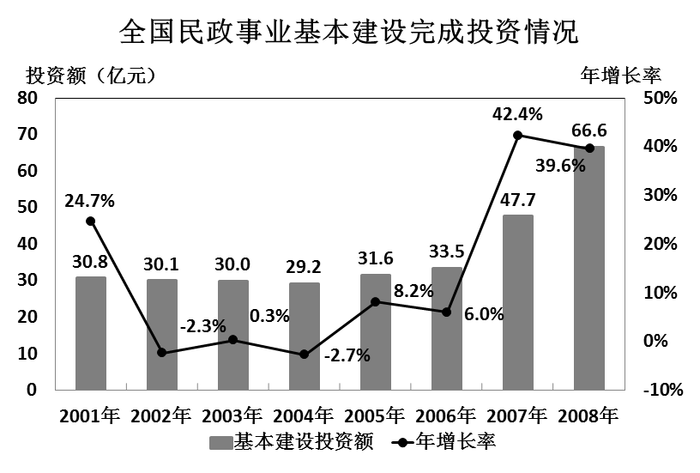

### 第 81 题

2008年民政事业基本建设投资总额中，国家投资所占比重约为：

A. 30%

B. 35%

C. 40%

D. 45%

第 81 题 · 答案与解析

**参考答案（粉笔题库参考内容）**

C

**解析**

国家投资26.6亿，全国民政事业投资总额66.6亿，所以国家投资所占比重为26.6 ÷ 66.6 = 39.9 ÷ 99.9 ≈ 40 ÷ 100 = 40%。

故正确答案为C。

**考点**：现期比重、综合资料

**来源**：2010年425联考《行测》题（云南/湖南/海南/山东/内蒙古/重庆/广西/辽宁/宁夏/陕西/天津）第81题

### 第 82 题

2003~2006年，民政事业基本建设投资额增长率最高的是：

A. 2003年

B. 2004年

C. 2005年

D. 2006年

第 82 题 · 答案与解析

**参考答案（粉笔题库参考内容）**

C

**解析**

由统计图直接读取，2003-2006年增长率分别为0.3%、﹣2.7%、8.2%、6.0%，所以增长率最高的为2005年。

故正确答案为C。

**考点**：排序类、综合资料

**来源**：2010年425联考《行测》题（云南/湖南/海南/山东/内蒙古/重庆/广西/辽宁/宁夏/陕西/天津）第82题

### 第 83 题

2000~2008年，全国民政事业基本建设累计完成投资总额为多少亿元：

A. 299.5

B. 307.1

C. 324.2

D. 340.4

第 83 题 · 答案与解析

**参考答案（粉笔题库参考内容）**

C

**解析**

2001-2008年，投资总额为30.8+30.1+30.0+29.2+31.6+33.5+47.7+66.6=299.5，2000年的投资额为30.8 ÷ (1 + 24.7%)，故可得299.5+30.8/(1+24.7%)≈299.5+30/1.25=323.5，C项最接近。

故正确答案为C。

**考点**：简单加减计算、综合资料

**来源**：2010年425联考《行测》题（云南/湖南/海南/山东/内蒙古/重庆/广西/辽宁/宁夏/陕西/天津）第83题

### 第 84 题

根据2007年民政事业基本建设投资金额从高到低排序，以下正确的是：

A. 优抚安置事业单位、其他事业单位、救助类单位

B. 收养性单位、其他事业单位、优抚安置事业单位

C. 收养性单位、救助类单位、其他事业单位

D. 优抚安置事业单位、救助类单位、收养性单位

第 84 题 · 答案与解析

**参考答案（粉笔题库参考内容）**

B

**解析**

在2008年，优抚安置事业单位9.6亿，增长88.2%；救助类单位2.6亿，增长100%；收养性单位30.4亿，增长33.9%；其他事业单位7.5亿，增长27.1%。很明显，2007年投资金额从高到低为收养性单位、其他事业单位、优抚安置事业单位、救助类单位。

故正确答案为B。

**考点**：基期比较、综合资料

**来源**：2010年425联考《行测》题（云南/湖南/海南/山东/内蒙古/重庆/广西/辽宁/宁夏/陕西/天津）第84题

### 第 85 题

下列说法与资料相符的是：

A. 2006至2008年，全国民政事业基本建设完成投资总额超过之前5年的投资总额

B. 2007年，收养性单位投资额占全国民政事业基本建设完成投资总额的一半以上

C. 全国民政事业基本建设完成投资总额2005年的年增长率高于2004至2008年的年均增长率

D. 2008年，平均每个民政事业基本建设投资项目的完成投资额不到200万元

第 85 题 · 答案与解析

**参考答案（粉笔题库参考内容）**

D

**解析**

A项：2006-2008年投资总额为33.5+47.7+66.6=147.8亿元，2001-2005年投资总额为30.8+30.1+30.0+29.2+31.6=151.7>147.8亿元，并未超过，错误；

B项：2008年收养性单位投资为30.4亿元，比上年增长33.9%，所以2007年收养性单位投资额占全国民政事业投资总额的比重为：30.4/(1+33.9%) ÷ 47.7 ≈ 30/(1.34 × 48) ≈ 22/48 ＜ 0.5，错误；

C项：由统计图可知，2005年全国民政事业投资总额的年增长率为8.2%，由年均增长率的公式为A(1 + r)^n = B，代入数据(1+r)^4=66.6/29.2≈2.2，若r=10%，则(1 + r)² = 1.1² = 1.21，(1+r)^4 = 1.21^2 ≈ 1.5 ＜ 2.2，错误；

D项：2008年，全国民政事业投资总额为66.6亿元，施工项目为3906个，平均每个施工项目投资金额为666000/3906＜666000/3330\=200，不足200万元，正确。

故正确答案为D。

**考点**：综合分析、综合资料

**来源**：2010年425联考《行测》题（云南/湖南/海南/山东/内蒙古/重庆/广西/辽宁/宁夏/陕西/天津）第85题

## 材料 2

**世界部分城市气候状况**

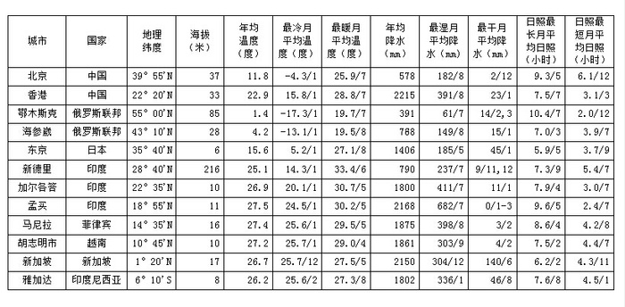

注：第6、7、9、10、11、12列中温度、降水和日照指标之后的数字表示特定的月份。

### 第 86 题

表中最靠近赤道的四个城市，其年均降水量的均值为：

A. 1747毫米

B. 1778毫米

C. 1922毫米

D. 2013.5毫米

第 86 题 · 答案与解析

**参考答案（粉笔题库参考内容）**

C

**解析**

通过纬度判断，最接近赤道的四个城市为马尼拉、胡志明市、新加坡以及雅加达，其年均降水量分别为1875、1861、2150、1802mm，所以平均降水量为(1875 + 1861 + 2150 + 1802)/4 = 7688/4 = 1922毫米。

故正确答案为C。

**考点**：现期平均数、统计表

**来源**：2010年425联考《行测》题（云南/湖南/海南/山东/内蒙古/重庆/广西/辽宁/宁夏/陕西/天津）第86题

### 第 87 题

表中最冷月与最暖月温差在20度以上的城市有多少个：

A. 2

B. 3

C. 4

D. 5

第 87 题 · 答案与解析

**参考答案（粉笔题库参考内容）**

C

**解析**

最冷月与最暖月温差在20度以上的城市，查表格，可以知道只有北京、鄂木斯克、海参崴、东京四个城市满足。

故正确答案为C。

**考点**：简单加减计算、统计表

**来源**：2010年425联考《行测》题（云南/湖南/海南/山东/内蒙古/重庆/广西/辽宁/宁夏/陕西/天津）第87题

### 第 88 题

表中纬度第二高的城市，其日照最长月的平均日照时间约为日照最短月平均日照时间的几倍：

A. 1.5倍

B. 1.8倍

C. 2.0倍

D. 2.5倍

第 88 题 · 答案与解析

**参考答案（粉笔题库参考内容）**

B

**解析**

纬度第二高的城市为海参崴，最长月平均日照7小时，最短月平均日照3.9小时，所以最长月平均日照：最短月平均日照= 7 : 3.9 ≈ 7 ÷ 4 = 1.75，B最接近。

故正确答案为B。

**考点**：现期倍数、统计表

**来源**：2010年425联考《行测》题（云南/湖南/海南/山东/内蒙古/重庆/广西/辽宁/宁夏/陕西/天津）第88题

### 第 89 题

表中海拔高度位居第三的城市，其最湿月平均降水量约占全年平均降水量的：

A. 15.6%

B. 17.7%

C. 18.9%

D. 31.5%

第 89 题 · 答案与解析

**参考答案（粉笔题库参考内容）**

D

**解析**

海拔第三位的城市为北京，最湿月均降水182mm，全年平均降水578mm，所以最湿月平均降水量占全年平均降水量的比重为182 ÷ 578，利用直除法，可知首位为3。

故正确答案为D。

**考点**：现期比重、统计表

**来源**：2010年425联考《行测》题（云南/湖南/海南/山东/内蒙古/重庆/广西/辽宁/宁夏/陕西/天津）第89题

### 第 90 题

下列说法与资料相符的是：

A. 新加坡月均降水量比雅加达多三十多毫米

B. 表中的印度城市，其纬度越高，年均温度越低

C. 海参崴在日照最短月中的日照总时长不足120小时

D. 表中海拔高于30米的所有城市年均温度均低于25度

第 90 题 · 答案与解析

**参考答案（粉笔题库参考内容）**

B

**解析**

新加坡年均降水比雅加达多2150-1802&lt;2150-1800=350mm，平均每月不到30mm，A说法错误；

印度三个城市中，纬度越高，年均温度越低，B说法正确；

海参崴日照最短月平均日照3.9小时，是7月，共有31天，所以日照总时长为31×3.9=(30+1)×(4-0.1)=120+0.9=120.9小时，C说法错误；

海拔高于30米的城市中，印度新德里温度高于25度，D说法错误。

故正确答案为B。

**考点**：统计表、综合分析

**来源**：2010年425联考《行测》题（云南/湖南/海南/山东/内蒙古/重庆/广西/辽宁/宁夏/陕西/天津）第90题

## 材料 3

2008年底，我国网民数从1997年的62万增加到2.98亿，居世界第2位。其中宽带网民数达到2.7亿，手机网民数达到1.2亿。互联网普及率达到22.6%，超过全球平均水平。

        2008年底，我国互联网的国际出口带宽由1997年的25.4Mbps增长到640286.7Mbps，11年间增长了25207倍。2008年底，我国IPV4地址数已从2001年底的0.2亿个增加到1.8亿个，全球排名由第9位上升到第3位；域名总数达到1682.6万个。其中国家CN域名在2007年平均每天增长2万个，2008年底已达到1357.2万个。网站总数由2000年的26.5万个增长到2008年的287.8万个，年均增长34.7%。2002年，我国的网页数为1.6亿个，2008年网页数达到160.9亿个。

        2005年，我国电子商务交易额达到12992亿元人民币，相当于国内生产总值的7.1%。到2008年底，我国网络购物用户人数达到7400万，占网民总数的24.8%。2008年底，我国使用网络媒体的网民比例达到78.5%，使用电子邮件的网民比例达到56.8%，使用网上教育的网民比例达到16.5%，拥有博客的网民比例达到54.3%。

### 第 91 题

2008年底，我国宽带网民数约占网民总人数的：

A. 88.3%

B. 89.7%

C. 90.6%

D. 92.1%

第 91 题 · 答案与解析

**参考答案（粉笔题库参考内容）**

C

**解析**

我国宽带国民数为2.7亿，总网民数为2.98亿，所以宽带网民占的比例为2.7÷2.98≈2.7÷3=90%，与C项最接近。

故正确答案为C。

**考点**：文字资料、现期比重

**来源**：2010年425联考《行测》题（云南/湖南/海南/山东/内蒙古/重庆/广西/辽宁/宁夏/陕西/天津）第91题

### 第 92 题

2008年底，我国平均每万网民拥有的国际出口带宽约是1997年的多少倍：

A. 11.5

B. 21.5

C. 52.4

D. 157.9

第 92 题 · 答案与解析

**参考答案（粉笔题库参考内容）**

C

**解析**

2008年底，我国网民从1997年的62万增加到2.98亿，互联网的国际出口宽带由1997年的25.4Mbps增长到640286.7Mbps，所求倍数为：640286.7/29800 ÷ 25.4/62 ≈ 640000/30000 × 60/25=64×4/5=51.2倍，与C项最接近。

故正确答案为C。

**考点**：文字资料、现期倍数

**来源**：2010年425联考《行测》题（云南/湖南/海南/山东/内蒙古/重庆/广西/辽宁/宁夏/陕西/天津）第92题

### 第 93 题

下列说法与资料相符的是：

A. 2005年，我国国内生产总值超过18万亿元人民币

B. 2008年底，全球互联网普及率的平均水平不低于25%

C. 2008年底，我国平均每网站拥有网页数超过6000个

D. 2007年初，我国国家CN域名数已达到627.2万个

第 93 题 · 答案与解析

**参考答案（粉笔题库参考内容）**

A

**解析**

A项，2005年，我国电子商务交易额达到12992亿元人民币，相当于国内生产总值的7.1%，所以国内生产总值为12992 ÷ 7.1% ÷ 10000 ≈13000 ÷ 0.07 ÷ 10000 = 130/7 ＞ 18万亿，正确；

B项，2008年我国互联网普及率达到22.6%，超过全球平均水平，所以全球互联网普及率的平均水平一定低于22.6%，错误；

C项，2008年我国网站总数为287.8万个，网页数为160.9亿个，平均每个网站拥有的网页数为160.9 × 10000 ÷ 287.8，利用直除法得，160.9 ÷ 287.8的首位为5，所以每个网站拥有的网页数为5000多个，小于6000个，错误；

D项，材料中只给出“国家CN域名在2007年平均每天增长2万个，2008年底已达到1357.2万个”，并没有给出2008年的变化情况，所以无法确定2007年初国家CN域名数，无法确定。

故正确答案为A。

**考点**：文字资料、综合分析

**来源**：2010年425联考《行测》题（云南/湖南/海南/山东/内蒙古/重庆/广西/辽宁/宁夏/陕西/天津）第93题

### 第 94 题

若我国手机网民全部使用网络媒体，则2008年底，非手机网民中使用网络媒体的比例约为：

A. 36%

B. 50%

C. 64%

D. 78%

第 94 题 · 答案与解析

**参考答案（粉笔题库参考内容）**

C

**解析**

由题意“若我国手机网民全部使用网络媒体，则2008年底，非手机网民中使用网络媒体的比例约为”判定此题为现期比重问题。定位文字材料第一段，“2008年底，我国网民数······增加到2.98亿······手机网民数达到1.2亿”，定位文字材料第三段“2008年底，我国使用网络媒体的网民比例达到78.5%”。根据比重=部分÷整体的公式，非手机网民中使用网络媒体的比例为：(2.98×78.5%-1.2)/(2.98-1.2)≈(3×0.8-1.2)/1.8≈66.7% ，与C项最接近。

故正确答案为C。

**考点**：文字资料、现期比重

**来源**：2010年425联考《行测》题（云南/湖南/海南/山东/内蒙古/重庆/广西/辽宁/宁夏/陕西/天津）第94题

### 第 95 题

下列说法与资料相符的是：

A. 2008年底，我国网络购物用户数已经超过手机网民数

B. 2008年底，我国使用网络媒体的人数比使用电子邮件的约多0.65亿

C. 2008年底，我国的宽带网民中超过一半的人拥有博客

D. 2001~2008年，我国IPV4地址数几乎每年翻一番

第 95 题 · 答案与解析

**参考答案（粉笔题库参考内容）**

B

**解析**

2008年底，我国网络购物用户数为7400万，手机网民数为1.2亿，网络购物用户数未超过手机网民数，A项错误；

2008年底，我国使用网络媒体的人数比使用电子邮件的多2.98×（78.5%-56.8%）=2.98×0.217≈3×0.215=0.645亿人，很接近0.65亿，B项正确；

我国国民中拥有博客的网民数为2.98×54.3%≈1.62亿人，宽带网民占2.7亿人，非宽带网民为2.98-2.7=0.28亿人，材料中并未提及非宽带网民拥有博客数情况，C项无法判断；

我国IPv4地址数从2001年底的0.2亿个增加到1.8亿个，不到七番，D项错误。

故正确答案为B。

**考点**：文字资料、综合分析

**来源**：2010年425联考《行测》题（云南/湖南/海南/山东/内蒙古/重庆/广西/辽宁/宁夏/陕西/天津）第95题

## 材料 4

**2005-2008年全国主要港口7月货运吞吐量**（单位：万吨）

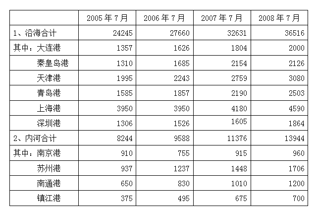

### 第 96 题

全国港口2008年7月货运吞吐量的同比增长率约为：

A. 11.9%

B. 14.7%

C. 17.8%

D. 21.5%

第 96 题 · 答案与解析

**参考答案（粉笔题库参考内容）**

B

**解析**

2008年7月全国港口货运吞吐量的同比增长率为(36516+13944)/(32631+11376) − 1 ≈ (36500+14000)/44000 − 1= 6500/44000 ≈ 14.8%，B最接近。

故正确答案为B。

**考点**：一般增长率、统计表

**来源**：2010年425联考《行测》题（云南/湖南/海南/山东/内蒙古/重庆/广西/辽宁/宁夏/陕西/天津）第96题

### 第 97 题

与2005年同期相比，上海港2008年7月货运吞吐量占沿海港口合计吞吐量的比重约：

A. 增加了3.7%

B. 减少了3.7%

C. 增加了5.3%

D. 减少了5.3%

第 97 题 · 答案与解析

**参考答案（粉笔题库参考内容）**

B

**解析**

上海港2008年7月货运吞吐量占沿海港口合计吞吐量的比重为4590/36516，2005年同期比重为3950/24245，故可得4590/36516 - 3950/24245 ≈ 4500/36000 - 4000/25000= 12.5% − 16% = −3.5%，即减少了3.5%，与B项最接近。

故正确答案为B。

**考点**：两期比重、统计表

**来源**：2010年425联考《行测》题（云南/湖南/海南/山东/内蒙古/重庆/广西/辽宁/宁夏/陕西/天津）第97题

### 第 98 题

2006~2008年间，表中港口有几个在7月出现过货运吞吐量比上年同期下降的局面：

A. 0

B. 1

C. 2

D. 3

第 98 题 · 答案与解析

**参考答案（粉笔题库参考内容）**

C

**解析**

表中港口出现7月份货运吞吐量比上年同期下降的有2006年7月的南京港和2008年7月的秦皇岛两个港口。

故正确答案为C。

**考点**：直接找数、统计表

**来源**：2010年425联考《行测》题（云南/湖南/海南/山东/内蒙古/重庆/广西/辽宁/宁夏/陕西/天津）第98题

### 第 99 题

与2006年7月相比，2007年同期哪个港口货运吞吐量的同比增长率与沿海港口合计吞吐量的同比增长率最为接近：

A. 大连港

B. 青岛港

C. 上海港

D. 深圳港

第 99 题 · 答案与解析

**参考答案（粉笔题库参考内容）**

B

**解析**

根据题干“与2006年7月相比，2007年······同比增长率与······同比增长率最为接近”可判定此题为一般增长率问题。定位表格材料，根据公式：增长率= (现期−基期)/基期可知，沿海港口合计吞吐量的同比增长率为(32631 − 27660)/27660 ≈ 18%，大连港吞吐量的增长率为(1804 − 1626)/1626 ≈ 11%，青岛港吞吐量的增长率为(2190−1857)/1857≈18%，上海港吞吐量的增长率为(4180-3950)/3950 ≈ 6%，深圳港吞吐量的增长率为(1605−1526)/1526≈5%，则青岛港货运吞吐量的同比增长率与沿海港口合计吞吐量的同比增长率最为接近。

故正确答案为B。

**考点**：一般增长率、统计表

**来源**：2010年425联考《行测》题（云南/湖南/海南/山东/内蒙古/重庆/广西/辽宁/宁夏/陕西/天津）第99题

### 第 100 题

下列说法与资料相符的是：

A. 沿海港口合计吞吐量2008年7月的同比增长额高于2007年的

B. 2005至2008年，每年7月内河港口合计吞吐量在全国港口货运吞吐总量中所占的比重逐渐降低

C. 2008年7月，天津港在全国港口货运吞吐总量中的比重为四年以来同期最高

D. 与2005年7月相比，表中2008年7月货运吞吐量增长率最高的港口是一个内河港

第 100 题 · 答案与解析

**参考答案（粉笔题库参考内容）**

D

**解析**

A项：定位表格，可知2008年7月的沿海港口合计吞吐量同比增额为36516-32631=3885万吨，2007年7月沿海港口合计吞吐量同比增额为32631-27660=4971万吨，即2008年7月的同比增长额低于2007年，错误；

B项：定位表格，可知2005年7月内河港口占全国比重的比例为8244/(8244+24245)=8244/32489 ≈ 25.4%、2006年7月内河港口占全国比重的比例分别为9588/(9588 + 27660) =9588/37248≈25.7%，即内河港口占全国比重的比例2006年7月>2005年7月，不是逐年降低，错误；

C项：定位表格，可知2005年7月天津港占全国比重为1995/(8244 + 24245) ≈1995/32489 ≈ 6.14%，2008年7月为3080/(13944+36516)≈3080/50460 ≈ 6.10%，即2008年7月&lt;2005年7月，错误；

D项：定位表格，可知与2005年7月相比，表中2008年7月各港口货运吞吐量增长率：大连港2000/1357-1，秦皇岛港2126/1310-1，天津港3080/1995-1，青岛港2503/1585-1，上海港4590/3950-1，深圳港1864/1306-1，南京港960/910-1，苏州港1706/937-1，南通港1200/650-1，镇江港700/375-1，分数部分只有700/375将近2，其余均是略大于1，即镇江港货运吞吐量增长率最大，是内河港口，正确。

故正确答案为D。

**考点**：统计表、综合分析

**来源**：2010年425联考《行测》题（云南/湖南/海南/山东/内蒙古/重庆/广西/辽宁/宁夏/陕西/天津）第100题

### 第 101 题

下列做法符合宪法或者法律规定的是：

A. 省人民代表大会常务委员会制定地方性法规

B. 市人民代表大会撤销市长职务

C. 国务院各部部长连续任职超过两届

D. 县人民政府设立秘书长

第 101 题 · 答案与解析

**参考答案（粉笔题库参考内容）**

A

**解析**

本题考查法律常识，主要涉及《立法法》、《宪法》和《政府组织法》的相关知识。

A项正确，根据《立法法》第七十二条，省、自治区、直辖市的人民代表大会及其常务委员会根据本行政区域的具体情况和实际需要，在不同宪法、法律、行政法规相抵触的前提下，可以制定地方性法规；

B项错误，根据《宪法》第一百零一条，市人民代表大会对市长享有罢免权而非撤销权；

C项错误，根据《宪法》第八十七条，总理、副总理、国务委员连续任职不得超过两届；

D项错误，根据《政府组织法》第四十四条第十款，县级以上的地方各级人民代表大会常务委员会根据省长、自治区主席、市长、州长、县长、区长的提名，决定本级人民政府秘书长、厅长、局长、委员会主任、科长的任免，报上一级人民政府备案。

故正确答案为A。

**考点**：宪法

**来源**：2010年425联考《行测》题（云南/湖南/海南/山东/内蒙古/重庆/广西/辽宁/宁夏/陕西/天津）第101题

### 第 102 题

下列关于设立行政许可与行政处罚的说法中，正确的是：

A. 行政许可与行政处罚的设定机关均应定期对其设定的行政许可、行政处罚进行评价

B. 部门规章可以依法设定一定的行政许可、行政处罚

C. 尚未制定法律的，行政法规可以依法设定一定的行政许可、行政处罚

D. 法律、法规、规章以外的其他规范性文件一律不得设定任何行政许可、行政处罚

第 102 题 · 答案与解析

**参考答案（粉笔题库参考内容）**

C

**解析**

本题考查法律常识，主要涉及行政许可法与行政处罚法的相关知识。

A项错误，《行政许可法》第二十条规定，行政许可的设定机关应当定期对其设定的行政许可进行评价，但行政处罚法没有相关规定；

B项错误，根据《行政许可法》第十六条和《行政处罚法》第十三条，部门规章只能对已经设定的行政许可作出实施的具体规定，但可以在法律、法规没有规定的情况下设定一定的行政处罚；

C项正确，根据《行政许可法》第十四条，尚未制定法律的，行政法规可以设定行政许可，根据《行政处罚法》第十一条规定，行政法规可以设定除限制人身自由以外的行政处罚；

D项错误，根据《行政许可法》第十四条，必要时，国务院可以采用发布决定的方式设定行政许可。

故正确答案为C。

**考点**：行政法

**来源**：2010年425联考《行测》题（云南/湖南/海南/山东/内蒙古/重庆/广西/辽宁/宁夏/陕西/天津）第102题

### 第 103 题

萧某对李某作出承诺：只要李某把邻居家的小狗偷来，就付给酬金200元。该行为属于：

A. 附条件的民事法律行为

B. 无效的民事法律行为

C. 可撤销的民事法律行为

D. 犯罪行为

第 103 题 · 答案与解析

**参考答案（粉笔题库参考内容）**

B

**解析**

本题考查法律常识，主要涉及民法的相关知识。

根据《民法通则意见》第七十五条，附条件的民事行为，如果所附的条件是违背法律规定或者不可能发生的，应当认定该民事行为无效。萧某要求李某偷小狗的行为明显违背法律相关规定，因此萧某的承诺行为无效。

故正确答案为B。

**考点**：民法典

**来源**：2010年425联考《行测》题（云南/湖南/海南/山东/内蒙古/重庆/广西/辽宁/宁夏/陕西/天津）第103题

### 第 104 题

某化肥厂向附近一小河排放工业废水，受该厂污染的河水流入村民承包的农田，造成农作物大量减产。村民的下列做法中没有法律依据的是：

A. 直接向该厂提出排除危害并承担赔偿责任的要求

B. 就赔偿责任和赔偿金额，请求当地环境保护行政主管部门处理

C. 向法院提起民事诉讼，要求厂家停止侵害、承担赔偿损失等责任

D. 向法院提起行政诉讼，要求环境保护行政主管部门承担行政赔偿责任

第 104 题 · 答案与解析

**参考答案（粉笔题库参考内容）**

D

**解析**

本题是考查环境保护法的题。根据《环境保护法》第四十一条，造成环境污染危害的，有责任排除危害，并对直接受到损害的单位或者个人赔偿损失。赔偿责任和赔偿金额的纠纷，可以根据当事人的请求，由环境保护行政主管部门或者其他依照法律规定行使环境监督管理权的部门处理，当事人对处理决定不服的，可以向人民法院起诉。当事人也可以直接向人民法院起诉。因此A、B、C三项都有法律依据。

根据《行政诉讼法》第二条，公民、法人或者其他组织认为行政机关和行政机关工作人员的具体行政行为侵犯其合法权益，有权依照本法向人民法院提起诉讼，而本题中不存在行政机关或其工作人员的具体行政行为侵害合法权益问题，受害人不能提起行政诉讼，D项没有法律依据。

本题为选非题，故正确答案为D。

**考点**：行政法

**来源**：2010年425联考《行测》题（云南/湖南/海南/山东/内蒙古/重庆/广西/辽宁/宁夏/陕西/天津）第104题

### 第 105 题

李某为公司仓库保管员。某日，两歹徒为逼李某交出仓库钥匙而持刀追打李某，李某被打成重伤，无奈之中李某抢了路边正在停车的黄某的摩托车逃走。李某抢走摩托车的行为：

A. 应负刑事责任。李某抢走他人车辆，属于抢劫行为，侵犯他人利益

B. 应负刑事责任。李某抢走他人车辆，属于盗窃行为，侵犯他人利益

C. 不应负刑事责任。李某抢走摩托车属于正当防卫，保护了公司和个人的合法权益

D. 不应负刑事责任。李某抢走摩托车属于紧急避险，损害了他人合法权益但保全了更大的合法权益

第 105 题 · 答案与解析

**参考答案（粉笔题库参考内容）**

D

**解析**

本题是考查刑法的题。根据《刑法》第二十一条，为了使国家、公共利益、本人或者他人的人身、财产和其他权利免受正在发生的危险，不得已采取的紧急避险行为，造成损害的，不负刑事责任。

本题中李某的职务仅是仓库保管员，没有与歹徒搏斗的义务，为了保全公司的公共利益和个人人身安全，抢走摩托车逃走的行为完全符合紧急避险的构成要件。

故正确答案为D。

**考点**：刑法

**来源**：2010年425联考《行测》题（云南/湖南/海南/山东/内蒙古/重庆/广西/辽宁/宁夏/陕西/天津）第105题

### 第 106 题

下列被告（被申请人）负举证责任的是：

A. 行政诉讼中，证明与被诉具体行政行为有利害关系

B. 民事诉讼中，对原告提出建筑物发生倒塌致人损害的侵权事实，被告给予否认的

C. 行政赔偿诉讼中，证明所受损害的事实

D. 行政复议中，认为行政机关不履行法定职责，证明曾经要求行政机关履行法定职责而该机关未履行的

第 106 题 · 答案与解析

**参考答案（粉笔题库参考内容）**

B

**解析**

本题考查法律常识，主要涉及行政法的相关知识。举证责任是指当事人对自己提出的主张有收集或提供证据的义务，并有运用该证据证明主张的案件事实成立或有利于自己的主张的责任，否则将承担其主张不能成立的危险。

A、C项：错误，根据《最高人民法院关于执行&lt;中华人民共和国行政诉讼法>若干问题的解释》第二十七条，原告对下列问题承担举证责任：（一）证明起诉符合法定条件，但被告认为原告起诉超过起诉期限的除外；（二）在起诉被告不作为的案件中，证明其提出申请的事实；（三）在一并提起的行政赔偿诉讼中，证明因受被诉行为侵害而造成损失的事实；（四）其他应当由原告承担举证责任的事项。故A、C两项均为原告承担举证责任。

B项：正确，根据《最高人民法院关于民事诉讼证据的若干规定》第四条，建筑物或者其他设施以及建筑物上的搁置物、悬挂物发生倒塌、脱落、坠落致人损害的侵权诉讼，由所有人或者管理人对其无过错承担举证责任；即应由被告（被申请人）负举证责任。

D项：错误，根据《中华人民共和国行政复议法》第十一条十一项规定，有下列情形之一的，公民、法人或者其他组织可以依照本法申请行政复议：（十一）申请行政机关履行保护人身权利、财产权利、受教育权利等合法权益的法定职责，行政机关拒绝履行、未依法履行或者不予答复。故也应由原告承担举证责任。

故正确答案为B。

**考点**：行政法

**来源**：2010年425联考《行测》题（云南/湖南/海南/山东/内蒙古/重庆/广西/辽宁/宁夏/陕西/天津）第106题

### 第 107 题

"文景之治"出现在哪个朝代：

A. 周

B. 汉

C. 唐

D. 宋

第 107 题 · 答案与解析

**参考答案（粉笔题库参考内容）**

B

**解析**

“文景之治”是指西汉文帝、景帝两代四十年左右的时间政治稳定、经济生产得到显著发展的局面，被视为封建社会的“盛世”，史称“文景之治”。因此，“文景之治”是出现在汉朝。

故正确答案为B。

**考点**：中国历史

**来源**：2010年425联考《行测》题（云南/湖南/海南/山东/内蒙古/重庆/广西/辽宁/宁夏/陕西/天津）第107题

### 第 108 题

我国教育近代化之先河开启于哪一时期：

A. 洋务运动时期

B. 戊戌变法时期

C. 辛亥革命时期

D. 南京临时政府时期

第 108 题 · 答案与解析

**参考答案（粉笔题库参考内容）**

A

**解析**

A项正确，洋务运动，又称自强运动，是指1861年（咸丰十年底开始）至1894年，清朝政府内的洋务派在全国各地掀起的“师夷之长技以制夷”的改良运动。洋务运动时期的教育改革作为中国近代教育与传统教育的第一次交锋，它的产生无疑是具有划时代的意义。这对我们的当今教育改革具有启迪和借鉴意义，开启了我国近代化之先河；

B项错误，戊戌变法指1898年（农历戊戌年）以康有为为首的改良主义者通过光绪皇帝所进行的资产阶级政治改革，是中国清朝光绪年间（1898年）的一项政治改革运动；

C项错误，辛亥革命是1911年清政府出卖铁路修筑权，激起中国人民的反抗，四川等地爆发保路运动。1911年10月10日，武汉地区的革命团体文学社和共进会发动武昌起义，接着各省纷纷响应，因为1911年为旧历辛亥年，故称“辛亥革命”，是一项反抗清政府的爱国运动；

D项错误，南京临时政府内阁是中华民国临时政府时期的临时性内阁，成立于民国元年（1912年）1月1日，结束于同年3月12日。1911年10月10日武昌起义，创立民国，中原十二省纷纷宣布独立。12月，十七省的代表齐聚上海，推举孙文为临时大总统；孙文组织内阁，成立南京临时政府，是一项政治运动。

故正确答案为A。

**考点**：中国历史

**来源**：2010年425联考《行测》题（云南/湖南/海南/山东/内蒙古/重庆/广西/辽宁/宁夏/陕西/天津）第108题

### 第 109 题

关于水稻，下列说法正确的是：

A. 水稻是目前全球产量最大的粮食作物

B. 我国在上世纪50年代研制出世界首例杂交水稻

C. 《诗经》的"彼黍离离，彼稷之苗"一句中提到了水稻

D. 袁隆平的研究小组在海南岛找到的野稻对杂交水稻培育意义重大

第 109 题 · 答案与解析

**参考答案（粉笔题库参考内容）**

D

**解析**

A项错误，目前全球产量最大的粮食作物是玉米而不是水稻。

B项错误，20世纪70年代，我国袁隆平培育的杂交水稻试验获得成功，成为世界上首例获得成功的杂交水稻品种。

C项错误，黍指小米，稷指高粱，该句话是说黍稷离离成行，正在长苗的时候，并没有提到水稻。

D项正确，袁隆平的研究小组是在海南找到的野稻，并进行试验，对杂交水稻培育意义重大。

故正确答案为D。

**考点**：自然地理

**来源**：2010年425联考《行测》题（云南/湖南/海南/山东/内蒙古/重庆/广西/辽宁/宁夏/陕西/天津）第109题

### 第 110 题

货币政策是政府调控宏观经济的基本手段之一，当通货膨胀较为严重时，应该采取的货币政策是：

A. 紧缩性货币政策

B. 扩张性货币政策

C. 适度宽松货币政策

D. 积极货币政策

第 110 题 · 答案与解析

**参考答案（粉笔题库参考内容）**

A

**解析**

通货膨胀指在纸币流通条件下，因货币供给大于货币实际需求，也即现实购买力大于产出供给，导致货币贬值，而引起的一段时间内物价持续而普遍地上涨现象。其实质是社会总需求大于社会总供给（供远小于求）。货币政策是指政府或中央银行为影响经济活动所采取的措施，尤指控制货币供给以及调控利率的各项措施。用以达到特定或维持政策目标，比如，抑制通胀、实现完全就业或经济增长。紧缩性货币政策就是通过削减货币供应的增长率来降低总需求水平，在这种政策下，取得信贷较为困难，利息率也随之提高。因此，在通货膨胀较严重时，应该采用紧缩性货币政策。

故正确答案为A。

**考点**：宏观经济与调控政策

**来源**：2010年425联考《行测》题（云南/湖南/海南/山东/内蒙古/重庆/广西/辽宁/宁夏/陕西/天津）第110题

### 第 111 题

青藏高原有"世界屋脊"之称，它的形成是由哪两个板块碰撞引起的：

A. 印度板块和太平洋板块

B. 印度板块和欧亚板块

C. 太平洋板块和南美板块

D. 太平洋板块和欧亚板块

第 111 题 · 答案与解析

**参考答案（粉笔题库参考内容）**

B

**解析**

青藏高原是中国最大的高原，世界平均海拔最高的高原。大约5000万年前，印度板块与欧亚板块相碰撞，导致了青藏高原的形成。

故正确答案为B。

**考点**：自然地理

**来源**：2010年425联考《行测》题（云南/湖南/海南/山东/内蒙古/重庆/广西/辽宁/宁夏/陕西/天津）第111题

### 第 112 题

我国佛教艺术驰名中外，云冈石窟、龙门石窟和莫高窟三大石窟举世皆知。以下关于三大石窟地理位置的描述，正确的是：

A. 所在省份两两接壤

B. 所在省份都有黄河流过

C. 均地处黄土高原

D. 所处纬度大致相当

第 112 题 · 答案与解析

**参考答案（粉笔题库参考内容）**

B

**解析**

A项错误，云冈石窟位于中国北部山西省大同市以西16公里处的武周山南麓；龙门石窟位于河南洛阳南郊12公里处；莫高窟位于甘肃省敦煌市东南25公里处，甘肃和河南、山西不接壤；

B项正确，所在省份都有黄河流过；

C项错误，河南洛阳位于平原地区；

D项错误，山西大同位于北纬40.06°，东经113.17°，敦煌市位于北纬39°53′−41°35′，东经92°13′ − 95°30′，河南洛阳位于北纬34.41°，东经112.27°，河南在山西以南。

故正确答案为B。

**考点**：其他

**来源**：2010年425联考《行测》题（云南/湖南/海南/山东/内蒙古/重庆/广西/辽宁/宁夏/陕西/天津）第112题

### 第 113 题

下列依次与蒙古族、回族、藏族、维吾尔族、壮族有关的是：

A. 酥油茶、馓子、青稞酒、馕、萨其马

B. 《嘎达梅林》、《穆斯林的葬礼》、《格萨尔王传》、《阿凡提的故事》、《刘三姐》

C. 那达慕大会、开斋节、雪顿节、古尔邦节、泼水节

D. 马头琴、冬不拉、铜钦、葫芦丝、芦笙

第 113 题 · 答案与解析

**参考答案（粉笔题库参考内容）**

B

**解析**

A项错误，酥油茶是藏族的传统食品，而不是蒙古族的，萨其马是满族的传统食品，而不是壮族；

B项正确，《嘎达梅林》、《穆斯林的葬礼》、《格萨尔王传》、《阿凡提的故事》、《刘三姐》分别是蒙古族、回族、藏族、维吾尔族、壮族的艺术文学作品；

C项错误，泼水节是傣族的节日，而不是壮族；

D项错误，马头琴是一种两弦的弦乐器，有梯形的琴身和雕刻成马头形状的琴柄，为蒙古族人民喜爱的乐器。冬不拉是一种哈萨克族民间流行的弹拨乐器，不是回族。铜钦是藏传佛教所特有的铜管乐器之一，主要用于盛大庆典或召集见臣民。葫芦丝是云南少数民族乐器，主要流传于傣、彝、阿昌、德昂等民族中，不是维吾尔族。芦笙为西南地区苗、瑶、侗等民族的簧管乐器，不是壮族。

故正确答案为B。

**考点**：文化常识

**来源**：2010年425联考《行测》题（云南/湖南/海南/山东/内蒙古/重庆/广西/辽宁/宁夏/陕西/天津）第113题

### 第 114 题

下列历史事件按时间先后排序正确的是：

A. 北美自由贸易区建立——世界贸易组织建立——亚太经济合作组织成立——欧洲联盟成立

B. “珍妮纺纱机”发明——瓦特改良蒸汽机——内燃机得到广泛应用——“阿波罗”号飞船进入太空

C. 哥白尼“日心说”——舍勒“燃素说”——爱因斯坦“相对论”——达尔文“进化论”

D. 巴黎圣母院建成——罗马大角斗场建成——白金汉宫建成——印度泰姬陵建成

第 114 题 · 答案与解析

**参考答案（粉笔题库参考内容）**

B

**解析**

A项错误，1994年1月1日，由美国、加拿大、墨西哥3国共同签署的北美自由贸易协定正式生效，北美自由贸易区宣告诞生；世界贸易组织的前身是关贸总协定，1995年1月1日起更名并正式运作；亚太经济合作组织（简称亚太经合组织，英文缩写APEC）成立于1989年；1993年11月1日马斯特里赫特条约生效，欧盟成立，所以正确顺序应为亚太经合组织成立—欧盟联盟成立—北美自由贸易区建立—世贸组织建立；

B项正确，18世纪60年代，织布工哈格里夫斯发明了“珍妮机”的手摇纺纱机；1781年瓦特制造了从两边推动活塞的双动蒸汽机；19世纪，内燃机在广泛应用中不断地得到改善和革新；1969年7月16日，美国阿波罗11号飞船出发，完成人类首次登月；

C项错误，哥白尼在40岁时，提出了日心说，时间是1513年左右；舍勒（1742～1786）1774年左右提出“燃素说”；爱因斯坦的狭义相对论提出于1905年，广义相对论提出于1915年；1859年11月达尔文的《物种起源》出版，进化论诞生，所以正确顺序为哥白尼“日心说”—舍勒“燃素说”—达尔文“进化论”—爱因斯坦“相对论”；

D项错误，巴黎圣母院在1345年全部建成；罗马大角斗场是建于公元72至82年间由4万名战俘用8年时间建造起来的；英国王室的府邸的白金汉宫于1703年建成；泰姬陵在1654年完工。所以正确顺序应为罗马大角斗场建成—巴黎圣母院建成—印度泰姬陵建成—白金汉宫建成。

故正确答案为B。

**来源**：2010年425联考《行测》题（云南/湖南/海南/山东/内蒙古/重庆/广西/辽宁/宁夏/陕西/天津）第114题

### 第 115 题

挂在墙壁上的石英钟，当电能耗尽而停止走动时，其秒针往往会停在哪个数字上：

A. 3

B. 6

C. 9

D. 12

第 115 题 · 答案与解析

**参考答案（粉笔题库参考内容）**

C

**解析**

本题考查物理常识。

钟表中秒针转动的速度较分针、时针转速高，所以转动最容易受外力影响。而悬挂着的钟表，从刻度12到刻度6时，秒针自身的质量对秒针轴形成的力矩与钟表本身的驱动力矩相同，可帮助秒针前进。当秒针从刻度6位置开始到刻度12时，秒针自身产生的力矩与钟表走动的驱动力矩正好相反，这力矩在秒针处于刻度9位置时达到最大，一旦超过该点，力矩又减少。所以当钟表驱动能量将尽，驱动秒针的力矩越来越弱，不能抵御秒针从刻度6到刻度9这段路程的反向力矩时，秒针往往就停在这段位置，特别是在接近反向力矩最大的9点方向处。

故正确答案为C。

**考点**：物理常识

**来源**：2010年425联考《行测》题（云南/湖南/海南/山东/内蒙古/重庆/广西/辽宁/宁夏/陕西/天津）第115题

### 第 116 题

下列说法错误的是：

A. 核心电子器件、高端通用芯片及基础软件产品项目简称"核高基"，是我国"十一五规划"中的第一个科技课题

B. 王选院士开发的汉字激光照排系统被誉为"汉字印刷术的第二次发明"

C. 上海超级计算中心是国内第一个面向社会开放、实现资源共享的高性能计算公共服务平台

D. CDMA2000是我国自主研发的3G移动通信标准

第 116 题 · 答案与解析

**参考答案（粉笔题库参考内容）**

D

**解析**

本题考查科技常识。

A项正确，核高基就是“核心电子器件、高端通用芯片及基础软件产品”的简称。是2006年国务院发布的《国家中长期科学和技术发展规划纲要(2006-2020年)》中与载人航天、探月工程并列的16个重大科技专项之一。属于我国“十一五规划”中的第一个科技课题。

B项正确，王选是汉字激光照排系统的创始人和技术负责人。他所领导的科研集体研制出的汉字激光照排系统为新闻、出版全过程的计算机化奠定了基础，被誉为“汉字印刷术的第二次发明”。

C项正确，上海超级计算中心(SSC)成立于2000年12月，是2000年上海市一号工程——上海信息港主体工程之一，由上海市政府投资建设，坐落于浦东张江高科技开发园区内。它是国内第一个面向社会开放、实现资源共享的高性能计算公共服务平台。

D项错误，CDMA2000也称为CDMA Multi-Carrier，以美国高通北美公司为主导提出，摩托罗拉、Lucent和后来加入的韩国三星都有参与，韩国现在成为该标准的主导者，并不是我国自主研发。

本题为选非题，故正确答案为D。

**考点**：科技理论与成就

**来源**：2010年425联考《行测》题（云南/湖南/海南/山东/内蒙古/重庆/广西/辽宁/宁夏/陕西/天津）第116题

### 第 117 题

以下说法正确的是：

A. 存在主义是十九世纪流行于西方的哲学思潮

B. 玛雅文化以南美洲的秘鲁为中心

C. 世界第二次工业革命的主要标志是蒸汽机的广泛使用

D. 十八世纪欧洲启蒙运动的中心在法国

第 117 题 · 答案与解析

**参考答案（粉笔题库参考内容）**

D

**解析**

本题考查人文常识。

A项错误，存在主义又称生存主义，是当代西方哲学主要流派之一，在二十世纪初获得发展，二战后约1945 ~ 1955年成为西方思想界的主流学说；

B项错误，玛雅文化主要分布在中美洲一带，包括今天的墨西哥东南、尤卡坦半岛、伯利兹、危地马拉、洪都拉斯等地区；

C项错误，第一次工业革命的主要标志是蒸汽机的广泛使用，第二次工业革命的主要标志是电力的广泛应用；

D项正确，十八世纪法国启蒙思想家将启蒙运动推向高潮，先进的科学理论、深厚的文化底蕴，给法国启蒙思想提供了得天独厚的发展条件，从而使法国成为欧洲思想最活跃、创作力最丰富的地方，故十八世纪欧洲启蒙运动的中心是在法国。

故正确答案为D。

**考点**：文化常识

**来源**：2010年425联考《行测》题（云南/湖南/海南/山东/内蒙古/重庆/广西/辽宁/宁夏/陕西/天津）第117题

### 第 118 题

以下哪个选项中的作品全部出自美国作家之手：

A. 《悲惨世界》、《了不起的盖茨比》、《百年孤独》

B. 《飞鸟集》、《草叶集》、《静静的顿河》

C. 《飘》、《红字》、《汤姆叔叔的小屋》

D. 《瓦尔登湖》、《海底两万里》、《堂吉诃德》

第 118 题 · 答案与解析

**参考答案（粉笔题库参考内容）**

C

**解析**

A项错误，《悲惨世界》的作者是法国作家雨果，《了不起的盖茨比》是美国作家弗朗西斯•斯科特•基•菲茨杰拉德，《百年孤独》是哥伦比亚作家加西亚•马尔克思的作品；

B项错误，《飞鸟集》是印度诗人泰戈尔的代表作之一，《草叶集》是美国诗人华特•惠特曼的诗集，《静静的顿河》是前苏联作家肖洛霍夫的作品；

C项正确，《飘》是美国著名女作家玛格丽特•米歇尔创作的小说，《红字》是19世纪美国浪漫主义作家霍桑的长篇小说，《汤姆叔叔的小屋》是美国作家哈里特•比彻•斯托（斯托夫人）于1852年发表的一部反奴隶制小说；

D项错误，《瓦尔登湖》是19世纪美国作家梭罗的一部文学名作，《海底两万里》的作者是法国科幻小说家儒勒•凡尔纳的代表作之一，《堂吉诃德》是西班牙作家塞万提斯的著名作品。

故正确答案为C。

**考点**：文学常识

**来源**：2010年425联考《行测》题（云南/湖南/海南/山东/内蒙古/重庆/广西/辽宁/宁夏/陕西/天津）第118题

### 第 119 题

菠菜不仅含有大量的β胡萝卜素，也是维生素B6、叶酸、铁和钾的极佳来源。但是菠菜不能直接烹调，吃菠菜时宜先用沸水烫软，捞出再炒。在烹调前用沸水烫菠菜的主要原因是：

A. 清除生菠菜含有的红血球凝集素

B. 改变生菠菜内龙葵素的化学成分

C. 防止菠菜内的草酸成分阻碍人体对钙的吸收

D. 清除菠菜种植过程中残留的农药

第 119 题 · 答案与解析

**参考答案（粉笔题库参考内容）**

C

**解析**

菠菜中含有草酸，草酸在人体内如果遇上钙和锌便生成草酸钙和草酸锌，不易吸收而排出体外，影响钙与锌的吸收。因此我们在食用菠菜时需用开水烫一下，以降低菠菜中的草酸含量。

故正确答案为C。

**考点**：化学常识

**来源**：2010年425联考《行测》题（云南/湖南/海南/山东/内蒙古/重庆/广西/辽宁/宁夏/陕西/天津）第119题

### 第 120 题

红细胞是血液中数量最多的一种血细胞，它在人体中的主要作用是：

A. 将氧气从肺运送到身体各个组织

B. 作为免疫系统的一部分帮助身体抵抗传染病以及外来感染

C. 促进血液中的生物化学反应，辅助生物体的新陈代谢

D. 在血管破裂时大量聚集，起到凝血作用

第 120 题 · 答案与解析

**参考答案（粉笔题库参考内容）**

A

**解析**

红细胞也称红血球，是血液中数量最多的一种血细胞，同时也是脊椎动物体内通过血液运送氧气的最主要的媒介。红细胞的90%由血红蛋白组成，血红蛋白是一种红细胞相关的化合物肌红蛋白，在肌肉细胞中存储氧气，可以在肺部或腮部临时与氧气分子结合；在氧分压低时，又与氧解离，身体的组织中释放出氧气，成为还原血红蛋白，由此实现运输氧的功能。B项是血液中白细胞的作用，D项是血小板的主要作用。

故正确答案为A。

**考点**：生物常识

**来源**：2010年425联考《行测》题（云南/湖南/海南/山东/内蒙古/重庆/广西/辽宁/宁夏/陕西/天津）第120题

