# 2011年424联考《行测》题（贵州/四川/福建/黑龙江/湖北/山西/重庆/辽宁/海南/江西/天津/陕西/云南/广西/山东/湖南）

<!-- gwy:overview:start -->
> **天津 · 2011 · 行测 · 统考** ｜ 120 题 · 图片 72 处 · 答案随题折叠

| 题型模块 | 题量 | 题号 |
| --- | ---: | ---: |
| 言语理解与表达 | 40 | 1–40 |
| 数量关系 | 10 | 41–50 |
| 判断推理 | 30 | 51–80 |
| 常识判断 | 20 | 81–100 |
| 资料分析 | 20 | 101–120 |
| **合计** | **120** | |

导航：[题型与作答说明](#题型与作答说明) · [题目](#题目) · [材料 1](#材料-1)
<!-- gwy:overview:end -->

> 候选采集稿。参考答案及解析来自粉笔页面，不代表官方答案或真实高分答卷；来源使用许可与原卷对应关系仍需人工核实。

## 题型与作答说明

言语理解与表达

（40题）

根据题目要求，在每个选项中选出一个正确答案

数量关系

（10题）

本部分包括数字推理与数学运算两种类型的试题。

判断推理

（30题）

本部分包括图形推理、定义判断与逻辑判断三种类型的试题。

常识判断

（20题）

根据题目要求，在每个选项中选出一个正确答案。

资料分析

（20题）

所给出的图、表或一段文字均有5个问题要你回答。你应根据资料所提供的信息进行分析、比较、计算和判断处理。

## 题目

### 第 1 题

文化的本性在于创造，其使命与一切墨守成规、刻板一致、千篇一律都是不相容的，创造性必然导致多样性，在文化领域，只有＿＿＿＿才会使文化丰富多彩和具有生机勃勃的活力，而统一性必然窒息文化。

填入划横线部分最恰当的一项是：

A. 不拘一格

B. 独树一帜

C. 推陈出新

D. 别出心裁

第 1 题 · 答案与解析

**参考答案（粉笔题库参考内容）**

A

**解析**

此题为考查成语的辨析填空。文段先提出“文化的本性在于创造”，接着说到“创造性必然导致多样性”，根据语境，文段的最后一句话是想说如何做才能使文化丰富多彩，即多样性，所以所填成语应该体现出会出现多样性的含义。只有A项“不拘一格”符合文意，“不拘一格”指不局限于一种规格或格局，即可以出现多样性。B项“独树一帜”比喻独特新奇，自成一家；C项“推陈出新”多指对旧文化进行分析批判，剔除其糟粕，吸取其精华，创造新文化；D项“别出心裁”指想出的办法与众不同。

B、C、D三项均不能体现出多样性的含义。

故正确答案为A。

**考点**：对应关系-前后呼应、成语填空

**来源**：2011年424联考《行测》题（贵州/四川/福建/黑龙江/湖北/山西/重庆/辽宁/海南/江西/天津/陕西/云南/广西/山东/湖南）第1题

### 第 2 题

近年来志愿者活动＿＿＿＿，说明我国经济获得长足发展之后，已经有了推行志愿者运动的＿＿＿＿，尽管初始稚步，但既然开始了，且方向是正确的，总会逐渐成熟。

依次填入划线部分最恰当的是：

A. 悄然兴起 条件

B. 方兴未艾 机制

C. 欣欣向荣 实力

D. 如火如荼 资本

第 2 题 · 答案与解析

**参考答案（粉笔题库参考内容）**

A

**解析**

第一空，根据文段中“尽管初始稚步”“总会逐渐成熟”可知，现在的志愿者运动处于刚刚起步、处于发展初期。A项“悄然兴起”指某事物开始出现并发展，B项“方兴未艾”指事物正在蓬勃发展，均符合文意，保留。C项“欣欣向荣”比喻事业蓬勃发展、兴旺昌盛，强调成熟且繁荣的状态，D项“如火如荼”形容气势旺盛、热烈或激烈，强调活动开展得规模大、热度高，均与“初始稚步”的起步阶段不匹配，排除C、D两项

第二空，根据“说明我国经济获得长足发展之后，有了推行志愿者运动的”可知，横线处需体现经济发展给志愿者运动提供了物质基础，A项“条件”指事物存在、发展的影响因素，符合文意，当选。B项“机制”指一个工作系统的组织或部分之间相互作用的过程和方式，不符合文意，排除。

故正确答案为A。

**考点**：对应关系-前后呼应、混搭填空

**来源**：2011年424联考《行测》题（贵州/四川/福建/黑龙江/湖北/山西/重庆/辽宁/海南/江西/天津/陕西/云南/广西/山东/湖南）第2题

### 第 3 题

卡夫卡生活在世界形势激烈动荡的时期，他看到西方社会的内在危机，但无法找到解决这些危机的出路。他孤独、苦恼，＿＿＿＿＿＿，心情矛盾，他的小说大多描写人的孤独和犯罪心理，或人在重重压迫下不了解自己的命运以致异化的现象，内容＿＿＿＿＿＿。

依次填入划横线部分最恰当的一项是：

A. 自怨自艾 怪诞离奇

B. 垂头丧气 荒谬绝伦

C. 怨天尤人 光怪陆离

D. 愤世嫉俗 荒诞不经

第 3 题 · 答案与解析

**参考答案（粉笔题库参考内容）**

A

**解析**

第一空，由横线前“孤独、苦恼”可知，这些都是卡夫卡内心的感受，并未涉及外部环境，C项“怨天尤人”指遇到挫折，一味抱怨天，责怪别人，D项“愤世嫉俗”表示对黑暗现实和不合理现象的憎恶，均是针对外部环境的情感反映，不符合文意，排除。

第二空，所填词语形容卡夫卡小说的特点，他的小说反映的是资本主义社会中普遍存在的、人掌握不了自己的命运以致“异化”的现象，这些现象是不合常理的，A项“怪诞离奇”指奇怪、古怪、匪夷所思，符合文意，当选。B项“荒谬绝伦”指荒唐错误到无可比拟的地步，与文意不符，排除。

故正确答案为A。

**考点**：成语填空、词的辨析-感情色彩

**来源**：2011年424联考《行测》题（贵州/四川/福建/黑龙江/湖北/山西/重庆/辽宁/海南/江西/天津/陕西/云南/广西/山东/湖南）第3题

### 第 4 题

事业的成败往往不只取决于人才的＿＿＿＿＿＿，还在于人才的有效使用，世界上只有＿＿＿＿＿＿的人，而没有无用的人，问题的关键在于如何使用人才。

依次填入划横线部分最恰当的一项是：

A. 多寡 失意

B. 得失 错位

C. 优劣 失败

D. 高低 误用

第 4 题 · 答案与解析

**参考答案（粉笔题库参考内容）**

B

**解析**

此题考查实词的最佳语境搭配。第一空，根据关联词“不只······还······”可知，为递进的逻辑关系，横线处后面一句说到，“还在于人才的有效使用”，那么有效使用人才的前提是得“拥有人才”，所以排除C、D两项。第二空，根据“只有······而没有······”可知，应选择和“无用”相对的词，根据语境，文段的意思为世上没有无用之人，关键在于如何正确地使用人才，所以此处的意思是世界上只有没有被正确使用的人，故用B项“错位”最合适；“失意”是针对人才自身的形容，与人才的使用无关，排除A项。

故正确答案为B。

**考点**：关联关系-并列关系、实词填空、词的辨析-程度轻重

**来源**：2011年424联考《行测》题（贵州/四川/福建/黑龙江/湖北/山西/重庆/辽宁/海南/江西/天津/陕西/云南/广西/山东/湖南）第4题

### 第 5 题

英国经济学家哥尔柏说：“税收这种技术，就是拔最多的鹅毛，听最少的鹅叫。”此话不免有几分＿＿＿＿＿＿，但却形象地说明，制定税收政策必须寻找一个合适的＿＿＿＿＿＿点。

依次填入划横线部分最恰当的一项是：

A. 戏谑 切入

B. 夸张 落脚

C. 揶揄 平衡

D. 幽默 增长

第 5 题 · 答案与解析

**参考答案（粉笔题库参考内容）**

C

**解析**

第一空，根据横线后的“但却”可知为转折关系，前后语义相反，所以应填入有着消极含义的词。“幽默”不符合，故排除D项。

第二空，根据文段，“拔最多的鹅毛，听最少的鹅叫”就是使政府能收到足够多的税，又使百姓少有怨言，达到此目的显然要考虑政府的需要和百姓的感受，即要综合这两方面因素，所以要找到一个“平衡点”，“落脚”与“切入”不符合文意，排除。

故正确答案为C。

**考点**：关联关系-转折关系、实词填空、对应关系-前后呼应

**来源**：2011年424联考《行测》题（贵州/四川/福建/黑龙江/湖北/山西/重庆/辽宁/海南/江西/天津/陕西/云南/广西/山东/湖南）第5题

### 第 6 题

知识，不是静止的，知识人总是与他的时代发生千丝万缕的联系。在看似＿＿＿＿＿＿的书斋生活的背后，精神世界的丰富图景却使任何“一言以蔽之”的企图成为＿＿＿＿＿＿。

依次填入划横线部分最恰当的一项是：

A. 平淡 空谈

B. 雷同 徒劳

C. 普通 泡影

D. 相同 可能

第 6 题 · 答案与解析

**参考答案（粉笔题库参考内容）**

B

**解析**

此题考查实词的最佳语境搭配。第一空，根据最后一句的转折关系，空格处应填入和后文“精神世界的丰富图景”相反语境的词语，即要表达有着相同或相似之处的含义，据此可排除A、C两项。第二空，根据转折词“却”可知，“一言以蔽之”的企图是不可能的，所以排除D项。

故正确答案为B。

**考点**：关联关系-转折关系、实词填空

**来源**：2011年424联考《行测》题（贵州/四川/福建/黑龙江/湖北/山西/重庆/辽宁/海南/江西/天津/陕西/云南/广西/山东/湖南）第6题

### 第 7 题

酒主要以液态形式存在。在古代缺乏严密容器的条件下是很难＿＿＿＿＿＿保存的，因此出土的古酒就十分＿＿＿＿＿＿。

依次填入画横线部分最恰当的一项是：

A. 长期 罕见

B. 完好 珍贵

C. 妥善 难得

D. 大量 稀少

第 7 题 · 答案与解析

**参考答案（粉笔题库参考内容）**

A

**解析**

本题考查实词的最佳语境搭配。第一空，应与前面“以液态形式”相呼应，古代难以保存酒是因为“缺乏严密容器”，作为液态的酒是会挥发的，所以“长期保存”很难，此处选“长期”更符合语境。C项“妥善”主要用于形容处理事情正确恰当，不合文意，排除。

第二空，根据“因此”可知是前文的结果，其主语是“出土的古酒”，正因为难以长期保存，所以很少发现有古酒出土。“珍贵”没有体现“少”的含义，与语境不符;“稀少”虽强调少，但不如“罕见”程度重；“罕见”强调难得见到，更符合语境。

故正确答案为A。

**考点**：关联关系-因果关系、实词填空、对应关系-前后呼应

**来源**：2011年424联考《行测》题（贵州/四川/福建/黑龙江/湖北/山西/重庆/辽宁/海南/江西/天津/陕西/云南/广西/山东/湖南）第7题

### 第 8 题

和基础教育一样，医疗卫生＿＿＿＿＿＿地拥有公共产品的属性。但在市场化的改革中，他们都曾经＿＿＿＿＿＿了公共性质，也因而带来了种种矛盾。

依次填入划横线部分最恰当的一项是：

A. 与生俱来 丧失

B. 理所当然 摒弃

C. 毋庸置疑 偏离

D. 责无旁贷 扭曲

第 8 题 · 答案与解析

**参考答案（粉笔题库参考内容）**

C

**解析**

此题为考查成语和实词的混搭填空。第一空，根据“和······一样”可知，此处指“医疗卫生”和“基础教育”具有相同的性质，“责无旁贷”指自己的责任，不能推卸给别人，用于此不合语境。第二空，根据“但”引导的转折关系，在市场化的改革下，它们的公益成分发生了一定改变，但二者拥有公共产品的属性，属性是不可能完全消失的，“丧失”或“摒弃”过于绝对，“扭曲”与“公共性质”不相搭配。故排除A、B、D三项。

故正确答案为C。

**考点**：混搭填空、词的辨析-搭配对象、词的辨析-程度轻重

**来源**：2011年424联考《行测》题（贵州/四川/福建/黑龙江/湖北/山西/重庆/辽宁/海南/江西/天津/陕西/云南/广西/山东/湖南）第8题

### 第 9 题

茶艺是一种综合性的生活艺术，但对于“茶艺”的＿＿＿＿＿＿诠释究竟是什么却众说纷纭，即使开茶艺馆的人，也多半＿＿＿＿＿＿。

依次填入划横线部分最恰当的一项是：

A. 合理 人云亦云

B. 准确 语焉不详

C. 精确 各执己见

D. 全面 一知半解

第 9 题 · 答案与解析

**参考答案（粉笔题库参考内容）**

B

**解析**

此题为考查实词和成语的混搭填空。第一空，考查近义实词的辨析和最佳语境搭配，根据文段语境可知，表达的意思是对茶艺正确的诠释众说纷纭，“全面”一词不合语境，排除D项。第二空，根据“也”可知，空格处应和“众说纷纭”相对应，表示连开茶艺馆的人也说不清楚、说不明白。“语焉不详”指说得不详细，符合文意。“人云亦云”指人家怎么说，自己也跟着怎么说。指没有主见，只会随声附和。文段并没有表明开茶馆的人效仿别人。不符合语境，排除A项。“各执己见”是指意见不统一，而文段强调的是对此事不清楚，不了解，故不符合语境，排除C项。

故正确答案为B。

**考点**：关联关系-并列关系、关联关系-转折关系、混搭填空

**来源**：2011年424联考《行测》题（贵州/四川/福建/黑龙江/湖北/山西/重庆/辽宁/海南/江西/天津/陕西/云南/广西/山东/湖南）第9题

### 第 10 题

当前人们常常感叹于艺术的功利化和庸俗化倾向，这已是有目共睹的现实。这种倾向的本质正在于画家选美精神和文化品格的＿＿＿＿＿。在油画创作中，技巧固然重要，但这毕竟只是＿＿＿＿＿，实质起作用的还是画家自身的审美精神和文化品格。

依次填入划横线部分最恰当的一项是：

A. 意识性 外表

B. 趋向性 铺垫

C. 鄙俗化 方法

D. 贫乏化 基础

第 10 题 · 答案与解析

**参考答案（粉笔题库参考内容）**

D

**解析**

第一空，所在的句子是在解释“艺术的功利化和庸俗化”的本质，所以应填入消极色彩的词，据此可排除表述中性的A项“意识性”以及B项“趋向性”，C项“鄙俗化”及D项“贫乏化”为贬义表述，保留。

第二空，由“但”这一转折词可知，空格处应表示相反的语境，由“技巧固然重要，但······”可知，空格处填入的意思应该显示其并不太重要，即“技巧”没有起到太大作用，不是特别重要的意思，故填“基础”，排除C项，D项当选。

故正确答案为D。

**考点**：关联关系-转折关系、实词填空、词的辨析-感情色彩

**来源**：2011年424联考《行测》题（贵州/四川/福建/黑龙江/湖北/山西/重庆/辽宁/海南/江西/天津/陕西/云南/广西/山东/湖南）第10题

### 第 11 题

中国古代官员普遍好读书，这是一个悠久的良性传统。在古代，官员的读书是＿＿＿＿＿的现象，大凡为官一生，“致仕”（退休）时一般也要“刻部稿”，期盼给后代留下一点＿＿＿＿＿。

依次填入划横线部分最恰当的一项是：

A. 广泛性 流风余韵

B. 官场化 星星之火

C. 持续性 雪泥鸿爪

D. 社会化 前车之鉴

第 11 题 · 答案与解析

**参考答案（粉笔题库参考内容）**

C

**解析**

此题为考查实词和成语辨析的混搭填空。先看第二空，“流风余韵”指前人流传下来的风度、情操；“星星之火”比喻开始时弱小，但有远大发展前途的新事物；“雪泥鸿爪”比喻往事遗留的痕迹；“前车之鉴”比喻把前人或以前的失败作为借鉴。“星星之火”“前车之鉴”明显不符合文意，故排除B、D两项；再看第一空，文段说到，为官一生到退休时也要“刻部稿”，表明，即使退休“也”要“刻部稿”，也就是说还是没有脱离书，所以此处强调的应该是那些官员读书的“持续性”，一生为官，一直读书，直到退休也是如此。

故正确答案为C。

**考点**：对应关系-前后呼应、混搭填空

**来源**：2011年424联考《行测》题（贵州/四川/福建/黑龙江/湖北/山西/重庆/辽宁/海南/江西/天津/陕西/云南/广西/山东/湖南）第11题

### 第 12 题

不管日益严峻的交通问题对你来说是什么，如果能＿＿＿＿＿到各种交通问题和交通本身一样古老，你就多少会感到＿＿＿＿＿。自从人类开始依靠自身的努力向前发展，这个社会就一直在努力追求运动的意义，社会和技术依据新的需求不断做出＿＿＿＿＿。

依次填入划横线部分最恰当的一项是：

A. 意识 轻松 调整

B. 联想 失落 更新

C. 认识 欣慰 反应

D. 考虑 遗憾 让步

第 12 题 · 答案与解析

**参考答案（粉笔题库参考内容）**

A

**解析**

第二空，根据语境，“如果”引导的假设条件所产生的结果应和前文的情况相反，前文说到“日益严峻的交通问题”给人们的感受应该是偏负面的，所以空格处应该填一个具有积极色彩的词，“失落”和“遗憾”都不合语境，故排除B、D两项。

第三空，人类努力向前发展，“努力”是主动的，所以社会和技术依据新的需求也应该是作出一种主动的“调整”，“反应”一般是根据对方作出的被动行为，所以排除C项。

第一空，代入验证，“意识到问题”搭配恰当。

故正确答案为A。

**考点**：实词填空、词的辨析-感情色彩

**来源**：2011年424联考《行测》题（贵州/四川/福建/黑龙江/湖北/山西/重庆/辽宁/海南/江西/天津/陕西/云南/广西/山东/湖南）第12题

### 第 13 题

毫无疑问，睡眠对于每个人都必不可少，但在一些＿＿＿＿＿情况下，我们需要抛开生物节律的＿＿＿＿＿。长时间保持清醒状态。“头悬梁、锥刺股”固然可行，但过于＿＿＿＿＿。这时人们就不得不借助一些促清醒的药物。

依次填入划线部分最恰当的一项是：

A. 意外 局限 得不偿失

B. 非常 限制 矫揉造作

C. 特殊 安排 强人所难

D. 极端 束缚 触目惊心

第 13 题 · 答案与解析

**参考答案（粉笔题库参考内容）**

D

**解析**

此题考查实词和成语的混搭填空。第二空，“我们需要抛开生物节律的”与“局限”一词搭配不当，一般说“有局限”“局限性”，不能说“抛开局限”，“生物节律”与“安排”也不相搭配，“安排”的主体一般是人，故排除A、C两项。第三空，“矫揉造作”形容过分做作，极不自然，与此处语境不合，文意强调的是“头悬梁，锥刺股”的做法过于极端、可怕；“触目惊心”指看到某种严重情况而内心震惊，用于此处合乎语境。

故正确答案为D。

**考点**：对应关系-前后呼应、混搭填空、词的辨析-搭配对象

**来源**：2011年424联考《行测》题（贵州/四川/福建/黑龙江/湖北/山西/重庆/辽宁/海南/江西/天津/陕西/云南/广西/山东/湖南）第13题

### 第 14 题

当前一些城市＿＿＿＿＿于表面繁荣、豪华的发展模式，＿＿＿＿＿对于百姓的服务功能；一些城市不顾自身经济承受能力，急于建设华而不实的新城；城市形象＿＿＿＿＿求新、求大、求洋，在推土机的轰鸣中，许多并未达到使用寿命的建筑纷纷倒地。这种城市化建设中的“贵族化”倾向必须＿＿＿＿＿。

依次填入划线部分最恰当的一项是：

A. 陶醉 轻视 过分 警觉

B. 倾向 漠视 注重 截止

C. 热衷 忽视 过度 警惕

D. 致力 注重 极度 警醒

第 14 题 · 答案与解析

**参考答案（粉笔题库参考内容）**

C

**解析**

此题考查实词的最佳语境搭配。第一空，“陶醉”的主体一般是人，而此处的主语是“城市”，排除A项。第二空，根据文段第一句话，前两个空填入的词应该意思相反，D项前两个词意思相近，故排除D项。第三空，根据文段所说一些城市“不顾”自身经济，“急于”建设，可知此处应填入较消极含义的词，故排除B项。代入验证第四空，“警惕”指对可能发生的危险情况或错误倾向保持敏锐的感觉，用于此处符合文意。

故正确答案为C。

**考点**：关联关系-并列关系、实词填空、词的辨析-感情色彩、词的辨析-搭配对象

**来源**：2011年424联考《行测》题（贵州/四川/福建/黑龙江/湖北/山西/重庆/辽宁/海南/江西/天津/陕西/云南/广西/山东/湖南）第14题

### 第 15 题

在经过一段急速的发展后，三维动画技术在最近两年进入一个＿＿＿＿＿期。不是因为技术本身无法再＿＿＿＿＿，而是技术前进的脚步太快，人们需要停下思考一下应该如何＿＿＿＿＿这些技术。

依次填入划线部分最恰当的一项是：

A. 平台 革新 应用

B. 瓶颈 创新 驾驭

C. 停滞 突破 消化

D. 平稳 发展 适应

第 15 题 · 答案与解析

**参考答案（粉笔题库参考内容）**

C

**解析**

此题考查实词的最佳语境搭配。

第一空，根据语境，空格处表达的语意应和前文“急速的发展”的意思相对，“平台”和“平稳”不合文意，排除A、D两项。

第二空，主语是“技术”，后面又加了一个“本身”作同位语，故用“突破”比较合适，表示无法突破自身。

第三空，根据语境可知，是因为技术前进脚步太快，人们跟不上这个变化的速度，所以需要停下来思考一下该怎么样去运用这些技术，“消化”一词用于此处最合适。且文段最后一句话是说人们需要“停下来”，故C项第一个词“停滞”也与之呼应。

故正确答案为C。

**考点**：实词填空、对应关系-前后呼应

**来源**：2011年424联考《行测》题（贵州/四川/福建/黑龙江/湖北/山西/重庆/辽宁/海南/江西/天津/陕西/云南/广西/山东/湖南）第15题

### 第 16 题

根据美国《发现》杂志最新＿＿＿＿＿，一项新研究发现成年人出汗时皮肤发出的刺鼻气味在动物王国堪称＿＿＿＿＿。这使人类成为世界上最臭的动物，这种臭味也成为吸引蚊子叮咬的主要原因。

依次填入划线部分最恰当的一项是：

A. 报导 史无前例

B. 报道 独一无二

C. 报料 独树一帜

D. 报告 绝无仅有

第 16 题 · 答案与解析

**参考答案（粉笔题库参考内容）**

B

**解析**

此题为考查实词和成语的混搭填空。第一空，“报料”一般指把别人的隐私公布出来以获得利益，“报告”作动词时一般指下级对上级汇报陈述，《发现》杂志的内容显然不是通过“报料”或“报告”让人知道，故排除C、D两项；“报道”和“报导”意思相同，都是指通过报纸、杂志、电视或其他形式把新闻告诉群众。第二空，根据后文“最臭的动物”可知，人类出汗发出的刺鼻气味是“独一无二”的，“史无前例”强调前所未有，而事实上动物界肯定是有出汗也会发出刺鼻气味的物种，只是没有人类“臭”而已，故排除A项。

故正确答案为B。

**考点**：对应关系-前后呼应、混搭填空、词的辨析-搭配对象

**来源**：2011年424联考《行测》题（贵州/四川/福建/黑龙江/湖北/山西/重庆/辽宁/海南/江西/天津/陕西/云南/广西/山东/湖南）第16题

### 第 17 题

微软前技术总监纳森·梅尔沃德2001年组建“智力风险”公司，雇佣一群最聪明的人＿＿＿＿＿生产技术专利，迄今已申请了价值八千万美元的专利，这证明“想法”并不＿＿＿＿＿，到处都是，我们以为发明所必须具备的天才、专心、灵感和机缘巧合并不是＿＿＿＿＿。

依次填入划线部分最恰当的一项是：

A. 集体 虚幻 千载难逢

B. 合作 遥远 遥不可及

C. 批量 稀罕 必不可少

D. 专门 离奇 不可替代

第 17 题 · 答案与解析

**参考答案（粉笔题库参考内容）**

C

**解析**

此题考查选择实词和成语的混搭填空能力。第二空，根据语境，此处应填入和后文“到处都是”相对的词语，“到处都是”即“多”，与之相对应的就是“少”，所以应填“稀罕”，初步断定选C项。第三空，通过材料提到的这个公司“迄今已申请了价值八千万美元的专利”“想法到处都是”可知，材料强调的是发明并不是那么难，“天才、专心、灵感和机缘巧合”这些因素本来在发明中是“所必须具备的”，但在这个事例中，这些因素并没有得到体现，因此说它们并不是“必不可少”。

故正确答案为C。

**考点**：对应关系-前后呼应、混搭填空

**来源**：2011年424联考《行测》题（贵州/四川/福建/黑龙江/湖北/山西/重庆/辽宁/海南/江西/天津/陕西/云南/广西/山东/湖南）第17题

### 第 18 题

合作是新形势下实现共同发展的必由之路，唯有合作我们才能＿＿＿＿＿矛盾；唯有合作我们才能不断＿＿＿＿＿共同利益；唯有合作我们才能有效应对各种挑战＿＿＿＿＿共赢的彼岸。

依次填入横线最恰当的一项是：

A. 弱化 维护 通向

B. 消除 加深 到达

C. 搁置 拥有 驶向

D. 超越 扩大 抵达

第 18 题 · 答案与解析

**参考答案（粉笔题库参考内容）**

D

**解析**

此题考查实词的辨析。第一空，要搭配“矛盾”，可排除C项的“搁置”，因为搁置矛盾应是合作的前提，而非合作的结果，合作的结果应是进一步的发展，即“弱化”“消除”或“超越”矛盾。第二空，要搭配“利益”可排除B项，“共同利益”与“加深”搭配不当。再比较A项和D项，“扩大”利益比“维护”利益更体现出合作的重要意义；同时“抵达”强调结果，而“通向”强调过程，前者同样更直接地点明合作的价值。

故正确答案为D。

**考点**：实词填空、词的辨析-搭配对象

**来源**：2011年424联考《行测》题（贵州/四川/福建/黑龙江/湖北/山西/重庆/辽宁/海南/江西/天津/陕西/云南/广西/山东/湖南）第18题

### 第 19 题

随着时代变迁，摩天大楼能耗过大、维护成本过高、影响环境等多种弊端，促使人们重新＿＿＿＿＿超高建筑的必要性和合理性，世界上许多著名城市都对建设超高建筑保持＿＿＿＿＿态度，并用严格的规划控制城市建筑高度，力求制定更为科学合理的城市规划，＿＿＿＿＿绿色宜居可持续的城市发展理念。

依次填入横线最恰当的一项是：

A. 审视 谨慎 践行

B. 论证 反对 坚持

C. 反思 消极 扩大

D. 批判 保守 发展

第 19 题 · 答案与解析

**参考答案（粉笔题库参考内容）**

A

**解析**

此题考查近义实词的辨析。第一空，文段首句是消极的语境，B项“论证”属于中性词。C项“反思”指“回头、反过来思考”，“重新反思”语义赘余，可直接说促使人们反思，不能说重新反思。由于前文没有提到与“批判”相关的意思，所以如果这里选D项就会与原意不符。“重新审视”搭配恰当，符合文意。第三空，“践行理念”为常用搭配，“扩大理念”搭配不当。

故正确答案为A。

**考点**：实词填空、词的辨析-搭配对象

**来源**：2011年424联考《行测》题（贵州/四川/福建/黑龙江/湖北/山西/重庆/辽宁/海南/江西/天津/陕西/云南/广西/山东/湖南）第19题

### 第 20 题

事实上，任何一个不可避免的灾害原本就是社会人口因素与生态系统中潜在的破坏性因素相结合的产物。就舟曲泥石流而言，人类活动的＿＿＿＿＿和社会管理＿＿＿＿＿显然是灾害的要素之一，但在地质专家们看来，这些原因还远不足以将舟曲之灾＿＿＿＿＿为人祸之故。

依次填入画横线部分最恰当的一项是：

A. 加速 疏忽 断言

B. 破坏 漏洞 归咎

C. 频繁 忽略 断定

D. 加剧 疏漏 妄定

第 20 题 · 答案与解析

**参考答案（粉笔题库参考内容）**

D

**解析**

根据文意，第一空与第二空是在形容灾害的要素之一，故需要填入具有消极色彩的词语，A项“加速”、C项“频繁”均为中性词，排除。

第三空，B项“归咎”与后文“之故”语意重复，排除；D项“妄定”搭配恰当，符合文意。

故正确答案为D。

**考点**：实词填空、词的辨析-感情色彩、词的辨析-搭配对象

**来源**：2011年424联考《行测》题（贵州/四川/福建/黑龙江/湖北/山西/重庆/辽宁/海南/江西/天津/陕西/云南/广西/山东/湖南）第20题

### 第 21 题

北极海域浮冰面积逐渐减小，总计缩小达20%左右，使北极熊难以在浮冰上长久立足，加之某些国家对海豹大量捕杀，使本来就不多的北极海豹越来越少，北极熊更难在浮冰上捕食海豹，我们来到北极斯匹兹卑尔根岛西北海岸北纬80度附近一海湾时，惊讶地拍摄了北极熊捕鱼的全过程，我们看到北极熊改变了以捕食海豹为生和“不下水”的习性开始跳下冰冷的海水抓鱼为食。

这段文字充分表明：

A. 北极环境日益恶劣

B. 物竞天择，适者生存

C. 聪明的物种更难适应环境

D. 环境变化改变了北极熊的生活习性

第 21 题 · 答案与解析

**参考答案（粉笔题库参考内容）**

D

**解析**

本题为中心理解题。材料整体构成“铺垫解释原因—提出观点”的分—总结构，先叙述北极海域浮冰面积减小、海豹被大量猎杀数量减少的现象，之后引出这些因素造成的影响：北极熊因此而改变生活习性，这是材料的重点，因此这段文字的主旨是环境变化改变北极熊的生活习性。因此，结合选项应该选择D项。A项的重点是“北极环境”，而材料的主要论述对象是北极熊的生活；B项引申过度，材料没有根据；C项“聪明的物种”在材料中并没有体现。故A、B、C三项均不选。

故正确答案为D。

**考点**：分述句特征-引入铺垫

**来源**：2011年424联考《行测》题（贵州/四川/福建/黑龙江/湖北/山西/重庆/辽宁/海南/江西/天津/陕西/云南/广西/山东/湖南）第21题

### 第 22 题

科幻小说大师阿瑟·克拉克说：“如果一个德高望重的老科学家说：‘这件事情是可能的’，那他可能是正确的；但如果他说：‘某件事情是不可能的’，那他也许是非常错误的。”

阿瑟·克拉克想说的是：

A. 科技进步永无止境

B. 想得到就能做得到

C. 未来可能远远超出想象

D. 迷信权威会阻碍前进的步伐

第 22 题 · 答案与解析

**参考答案（粉笔题库参考内容）**

C

**解析**

根据提问和选项可知此题是中心理解题。阿瑟·克拉克通过两个假设条件对比，表达的意思是：老科学家认为某件事可能，那么这件事真的有可能；老科学家认为某件事不可能，那么这件事还是有可能。因此可以看出他的结论是：一切都是有可能的，不能轻易下结论说某件事是不可能的。因此，结合选项应该选择C项。C项表述符合阿瑟·克拉克的隐含意图。A项“科技进步”在文中并没有体现，不能推出；B项与文段中说的“‘这件事情是可能的’，那他可能是正确的”一句话意思相似，但这只是文段的一个方面，表述不全面，且此项表述的意思也有些绝对；D项“迷信”的说法也在文中找不到根据。故A、B、D三项均不选。

故正确答案为C。

**考点**：关联词-并列

**来源**：2011年424联考《行测》题（贵州/四川/福建/黑龙江/湖北/山西/重庆/辽宁/海南/江西/天津/陕西/云南/广西/山东/湖南）第22题

### 第 23 题

有个教授把学生分成几组，发给每组一些拼图碎片，并且计时，看看哪一组能够最先完成。其实，每片拼图背面都按顺序标注了数字只需要按照这些数字的顺序拼接，很快就能拼出整个画面，不过很少有哪组注意到这一点，有的拼了很长时间才发现背面有数字标记，有的压根就没看到。

这段文字意在说明：

A. 细致的观察更有利于成功

B. 注意正反两面才能全面了解事物

C. 机会只给有准备的人

D. 磨刀不误砍柴工

第 23 题 · 答案与解析

**参考答案（粉笔题库参考内容）**

A

**解析**

根据提问可知此题为中心理解题。材料中教授所做的测验，如果发现拼图背面的顺序标注就能很快拼接成功，而有些人没发现则费时费力，区别就在于：是否能细心发现。因此，结合选项应该选择A项。B项“正反两面”从材料中不能得到体现；C、D两项均指有事先做好准备的重要性，引申错误。故B、C、D三项均不选。

故正确答案为A。

**来源**：2011年424联考《行测》题（贵州/四川/福建/黑龙江/湖北/山西/重庆/辽宁/海南/江西/天津/陕西/云南/广西/山东/湖南）第23题

### 第 24 题

调查显示少儿图书在2007年的销售量同比增长近25%，成为继经管、学术文化类图书后的又一高增长模块。在2007年全国图书零售市场中，少儿图书所占的比重达到11%以上；本土原创儿童文学作品销量更是呈井喷之势，在各大书店的少儿图书畅销排行榜上，往往占据至少一半以上的席位。

符合原文意思的是：

A. 少儿图书销量超过学术文化图书

B. 图书市场整体结构发生较大变化

C. 少儿图书销量占零售市场的两成以上

D. 畅销儿童文学作品有本土原创化的倾向

第 24 题 · 答案与解析

**参考答案（粉笔题库参考内容）**

D

**解析**

根据提问和选项可知此题是细节判断题。应将选项一一对照原文。由原文“本土原创儿童文学作品销量更是呈井喷之势，在各大书店的少儿图书畅销排行榜上，往往占据至少一半以上的席位”可以推出，畅销儿童文学作品有本土原创化的倾向。因此，结合选项应该选择D项。文中仅提到少儿图书成为和经管、学术文化类图书一样高增长的模块，并没有提到它销量超越后两者，故A项表述错误；文中只是叙述少儿图书的销量情况，由此不能得出整个图书市场结构的状况，B项表述引申偏颇；文中提到少儿图书在零售市场占11%以上比重，仅为一成以上，C项“两成”的表述错误。故A、B、C三项均不选。

故正确答案为D。

**考点**：细节判断题

**来源**：2011年424联考《行测》题（贵州/四川/福建/黑龙江/湖北/山西/重庆/辽宁/海南/江西/天津/陕西/云南/广西/山东/湖南）第24题

### 第 25 题

网络成瘾的心理机制比较复杂，有需要、动机等动力因素和抑郁、孤独、自制力等人格特质因素，专家认为，体育锻炼作为网络替代品在满足个体需要过程中与人格关系密切，据报道，与不锻炼的人相比，经常参加体育锻炼的人有较强的自制力，他们更聪明、认真、富有想象力、有较强的自立能力。不仅如此，体育运动还可以产生短期心理健康效应。

由此可知：

A. 评论体育锻炼对人格培养的重要意义

B. 指出体育锻炼作为网络替代品的可能性

C. 阐述体育锻炼对治疗网络成瘾的价值

D. 说明体育锻炼具有促进心理健康的基本功能

第 25 题 · 答案与解析

**参考答案（粉笔题库参考内容）**

C

**解析**

本题为中心理解题。材料首先说明网络成瘾的几方面因素，由此引出解决问题的方法，这是文段的重点，即参加体育锻炼，并详细介绍了体育锻炼在满足个体需要和改变人格特质上起到的作用，而需要、动机等动力因素和人格特质正是网络成瘾的重要因素，由此可知体育锻炼对治疗网络成瘾意义重大，C项表述准确地概括了材料主旨。因此，结合选项应该选择C项。A项和D项仅说了文段的一个方面，概括片面；“体育锻炼作为网络替代品”在文中有提到，但文段并没有讨论其实现的可能性，故不选B项。

故正确答案为C。

**考点**：关联词-对策、关联词-并列

**来源**：2011年424联考《行测》题（贵州/四川/福建/黑龙江/湖北/山西/重庆/辽宁/海南/江西/天津/陕西/云南/广西/山东/湖南）第25题

### 第 26 题

好的散文不会让读者感到与作者生疏，作品在描摹眼中世界的同时也在清晰地勾画着自身的影像。实际上，无论作品本身是优是劣，＿＿＿＿＿，“作者形象”并不等同于作家的自画像，它是作家灵魂的投影，是展现在文字中的一种人生境界，是写作视角和阅读视角综合的结果。

填入划横线处最恰当的一句是：

A. 写作是一种意味深长的印记

B. 作品传达的是作者独有的情感体验

C. 没有一部作品不在描绘着“作者形象”

D. 每一篇散文都是人文情怀与精神价值的融合

第 26 题 · 答案与解析

**参考答案（粉笔题库参考内容）**

C

**解析**

此题为语句填空题。应注意横线处与前后文的语境衔接。根据横线后面的语境，后文是对“作者形象”的具体阐述，可知横线处应该引出“作者形象”这一概念。因此，结合选项应该选择C项。横线前面谈论的主体是“作品”，根据语意和形式一致原则，可以排除A、D两项；B项与后文语意不一致，无法衔接上。

故正确答案为C。

**考点**：横线在中间

**来源**：2011年424联考《行测》题（贵州/四川/福建/黑龙江/湖北/山西/重庆/辽宁/海南/江西/天津/陕西/云南/广西/山东/湖南）第26题

### 第 27 题

法国人谈起中国人心目中的法国文学，总忍不住用一种轻蔑的口吻说：“你们喜欢《茶花女》。”在法国人眼里，喜欢大仲马还算有些品味，毕竟他有一部《基督山伯爵》，有《三个火枪手》。小仲马有什么呢？只不过写了一个交际花而已。法国文学是法国人的骄傲，在世界文学中有着举足轻重的地位。仅喜欢《茶花女》，显而易见是对法国文学的不尊重。《茶花女》在中国成为一种流行，差不多是一百多年前的事情。当时正赶上戊戌变法失败，人心沮丧，改良的路行不通，大家只好将就胡乱看小说。“茶花女”在中国本土的诞生，是生逢其时。

这段文字意在说明：

A. 《茶花女》在中国的流行有一定的社会背景

B. 对文学作品的喜好能反映出一个人的品位

C. 评价文学作品要结合其诞生的时代背景

D. 中国人和法国人的文学审美观存在区别

第 27 题 · 答案与解析

**参考答案（粉笔题库参考内容）**

A

**解析**

根据提问和选项可知此题是中心理解题。材料由法国人对中国人喜欢《茶花女》表示轻蔑，引出为何这部在法国人眼中并不能代表法国文学的作品在中国得以流行的原因。原因追溯到一百多年前，文段最后具体说明《茶花女》的流行是因为当时特殊的社会背景。因此，结合选项应该选择A项，A项符合文段意图。B项引申过度，材料并没有体现这点；C项“对文学作品的评价”在材料中也没有体现；D项仅为对材料前面部分的理解，过于片面，并非材料主旨。故B、C、D三项均不选。

故正确答案为A。

**考点**：主题词

**来源**：2011年424联考《行测》题（贵州/四川/福建/黑龙江/湖北/山西/重庆/辽宁/海南/江西/天津/陕西/云南/广西/山东/湖南）第27题

### 第 28 题

细小的火山灰中含有二氧化硅，这种化合物的熔点是1100摄氏度。而目前大部分飞机的涡轮发动机工作温度为1400摄氏度，一旦火山灰被吸入引擎的内部，二氧化硅溶化后就会吸附在涡轮叶片和涡轮导向叶片上，导致灾难性后果。1982年，两架飞机曾经从印度尼西亚西爪哇省加隆贡火山喷发的火山灰中穿过，两架飞机的八个引擎全部停转，在从11000米高空滑翔至400米高度后才重新启动得以紧急迫降。

这段文字主要介绍：

A. 火山灰对飞机飞行有严重影响

B. 二氧化硅是火山灰的主要成分

C. 降温能使飞机有效避免火山灰的危害

D. 历史上火山喷发曾险些导致飞行事故

第 28 题 · 答案与解析

**参考答案（粉笔题库参考内容）**

A

**解析**

本题为中心理解题。材料前面首先提出观点，说明飞机的涡轮发动机工作温度完全可以达到火山灰中的二氧化硅的熔点，一旦火山灰被吸附进飞机涡轮，会产生灾难性后果，这是文段的主旨，之后材料则举例子说明了这个观点，所以A项表述是文段的主要内容。因此，结合选项应该选择A项。B项的主体是“二氧化硅”，并不是材料介绍的重点；C项说法在材料并没有体现；D项只是针对后文提到的例子而言，并不能概括主旨。故B、C、D三项均不选。

故正确答案为A。

**考点**：分述句特征-举例子

**来源**：2011年424联考《行测》题（贵州/四川/福建/黑龙江/湖北/山西/重庆/辽宁/海南/江西/天津/陕西/云南/广西/山东/湖南）第28题

### 第 29 题

从羊皮纸、竹简到纸张、活字印刷术的发明，从莫尔斯电码、二进制代码到影像的数字化，文化产品的载体，越来越轻盈，精神产品的传播也越来越迅捷。特别是互联网的发明和应用正好打破了文化的内容传播的时空界限，让文字、视频、音乐也可以在瞬间传到地球上的任何一个角落。同时，借助科技创新的种种新工具，人们可以以更快捷的速度，制作精彩纷呈的动漫游戏、数字影视、手机报纸、网络出版、有声读物等等，并由此创造出一个个全新的文化产业。

这段文字主要说明了：

A. 文化的进步包含科技的发展和创新

B. 科技创新使文化创新的潜力变得无穷

C. 科技创新大大推进了文化创新的进程

D. 科技创新为文化创新提供了工具和载体

第 29 题 · 答案与解析

**参考答案（粉笔题库参考内容）**

D

**解析**

文段首先论述科技创新为文化创新提供了越来越轻盈的载体，使得精神产品的传播更迅捷，“同时”之后继续阐述科技创新给文化传播带来的好处，即借助科技创新的工具，人们可以更快地创造出新的文化产业。故文段并列结构，从“工具”和“载体”两个方面，论述科技创新为文化创新带来的影响，对应D项。

A项“文化的进步”非重点，文段重在强调科技创新对文化的影响，排除；B项“文化创新的潜力”侧重未来的发展前景，而文段强调的是科技创新对文化创新的现实影响，排除；C项“推进文化创新的进程”正是科技创新为文化创新提供了工具和载体之后产生的效果，本身非重点，排除。

故正确答案为D。

**考点**：关联词-并列

**来源**：2011年424联考《行测》题（贵州/四川/福建/黑龙江/湖北/山西/重庆/辽宁/海南/江西/天津/陕西/云南/广西/山东/湖南）第29题

### 第 30 题

一战后，不仅仅是自然科学，德国整个学术文化都呈现出一片繁荣景象，海德格尔在哲学史上的地位无需赘述，马克思·韦伯名震整个社会科学史，施密特是影响现代宪政最重要的人物之一；心理学方面，格式塔学派也悄然兴起，在文学上，霍普特曼和托马斯曼两位诺贝尔得主双星闪耀，雷马克的《西线无战事》是上个世纪最有名的作品之一；戏剧、电影和音乐亦都迅速进入黄金时代，风格变的迷人而多样化，德国似乎要把它在政治和经济上所失去的，从科学和文化上赢回来，对于当时内外交困，14年间更迭了多次内阁的政权来说，这样的繁荣，也算是一个小小的奇迹。

下列说法和这段文字相符的是：

A. 一战后德国在学术文化方面引领世界

B. 德国政府历来十分重视科技的发展与进步

C. 学术文化和政治经济的发展不一定是同步的

D. 自然科学与社会科学的发展往往是相互促进的

第 30 题 · 答案与解析

**参考答案（粉笔题库参考内容）**

C

**解析**

A项，根据“一战后，不仅仅是自然科学，德国整个学术文化都呈现出一片繁荣景象”可知，一战后，德国在学术文化方面呈现出繁荣景象，“引领世界”无中生有且程度过重，排除；

B项，“历来十分重视科技”文段并未提及，无中生有，排除；

C项，根据“德国整个学术文化都呈现出一片繁荣景象”“德国似乎要把它在政治和经济上所失去的，从科学和文化上赢回来”可知，表述正确，当选；

D项，文段并未提及“自然科学”与“社会科学”的关系，“相互促进”无中生有，排除。

故正确答案为C。

**考点**：细节判断题

**来源**：2011年424联考《行测》题（贵州/四川/福建/黑龙江/湖北/山西/重庆/辽宁/海南/江西/天津/陕西/云南/广西/山东/湖南）第30题

### 第 31 题

网络时代是一个“信息过剩而注意力稀缺”的时代，以网络为基础的当代经济本质是“注意力经济”，在这种经济形态中，最重要的资源是注意力，因此在互联网上如何吸引注意力成为一个非常重要的问题。网络时代对注意力的经济价值的强调无疑是必须的，但如果忽视了对吸引注意力的道德评价和精神意义，却会导致对注意力缺乏应有的人文关怀和起码的尊重，以至于会有人利用网络手段的便捷性和隐匿性，通过不实和不良信息去浪费、污染、践踏他人的注意力，这无疑也是一种严重的精神伤害。

根据这段文字，可以看出作者的意图是：

A. 呼吁网络时代要善用注意力，珍视其精神和文化价值

B. 强调网络时代如何吸引注意力是创造经济价值的关键

C. 强调网络时代忽略了对吸引注意力的道德评价

D. 呼吁应加强对网络注意力污染和扭曲的管理

第 31 题 · 答案与解析

**参考答案（粉笔题库参考内容）**

A

**解析**

本题是中心理解题。整个材料的主要论述对象是“注意力”，材料先提出“在互联网上如何吸引注意力成为一个非常重要的问题”，接着提出注意力在经济和道德上的两方面意义，根据“但”这一转折词可知，“注意力的道德评价和精神意义”是文段强调的重点，所以作者通过这些论述旨在强调要正确应用注意力，尤其不能忽视其精神和文化价值。因此，结合选项应该选择A项。B项表述片面，“经济价值”只是注意力价值的一个方面，并不是作者强调的关键；C项是对文段中的一个表面现象进行的说明，作者是想通过这样的现象告诉人们应该重视注意力的道德评价和精神意义，所以此项没有直接清晰地体现作者的意图所在；D项在材料中并未体现。故B、C、D三项均不选。

故正确答案为A。

**考点**：关联词-对策

**来源**：2011年424联考《行测》题（贵州/四川/福建/黑龙江/湖北/山西/重庆/辽宁/海南/江西/天津/陕西/云南/广西/山东/湖南）第31题

### 第 32 题

早在1990年第一辆电动汽车就已经上路。尽管近些年一些知名汽车厂商先后推出了各自的纯电动概念车，但这并未拉近电动汽车与现实生活之间的距离。究其原因，电动汽车的研发并非只是将传统发动机更换为电动机这般简单，而是一个庞大的研究课题，仅车用电池就存在电池容量、存储能力、稳定性等诸多问题。此外，用电动机代替传统发动机后，车身设计、传统系统、电器系统都会发生颠覆性的变化。解决这一系列问题，需要汽车厂家具备雄厚的研发能力。

这段文字意在说明：

A. 电动汽车研发的瓶颈是蓄电池的问题

B. 电动汽车广泛应用于实际生活尚需时日

C. 电动汽车已成为汽车工业研究发展的新方向

D. 电动汽车的研发进程取决于厂家的研发实力

第 32 题 · 答案与解析

**参考答案（粉笔题库参考内容）**

B

**解析**

根据提问可知此题是中心理解题。材料构成总—分结构，首先提出观点：尽管电动车出现已久，但依然和现实生活之间有距离，这是文段的主旨。接着详述具体的原因，即研发过程中存在很多问题。这些都是为了说明电动汽车离广泛运用还有距离。结合选项，应该选择B项。

A项中的“蓄电池问题”仅是电动汽车研发中的一方面，并非“瓶颈”，且非文段重点内容；C项中的“新方向”在材料中并未体现；D项内容从最后一句得出，并非文段主旨。故A、C、D三项均可排除。

故正确答案为B。

**考点**：关联词-转折、分述句特征-其他、分述句特征-引入铺垫

**来源**：2011年424联考《行测》题（贵州/四川/福建/黑龙江/湖北/山西/重庆/辽宁/海南/江西/天津/陕西/云南/广西/山东/湖南）第32题

### 第 33 题

从我国古代文献看，商代甲骨文中已有“稻”字出现，在《诗经》中已将黍、稻并提。春秋以前，因我国北方种稻量少，水稻被列为五谷之末，如“禾、稷、菽、麦、稻”；而至宋代，便因种植数量多而升至五谷之首了，民间更流传着“苏湖熟，天下足”的说法；到了明代，更有天下谷类“稻居什七”之说，稻米成为我国的主要粮食。

下列说法与原文相符的是：

A. 水稻从商代开始种植

B. 春秋时期，北方不产水稻

C. 宋代人以稻米为主要粮食

D. 水稻在我国古代长期为五谷之一

第 33 题 · 答案与解析

**参考答案（粉笔题库参考内容）**

D

**解析**

根据提问和选项可知此题是细节判断题。应将选项一一对照原文。根据文段表述，春秋“五谷之末”，宋代“五谷之首”，明代“稻居什七”“成为主要粮食”，可体现水稻长期是五谷之一。因此，结合选项应该选择D。A项过度推断，商代有“稻”字出现，不能代表商代开始种植水稻；B项偷换范围，“少”不能等同于“不产”；C项表述有误，不是宋代人而是明代人以水稻为主要粮食。故A、B、C三项均不选。

故正确答案为D。

**考点**：细节判断题

**来源**：2011年424联考《行测》题（贵州/四川/福建/黑龙江/湖北/山西/重庆/辽宁/海南/江西/天津/陕西/云南/广西/山东/湖南）第33题

### 第 34 题

美国农业部的数据库里有常见食物的各种维生素含量，有人统计了各种食物在“生”和“熟”状态下的数据，剔除含水量变化的影响得出了各种维生素通过加热之后的损失比例，虽然这些数据不一定非常准确，但是足够我们得到一个有意义的影响：维生素A和E受温度影响不大，食物加工为熟食之后损失为10%左右，维生素C的损失是16%，而维生素B最不稳定，损失为26%，其他的维生素也基本上在这个范围之内，总体而言，把食物加热做成熟食之后，维生素的损失大致在10%～25%之间。

这段文字主要强调的是：

A. 生食与熟食的维生素含量没有差异

B. 食物中不同维生素受温度影响不同

C. 加热对食物中维生素的破坏是有限的

D. 加热后的食物中维生素损失比例

第 34 题 · 答案与解析

**参考答案（粉笔题库参考内容）**

D

**解析**

文段开篇指出有人得出不同维生素加热后的损失比例，接下来将这个损失比例的具体情况进行详细展开解释说明，“维生素A和E受温度影响不大”，最不稳定的维生素B也仅损失26%，最后总结损失在之间，这些数据都是对损失比例的详细说明，故文段重点在开头，即客观介绍加热后的食物中维生素损失比例，对应D项。

A项，“没有差异”与文意相悖，根据文段可知生食和熟食之间维生素含量差异在之间，排除；

B项，“不同维生素受温度影响不同”非重点，文段重点是加热后的食物中维生素损失比例，排除；

C项，“破坏是有限的”文段并未提及，无中生有，排除。

故正确答案为D。

**考点**：分述句特征-数据资料

**来源**：2011年424联考《行测》题（贵州/四川/福建/黑龙江/湖北/山西/重庆/辽宁/海南/江西/天津/陕西/云南/广西/山东/湖南）第34题

### 第 35 题

①无论从事什么职业，处于什么岗位

②思维能力在人的成功过程中起着举足轻重的作用

③著名科学家霍金说过：有一个聪明的大脑，你会比别人更接近成功

④没有思维活动的参与，人类的任何发明创造都是根本不可能完成的

⑤都是快速走向成功的有利资本

⑥拥有较高的智商、活跃的思维

上述句子按语序排列组合，最连贯的一项是：

A. ②①⑥⑤④③

B. ②⑥①⑤③④

C. ③②④①⑥⑤

D. ③④⑥①⑤②

第 35 题 · 答案与解析

**参考答案（粉笔题库参考内容）**

C

**解析**

首先观察首句，可知②③为首句，两句中③是引用，②为观点，一般情况下引用放在句首，排除A、B两项；再看②与④，很明显这两句都是在说“思维”的问题，构成相同信息捆绑，对应C项。

故正确答案为C。

**考点**：确定捆绑、确定顺序

**来源**：2011年424联考《行测》题（贵州/四川/福建/黑龙江/湖北/山西/重庆/辽宁/海南/江西/天津/陕西/云南/广西/山东/湖南）第35题

### 第 36 题

①每年清明节期间，新茶初出，最适合参斗

②斗茶，即比赛茶的优劣，又名斗茗、茗战，始于唐，盛于宋，是古代有钱有闲人的雅玩

③斗茶的场所，多选在有规模的茶叶店，前后二进，前期扩大为店面，后天狭小，兼有厨房便于煮茶

④在古代，斗茶可谓风靡一时，如同西班牙斗牛一般惹人眷爱，但不同的是，斗茶要文雅的多，其文化内涵也十足丰富

⑤有些人家，有比较雅洁的内室或花木扶疏的庭院，或临水，或清幽，都是斗茶的好场所

⑥宋代是一个极讲究茶道的时代，宋徽宗、赵佶撰《大观茶论》，蔡襄撰《茶录》，黄儒撰《品茶要录》，可见宋代斗茶之风极盛

上述句子按语序排列组合，最连贯的一项是：

A. ⑥③⑤②①④

B. ④②⑥①③⑤

C. ②①③⑤④⑥

D. ①②⑥③⑤④

第 36 题 · 答案与解析

**参考答案（粉笔题库参考内容）**

B

**解析**

首先看首句，通过①②④⑥这四句可知，文段讲的是斗茶。①句说的是清明节期间最适合斗茶，⑥句说的是宋代斗茶的具体情况，两句都是对斗茶具体时间节点的阐述，均不能放在句首，故排除A、D两项；④句提出在古代，斗茶风靡一时，引入话题，②句是对斗茶含义的具体说明，故④句应该放在句首，代入验证顺序正确。

故正确答案为B。

**考点**：确定顺序、确定首句-首句特征

**来源**：2011年424联考《行测》题（贵州/四川/福建/黑龙江/湖北/山西/重庆/辽宁/海南/江西/天津/陕西/云南/广西/山东/湖南）第36题

### 第 37 题

近年来，在经济发展前景不明和资金链吃紧的压力下，多数跨国公司基于实际考虑，开始实行战略性收缩，以期回笼资金，抵御国际金融危机的冲击，与此同时，另一些跨国公司基于对未来的判断，提高了新兴市场和新兴产业在战略中的比重，抢占下一个繁荣的先机。例如，自国际金融危机发生以来，某跨国公司在全球裁员数以千计的情况下，通过各种渠道向亚太地区提供了7.4亿欧元的资金发展新业务。

这段文字主要说明：

A. 跨国公司在应对金融危机时，采取了不同策略

B. 亚太地区已经成为全球经济体系中的一个重点

C. 金融危机迫使很多跨国公司进行局部性的战略收缩

D. 发展新兴市场和行业是经济复苏的一条捷径

第 37 题 · 答案与解析

**参考答案（粉笔题库参考内容）**

A

**解析**

文段开篇指出，在经济危机背景下，多数跨国公司实行战略性收缩以抵御危机，“与此同时”表示并列关系，指出另一些跨国公司提高新兴市场和产业比重抢占先机，随后通过举例对后者进行论证。故文段为并列结构，主要说明了跨国公司在应对金融危机时采取的不同策略，对应A项。

B项，“成为全球经济体系中的一个重点”无中生有，且“亚太地区”对应例子部分，非文段重点，排除；

C项，“战略收缩”，仅对应并列的一部分，表述片面，排除；

D项，“发展新兴市场和行业”仅对应并列的一部分，表述片面，且“经济复苏的一条捷径”文段并未提及，无中生有，排除。

故正确答案为A。

**考点**：关联词-并列

**来源**：2011年424联考《行测》题（贵州/四川/福建/黑龙江/湖北/山西/重庆/辽宁/海南/江西/天津/陕西/云南/广西/山东/湖南）第37题

### 第 38 题

尽管“负面新闻”关注的是体现冲突、对抗、不和谐的负面题材，报道者对题材的使用角度的表现方式却可能不尽相同，优秀的报道者往往在负面题材中发现积极的因素，即使发现不了积极的因素，也会以建设性的态度处理消极因素，给人以警醒、反思；而蹩脚的报道者面对某些负面题材，会以猎奇把玩的心态进行报道，使人徘徊于感官的刺激当中，难以获得精神的震撼、洗礼与反思，反而会扩大人们对社会的恐惧与不安全感，造成极坏的影响。

这段文字意在说明：

A. 即使负面题材也包含着可供挖掘的积极因素

B. 报道者是否优秀主要体现在对负面题材的挖掘深度

C. 对负面题材的处理方式是影响新闻效果的关键因素

D. 优秀的新闻工作者应该以更为积极的视角处理负面题材

第 38 题 · 答案与解析

**参考答案（粉笔题库参考内容）**

C

**解析**

根据提问可知此题是中心理解题。文段通过优秀的报道者，蹩脚的报道者引导并列，通过不同的报道者报道新闻的不同角度和表现方式，会使新闻产生不同的效果。即报道者对负面题材的处理方式是造成新闻效果不同的关键。因此，结合选项应该选择C项。A项是“积极的因素”对应文段“优秀的报道者部分”表述片面，排除；B项体现报道者是否优秀的是对负面题材采取的不同角度和表现方式，而非“挖掘深度”；D项引申过度，“优秀的新闻工作者应该以更为积极的视角处理负面题材”在材料并没有体现。且B、D两项都是围绕“报道者”在论述，而文段的重点是强调对“新闻效果的影响”。

故正确答案为C。

**考点**：关联词-并列

**来源**：2011年424联考《行测》题（贵州/四川/福建/黑龙江/湖北/山西/重庆/辽宁/海南/江西/天津/陕西/云南/广西/山东/湖南）第38题

### 第 39 题

历史证明每一轮经济危机都伴随着一场深刻的技术革命，然后逐渐走出低谷，并开始复苏。不得不承认，金融危机让“中国制造”遭遇空前危机，这造成的直接结果是各地区都在抓产业升级。但同时新的问题出现了，在“抓大放小”的惯性思维下，不少人认为产业升级是大企业的事，与中小企业没有多大干系。显然这是一种误读。产业升级的核心动力是科技创新，而中小企业是科技创新最为活跃的力量。

这段文字主要说明了：

A. 产业升级过程中，中国企业面临的新问题

B. 产业升级过程中，离不开中小企业的参与

C. 技术变革是企业度过金融危机的最好手段

D. 产业升级是使“中国制造”渡过金融危机的关键

第 39 题 · 答案与解析

**参考答案（粉笔题库参考内容）**

B

**解析**

本题为中心理解题。材料首先由历史的经验引出论述对象产业升级，由“但”这一转折关联词可知，材料的重点在这之后，即抓产业升级仍需要重视的问题，由最后一句可知中小企业在这其中起重要作用。因此，结合选项应该选择B项。文段讨论的重点是中小企业在产业升级中的重要性，A项并没有体现出中小企业这一概念；C、D两项内容未抓住材料重点，材料主谈的不是如何渡过金融危机。

故正确答案为B。

**考点**：关联词-转折

**来源**：2011年424联考《行测》题（贵州/四川/福建/黑龙江/湖北/山西/重庆/辽宁/海南/江西/天津/陕西/云南/广西/山东/湖南）第39题

### 第 40 题

加拿大研究人员对北美不同地区平均年龄29岁的308位志愿者（其中198位是女性）进行了调查，结果发现，50.7%的人有互联网拖延症而且上网时间的47%不是用来工作，而是用来拖延工作，研究表明：白领的拖延情况，比蓝领更严重，被雇佣白领比自由经营的白领更严重，雇佣情况下，下级比上级拖延情况更严重，如果人们对成功的确定性大或者容易转移注意力就更容易拖延，而令人愉悦的工作、更直接的回报、更大的机会，会让人有动力完成得更快。

根据这段文字，以下最不容易患互联网拖延症的一项是：

A. 较少的体力付出

B. 丰厚的薪酬

C. 有趣的工作内容

D. 明确的人生

第 40 题 · 答案与解析

**参考答案（粉笔题库参考内容）**

C

**解析**

根据提问可知此题为细节判断题。应将选项一一对照原文。由于问题是“最不容易患互联网拖延症的一项”，可以将答案锁定在最后一句“而令人愉悦的工作、更直接的回报、更大的机会，会让人有动力完成得更快”。因此，结合选项应该选择C项，C项与原文“令人愉悦的工作”相关。A项在文中体现不出来；B项在文段中也未直接体现，文段最后一句话说到“更直接的回报”，这不必然对应着“钱”方面的回报，也有可能指获得的尊重、上级的认可、个人价值的实现等，而且“直接”的回报也不代表着是“丰厚的”；D项属于“对成功的确定性大”的范围，是容易拖延的。

故正确答案为C。

**考点**：细节判断题

**来源**：2011年424联考《行测》题（贵州/四川/福建/黑龙江/湖北/山西/重庆/辽宁/海南/江西/天津/陕西/云南/广西/山东/湖南）第40题

### 第 41 题

刘女士今年48岁，她说：“我有两个女儿，当妹妹长到姐姐现在的年龄时，姐妹俩的年龄之和比我到那时的年龄还大2岁。”问姐姐今年多少岁：

A. 24

B. 23

C. 25

D. 不确定

第 41 题 · 答案与解析

**参考答案（粉笔题库参考内容）**

C

**解析**

设姐姐现在年龄为X岁，姐姐与妹妹的年龄差是D，则列表如下：

 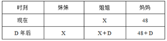

根据题意可得：X+X+D=48+D+2，解得X=25。

故正确答案为C。

**考点**：年龄问题

**来源**：2011年424联考《行测》题（贵州/四川/福建/黑龙江/湖北/山西/重庆/辽宁/海南/江西/天津/陕西/云南/广西/山东/湖南）第41题

### 第 42 题

某单位招待所有若干间房间，现在安排一支考察队的队员住宿，若每间住3人则有2人无房可住；若每间住4人，则有一间房间不空也不满，则该招待所的房间最多有：

A. 4间

B. 5间

C. 6间

D. 7间

第 42 题 · 答案与解析

**参考答案（粉笔题库参考内容）**

B

**解析**

方法一：设房间数为x，则总人数为3x+2，若每间住4人，没有空房间且没住满，则得到4(x-1)&lt;3x+2&lt;4x，解得2＜x＜6，因此x最大值为5。

方法二：采用极端思想确定范围，根据题意可得极端情况为要么最后一个房间住1个人，要么最后一个房间住3个人，若住1人得到4(x-1)+1=3x+2，解得x=5；若住3人得到4(x-1)+3=3x+2，解得x=3。问房间最多，则取x=5。

故正确答案为B。

**考点**：和差倍比问题、非典型最值问题

**来源**：2011年424联考《行测》题（贵州/四川/福建/黑龙江/湖北/山西/重庆/辽宁/海南/江西/天津/陕西/云南/广西/山东/湖南）第42题

### 第 43 题

某单位招录了10名新员工，按其应聘成绩排名1到10，并用10个连续的四位自然数依次作为他们的工号，凑巧的是每个人的工号都能被他们的成绩排名整除，问排名第三的员工工号所有数字之和是多少：

A. 12

B. 9

C. 15

D. 18

第 43 题 · 答案与解析

**参考答案（粉笔题库参考内容）**

A

**解析**

方法一：假设10个工号依次为N+1，N+2，······，N+10，由题意，N+A能够被A整除（A为1、2、······、10），则N能够被A整除。于是N能够被1，2，······，10整除，因此N至少为1，2，······，10的最小公倍数，则在四位数上N最小为2520，可知此时第三位工号为2523，其数字和为12。

方法二：根据数字特性，若1个多位数能够被3整除，则该多位数的各位数字之和能够被3整除；若1个多位数能够被9整除，则该多位数的各位数字之和能够被9整除。已知10个工号分别能被A整除（A为1，2，······，10），则能够推断10个工号最后一个数字分别为1，2，······，10。观察第三名与第九名，第三名的工号加上6等于第九名的工号，即第三名的工号数字之和加上6后能够被9整除，在四个选项中仅A项符合。

故正确答案为A。

**考点**：和差倍比问题

**来源**：2011年424联考《行测》题（贵州/四川/福建/黑龙江/湖北/山西/重庆/辽宁/海南/江西/天津/陕西/云南/广西/山东/湖南）第43题

### 第 44 题

小王开车上班需经过4个交通路口，假设经过每个路口遇到红灯的概率分别为0.1，0.2，0.25，0.4，他上班经过4个路口至少有一处遇到绿灯的概率是：

A. 0.988

B. 0.899

C. 0.989

D. 0.998

第 44 题 · 答案与解析

**参考答案（粉笔题库参考内容）**

D

**解析**

逆向考虑，至少有一处遇到绿灯的对立面是全是红灯，小王经过4个路口全部遇到红灯的概率是0.1×0.2×0.25×0.4=0.002，则至少有一处遇到绿灯的概率是1–0.002=0.998。

故正确答案为D。

**考点**：给概率求概率

**来源**：2011年424联考《行测》题（贵州/四川/福建/黑龙江/湖北/山西/重庆/辽宁/海南/江西/天津/陕西/云南/广西/山东/湖南）第44题

### 第 45 题

把一个正四面体的每个表面都分成9个相同的等边三角形，用任意颜色给这些小三角形上色，要求有公共边的小三角形颜色不同，问最多有多少个小三角形颜色相同：

A. 15

B. 12

C. 16

D. 18

第 45 题 · 答案与解析

**参考答案（粉笔题库参考内容）**

A

**解析**

先看一个面上的情况，要使颜色相同的三角形最多，最多有6个（如下图左侧图所示），此时其他面上能与之颜色相同的三角形最多只能有3个（如下图右侧图所示）。因此颜色相同的三角形最多有6+3×3=15个。

故正确答案为A。

**考点**：几何其他题型

**来源**：2011年424联考《行测》题（贵州/四川/福建/黑龙江/湖北/山西/重庆/辽宁/海南/江西/天津/陕西/云南/广西/山东/湖南）第45题

### 第 46 题

10个箱子总重100公斤，且重量排在前三位数的箱子总重不超过重量排在后三位的箱子总重的1.5倍，问最重的箱子重量最多是多少公斤：

A. 500/23

B. 200/11

C. 20

D. 25

第 46 题 · 答案与解析

**参考答案（粉笔题库参考内容）**

A

**解析**

要使最重的箱子尽可能的重，则其余9个箱子应该尽可能轻，考虑极端情况，假设其余9个箱子一样重为x公斤，最重的箱子质量为y公斤，且y>x，则根据题意得到：①y+9x=100；②y+2x≤1.5×3x，整理得到100≤11.5x，即x≥100/11.5，x值尽可能小才能保证y值尽可能大，取x=100/11.5，由②式得到y ≤ 2.5x，。

故正确答案为A。

**考点**：构造数列

**来源**：2011年424联考《行测》题（贵州/四川/福建/黑龙江/湖北/山西/重庆/辽宁/海南/江西/天津/陕西/云南/广西/山东/湖南）第46题

### 第 47 题

一条环形赛道前半段为上坡，后段为下坡，上坡和下坡的长度相等，两辆车同时从赛道起点出发同向行驶，其中A车上、下坡时速相等，而B车上坡时速比A车慢20%，下坡时速比A车快20%，问A车跑到第几圈时两车再次齐头并进：

A. 23

B. 22

C. 24

D. 25

第 47 题 · 答案与解析

**参考答案（粉笔题库参考内容）**

D

**解析**

设A车速度为V，则B车上坡速度为0.8V，B车下坡速度为1.2V。上坡和下坡距离相等，运用等距离平均速度公式可知B车完成一圈的平均速度=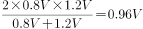，则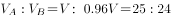，因为运动时间相等，则路程比等于速度比，即，也就是说当A车行驶25圈时，B车行驶24圈，此时A、B两车再次齐头并进。

故正确答案为D。

**考点**：平均速度

**来源**：2011年424联考《行测》题（贵州/四川/福建/黑龙江/湖北/山西/重庆/辽宁/海南/江西/天津/陕西/云南/广西/山东/湖南）第47题

### 第 48 题

某公司要买100本便签纸和100支胶棒，附近有两家超市。A超市的便签纸0.8元一本，胶棒2元一支且买2送1。B超市的便签纸1元一本且买3送1，胶棒1.5元一支，如果公司采购员要在这两家超市买这些物品，他至少要花多少元钱：

A. 183.5

B. 208.5

C. 225

D. 230

第 48 题 · 答案与解析

**参考答案（粉笔题库参考内容）**

B

**解析**

先考虑便签，A超市0.8元一本，4本需要3.2元，B超市3元4本（花费较低），且100能够被4整除，因此100本便签可全部在B超市购买，花费元；再考虑胶棒，A超市为3支4元（花费较低），B超市为1.5元一支，3支4.5元，因此胶棒以3支为一组尽可能多地在A超市购买，可购买99支，花费元，剩余的一支在B超市购买，花费1.5元，总共需要75+132+1.5=208.5元。

故正确答案为B。

**考点**：经济利润问题、非典型最值问题

**来源**：2011年424联考《行测》题（贵州/四川/福建/黑龙江/湖北/山西/重庆/辽宁/海南/江西/天津/陕西/云南/广西/山东/湖南）第48题

### 第 49 题

有甲、乙、丙三辆公交车于上午8：00同时从公交总站出发，三辆车再次回到公交总站所用的时间分别为40分钟、25分钟和50分钟，假设这三辆公交车中途不休息，请问它们下次同时到达公交总站将会是几点：

A. 11点整

B. 11点20分

C. 11点40分

D. 12点整

第 49 题 · 答案与解析

**参考答案（粉笔题库参考内容）**

B

**解析**

三辆公交车下次同时到达公交总站相隔的时间应是三辆车各自往返一趟时间的最小公倍数，即40分钟、25分钟、50分钟的最小公倍数200分钟，即3小时20分钟，因此三辆车下次同时到达公交总站的时间为11点20分。

故正确答案为B。

**考点**：周期相遇问题

**来源**：2011年424联考《行测》题（贵州/四川/福建/黑龙江/湖北/山西/重庆/辽宁/海南/江西/天津/陕西/云南/广西/山东/湖南）第49题

### 第 50 题

一条路上依次有A、B、C三个站点，加油站M恰好位于A、C的中点，加油站N恰好位于B、C的中点，若想知道M和N两个加油站之间的距离，只需知道哪两点之间的距离：

A. B和C

B. C和N

C. A和M

D. A和B

第 50 题 · 答案与解析

**参考答案（粉笔题库参考内容）**

D

**解析**

方法一：画图（如下图所示）分析可知，，则只需知道A、B间的距离，就可知道 M、N间的距离。

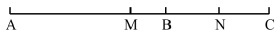

方法二：假设A、B、C三点构成一个三角形（如下图所示），M是AC的中点，N是BC的中点，MN是三角形的中位线，。则只需知道A、B间的距离，就可知道MN的距离。

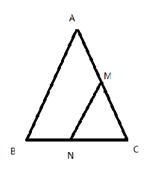

故正确答案为D。

**考点**：几何其他题型

**来源**：2011年424联考《行测》题（贵州/四川/福建/黑龙江/湖北/山西/重庆/辽宁/海南/江西/天津/陕西/云南/广西/山东/湖南）第50题

### 第 51 题

从所给的四个选项中，选择最合适的一个填入问号处，使之呈现一定的规律性。

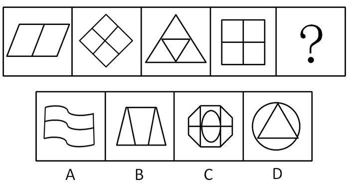

A. A

B. B

C. C

D. D

第 51 题 · 答案与解析

**参考答案（粉笔题库参考内容）**

A

**解析**

考查元素种类。题干中每幅图形都只包含一种元素，选项中只有A项含有一种元素；B、C、D三项都是至少含有两种元素。

故正确答案为A。

**考点**：数量规律-素

**来源**：2011年424联考《行测》题（贵州/四川/福建/黑龙江/湖北/山西/重庆/辽宁/海南/江西/天津/陕西/云南/广西/山东/湖南）第51题

### 第 52 题

从所给的四个选项中，选择最合适的一个填入问号处，使之呈现一定的规律性。

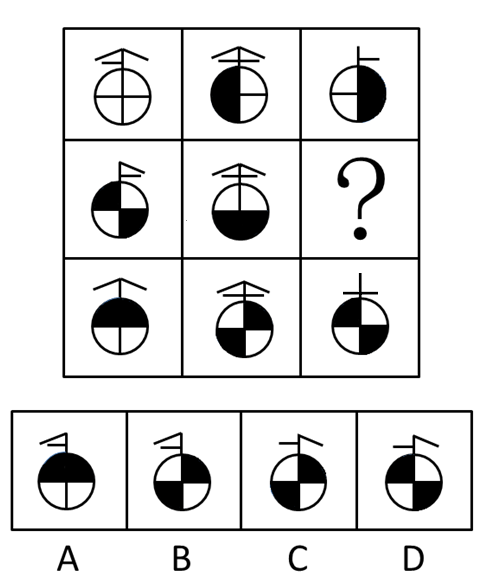

A. A

B. B

C. C

D. D

第 52 题 · 答案与解析

**参考答案（粉笔题库参考内容）**

A

**解析**

元素组成相似，既考查了黑白叠加，还考查了线条的叠加。这个九宫格图形中第一行和第三行都是前两幅图叠加在一起得到第三幅图。颜色叠加规律就是：白＋黑＝白，黑＋白＝黑，白＋白＝黑，黑＋黑=白。圆球上部分的规律是，竖线不变，图二减图一（或二者求异）得到图三。此题目的难点是“白＋黑”不等于“黑＋白”，需要注意。

故正确答案为A。

**考点**：样式规律-加减同异、样式规律-黑白运算

**来源**：2011年424联考《行测》题（贵州/四川/福建/黑龙江/湖北/山西/重庆/辽宁/海南/江西/天津/陕西/云南/广西/山东/湖南）第52题

### 第 53 题

从所给的四个选项中，选择最合适的一个填入问号处，使之呈现一定的规律性。

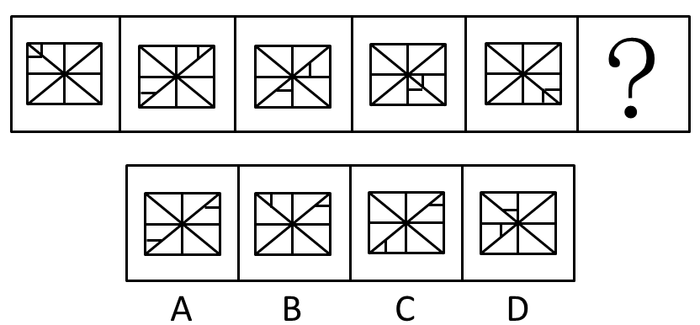

A. A

B. B

C. C

D. D

第 53 题 · 答案与解析

**参考答案（粉笔题库参考内容）**

C

**解析**

元素组成相同，考查位置规律。小横线在已知图形中进行逆时针平移，小竖线在已知图形中进行顺时针平移。

故正确答案为C。

**考点**：位置规律-平移

**来源**：2011年424联考《行测》题（贵州/四川/福建/黑龙江/湖北/山西/重庆/辽宁/海南/江西/天津/陕西/云南/广西/山东/湖南）第53题

### 第 54 题

从所给的四个选项中，选择最合适的一个填入问号处，使之呈现一定的规律性。

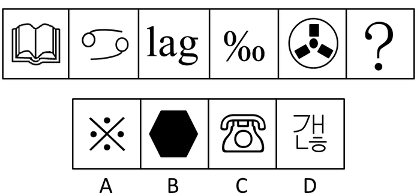

A. A

B. B

C. C

D. D

第 54 题 · 答案与解析

**参考答案（粉笔题库参考内容）**

D

**解析**

本题属于数量类，需要数图案的组成部分。题干中五幅图组成部分的总数分别是1、2、3、4、5，只有D项包含6部分。

故正确答案为D。

**考点**：数量规律-素

**来源**：2011年424联考《行测》题（贵州/四川/福建/黑龙江/湖北/山西/重庆/辽宁/海南/江西/天津/陕西/云南/广西/山东/湖南）第54题

### 第 55 题

请从所给的四个选项中，选择最合适的一个填入问号处，使之呈现一定的规律性。

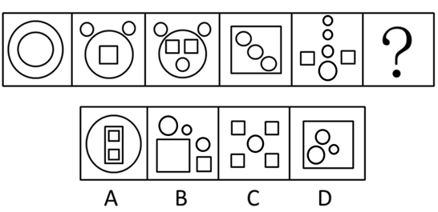

A. A

B. B

C. C

D. D

第 55 题 · 答案与解析

**参考答案（粉笔题库参考内容）**

D

**解析**

元素组成凌乱，考数数。图中圆圈的数量比方块的数量多2个。符合的只有D项。

故正确答案为D。

**考点**：数量规律-素

**来源**：2011年424联考《行测》题（贵州/四川/福建/黑龙江/湖北/山西/重庆/辽宁/海南/江西/天津/陕西/云南/广西/山东/湖南）第55题

### 第 56 题

从所给的四个选项中，选择最合适的一个填入问号处，使之呈现一定的规律性。

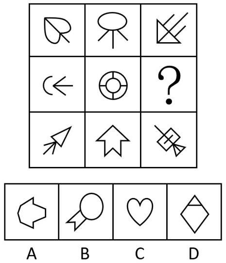

A. A

B. B

C. C

D. D

第 56 题 · 答案与解析

**参考答案（粉笔题库参考内容）**

A

**解析**

本题属于属性类。题干的这个九宫格图形每幅图都是轴对称图形，而且它们的对称轴可以组成一个“米”字形状。要求的这幅图应该是个横轴对称的图形，只有A项符合要求。

故正确答案为A。

**考点**：属性规律-对称性

**来源**：2011年424联考《行测》题（贵州/四川/福建/黑龙江/湖北/山西/重庆/辽宁/海南/江西/天津/陕西/云南/广西/山东/湖南）第56题

### 第 57 题

从所给的四个选项中，选择最合适的一项填在问号处，使之呈现一定的规律性。

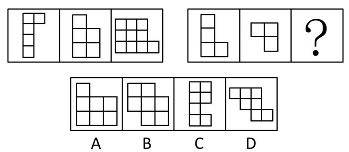

A. A

B. B

C. C

D. D

第 57 题 · 答案与解析

**参考答案（粉笔题库参考内容）**

A

**解析**

元素组成相似，考查元素叠加和位置。第一组三幅图形的规律是第一幅图逆时针旋转90度，第二幅图向右翻转再逆时针旋转90度之后，两幅图拼在一起得到第三幅。第二组图形运用规律，A项符合规律。

故正确答案为A。

**考点**：样式规律-加减同异

**来源**：2011年424联考《行测》题（贵州/四川/福建/黑龙江/湖北/山西/重庆/辽宁/海南/江西/天津/陕西/云南/广西/山东/湖南）第57题

### 第 58 题

从所给的四个选项中，选择最合适的一个填入问号处，使之呈现一定的规律性。

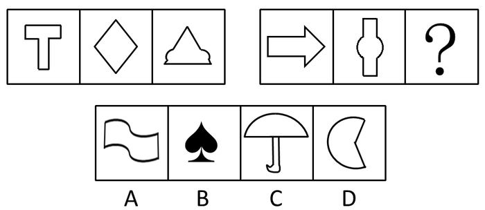

A. A

B. B

C. C

D. D

第 58 题 · 答案与解析

**参考答案（粉笔题库参考内容）**

D

**解析**

本题属于属性类题目。第一组图形都是竖轴对称，第二组都是横轴对称，D项符合要求。

故正确答案为D。

**考点**：属性规律-对称性

**来源**：2011年424联考《行测》题（贵州/四川/福建/黑龙江/湖北/山西/重庆/辽宁/海南/江西/天津/陕西/云南/广西/山东/湖南）第58题

### 第 59 题

左边给定的是纸盒外表面的展开图，右边哪一项能由它折叠而成？请把它找出来：

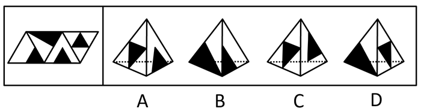

A. A

B. B

C. C

D. D

第 59 题 · 答案与解析

**参考答案（粉笔题库参考内容）**

C

**解析**

将原展开图标上序号如下图，逐一进行分析。

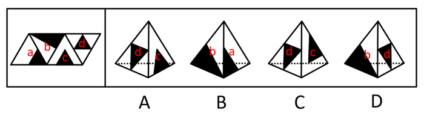

A项：选项由面c与面d构成，展开图中面c中小黑三角的右边是面d，而选项中面c中小黑三角的左边是面d，选项与展开图不一致，排除；

B项：选项由面a与面b构成，展开图中两个小黑三角没有交点，而选项中两个小黑三角有交点，选项与展开图不一致，排除；

C项：选项由面c与面d构成，选项与展开图一致，当选；

D项：选项由面b和面d构成，展开图中面b中小黑三角形的斜边和两个面的公共边重合，而选项中没有重合，选项与展开图不一致，排除。

故正确答案为C。

**来源**：2011年424联考《行测》题（贵州/四川/福建/黑龙江/湖北/山西/重庆/辽宁/海南/江西/天津/陕西/云南/广西/山东/湖南）第59题

### 第 60 题

从所给的四个选项中，选择最合适的一个填入问号处，使之呈现一定的规律性。

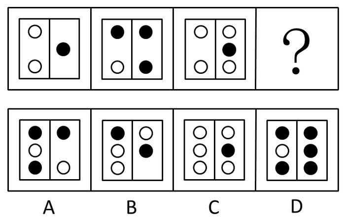

A. A

B. B

C. C

D. D

第 60 题 · 答案与解析

**参考答案（粉笔题库参考内容）**

D

**解析**

元素组成不同，且无明显属性规律，考虑数量规律。题干图形均由黑白球组成，考虑元素的种类或个数。观察发现，题干图形中黑白球的个数依次为3、4、5，故？处黑白球的个数应为6，排除A、B两项；继续观察发现，题干图形依次包含2个白球和1个黑球、3个黑球和1个白球、4个白球和1个黑球，即数量多的小球个数依次递增，且颜色交替出现，个数为1的小球颜色也交替出现，故？处图形应包含5个黑球和1个白球，只有D项符合。

故正确答案为D。

**考点**：数量规律-素

**来源**：2011年424联考《行测》题（贵州/四川/福建/黑龙江/湖北/山西/重庆/辽宁/海南/江西/天津/陕西/云南/广西/山东/湖南）第60题

### 第 61 题

低碳经济是在可持续发展理论指导下，通过技术创新、制度创新产业转型、新能源开发等多种手段，尽可能地减少煤炭、石油高碳能源消耗，减少温室气体排放，达到社会经济发展与生态环境保护双赢的一种经济发展形态。

根据上述定义，下列不符合低碳经济理念的是：

A. 某粮油食品公司大力推广绿色食品

B. 某小区住房都安装了太阳能电池板

C. 某空调公司引进了低能耗空调生产线

D. 在荒山、滩头、草甸兴建风力发电站

第 61 题 · 答案与解析

**参考答案（粉笔题库参考内容）**

A

**解析**

第一步：抓住定义中的关键词。

定义的关键词有“通过技术创新”、“减少高碳能源消耗”等。

第二步：逐一判断选项。

A项，“绿色食品”是关于是否使用化学肥料的问题，不是降低碳能源消耗的问题，不符合定义；

B项，“太阳能”属于新能源开发，并且能够很好地减少煤炭、石油的能源消耗；

C项，“低能耗”体现了减少温室气体排放的目标；

D项，“风力发电站”的发电动力来源于风力，不耗费煤炭、石油等能源，也不会产生温室气体。

所以B、C、D三项都符合低碳经济的理念。

本题为选非题，故正确答案为A。

**考点**：方式目的

**来源**：2011年424联考《行测》题（贵州/四川/福建/黑龙江/湖北/山西/重庆/辽宁/海南/江西/天津/陕西/云南/广西/山东/湖南）第61题

### 第 62 题

如果概念B所表达的对象均在概念A所表达的范围之内，概念A所表达的对象有些在概念B所表达的范围之内，有些不在概念B所表述的范围之内，则称概念A与概念B之间存在真包含关系。

根据上述定义，下列哪项中划横线的两个概念是真包含关系：

A. <u>榕树</u>在很多城市被作为<u>行道树</u>

B. <u>启明星</u>就是<u>金星</u>

C. <u>植物</u>有时候也会表现出类似<u>动物</u>的行为

D. <u>科学</u>包括多种学科，例如气象学、<u>遗传学</u>等

第 62 题 · 答案与解析

**参考答案（粉笔题库参考内容）**

D

**解析**

第一步：抓住定义中的关键词。

定义的关键词有“B······均在······A”、“A······有些在······B”。

第二步：逐一判断选项。

A项，不是所有“榕树”都是“行道树”，也不是所有“行道树”都是“榕树”；

B项，二者等同，是同一关系；

C项，二者是互斥关系，“植物”不是“动物”；

D项，“遗传学”肯定是“科学”，但“科学”不一定就是“遗传学”。

故正确答案为D。

**考点**：单定义-其他句式

**来源**：2011年424联考《行测》题（贵州/四川/福建/黑龙江/湖北/山西/重庆/辽宁/海南/江西/天津/陕西/云南/广西/山东/湖南）第62题

### 第 63 题

沉没成本是指已经付出且不可收回的成本。沉没成本是由过去的决策或环境决定的，它所造成的成本是不能由现在或将来的任何决策而改变的。

根据上述定义，下列不涉及沉没成本的是：

A. 小李花100美元买了一台二手台式电脑，回国时由于无法携带，只好忍痛将电脑丢弃

B. 某煤矿的煤炭已经开采完，矿井里的一些采掘设备由于无法取出，只好被废弃

C. 小陈如果在承包的山林中放养野鸡，比放养野兔的年收益更多，但管理更多，于是他选择了放养野兔

D. 小张准备约小丽一起去看电影，因为小丽临时加班，又不能退票，小张只好将两张电影票充当了留言条

第 63 题 · 答案与解析

**参考答案（粉笔题库参考内容）**

C

**解析**

第一步：抓住定义中的关键词。

定义的关键短语有“已经付出”“不可收回”“过去的决策或环境”等。

第二步：逐一判断选项。

A项中“100美元”，B项中“采掘设备”，D项中“电影票”都属于已经付出的成本，符合定义；

C项中小陈并未放养野鸡，因此“放养野鸡”不属于他过去的决策，不符合定义。

本题为选非题，故正确答案为C。

**考点**：原因结果

**来源**：2011年424联考《行测》题（贵州/四川/福建/黑龙江/湖北/山西/重庆/辽宁/海南/江西/天津/陕西/云南/广西/山东/湖南）第63题

### 第 64 题

学习障碍是指从发育的早期阶段起，儿童获得学习技能的正常方式方法受损。这种损害不是单纯缺乏学习机会的结果，不是智力的发展迟缓的结果，也不是后天的脑外伤或疾病的结果，这种障碍来源于认知处理过程的异常，表现在阅读、拼写、计算等方面有特殊的障碍。

根据上述定义，下列属于学习障碍的是：

A. 九岁的小强刚从国外回来，不能识别简体字，在阅读学习材料时面临不少困难

B. 小华原来学习优秀，随父母移居国外后由于听课困难，学习成绩大幅下降

C. 小明的成绩不好，三年级时接受了专业的智力的测验，结果发现他的智力只相当于六岁儿童的水平

D. 小红聪明可爱，但上学之后读书时常出现跳行跳字的现象，虽然老师多次纠正但她仍然难以改正

第 64 题 · 答案与解析

**参考答案（粉笔题库参考内容）**

D

**解析**

第一步：抓住定义中的关键词。

定义的关键短语有“不是智力发展迟缓”“认知处理过程的异常”等。

第二步：逐一判断选项。

A项“小强刚从国外回来”，B项“移居国外”都是因为缺乏学习机会，而非由于“认知处理过程的异常”，不符合定义；

C项小明的情况属于智力发展迟缓，不是学习障碍；

D项“跳行跳字”的现象属于表现在阅读方面的认知处理过程的异常现象，符合定义。

故正确答案为D。

**考点**：单定义-其他句式

**来源**：2011年424联考《行测》题（贵州/四川/福建/黑龙江/湖北/山西/重庆/辽宁/海南/江西/天津/陕西/云南/广西/山东/湖南）第64题

### 第 65 题

行政赔偿是指行政机关及其工作人员违法行使职权，侵犯了公民、法人或其他组织的合法权益并造成损害，由国家承担赔偿责任的制度。

根据上述定义，下列各项要求中属于行政赔偿范围的是：

A. 某区政府工作人员王某驾驶区政府车辆外出办事途中顺路回家探亲，因超速行驶撞伤村民张某，张某要求该区政府进行损害赔偿

B. 交通警察孙某与出租车司机李某素有嫌隙，孙某诬陷李某违反交通规则，并吊销其驾照，李某要求交通管理部门赔偿其损失

C. 某市工商局发现某公司涉嫌销售假冒伪劣产品而将其产品扣押，该公司以其财产遭受损失为由要求赔偿

D. 公安局销毁了一片非法种植的罂粟，种植者老刘认为他种植罂粟的目的是为母亲治病，公安机关不应销毁，要求公安部门赔偿其损失

第 65 题 · 答案与解析

**参考答案（粉笔题库参考内容）**

B

**解析**

第一步：抓住定义中的关键词。

定义的关键词有“违法行使职权”。

第二步：逐一判断选项。

A项“超速行驶”不是在行使职权，C、D两项都没有违法行使职权，均不符合定义；

B项孙某因为私怨，利用职权诬陷李某，符合定义中的“违法行使职权”。

故正确答案为B。

**考点**：单定义-其他句式

**来源**：2011年424联考《行测》题（贵州/四川/福建/黑龙江/湖北/山西/重庆/辽宁/海南/江西/天津/陕西/云南/广西/山东/湖南）第65题

### 第 66 题

绿色公关是指企业以生态与经济可持续发展观念影响公关，选择具有“绿色”特征的媒体开展传播活动，以“绿色”为特色塑造企业形象，赢得公众的信任与支持，给企业带来更多便利和竞争优势的一系列公关活动。

根据上述定义，下列属于绿色公关的是：

A. 某软件公司推出一款绿色软件，无需安装即可使用，移除后也不会有任何残留记录留在电脑里，受到了很多用户的欢迎

B. 某快餐企业推出了“种植一棵树”的宣传活动，并倡导减少包装以节约资源，创造了良好的经营环境和社会氛围

C. 某小区居委会按照当地政府的要求进行垃圾分类宣传，在小区举办垃圾分类知识竞赛，现场发放不同颜色的垃圾袋供居民使用，受到大家的欢迎

D. 人民网举办了以“发展低碳经济引领绿色潮流”为主题的“2010首届低碳中国年度创新论坛”，揭晓了2010年低碳中国领军人物，领军品牌，十大创新技术产品等十多个奖项

第 66 题 · 答案与解析

**参考答案（粉笔题库参考内容）**

B

**解析**

第一步：抓住定义中的关键词。

定义的关键词有“企业”、“生态与经济可持续发展观念”等。

第二步：逐一判断选项。

A项中的“绿色”是电脑软件概念，而“绿色公关”中的“绿色”是生态相关概念，C项中都不是给企业带来便利和竞争优势的活动。故A、C两项均不符合定义；

B项“快餐企业”“倡导减少包装以节约资源”符合定义；

D项中的人民网所举办的活动不是为了塑造人民网的形象，而是帮助其他企业塑造形象，不符合定义。

故正确答案为B。

**考点**：方式目的

**来源**：2011年424联考《行测》题（贵州/四川/福建/黑龙江/湖北/山西/重庆/辽宁/海南/江西/天津/陕西/云南/广西/山东/湖南）第66题

### 第 67 题

敌意性归因偏差是指在情景不明的情况下，会将对方的动机或意图视为有敌意的倾向。

根据上述定义，下列属于敌意性归因偏差的是：

A. 小刘在社团主席竞选中败得很惨，当小王劝他再参加学生会将要进行的主席选举时，他觉得小王是故意来挖苦他的

B. 领导看到小张在晋升前的民主评议中得票很低，就断定他人品不好，打消了提升他的念头

C. 王老师班上的学生陈强一向表现平平，却在最近的学科竞赛上获得了全校最好成绩，王老师觉得陈强在竞赛中存在作弊行为

D. 某公司赵总一直不同意李总提出的年底奖金分配方案，李总多次与之沟通收效甚微，李总认为赵总过于维护自己部门的利益

第 67 题 · 答案与解析

**参考答案（粉笔题库参考内容）**

A

**解析**

第一步：抓住定义中的关键词。

定义的关键短语有“情况不明”“视为有敌意”。

第二步：逐一判断选项。

A项“挖苦自己”是“敌意”，符合定义；

B项“人品不好”、C项“作弊”和D项“维护自己部门利益”都不是“敌意”，均不符合定义。

故正确答案为A。

**考点**：单定义-其他句式

**来源**：2011年424联考《行测》题（贵州/四川/福建/黑龙江/湖北/山西/重庆/辽宁/海南/江西/天津/陕西/云南/广西/山东/湖南）第67题

### 第 68 题

食品污染物指不是有意加入食品中，而是在生产，制造，加工，调制，处理，填充，包装，运输和贮藏等过程中带入食品中，或是由于环境污染带入食品中的任何物质。

根据上述定义，下列属于食品污染物的是：

A. “三鹿奶粉”事件中“问题奶粉”含有三聚氰胺成分

B. 对肉质进行嫩化改良而使用的木瓜蛋白酶成分

C. 油炸食品在加工过程中由于加入增多剂而产生的铝成分

D. 食品腌制中，使用的添加剂中含有的对人体有害的亚硝酸盐

第 68 题 · 答案与解析

**参考答案（粉笔题库参考内容）**

C

**解析**

第一步：找出定义关键词。

“不是有意加入食品中”、“在生产，制造，加工，调制，处理，填充，包装，运输和贮藏等过程中带入食品中”。

第二步：逐一分析选项。

A项：“三聚氰胺”是有意加入食品中的，不符合定义，排除；

B项：“木瓜蛋白酶”是有意加入食品中的，不符合定义，排除；

C项：铝成分是加入增多剂后产生的，符合“不是有意加入食品中”、“在生产，制造，加工，调制，处理，填充，包装，运输和贮藏等过程中带入食品中”，符合定义，当选；

D项：“亚硝酸盐”是在添加剂中本来就含有的，不符合“不是有意加入食品中”，不符合定义，排除。

故正确答案为C。

**考点**：大前提

**来源**：2011年424联考《行测》题（贵州/四川/福建/黑龙江/湖北/山西/重庆/辽宁/海南/江西/天津/陕西/云南/广西/山东/湖南）第68题

### 第 69 题

范围经济是由厂商的经营范围而非规模带来的经济，是指同时生产两种产品的费用低于分别生产每种产品的费用的经济现象。

根据上述定义，下列属于范围经济的是：

A. 某啤酒制造厂收购了一个经营亏损的小型啤酒厂，生产线扩大后原料采购成本降低，两个厂区啤酒的生产效益均有提高

B. 某家具生产厂家实行桌子与衣柜全并生产后，相同的生产过程使成本有效降低

C. 因为市场需求扩大，布鞋和鞋垫的手工作坊式生产逐渐被机器生产取代，生产成本大幅下降

D. 某奶制品厂实行奶酪与酸奶一起生产，二者的生产工艺相互借鉴，产品改良，销量大增

第 69 题 · 答案与解析

**参考答案（粉笔题库参考内容）**

B

**解析**

第一步：抓住定义中的关键词。

定义的关键在于“同时生产两种产品的费用低于分别生产每种产品的费用”。

第二步：逐一判断选项。

A项是厂区合并，并非产品合并，C项是生产方式由手工作坊变为机器生产，没有体现经营范围的扩大带来的影响，D项是增加了销量，没有提到降低费用。故A、C、D三项均不符合定义。

B项是通过合并产品生产降低成本，符合定义。

故正确答案为B。

**考点**：大前提

**来源**：2011年424联考《行测》题（贵州/四川/福建/黑龙江/湖北/山西/重庆/辽宁/海南/江西/天津/陕西/云南/广西/山东/湖南）第69题

### 第 70 题

自我设限是指个体针对可能到来的失败威胁，事先调协障碍，为失败创造一个合理的借口，从而保护自我价值，维护自我形象。

根据上述定义，下列属于自我设限的是：

A. 小周和小田一起竞选班长，小田跟朋友说，小周学习好，人缘也好，还在学生社团担任干部，老师都比较喜欢他，自己估计没戏了，最后果然小周当选了班长。

B. 小王即将参加某公司的面试，但总觉得自己无法通过，面试前一天，他因为突然生病被送进了医院，错过了这次面试

C. 小李毕业后进入保险公司做销售代理，第一个月没有签订一单合同，他解释是因为受全球金融危机影响，市场行情很不好

D. 小明的语文成绩在班上一直名列前茅，每次考试前他都跟同学说，自己状态不好肯定会考砸，但他最后的成绩都在前三名之内

第 70 题 · 答案与解析

**参考答案（粉笔题库参考内容）**

A

**解析**

第一步：抓住定义中的关键词。

定义的关键在于事先为可能到来的失败威胁找合理的借口。

第二步：逐一判断选项。

A项小田知道自己获选可能性不大，事先向别人解释小周可能获选的理由，以此保护自我价值，符合定义；

B项小王突然生病是客观事实，并非他事先为失败找借口，不符合定义；

C项小李的解释是事后的解释，并非“事先”，不符合定义；

D项小明成绩一直优秀，并不存在可能到来的失败，事实也证明了这一点，不符合定义。

故正确答案为A。

**考点**：方式目的

**来源**：2011年424联考《行测》题（贵州/四川/福建/黑龙江/湖北/山西/重庆/辽宁/海南/江西/天津/陕西/云南/广西/山东/湖南）第70题

### 第 71 题

小刘是环保志愿者组织“拯救地球”的成员，由于身患重病，不能到上海做世博会志愿者，而该组织其他成员都是获得了上海世博会志愿者的资格。

由此可以推出：

A. 小刘是“拯救地球”的成员，但未获得上海世博会志愿者资格

B. 上海世博会志愿者都是“拯救地球”的成员

C. 如果有人是上海世博会志愿者，又是“拯救地球”成员，他一定不是小刘

D. 如果有人是“拯救地球”的成员，但不是上海世博会志愿者，他一定是小刘

第 71 题 · 答案与解析

**参考答案（粉笔题库参考内容）**

C

**解析**

第一步：抓住题干对象及其关系。

题干说明小刘不能到上海做世博会志愿者，并不能说明小刘没有获得志愿者的资格，而该组织其他成员都是获得了上海世博会志愿者的资格，并不能说明该组织其他成员就一定到上海世博会做志愿者了。

第二步：逐一判断选项。

A项说小刘未获得上海世博会志愿者的资格，根据第一步分析可知，小刘不能到上海做世博会志愿者，并不能说明小刘没有获得志愿者的资格，因此A项不能由题干推出；

B项不符合推断，由题干信息可知，有些“拯救地球”的成员获得了上海世博会志愿者的资格，并不能说明这些人就一定到上海世博会做志愿者了，而上海世博会志愿者不一定都是“拯救地球”的成员；

C项符合推断，有人是上海世博会志愿者，说明这个人肯定是获得了上海世博会志愿者的资格，并且又是“拯救地球”的成员，小刘虽然是“拯救地球”成员，但他不能到上海做世博会志愿者，说明他不是志愿者，那么这个人肯定不是小刘；

D项不能由题干信息推出，根据第一步分析可知，这个人不一定是小刘，可以是其他人，因为组织中的其他成员是否有原因也没能成为志愿者是未知的，所以不能说这个人一定是小刘，因此D项说法无法判断。

故正确答案为C。

**考点**：日常结论

**来源**：2011年424联考《行测》题（贵州/四川/福建/黑龙江/湖北/山西/重庆/辽宁/海南/江西/天津/陕西/云南/广西/山东/湖南）第71题

### 第 72 题

在选购地板时，消费者都很关心地板散发的气味，因为地板的刺激性气味强，往往是有毒有害物质超标的一种表现，最近有一种据称是香味环保地板赢得了不少消费者的青睐。销售人员声称地板散发的香味可以消毒杀菌，去除空气中的异味。当销售人员在推销这种产品时，往往会拿来几种不同的地板，让有购买意向的消费者闻一闻，并指出散发着清香气味的地板，即是香味环保地板。

以下哪项如果为真，最能削弱销售人员的观点：

A. 气味并不是判别地板是否环保的唯一标准，除气味外，消费者更关心地板中有机挥发物的含量

B. 事实上，由于木材本身的气味以及受制造工艺所限，地板或多或少都带有一定的刺激性气味

C. 到目前为止，国家有关部门还没有出台香味环保地板的专门标准，所谓的“香味”不过是厂家炒作的概念

D. 检验证明，不少厂商是通过在地板中添加大量香精等化学助剂来达到掩盖或者中和刺激性气味的目的

第 72 题 · 答案与解析

**参考答案（粉笔题库参考内容）**

D

**解析**

第一步：找到论点和论据。

论点：销售人员声称地板散发的香味可以消毒杀菌，去除空气中的异味。

没有明显论据。

第二步：判断削弱方式。

本题只有论点，没有论据，所以需削弱论点。

第三步：逐一判断选项的作用。

A项的有机挥发物和C项的标准均与香味环保地板的好坏无关，属无关选项；

B项说明都有刺激性气味，并不能证明香味环保地板不好，属无关选项；

D项直接削弱论点，说明越香的地板，刺激性气味越重，对身体越不好。

故正确答案为D。

**考点**：削弱论点

**来源**：2011年424联考《行测》题（贵州/四川/福建/黑龙江/湖北/山西/重庆/辽宁/海南/江西/天津/陕西/云南/广西/山东/湖南）第72题

### 第 73 题

生理学家发现，人类掌管记忆和思维等高级认知功能的大脑皮质在正常情况下有6层，如果胎儿缺乏一种名为“Cdk5”的酶，大脑皮质的发育就会变得极为缓慢，无法最终形成正常大脑皮质的层结构，从而严重影响儿童认知发展，一些医药界人士推测，利用这一发现，将有望研发出药物，普遍提高学生的学习能力。

如果以下为真，哪项不能质疑上述推测：

A. 人体不能吸收外部补充的“Cdk5”酶

B. 学生的学习能力主要是通过后天学习获得的

C. 青少年过了脑发育关键期后，补充“Cdk5”酶不起作用

D. 一些“Cdk5”酶含量高的人学习能力并不突出

第 73 题 · 答案与解析

**参考答案（粉笔题库参考内容）**

D

**解析**

第一步：找到论点和论据。

论点：研发出含有“Cdk5”酶的药物可以提高学生的学习能力。

论据：缺乏“Cdk5”酶将影响儿童认知发展。

第二步：逐一判断选项的作用。

A项人体不能吸收外部补充的“Cdk5”酶，说明把“Cdk5”酶注入体内是不可行的，削弱了论点；

B项学习能力主要是通过后天学习获得的而不是先天，说明是其他原因影响学生的学习能力，削弱了论点；

C项青少年过了脑发育的关键期后，即使补充“Cdk5”酶也不起作用，直接削弱了论点；

D项“Cdk5”酶含量高的人学习能力并不突出，论点说含有“Cdk5”酶的药物可以提高学生的学习能力，学习能力是否突出与能否提高学习能力是两个不同的概念。因此D项与题干论证无关。

故正确答案为D。

**考点**：削弱选非题

**来源**：2011年424联考《行测》题（贵州/四川/福建/黑龙江/湖北/山西/重庆/辽宁/海南/江西/天津/陕西/云南/广西/山东/湖南）第73题

### 第 74 题

食品安全的实现，必须有政府的有效管理。只有政府部门之间的相互协调配合，才能确保政府进行有效的管理。但是，如果没有健全的监督制约机制，是不可能实现政府各部门之间协调配合的。

由此可以推出：

A. 没有健全的监督制约机制，不可能实现食品安全

B. 要想健全监督的机制，必须有政府的有效管理

C. 有了政府各部门之间的相互协调配合，就能实现食品安全

D. 一个不能进行有效管理的政府，即是没有建立起健全的监督制约机制的政府

第 74 题 · 答案与解析

**参考答案（粉笔题库参考内容）**

A

**解析**

第一步：利用充分必要条件翻译题干。

①食品安全→政府的有效管理；②政府进行有效的管理→政府部门之间的相互协调配合；③-健全的监督制约机制→—政府各部门之间协调配合。根据逆否规则推出④政府各部门之间协调配合→健全的监督制约机制，将四个推导关系连接，即食品安全→政府的有效管理→政府部门之间的相互协调配合→健全的监督制约机制，其逆否命题：-健全的监督制约机制→—政府部门之间的相互协调配合→—政府的有效管理→–食品安全。

第二步：逐一翻译选项并判断选项。

A项，-健全的监督制约机制→—食品安全，根据第一步推导可知，A项是题干推导关系的逆否规则；

B项，健全监督的机制→政府的有效管理，根据第一步可知，肯定后件推不出肯定前件，排除B项；

C项，政府各部门协调配合→食品安全，根据第一步可知，肯定后件推不出肯定前件，排除C项；

D项，-政府的有效管理→–健全的监督制约机制，根据第一步可知，否定前件推不出否定后件，排除D项。

故正确答案为A。

**考点**：常规翻译

**来源**：2011年424联考《行测》题（贵州/四川/福建/黑龙江/湖北/山西/重庆/辽宁/海南/江西/天津/陕西/云南/广西/山东/湖南）第74题

### 第 75 题

虎山长城遗址除一号台址发现很少的残砖之外，其他地方均没有发现城砖。虎山村及附近村庄也没有从长城上拆下城砖用于民房建筑的情况。由此可以推测，虎山长城用砖是极少的。

上述推测还需要隐含哪一项假设：

A. 虎山长城遗址附近没有发现古砖窑

B. 当地县志记载虎山长城是夯土筑成

C. 此地山高坡陡，城砖难以运进运出

D. 此地土质极差，不适宜烧制长城用砖

第 75 题 · 答案与解析

**参考答案（粉笔题库参考内容）**

C

**解析**

第一步：找到论点和论据。

论点：虎山长城用砖是极少的。

论据：虎山长城遗址除一号台址发现很少的残砖之外，其他地方均没有发现城砖，且虎山村及附近村庄也没有从长城上拆下城砖的情况。

第二步：逐一分析选项。

A 项：强调虎山长城遗址附近没有发现古砖窑，即使附近没有，也可能从其他地方运来砖块，不能说明虎山长城的用砖数量少，无关选项，排除；

B 项：强调当地县志记载虎山长城是夯土筑成，县志记载不一定就是符合真实情况的，无法得出虎山长城用砖少，无关选项，排除；

C 项：强调城砖难以运进运出，是虎山长城用砖极少的一个必要条件，可以用否定代入法来验证：假设城砖可以运进运出，那么有可能会有一部分残砖已经被运出此地，也就是说，不能通过现有遗址残砖少就推出虎山长城用砖是极少的这一结论。所以C项是题干论证成立所必需假设的，可以加强，当选；

D 项：强调土质差不适宜烧制长城用砖，即使此处不能烧制，还可以从其他地区运来砖块，并不能说明虎山长城用砖少，无关选项，排除。

故正确答案为C。

**考点**：必要条件

**来源**：2011年424联考《行测》题（贵州/四川/福建/黑龙江/湖北/山西/重庆/辽宁/海南/江西/天津/陕西/云南/广西/山东/湖南）第75题

### 第 76 题

伏案工作者长时间低头阅读，书写很容易患腰颈椎疾病，为帮助这部分人预防和缓解腰颈椎疾病，某单位工会为职工印发了宣传册，教大家一些预防和治疗腰颈椎疾病的一些方法。

以下哪项如果为真，最能对上述宣传效果提出质疑：

A. 预防和缓解腰颈椎疾病的方法因人而异

B. 腰颈椎疾病很难进行自我预防和治疗

C. 预防和治疗腰颈椎疾病需要专业人士指导

D. 不经常伏案工作的人也可能患腰颈椎疾病

第 76 题 · 答案与解析

**参考答案（粉笔题库参考内容）**

B

**解析**

第一步：找到论点和论据。

本题论点：伏案工作者长时间低头阅读、书写很容易患腰颈椎疾病，为帮助这部分人预防和缓解腰颈椎疾病，某单位工会为职工印发了宣传册，教大家一些预防和治疗腰颈椎疾病的方法。

没有论据。

第二步：判断削弱方式。

本题只有论点，没有论据，所以需削弱论点。

第三步：逐一判断选项的作用。

A项，预防和缓解腰颈椎疾病的方法因人而异，与预防和治疗腰颈椎疾病的方法是否有效无直接关系，属无关选项；

B项，腰颈椎疾病很难进行自我预防和治疗，说明通过这些方法达不到预防和缓解的目的，从而直接削弱了题干结论；

C项，预防和治疗腰颈椎疾病需要专业人士指导，有无专业人士指导与预防和治疗腰颈椎疾病的方法是否有效无直接关系，而且这个宣传册也可能是专业人士编写的，属无关选项；

D项，不经常伏案工作的人也可能患腰颈椎疾病，这与预防和治疗腰颈椎疾病的方法是否有效无直接关系，属无关选项。

故正确答案为B。

**考点**：削弱论点

**来源**：2011年424联考《行测》题（贵州/四川/福建/黑龙江/湖北/山西/重庆/辽宁/海南/江西/天津/陕西/云南/广西/山东/湖南）第76题

### 第 77 题

克山病是一种原因未明的地方性心肌病，山东省两次克山病流行均发生在病区居民生活困难时期，此时居民饮食结构单一，营养缺乏。1978年以后，由于农村经济体制的改革，病区居民生活逐渐好转，营养结构趋向合理，克山病新发病人越来越少，达到基本控制标准。一些研究者据此推测，营养缺乏可能是克山病发病的重要因素。

如果以下各项为真，哪项不能质疑上述推论：

A. 原来克山病病区的土壤、水质在几十年中发生了较大变化

B. 1978前农村生活水平普遍较低，但克山病仅在个别地方出现

C. 一些生活水平高的地区，也出现过克山病病例

D. 通过调整饮食结构，无法治愈克山病

第 77 题 · 答案与解析

**参考答案（粉笔题库参考内容）**

D

**解析**

第一步：找出论点和论据。

论点：一些研究者据此推测，营养缺乏可能是克山病发病的重要因素。

论据：山东省两次克山病流行均发生在病区居民生活困难时期，此时居民饮食结构单一，营养缺乏；而农村经济体制改革后，病区居民生活逐渐好转，营养结构趋向合理，克山病新发病人越来越少，达到基本控制标准。

第二步：逐一判断选项的作用。

A项，克山病病区的土壤、水质在几十年中发生了较大变化，说明导致克山病新发病人越来越少的原因不是营养结构趋向合理，而是土壤、水质，属于他因削弱；

B项，克山病仅在个别地方出现，生活水平低、营养缺乏的地方并不都出现克山病，削弱了论证；

C项，一些生活水平高的地区也出现过克山病病例，说明了营养不缺乏的地区也存在克山病，质疑了论点；

D项，说明饮食结构调整与克山病能不能治好的逻辑关系，而题干强调的是克山病的发病原因，“发病原因”和“能不能治好”是两个不同概念，因此D项和题干无关，不能质疑题干推论。

本题为选非题，故正确答案为D。

**考点**：削弱-实验类、削弱选非题

**来源**：2011年424联考《行测》题（贵州/四川/福建/黑龙江/湖北/山西/重庆/辽宁/海南/江西/天津/陕西/云南/广西/山东/湖南）第77题

### 第 78 题

出于安全考虑，使用年限超过10年的电梯必须更换钢索，在必须更换钢索的电梯中有一些是S品牌的，所有S品牌电梯都不存在安全隐患。

由此可以推出：

A. 有些存在安全隐患的电梯必须更换钢索

B. 有些S品牌的电梯必须更换钢索

C. 有些S品牌的电梯不需要更换钢索

D. 所有必须更换钢索的电梯使用限都超过了10年

第 78 题 · 答案与解析

**参考答案（粉笔题库参考内容）**

B

**解析**

第一步：翻译题干。

①超10年→换钢索；②有些S品牌→换钢索；③S品牌→-存在安全隐患。

第二步：逐一翻译选项并得出答案。

A项，有些存在安全隐患→换钢索，根据逆否规则，由③可知“存在安全隐患→-S品牌”，“-S品牌”否定的是②的前件，否前件无法得出绝对表达的结论，只能得出可能性结论，即只能得出有些存在安全隐患的电梯可能需要更换钢索，错误；

B项，有些S品牌→换钢索，可从②直接推出，正确；

C项，有些S品牌→-换钢索，“有些S品牌→换钢索”和“有些S品牌→-换钢索”构成反对关系，前者为真无法判断后者的真假，错误；

D项，换钢索→超10年，“换钢索”肯定推导关系①中的后件，肯后件无法推出绝对表达的结论，错误。

故正确答案为B。

**考点**：集合推理

**来源**：2011年424联考《行测》题（贵州/四川/福建/黑龙江/湖北/山西/重庆/辽宁/海南/江西/天津/陕西/云南/广西/山东/湖南）第78题

### 第 79 题

德国经济在席卷全球的金融危机当中受到的冲击与其他发达国家相比较小，主要原因是德国经济建立在先进的制造业的基础上，德国的机械装备和汽车制造业保持了很强的竞争力。一些人根据德国的例子得出结论：只有具备强大的制造业竞争水平，一个国家的经济才有高度的稳定性。

如果以下各项为真，哪项能够质疑上述结论：

A. 有些制造业不发达的国家在金融危机中受影响较小

B. 某国制造业不发达，该国经济一直动荡不安

C. 有些国家保持长期经济稳定，却没有发达的制造业

D. 有些国家制造业很发达，但经济并没有长期保持稳定

第 79 题 · 答案与解析

**参考答案（粉笔题库参考内容）**

C

**解析**

第一步：找到论点和论据。

论点：只有具备强大的制造业竞争水平，一个国家的经济才有高度的稳定性，即经济有高度的稳定性→具备强大的制造业竞争水平。

论据：德国经济建立在先进的制造业的基础上，德国的机械装备和汽车制造业保持了很强的竞争力，使得德国经济在席卷全球的金融危机当中受到的冲击与其他发达国家相比小。

第二步：判断削弱方式。论点和论据之间存在因果联系，需要削弱论点。

第三步：逐一判断选项的作用。

A项，有些制造业不发达的国家的情况如何，与“经济有高度的稳定性→具备强大的制造业竞争水平”无直接关系，属无关选项；

B项，该国经济动荡同时制造业不发达，与“经济有高度的稳定性→具备强大的制造业竞争水平”无直接关系，属无关选项；

C项，即经济有高度的稳定性 且 -具备强大的制造业竞争水平，正是题干论点“经济有高度的稳定性→具备强大的制造业竞争水平”的矛盾关系，直接否定论点，削弱作用明显；

D项，有些国家制造业很发达，但经济并没有长期保持稳定，这与“经济有高度的稳定性→具备强大的制造业竞争水平”无直接关系，属无关选项。

故正确答案为C。

**考点**：削弱论点

**来源**：2011年424联考《行测》题（贵州/四川/福建/黑龙江/湖北/山西/重庆/辽宁/海南/江西/天津/陕西/云南/广西/山东/湖南）第79题

### 第 80 题

传统观点认为鸡蛋黄胆固醇含量高是直接造成高血压、动脉粥样硬化、冠心病及脑中风的罪魁祸首。所以，很多中老年人不敢吃鸡蛋黄，最近，营养学家组织了一个专门研究鸡蛋黄与胆固醇之间关系的小组，对116名50至65岁男性进行了为期半年的实验。

假定以下是几种实验的结果，哪种将最能削弱传统观点：

A. 将被试者分为两组，分别食用蛋黄和蛋清，结果发现两组被试者体内胆固醇含量没有明显差异

B. 将被试者分为两组，分别食用蛋黄和蛋清，结果发现食用蛋清的一组被试者体内胆固醇含量明显增加

C. 将被试者分为两组，一组食用蛋黄，一组不食用蛋黄，半年后发现没有食用蛋黄的被试者体内胆固醇含量有所减少

D. 将被试者分为两组，一组食用蛋黄，一组不食用蛋黄，半年后被试者体内的胆固醇含量均没有发生变化

第 80 题 · 答案与解析

**参考答案（粉笔题库参考内容）**

D

**解析**

第一步：找到论点和论据。

论点：鸡蛋黄胆固醇含量高是直接造成高血压、动脉粥样硬化、冠心病及脑中风的罪魁祸首。

没有论据。

第二步：逐一判断选项的作用。

本题要研究的是鸡蛋黄与胆固醇之间的关系，属于类比论证题型，即保证其他条件相同，唯一不同的是食用鸡蛋黄和不食用鸡蛋黄，实验结果是前一组被试者的胆固醇含量和后一组被试者的胆固醇含量一样多，说明胆固醇不起作用，从而有力地削弱论点。A、B两项对比的是蛋黄和蛋清，而蛋清跟论点中的胆固醇没有关系，因此实验结果不能说明蛋黄和胆固醇之间的关系，A、B两项属无关选项；C项的两组对象分类符合实验要求，但实验结果说明鸡蛋黄跟胆固醇含量高有关，加强了论点。

故正确答案为D。

**考点**：削弱-实验类、削弱论点

**来源**：2011年424联考《行测》题（贵州/四川/福建/黑龙江/湖北/山西/重庆/辽宁/海南/江西/天津/陕西/云南/广西/山东/湖南）第80题

### 第 81 题

被称作“雨巷诗人”的现代派诗人是：

A. 戴望舒

B. 徐志摩

C. 胡适

D. 闻一多

第 81 题 · 答案与解析

**参考答案（粉笔题库参考内容）**

A

**解析**

A项正确，戴望舒，中国现代派象征主义诗人，代表作有《雨巷》，并因此被称为“雨巷诗人”。

故正确答案为A。

**考点**：文学常识

**来源**：2011年424联考《行测》题（贵州/四川/福建/黑龙江/湖北/山西/重庆/辽宁/海南/江西/天津/陕西/云南/广西/山东/湖南）第81题

### 第 82 题

改革开放30多年来，中国的选人用人制度改革逐步展开、不断深化，取得了巨大成就。以下不能体现中国干部人事制度变迁轨迹的一项是：

A. 建立公务员制度

B. 推行新闻发言人制度

C. 实行企事业单位人员聘用制

D. 实现干部“四化”

第 82 题 · 答案与解析

**参考答案（粉笔题库参考内容）**

B

**解析**

A项正确，1987年，党的十三大提出了建设国家公务员制度的目标；B项错误，B项不属于人事制度变迁；C项正确，企业、事业单位先后推行了干部聘用制；D项正确，1980年8月，邓小平在中共中央政治局扩大会议上提出：选干部要注意德才兼备，干部“四化”指革命化、年轻化、知识化和专业化。

本题为选非题，故正确答案为B。

**来源**：2011年424联考《行测》题（贵州/四川/福建/黑龙江/湖北/山西/重庆/辽宁/海南/江西/天津/陕西/云南/广西/山东/湖南）第82题

### 第 83 题

在新民主主义革命和社会主义建设的重要关头，中国共产党成功地完成了三次重大转变：武装反抗国民党反动派；工作重心由农村转向城市、由战争转向生产建设；拨乱反正，开辟了中国特色社会主义道路。以下四项中哪一会议与这些转变无关：

A. 十一届三中全会

B. 八七会议

C. 七届二中全会

D. 遵义会议

第 83 题 · 答案与解析

**参考答案（粉笔题库参考内容）**

D

**解析**

本题考查毛中特。

A项正确，十一届三中全会实现了思想路线、政治路线、组织路线上的拨乱反正。会议开辟了中国特色社会主义道路，形成了中国特色社会主义理论体系，确立了中国特色社会主义制度，发展了中国特色社会主义文化。

B项正确，八七会议坚决纠正了以陈独秀为代表的右倾投降主义错误，确定实行土地革命和武装反抗国民党反动派的总方针。

C项正确，七届二中全会上，毛泽东在报告中指出在全国胜利的局面下，党的工作重点必须由乡村转移到城市；规定党在全国胜利以后，在政治、经济、外交方面应当采取的基本政策，以及使中国由农业国转变为工业国，由新民主主义社会转变为社会主义社会的总任务和主要途径。

D项错误，遵义会议是中国共产党第一次独立自主地运用马克思列宁主义基本原理解决自己的路线、方针政策的会议，标志着中国共产党从幼年到成熟。

本题为选非题，故正确答案为D。

**考点**：党的历史

**来源**：2011年424联考《行测》题（贵州/四川/福建/黑龙江/湖北/山西/重庆/辽宁/海南/江西/天津/陕西/云南/广西/山东/湖南）第83题

### 第 84 题

联合国开发计划署把新能源分为：

A. 水能、太阳能、风能、地热能

B. 传统能源之外的各种能源形式

C. 大中型水电、新可再生能源、传统生物质能

D. 小水电、太阳能、风能、现代生物质能、地热能

第 84 题 · 答案与解析

**参考答案（粉笔题库参考内容）**

C

**解析**

联合国开发计划署把新能源分为以下三大类：大中型水电；新可再生能源，包括小水电、太阳能、风能、现代生物质能、地热能、海洋能；传统生物质能。

故正确答案为C。

**考点**：物理常识

**来源**：2011年424联考《行测》题（贵州/四川/福建/黑龙江/湖北/山西/重庆/辽宁/海南/江西/天津/陕西/云南/广西/山东/湖南）第84题

### 第 85 题

下列不属于紧缩性货币政策的措施是：

A. 提高存款准备金率

B. 发行央行票据

C. 买进政府债券

D. 提高再贴现率

第 85 题 · 答案与解析

**参考答案（粉笔题库参考内容）**

C

**解析**

本题考查经济常识。紧缩性货币政策是通过减少货币供应量达到紧缩经济作用的政策。这种货币政策是在经济过热，总需求大于总供给，经济中出现通货膨胀时，所采用的紧缩货币的政策。

A项正确，存款准备金，是指金融机构为保证客户提取存款和资金清算需要而准备的在中央银行的存款，中央银行要求的存款准备金占其存款总额的比例就是存款准备金率。提高存款准备金率属于紧缩性货币政策，其调节经济的基本逻辑为：提高存款准备金率→银行用于贷款的货币减少→货币供应量减少→抑制通货膨胀。

B项正确，央行票据即中央银行票据，是中央银行为调节商业银行超额准备金而向商业银行发行的短期债务凭证，其实质是中央银行债券。发行央行票据属于紧缩性货币政策，目的是减少商业银行可贷资金量。其调节经济的基本逻辑为：发行央行票据→银行用于贷款的货币减少→货币供应量减少→抑制通货膨胀。

C项错误，买进政府债券属于公开市场业务的内容，与一般金融机构所从事的证券买卖不同，中央银行买卖证券的目的不是为了盈利，而是为了调节货币供应量。买进政府债券属于扩张型货币政策，其调节经济的基本逻辑为：买进政府债券→政府筹得资金，扩大公共开支→货币供应量增多→抑制通货紧缩。

D项正确，再贴现率是商业银行将其贴现的未到期的票据向中央银行申请再贴现时的预扣利率。提高再贴现率属于紧缩性货币政策，其调节经济的基本逻辑为：提高再贴现率→银行贴现成本增加→银行信贷规模减小→货币供应量减少→抑制通货膨胀。

本题为选非题，故正确答案为C。

**考点**：宏观经济与调控政策

**来源**：2011年424联考《行测》题（贵州/四川/福建/黑龙江/湖北/山西/重庆/辽宁/海南/江西/天津/陕西/云南/广西/山东/湖南）第85题

### 第 86 题

下列关于照明灯的描述不正确的是：

A. 荧光节能灯的节能效果比LED灯效果好

B. LED灯长时间工作会光衰引起老化

C. 荧光节能灯的发光原理是采用高压电子撞击荧光粉而产生

D. 白炽灯直接由钨丝加热产生亮度，用久了会发黑是因为钨丝升华

第 86 题 · 答案与解析

**参考答案（粉笔题库参考内容）**

A

**解析**

A项错误，LED灯发光是由电致光的，直接将电能转化为光能的，能量转换损失较少。而荧光灯（也称日光灯）由气体放电过程释放紫外光，所消耗的电能只有60%转化为可见光，其他能量则转化为热能。因此荧光灯的节能效果不如LED灯。

B项正确，LED灯作为一种导体固体发光器件，较其他发光器具有更长的工作寿命，其亮度半衰期通常可达到十万个小时。LED灯的长时间工作会因光衰引起老化，尤其对大功率LED灯来说，光衰问题更加严重。

C项正确，荧光节能灯主要是通过镇流器给灯管灯丝加热，灯丝发射电子碰撞氩原子，氩原子获得能量后又撞击汞原子，汞原子在吸收能量后跃迁产生电离，发出253.7nm的紫外线，紫外线激发荧光粉发光。

D项正确，钨丝白炽灯使用欧冠金属钨拉制的灯丝，这种材料的特点是其熔点很高，即在高温下仍能保持固态。在高温下一些钨原子会蒸发成气体，并在灯泡的玻璃表面上沉积，使灯泡变黑。

本题为选非题，故正确答案为A。

**考点**：物理常识

**来源**：2011年424联考《行测》题（贵州/四川/福建/黑龙江/湖北/山西/重庆/辽宁/海南/江西/天津/陕西/云南/广西/山东/湖南）第86题

### 第 87 题

下列做法不符合法律规定的是：

A. 某区人大常委会接受区长辞职

B. 某县人民法院受理起诉县教育局的案件

C. 某省人民政府制定《行政程序暂行规定》

D. 某市人大常委会听取市长的述职报告并进行评议

第 87 题 · 答案与解析

**参考答案（粉笔题库参考内容）**

C

**解析**

A项，《地方各级人民代表大会和地方各级人民政府组织法》第二十七条规定：“县级以上的地方各级人民代表大会常务委员会组员和人民政府领导人员，人民法院院长，人民检察院检察长，可以向本级人民代表大会提出辞职，由大会决定是否接受辞职；大会闭会期间，可以向本级人民代表大会常务委员会提出辞职，由常务委员会决定是否接受辞职。”A项正确。

B项，根据《行政诉讼法》第十五条和《最高人民法院关于行政案件管辖若干问题的规定》第一条的规定：“被告为县级以上人民政府的第一审行政案件由中级人民法院管辖，但以县级人民政府名义办理不动产物权登记的案件可以除外。”B项中被告为县教育局，并非县人民政府，因此B项案件应由县法院管辖，B项正确。

C项，根据《立法法》第七十三条第一款的规定：“省、自治区、直辖市和较大的市的人民政府，可以根据法律、行政法规和本省、自治区、直辖市的地方性法规，制定规章。”因此，某省人民政府只能制定《某省行政程序暂行规定》，全国性的有关行政程序的行政法规只能由国务院制定，C项错误。

D项，《地方各级人民代表大会和地方各级人民政府组织法》第五十五条规定：“地方各级人民政府对本级人民代表大会和上一级国家行政机关负责并报告工作。县级以上的地方各级人民政府在本级人民代表大会闭会期间，对本级人民代表大会常务委员会负责并报告工作。”D项正确。

本题为选非题，故正确答案为C。

**考点**：行政法

**来源**：2011年424联考《行测》题（贵州/四川/福建/黑龙江/湖北/山西/重庆/辽宁/海南/江西/天津/陕西/云南/广西/山东/湖南）第87题

### 第 88 题

行政机关在其法定职权范围内，依照法律、法规、规章的规定，可以委托下列哪一机关或者单位实施行政许可：

A. 所属事业单位

B. 其他行政机关

C. 其他国家机关

D. 其他行政机关和所属事业单位

第 88 题 · 答案与解析

**参考答案（粉笔题库参考内容）**

B

**解析**

《行政许可法》第二十四条规定：“行政机关在其法定职权范围内，依照法律、法规、规章的规定，可以委托其他行政机关实施行政许可。委托机关应当将受委托行政机关和受委托实施行政许可的内容予以公告。委托行政机关对受委托行政机关实施行政许可的行为应当负责监督，并对该行为的后果承担法律责任。受委托行政机关在委托范围内，以委托行政机关名义实施行政许可；不得再委托其他组织或者个人实施行政许可。”

B项正确，行政许可只能委托行政机关进行。

故正确答案为B。

**考点**：行政法

**来源**：2011年424联考《行测》题（贵州/四川/福建/黑龙江/湖北/山西/重庆/辽宁/海南/江西/天津/陕西/云南/广西/山东/湖南）第88题

### 第 89 题

下列哪项属于21世纪取得的科学成就：

A. 器官移植成为常规疗法

B. “炎黄一号”项目的成功

C. 克隆羊“多莉”的诞生

D. 试管婴儿路易斯·布朗诞生

第 89 题 · 答案与解析

**参考答案（粉笔题库参考内容）**

B

**解析**

B项正确，“炎黄一号”是全球第一例中国人标准基因组序列图谱，也是全球20亿黄种人的第一个个人基因序列图。该项目完成于2007年10月11日，是我国科学家继承担国际人类基因组计划1%任务、国际人类单体型图谱10%任务后，用新一代测序技术独立完成的100%中国人基因组图谱。其他三项发生在20世纪。

故正确答案为B。

**考点**：科技理论与成就

**来源**：2011年424联考《行测》题（贵州/四川/福建/黑龙江/湖北/山西/重庆/辽宁/海南/江西/天津/陕西/云南/广西/山东/湖南）第89题

### 第 90 题

下列关于卫星导航系统的表述不正确的是：

A. GPS的信号强度与准度是可控的

B. GPS是欧盟建立的卫星导航系统

C. 北斗导航系统是我国自主研发的卫星导航系统

D. “伽利略”导航系统是第一个基于民用的全球卫星导航系统

第 90 题 · 答案与解析

**参考答案（粉笔题库参考内容）**

B

**解析**

B项错误，GPS是英文Global Positioning System（全球定位系统）的简称。GPS是20世纪70年代由美国陆、海、空三军联合研制的新一代空间卫星导航定位系统。其主要目的是为陆、海、空三大领域提供实时、全天候和全球性的导航服务，并用于情报收集、核爆监测和应急通讯等一些军事目的，是美国独霸全球战略的重要组成。

本题为选非题，故正确答案为B。

**考点**：科技理论与成就

**来源**：2011年424联考《行测》题（贵州/四川/福建/黑龙江/湖北/山西/重庆/辽宁/海南/江西/天津/陕西/云南/广西/山东/湖南）第90题

### 第 91 题

下列关于行政监督的说法正确的是：

A. 人民法院可以通过法纪检查对国家行政机关和公务员实行监督

B. 王某不服从交警处罚向交警支队提起行政复议不属于行政监督的范畴

C. 人民政协委员可以通过视察、调查、研究等方式进行行政监督

D. 行政监督的主体是执政党以外的政党组织、国家机关、各人民团体、群众组织和社会公众

第 91 题 · 答案与解析

**参考答案（粉笔题库参考内容）**

C

**解析**

A项错误，司法监督包括人民检察院的监督和审判机关的监督两类。检察院对国家行政机关和国家公务人员实行监督的范围是：法纪检查；经济检查；侦查监督。审判机关监督的方式和种类有：通过宪法诉讼进行的监督；通过行政诉讼进行的监督；通过国家赔偿诉讼进行的监督；通过刑事诉讼进行的监督。B项错误，王某的行为是对国家行政机关及其公务员的行政行为（交警作出处罚）进行审视、评价与查纠，属于行政监督范畴。C项正确，人民政协具有民主监督的职能，可以通过视察、调查、研究等方式进行行政监督。D项错误，行政监督的主体有行政机关、行政监察机关、审计机关、立法机关、司法机关、政党组织（包括执政党）和人民群众等。

故正确答案为C。

备注：此题已经过时，保留仅供参考。目前行政监察机关已经被合并到监察委员会，属于外部监督。

**考点**：行政法

**来源**：2011年424联考《行测》题（贵州/四川/福建/黑龙江/湖北/山西/重庆/辽宁/海南/江西/天津/陕西/云南/广西/山东/湖南）第91题

### 第 92 题

下列关于医学常识的说法正确的是：

A. 人体内缺乏维生素E易患夜盲症

B. 现有抗生素药物对超级细菌不起作用

C. 贫血指血液中红细胞和白细胞数量低于正常水平

D. 手足口病的最主要传播途径是血液传播和母婴传播

第 92 题 · 答案与解析

**参考答案（粉笔题库参考内容）**

B

**解析**

A项错误，在正常情况下，人体内有足够的维生素A，在视网膜和肝脏酶的作用下，促进视紫红质再生，恢复对光的敏感性，使人在暗处可以看见物体的形和色，如果机体缺乏维生素A，视紫红质的再生不仅缓慢而且不完全，当人从亮处进入暗处时，很长时间看不见物体，我们把这种现象叫作暗适应能力下降（根据暗适应能力可以测一测自己的维生素A水平），往往由维生素A的严重缺乏，视紫红质不能再生所引起的，就是人们常说的“夜盲症”。B项正确，超级病菌是耐药性细菌，能在人身上造成脓疮和毒疱，甚至逐渐让人的肌肉坏死。更可怕的是，抗生素药物对它不起作用，病人会因为感染而引起可怕的炎症、高烧、痉挛、昏迷直到最后死亡。这种病菌的可怕之处并不在于它对人的杀伤力，而是它对普通杀菌药物——抗生素的抵抗能力，对这种病菌，人们几乎无药可用。C项错误，“贫血”是指人体外周血红细胞容量减少，低于正常范围下限的一种常见的临床症状。D项错误，手足口病传播渠道：（1）人群密切接触传播；（2）患者喉咙分泌物（飞沫）传播；（3）饮用或食用被患病者污染过的水和食物；（4）吃有病毒或苍蝇叮爬过的食物。

故正确答案为B。

**考点**：生物常识

**来源**：2011年424联考《行测》题（贵州/四川/福建/黑龙江/湖北/山西/重庆/辽宁/海南/江西/天津/陕西/云南/广西/山东/湖南）第92题

### 第 93 题

下列关于我国武装力量的说法不正确的是（  ）。

A. 我国武装力量受中国共产党领导

B. 中国人民武装警察的职责中不包括防卫作战

C. 国务院、中央军委共同领导全国的国防动员工作

D. 我国的武装力量由中国人民解放军现役部队及预备役部队、武装警察和民兵组成

第 93 题 · 答案与解析

**参考答案（粉笔题库参考内容）**

B

**解析**

A项正确，《国防法》第十九条规定：“中华人民共和国的武装力量受中国共产党领导。武装力量中的中国共产党组织依照中国共产党章程进行活动。”B项错误，《人民武装警察法》第二条规定：“人民武装警察部队担负国家赋予的安全保卫任务以及防卫作战、抢险救灾、参加国家经济建设等任务。”C项正确，《国防动员法》第九条第一款规定：“国务院、中央军事委员会共同领导全国的国防动员工作······根据全国人民代表大会常务委员会的决定和国家主席发布的动员令，组织国防动员的实施。”D项正确，《国防法》第二十二条第一款规定：“中华人民共和国的武装力量，由中国人民解放军现役部队和预备役部队、中国人民武装警察部队、民兵组成。”

本题为选非题，故正确答案为B。

**考点**：其他法律法规

**来源**：2011年424联考《行测》题（贵州/四川/福建/黑龙江/湖北/山西/重庆/辽宁/海南/江西/天津/陕西/云南/广西/山东/湖南）第93题

### 第 94 题

下列说法不正确的是：

A. 当交通信号灯、交通标志与交警的指挥不一致时，应当服从信号灯的指挥

B. 强降水是泥石流、滑坡的主要诱因

C. 举办大型会展和文化体育等重大活动，主办单位应制定应急预案并报当地人民政府备案

D. 有关单位和人员报送、报告突发事件信息，应当做到及时、客观、真实，不得迟报、谎报、瞒报、漏报

第 94 题 · 答案与解析

**参考答案（粉笔题库参考内容）**

A

**解析**

A项错误，当交通信号灯交通标志与交通警察的指挥不一致时，应当服从交警的临时指挥。

本题为选非题，故正确答案为A。

**来源**：2011年424联考《行测》题（贵州/四川/福建/黑龙江/湖北/山西/重庆/辽宁/海南/江西/天津/陕西/云南/广西/山东/湖南）第94题

### 第 95 题

下列关于太阳风的说法不正确的是：

A. 由于太阳风的作用，彗星周围的灰尘和气体会形成彗尾

B. 太阳风会促进大气中臭氧的产生，影响地球的空间环境

C. 太阳风是太阳黑子活动高峰阶段射出的超音速等离子体流

D. 两极的高层大气受到太阳风的袭击会发出光芒，形成极光

第 95 题 · 答案与解析

**参考答案（粉笔题库参考内容）**

B

**解析**

B项错误，太阳风是太阳向太阳系连续地以很高的速度和不稳定的强度释放的电离气体流。当该气体流在地球附近通过时，它将与地球磁场发生作用并在高层大气中产生各种效应。太阳风会使臭氧减少。

本题为选非题，故正确答案为B。

**考点**：自然地理

**来源**：2011年424联考《行测》题（贵州/四川/福建/黑龙江/湖北/山西/重庆/辽宁/海南/江西/天津/陕西/云南/广西/山东/湖南）第95题

### 第 96 题

下列说法正确的是：

A. 我国有6个省级行政区与邻国接壤

B. 庐山在黄山以北，嵩山以南

C. 在我国，丹顶鹤的主要栖息地是东北

D. 新疆和青海的部分地区是属于印度洋流域

第 96 题 · 答案与解析

**参考答案（粉笔题库参考内容）**

C

**解析**

A项错误，我国与外国陆域接壤的省级行政区有9个：广西、云南、西藏、甘肃、新疆、内蒙古、黑龙江、吉林、辽宁；B项错误，庐山在江西省，在嵩山、黄山之南；D项错误，新疆和青海没有河流流入印度洋，青海的部分地区属于太平洋流域，新疆的部分地区属于北冰洋流域，大部分是内流区。

故正确答案为C。

**考点**：中国地理

**来源**：2011年424联考《行测》题（贵州/四川/福建/黑龙江/湖北/山西/重庆/辽宁/海南/江西/天津/陕西/云南/广西/山东/湖南）第96题

### 第 97 题

以下哪部是我国古代的地理学巨著：

A. 《梦溪笔谈》

B. 《太平广记》

C. 《天工开物》

D. 《水经注》

第 97 题 · 答案与解析

**参考答案（粉笔题库参考内容）**

D

**解析**

A项错误，《梦溪笔谈》，作者是北宋科学家、政治家沈括，该著作是一部涉及古代中国自然科学、工艺技术及社会历史现象的综合性笔记体著作，被评价为“中国科学史上的里程碑”。

B项错误，《太平广记》是宋代人编撰的一部书籍，取材于汉代至宋初的野史传说和释藏、道经等为主的杂著，属于类书。

C项错误，《天工开物》是世界上第一部关于农业和手工业生产的综合性著作，是中国古代一部综合性的科技著作，作者是明末清初科学家宋应星。

D项正确，《水经注》是北魏郦道元所著，是我国古代较完整的一部以记载河道水系为主的综合性地理著作，全面而系统地介绍了水道所流经地区的自然地理和经济地理等诸方面内容，是一部历史、地理、文学价值都很高的综合性地理著作。

故正确答案为D。

**考点**：文学常识

**来源**：2011年424联考《行测》题（贵州/四川/福建/黑龙江/湖北/山西/重庆/辽宁/海南/江西/天津/陕西/云南/广西/山东/湖南）第97题

### 第 98 题

下列关于文化艺术的表述不正确的是：

A. 印象派绘画的代表人物是莫奈、马奈、梵高等

B. 芭蕾舞起源于意大利，兴盛于法国

C. 北宋时期的文人画多以山水、花鸟为主要内容

D. 中国传统的弹拨乐器有古筝、扬琴、琵琶、马头琴等

第 98 题 · 答案与解析

**参考答案（粉笔题库参考内容）**

D

**解析**

A项正确，印象派绘画诞生于法国19世纪后期，是西方绘画史上一个划时代的艺术流派，代表人物有雷诺阿、莫奈、马奈、梵高等。

B项正确，芭蕾舞孕育于意大利文艺复兴时期，17世纪后半叶开始在法国发展流行并逐渐职业化。

C项正确，北宋文人画多取材于山水、花鸟、梅兰竹菊和木石等。

D项错误，中国古代弹拨乐器分横式与竖式两类。横式，如筝（古筝和转调筝）、古琴、扬琴和独弦琴等；竖式，如琵琶、阮、月琴、三弦、柳琴、箜篌、琉特琴、冬不拉和扎木聂等。马头琴属于拉弦乐器，不属于拨弦乐器。

本题为选非题，故正确答案为D。

**考点**：文化常识

**来源**：2011年424联考《行测》题（贵州/四川/福建/黑龙江/湖北/山西/重庆/辽宁/海南/江西/天津/陕西/云南/广西/山东/湖南）第98题

### 第 99 题

下列说法不正确的是：

A. 为反映某年度政府预算执行的结果，需要编制该年度的政府决算

B. 为提高出口货物在国际市场上的竞争力，世界各国一般多在本国实行出口退税制度

C. 如果货币的期汇比现汇贵，则称该货币远期升水，否则，称该货币远期贴水

D. 根据现代企业制度，公司的权力机构是董事会

第 99 题 · 答案与解析

**参考答案（粉笔题库参考内容）**

D

**解析**

A项正确，政府决算是指经法定程序批准的年度政府预算执行结果的会计报告；B项正确，出口退税主要是通过退还出口货物的国内已纳税款来平衡国内产品的税收负担，使本国产品以不含税成本进入国际市场，与国外产品在同等条件下进行竞争，从而增强竞争能力，扩大出口创汇；C项正确，货币远期升水是指一种货币的远期汇率高于即期汇率，远期贴水是指远期汇率低于即期汇率；D项错误，公司权力机构应为股东大会。

本题为选非题，故正确答案为D。

**考点**：宏观经济与调控政策

**来源**：2011年424联考《行测》题（贵州/四川/福建/黑龙江/湖北/山西/重庆/辽宁/海南/江西/天津/陕西/云南/广西/山东/湖南）第99题

### 第 100 题

城市建设与发展过程中如果规划不当，到了炎热的夏天往往会出现热岛效应。下列有关热岛效应的表述不正确的是：

A. 热岛效应只会在大城市出现，中小城市不会出现这种情况

B. 城市增加的车辆与住户的空调加剧了热岛效应

C. 出现热岛效应的地方，温度比周围郊区一般要高两三度甚至四五度

D. 城市高楼大厦越来越多，通风与气流不畅是造成热岛效应的原因之一

第 100 题 · 答案与解析

**参考答案（粉笔题库参考内容）**

A

**解析**

热岛效应是由于人们改变城市地表面引起小气候变化的综合现象，是城市气候最明显的特征之一。由于城市化的速度加快，城市建筑群密集、柏油路和水泥路面比郊区的土壤、植被具有更大的热容量和吸热率，使得城市地区储存了较多的热量，并向四周和大气中大量辐射，造成了同一时间城区气温普遍高于周围的郊区气温，高温的城区处于低温的郊区包围之中，如同汪洋大海中的岛屿，人们把这种现象称为城市热岛效应。而热岛效应不只在大城市会出现，小城市也会有这种情况。

本题为选非题，故正确答案为A。

**考点**：其他

**来源**：2011年424联考《行测》题（贵州/四川/福建/黑龙江/湖北/山西/重庆/辽宁/海南/江西/天津/陕西/云南/广西/山东/湖南）第100题

## 材料 1

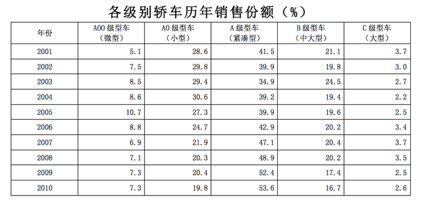

### 第 101 题

A0级型车比A00级型车在过去的五年中每年平均销售份额约高出：

A. 15个百分点

B. 14个百分点

C. 16个百分点

D. 17个百分点

第 101 题 · 答案与解析

**参考答案（粉笔题库参考内容）**

B

**解析**

根据题干“······平均销售份额约高出”，结合选项为“······个百分点”，可判定本题为现期平均数问题。定位材料表格可得：A0型车过去五年每年的销售份额分别为24.7%、21.9%、20.3%、20.4%、19.8%；A00级型车过去五年每年的销售份额分别为8.8%、6.9%、7.1%、7.3%、7.3%。故过去五年，A0级型车的平均销售额；A00级型车的平均销售额，则A0级型车比A00级型车在过去的五年中每年平均销售份额约高出21.4－7.5＝13.9个百分点，与B项最接近。

故正确答案为B。

**考点**：现期平均数、统计表

**来源**：2011年424联考《行测》题（贵州/四川/福建/黑龙江/湖北/山西/重庆/辽宁/海南/江西/天津/陕西/云南/广西/山东/湖南）第101题

### 第 102 题

相对于2001年，10年的销售份额增长率最大的车型是：

A. A级型车

B. B级型车

C. A0级型车

D. A00级型车

第 102 题 · 答案与解析

**参考答案（粉笔题库参考内容）**

D

**解析**

根据题干“······增长率最大的车型”，可判定为一般增长率比较问题。定位材料表格可得：A级型车2010年销售份额为53.6%，2001年销售份额为41.5%；B级型车2010年销售份额为16.7%，2001年销售份额为21.1%；A0级型车2010年销售份额为19.8%，2001年销售份额为28.6%；A00级型车2010年销售份额为7.3%，2001年销售份额为5.1%。根据表中数据可知，B级型车和A0级型车2010年销售份额低于2001年，其增长率为负数，故排除B、C两项。代入增长率计算公式：

A级型车的销售份额增长率为，A00级型车的销售份额增长率为，高于A级型车。

故正确答案为D。

**考点**：一般增长率、统计表

**来源**：2011年424联考《行测》题（贵州/四川/福建/黑龙江/湖北/山西/重庆/辽宁/海南/江西/天津/陕西/云南/广西/山东/湖南）第102题

### 第 103 题

2001～2010年各级别轿车历年销售份额的变化趋势正确的是：

A. B级型车销售份额逐年减小

B. 近十年来，C级型车销售份额最平稳

C. A00级型车的销售份额始终是C级型车销售份额的2倍以上

D. 2010年A0级型车的销售量相比于2001年有所减少

第 103 题 · 答案与解析

**参考答案（粉笔题库参考内容）**

B

**解析**

A项：定位材料表格中B级型车，2002年销售份额为19.8%，2003年销售份额为24.5%，故2003年销售份额增加，非逐年减少，错误；

B项：定位材料表格中C级型车，C级型车份额变动最小，故C级型车份额最平稳，正确；

C项：定位材料表格中A00级型车和C级型车， 2001年A00级型车的销售份额是5.1%，C级型车销售份额是3.7%，明显该年A00级型车的销售份额不是C级型车的2倍，错误；

D项：定位材料表格中A0级型车，表格中只给出了各级别轿车历年的销售份额，不能推断不同年份之间的销售量变化情况，错误。

故正确答案为B。

**考点**：统计表、综合分析

**来源**：2011年424联考《行测》题（贵州/四川/福建/黑龙江/湖北/山西/重庆/辽宁/海南/江西/天津/陕西/云南/广西/山东/湖南）第103题

### 第 104 题

因1.6升购置税调整，A级型车市场从2008年到2009年的上升率相对于B级型车同比下降率的比值约为：

A. 0.4

B. 0.3

C. 0.5

D. 0.6

第 104 题 · 答案与解析

**参考答案（粉笔题库参考内容）**

C

**解析**

根据题干“······相对于······的比值为”，可判定本题为比值计算问题。定位材料表格可得：A级型车2008年销售份额为48.9%，2009年销售份额为52.4%；B级型车2008年销售份额为20.2%，2009年销售份额为17.4%。A级型车2008年到2009年的上升率=，B级型车同比下降率=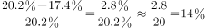，比值为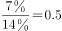。

故正确答案为C。

**考点**：比值计算、统计表

**来源**：2011年424联考《行测》题（贵州/四川/福建/黑龙江/湖北/山西/重庆/辽宁/海南/江西/天津/陕西/云南/广西/山东/湖南）第104题

### 第 105 题

B级型车与C级型车相比，比值最大的年份与比值最小的年份相差：

A. 2.64

B. 2.84

C. 3.56

D. 2.44

第 105 题 · 答案与解析

**参考答案（粉笔题库参考内容）**

C

**解析**

根据题干“······比值最大······与比值最小相差”，可判定本题为比值计算问题。定位材料表格：观察表格，利用估算法可知，B级型车与C级型车相比，比值最大的年份是2003年，为；比值最小的年份为2007年，为，差为9.1－5.5=3.6，与C项最接近。

故正确答案为C。

**考点**：比值计算、统计表

**来源**：2011年424联考《行测》题（贵州/四川/福建/黑龙江/湖北/山西/重庆/辽宁/海南/江西/天津/陕西/云南/广西/山东/湖南）第105题

## 材料 2

2010年1～3月，法国货物贸易进出口总额为2734.4亿美元，同比增长13.4%。其中，出口1264.7亿美元，同比增长14.5%；进口1469.7亿美元，同比增长12.4%；逆差205.0亿美元，同比增长1.0%。

        1～3月，中法双边贸易额为142.7亿美元，同比增长22.4%。其中，法国对中国出口32.1亿美元，同比增长43.5%；自中国进口110.6亿美元，同比增长17.4%；法国逆差78.5亿美元，同比增长9.3%。中国在法国主要出口伙伴中排名第九位、在法国的主要进口来源地中居第四位。

        1～3月，法国对中国出口的前三大产品为机电产品、运输设备和化工产品，出口额分别为9.8亿美元、8.4亿美元和4.0亿美元，同比分别增长14.9%、99.7%和25.9%，这三类产品出口额合计占法国对中国出口总额的（    ）。另外，与上年同期相比，1～3月法国对中国出口的塑料橡胶、皮革箱包、陶瓷玻璃和家具玩具的出口额增长显著，其中家具玩具的出口额增长最快，增幅达到190.9%。

        1～3月，法国自中国进口的前三大类产品为机电产品、纺织品及原料、家具玩具，进口额分别为48.5亿美元、18.2亿美元和11.7亿美元，同比分别增长30.4%、3.6%和8.1%，在法国同类产品进口市场中的份额分别为16.8%、25.9%和30.8%，这三类产品1～3月进口额合计占法国自中国进口总额的70.9%。另外，法国自中国进口的化工产品的进口额同比增长最快，为38.8%。

### 第 106 题

2010年1～3月，法国货物贸易出口额比上年同期增长了约：

A. 140亿美元

B. 120亿美元

C. 160亿美元

D. 180亿美元

第 106 题 · 答案与解析

**参考答案（粉笔题库参考内容）**

C

**解析**

根据题干“······比上年同期增长了约”，结合选项带单位，可判定本题为增长量计算问题。定位材料第一段可知：“2010年1～3月，法国货物贸易进出口总额为2734.4亿美元，同比增长13.4%。其中，出口1264.7亿美元，同比增长14.5%”。故2010年1～3月法国货物贸易出口额同比增长量，与C项最接近。

故正确答案为C。

**考点**：增长量计算、文字资料

**来源**：2011年424联考《行测》题（贵州/四川/福建/黑龙江/湖北/山西/重庆/辽宁/海南/江西/天津/陕西/云南/广西/山东/湖南）第106题

### 第 107 题

资料中括号处应填入的数字为：

A. 28.3%

B. 20.1%

C. 56.7%

D. 69.2%

第 107 题 · 答案与解析

**参考答案（粉笔题库参考内容）**

D

**解析**

根据题干“2010年1～3月，······占······”，结合材料时间为2010年1～3月，可判定本题为现期比重问题。定位材料第二段和第三段可知：“其中，法国对中国出口32.1亿美元，同比增长43.5%；1～3月，法国对中国出口的前三大产品为机电产品、运输设备和化工产品，出口额分别为9.8亿美元、8.4亿美元和4.0亿美元，同比分别增长14.9%、99.7%和25.9%”。故这三类产品出口额合计占法国对中国出口总额的比重为，与D项最接近。

故正确答案为D。

**考点**：文字资料、现期比重

**来源**：2011年424联考《行测》题（贵州/四川/福建/黑龙江/湖北/山西/重庆/辽宁/海南/江西/天津/陕西/云南/广西/山东/湖南）第107题

### 第 108 题

2010年1～3月，法国对中国出口的各类产品中，出口额比上年同期增长最多的是：

A. 机电产品

B. 运输设备

C. 化工产品

D. 家具玩具

第 108 题 · 答案与解析

**参考答案（粉笔题库参考内容）**

B

**解析**

根据题干“······比上年同期增长最多的是”，可判定本题为增长量比较问题。定位材料第三段：“1～3月，法国对中国出口的前三大产品为机电产品、运输设备和化工产品，出口额分别为9.8亿美元、8.4亿美元和4.0亿美元，同比分别增长14.9%、99.7%和25.9%”。代入增长量公式：×π。

机电产品的增长量=；

运输设备的增长量；

化工产品的增长量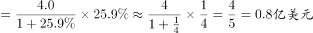。

化工产品在出口额中占第三，为4.0亿美元，则家具玩具的出口额少于4.0亿美元，则家具玩具的出口额增长量也显然不会超过4.0亿美元。因此运输设备的增长量最多。

故正确答案为B。

**考点**：增长量比较、文字资料

**来源**：2011年424联考《行测》题（贵州/四川/福建/黑龙江/湖北/山西/重庆/辽宁/海南/江西/天津/陕西/云南/广西/山东/湖南）第108题

### 第 109 题

2010年1～3月，法国纺织品及原料的进口额约为多少亿美元：

A. 70.3

B. 67.8

C. 99.1

D. 108.3

第 109 题 · 答案与解析

**参考答案（粉笔题库参考内容）**

A

**解析**

根据题干问“2010年1～3月，法国纺织品及原料的进口额”，根据材料第四段“法国自中国进口的纺织品及原料为18.2亿美元，占同类产品的份额为25.9%”，可知法国纺织品及原料的进口额为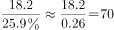亿美元，与A项最接近。

故正确答案为A。

**考点**：文字资料、现期比重

**来源**：2011年424联考《行测》题（贵州/四川/福建/黑龙江/湖北/山西/重庆/辽宁/海南/江西/天津/陕西/云南/广西/山东/湖南）第109题

### 第 110 题

关于2010年1～3月中法双边贸易情况的描述，以下说法与资料相符合的是：

A. 中国机电产品对法贸易顺差高于上年同期

B. 中国是法国最大的家具玩具进口来源地

C. 法国对中国出口额占其出口总额的4%以上

D. 中法化工产品进出口贸易额同比增长了约20%

第 110 题 · 答案与解析

**参考答案（粉笔题库参考内容）**

A

**解析**

A项：定位材料第三段和第四段可知：“法国对中国出口机电产品9.8亿美元，同比增长14.9%，自中国进口48.5亿美元，同比增长30.4%”。同比进口增长率大于出口增长率，故法国对中国逆差（进口–出口）增加，即中国对法国顺差增加，正确；

B项：定位材料第四段可知：“法国自中国进口家具玩具占同类份额为30.8%”，并没有过半，不能确定一定是最大的，错误；

C项：定位材料第一段和第二段可知：“2010年1-3月法国出口总额为1264.7亿美元；法国对中国出口额为32.1亿美元”。故法国对中国出口额占其出口总额的比重为，不到4%，错误；

D项：定位材料第三段和第四段可知：“法国对中国出口化工产品同比增长25.9%，法国自中国进口化工产品同比增长38.8%”，根据“混合增长率居中”，可知化工产品进出口贸易额增长应介于25.9%和38.8%之间，非20%，错误。

故正确答案为A。

**考点**：文字资料、综合分析

**来源**：2011年424联考《行测》题（贵州/四川/福建/黑龙江/湖北/山西/重庆/辽宁/海南/江西/天津/陕西/云南/广西/山东/湖南）第110题

## 材料 3

2009年，某省全年粮食作物播种面积253.85万公顷，比上年增长1.5%；糖蔗种植面积13.58万公顷，下降0.2%；油料种植面积33.14万公顷，增长2.3%；蔬菜种植面积113.84万公顷，增长2.3%。

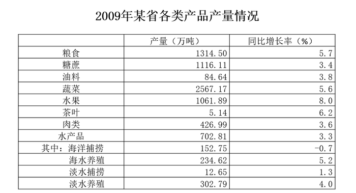

### 第 111 题

以下三种作物按2009年亩产量从高到低排序正确的是：

A. 糖蔗、蔬菜、油料

B. 糖蔗、油料、蔬菜

C. 蔬菜、油料、糖蔗

D. 蔬菜、糖蔗、油料

第 111 题 · 答案与解析

**参考答案（粉笔题库参考内容）**

A

**解析**

根据题干“······2009年亩产量从高到低······”，结合材料数据为2009年，判定本题为现期平均数比较问题。定位文字材料和表格材料可知：糖蔗种植面积13.58万公顷，产量为1116.11万吨；油料种植面积33.14万公顷，产量为84.64万吨；蔬菜种植面积113.84万公顷，产量为2567.17万吨。亩产量排序与公顷产量一致，故只需比较公顷产量。每公顷产量分别如下：

糖蔗：；蔬菜：；油料：。很明显糖蔗＞蔬菜＞油料。

故正确答案为A。

**考点**：现期平均数、综合资料

**来源**：2011年424联考《行测》题（贵州/四川/福建/黑龙江/湖北/山西/重庆/辽宁/海南/江西/天津/陕西/云南/广西/山东/湖南）第111题

### 第 112 题

下列作物2009年比2008年增产量最多的是：

A. 糖蔗

B. 粮食

C. 蔬菜

D. 水果

第 112 题 · 答案与解析

**参考答案（粉笔题库参考内容）**

C

**解析**

根据题干“······增产量最多”，判定本题为增长量比较问题。定位表格材料可知：

糖蔗2009年产量1116.11万吨，增长率为3.4%；

粮食2009年产量1314.5万吨，增长率为 5.7%；

蔬菜2009年产量2567.17万吨，增长率为5.6%；

水果2009年产量1061.89万吨，增长率为8.0%。

根据增长量比较 “大大则大”的原则，粮食产量及增长率均大于糖蔗，则增长量大于糖蔗，排除A项；蔬菜与粮食增长率近似相等，现期量远大于粮食，则增长量应大于粮食，排除B项；

蔬菜的增长量万吨；

水果的增长量万吨；

故蔬菜的增长量最大。

故正确答案为C。

**考点**：增长量比较、综合资料

**来源**：2011年424联考《行测》题（贵州/四川/福建/黑龙江/湖北/山西/重庆/辽宁/海南/江西/天津/陕西/云南/广西/山东/湖南）第112题

### 第 113 题

2009年，海水养殖业产量占水产品养殖业产量的比重为：

A. 33.4%

B. 77.5%

C. 60.8%

D. 43.7%

第 113 题 · 答案与解析

**参考答案（粉笔题库参考内容）**

D

**解析**

根据题干“2009年，······占······的比重”，结合材料时间为2009年，可判定本题为现期比重计算问题。定位表格材料可知：2009年海水养殖业产量为234.62万吨，淡水养殖业产量为302.79万吨。故水产品养殖业总产量=234.62＋302.79＝537.41万吨，海水养殖业产量所占比重约为234.62/537.41，选项首位不同，直除首位为4。

故正确答案为D。

**考点**：现期比重、综合资料

**来源**：2011年424联考《行测》题（贵州/四川/福建/黑龙江/湖北/山西/重庆/辽宁/海南/江西/天津/陕西/云南/广西/山东/湖南）第113题

### 第 114 题

若保持2009年的增长速度，哪一年水果的年产量开始超过糖蔗：

A. 2011年

B. 2010年

C. 2012年

D. 2013年

第 114 题 · 答案与解析

**参考答案（粉笔题库参考内容）**

A

**解析**

根据题干“保持2009年增长速度，······开始超过······”，可判定本题为现期追赶问题。定位表格材料可知：2009年水果产量为1061.89万吨，增速为8.0%；2009年糖蔗产量为1116.11万吨，增速为3.4%。

故2010年水果产量约为万吨，糖蔗产量约为万吨，2010年水果产量未超过糖蔗。

2011年水果产量约为万吨，糖蔗产量约为万吨， 即2011年水果产量已经开始超过糖蔗。

故正确答案为A。

**考点**：现期计算、综合资料

**来源**：2011年424联考《行测》题（贵州/四川/福建/黑龙江/湖北/山西/重庆/辽宁/海南/江西/天津/陕西/云南/广西/山东/湖南）第114题

### 第 115 题

能够从上述资料中推出的是：

A. 与上年相比，2009年肉类的增产量高于水产品的增产量

B. 2008年，肉类和水产品总产量高于粮食产量

C. 2009年，茶叶种植面积比上年有所增长

D. 2009年，水产品捕捞业产量比上年有所下降

第 115 题 · 答案与解析

**参考答案（粉笔题库参考内容）**

D

**解析**

A项：定位表格材料：2009年肉类产量为426.99万吨，增速为3.6%；2009年水产品产量为702.81万吨，增速为3.3%。代入增长量公式：，肉类增长量；水产品增长量。肉类的增产量低于水产品，错误；

B项：定位材料表格：2009年肉类产量为426.99万吨，增速为3.6%；2009年水产品产量为702.81万吨，增速为3.3%；2009年粮食产量为1314.5万吨，增速为5.7%。2008年粮食产量为；2008年肉类和水产品总量为。即2008年肉类和水产品总产量低于粮食产量，错误；

C项：定位文字材料和表格材料：材料中只给出了茶叶的产量，没有给出任何关于种植面积的信息，无法判断，错误；

D项：定位表格材料：2009年，海洋捕捞业产量下降了0.7%，淡水捕捞业产量增加1.3%，水产品捕捞业产量的增速介于-0.7%和1.3%之间，但海洋捕捞业产量远高于淡水捕捞业产量，故水产品捕捞业的增速接近-0.7%，因此2009年水产品捕捞业产量比上年应有所下降，正确。

故正确答案为D。

**考点**：综合分析、综合资料

**来源**：2011年424联考《行测》题（贵州/四川/福建/黑龙江/湖北/山西/重庆/辽宁/海南/江西/天津/陕西/云南/广西/山东/湖南）第115题

## 材料 4

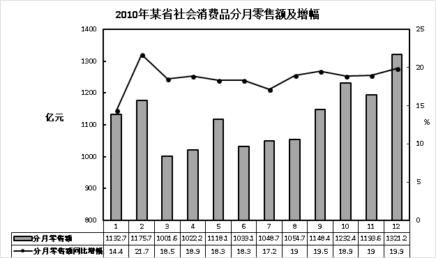

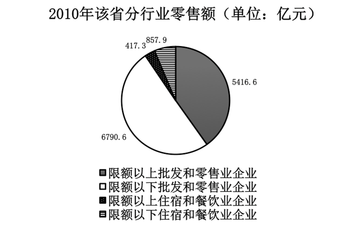

### 第 116 题

以下说法正确的是：

A. 2010年该省社会消费品分月零售额增幅最大的是12月份

B. 2009年该省社会消费品分月零售额最大的是12月份

C. 2010年该省限额以上企业零售额大于限额以下企业零售额

D. 该省2009年5月社会消费零售额为941.5亿元

第 116 题 · 答案与解析

**参考答案（粉笔题库参考内容）**

B

**解析**

A项：定位折线图，通过观察可发现2010年增幅最大的是2月份，非12月，错误；

B项：定位柱状图，通过观察可发现2010年12月份的零售额数值最大，3-11月增长率与12月份增长率接近，因此2009年3-11月零售额不可能高于12月份；2010年2月份零售额低于12月份，增长率高于12月份，故2009年2月零售额低于12月份；2010年1月份增长率为14.4%，零售额为1132.7亿元，2009年1月份零售额为；12月份增长率为19.9%，零售额为1321.2亿元，2009年12月份零售额为。因此2009年零售额最大的是12月份，正确；

C项：定位饼状图，限额以下批发和零售业企业的零售额已占饼状图一半，限额以下的企业零售额还包括住宿和餐饮业企业，因此限额以下企业零售额明显超过一半，故限额以上企业零售额小于限额以下企业零售额，错误；

D项：定位柱状图，2010年5月社会消费品零售额为1118.1亿元，增长率为18.3%。故2009年5月社会消费品零售额为，非941.5亿元，错误。

故正确答案为B。

**考点**：统计图、综合分析

**来源**：2011年424联考《行测》题（贵州/四川/福建/黑龙江/湖北/山西/重庆/辽宁/海南/江西/天津/陕西/云南/广西/山东/湖南）第116题

### 第 117 题

已知2010年该省限额以下批发和零售企业零售额相比于2009年同期增幅为18.7%，那么2009年该省限额以下批发和零售企业零售额约为：

A. 5720亿元

B. 4563亿元

C. 772亿元

D. 351亿元

第 117 题 · 答案与解析

**参考答案（粉笔题库参考内容）**

A

**解析**

根据题干“······2009年······零售额为”，结合材料数据为2010年，判定本题为基期计算问题。定位饼状图可知：“2010年该省限额以下批发和零售企业零售额为6790.6亿元”，题干又告知增长率为18.7%，则2009年该省限额以下批发和零售业企业零售额=，直除首位为5。

故正确答案为A。

**考点**：基期计算、统计图

**来源**：2011年424联考《行测》题（贵州/四川/福建/黑龙江/湖北/山西/重庆/辽宁/海南/江西/天津/陕西/云南/广西/山东/湖南）第117题

### 第 118 题

已知2010年限额以上企业零售额增幅为27.4%，限额以下企业零售额增幅为12.8%，那么2009年限额以下企业和限额以上企业零售额差值比2010年差值：

A. 约多386亿元

B. 约少386亿元

C. 约多647亿元

D. 约少647亿元

第 118 题 · 答案与解析

**参考答案（粉笔题库参考内容）**

A

**解析**

根据题干“2009年······差值比2010年差值”，所求为|2009限额以下-2009限额以上|-|2010限额以下-2010限额以上|，结合材料数据为2010年，判定本题为基期和差问题。定位饼状图可知：2010限额以下企业零售额为（6790.6+857.9）亿元，则2009年限额以下企业零售额为亿元；2010年限额以上企业零售额为（5416.6+417.3）亿元，则2009年限额以上企业额为亿元。

2010年限额以下和限额以上差值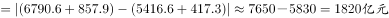；

2009年限额以下和限额以上差值。

2009年差值比2010年差值高2180-1820=360亿元，与A项最接近。

故正确答案为A。

**考点**：基期和差、统计图

**来源**：2011年424联考《行测》题（贵州/四川/福建/黑龙江/湖北/山西/重庆/辽宁/海南/江西/天津/陕西/云南/广西/山东/湖南）第118题

### 第 119 题

该省2010年社会消费品零售总额是：

A. 13482.4亿元

B. 11959.6亿元

C. 14852.6亿元

D. 16347.2亿元

第 119 题 · 答案与解析

**参考答案（粉笔题库参考内容）**

A

**解析**

定位饼状图：2010年该省分行业零售额分别为6790.6亿元、417.3亿元、857.9亿元、5416.6亿元。2010年社会消费品零售额为(6790.6+417.3+857.9+5416.6）亿元，观察选项，计算两位尾数，0.6＋7.3＋7.9＋6.6，正确选项最后两位数应是2.4，排除B、C、D三项。

故正确答案为A。

**考点**：简单加减计算、统计图

**来源**：2011年424联考《行测》题（贵州/四川/福建/黑龙江/湖北/山西/重庆/辽宁/海南/江西/天津/陕西/云南/广西/山东/湖南）第119题

### 第 120 题

以下说法错误的是：

A. 2010年3月的零售额在12个月中是最小的

B. 2010年1月的零售额增幅在12个月中是最小的

C. 2010年批发和零售业零售额占社会消费品零售总额的比重超过50%

D. 2010年限额以上企业零售额占社会消费品零售总额的比重超过50%

第 120 题 · 答案与解析

**参考答案（粉笔题库参考内容）**

D

**解析**

A项：定位柱状图，观察柱状图可知，2010年3月的零售额在12个月中是最小的，正确；

B项：定位柱状图，观察柱状图可知，2010年1月的零售额增幅在12个月中是最小的，正确；

C项：定位饼状图，批发和零售业的零售额为（6790.6+5416.6）亿元，明显大于社会消费品零售总额的50%，正确；

D项：定位饼状图，限额以上企业零售额为（5416.6+417.3）亿元，明显小于社会消费品零售总额的50%，错误。

本题为选非题，故正确答案为D。

**考点**：统计图、综合分析

**来源**：2011年424联考《行测》题（贵州/四川/福建/黑龙江/湖北/山西/重庆/辽宁/海南/江西/天津/陕西/云南/广西/山东/湖南）第120题

