# 2013年天津市公务员录用考试《行测》题

<!-- gwy:overview:start -->
> **天津 · 2013 · 行测 · 统考** ｜ 120 题 · 图片 64 处 · 答案随题折叠

| 题型模块 | 题量 | 题号 |
| --- | ---: | ---: |
| 数量关系 | 15 | 1–15 |
| 言语理解与表达 | 35 | 16–50 |
| 常识判断 | 20 | 51–70 |
| 判断推理 | 30 | 71–100 |
| 资料分析 | 20 | 101–120 |
| **合计** | **120** | |

导航：[题型与作答说明](#题型与作答说明) · [题目](#题目) · [材料 1](#材料-1)
<!-- gwy:overview:end -->

> 候选采集稿。参考答案及解析来自粉笔页面，不代表官方答案或真实高分答卷；来源使用许可与原卷对应关系仍需人工核实。

## 题型与作答说明

数量关系

（15题）

本部分包括数字推理与数学运算两种类型的题目。

言语理解与表达

（35题）

本部分包括选词填空和阅读理解两种类型的题目。

常识判断

（20题）

根据题目要求，在四个选项中选出一个最恰当的答案。

判断推理

（30题）

本部分包括图形推理、定义判断与逻辑判断三种类型的试题。

资料分析

（20题）

所给出的图、表、文字或综合性资料均有若干个问题要你回答。你应根据资料提供的信息进行分析、比较、计算和判断处理。

## 题目

### 第 1 题

3，5，6，10，11，17，18，（  ）

A. 25

B. 26

C. 27

D. 28

第 1 题 · 答案与解析

**参考答案（粉笔题库参考内容）**

B

**解析**

原数列两两分组后，后一项减去前一项，分别为2、4、6、8，所以未知项为18＋8＝26。

故正确答案为B。

**来源**：2013年天津市公务员录用考试《行测》题第1题

### 第 2 题

3，5/4，7/9，（  ）

A. 129/256

B. 9/16

C. 14/81

D. 7/61

第 2 题 · 答案与解析

**参考答案（粉笔题库参考内容）**

B

**解析**

将第一项3改写成3/1，分子3，5，7，（  ），此数列是公差为2的等差数列，下一项7+2=9。分母1，4，9（  ），此数列是平方数列，下一项为16，则所求项为9/16。

故正确答案为B。

**来源**：2013年天津市公务员录用考试《行测》题第2题

### 第 3 题

3，10，31，94，（  ），850

A. 250

B. 270

C. 282

D. 283

第 3 题 · 答案与解析

**参考答案（粉笔题库参考内容）**

D

**解析**

原数列为三倍递推数列。后项＝前项×3＋1，所以未知项为94×3＋1＝283，验证后项，283×3＋1＝850，符合要求。

故正确答案为D。

**来源**：2013年天津市公务员录用考试《行测》题第3题

### 第 4 题

3，2，11，14，27，（  ）

A. 32

B. 34

C. 36

D. 40

第 4 题 · 答案与解析

**参考答案（粉笔题库参考内容）**

B

**解析**

观察发现各项均为幂次数附近的数字，考虑幂次修正数列。其中：，，，，，其底数是公差为1的等差数列，指数均为2，修正项为2，-2循环交替，故所求项为。

故正确答案为B。

**来源**：2013年天津市公务员录用考试《行测》题第4题

### 第 5 题

3，-15/4，14/5，-45/28，（  ）

A. 25/36

B. 33/41

C. 21/48

D. 35/64

第 5 题 · 答案与解析

**参考答案（粉笔题库参考内容）**

B

**解析**

负号交替出现，不需要考虑。将原数列不含负号部分进行反约分：6/2，15/4，28/10，45/28；其中分子列的差数列9、13、17为等差数列，下一项为21，故原数列未知项的分子为45＋21＝66；分母列的差数列2、6、18为等比数列，下一项为54，故原数列未知项的分母为54＋28＝82，因此原数列的未知项为66/82=33/41。

故正确答案为B。

**来源**：2013年天津市公务员录用考试《行测》题第5题

### 第 6 题

2012^2012的末位数是：

A. 2

B. 4

C. 6

D. 8

第 6 题 · 答案与解析

**参考答案（粉笔题库参考内容）**

C

**解析**

根据口诀“底数留个位，指数除以4留余数（余数为0换成4）”，

可知该数的末位数相当于2^4的末位数，即为6。

故正确答案为C。

**来源**：2013年天津市公务员录用考试《行测》题第6题

### 第 7 题

一群人坐车出去旅游，如果每辆车坐22人，还剩5人没位置。如果每辆车坐26人，则空出15个座位。

问每辆车坐25人，空出多少个座位：

A. 20

B. 15

C. 10

D. 5

第 7 题 · 答案与解析

**参考答案（粉笔题库参考内容）**

C

**解析**

假定车有x辆，人有y人。则可得y=22x+5，y=26x-15。联立可得x=5，y=115。则当每车坐25人，空出座位数为25×5－115＝10个。

故正确答案为C。

**考点**：和差倍比问题

**来源**：2013年天津市公务员录用考试《行测》题第7题

### 第 8 题

甲地到乙地，步行速度比骑车速度慢75%，骑车速度比公交慢50%。如果一个人坐公交车从甲地到乙地，再从乙地步行到甲地，一共用了一个半小时，则该人骑车从甲地到乙地需要多长时间：

A. 10分钟

B. 20分钟

C. 30分钟

D. 40分钟

第 8 题 · 答案与解析

**参考答案（粉笔题库参考内容）**

B

**解析**

由题意步行速度比骑车慢75%可列式：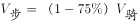， 则；同理骑车比公交慢50%可列式：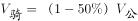，则。我们可以赋值步行、骑车和公交的速度分别为1、4和8，根据题意设甲地到乙地的距离为8x，因S=V×T，可知T_步=8x；T_骑=2x；T_公=x。根据题意分钟；则x=10分钟，分钟。

故正确答案为B。

**考点**：普通行程

**来源**：2013年天津市公务员录用考试《行测》题第8题

### 第 9 题

一项工程计划300天完工，开工100天后，由于施工人员减少，工作效率下降20%，问完成该工程比原计划推迟了多少天？

A. 40

B. 50

C. 60

D. 70

第 9 题 · 答案与解析

**参考答案（粉笔题库参考内容）**

B

**解析**

假定原效率为10，因此工程总量为3000。开工100天后还剩余工作量为2000，此时效率变为10×（1–20%）＝8，需要时间为2000÷8＝250天，原计划300天完工，现在100＋250＝350天完工，所以完成该工程比原计划推迟了50天。

故正确答案为B。

**考点**：给效率比例型

**来源**：2013年天津市公务员录用考试《行测》题第9题

### 第 10 题

甲容器有浓度为3%的盐水190克，乙容器中有浓度为9%的盐水若干克，从乙取出210克盐水倒入甲，甲容器中的盐水的浓度是多少：

A. 5.45%

B. 6.15%

C. 7.35%

D. 5.95%

第 10 题 · 答案与解析

**参考答案（粉笔题库参考内容）**

B

**解析**

设甲容器中盐水浓度为C，根据两溶液混合公式可得，，故解得C＝6.15%。

故正确答案为B。

**来源**：2013年天津市公务员录用考试《行测》题第10题

### 第 11 题

正六面体的表面积增加96%，棱长增加多少：

A. 20%

B. 30%

C. 40%

D. 50%

第 11 题 · 答案与解析

**参考答案（粉笔题库参考内容）**

C

**解析**

根据几何等比放缩性质，表面积为原来的1.96倍时，棱长为原来的1.4倍，因此棱长增加了40%。

故正确答案为C。

**考点**：几何公式类-立体图形、几何结论类-相似图形

**来源**：2013年天津市公务员录用考试《行测》题第11题

### 第 12 题

有70名学生参加数学、语文考试，数学考试得分60分以上的有56人，语文得分60以上的有62人，都不及格的有4人。则两门考试都得60分以上的有多少人：

A. 50

B. 51

C. 52

D. 53

第 12 题 · 答案与解析

**参考答案（粉笔题库参考内容）**

C

**解析**

设两门考试都得60分以上的有x人，根据两集合容斥原理公式可得，56＋62－x＝70－4，解得x尾数是2。

故正确答案为C。

**考点**：两集合

**来源**：2013年天津市公务员录用考试《行测》题第12题

### 第 13 题

由1—9中的数字组成一个三位数，有数字重复的情形有多少种：

A. 220

B. 255

C. 280

D. 225

第 13 题 · 答案与解析

**参考答案（粉笔题库参考内容）**

D

**解析**

组成任意三位数的方法数为9×9×9，其中没有数字重复的情形为9×8×7，因此肯定有种是重复的。

故正确答案为D。

**考点**：基础排列组合

**来源**：2013年天津市公务员录用考试《行测》题第13题

### 第 14 题

某个公司在甲乙丙丁四个地方各有一个仓库，四个地方依次排列，大致都在一条直线上，分别相距6千米、10千米、18千米。甲仓库有货物4吨，乙仓库有货物6吨，丙仓库有货物9吨，丁仓库有货物3吨。如果把所有的货物集中到一个仓库，每吨货物每千米运费为100元，请问把货物放在哪个仓库最省钱：

A. 甲

B. 乙

C. 丙

D. 丁

第 14 题 · 答案与解析

**参考答案（粉笔题库参考内容）**

C

**解析**

货物集中问题，只与各个仓库的存放量有关，与距离及运费无关。先考虑甲乙打包、丙丁打包，显然前者存放量不如后者多，因此甲乙的货物均需要向丙丁方向移动；同理可知丁仓库的货物需要向甲乙丙方向移动。综合两者可知货物将集中在丙仓库。

故正确答案为C。

**考点**：统筹规划问题

**来源**：2013年天津市公务员录用考试《行测》题第14题

### 第 15 题

5个人平均年龄为29，且没有小于24的，那么年龄最大的人至多为多少岁：

A. 46

B. 48

C. 50

D. 49

第 15 题 · 答案与解析

**参考答案（粉笔题库参考内容）**

D

**解析**

要使年龄最大者的年龄尽可能大，则其余四个人的年龄尽可能小，而最小只能为24，因此年龄最大者的年龄至多可以为29×5－24×4＝49岁。

故正确答案为D。

**考点**：构造数列

**来源**：2013年天津市公务员录用考试《行测》题第15题

### 第 16 题

在互惠关系中，一个微小的支持可能形成较大回报的责任感，类似于中国传统文化中的“\_\_\_\_\_\_”所蕴含之意。正是这种责任感生成了以一种行为回报另一种行为的持续性关系。

填入划横线部分最恰当的一项是：

A. 投桃报李

B. 礼尚往来

C. 来鸿去燕

D. 滴水之恩，当涌泉相报

第 16 题 · 答案与解析

**参考答案（粉笔题库参考内容）**

D

**解析**

“滴水之恩，当涌泉相报”与“一个微小的支持可能形成较大回报的责任感”表达一致。

故正确答案为D。

**考点**：对应关系-前后呼应、成语填空

**来源**：2013年天津市公务员录用考试《行测》题第16题

### 第 17 题

据了解，最能代表首都建筑风格的北京四合院在旧时没有任意两个是完全一模一样的，因为每一个四合院的生成都有其独特性，承载了包括家庭习惯、工匠意图、人文传统等多重历史信息。“而现在的四合院几乎一模一样，仿佛一条生产线上下来，与建筑传统\_\_\_\_\_。”

填入划横线部分最恰当的一项是：

A. 南辕北辙

B. 背道而驰

C. 天壤之别

D. 大相径庭

第 17 题 · 答案与解析

**参考答案（粉笔题库参考内容）**

B

**解析**

根据“最能代表首都建筑风格的北京四合院在旧时没有任意两个是完全一模一样的”“而现在的四合院几乎一模一样”可知，“现在的四合院”和“建筑传统”截然相反。C项“天壤之别”形容差别很大，D项“大相径庭”比喻相差很远，大不相同，均侧重强调差别大，而非截然相反，排除。A项“南辕北辙”通常指一个主体的行动和目的相反，B项“背道而驰”比喻彼此的方向和目的完全相反，“现在的四合院”与“建筑传统”属于两个主体之间的比较，用“背道而驰”更为合适。

故正确答案为B。

**考点**：对应关系-前后呼应、成语填空、词的辨析-词义侧重

**来源**：2013年天津市公务员录用考试《行测》题第17题

### 第 18 题

前不久热映的香港电影《桃姐》，反映香港老人院生活的片段让人难忘，催人泪下。当片中一群老人机械地张着嘴巴，护工挨个喂饭过去的场景出现时，许多观众\_\_\_\_\_。

填入划横线部分最恰当的一项是：

A. 唏嘘不已

B. 感叹不已

C. 感喟不已

D. 伤感不已

第 18 题 · 答案与解析

**参考答案（粉笔题库参考内容）**

A

**解析**

唏嘘不已：中性词，原意为哭泣后不由自主地急促呼吸，抽泣。扩展意有感叹、感慨、令人十分惊讶。

感叹不已：因为某些事物而发出很多感叹。

感喟不已：不停的感慨叹息。

伤感不已：受外界事物感触而引起悲伤和伤感之情。

对应前文“让人难忘，催人泪下”，观众既有感叹，又有哭泣。

B、C两项只有感叹，排除；D项为干扰项，虽然“悲伤”，但是没有眼泪。

故正确答案为A。

**考点**：实词填空、对应关系-前后呼应、词的辨析-词义侧重

**来源**：2013年天津市公务员录用考试《行测》题第18题

### 第 19 题

托尔斯泰创造了小说艺术的巅峰，他能把拿破仑进军俄国的战争史诗般的场面驾驭自如，能把安娜的人性刻画得\_\_\_\_\_\_\_\_\_，像这样的大手笔再也没有了。填入划横线处最恰当的一项是：

A. 惟妙惟肖

B. 妙笔生花

C. 鬼斧神工

D. 入木三分

第 19 题 · 答案与解析

**参考答案（粉笔题库参考内容）**

D

**解析**

A项错误，惟妙惟肖强调的重点在于模仿或描写得非常美妙，十分逼真，与原文“人性”无法搭配；

B项错误，妙笔生花重在强调写作技巧高超，与“刻画”无法搭配；

C项错误，鬼斧神工形容建筑、雕塑等技艺高超，与原文“文学”这一大语境不符；

D项正确，分析空格所在语句，可知所填修饰副词搭配的动词为“刻画”，刻画除了有描述、表现的涵义之外，还强调深刻之意，加之其共同搭配的宾语为“安娜的人性”，故最为恰当的是D项入木三分。

故正确答案为D。

**考点**：成语填空、词的辨析-搭配对象

**来源**：2013年天津市公务员录用考试《行测》题第19题

### 第 20 题

在中国高校招生考试史上，1952年是一个非常重要的年份，它成为新旧招生制度的\_\_\_\_\_\_，标志着“高考时代”的开始。填入划横线部分最恰当的一项是：

A. 标志牌

B. 分界线

C. 分水岭

D. 里程碑

第 20 题 · 答案与解析

**参考答案（粉笔题库参考内容）**

C

**解析**

首先排除A、D两项。标志牌指为了视觉效果而设立的牌子；里程碑一般用来比喻在历史发展过程中可以作为标志的重大历史事件，而非文段中的某个年份。

然后对比B、C两项，虽然都含有“界限”之意，“分水岭”更突出强调不同事物的本质性界限，与文段中“新旧招生制度”的主体搭配恰当。

故正确答案为C。

**考点**：实词填空、对应关系-前后呼应、词的辨析-词义侧重

**来源**：2013年天津市公务员录用考试《行测》题第20题

### 第 21 题

在景区门票涨价广受质疑时，有些地方把景区的门票价格听证会当\_\_\_\_\_，但景区是一种特殊的商品，它不仅牵涉当地百姓的利益，还直接影响外地游客利益。

填入划横线部分最恰当的一项是：

A. 保护伞

B. 护身符

C. 挡箭牌

D. 遮羞布

第 21 题 · 答案与解析

**参考答案（粉笔题库参考内容）**

C

**解析**

受到质疑后推脱责任，即把“景区的门票价格听证会”当成推脱的借口，“挡箭牌”就指推脱事情的借口，与之一致。保护伞：比喻赖以不受伤害的资本，保护某些人或某一势力范围，使其利益不受损害或不受干涉的力量。

A、B两项意思相近，可首先排除；D项明显不符合语境，错误。

故正确答案为C。

**考点**：实词填空、对应关系-前后呼应

**来源**：2013年天津市公务员录用考试《行测》题第21题

### 第 22 题

“刻章办证”的小广告在现实生活中屡见不鲜，办证俨然成为了一个行业。正是长期以来“以证治国”的管制思维，在给人带来不便的同时也催生了\_\_\_\_\_的证件需求。

填入划横线部分最恰当的一项是：

A. 变异

B. 异化

C. 固化

D. 变化

第 22 题 · 答案与解析

**参考答案（粉笔题库参考内容）**

B

**解析**

前面说到“带来不便”，所以不是正常的“需求”，C、D两项显然没有表达这层意思，可以排除；而“变异”明显不能和“需求”搭配，排除A项。

故正确答案为B。

**考点**：实词填空、对应关系-前后呼应、词的辨析-搭配对象、词的辨析-词义侧重

**来源**：2013年天津市公务员录用考试《行测》题第22题

### 第 23 题

生活在内地的中国人终其一生，要无数次填写有关个人资讯的登记表格。举凡上学、提干、入党、参军、就业、旅行等概莫能外，而登记栏目也几乎是\_\_\_\_\_的，包括出生年月、家庭出身、民族、性别、党派、籍贯、文化程度等。

填入划横线部分最恰当的一项是：

A. 千人一面

B. 如出一辙

C. 一模一样

D. 千篇一律

第 23 题 · 答案与解析

**参考答案（粉笔题库参考内容）**

D

**解析**

“千篇一律”指文章公式化，也比喻办事按一个格式，非常机械，显然更符合语境。

“千人一面”主要用于形容文艺创作的雷同，“如出一辙”比喻两件事情非常相似，“一模一样”是指样子完全相同，三个词用于修饰“登记栏目”显然都不恰当，可排除A、B、C。

故正确答案为D。

**考点**：成语填空、词的辨析-搭配对象、词的辨析-程度轻重、词的辨析-词义侧重

**来源**：2013年天津市公务员录用考试《行测》题第23题

### 第 24 题

神九飞天，值得每一个华夏儿女为之自豪，但\_\_\_\_\_之后仍需回归\_\_\_\_\_。保持一颗清醒的头脑，善莫大焉。

依次填入划横线部分最恰当的一项是：

A. 感性 理性

B. 理性 感性

C. 高兴 清醒

D. 兴奋 平静

第 24 题 · 答案与解析

**参考答案（粉笔题库参考内容）**

A

**解析**

“保持一颗清醒的头脑”对应第二个空，“理性”准确地表达了这个意思。

B项显然不对，意思正好相反；C项与后面的“清醒”重复；D项“平静”与后面明显不搭配。

故正确答案为A。

**考点**：实词填空、对应关系-前后呼应

**来源**：2013年天津市公务员录用考试《行测》题第24题

### 第 25 题

天价粽子人为添加鲍鱼、海参、扇贝等昂贵成分，甚至在礼盒中配售其它商品而令粽子价格暴涨的做法，让好好的端午节变了味道，这是对节日的亵渎，更是国人\_\_\_\_\_消费心理在作怪。

填入划横线部分最恰当的一项是：

A. 变态

B. 畸形

C. 阴暗

D. 病态

第 25 题 · 答案与解析

**参考答案（粉笔题库参考内容）**

B

**解析**

根据“价格暴涨”“变了味道”“对节日的亵渎”可知，天价粽子体现的是国人不正常的消费心理。A项“变态”侧重人生理、心理出现神经质、异于常人的状态，是一部分人不正常的行为，而文段说的是“国人”，即代表的是中国消费者普遍的消费心理，程度过重，不符合文意，排除A项。C项“阴暗”强调阴沉、不阳光的状态，文段没有体现消费者心理阴暗的信息，排除C项。B项“畸形”泛指事物发展不正常，造成某些事物的发展脱离了原来的轨道。符合文段粽子脱离原来含义，超出范围。而D项“病态”也指不正常的状态，但其更侧重“不健康”“不阳光”，不符合文意，排除。

故正确答案为B。

**考点**：实词填空、词的辨析-程度轻重

**来源**：2013年天津市公务员录用考试《行测》题第25题

### 第 26 题

由于体制性障碍、城乡利益冲突以及农民工知识技能不足等原因，农民工一直是城市中的边缘群体，是没有真正融入城市社会的城市居民。农民工城市融入是城市化的重要环节。如何使大量留在城市中的农民工和所在城市融合为一体，是我国经济社会转型期必须要解决的课题。当前，农民工家庭面临着经济层面、制度层面和文化层面三种相互关联、依次递进的社会融合问题。

对这段文字理解不正确的是：

A. 农民工在城市中一直处于非主流地位

B. 农民工没有真正融入城市社会，城乡二元体制是因素之一

C. 农民工与城市生活方式格格不入

D. 农民工需要在经济、制度、文化层面融入城市

第 26 题 · 答案与解析

**参考答案（粉笔题库参考内容）**

C

**解析**

C中“格格不入”表述过于绝对，文段只说了农民工没有真正融入到城市社会中，而不是完全没有融入。

本题为选非题，故正确答案为C。

**考点**：细节判断题

**来源**：2013年天津市公务员录用考试《行测》题第26题

### 第 27 题

目前我们的城市化道路走了一条不符合中国国情的道路，为什么？一是现有的城市发展是“关起门来搞城市化”，把农民关在城外，自己在城内搞现代化，这是为城市“锦上添花”，而不是搞农村“人口城市化”。二是我们在城市化道路上搞“天女散花”，强调大力发展小城镇，因为“小城镇，大战略”能解决农村剩余劳动力的大问题。这是一种错误的战略选择和过时观念，实际上这是一种“离土不离乡”的传统观念的延续，它实质上就是不愿意让农民进大中城市，不允许他们分享大中城市积累的文明成果。

这段文字的主要观点是：

A. 城市化就是让农村人口城市化

B. 城市化就是使农村人口进入大中城市

C. 城市化就是让农民离土又离乡

D. 城市化道路选择要考虑中国国情

第 27 题 · 答案与解析

**参考答案（粉笔题库参考内容）**

D

**解析**

本题为中心理解题。

文段为总分结构，首句是中心句。后面从两方面论述了为什么我们的城市化道路走了一条不符合中国的道路，其意在说明的是城市化道路选择要考虑中国国情。

故正确答案为D。

**考点**：关联词-对策

**来源**：2013年天津市公务员录用考试《行测》题第27题

### 第 28 题

看待社会公正问题，应防止落入平均主义这种无论在历史上还是在现实中都颇具诱惑力的窠臼中。虽然平均主义在某些领域是适用的，但若将其推广到所有领域尤其是分配领域，否认人的差别而要求平均分享一切，最终只会扼制人的积极性，扼杀社会发展的活力，不利于社会公正的实现。

这段文字意在强调：

A. 社会公正是相对的

B. 平均主义是国人习惯的“窠臼”

C. 平均主义适合非分配领域

D. 追求社会公正并非要搞平均主义

第 28 题 · 答案与解析

**参考答案（粉笔题库参考内容）**

D

**解析**

由提问可知本题为中心理解题。

文段第一句为中心句，指出看待社会公正问题要防止落入平均主义的窠臼，后面接上文说明了“平均主义”的危害，所以“追求社会公正并非要搞平均主义”。

故正确答案为D。

**考点**：主题词、关联词-转折

**来源**：2013年天津市公务员录用考试《行测》题第28题

### 第 29 题

高学历高技能的工人与低学历工人的就业前景差别越来越大。在美国，自2008年以来，大学毕业生的失业率从未超过5%，而高中辍学者的失业率在2009年和2010年的高峰期却增至15%以上。在所有经合组织成员中，这一趋势已经很明显：新增的工作越来越需要拥有高学历和高技能的工人。因此，很多工人正在被抛弃。麦肯锡全球研究所预计，到2020年，美国对大学学历工人的需求缺口将达到150万人———而未完成高中学业的工人将出现近600万人的剩余。同样，法国的雇主们也需要再找到220万名拥有学士学位的工人，而该国没有学士学位的工人数量将有230万人的剩余。如果这种技能配合不当的现象继续存在，发达经济体中永久性失业的人群将持续增长。

这段文字所揭示的突出问题是：

A. 低学历工人的失业率呈上升趋势

B. 永久性失业的人群将持续增长

C. 高学历工人与低学历工人的就业前景差别越来越大

D. 高学历工人的需求缺口将持续增长

第 29 题 · 答案与解析

**参考答案（粉笔题库参考内容）**

C

**解析**

文段为总分结构。首句表明观点，即“高学历高技能的工人与低学历工人的就业前景差别越来越大”。随后以美国、法国的情况为例进一步论证。

C项为主旨的同义表述。

A项和D项是高低学历技能配合不当的就业前景，这一现实问题导致的两个不同方面的结果，表述都过于片面；B项只是高低学历技能配合不当的就业前景，这一现实问题可能导致的一个假设性后果，不是文段揭示的突出问题。

故正确答案为C。

**考点**：特殊问法

**来源**：2013年天津市公务员录用考试《行测》题第29题

### 第 30 题

一国人口生育率的迅速下降在造成人口老龄化加速的同时，少儿抚养比也迅速下降，劳动年龄人口比例上升，在老年人口比例达到较高水平之前，将形成一个劳动力资源相对丰富、抚养负担较轻、于经济发展十分有利的“黄金时期”，人口学家称之为“人口红利”。中国目前的人口年龄结构就处在人口红利的阶段，每年供给的劳动力总量约为1000万，劳动人口比例较高，保证了经济增长中的劳动力需求。由于人口老龄化高峰尚未到来，社会保障支出负担轻，财富积累速度比较快。

从这段文字可以推断出：

A. “人口红利”一定会带来经济增长

B. 中国的“人口红利期”即将结束

C. “人口红利期”是一个国家人口变迁过程中的必经阶段

D. 一个老龄化社会，必然已经结束了“人口红利期”

第 30 题 · 答案与解析

**参考答案（粉笔题库参考内容）**

C

**解析**

由“在老年人口比例达到较高水平之前，将形成一个劳动力资源相对丰富、抚养负担较轻、于经济发展十分有利的‘黄金时期’”可知，C表述正确。

A过于绝对化；B属于无中生有；D混淆了充要条件。

故正确答案为C。

**考点**：细节判断题

**来源**：2013年天津市公务员录用考试《行测》题第30题

### 第 31 题

据日本社会保障规定，失业完全无收入者，每月可领到一定数额的失业补助金。丧失劳动能力及无人赡养的老人，除每月可领取补助以外，房租减收，用水、看病免费，市内交通费70岁以上全免、以下减半，若有未成年的子女，还另外增加补助金。凭这样几条，足可以维持基本的生活，根本无需上街去“流浪”。

这段文字意在说明：

A. 日本社会保障制度的完善

B. 日本社会保障的基本目标

C. 日本社会保障制度的具体内容

D. 日本没有流浪者的原因

第 31 题 · 答案与解析

**参考答案（粉笔题库参考内容）**

A

**解析**

本题为中心理解题。

A项正确，文段前两句是举例子，介绍日本社会保障制度对于“失业完全无收入者”和“丧失劳动能力及无人赡养的老人”这两类人的一些规定，然后得出结论“足可以维持基本的生活，根本无需上街去‘流浪’”。从内容和理论效果两方面说明“日本社会保障制度十分完善”，当选；

B项错误，文段没有提及，排除；

C项错误，文段介绍的保障内容是用来举例说明的几个例子，并非社会保障的全部具体内容，也不是文段讨论的主题，排除；

D项错误，为强干扰项，要注意的是，不需要流浪并不代表没有流浪的人，二者没有必然的联系。而从文段内容来看，主要是说由于保障制度的完善所以从生活条件来看不存在“流浪”的需要，而其他方面的原因仍有可能导致“流浪”，D项“日本没有流浪者”的说法不正确，排除。

故正确答案为A。

**考点**：关联词-并列

**来源**：2013年天津市公务员录用考试《行测》题第31题

### 第 32 题

有朋友对我说：“你们古董行不好，净卖假货。”我深刻反省，究其原因，文物的文化含量太大，难以一目了然。自古文物收藏凭的是眼力，玩的是心跳，至少宋代以来许多国宝就在真假之间争论，翻来覆去者并不罕见。历史上被判了死刑的文物又起死回生也不是凤毛麟角。由于人类对自身文化认知的局限而对文物发生错判，只要不是故意，就情有可原。

对这段文字理解错误的是：

A. 非故意的卖假古董可以谅解

B. 非故意的错判文物真假可以原谅

C. 宋代以来许多国宝陷于真假之争

D. 历史上有不少被判为赝品的古董又被鉴定为真品

第 32 题 · 答案与解析

**参考答案（粉笔题库参考内容）**

A

**解析**

A项说法错误，文段没有体现，也违背法律常识；

B项说法正确，由“由于人类对自身文化认知的局限而对文物发生错判，只要不是故意，就情有可原”可知；

C项说法正确，由“至少宋代以来许多国宝就在真假之间争论”可知；

D项说法正确，由“历史上被判了死刑的文物又起死回生也不是凤毛麟角”可知。

本题为选非题，故正确答案为A。

**考点**：细节判断题

**来源**：2013年天津市公务员录用考试《行测》题第32题

### 第 33 题

现在中文系的文学教学是普遍存在弊病的，突出的表现是：概论、文学史和各种理论展示的课程太多，作家作品与专书选读太少。结果呢，学生刚上大学可能还挺有灵气，学了几年后，理论条条有了，文章也会操作了，但悟性与感受力反而差了。

这段文字不直接支持的观点是：

A. 中文系学生的“文气”在日益弱化

B. 现在中文系的文学教学需要改革

C. 现在中文系学生普遍缺少文学作品的阅读

D. 现在中文系文学教学应大幅削减概论、文学史及理论课

第 33 题 · 答案与解析

**参考答案（粉笔题库参考内容）**

D

**解析**

由“作家作品与专书选读太少，结果呢，学生刚上大学可能还挺有灵气，学了几年后，理论条条有了，文章也会操作了，但悟性与感受力反而差了。”可知，现在学生们文学作品读的少，“文气”日益弱化，对应A项。由文段“突出的表现是：概论、文学史和各种理论展示的课程太多”可推知我们现在需要对其进行改革，对应B项；由“作家作品与专书选读太少”可知，C项正确。只有D项“大幅度削减”从文段得不出来，故不是直接支持的观点。

本题为选非题，故正确答案为D。

**考点**：细节判断题

**来源**：2013年天津市公务员录用考试《行测》题第33题

### 第 34 题

高校社团活动现在遭到批评，批评的不是该不该有社团，而是高校对社团的经营方式。目前的高校社团组织应该改进，使参加社团的多数人受益，而不是少数人的成功。如果高校社团经营好了，在大学生培养中的作用就不只是“第二课堂”。教育不始于课堂，也不会止于课堂。读万卷书不如行千里路，行千里路不如阅人无数，处处留心皆是学问，课堂内外尽为培养。

这段文字意在说明：

A. 高校社团的社会评价很差

B. 高校社团的经营方式需要改进

C. 高校社团不能满足于少数大学生的获益

D. 高校社团的定位不是“第二课堂”

第 34 题 · 答案与解析

**参考答案（粉笔题库参考内容）**

B

**解析**

本题为中心理解题。

根据文段首句“不是……而是……”的关系可知，“而是”后面为表达的重点，而包含“高校对社团的经营方式”的选项只有B。

故正确答案为B。

**考点**：主题词、关联词-对策、分述句特征-其他、分述句特征-引入铺垫

**来源**：2013年天津市公务员录用考试《行测》题第34题

### 第 35 题

与营养餐相比，音体美教育的缺失似乎显得不那么迫在眉睫。这样的逻辑并不错，然而，换一个角度的话，或许能逼视出这种逻辑的不足：与物质匮乏相比，心灵缺乏滋养，难道不是一个至少同样重要的问题？我们有理由呼吁：各种慈善努力，无论官方或民间，务请聚焦贫困地区音体美的匮乏。

关于这段文字的总结，错误的是：

A. 营养餐和音体美教育同为贫困地区学生所需

B. 贫困地区音体美教育匮乏

C. 作者认为营养餐比音体美教育更亟需

D. 慈善事业对贫困地区的音体美教育关注不够

第 35 题 · 答案与解析

**参考答案（粉笔题库参考内容）**

C

**解析**

本题为选非题。

由“与物质匮乏相比，心灵缺乏滋养，难道不是一个至少同样重要的问题？”可知，营养餐并不比音体美教育更重要，C表述错误。

本题为选非题，故正确答案为C。

**考点**：细节判断题

**来源**：2013年天津市公务员录用考试《行测》题第35题

### 第 36 题

曲艺是中华传统文化的重要组成部分。近年来，在各级政府的重视下，经过全国曲艺工作者和学术界的共同努力，曲艺艺术在传承中得到发展，一系列源于传统的曲艺精品不断涌现，一大批宝贵的曲艺遗产得到了有效的抢救与保护。但是，随着经济全球化和生活方式的转变、城市化步伐的加快以及外来文化的冲击，包括曲艺在内的非物质文化遗产的生存和发展，也出现了不小的困难，一些曲艺遗产面临流失，许多曲种后继乏人、濒临失传，传承保护工作迫在眉睫。

最能准确表达这段文字的主旨的是：

A. 曲艺是中华传统文化的重要组成部分

B. 曲艺遗产传承保护工作迫在眉睫

C. 曲艺遗产得到了有效的抢救与保护

D. 非物质文化遗产传承保护工作迫在眉睫

第 36 题 · 答案与解析

**参考答案（粉笔题库参考内容）**

B

**解析**

文段首句提出论述的主体概念——曲艺。第二句分析了对曲艺遗产的保护。第三句以“但是”引导，表明强调重点在转折之后，即曲艺遗产“传承保护工作迫在眉睫”。B项为主旨的同义表述。

A、C两项的表述内容都出现在“但是”之前，非文段重点内容；D项主体概念发生偏离。

故正确答案为B。

**考点**：关联词-转折

**来源**：2013年天津市公务员录用考试《行测》题第36题

### 第 37 题

人皆有求生本能，更多绝症患者放弃治疗实有其现实隐衷，比如继续治疗将会给家庭带来不可承受的经济负担，比如癌症晚期患者就医环境不尽如人意。这些现实的无奈，恰是完善医疗制度和社会保障的着力之处。这不仅需要提供有尊严、安全而稳定的就医环境，完善大病救助制度以缓解普通家庭的医疗负担，也呼唤包括心理疏导、慈善陪护在内的临终关怀服务，根除绝症患者的后顾之忧和现实无奈。

作者认为解决患者治疗困境的途径是：

A. 提供良好的临终关怀服务

B. 完善医疗救助制度

C. 完善医疗制度，加强社会保障

D. 提供良好的就医环境

第 37 题 · 答案与解析

**参考答案（粉笔题库参考内容）**

C

**解析**

文段结构为提出问题-解决问题。首句提出患者陷入治疗困境这一社会问题，随后提出解决方案，即完善医疗制度和社会保障。尾句对这一解决方案如何实行做进一步阐述。C项为宏观对策的同义表述，当选。

A、B、D三项都是具体的方案实行方式，都不够全面，排除。

故正确答案为C。

**考点**：关联词-对策

**来源**：2013年天津市公务员录用考试《行测》题第37题

### 第 38 题

作为可再生新能源，风能具有无污染、永不枯竭、综合社会效益高、研发成本相对低等特点。然而，风电行业建设投资回收周期长，客观上需要长期、稳定的优惠政策保障。美国风能增长潜力很大，但因美政府对风能税收鼓励政策不稳定，使包括中国风能企业在内的国际投资者在美国风能市场的增长前景变得不确定。

对这段文字理解不正确的是：

A. 风能属于可再生新能源

B. 风能行业的优势大于其劣势

C. 美国政府对风能企业的优惠不稳定

D. 在美国投资的中国风能企业市场前景不确定

第 38 题 · 答案与解析

**参考答案（粉笔题库参考内容）**

B

**解析**

文中只客观列举了风能行业存在的优势和劣势，但并没有将二者进行比较，B项属于无中生有，理解有误。

本题为选非题，故正确答案为B。

**考点**：细节判断题

**来源**：2013年天津市公务员录用考试《行测》题第38题

### 第 39 题

在国际上，“医药代表”已经有近40年历史且被广泛认可和接受。 真正的医药代表是一个有很高准入门槛的职业，他们不仅给医疗专业人员传递药品知识，而且还收集临床药品安全信息，反馈给药品研制开发企业，为下一步改进或研发新的药品提供宝贵线索。

这段文字主要介绍的是：

A. 医药代表发展历史

B. 医药代表的作用

C. 关于医药代表的国际研究成果

D. 医药代表的职业资格

第 39 题 · 答案与解析

**参考答案（粉笔题库参考内容）**

B

**解析**

本题为中心理解题。

A项错误，文段首句指出了医药代表的发展时间，但没有说明具体的发展历史，排除；

B项正确，文段依次说明了医药代表的不同作用，当选；

C项错误，属于无中生有，排除；

D项错误，文段第二句的开始指出了医药代表的职业层次定位，没有涉及到具体职业资格的获得，排除。

故正确答案为B。

**来源**：2013年天津市公务员录用考试《行测》题第39题

### 第 40 题

一直以来，公立医院15%“药品加成”政策已被固化为“以药养医”顽疾，甚至滋生“以药腐医”乱象，取消“以药养医”成为新医改的重头戏之一。国务院出台的“十二五”医改意见已经明确，取消药品加成政策之后，将公立医院补偿由服务收费、药品加成收入和财政补助三个渠道改为服务收费和财政补助两个渠道。

作者认为“以药养医”是：

A. 政府对公立医院的特殊政策

B. 医疗价格虚高的原因

C. “以药腐医”的原因

D. “药品加成”政策的结果

第 40 题 · 答案与解析

**参考答案（粉笔题库参考内容）**

D

**解析**

由首句可知，“药品加成”政策是“以药养医”和“以药腐医”乱象出现的原因，即“以药养医”是“药品加成”政策作用的结果。

故正确答案为D。

**考点**：实词

**来源**：2013年天津市公务员录用考试《行测》题第40题

### 第 41 题

你身边有没有这样一群人？早上上班见面问好，他在低头玩手机；中午同事吃饭闲聊，他在低头玩手机；晚上朋友聚会叙旧，他还在低头玩手机。其实他没有那么忙，他可能是在“切水果”，可能是在“打小鸟”，更有可能的是在刷微博、摇微信。移动互联网的应用、智能手机和平板电脑的普及，培养出了这样一群“指头族”，一群习惯通过手指看世界的人。

这段文字的主旨是：

A. 描述“指头族”的生活方式

B. 描述“指头族”看世界的方式

C. 说明“指头族”产生的原因

D. 描述“指头族”的手机情结

第 41 题 · 答案与解析

**参考答案（粉笔题库参考内容）**

A

**解析**

本题为中心理解题。

通读文段可知，每个人身边都有一群“指头族”，而第二句对这个人群的具体特征进行了描述，指出了他们的生活方式。

故正确答案为A。

**考点**：关联词-并列

**来源**：2013年天津市公务员录用考试《行测》题第41题

### 第 42 题

“当你的微博‘粉丝’超过10万，你就是一份都市报；超过100万，你就是一份全国性报纸；超过1000万，你就是电视台。”

以上文字意在说明：

A. 微博平台出色的宣传功效

B. “粉丝”数量越多，对微博的作用越大

C. 微博比报纸和电视更具宣传优势

D. “粉丝”是自媒体发展的重要推手

第 42 题 · 答案与解析

**参考答案（粉笔题库参考内容）**

A

**解析**

本题为中心理解题。

A项正确，文段为并列结构，根据粉丝的多少把微博比喻为不同层次的传媒平台，这种层层扩大的影响，说明微博平台具有出色的宣传功效，当选；

B、D项错误，文段论述主体是微博，讨论的是微博的影响力，也就是微博的作用，B、D项论述主体是“粉丝”，讨论的是“粉丝对微博的作用”，与文段所述不同，排除；C项错误，属于无中生有，文段中是用报纸、电视作为比喻来介绍微博的影响力，并没有将微博与报纸、电视比较的意思，排除。

故正确答案为A。

**考点**：关联词-并列

**来源**：2013年天津市公务员录用考试《行测》题第42题

### 第 43 题

在“理论研究—应用研究—商品生产（工程建设）—经济效益（社会效益）”的技术经济价值链上，传统的分工是高校的理科从事基础理论研究、工科从事应用研究，企业则从事生产建设和相应的技术研究，各环节的创新活动是相对独立的，环节间的纵向协同创新较少，因而许多理论研究成果乃至应用研究成果被束之高阁。这个局面能否改变，对高校而言，关键在于学校和教师对科学研究的价值定位。如果价值定位是完成论文和科研课题，那么学校和教师就会将成果止步于学术期刊和实验室，难以产生与企业协同创新的愿望和内动力；如果价值定位是将研究成果应用于实际，那么学校和教师就会自发产生与企业合作的内驱力。

作者最想说明的是：

A. 对科学研究的价值定位影响着高校和教师科研成果的转化

B. 科研成果的应用价值是高校与企业协同创新的内在动力

C. 应该打破将研究成果束之高阁的不利局面

D. 只有研究成果应用于实际，科学研究才有价值

第 43 题 · 答案与解析

**参考答案（粉笔题库参考内容）**

B

**解析**

文段首先指出现在存在“许多理论研究成果乃至应用研究成果被束之高阁”的问题，然后说明要改变这一局面，就要将科学研究的价值定位为将科学成果应用于实际，即与企业纵向协同创新，B表述最恰当最具体，当选。

A为强干扰项，但表述不够具体，只说明了问题，并没有指出解决的办法，排除；C、D项表述片面，排除。

故正确答案为B。

**考点**：主题词

**来源**：2013年天津市公务员录用考试《行测》题第43题

### 第 44 题

随着时代的进步，生态文明越来越得到国际社会的普遍认同。正如国外学者所指出的，“没有环境保护的繁荣是推迟执行的灾难”；不保护环境，经济就会陷入“增长的极限”；通过保护环境优化发展，经济则会有“无限的增长”。

对“没有环境保护的繁荣是推迟执行的灾难”的准确理解是：

A. 没有环境保护的经济发展势必带来生态文明的灾难

B. 没有环境保护，经济繁荣只会昙花一现

C. 经济发展一定会造成环境破坏

D. 有了环境保护，经济才会有持续的发展

第 44 题 · 答案与解析

**参考答案（粉笔题库参考内容）**

A

**解析**

文段涉及到国外学者的观点有三个分句，B、D对应后两点；C说法过于绝对，未在文段中体现；“推迟执行的灾难”意为灾难肯定会来临，只是推迟而已，A表述与之最接近。

故正确答案为A。

**考点**：句子

**来源**：2013年天津市公务员录用考试《行测》题第44题

### 第 45 题

“低碳农业”是以“低消耗、低污染、低排放、高品质、高效益”等“三低、两高”为特征的现代农业，是彻底转变农业发展方式，合理高效利用资源和能源，建立清洁能源结构和实施清洁生产，并促进能源和资源利用技术创新、制度创新和可持续发展的路径选择。显然，低碳农业是低碳经济在农业发展中的实现形式，有助于维护全球生态安全、改善全球气候条件、在农业领域推广节能减排技术、开发生物质能源和可再生能源，具备“持续生产、安全保障、品质优良、调节气候、生态涵养”等多元功能。

根据这段文字，对“低碳农业”理解不正确的是：

A. “低碳农业”具有多方面的功能

B. “低碳农业”是现代农业的一种表现形式

C. “低碳农业”是农业发展的理想目标

D. “低碳农业”是实现低碳经济的形式之一

第 45 题 · 答案与解析

**参考答案（粉笔题库参考内容）**

C

**解析**

A选项对应在“是彻底转变农业发展方式……的路径选择”体现了多方面功能；B选项对应文段“低碳农业”是以“低消耗、低污染、低排放、高品质、高效益”等“三低、两高”为特征的现代农业，说明“低碳农业”是现代农业的一种表现形式；D选项对应在文段“显然，低碳农业是低碳经济在农业发展中的实现形式”；C选项的“理想目标”文段中没有提到，无中生有。

本题为选非题，故正确答案为C。

**考点**：细节判断题

**来源**：2013年天津市公务员录用考试《行测》题第45题

## 材料 1

最近，周围不少朋友抱怨实名制成了“睁眼瞎”。有人上医院挂号，发现实名制下，号贩子依然猖獗，挂号依然难于上青天；还有人坐火车，发现根本没人验票，实名制对票贩子成了摆设，倒是给乘车人增添了不少麻烦。

    近年来，越来越多的服务领域开始实施实名制。实名制是通过真实身份信息验证来分配服务资源的一种方式，它并不改变服务资源的供应量，在缓解供求矛盾中，算是一种需求侧管理。

    在基本公共服务领域，特别是服务资源相对稀缺的领域，实名制是一件“利器”。过去实行非实名制，有关部门打击“黄牛党”只能靠事后追溯，发现线索难、取证更难。而实名制由于与真实身份相联系，既有利于防止“黄牛党”等“占位投机”，又遏制了一些利益群体的“暗箱操作”，在很大程度上提高了服务资源分配的公平性与透明度。

    然而，任何利器能否发挥最大效用，往往不在于其本身的锐利程度，更在于如何使用。实名制也是如此。作为一套复杂、动态的监管系统，实名制的各个步骤环环相扣，相互影响，好似做一道算术题。在这道算术题里，只有消费者的消费手续、服务者的服务流程、监管者的监管步骤都做加法，最终才能换来监管成果的乘数效应。如果执行与监管不到位，就算制度设计得再周详，也会形同虚设。

    比如，过去旅客买完票，患者挂了号，监管者的使命就完成了，而如今，监管才刚刚开始。拿火车票实名制来说，不仅涉及购票这一个环节，还连着取票、验票、退票等诸多环节。监管者所增加的麻烦可想而知。然而，这些所谓的麻烦，恰恰是监管者无法避免、不能推卸的。实名制是追求分配公平的手段，不能为了实名而实名，不能“社会呼吁了，制度建立了，也就完事了”。

    另一方面，实名制的巨大投入也要求有关部门不能对监管漏洞置之不理。实名制是信息化新制度，无论是为了保证公民信息安全，还是为了完善服务流程，相关部门已在硬件、软件的采购、维护、升级以及人员培训等方面，投入了巨额资金。如果监管者对目前存在的这些漏洞熟视无睹，那么前期的投入都将化为乌有，实际上也是一种渎职。

    亡羊补牢，犹未为晚。任何新制度的实施，都需要一段调试、适应期。对于这些符合公众利益的新制度在试水时的一些遗憾和漏洞，人们不妨多一些理解与宽容，而有关部门则应该多一些闻过则喜的胸怀、多一些改革时不我待的紧迫。

### 第 46 题

关于下面实名制的说法，正确的是：

A. 通过真实身份信息验证来分配服务资源

B. 极大增加了服务资源的供应量，缓解供求矛盾

C. 为应对黄牛党等占位投机而产生

D. 实名制意义重大，现今已经得到大力推广

第 46 题 · 答案与解析

**参考答案（粉笔题库参考内容）**

A

**解析**

A项正确，由原文“实名制是通过真实身份信息验证来分配服务资源的一种方式，它并不改变服务资源的供应量，在缓解供求矛盾中，算是一种需求侧管理”可知；

B项错误，由原文“它并不改变服务资源的供应量”可知该项曲解文意，说法有误；

C项错误，原文“而实名制由于与真实身份相联系，既有利于防止‘黄牛党’等‘占位投机’，而非实名制为应对黄牛党等占位投机产生”，排除；

D项错误，原文“近年来，越来越多的服务领域开始实施实名制”而非“已经得到大力推广”。

故正确答案为A。

**来源**：2013年天津市公务员录用考试《行测》题第46题

### 第 47 题

实名制的主体是：

A. 黄牛党 消费者

B. 消费者 服务者 监管者

C. 消费者 服务者

D. 消费者 黄牛党 服务者 监管者

第 47 题 · 答案与解析

**参考答案（粉笔题库参考内容）**

B

**解析**

A、D项错误，根据原文“实名制由于与真实身份相联系，既有利于防止黄牛党等占位投机”，黄牛党不是实名制的主体；

B项正确，C项错误，根据原文“实名制的各个步骤环环相扣……只有消费者的消费手续、服务者的服务流程、监管者的监管步骤都做加法，最终才能换来监管成果的乘数效应。”可知，实名制的主体是消费者、服务者和监管者。根据原文“拿火车票实名制来说……监管者所增加的麻烦可想而知。然而，这些所谓的麻烦，恰恰是监管者无法避免、不能推卸的。”可知，监管者也是实名制的主体，因此C项不够全面，排除，B项符合题意。

故正确答案为B。

**来源**：2013年天津市公务员录用考试《行测》题第47题

### 第 48 题

第四段中加横线的句子的意思是：

A. 只有消费者、服务者、监管者相互配合，实名制才能事半功倍

B. 消费者、服务者、监管者缺一不可

C. 消费手续、服务流程、监管步骤缺一不可

D. 消费手续、服务流程、监管步骤环环相扣

第 48 题 · 答案与解析

**参考答案（粉笔题库参考内容）**

A

**解析**

抓住两个关键词“做加法”和“乘数效应”，从加到乘体现了一种效率上的提高，A表述与之相符。

故正确答案为A。

**来源**：2013年天津市公务员录用考试《行测》题第48题

### 第 49 题

对文章主旨表述最直接并最准确的是：

A. 实名制的执行需要多方联动

B. 如果执行与监管不到位，实名制将形同虚设

C. 应该加强实名制监管

D. 越来越多的服务领域开始实施实名制

第 49 题 · 答案与解析

**参考答案（粉笔题库参考内容）**

B

**解析**

文章从执行和监管两方面阐述了实名制的实行，只有B包含了这两方面。

故正确答案为B。

**来源**：2013年天津市公务员录用考试《行测》题第49题

### 第 50 题

对于实名制执行过程中出现的问题，作者的态度是：

A. 抱怨

B. 批评

C. 理解与宽容

D. 无所谓

第 50 题 · 答案与解析

**参考答案（粉笔题库参考内容）**

C

**解析**

由“对于这些符合公众利益的新制度在试水时的一些遗憾和漏洞，人们不妨多一些理解与宽容”可知，C项符合题意。

故正确答案为C。

**来源**：2013年天津市公务员录用考试《行测》题第50题

### 第 51 题

下列关于合理饮食有利于健康的说法，正确的是：

A. 没有水就没有生命

B. 饮用水越纯净越好

C. 调味剂和营养剂加得越多越好

D. 养成良好的饮食习惯，多吃蔬菜、水果

第 51 题 · 答案与解析

**参考答案（粉笔题库参考内容）**

D

**解析**

本题考查合理饮食与健康的关系。

A项错误，与题干无关；

B项错误，饮用水并非越纯净越好，人体中有些元素是从饮水中获得的，纯度过高的水中不含人体所需的微量元素和矿物质，不利于人体健康；

C项错误，调味剂和营养剂有一定的营养价值，但过量使用会破坏营养的均衡，甚至会影响健康，导致疾病；

D项正确，蔬菜和水果含有人体必须的多种维生素和矿物质，大部分蔬菜和水果属于碱性食物，多吃有利于调节身体的酸碱平衡系统，促进健康。

故正确答案为D。

**考点**：生活常识

**来源**：2013年天津市公务员录用考试《行测》题第51题

### 第 52 题

食用菌（edible fungus）是可供人类食用的大型真菌。世界第一大食用菌是：

A. 金针菇

B. 木耳

C. 蘑菇

D. 香菇

第 52 题 · 答案与解析

**参考答案（粉笔题库参考内容）**

C

**解析**

世界第一大食用菌为蘑菇，香菇是第二大食用菌。

故正确答案为C。

**本题相关知识点：**

金针菇学名毛柄金钱菌，又称毛柄小火菇、构菌、朴菇、冬菇、朴菰、冻菌、金菇、智力菇等，因其菌柄细长，似金针菜，故称金针菇。

木耳又叫木菌，因生长于腐木之上，其形似人的耳朵，故名木耳。

**考点**：生活常识

**来源**：2013年天津市公务员录用考试《行测》题第52题

### 第 53 题

人体汗腺分布最多的部位是：

A. 腋窝

B. 腹股沟

C. 阴部

D. 手掌和脚部

第 53 题 · 答案与解析

**参考答案（粉笔题库参考内容）**

D

**解析**

人体的汗腺遍布全身皮肤，其中汗腺分布最多的部位是手掌和脚部。

故正确答案为D。

**考点**：生物常识

**来源**：2013年天津市公务员录用考试《行测》题第53题

### 第 54 题

毛泽东的诗词《卜算子·咏梅》中有“已是悬崖百丈冰，犹有花枝俏”的名句。这种写作方法被称为：

A. 反衬

B. 双关

C. 对比

D. 渲染

第 54 题 · 答案与解析

**参考答案（粉笔题库参考内容）**

A

**解析**

反衬是一种衬托手法，反衬指的是把一种与本体事物相反或对立的观点、事物从反面去陪衬烘托本体事物的修辞手法。“已是悬崖百丈冰，犹有花枝俏”运用的就是反衬的写作手法，该句中的“悬崖”表明了环境的险峻，“百丈冰”说明天气的寒冷，在如此艰险的生存条件下，梅花却不畏严寒、俏丽地绽放着。“悬崖”和“百丈冰”反衬出梅花的坚强和勇敢。

故正确答案为A。

**本题相关知识点：**

双关指利用词句的多义及同音（或近音）的条件，使语句有双重意义，言在此而意在彼。“东边日出西边雨，道是无晴却有晴”中的“晴”用的就是双关，表面上指晴天的晴，暗指感情的情。

对比是把对立的意思或事物、或把事物的两个方面放在一起作比较的修辞手法。“虚心使人进步，骄傲使人落后”用的就是对比。

渲染是对所写对象作突出的描写、形容、烘托。

**考点**：文学常识

**来源**：2013年天津市公务员录用考试《行测》题第54题

### 第 55 题

大气中二氧化碳含量的逐年上升导致什么现象：

A. 雨岛效应

B. 热岛效应

C. 温室效应

D. 臭氧层空洞

第 55 题 · 答案与解析

**参考答案（粉笔题库参考内容）**

C

**解析**

温室效应是大气保温效应的俗称，指大气中温室气体吸收了行星表面发出的长波辐射后向各个方向辐射能量，进而导致行星表面平均温度升高的过程。二氧化碳能强烈吸收地面放出的长波辐射能，被称为温室气体。因此，大气中二氧化碳含量的逐年上升会导致温室效应。

故正确答案为C。

**本题相关知识点：**

雨岛效应和热岛效应都是跟城市有关的地理现象。热岛效应指城市气温高于郊区的现象，其形成原因在于城市人口集中且不断增加，工业发达，工业生产及交通工具消耗大量的燃料，居民生活用能等释放出大量的人为热，同时也受城市建筑结构及下垫面特性的综合影响。雨岛效应指的是由于城市热岛所产生的局部地区气流的上升有利于对流性降水的产生、发展，城区空气中凝结核多时有促进暖云降水作用，同时城市的下垫面粗糙度大，使其降水雨系移动速度减慢，延长地区降水时间的现象。

臭氧层空洞是大气平流层中臭氧浓度大量减少的空域，臭氧层空洞跟大量用作制冷剂、喷雾剂、发泡剂等化工制剂的氟氯烃有关，跟二氧化碳没有过多的直接关系。

**考点**：其他

**来源**：2013年天津市公务员录用考试《行测》题第55题

### 第 56 题

某市120余个政府机构集体入驻微博，打造政务微博群，其中7个官方微博粉丝已超过10万。该市的做法：

A. 创新了政府的社会管理，尊重了公民的知情权

B. 转变了政府的基本职能，扩大了公民的自由权

C. 有利于从群众中来到群众中去，扩大政府的职能范围

D. 有利于做好政府的管理和服务，发挥权力机关的作用

第 56 题 · 答案与解析

**参考答案（粉笔题库参考内容）**

A

**解析**

A项正确，微博作为一种社交媒体，有利于及时传播信息，接受反馈，与网民互动。政府打造政务微博群的做法，让公民多一个了解政务的渠道，尊重了公民的知情权，体现了政府在社会管理模式上的创新；

B、C项错误，政府职能指政府依法对国家和社会公共事务进行管理时应承担的职责和所具有的功能，开通微博不会改变政府的职能；

D项错误，发挥权力机关的作用也就是发挥政府职能。

故正确答案为A。

**来源**：2013年天津市公务员录用考试《行测》题第56题

### 第 57 题

微博在汇聚民众智慧的同时，也可能成为谣言散布的途径。从传播学的角度看，事件越重要、事实越不清楚，传播得就越快越广，谣言的危害也就越大，“谣言＝（事件的）重要性×（事件的）模糊性×公众的判断能力”。

因此，当有重要事件发生时：

①大众应避免盲从，要有理性判断

②传媒应承担社会责任，防止消息扩散

③个人应尽快传播，自由行使权利

④政府应及时发布信息，谣言止于公开

A. ①②

B. ①④

C. ②③

D. ③④

第 57 题 · 答案与解析

**参考答案（粉笔题库参考内容）**

B

**解析**

由题干可知，谣言的传播与事件的重要性、模糊性和公众的判断力有关，因此，发生重要事件时，大众要有理性判断，政府应及时发布消息，还原事件的真相，①、④的做法是正确的，③的做法错误；有重要事件发生时，媒体的社会责任应当是及时传递必要信息，尽快让公众了解真相，而非防止消息扩散，②的做法有误。

故正确答案为B。

**来源**：2013年天津市公务员录用考试《行测》题第57题

### 第 58 题

从2012年10月8日起，A市正式实施机动车工作日高峰时段区域“错峰限行”交通管理措施。A市交警部门规定，该措施实施第一周，对于违禁上路车辆以提示、教育、警告为主。适应期过后，严格执行管理。

对上述事件最合理的概括是：

A. 转变职能，加强监管

B. 以人为本，合理行政

C. 合理行政，廉洁高效

D. 民主执政，科学执政

第 58 题 · 答案与解析

**参考答案（粉笔题库参考内容）**

B

**解析**

从题干可知，在实施新的交通管理措施的第一周，为让驾车人适应，对违禁上路车辆以提示、教育、警告为主，体现了以人为本的精神；而适应期过后则严格执行管理，是合理行政的体现。

故正确答案为B。

**来源**：2013年天津市公务员录用考试《行测》题第58题

### 第 59 题

《老子》中说：“合抱之木，生于毫末；九层之台，起于累土；千里之行，始于足下。”这句话蕴含的哲理是：

A. 事物的变化发展从量变开始，量变达到一定程度必然会引起质变

B. 质变是量变的前提和必要准备

C. 质变优于量变

D. 质变和量变相互渗透

第 59 题 · 答案与解析

**参考答案（粉笔题库参考内容）**

A

**解析**

A项正确，老子这句话的意思是“合抱的大树，生长于细小的幼苗；九层的高台，筑起于每一堆泥土；千里的远行，是从脚下第一步开始走出来的”，这说明了事物的发展都有一个从小到大的过程，微小的事物积累到一定阶段，就能变成大的事物，这其中蕴含的哲理便是量变引起质变；

B项错误，量变才是质变的前提和必要准备；

C项错误，质变和量变是事物发展的两种状态，不能简单地肯定质变优于量变；

D项错误，不是题干所蕴含的哲理。

故正确答案为A。

**考点**：唯物辩证法

**来源**：2013年天津市公务员录用考试《行测》题第59题

### 第 60 题

根据我国《刑法》规定，已经着手实行犯罪，由于犯罪分子意志以外的原因而未得逞的，是犯罪未遂。这里“未得逞”是指：

A. 犯罪行为没有实施完毕

B. 犯罪目的没有达到

C. 犯罪结果没有发生

D. 行为没有具备某种犯罪构成的全部要件

第 60 题 · 答案与解析

**参考答案（粉笔题库参考内容）**

D

**解析**

犯罪未遂中的“未得逞”指的是行为没有具备犯罪构成的全部要件。

故正确答案为D。

**考点**：刑法

**来源**：2013年天津市公务员录用考试《行测》题第60题

### 第 61 题

经过改革开放30多年来的努力，中国人民享受了前所未有的开放和自由，中国的人权事业取得了举世瞩目的成就。中国政府高度重视人权的根本原因是：

A. 中国全面落实依法治国的方略

B. 国家最高权力机关是人民代表大会

C. 我国人民民主具有真实性

D. 我国是人民当家做主的社会主义国家

第 61 题 · 答案与解析

**参考答案（粉笔题库参考内容）**

D

**解析**

本题考查新思想。

本题要求回答根本原因，实际上就是要找出中国政府高度重视人权的本质的必然性因素。我国的政权组织形式是人民代表大会制度，国家的一切权力属于人民，人民当家做主是社会主义民主政治的本质和核心，这就决定了我国政府必须高度重视人权，让人民享受应有的开放和自由。

故正确答案为D。

**考点**：政治建设

**来源**：2013年天津市公务员录用考试《行测》题第61题

### 第 62 题

职业精神与人们职业活动紧密联系，是具有自身职业特征的精神。

我国公务员职业精神的本质是：

A. 恪尽职守

B. 诚实守信

C. 公而忘私

D. 服务人民

第 62 题 · 答案与解析

**参考答案（粉笔题库参考内容）**

D

**解析**

公务员是依法履行公职的工作人员，其义务是全心全意为人民服务，接受人民监督，服务人民是公务员的职业特征。

故正确答案为D。

**考点**：行政法

**来源**：2013年天津市公务员录用考试《行测》题第62题

### 第 63 题

先秦两汉时期成就最高、影响最大、通过人物描写来反映历史面貌的作品是：

A. 《左传》

B. 《史记》

C. 《国语》

D. 《国策》

第 63 题 · 答案与解析

**参考答案（粉笔题库参考内容）**

B

**解析**

《史记》是中国第一部以描写人物为中心的大规模作品，为中国文学建立了一批重要的人物原型，其描写的人物形象对后代的小说、戏剧有着深远的影响。

故正确答案为B。

**本题相关知识点：**

《左传》是我国现存第一部叙事详尽的编年体史书，为“十三经”之一。

《国语》是中国最早的一部国别体著作，记录了周朝王室和鲁国、齐国、晋国、郑国、楚国、吴国、越国等诸侯国的历史。

《国策》是《战国策》的简称，《国策》是我国古代记载战国时期政治斗争的一部最完整的著作。

**考点**：文学常识

**来源**：2013年天津市公务员录用考试《行测》题第63题

### 第 64 题

汉武帝在位初年，西汉国库中积蓄了大量的粮食和财钱，这说明了：

A. 封建统治者注意休养生息，政府开支较少

B. 生产力高度发达，出现了大量剩余产品

C. 封建政府征收重税，聚敛了大量财富

D. 地主剥削较轻，社会公共财富比较充裕

第 64 题 · 答案与解析

**参考答案（粉笔题库参考内容）**

A

**解析**

A 项正确，汉武帝登基后，继续父亲汉景帝在位时推行的与民休养生息的治国之道，勤于政事，厉行节约，使西汉王朝的国力日益增强。

B 项错误，出现大量剩余产品不能说明生产力高度发达。

C、D 两项错误，与史实不符。
故正确答案为 A。

**考点**：中国历史

**来源**：2013年天津市公务员录用考试《行测》题第64题

### 第 65 题

“从物到感觉和思想”与“从感觉和思想到物”是两条根本对立的认识路线，它属于：

A. 辩证法与形而上学的对立

B. 唯物主义反映论与唯心主义先验论的对立

C. 可知论与不可知论的对立

D. 辩证唯物主义与旧唯物主义的对立

第 65 题 · 答案与解析

**参考答案（粉笔题库参考内容）**

B

**解析**

“从物到感觉和思想”的观点承认物质是第一性，意识是第二性，认识是主体对客体的反映，属于唯物主义反映论，“从感觉和思想到物”的观点把认识看作是先于物质、先于实践经验的东西，属于唯心主义先验论。

故正确答案为B。

**本题相关知识点：**

唯物辩证法和形而上学的对立体现在是否承认矛盾，是否承认事物的内部矛盾是事物发展的源泉；

可知论与不可知论的对立在于物质世界能否被人类感知；

辩证唯物主义与旧唯物主义的区别在于旧唯物主义不承认社会实践对认识的决定作用，其反映论是机械的形而上学反映论，而辩证唯物主义承认实践对认识的决定作用，把辩证法跟认识论紧密结合在一起。

**考点**：唯物论

**来源**：2013年天津市公务员录用考试《行测》题第65题

### 第 66 题

古诗云：“王子去求仙，丹成入九天。洞中方七日，世上已千年。”这是用神话形式说明时间：

A. 是客观的

B. 是有限的

C. 是可知的

D. 是相对的

第 66 题 · 答案与解析

**参考答案（粉笔题库参考内容）**

D

**解析**

“洞中方七日，世上已千年”中通过“七日”与“千年”的对比，说明的是时间的相对性。

故正确答案为D。

**考点**：唯物辩证法

**来源**：2013年天津市公务员录用考试《行测》题第66题

### 第 67 题

苏联在解体前，很长时间内其高级领导人大多是理工科出身，而美国现在的总统大多是学法律、政治的。这一差异的内在原因是：

A. 一国在其发展初期大多以技术立国，专家、科技工作者往往能因其杰出贡献而走上政坛；在一个高度发达的国家则需要以民主、法治立国，领导人必须是这方面的行家

B. 苏联比较尊重技术人才，美国则比较尊重人文方面的人才

C. 两国政治家的气质不同

D. 这是由两国的政治体制造成的

第 67 题 · 答案与解析

**参考答案（粉笔题库参考内容）**

A

**解析**

A项正确，题干将苏联解体前其大多数高级领导人所学的专业和现在美国大部分总统所学的专业进行对比，A项说明了这种差异的根本原因，一国在其发展初期大多以技术立国解释了苏联高级领导人的情况，高度发达的国家解释了美国的情况；

B项错误，说法过于笼统，没有解释苏联和美国领导人的不同；

C项错误，每个政治家都会有自己独特的气质，不能解释差异的原因；

D项错误，政治体制是外在影响，不是内在原因。

故正确答案为A。

**来源**：2013年天津市公务员录用考试《行测》题第67题

### 第 68 题

当代的机器人有一些严重的缺点，你认为下列几项中不成立的一项是：

A. 机器给人带来了更多的麻烦

B. 机器人不能像人一样思考

C. 机器人只能做简单的动作

D. 机器人没有人的肌肉那样的性能

第 68 题 · 答案与解析

**参考答案（粉笔题库参考内容）**

A

**解析**

人类发明机器人最重要的目的就是给人类带来便利，而非给人带来更多麻烦，A项说法不成立。机器人不能像人一样思考，没有人的肌肉那样的性能，只能做简单的动作，这三项都是目前机器人存在的缺陷，也是科学家致力于解决的问题，以期为人们带来更多便利。

故正确答案为A。

**考点**：科技理论与成就

**来源**：2013年天津市公务员录用考试《行测》题第68题

### 第 69 题

下雨的时候，闪电一过，接着就要打雷。对这种现象正确的解释是：

A. 雷声是闪电后形成的

B. 雷是闪电的附属物

C. 闪电和雷声同时产生，但闪电比雷声快

D. 打雷自然而然跟着闪电

第 69 题 · 答案与解析

**参考答案（粉笔题库参考内容）**

C

**解析**

本题考查生活中的物理现象。雷电是云层在运动过程中产生的电荷在放电时产生的电火花，既有光也有声。之所以先出现闪电后听到雷声，是因为在空气中，光的传播速度比声音的传播速度快。

故正确答案为C。

**考点**：生活常识

**来源**：2013年天津市公务员录用考试《行测》题第69题

### 第 70 题

一个天真的孩子听妈妈讲故事。妈妈对他讲鲸鱼是现在生存在海洋里体积最大的动物，比大象大不知有多少。孩子天真地问妈妈：“那鲸鱼一定是最大的鱼了？”妈妈笑着说他错了，那么，孩子错在哪里呢：

A. 鲸鱼并不是海洋里现存的最大的动物

B. 鲸鱼不生活在海洋里

C. 鲸鱼其实不是鱼，是一种哺乳动物

D. 现在已经不存在鲸鱼了

第 70 题 · 答案与解析

**参考答案（粉笔题库参考内容）**

C

**解析**

孩子的问题是鲸鱼是不是最大的鱼，妈妈说他错了，是对这句话的否定，这说明，鲸鱼不是最大的鱼。实际上，鲸鱼是一种哺乳动物。

故正确答案为C。

**考点**：生活常识

**来源**：2013年天津市公务员录用考试《行测》题第70题

### 第 71 题

从所给的四个选项中，选择最合适的一个填到问号处，使之呈现一定的规律性：

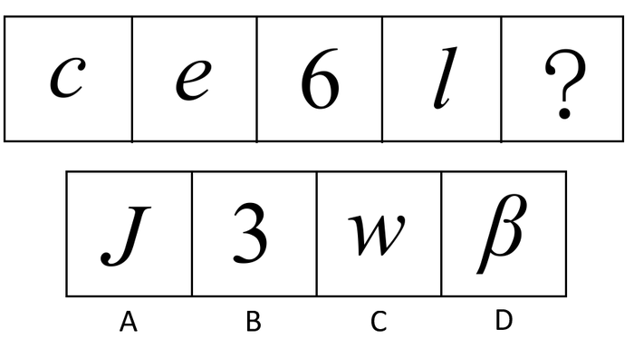

A. A

B. B

C. C

D. D

第 71 题 · 答案与解析

**参考答案（粉笔题库参考内容）**

C

**解析**

考查元素书写方向，位置考查。

本题中，已知图形中的字母和数字都按逆时针书写，四个选项中，A、B、D项都按顺时针书写，只有C项按逆时针书写。

故正确答案为C。

**考点**：文字/字母/数字类

**来源**：2013年天津市公务员录用考试《行测》题第71题

### 第 72 题

从所给的四个选项中，选择最合适的一个填到问号处，使之呈现一定的规律性：

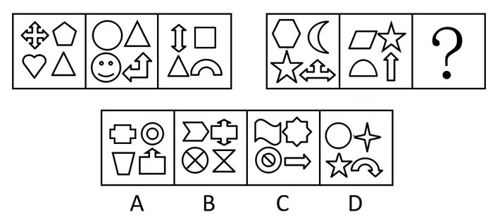

A. A

B. B

C. C

D. D

第 72 题 · 答案与解析

**参考答案（粉笔题库参考内容）**

D

**解析**

组成元素相似，单元素遍历。

第一串的三个图形中，都包含一个相同的元素“△”，第二串的前两个已知图形中，都包含一个相同的元素“☆”。四个选项中，只有D项包含“☆”。

故正确答案为D。

**考点**：数量规律-素、样式规律-遍历

**来源**：2013年天津市公务员录用考试《行测》题第72题

### 第 73 题

从所给的四个选项中，选择最合适的一个填到问号处，使之呈现一定的规律性：

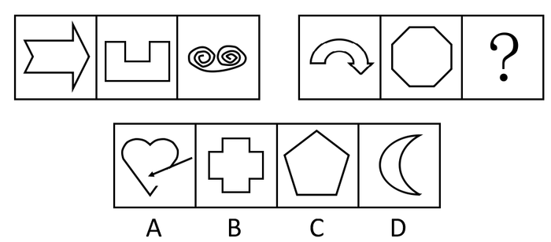

A. A

B. B

C. C

D. D

第 73 题 · 答案与解析

**参考答案（粉笔题库参考内容）**

A

**解析**

元素组成凌乱，考属性。

第一组图中，第一、二个图形是封闭图形，第三个图形是开放图形；第二组图中，前两个图形也是封闭图形，因此第三个图形应是开放图形，只有A项符合。

故正确答案为A。

**考点**：属性规律-开闭性

**来源**：2013年天津市公务员录用考试《行测》题第73题

### 第 74 题

把下面六个图形分成两类，使每一类图形都有各自共同的规律或特征，分类正确的一项是：

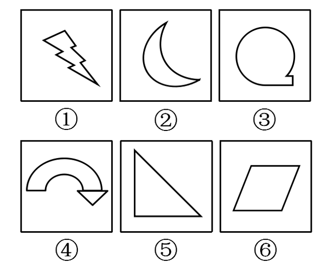

A. ①③⑤，②④⑥

B. ①④⑤，②③⑥

C. ①③④，②⑤⑥

D. ①②④，③⑤⑥

第 74 题 · 答案与解析

**参考答案（粉笔题库参考内容）**

C

**解析**

元素组成凌乱，考属性。

图①、③、④是非对称性图形，图②、⑤、⑥是对称图形。

故正确答案为C。

**考点**：属性规律-对称性

**来源**：2013年天津市公务员录用考试《行测》题第74题

### 第 75 题

把下面六个图形分成两类，使每一类图形都有各自共同的规律或特征，分类正确的一项是：

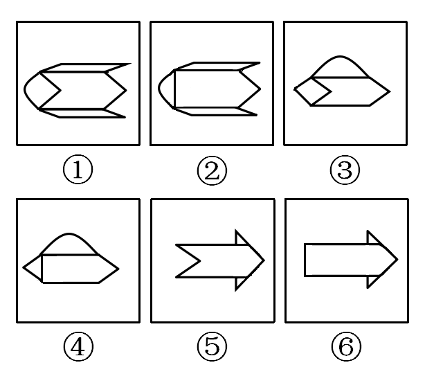

A. ①②⑤，③④⑥

B. ①③⑥，②④⑤

C. ①③④，②⑤⑥

D. ①③⑤，②④⑥

第 75 题 · 答案与解析

**参考答案（粉笔题库参考内容）**

D

**解析**

元素组成相似，考元素遍历。

图①、③、⑤中间部分的图形相同，左边都有两条直线，图②、④、⑥中间部分的图形相同，左边只有一条直线。

故正确答案为D。

**考点**：数量规律-素、样式规律-遍历

**来源**：2013年天津市公务员录用考试《行测》题第75题

### 第 76 题

给定一个纸盒，下列哪一项不能折成给定的纸盒：

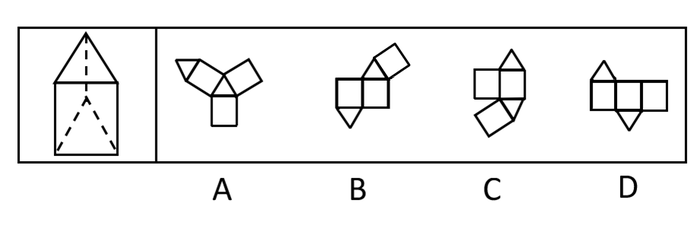

A. A

B. B

C. C

D. D

第 76 题 · 答案与解析

**参考答案（粉笔题库参考内容）**

C

**解析**

本题考查空间重构。A、B、D三项均能折成给定的纸盒。

C项：如下图所示，标红的两条边为公共边，但两条边长度不相等，无法折叠成完整封闭的立体图形，因此不能折成给定的纸盒，当选。

本题为选非题，故正确答案为C。

**来源**：2013年天津市公务员录用考试《行测》题第76题

### 第 77 题

从所给的四个选项中，选择最合适的一个填到问号处，使之呈现一定的规律性：

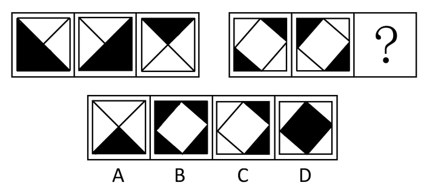

A. A

B. B

C. C

D. D

第 77 题 · 答案与解析

**参考答案（粉笔题库参考内容）**

D

**解析**

元素组成相似，优先考虑样式规律。观察发现，题干图形轮廓相同，且图形均由黑色区域和白色区域构成，考虑黑白运算。第一组图形的运算规则为：黑+白=白，黑+黑=白，白+黑=白，白+白=黑。第二组图形运用此规律，只有D项符合。

故正确答案为D。

**考点**：样式规律-黑白运算

**来源**：2013年天津市公务员录用考试《行测》题第77题

### 第 78 题

从所给的四个选项中，选择最合适的一个填到问号处，使之呈现一定的规律性：

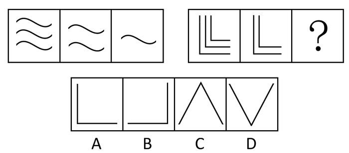

A. A

B. B

C. C

D. D

第 78 题 · 答案与解析

**参考答案（粉笔题库参考内容）**

A

**解析**

组成元素相同，数量不同，考查元素数数。

第一组图形中，每组图形的组成元素一样，且数量为3、2、1；依此规律，第二组图形中，未知图形的图案应与前两图一样，且数量为1，只有A项的图形满足。

故正确答案为A。

**考点**：数量规律-素

**来源**：2013年天津市公务员录用考试《行测》题第78题

### 第 79 题

从所给的四个选项中，选择最合适的一个填到问号处，使之呈现一定的规律性：

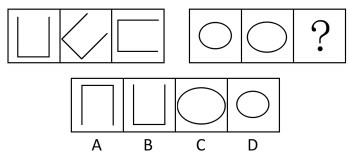

A. A

B. B

C. C

D. D

第 79 题 · 答案与解析

**参考答案（粉笔题库参考内容）**

C

**解析**

本题组成元素相同，考位置。

第一组图中，前一个图形保持基本形状不变，按顺时针旋转45°得到下一个图形；第二组图形也应遵循一个前后一致的规律，逐渐变大或变小，显然是变大。

故正确答案为C。

**考点**：位置规律-旋转

**来源**：2013年天津市公务员录用考试《行测》题第79题

### 第 80 题

把下面六个图形分成两类，使每一类图形都有各自共同的规律或特征，分类正确的一项是：

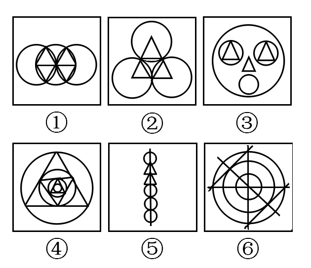

A. ①③⑥，②④⑤

B. ①③④，②⑤⑥

C. ①②⑥，③④⑤

D. ②③⑤，①④⑥

第 80 题 · 答案与解析

**参考答案（粉笔题库参考内容）**

C

**解析**

本题组成元素相似，是元素和数量的综合考查。

图形①、②、⑥都包含3个圆，图形③、④、⑤都包含4个圆。

故正确答案为C。

**考点**：数量规律-素

**来源**：2013年天津市公务员录用考试《行测》题第80题

### 第 81 题

全球变暖（global warming）指的是在一段时间中，地球的大气和海洋因温室效应而造成温度上升的气候变化现象，为公地悲剧之一，而其所造成的效应称之为全球变暖效应。

根据上述定义，下列表述不是全球变暖效应的一项是：

A. 近年极端天气事件更强更频繁，譬如洪水、旱灾、热浪、飓风和龙卷风

B. 太平洋海面上升和降雨量及降雪量在数额上和样式上的变化

C. 世界上出现更高或更低的农产量、冰河撤退、夏天时河流流量减少、物种消失及疾病肆虐

D. 非洲大陆全洲年平均气温在20℃以上的地方占全洲面积95%，其终年炎热，有将近一半的地区有着炎热的暖季和温暖的凉季

第 81 题 · 答案与解析

**参考答案（粉笔题库参考内容）**

D

**解析**

第一步：找到定义关键词。

气候变化现象。

第二步：逐一分析选项。

A项极端天气更强更频繁，B项太平洋海面上升、降雨量降雪量发生变化，C项冰河撤退、河流流量减少，都属于气候变化现象，符合关键词；

D项描述的是非洲大陆的气候特征，没有体现气候变化现象，不符合关键词，为答案。

故正确答案为D。

**考点**：原因结果

**来源**：2013年天津市公务员录用考试《行测》题第81题

### 第 82 题

反诉：指在已经开始的民事诉讼中，被告向审判机关提出的旨在使原诉被撤销或失去作用的反请求。反诉中的被告即是本诉的原告，反诉最迟应在本诉判决之前提起。反诉只能向审理本诉的审判机关提起，反诉与本诉的诉讼标的或诉讼理由应当具有牵连的关系。

根据上诉定义，下面哪种情况属于反诉：

A. 两人因为民事纠纷诉诸法律，法庭作出一审判决，被告胜诉，原告不服，于是又向高一级的人民法院提出了诉讼请求

B. 一个无业游民有一次私闯别人住宅被人以入室行窃罪告上法庭。但是在他进入房间时发现了主人有重大的杀人嫌疑，于是他以谋杀罪对该主人进行起诉

C. 一工厂经理因挪用公款被会计发现，因怕他会告发，于是恶人先告状，以渎职罪等罪对会计进行起诉

D. 广东两家公司发生经济纠纷，卖方因为买方拒不履行合同，交付全部货款对买方进行起诉。在审理中，买方认为是卖方货物质量太差造成的，买方理由充分，因而对原告进行起诉，以讨个说法

第 82 题 · 答案与解析

**参考答案（粉笔题库参考内容）**

D

**解析**

第一步：找到定义关键词。

被告向审判机关提出的，旨在使原诉被撤销或失去作用，反诉与本诉的诉讼标的或诉讼理由应当具有牵连的关系。

第二步：逐一分析选项。

D项两家公司的经济纠纷中，原诉是卖方起诉买方不履行合同，卖方是原告，买方是被告。审理中，原被告买方起诉卖方，称其不履行合同的原因在于卖方的质量太差，意在使原诉失去作用。一开始卖方起诉买方，以及后来的买方起诉卖方，都是针对同一起经济纠纷，即诉讼标的具有牵连关系。满足所有关键词，是本题答案。

A项是原告再次提起诉讼，不满足“被告向审判机关提出的”；B项的诉讼理由没有牵连关系；C项中原告是工厂经理，被告是会计，作为被告的会计并没有向审判机关提出反请求。A、B、C三项均不满足所有关键词。

故正确答案为D。

**考点**：单定义-其他句式

**来源**：2013年天津市公务员录用考试《行测》题第82题

### 第 83 题

广告：指为了商业目的，由商品经营者和服务提供者承担费用，通过一定媒介或一定形式，如通过报刊、电视、路牌、橱窗等，直接或间接地对自己推销的商品或者所提供的服务所进行的公开的宣传活动。

下列属于广告活动的是：

A. 水泥厂的厂长为了更好地销售水泥，向邻县的包工头送礼一百万

B. 奥巴马为了当总统，不惜重金在电视上和报刊上发表演说

C. 李宁牌服装赞助中国体育代表团出征奥运会，获得良好的社会效应和经济效益

D. 老师规定学生考试一定要用圆珠笔

第 83 题 · 答案与解析

**参考答案（粉笔题库参考内容）**

C

**解析**

第一步：找到定义关键词。

为了商业目的，商业经营者和服务提供者，通过一定媒介或一定形式，直接或间接地进行公开的宣传活动。

第二步：逐一分析选项。

A项向包工头送礼不满足“直接或间接地进行公开的宣传活动”；

B项是为了当总统，不是为了商业目的；

C项李宁牌服装是商业经营者，通过赞助代表团这种间接的形式，公开宣传自己所推销的商品，达到了取得良好的社会效应和经济效益的商业目的，满足所有关键词，是答案；

D项不是为了商业目的。

故正确答案为C。

**考点**：方式目的

**来源**：2013年天津市公务员录用考试《行测》题第83题

### 第 84 题

连续犯是指行为人基于数个同一的犯罪故意，连续多次实施数个性质相同的犯罪行为，触犯同一罪名的犯罪形态。

下列属于连续犯的是：

A. 某甲为了杀害乙、丙，一次性将药物放入某饭锅内，造成乙、丙同时死亡

B. 某赌徒为了偿还赌债，先后八次入室行窃，窃得赃款三万余元

C. 江西一匪，流窜全国，多次杀人、抢劫

D. 某出纳员偶然发现单位财务制度存在疏漏，将3000元公款占为己有，后来又再次利用该漏洞贪污8000元

第 84 题 · 答案与解析

**参考答案（粉笔题库参考内容）**

B

**解析**

第一步：找到定义关键词。

数个同一的犯罪故意，数个性质相同的犯罪行为，触犯同一罪名。

第二步：逐一分析选项。

A项一次性投毒，不满足“数个性质相同的犯罪行为”；

B项“八次入室抢劫”满足“数个同一的犯罪故意，数个性质相同的犯罪行为”，其行为触犯同一罪名，满足所有关键词，是答案；

C项杀人、抢劫是两个不同性质的犯罪行为，不满足“性质相同”；

D项将3000元公款占为己有和贪污8000元是两个罪名，不满足“触犯同一罪名”。

故正确答案为B。

**考点**：原因结果

**来源**：2013年天津市公务员录用考试《行测》题第84题

### 第 85 题

出口加工区是经济特区的一种形式，是外向型的经济特区，主要是利用外国的资金、技术、设备，利用我国的土地、资源、劳动力等优势，生产的产品以外销为主。

下列地区属于出口加工区的是：

A. 香港特别行政区

B. 西北青海省盐湖经济开发区，采取招商引资策略，外商出资，我方出人力、土地，产品主要在西北五省区销售

C. 深圳的蛇口工业区采取来料加工的方式与外国人合作，产品销往国外

D. 北大校办企业方正集团的产品首先要支持本校的教学和科研，因为它借用北大无形资产

第 85 题 · 答案与解析

**参考答案（粉笔题库参考内容）**

C

**解析**

第一步：找到定义关键词。

经济特区，外国的资金、技术、设备，我国的土地、资源、劳动力，以外销为主。

第二步：逐一分析选项。

A项香港特别行政区是个综合性的大都市，与定义不符；

B项在西北五省区销售，不满足“以外销为主”；

C项深圳蛇口工业区采用的来料加工的方式指外商提供原材料和技术支持，利用我国的土地和劳动力优势进行加工，产品销往国外，满足所有关键词；

D项说的是方正集团，不属于经济特区。

故正确答案为C。

**考点**：方式目的

**来源**：2013年天津市公务员录用考试《行测》题第85题

### 第 86 题

共同共有：指两个或两个以上的共有人对共有财产享有同等权利并承担同等的责任和义务。

根据上述定义，下列哪一种情况属于共同共有：

A. 某百万富翁立下遗嘱，言明他所有的存款及房产折价后，平等地分给他的两个儿子，两个各享一半财产的继承权

B. 某大学的学生宿舍按规定应该每个宿舍住六个人，由于人数原因，最后一个安排的宿舍只有三个人。后学校给每个宿舍配了一台饮水机，给三个人的宿舍也装了一个

C. 某风险投资商投资某一正在发展的小型企业，并言明该企业以后实行股份制，企业董事长拥有30%的股份，风险投资商占有70%的股份

D. 两个伙伴合作开办了一家公司，一个负责经营，一个负责开发，但他们在合伙前就以书面公证的形式言明，两人共同拥有这家公司，但是一旦破产欠债，管开发的人不负责还债

第 86 题 · 答案与解析

**参考答案（粉笔题库参考内容）**

A

**解析**

第一步：找到定义关键词。

“两个或两个以上”、“共有财产”、“同等权利并承担同等的责任和义务”。

第二步：逐一分析选项。

A项：两个儿子符合“两个或两个以上”，只是立下遗嘱，还未进行分割，因此该财产属于共有财产，并且两个儿子对其享有同等的权利并承担同等的义务，符合定义，当选；

B项：饮水机属于学校财产而不是学生的共有财产，不符合定义，排除；

C项：董事长和风险投资商享有的权利和承担的义务不同等，不符合定义，排除；

D项：两个合伙人承担的责任不同，不符合定义，排除。

故正确答案为A。

**考点**：单定义-其他句式

**来源**：2013年天津市公务员录用考试《行测》题第86题

### 第 87 题

留置：指债权人按照合同约定占有债务人的动产，债务人不按合同约定的期限履行债务的，债权人有权依法留置该动产，以该财产的折价或者以拍卖、变卖该财产的价款优先受偿。

下列情况中属于留置的是：

A. 一企业家雄心勃勃，他在企业效益特别好的时候，并没有把利润以股息、红利、奖金等形式散了下去，而是留在企业，作为进一步发展的资本

B. 银行在康某到期仍无力偿还贷款的情况下，以其作为抵押的房产折价拍卖后全部款项归入银行

C. 某企业因经营不善，无力偿还其所欠另一家企业的债务，依据合同，在其宣告破产后，另一家企业直接接管并拥有了该企业

D. 一古董商买进一批重要文物需大笔钱财，因此他向一位同行签订合同借款500万。在合同生效后，根据合同另一古董商取走了他店里的一批古董作为抵押

第 87 题 · 答案与解析

**参考答案（粉笔题库参考内容）**

D

**解析**

第一步：找到定义关键词。

债权人，债务人的动产，以该财产的折价或者以拍卖、变卖该财产的价款优先受偿。

第二步：逐一分析选项。

A项不存在债权人和债务人，不符合定义；

B项中的房产属于不动产；

C项中的企业不满足“债务人的动产”，C项是直接接管，不满足“以该财产的折价或者以拍卖、变卖该财产的价款优先受偿”；

D项中的古董商向另一同行借款产生债务关系，债权人根据合同规定取走债务人店里的一批古董作为抵押，其中被取走的古董属于动产，以古董作抵押满足“以该财产的折价优先受偿”，是答案。

故正确答案为D。

**考点**：单定义-其他句式

**来源**：2013年天津市公务员录用考试《行测》题第87题

### 第 88 题

野外作业，又称田野作业，是指人们在远离城镇或居民点的地方从事科学技术考察或进行生产活动。

下列不属于野外作业的一项是：

A. 大地测量

B. 水文地质调查

C. 考古工作队在河南洛阳挖掘古墓

D. 天津电视台直播春节晚会

第 88 题 · 答案与解析

**参考答案（粉笔题库参考内容）**

D

**解析**

第一步：找到定义关键词。

从事科学技术考察或进行生产活动。

第二步：逐一分析选项。

A项大地测量，B项水文地质调查，C项挖掘古墓都属于从事科学技术考察，符合定义。

D项天津电视台直播春节晚会不满足“从事科学技术考察或进行生产活动”，不符合定义，是答案。

故正确答案为D。

**考点**：单定义-其他句式

**来源**：2013年天津市公务员录用考试《行测》题第88题

### 第 89 题

化学反应：指一种或多种物质改变化学组成、性质和特征成为与原来不相同的另一种或多种物质的变化。

下列变化哪一种不属于化学反应：

A. 以石油为原料合成聚乙烯

B. 木炭燃烧获取热量

C. 葡萄通过乙醇等工艺制造成葡萄酒

D. 自来水加热变成水蒸气

第 89 题 · 答案与解析

**参考答案（粉笔题库参考内容）**

D

**解析**

第一步：找到定义关键词。

成为与原来不相同的另一种或多种物质。

第二步：逐一分析选项。

A项石油变成聚乙烯，B项木炭燃烧后变成炭灰，C项葡萄变成葡萄酒，变成的物质与原来不相同，满足关键词。

D项水蒸气是水的气体形式，不满足“成为与原来不相同的另一种或多种物质”，是答案。

故正确答案为D。

**考点**：单定义-其他句式

**来源**：2013年天津市公务员录用考试《行测》题第89题

### 第 90 题

公务员的辞退：指国家机关用人部门或单位根据法律规定，在一定条件下解除其与工作人员职务关系的行为或事实。

下列何种行政行为一定属于辞退：

A. 公务员王某在任职不到一年的时间里就无故旷工累计达三十天，按公务员有关条例不得不离开该单位

B. 张某在某机关工作至今整整三十年。今年年满六十，回家安度晚年

C. 周某去年九月通过考试被录取到省政府办公厅从事秘书工作，虽勤勤恳恳仍难称职，有关部门依据“国家公务员暂行条例”，不得不请其另谋高就

D. 某公务员离职申请得到主管部门批准，离开原单位到某公司任职

第 90 题 · 答案与解析

**参考答案（粉笔题库参考内容）**

A

**解析**

第一步：找到定义关键词。

根据法律规定，在一定条件下解除其与工作人员职务关系。

第二步：逐一分析选项。

A项王某无故旷工累积达三十天，违反公务员条例，根据《公务员法》规定单位应解除王某与单位的职务关系，属于辞退行为，是答案。

B项属于退休，C项属于免职，D项属于辞职。

故正确答案为A。

**考点**：单定义-其他句式

**来源**：2013年天津市公务员录用考试《行测》题第90题

### 第 91 题

由于身体太重，狗熊抬起左前脚迈步时，前半边身子就会歪向左边，换脚的时候，身体又会倒向另一边。所以：

A. 狗熊很可爱

B. 狗熊很凶

C. 狗熊走路时总是摇头晃脑的

D. 狗熊非常重

第 91 题 · 答案与解析

**参考答案（粉笔题库参考内容）**

C

**解析**

本题属日常结论类题型。

第一步：抓住题干主要信息，即狗熊因身体太重，走起路来身体不平衡，东倒西歪。

第二步：分析各选项。

A项狗熊很可爱和B项狗熊很凶都是主观判断，无法从题干信息得出；

狗熊走路身体东倒西歪，那头部自然也是一会儿向左一会儿向右，看起来就是摇头晃脑的，C项正确；

D项狗熊非常重是已知信息，不是结论。

故正确答案为C。

**考点**：日常结论

**来源**：2013年天津市公务员录用考试《行测》题第91题

### 第 92 题

滑旱冰看起来对腿部、脚步韧带、关节受到扭伤的人不利，但矫形外科医生发现，滑旱冰是一种关节和韧带疾病患者可以采用的康复措施。这意味着：

A. 这种运动对关节有利

B. 这种运动对关节不利

C. 滑旱冰很好学

D. 滑旱冰风靡全球

第 92 题 · 答案与解析

**参考答案（粉笔题库参考内容）**

A

**解析**

日常结论题，根据题干信息逐一分析选项。

A项：根据题干可知，滑旱冰是一种关节和韧带疾病患者可以采用的康复措施，说明滑旱冰对于关节有利，可以推出，当选；

B项：根据题干可知，滑旱冰是一种关节和韧带疾病患者可以采用的康复措施，说明滑旱冰对于关节有利，表述错误，排除；

C项：题干中并未提及滑旱冰是否容易学，无中生有，无法推出，排除；

D项：题干中并未提及滑旱冰是否风靡全球，无中生有，无法推出，排除。

故正确答案为A。

**考点**：日常结论

**来源**：2013年天津市公务员录用考试《行测》题第92题

### 第 93 题

当代经济的发展与竞争，已不再主要依靠密集劳动力。如在美国，整个信息高速公路工程将耗时20年，总投资达4000亿美元。要为9500万个家庭全部装上大容量光纤线路，要耗资2000亿美元。

由此可见：

A. 未来的经济发展主要靠高技术

B. 未来的经济发展将不再需要劳动力

C. 未来的经济发展过程是一个资本密集的过程

D. 在未来的经济竞争中，发展中国家将越来越落伍

第 93 题 · 答案与解析

**参考答案（粉笔题库参考内容）**

C

**解析**

日常结论题，根据题干信息逐一分析选项。

A项：题干指出“当代经济的发展与竞争，已不再主要依靠密集劳动力”，并未提到“未来”的经济发展“主要”靠什么技术，无法推出，排除；

B项：题干指出“当代经济的发展与竞争，已不再主要依靠‘密集劳动力’”，而非不再需要“劳动力”，偷换概念，无法推出，排除；

C项：题干中的例子强调工程总投资额之大，说明了资本的密集，可以推出，当选；

D项：题干未涉及发展中国家的情况，无法推出，排除。

故正确答案为C。

**考点**：日常结论

**来源**：2013年天津市公务员录用考试《行测》题第93题

### 第 94 题

西斯廷教堂天花板上米开朗基罗的壁画的清洗和修复工作是由一些世界上最好的艺术复原专家在一批国际性艺术家和历史专家的密切监督下进行的。然而，结果产生一场争议性风暴。大多数的现代参观者似乎已习惯于观看这些颜色已被泛黄的胶层和灰尘弄得暗淡无光，人物的轮廓已被半个世纪以来积累的污垢弄得模糊不清的壁画了。可见，米开朗基罗的壁画：

A. 成为有关其艺术功绩剧烈争议的主题

B. 受到几个世纪的冷落，直至今日

C. 在最近的修复工作中被蒙上灰尘

D. 人们更喜欢原汁原味的壁画，尽管它为岁月所侵蚀，但可以从中感受到更多的享受

第 94 题 · 答案与解析

**参考答案（粉笔题库参考内容）**

D

**解析**

本题属于日常结论类题型。

第一步：抓住题干主要信息。

题干包含两个主要信息：一是米开朗基罗的壁画经过清洗和修复后，引起争议；二是大多数现代参观者似乎习惯观看清洗和修复前的壁画，即便壁画的颜色已变得黯淡无光，人物轮廓也模糊不清。

第二步：分析各选项。

题干说的是壁画的复原问题引发争论，没涉及艺术功绩，A项属于无关选项；

B项“受到几个世纪的冷落”题干没有谈及，也是无关选项；

C项说的是壁画的颜色被灰尘弄得暗淡无光，并没说明最近的修复工作是否被蒙上灰尘，C项的表述无法从题干得出；

从第一步信息可知，人们更喜欢壁画的原样，即便壁画的颜色和人物轮廓已不如从前，但人们可从中获得更多感受，即D项。

故正确答案为D。

**考点**：日常结论

**来源**：2013年天津市公务员录用考试《行测》题第94题

### 第 95 题

H有三个女儿M、Q、P，一个结婚了有一个孩子，另一个结婚了有两个孩子，第三个没有结婚也没有小孩，P是I和L的姨妈，M是N的妻子，J是L的弟弟又是K的外甥，K和N都没有兄弟姐妹，H是K的丈人。K和L的关系是：

A. K是L的母亲

B. K是L的姨妈

C. K是L的父亲

D. K是L的姨父

第 95 题 · 答案与解析

**参考答案（粉笔题库参考内容）**

D

**解析**

题干条件中K出现的次数最多（3次），整理出与K相关的条件：① J是L的弟弟又是K的外甥；②K和N都没有兄弟姐妹；③H是K的丈人。

由③H是K的丈人可知，K是H的女婿，即K是男性，排除A、B 两项。

由①J是K的外甥可知，K是J的姨父；又因为J是L的弟弟，所以K也是L的姨父。

故正确答案为D。

**考点**：从最大信息开始推

**来源**：2013年天津市公务员录用考试《行测》题第95题

### 第 96 题

有一句话叫做字如其人，又说心正则身正。一般来说，品格高尚的人都写一手好字，但是历史上著名的大汉奸秦桧也写得一手好字。因此：

A. 判断一个人应该先看他的字

B. 字如其人是不正确的

C. 坏人也可以写好字

D. 认识一个人应当听其言，观其行，而不是抓住一点表面现象就下定论

第 96 题 · 答案与解析

**参考答案（粉笔题库参考内容）**

D

**解析**

本题为日常结论类题型。

第一步：抓住题干主要信息。

题干主要包含两个主要信息，一是品格高尚的人写得一手好字，二是秦桧是大汉奸，但也写得一手好字。

第二步：分析各选项。

A项与题意不符，从秦桧的反例可知看人不能只看其字；

B项题干没有对字如其人这个说法作出判断，无法得出；

C项是题干的已知信息，不是结论；

由题干信息可知，并不能从是否写得一手好字来判断一个人的品格是否高尚，也就是看人不能只看表面，要听言观行，即D项。

故正确答案为D。

**考点**：日常结论

**来源**：2013年天津市公务员录用考试《行测》题第96题

### 第 97 题

地球和火星相比，有许多共同属性，如同隶属于太阳系，都是较规则球体，有公转和自转。既然地球有生命存在，火星也很有可能有生命存在。哪项为真最可能削弱上述判断的可靠性：

A. 地球距离火星过远，火星很难有生命

B. 地球和火星生成时间不同

C. 地球和火星转速不同

D. 火星上目前没有发现液态水

第 97 题 · 答案与解析

**参考答案（粉笔题库参考内容）**

D

**解析**

本题属于削弱题型。

第一步：找出论点论据。

论点：火星很可能有生命存在。

论据：地球有生命存在。

第二步：逐一分析选项。

论据强调的是地球，论点强调的是火星，论点和论据强调的对象不同，需要削弱论证，在论点和论据间拆桥。D项切断了论点和论据间的联系，液态水是存在生命的重要前提，地球上有液态水，火星上没有液态水，因此不能从地球上有生命存在得出火星也有可能存在生命的结论。

A、B、C三项指的是地球和火星之间的区别，这些区别都不是决定生命存在的重要前提，与论点无关，属于无关选项。

故正确答案为D。

**考点**：拆桥

**来源**：2013年天津市公务员录用考试《行测》题第97题

### 第 98 题

当前大学课程设置出现一定问题，很多大公司的新上岗人员都没有很好掌握基本工作技能，比如文件的写作、数据的处理及办事能力。

上述论证是以下面哪项为前提的：

A. 现在的大学课程设置没有基本技能方面的课程

B. 文件的写作、数据的处理及办事能力等基本技能对胜任工作很重要

C. 公司新上岗人员基本代表当前毕业大学生水平

D. 过去的大学生比现在的大学生接受了更多的基本技能教育

第 98 题 · 答案与解析

**参考答案（粉笔题库参考内容）**

C

**解析**

本题属于加强题型。

第一步：找出论点论据。

论点：当前大学课程设置出现一定问题。

论据：很多大公司的新上岗人员都没有很好掌握基本工作技能。

第二步：逐一判断选项。

论点强调的是大学课程设置，论据强调的是公司的新上岗人员的工作技能，论点和论据之间不存在因果关系，需要在两者间搭桥，加强论证。

C项在大学课程和公司的新上岗人员之间建立联系，说明新上岗人员基本代表当前毕业大学生的水平，因此新上岗员工的工作技能不足，反映出当前毕业大学生的水平不够，从而说明大学课程存在问题；

A项大学课程设置没有基本技能的课程，并不能说明大学课程就一定有问题，无法加强论点；

B项说的是基本技能对胜任工作的重要性，与论点无关，属于无关选项；

D项将过去的大学生与现在的大学生进行对比，与论点无关，属于无关选项。

故正确答案为C。

**考点**：搭桥

**来源**：2013年天津市公务员录用考试《行测》题第98题

### 第 99 题

在同学聚会上，甲、乙、丙在各自的工作岗位上都做出了一定的成绩，成为了明星、教授和经理。另外，

（1）他们分别毕业于音乐系、物理系和中文系；

（2）明星称赞中文系毕业者身体健康；

（3）物理系毕业生请教授写了一幅字；

（4）明星和物理系毕业者生活在同一个城市；

（5）乙向音乐系毕业者请教过乐理问题；

（6）毕业后，物理系毕业者、乙都没有和丙联系过。

由此可知：

A. 丙是明星，甲毕业于物理系

B. 乙毕业于音乐系

C. 甲毕业于音乐系

D. 中文系毕业者是明星

第 99 题 · 答案与解析

**参考答案（粉笔题库参考内容）**

A

**解析**

本题属于排列组合题型，首选用排除法作答。

第一步：找突破口。

由（2）明星称赞中文系毕业者身体健康可知，明星不是中文系毕业者，排除D项；由（5）乙向音乐系毕业者请教过乐理问题可知，乙不是音乐系毕业者，排除B项；由（6）毕业后，物理系毕业者、乙都没有和丙联系过可知，物理系毕业者既不是乙也不是丙，即甲是物理系毕业者，排除C项。

故正确答案为A。

**考点**：排除法

**来源**：2013年天津市公务员录用考试《行测》题第99题

### 第 100 题

如果政府继续实施限购限贷等房地产调控政策，并且加大保障性住房建设，那么调控就会取得明显成效。

根据以上陈述，可以推出：

A. 如果房地产的调控取得明显成效，那么，不是政府继续实施限购限贷等房地产调控政策，就是加大了保障性住房建设

B. 如果房地产的调控没有取得明显成效，那么一定是政府放松了房地产调控政策和减少了保障性住房建设

C. 如果政府继续实施限购限贷等房地产调控政策，那么如果加大保障性住房建设，房地产的调控就会取得明显成效

D. 如果政府继续实施限购限贷等房地产调控政策，即使减少保障性住房建设，房地产的调控也会取得明显成效

第 100 题 · 答案与解析

**参考答案（粉笔题库参考内容）**

C

**解析**

本题属于关联词推导题型。

第一步：翻译题干。根据充分必要条件。

继续房地产调控政策∧加大保障性住房建设→调控取得成效，根据逆否规则和摩根规则，可得出：-调控取得成效→—（继续房地产调控政策∧加大保障性住房建设）→—继续房地产调控政策∨—加大保障性住房建设。

第二步：逐一翻译选项并得出正确答案。

A项：调控取得成效→继续房地产调控政策∨加大保障性住房建设，“调控取得成效”是肯定题干推导关系的后件，肯后件无法得出绝对表达的结论，错误；

B项：-调控取得成效→—继续房地产调控政策∧—加大保障性住房建设，与题干推导关系的逆否规则不一致，错误；

C项：继续房地产调控政策∧加大保障性住房建设→调控取得成效，与题干推导关系一致，正确；

D项：继续房地产调控政策∧—加大保障性住房建设→调控取得成效，与题干推导关系不一致，错误。

故正确答案为C。

**考点**：常规翻译

**来源**：2013年天津市公务员录用考试《行测》题第100题

## 材料 2

2012年1-3月，我国规模以上工业企业资料如下：

        全国规模以上工业企业实现利润10449亿元，同比下降1.3%。其中，国有及国有控股企业实现利润3172亿元，同比下降12.4%；集体企业实现利润178亿元，同比增长16.8%；股份制企业实现利润5959亿元，同比增长0.4%；外商及港澳台投资企业实现利润2515亿元，同比下降12.6%；私营企业实现利润3264亿元，同比增长22.4%。

        在41个工业大类行业中，27个行业利润同比增长，11个行业同比下降。主要行业中：石油和天然气开采业利润同比增长10.6%，农副食品加工业增长7.7%，汽车制造业增长6.3%，电力、热力生产和供应业增长28.3%，化学原料和化学制品制造业下降23.1%，黑色金属冶炼和压延加工业下降83.5%，通用设备制造业下降0.5%，电气机械和器材制造业下降2.4%，计算机、通信和其他电子设备制造业下降12.2%。石油加工、炼焦和核燃料加工业由同期盈利转为亏损。

        规模以上工业企业实现主营业务收入197823亿元，同比增长14.1%。其中，国有及国有控股企业实现主营业务收入56164亿元，同比增长7.6%，集体企业实现主营业务收入2711亿元，同比增长13.2%，主营业务收入利润率为6.57%；股份制企业实现主营业务收入112260亿元，同比增长16.6%，主营业务收入利润率为5.31%；外商及港澳台投资企业实现主营业务收入50191亿元，同比增长7.2%，主营业务收入利润率为5.01%；私营企业实现主营业务收入60020亿元，同比增长23.9%，主营业务收入利润率为5.44%。

### 第 101 题

2011年1-3月份国有及国有控股企业实现利润为：

A. 3565亿元

B. 2822亿元

C. 3621亿元

D. 2772亿元

第 101 题 · 答案与解析

**参考答案（粉笔题库参考内容）**

C

**解析**

根据题干“2011年1-3月······”，结合材料时间2012年1-3月，可判定本题为基期计算问题。定位材料第一段，2012年1-3月，国有及国有控股企业实现利润3172亿元，同比下降12.4%。可得 3172/0.876≈3150/0.875=3600亿元，与C项最为接近。

故正确答案为C。

**考点**：基期计算、文字资料

**来源**：2013年天津市公务员录用考试《行测》题第101题

### 第 102 题

2011年1-3月份，按实现利润比重排名前三位的经济类型依次是：

A. 国有及国有控股企业、私营企业、股份制企业

B. 股份制企业、国有及国有控股企业、外商及港澳台商投资企业

C. 股份制企业、私营企业、国有及国有控股企业

D. 私营企业、国有及国有控股企业、股份制企业

第 102 题 · 答案与解析

**参考答案（粉笔题库参考内容）**

B

**解析**

根据题干“2011年1-3月，按······比重排名前三”结合材料时间2012年1-3月，可判定本题为基期比重比较问题。定位材料第一段：“国有及国有控股企业实现利润3172亿元，······私营企业实现利润3264亿元，同比增长22.4%”。要比较2011年1-3月各类企业实现利润所占比重，由于分母都是一样的，故只需比较各经济类型实现利润即可，依次如下：

国有及国有控股企业：3621亿元（由上题可知）；

股份制企业：亿元，且略小于5959亿元；

外商及港澳台商投资企业：≈2520/0.875=2880亿元；

私营企业：≈3300/1.252640亿元。

综上，前三位依次为股份制企业、国有及国有控股企业、外商及港澳台商投资企业。

故正确答案为B。

**考点**：基期比重、文字资料

**来源**：2013年天津市公务员录用考试《行测》题第102题

### 第 103 题

主要行业中增长速度最快的是：

A. 黑色金属冶炼和压延加工业

B. 电力、热力生产和供应业

C. 农副食品加工业

D. 石油和天然气开采业

第 103 题 · 答案与解析

**参考答案（粉笔题库参考内容）**

B

**解析**

定位材料第二段， 黑色金属冶炼和压延加工业增长速度是-83.5%；电力、热力生产和供应业增长速度是28.3%；农副食品加工业增长速度是7.7%；石油和天然气开采业增长速度是10.6%；故电力、热力生产和供应业最高。

故正确答案为B。

**考点**：文字资料、直接找数

**来源**：2013年天津市公务员录用考试《行测》题第103题

### 第 104 题

从2011年1-3月到2012年1-3月，规模以上工业企业中，主营业务收入同比增长金额最大的是（  ）。

A. 国有及国有控股企业

B. 集体企业

C. 股份制企业

D. 私营企业

第 104 题 · 答案与解析

**参考答案（粉笔题库参考内容）**

C

**解析**

根据题干“······同比增长金额最大”，可判定本题为增长量比较问题。定位材料第三段：“国有及国有控股企业实现主营业务收入56164亿元，······私营企业实现主营业务收入60020亿元，同比增长23.9%”。通过大大则大排除A、B两项；根据×π，C项：≈16000亿元；D项：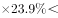25%=60020/5≈12000亿元；股份制企业最大。

故正确答案为C。

**考点**：增长量比较、文字资料

**来源**：2013年天津市公务员录用考试《行测》题第104题

### 第 105 题

上述资料表明，2012年1-3月份：

A. 在41个工业大类行业中，超过七成的行业利润同比增长

B. 国有及国有控股企业在主营业务收入中具有主导作用

C. 除了国有及国有控股企业其他类型企业实现利润均为正增长

D. 私营企业实现主营业务收入的增长速度最快

第 105 题 · 答案与解析

**参考答案（粉笔题库参考内容）**

D

**解析**

A项：定位材料第二段，在41个工业大类行业中，27个行业利润同比增长，同比增长的行业的比重为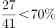，即低于七成，错误；

B项：定位材料第三段，主营业务中，股份制企业112260亿元，占所有规模以上企业营业收入197823亿元的一半以上，故股份制企业收入占主导地位，错误；

C项：定位材料第一段，外商及港澳台商投资企业实现利润也为负增长，错误；

D项：定位材料第三段，私营企业实现主营业务收入同比增长23.9%，为最高，正确。

故正确答案为D。

**考点**：文字资料、综合分析

**来源**：2013年天津市公务员录用考试《行测》题第105题

## 材料 3

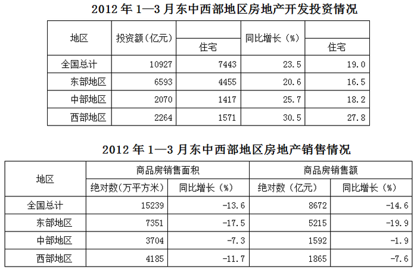

### 第 106 题

关于我国2012年1-3月房地产开发投资，说法错误的是：

A. 东部地区所占比重最大

B. 西部地区增长速度最快

C. 住宅投资约占五成

D. 投资总额增长速度超过住宅投资增长速度

第 106 题 · 答案与解析

**参考答案（粉笔题库参考内容）**

C

**解析**

A项：定位表格1，东部地区投资额最多，故比重最大，正确；

B项：定位表格1，西部增长速度是30.5%，最快，正确；

C项：定位表格1，住宅投资占比为7443/10927，远高于五成，错误；

D项：定位表格1，投资总额增长速度23.5%，住宅投资增长速度19.0%，前者大于后者，正确。

故正确答案为C。

**考点**：统计表、综合分析

**来源**：2013年天津市公务员录用考试《行测》题第106题

### 第 107 题

2011年1-3月，西部地区住宅类房地产投资额是（    ）亿元。

A. 1735

B. 1229

C. 932

D. 785

第 107 题 · 答案与解析

**参考答案（粉笔题库参考内容）**

B

**解析**

根据题干“2011年1-3月······”结合材料时间2012年1-3月，可判定本题为基期计算问题。定位第一个表格可知：西部地区住宅类房地产投资额是1571亿元，增长率是27.8%；根据可得，2011 年1-3月，西部地区住宅类房地产投资额为，结合选项，差距大，≈1571/1.3，直除首两位是12。

故正确答案为B。

**考点**：基期计算、统计表

**来源**：2013年天津市公务员录用考试《行测》题第107题

### 第 108 题

以下说法错误的是：

A. 商品房销售面积和商品房销售额均为负增长

B. 东中西部地区的商品房销售面积变化趋势与全国相同

C. 西部地区商品房销售平均价高于中部地区的平均价

D. 中部地区商品房销售平均价高于西部地区的平均价

第 108 题 · 答案与解析

**参考答案（粉笔题库参考内容）**

D

**解析**

A项：定位表格2可知，商品房销售面积和商品房销售额均为负增长，正确。

B项：定位表格2可知，东中西部地区商品房销售面积同比增长率都是负数，与全国一致，正确。

C项：定位表格2可知，西部地区的商品房销售平均价格为1865/4185≈0.45亿元/万平方米，中部地区的商品房销售平均价格为1592/3704 ≈0.43亿元/万平方米，故C项正确，D项错误。

本题为选非题，故正确答案为D。

【秒杀技】

观察选项，C、D两项明显矛盾，可直接排除A、B两项。

**考点**：统计表、综合分析

**来源**：2013年天津市公务员录用考试《行测》题第108题

### 第 109 题

2012年1-3月，东部地区商品房销售额占全国的比重约为：

A. 40%

B. 50%

C. 60%

D. 70%

第 109 题 · 答案与解析

**参考答案（粉笔题库参考内容）**

C

**解析**

根据题干“2012年1-3月，……占……的比重”结合材料时间2012年1-3月，可判定本题为现期比重计算问题。定位表格2，东部地区和全国商品房销售额分别是5215亿元、8672亿元，故东部地区商品房销售额占全国的比重为5215/8672×100%≈60%。

故正确答案为C。

**考点**：现期比重、统计表

**来源**：2013年天津市公务员录用考试《行测》题第109题

### 第 110 题

下列说法正确的是：

A. 2012年1-3月，西部地区房地产开发投资增长速度低于全国平均水平

B. 2012年1-3月，中部地区商品房销售面积增长速度低于全国平均水平

C. 2012年1-3月，东部地区商品房销售额的增幅最大

D. 2012年1-3月，房地产销售情况同比变化最小的是中部地区

第 110 题 · 答案与解析

**参考答案（粉笔题库参考内容）**

D

**解析**

A项：定位表格１可知，西部地区房地产开发投资增长速度与全国水平分别为30.5%和23.5%，前者大于后者，错误；

B项：定位表格２可知，中部地区商品房销售面积增长速度与全国平均水平分别为-7.3%和-13.6%，前者大于后者，错误；

C项：定位表格２可知，东部地区的降幅最大，而非增幅最大，错误；

D项：定位表格２可知，中部地区销售面积和销售额增长速度的绝对值与其他地区相比均最小，即变化最小。

故正确答案为D。

**考点**：统计表、综合分析

**来源**：2013年天津市公务员录用考试《行测》题第110题

## 材料 4

T省2011年完成全社会固定资产投资额7441.71亿元，比上年增长30.3%，人均投资达到27080.41万元。其中，固定资产投资(不含农户)为7221.64亿元，增长30.4%。
**2007—2011年全社会固定资产投资同比增长速度**

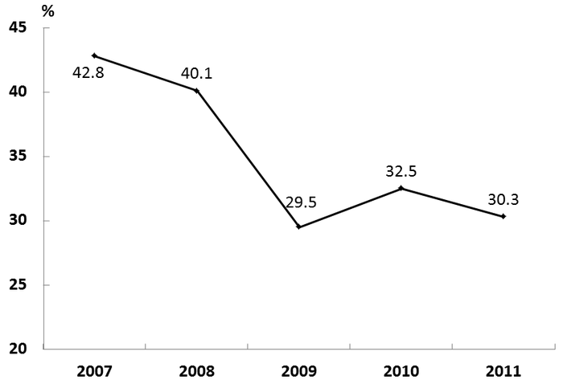

        在固定资产投资（不含农户）中，第一产业完成投资197.07亿元，增长1.1倍；第二产业完成投资4041.63亿元，增长27.2%；第三产业完成投资2982.94亿元，增长31.7%。

        全年完成工业投资3993.39亿元，增长27.1%，增幅低于全部投资增速3.2个百分点，对全社会投资增长的贡献率达55.3%。全年民间投资达到5194.25亿元，民间投资的比重达到71.9%，比上年提高4.9个百分点。

**2011年全省固定资产投资（不含农户）及其增长速度**     **单位：亿元**

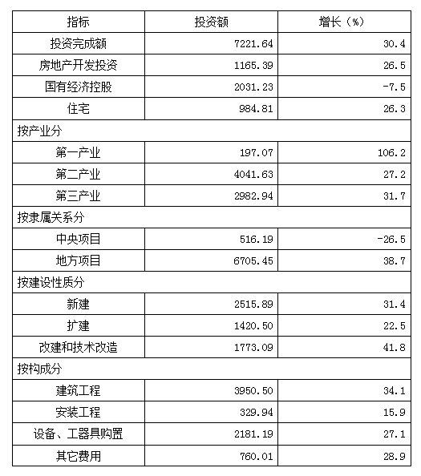

        全年完成非国有固定资产投资5461.53亿元，增长48.1%，占固定资产投资总额的75.6%。其中，完成私营企业投资1802.46亿元，增长1.1倍。

        全年新建项目完成投资2515.89亿元，同比增长31.4%；扩建项目完成投资1420.50亿元，增长22.5%；改建和技术改造项目完成投资1773.09亿元，增长41.8%。

        全年完成房地产开发投资1165.39亿元，增长26.5%。商品房竣工面积1656.17万平方米，下降18.4%；商品房销售建筑面积2364.25万平方米，下降0.7%。其中，销售住宅面积2060.73万平方米，下降2.1%。

### 第 111 题

下列说法正确的是：

A. 在固定资产投资中，第一产业完成投资额所占比重最大

B. 在固定资产投资中，第二产业完成投资额增长幅度最大

C. 在固定资产投资中，地方项目比中央项目增长速度快

D. 工业投资对全社会投资增长的贡献率低于五成

第 111 题 · 答案与解析

**参考答案（粉笔题库参考内容）**

C

**解析**

A项：定位表格材料可知：第一、二、三产业完成投资额分别为197.07亿元、4041.63亿元、2982.94亿元。固定资产投资中，第二产业投资额最高，因此所占比重最大，错误；

B项：定位表格材料可知：第一、二、三产业完成投资额的增长率分别为106.2%、27.2%、31.7%。因此第一产业增长幅度最大，错误；

C项：定位表格材料可知：地方项目投资额为正增长，中央项目投资额为负增长，正确；

D项：定位文字材料第三段可知，工业投资对全社会投资增长的贡献率达55.3%，高于五成，错误。

故正确答案为C。

**考点**：综合分析、综合资料

**来源**：2013年天津市公务员录用考试《行测》题第111题

### 第 112 题

全年项目完成投资中：

A. 改建和技术改造项目所占比重最大

B. 与上年相比，新建项目增长速度最快速

C. 扩建项目完成投资1420.50亿元，比上年增长22.5%

D. 其他投资达到2000亿元

第 112 题 · 答案与解析

**参考答案（粉笔题库参考内容）**

C

**解析**

A项：定位材料文字第五段可知：新建项目完成投资2515.89亿元>改建和技术改造项目完成投资1773.09亿元，分母相同，则新建项目完成投资所占比重>改建和技术改造项目完成投资所占比重，错误；

B项：定位材料文字第五段可知：新建项目同比增长31.4%，改建和技术改造项目增长41.8%，41.8%＞31.4%改建和技术改造项目增长速度更快，错误；

C项：定位材料文字第五段可知：扩建项目完成投资1420.50亿元，增长22.5%，正确；

D项：材料中未提供其他投资的相关数据，错误。

故正确答案为C。

**考点**：综合分析、综合资料

**来源**：2013年天津市公务员录用考试《行测》题第112题

### 第 113 题

全社会固定资产投资：

A. 近五年增长速度有上升趋势

B. 2011年增长速度下降幅度最大

C. 2010年大约为7000亿元

D. 2011年增长率比上年下降了2.2个百分点

第 113 题 · 答案与解析

**参考答案（粉笔题库参考内容）**

D

**解析**

A项：定位材料折线图，2009年及2011年全社会固定资产投资同比增速与上年相比均有所下降，错误；

B项：定位材料折线图，2009年增长速度下降幅度最大，错误；

C项：定位材料文字第一段可知：T省2011年完成全社会固定资产投资额7441.71亿元，比上年增长30.3%，则2010年全社会固定资产投资额，错误；

D项：定位材料折线图，2010年增长率为32.5%，2011年增长率为30.3%，则2011年增长率比上年下降了32.5%-30.3%=2.2个百分点，正确。

故正确答案为D。

**考点**：综合分析、综合资料

**来源**：2013年天津市公务员录用考试《行测》题第113题

### 第 114 题

2011年，非国有固定资产投资占固定资产投资总额的比重为：

A. 75.6%

B. 24.4%

C. 10.8%

D. 71.9%

第 114 题 · 答案与解析

**参考答案（粉笔题库参考内容）**

A

**解析**

定位文字材料第四段可知，2011年全年完成非国有固定资产投资5461.53亿元，占固定资产投资总额的75.6%。

故正确答案为A。

**考点**：直接找数、综合资料

**来源**：2013年天津市公务员录用考试《行测》题第114题

### 第 115 题

下列说法正确的是：

A. 商品房竣工面积大于商品房销售建筑面积

B. 销售住宅面积比上年有所提高

C. 商品房竣工面积比上年有所下降

D. 房地产开发投资比上年增长10.5%

第 115 题 · 答案与解析

**参考答案（粉笔题库参考内容）**

C

**解析**

A项：定位材料文字第六段可知：商品房竣工面积1656.17万平方米&lt;商品房销售建筑面积2364.25万平方米，错误；

B项：定位材料文字第六段可知：销售住宅面积2060.73万平方米，下降2.1%，错误；

C项：定位材料文字第六段可知：商品房竣工面积1656.17万平方米，下降18.4%，正确；

D项：定位材料文字第六段可知：全年完成房地产开发投资1165.39亿元，增长26.5%，错误。

故正确答案为C。

**考点**：综合分析、综合资料

**来源**：2013年天津市公务员录用考试《行测》题第115题

## 材料 5

**金砖五国经济社会指标比较**

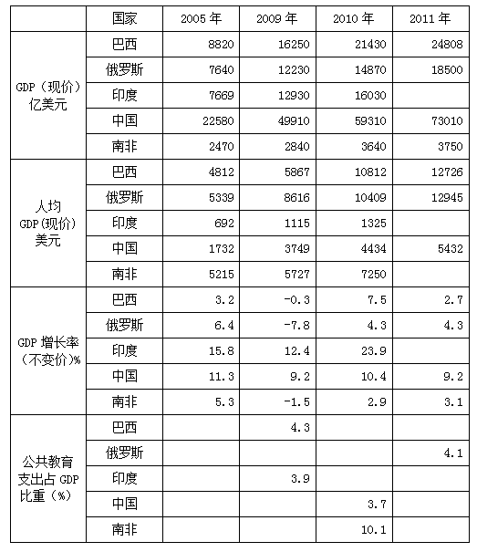

### 第 116 题

2011年中国人均GDP比上一年提高：

A. 44.8%

B. 144.8%

C. 122.5%

D. 22.5%

第 116 题 · 答案与解析

**参考答案（粉笔题库参考内容）**

D

**解析**

根据题干“2011年……比上年提高”结合选项百分数，可判定本题为增长率计算问题。定位表格材料可知：2011年中国人均GDP为5432，2010年中国人均GDP为4434，根据可得，，与D项最为接近。

故正确答案为D。

**考点**：一般增长率、统计表

**来源**：2013年天津市公务员录用考试《行测》题第116题

### 第 117 题

2011年中国GDP比巴西高了：

A. 2.94倍

B. 1.94倍

C. 0.43倍

D. 1.43倍

第 117 题 · 答案与解析

**参考答案（粉笔题库参考内容）**

B

**解析**

由“2011年中国GDP比巴西提高了······倍”，可判定本题为一般增长率的计算问题。定位表格材料，2011年巴西GDP为24808亿美元，中国GDP为73010亿美元，可知中国GDP比巴西提高了，B项最为接近。

故正确答案为B。

**考点**：一般增长率、统计表

**来源**：2013年天津市公务员录用考试《行测》题第117题

### 第 118 题

巴西GDP2005-2011年平均每年增加：

A. 2284.00亿美元

B. 2664.67亿美元

C. 2812.69亿美元

D. 1689.00亿美元

第 118 题 · 答案与解析

**参考答案（粉笔题库参考内容）**

B

**解析**

由“巴西GDP2005-2011年平均每年增加”，可判定本题为年均增长量的计算问题。定位表格材料，2005年巴西GDP为8820亿美元，2011年巴西GDP为24808亿美元，代入，可知巴西GDP2005-2011年年均增长量亿美元，B项最为接近。

故正确答案为B。

**考点**：年均增长量、统计表

**来源**：2013年天津市公务员录用考试《行测》题第118题

### 第 119 题

下列说法正确的是：

A. 金砖国家中经济实力最强的国家是中国

B. 金砖国家中近几年经济波动最大的是俄罗斯

C. 金砖国家中近几年发展趋势最好的国家是南非

D. 金砖国家中经济增长速度最快的国家是印度

第 119 题 · 答案与解析

**参考答案（粉笔题库参考内容）**

A

**解析**

A项：“经济实力最强”即GDP最高。定位表格可知，2005年，2009—2010年，中国GDP均高于其他金砖国家；虽2011年印度GDP未知，但结合常识，中国GDP均高于其他金砖国家，正确；

B项：“经济波动最大”即GDP增长率变化最大，GDP增长率变化=2011年GDP增长率-2005年GDP增长率。定位表格可知，2011年印度GDP增长率未给出，故无法判断，错误；

C项：“发展趋势最好”即GDP高且GDP增长快。定位表格可知，每一年南非GDP增长率（不变价）都小于中国，故南非的发展趋势不是最好的，错误；

D项：“经济增长速度最快”即2011年较2005年GDP增长率最大。定位表格可知，2011年印度GDP未给出，故无法判断，错误。

故正确答案为A。

**考点**：统计表、综合分析

**来源**：2013年天津市公务员录用考试《行测》题第119题

### 第 120 题

中国2010年公共教育支出费用为多少亿美元：

A. 219.4

B. 7191.4

C. 190.4

D. 2194.5

第 120 题 · 答案与解析

**参考答案（粉笔题库参考内容）**

D

**解析**

根据题干“……2010年……”结合材料时间2010年，可判定本题为现期计算问题。定位表格可知：2010年中国GDP为59310亿美元，2010年中国公共教育支出占GDP比重为3.7%，故2010年中国公共教育支出费用为亿美元，与D项最为接近。

故正确答案为D。

**考点**：现期计算、统计表

**来源**：2013年天津市公务员录用考试《行测》题第120题

