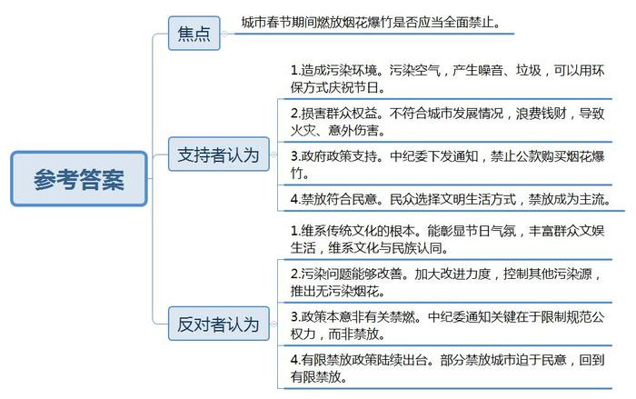
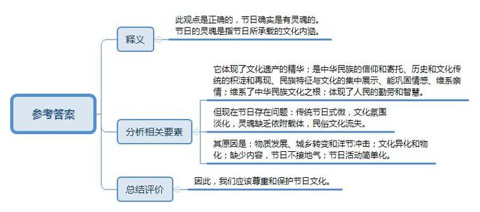
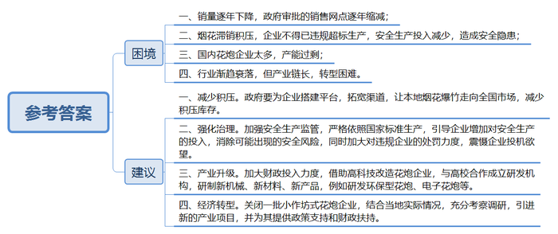
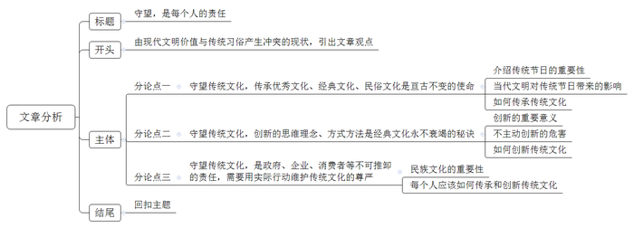

# 2014年天津市公考《申论》题

<!-- gwy:overview:start -->
> **天津 · 2014 · 申论 · 统考** ｜ 4 题 · 图片 4 处 · 答案随题折叠

导航：[题目](#题目) · [材料 1](#材料-1)
<!-- gwy:overview:end -->

> 候选采集稿。参考答案及解析来自粉笔页面，不代表官方答案或真实高分答卷；来源使用许可与原卷对应关系仍需人工核实。

## 给定材料

### 材料 1

据有关部门统计，2013年我国平均雾霾日数为52年来最多。全国平均雾霾日数为4.7天，较常年同期（2.4）偏多2.3天，为1961年以来最多。外媒称中国雾霾为“人类历史上最严重的大气污染”。某《时代》周刊报道说：“北京人已经习惯了恶劣的空气，但没人记得以前曾经出现过这么严重的雾霾天气。一些人甚至担心‘呼吸致死’。”

监测数据表明：大量燃放烟花爆竹会急剧增加空气中颗粒物（PM10、PM2.5）、二氧化硫等污染物的浓度，特别是对PM2.5浓度的增加有显著贡献。燃放点附近，PM2.5小时浓度瞬间急剧升高。鞭炮燃放导致PM2.5、二氧化硫等主要污染物日均浓度升高几倍甚至几十倍。春节期间的鞭炮燃放将导致PM2.5年均值浓度增加1-2微克/立方米。

以2013年除夕夜间北京市空气中污染物浓度变化为例，北京国控监测点位PM2.5平均浓度为267微克/立方米，其中个别点位PM2.5小时浓度甚至超过1000微克/立方米，相比前一日平均浓度上升了150微克/立方米；PM10平均浓度为300微克/立方米，相比前一日浓度上升了约220微克/立方米；二氧化硫平均浓度为109微克/立方米，相比前一日浓度上升了约52微克/立方米。

研究表明，燃放烟花爆竹确实可以在短时间让PM2.5爆表。在“雾霾”和“PM2.5”成为年度热词的当下，春节还要不要燃放烟花爆竹，再次成为热议的话题。

### 材料 2

武汉市光谷五小今年给学生们布置了一项形式活泼、贴近生活的年俗作业——学生可以完成一样与过年有关的家务，或者帮家人写一幅春联，剪一套窗花等，只要与“年文化”有关就行。在返校报到的学生中，却有两成学生拿不出年俗作业。学生小李的妈妈说，年俗作业的本意挺好，但如今的年味越来越淡，自己小时候贴门神，还要祭灶王爷等丰富的年味活动现在很难见到。

今年春节晚会上歌曲《群发的短信我不回》引起了人们对传统春节的怀念。年味越来越淡，越来越没意思——这是很多人过年的感受。其实，式微的不只是春节，元宵、端午、七夕、中秋等传统节日也在日益淡化，这是不争的事实。究其原因，有人认为这是物质的发展，城乡的转变和洋节的挤兑；也有人认为，真正的原因是文化在“异化”和“物化”。“节日和人一样都是有灵魂的”，当灵魂越来越缺乏依附的载体，节日就会越来越淡，越来越没意思。

中国艺术研究院副院长L指出：“原来的传统节日是有大量的丰富的民俗活动的，这些节俗活动是在历史中形成的，一些民俗的讲究或者说生产生活的习俗紧密关联在一起，和节气、时令、气候、水土这些东西关联在一起，和祭祀、主导、祈祷、敬仰、吟诵等民俗事项关联在一起，有着缅怀、祝愿、庆贺、祈愿、敬祭等种种内涵。”随着时代的发展和社会的进步，节日所承载的内涵和文化都在发生变化。现在的节日，几乎都没有祈祷和敬祭等内容，失去了庄严的文化氛围。而且，人们对一些不接地气的节日越来越淡化，相反对产生于国外的又接地气的节日情有独钟。当传统节日越来越没有文化味道，自然就会式微。

《中国青年报》和新浪网的一份联合调查显示，现代人对于传统的春节民俗文化已经不那么熟悉了。近半数的人表示自己过节期间会“放鞭炮”和“给晚辈压岁钱”，只有两成不到的人会“烧纸摆供祭奠祖宗”以及“写对联、福字”。春节活动日益趋向简单，很大程度上造成了我们传统民俗文化的进一步流失。

春节民俗充分体现了我国5000年来悠久的文化以及人民的勤劳与智慧，为后人留下了丰富的文化遗产，春节民俗更是文化遗产的精华部分。

众所周知，放鞭炮不仅污染空气环境、产生巨大噪音，还可能导致火灾、意外伤害，似乎一无是处。然而，从驱赶“年”兽开始，过年放鞭炮维系着中华民族的千年文化之根，成为民族传统文化的重要内容。节日的核心就是休闲娱乐，健康、安全、环境从来不是节日考量的核心因素。从这个角度看，如同西班牙奔牛节、欧洲国家的狂欢节一样，放鞭炮是中华民族特有的信仰和寄托，不可轻废。“爆竹声声辞旧岁，烟花朵朵迎新年。”从来没有哪一种方式像烟花爆竹一样，张扬浓烈地表达愉悦喜庆的节日氛围。

春节是历史和文化传统的积淀和再现，是民族特征与民族文化的集中展示，是巩固情感、维系亲情的纽带。可是，日益失去传统文化内涵的春节还有多少年味，没有年味的春节还算是真正传统意义上的春节吗？

### 材料 3

2014年春节临近，百万网友发起“拒绝烟花爆竹”活动。活动发起人在新浪微博“拒绝烟花爆竹”的话题中这样写道：“烟花爆竹燃烧会释放大量有害物质，形成城市烟雾，去年除夕北京PM2.5浓度一度破千！北京去年春节产生了5000多吨爆竹垃圾。春节不放或少放烟花，支持的转起！”短短几日就有近300万网友参与了这一讨论。

网友“彼岸花茶香”写道：“必须拒绝，再灿烂的烟花也只是一瞬，稍纵即逝，还浪费钱，比起环境那只是昙花一现。所谓保护环境人人有责，从身边的小事做起啊。”

网友“Better”说：“支持不放烟花，为了让雾霾不要更严重，提倡人们以摆放鲜花或者绿植等更环保的方式庆祝新年。”

网友“冰风谷”说：“我觉得没有烟花就更没气氛了。这是流传了几千年的传统。本来中国的春节气氛就不是特别浓，没有烟花爆竹更冷清了。”

更多的网友从理性观点出发，希望在燃放烟花、庆祝春节、保护环境这三者中找到一个平衡点。网友“海螺”认为：“我觉得烟花和春节是分不开的，但是能不能研究一下无污染的烟花啊，真心不想拒绝放烟花啊。”

网友“花开半夏”说：“烟花爆竹的燃放是传统习俗。只是因为它污染严重就禁止，为什么不想个两全其美的办法呢？现在的孩子们几乎都没过去那些乐趣了，全是电子产品。我觉得应该加大力度改进而不是禁止或者拒绝。”

网友“从此以后”说：“烟花爆竹污染环境，对人有害，但‘年’没有它好像就没有象征性的东西了，每逢这个时候一听到爆竹声，大家都知道除夕就要到了，我想可不可以控制下其他污染源，适当放一点。”

专家认为，公众意见的分歧体现了民众关切的不同，也体现了社会治理的难度。中南财经政法大学乔新生教授指出，移风易俗体现的是人类文明的进步，习俗虽不适宜采用命令的形式彻底加以禁止，但可以加以改变和转化。

### 材料 4

城市该不该禁放烟花爆竹的老话题从网上也移到了网下。今年禁放派又多了一个论据。2014年春节前夕，中纪委下发《关于严禁元旦春节期间公款购买赠送烟花爆竹等年货节礼的通知》。在禁放派看来，这是一个移风易俗的举措，是向燃放烟花爆竹的陈规陋习动刀子，是耶非耶？

A：燃放烟花爆竹绝对是陈规陋习，尤其是每年春节期间，国人花那么多钱买那么多烟花爆竹燃放，这和直接烧钱没有本质区别，是纯粹的浪费。除了让烟花爆竹产业赚钱之外，有谁是受益者？至于用纳税人的钱买烟花燃放，更是助长了这种大肆燃放的风气。

B：这个通知，是禁止公款购买赠送烟花爆竹，关键词是公款，而不是烟花爆竹，烟花爆竹只是年货节礼的一种。中纪委还不允许官员收受红包呢，但你过年了还得给孩子压岁钱吧？所以本质上，这是对公权力的限制与规范，而不是拿习俗动刀子。民间燃放烟花爆竹，只要合法合规与注意安全，增加了年味与喜庆的心情，有何不可？逢传统就反的心态该反思了。

C：对传统的理性态度是扬弃，是批判地继承，而不是照单全收。燃放烟花爆竹在农业社会可以理解，但在城市就不太合适，城市人口稠密，建筑物林立，燃放容易伤着人与引起火灾，至于污染与噪音更不必说了。过去一些地方政府逢年过节喜欢在公园等开阔地方燃放烟花，以示与民同乐，其实是带了坏头，民众也就有样学样了。

D：这种思维只是考虑了燃放烟花爆竹的“负外部性”，伤人与火灾毕竟是小概率事件，坐车还有可能遇上车祸呢。大家选择燃放，必定是做了收益与成本的考量的，爆竹表达国人除旧、迎新与祈福的心意，也是维系文化与民族认同的仪式，为什么想要乞灵于权力下令废掉这一习俗。移风易俗之说乃是对传统的蔑视，风俗可以变，但一定是自发与渐变，而非一禁了之。

E：自1990年代以来，先后有二百多个城市颁布了燃放烟花爆竹的禁令，可不是官员拍脑袋就决定的，而是在强烈的民意要求下推出的。本质上，在城市燃放烟花爆竹反映了现代文明与传统习俗的冲突。随着越来越多的人选择了文明的生活方式，禁放的声音也就越来越大，可以预见，燃放烟花爆竹的行为必将成为少数与非主流，立法呼应民意不是很正常的事情吗？

F：问题是，这些年来，包括上海与北京在内的其中一百多个城市在民意的压力下，回到了有限禁放的政策，例如北京于2005年改变了1993年以来的全面禁放，规定五环路以内的地区为限制燃放烟花爆竹地区，除夕至正月初一及初二至元宵每日的7—24时，可以燃放烟花爆竹。全面禁放也没有意义，造成大家都违规的局面，法不责众，根本不可能有效执法。

### 材料 5

争议声中，今年烟花爆竹的销售情况如何呢？1月27日，记者在北京一烟花爆竹销售点看到，此处生意冷清，七八位销售员守着没有顾客的店面。一位销售员说：“往年这个时候，每天能卖到两三万块钱，现在一天顶多一千，你看差多少啊！”

在太原市的几处烟花爆竹临时销售点，销售人员普遍反映，销售状况甚至不如去年。太原市几处繁华路段的销售摊位，1月21日以来最低的日销售金额只有100多元。据了解，太原全市的经销商今年共购进15.3万箱、价值3000余万元的烟花爆竹，这一总量只是高峰年份的一半，烟花爆竹销售量呈逐年下降趋势。

一组数据显示，2012年，北京市共审批通过烟花爆竹零售网点1429处；到了2013年，审批通过的零售网点缩减到1337处；而今年审批通过的零售网点数更是缩减到1178处，相比去年减少了12%。

### 材料 6

梁平县聚奎镇生产烟花爆竹已有300多年的历史。2004年，梁平县被重庆定为烟花爆竹生产基地。在这里几乎家家户户都有一门卷筒、填药、做引的手艺。张必海七八岁的时候，就已经开始帮家里做爆竹了。2006年，张必海开始搞产业升级，最危险的兑药、灌药环节，由机器来完成，实现人和药分离。到2010年，生产实现全机械化，花了1000多万。

在张必海的带动下，梁平的烟爆企业主动产业升级，在提高产量的同时，降低了安全事故。2013年，全县27家生产企业，十年来首次实现“零死亡”。梁平也成为全国22个烟花爆竹重点县之一。但截至马年除夕，9000多万元的库存，也创下了近几年的峰值。在蛇年除夕，库存有4000万元，再往前一年，农历廿七的时候，库存为零。

烟花爆竹生产2013年3月1号开始执行的新国标。适合个人燃放的是C类烟花产品，张必海的公司一直生产到2013年的10月份。结果是C类烟花在库房越堆越多，“生产了500万发，只卖掉100万发，300多万元压起。”其原因用张必海的话说就是：“不好卖，觉得小了，放出来不好看。”张必海果断改为生产B类产品，烟花的直径、高度和药量都有所增加，属于专业燃放类，“需要专业的人员协助市民燃放。”但这类“超标”产品，却卖得不错。

在重庆，目前，全市有52家烟花爆竹生产企业，梁平27家，其他25家分布在18个区县，“这25家基本只供应本地市场，梁平的27家要竞争全国市场。”在重庆市场上，有大量的来自湖南的烟花爆竹产品。梁平的烟花爆竹产业所面临的问题是具有代表性的，专业人士担心企业在安全生产上的投入会逐渐减少，安全问题又将重现。

### 材料 7

受多种因素影响，烟花爆竹销售自2012年底就遇到了寒流，全国各地的烟花爆竹销售最多曾下降3成，这也倒逼烟花爆竹企业要加速升级整合。2013年12月5日，浏阳市唯一在国内上市的熊猫烟花开始停牌，20天之后，熊猫烟花通过非公开发行股份的方式购买了东阳华海时代影业传媒有限公司60%的股份，而这也意味着熊猫烟花这一国内烟花制造领头企业正逃离烟花行业，准备转战影视业。

对烟花制造业而言，这也是种市场信号：无论是逾百万网友发起“拒绝烟花爆竹”活动，还是“7成受访市民未买烟花爆竹”，都意味着，在民众选择渐趋理性的语境下，以烟花爆竹为代表的、依托于民俗文化的行业或将面临式微的局面，就像挂历遭遇市场滑铁卢一样。有数据显示，目前国内有上千家的烟花爆竹生产企业，其中产值过亿的就有20多家，著名的花炮之乡湖南浏阳，烟花爆竹行业对浏阳经济的贡献率超过40%。这样一个庞大的、产业链较长的产业，如何转型走出寒冬，需要政府、企业共同思考。

烟花爆竹燃放，本就关系到一系列命题，包括环保、产业转型、社会治理等。如今，民意在“拒绝烟花”行动中已有所表达，作为联动治理链条上的政府、花炮企业，显然也应嗅到“烟花遇冷”里的气味，接好民意这一棒。

### 材料 8

中国烟花爆竹标准化技术委员会委员、北京理工大学教授赵家玉认为，作为流传千年的风俗，烟花爆竹不能简单地一禁了之、一限了之。“环保型烟花爆竹是解决‘保年味’与‘防雾霾’矛盾的好办法。”与传统烟花相比，环保烟花除点火引线外，不含有硫磺等燃放会产生二氧化硫污染的成分，燃放时几乎没有异味，烟雾可减少近一半，燃放后产生的垃圾也将大幅减少。赵家玉说，这种新产品主要是通过改进黑火药或者采用新型替代药剂，使燃放后产生的颗粒物变得更大，以利于快速沉降，从而尽可能少地产生PM2.5。

记者了解到，今年北京三家花炮企业已开始主打环保型产品。熊猫烟花新推出一款号称全球首发的零污染无硫花炮，可以达到无硫、无烟、无纸屑、无残渣。逗逗烟花则调整了火药的配比成分，除使用硫磺替代品外，还弃用了往年使用的再生纸，改用可降解纸来制作烟花爆竹的外皮。而燕龙公司也主推无硫烟花和微烟无土鞭炮。这也许是未来烟花爆竹企业产业升级的方向。

花炮之乡浏阳借助高科技，从安全、环保上对这个千年传统产业进行改造。一方面关闭了1000多家小作坊式花炮企业，另一方面投入60多亿元，对保留下来的900多家花炮企业进行工厂化改造，先后与北京理工大学等建立研发机构，研制不少具有世界领先水平的花炮新机械、新材料、新产品。尤其是花炮机械的全面运用，不仅大大提高了劳动效力，而且极大降低了花炮生产安全风险。目前，已开发出环保型礼花弹、组合烟花、造型烟花等14大类5000多个产品品种，多数具有无硫、微烟、安全性能高、废弃后可分解等特点。

在太原的一处小商品批发市场，一些批发商表示，电子鞭炮近日来销量很好。电子鞭炮不仅能模拟发出普通鞭炮声，还能随着响声闪光，既无污染，又能重复使用。但北京一位烟花爆竹销售人员说，没有发现市民专门来买环保型烟花，“大家看重的是燃放后的效果和价钱”。“环保产品比传统产品面临更大的风险，不仅企业生产的积极性不高，经销商也不太愿意进货，消费者又怎么会有机会消费呢？”一位业内人士建议，环保烟花需要政府、企业、经销商、消费者形成共识，一起推广。

国办发\[2010\]53号文件和安监总管三\[2013\]122号文件，都对烟花的生产提出一定的环保要求。传统标准中，烟花爆竹的药量都比较大，新文件明确规定了药量和规格，而药量减少就有助于环保。但环保烟花至今还没有成文的规定，国家层面的法规还未明确硫、烟、残留物等具体参数，环保部门也没有完全定义，国外也没有我们可以参照的烟花生产、燃放标准。没有标准，企业就缺乏生产方向和执行要求。

## 题目

### 第 1 题

**背景材料中罗列了一些民众针对“城市该不该禁放烟花爆竹”问题的不同意见及争议。请你指出禁放争议的焦点并分别说明两种主要意见的观点及其理由。（20分）**

关联材料：材料 1、材料 2、材料 3、材料 4、材料 5、材料 6、材料 7、材料 8

作答要求：

要求：观点明确，内容全面、准确，条理清晰，不超过300字。

第 1 题 · 答案与解析

**参考答案（粉笔题库参考内容）**

焦点：城市春节期间燃放烟花爆竹是否应当全面禁止。

支持者认为：1.造成污染环境。污染空气，产生噪音、垃圾，可以用环保方式庆祝节日。2.损害群众权益。不符合城市发展情况，浪费钱财，导致火灾、意外伤害。3.政府政策支持。中纪委下发通知，禁止公款购买烟花爆竹。4.禁放符合民意。民众选择文明生活方式，禁放成为主流。

反对者认为：1.维系传统文化的根本。能彰显节日气氛，丰富群众文娱生活，维系文化与民族认同。2.污染问题能够改善。加大改进力度，控制其他污染源，推出无污染烟花。3.政策本意非有关禁燃。中纪委通知关键在于限制规范公权力，而非禁放。4.有限禁放政策陆续出台。部分禁放城市迫于民意，回到有限禁放。

**解析**

**参考答案说明：**思路方面，本参考答案按照写明“争议焦点+观点及理由”展开。内容方面，本参考答案先写到了“民众对该不该燃放烟花爆竹问题的争议焦点”，“观点及理由”部分先分析了“支持者”的理由，接着分析了“反对者”的理由。

### 第 2 题

**背景材料2谈到“节日和人一样都是有灵魂的”，请结合背景材料谈谈你对这句话的理解。（15分）**

关联材料：材料 2

作答要求：

要求：分析透彻，观点明确，条理清楚，不超过300字。

第 2 题 · 答案与解析

**参考答案（粉笔题库参考内容）**

一、此观点是正确的，节日确实是有灵魂的。

二、节日的灵魂是指节日所承载的文化内涵。

三、它体现了文化遗产的精华；是中华民族的信仰和寄托、历史和文化传统的积淀和再现、民族特征与文化的集中展示、能巩固情感、维系亲情；维系了中华民族文化之根；体现了人民的勤劳和智慧。但现在节日存在问题：传统节日式微，文化氛围淡化；灵魂缺乏依附载体；民俗文化流失。其原因是：物质发展、城乡转变和洋节冲击；文化异化和物化；缺少内容，节日不接地气；节日活动简单化。

四、因此，我们应该尊重和保护节日文化。

**解析**

**参考答案说明：**宏观上，本参考答案按照词句解释题的一般思路“释义+分析相关要素+总结评价”展开。内容方面，本参考答案先对“节日的灵魂”的含义进行了解释；“分析相关要素”部分先分析了“节日是有灵魂的”产生的原因，影响；最后给如何过好节日的对策。

### 第 3 题

**背景材料5、6、7反映了我国烟花制造企业在“烟花遇冷”之后所面临的困境，假如你是某烟花之乡的领导干部，请拟出解决该问题的建议。（25分）**

关联材料：材料 5、材料 6、材料 7、材料 8

作答要求：

要求：问题明确，建议合理，有针对性、可操作性，不超过400字。

第 3 题 · 答案与解析

**参考答案（粉笔题库参考内容）**

困境：

一、销量逐年下降，政府审批的销售网点逐年缩减；

二、烟花滞销积压，企业不得已违规超标生产，安全生产投入减少，造成安全隐患；

三、国内花炮企业太多，产能过剩；

四、行业渐趋衰落，但产业链长，转型困难。

建议：

一、减少积压。政府要为企业搭建平台，拓宽渠道，让本地烟花爆竹走向全国市场，减少积压库存。

二、强化治理。加强安全生产监管，严格依照国家标准生产，引导企业增加对安全生产的投入，消除可能出现的安全风险，同时加大对违规企业的处罚力度，震慑企业投机欲望。

三、产业升级。加大财政投入力度，借助高科技改造花炮企业，与高校合作成立研发机构，研制新机械、新材料、新产品，例如研发环保型花炮、电子花炮等。

四、经济转型。关闭一批小作坊式花炮企业，结合当地实际情况，充分考察调研，引进新的产业项目，并为其提供政策支持和财政扶持。

**解析**

**参考答案说明**：答案从“困境”“建议”两种答题要素展开。（1）“困境”方面从“销量逐年下降”“烟花滞销积压”“国内花炮企业太多”“行业渐趋衰落”这四个方面进行了分条撰写。各条要点之间在内容上是并列关系，没有交叉。（2）“建议”方面从“减少积压”“强化治理”“产业升级”“经济转型”这四个方面进行了分条撰写。各条要点之间在内容上是并列关系，没有交叉。并且撰写每条要点时，都提炼出了概括性强的总结词并前置。

### 第 4 题

**从背景材料出发，结合实际，以“守望，是每个人的责任”为题，写一篇关于传统文化传承与创新的议论文。（40分）**

关联材料：材料 1、材料 2、材料 3、材料 4、材料 5、材料 6、材料 7、材料 8

作答要求：

要求：

（1）结合材料，中心明确，观点鲜明，联系实际；

（2）思路清晰，分析具体，条理清楚，语言流畅；

（3）字数在1000字左右。

第 4 题 · 答案与解析

**参考答案（粉笔题库参考内容）**

**守望，是每个人的责任**

随着改革开放不断深入，人们对精神生活的要求与日俱增，随之而来的便是现代文明价值与传统习俗产生的激烈冲撞。传统节日是对中华民族悠久历史底蕴的诠释，是维系民间情感和文化认同的纽带。传统节日的失守，将会导致中华民族五千多年的文化积淀无所依附，我们的精神寄托将无处安放。因此，厘清传统文化中的精髓和糟粕，彰显优秀传统文化，在传承中创新，是我们每个人义不容辞的责任。

**一方面，守望传统文化，传承优秀文化、经典文化、民俗文化是亘古不变的使命。**在历史长河中，璀璨纷呈的传统节日是中华文明的重要组成部分，是民族魅力的集中展现。现代文明的发展淡化了对传统节日的传承，祈祷、敬祭等文化精髓逐渐式微，少了依附的载体，失去了庄严的文化氛围，变得越来越没有文化味道。以国人最重要的节日——春节为例：据某调查显示，居然有近半数人认为春节的内涵只有“放鞭炮”和“给晚辈压岁钱”，而辞旧迎新、祭祖祈福这些最基本的含义已逐渐消失。让人痛心疾首！因此，一方面，政府要支持举办简约的传统民俗文化活动，鼓励发展传统民间艺术，注重传统节日申遗，做好历史标签。另一方面，亟待加强学校教育，重视对传统文化内涵的继承，将中华民族传统民俗文化内涵引入中小学课堂。

**另一方面，守望传统文化，创新的思维理念、方式方法是经典文化永不衰竭的秘诀。**创新是保持文化生命力的源泉，是传统文化保持永恒活力的重要途径。随着时代的发展，传统文化节日如果一味地固步自封而不去创新发展，难免会落后时代潮流最终会被淘汰。例如：表示庆祝的鞭炮污染环境，祭祖时烧纸摆供过于迷信，还容易招致火灾，还有一些节日已经严重脱离了这个时代，不接地气。为了更好地守护我们的节日文化，必须有所创新！因此，一方面我们要更新观念，对传统过节方式进行创新，在传统民俗习惯中融入现在的生活元素，对文化内涵进行创新，让节日文化在创新中发展；另一方面，对于节日的形式也该有所创新，如放弃污染严重的老式花炮，推广电子鞭炮、环保鞭炮，在网上进行祭奠祖先活动等。

**综上所述，守望传统文化，是政府、企业、消费者等不可推卸的责任，需要用实际行动维护传统文化的尊严。**民族的文化是我们每个人的精神家园，是我们感情的依托和归宿。我们应该从自身做起，尊重传统节日，学习节日背后所承载的内涵和精髓，并以身践行，以言传播，尽自己的绵薄之力，来扩展传统节日文化对当代社会的影响。

一个国家只有重视好传统节日的传承与发展，才能不断丰富民族文化宝库，塑造文化大国的国际地位。时不待我，愿每一个人都重视传统、明确责任、不辱使命，保护我们的传统节日，让中华文化在当下及未来璀璨夺目、大放异彩！

**文章分析**

**守望，是每个人的责任**

【**标题的优点：**严格按照题目的要求，以“守望，是每个人的责任”为标题。】

随着改革开放不断深入，（1）人们对精神生活的要求与日俱增，随之而来的便是现代文明价值与传统习俗产生的激烈冲撞。传统节日是对（2）中华民族悠久历史底蕴的诠释，是维系民间情感和文化认同的纽带。传统节日的失守，将会导致中华民族五千多年的文化积淀无所依附，我们的精神寄托将无处安放。因此，（3）厘清传统文化中的精髓和糟粕，彰显优秀传统文化，在传承中创新，是我们每个人义不容辞的责任。

【**开头的优点：**★内容方面。范文的开头是紧扣题目给定的“传统文化的传承与创新”这一主题展开的。首先，开头点出主题，做到了主题明确。其次，对“传统文化的传承与创新”这一主题进行了分析阐述，指出了（1）现代文明价值与传统习俗产生冲突。（2）以传统节日为代表的传统文化的影响。（3）传承与创新传统文化的措施。注意以上三个方面的阐述在逻辑上有先后顺序：先写问题，再写影响，最后写对策。★文字表达方面。长短句配合使用，使语言表达有节奏感。此外，也使用了比喻、拟人等修辞手法，使文字表达更加形象、有力。】

**一方面，守望传统文化，传承优秀文化、经典文化、民俗文化是亘古不变的使命。**在历史长河中，（1）璀璨纷呈的传统节日是中华文明的重要组成部分，是民族魅力的集中展现。（2）现代文明的发展淡化了对传统节日的传承，祈祷、敬祭等文化精髓逐渐式微，少了依附的载体，失去了庄严的文化氛围，变得越来越没有文化味道。以国人最重要的节日——春节为例：据某调查显示，居然有近半数人认为春节的内涵只有“放鞭炮”和“给晚辈压岁钱”，而辞旧迎新、祭祖祈福这些最基本的含义已逐渐消失。让人痛心疾首！因此，（3）一方面，政府要支持举办简约的传统民俗文化活动，鼓励发展传统民间艺术，注重传统节日申遗，做好历史标签。另一方面，亟待加强学校教育，重视对传统文化内涵的继承，将中华民族传统民俗文化内涵引入中小学课堂。

**【论述段****1****的优点：**★观点句：范文的观点句是紧扣“传统文化的传承与创新”这一文章主题提出的。形式上，它在段首处直接写出，位置突出，容易发现。内容上，关键词突出，内容要点明确，可以明显看出它是从“传承”入手，指出了“如何守望传统文化”。★论述内容：（1）先介绍了“传统节日的重要性”；（2）接着介绍了“当代文明对传统节日带来的影响”；（3）最后介绍了“如何传承传统文化”。注意：以上几个方面的内容都是紧扣“守望传统文化，传承优秀文化、经典文化、民俗文化是亘古不变的使命”这个观点句进行分析论述的，论述的针对性强，内容层次丰富。在论述方法和论据的选取上做到了讲道理、举例子相结合，做到了丰富多样。】

**另一方面，守望传统文化，创新的思维理念、方式方法是经典文化永不衰竭的秘诀。**（1）创新是保持文化生命力的源泉，是传统文化保持永恒活力的重要途径。（2）随着时代的发展，传统文化节日如果一味地固步自封而不去创新发展，难免会落后时代潮流最终会被淘汰。例如：表示庆祝的鞭炮污染环境，祭祖时烧纸摆供过于迷信，还容易招致火灾，还有一些节日已经严重脱离了这个时代，不接地气。为了更好地守护我们的节日文化，必须有所创新！因此，（3）一方面我们要更新观念，对传统过节方式进行创新，在传统民俗习惯中融入现在的生活元素，对文化内涵进行创新，让节日文化在创新中发展；另一方面，对于节日的形式也该有所创新，如放弃污染严重的老式花炮，推广电子鞭炮、环保鞭炮，在网上进行祭奠祖先活动等。

**【论述段****2****的优点：**★观点句：范文的观点句是紧扣“传统文化的传承与创新”这一文章主题提出的。形式上，它在段首处直接写出，位置突出，容易发现。内容上，关键词突出，内容要点明确，可以明显看出它是从“创新”入手，指出了“如何守望传统文化”。★论述内容：（1）先介绍了“创新的重要意义”；（2）接着介绍了“不主动创新的危害”；（3）最后介绍了“如何创新传统文化”。注意：以上几个方面的内容都是紧扣“守望传统文化，创新的思维理念、方式方法是经典文化永不衰竭的秘诀”这个观点句进行分析论述的，论述的针对性强，内容层次丰富。在论述方法和论据的选取上做到了讲道理、举例子相结合，做到了丰富多样。】

**综上所述，守望传统文化，是政府、企业、消费者等不可推卸的责任，需要用实际行动维护传统文化的尊严。**（1）民族的文化是我们每个人的精神家园，是我们感情的依托和归宿。（2）我们应该从自身做起，尊重传统节日，学习节日背后所承载的内涵和精髓，并以身践行，以言传播，尽自己的绵薄之力，来扩展传统节日文化对当代社会的影响。

**【论述段****3****的优点：**★观点句：范文的观点句是紧扣“传统文化的传承与创新”这一文章主题提出的。形式上，它在段首处直接写出，位置突出，容易发现。内容上，关键词突出，内容要点明确，可以明显看出它是从“政府、企业、消费者等”入手，指出了“如何守望传统文化”。★论述内容：（1）先介绍了“民族文化的重要性”；（2）再介绍了“每个人应该如何传承和创新传统文化”。注意：以上两个方面的内容都是紧扣“守望传统文化，是政府、企业、消费者等不可推卸的责任，需要用实际行动维护传统文化的尊严”这个观点句进行分析论述的，论述的针对性强，内容层次丰富。在论述方法和论据的选取上以讲道理为主，分析层次清晰，鞭辟入里。】

**【论述段之间的关系：**★内容的内在逻辑：范文的论述段之间是依照“并列”的逻辑展开的。论述段1先写了“传统文化的传承”，论述段2再写了“传统文化的创新”，论述段3接着写了“各个主体用实际行动传承与创新传统文化”。★段与段的外在衔接：论述段1与论述段2的段首句由“一方面……另一方面”衔接，表明两段的并列关系；论述段3的段首句用“综上所述”引导，起到了承接论述段1、2，开启论述段3的作用。**】**

一个国家只有（1）重视好传统节日的传承与发展，才能不断丰富民族文化宝库，塑造文化大国的国际地位。时不待我，（2）愿每一个人都重视传统、明确责任、不辱使命，保护我们的传统节日，让中华文化在当下及未来璀璨夺目、大放异彩！

【**结尾的优点**：（1）再次提到了“传统文化传承与创新”；（2）发出了号召希望，阐述了深远意义。】

**解析状态：unknown（来源未提供）**

