# 2014年天津市公务员录用考试《行测》题

<!-- gwy:overview:start -->
> **天津 · 2014 · 行测 · 统考** ｜ 120 题 · 图片 150 处 · 答案随题折叠

| 题型模块 | 题量 | 题号 |
| --- | ---: | ---: |
| 数量关系 | 15 | 1–15 |
| 言语理解与表达 | 35 | 16–50 |
| 常识判断 | 20 | 51–70 |
| 判断推理 | 30 | 71–100 |
| 资料分析 | 20 | 101–120 |
| **合计** | **120** | |

导航：[题型与作答说明](#题型与作答说明) · [题目](#题目) · [材料 1](#材料-1)
<!-- gwy:overview:end -->

> 候选采集稿。参考答案及解析来自粉笔页面，不代表官方答案或真实高分答卷；来源使用许可与原卷对应关系仍需人工核实。

## 题型与作答说明

数量关系

（15题）

本部分包括数字推理与数学运算两种类型的题目。

言语理解与表达

（35题）

本部分包括选词填空和阅读理解两种类型的题目。

常识判断

（20题）

根据题目要求，在四个选项中选出一个最恰当的答案。

判断推理

（30题）

本部分包括图形推理、定义判断与逻辑判断三种类型的试题。

资料分析

（20题）

由文字，图表，等组成

## 题目

### 第 1 题

6，11，17，，45。

A. 30

B. 28

C. 25

D. 22

第 1 题 · 答案与解析

**参考答案（粉笔题库参考内容）**

B

**解析**

通过观察可以发现，数列前两项之和等于第三项，则所求项为11+17=28。代入验证后三项：17+28=45，符合题干所给条件。

故正确答案为B。

**来源**：2014年天津市公务员录用考试《行测》题第1题

### 第 2 题

2，3，6，15，。

A. 25

B. 36

C. 42

D. 64

第 2 题 · 答案与解析

**参考答案（粉笔题库参考内容）**

C

**解析**

数列数字较小，首先作差寻找规律。作差后得到新数列为：1、3、9、(  )，为公比为3的等比数列，则下一项为。则题干所求为：15+27=42。

故正确答案为C。

**来源**：2014年天津市公务员录用考试《行测》题第2题

### 第 3 题

1，2，9，64，625，。

A. 1728

B. 3456

C. 5184

D. 7776

第 3 题 · 答案与解析

**参考答案（粉笔题库参考内容）**

D

**解析**

数列起伏较大，且64与625都为幂次数，优先考虑幂次数列。观察可以发现，题干数列分别为：、、、、、，则下一项应为，尾数为6，且数值大于6000，故只有D项符合。

故正确答案为D。

**来源**：2014年天津市公务员录用考试《行测》题第3题

### 第 4 题

10，21，44，65，。

A. 122

B. 105

C. 102

D. 90

第 4 题 · 答案与解析

**参考答案（粉笔题库参考内容）**

C

**解析**

数列起伏平缓，作差没有规律，且无幂次与倍数特征，考虑因数分解。观察可发现：10＝2×5；；；。相乘因式前一项为连续自然数列，下一项应为6；后一项为连续质数列，下一项应为17。故题干所求应为。

故正确答案为C。

**来源**：2014年天津市公务员录用考试《行测》题第4题

### 第 5 题

3，5，11，21，43，。

A. 60

B. 68

C. 75

D. 85

第 5 题 · 答案与解析

**参考答案（粉笔题库参考内容）**

D

**解析**

数列起伏平缓，作差没有规律，且无幂次与倍数特征，考虑两项作和。作和后得到新数列为：8、16、32、64、(    )，为公比为2的等比数列，则下一项应为128。故题干所求为128-43=85。

故正确答案为D。

**来源**：2014年天津市公务员录用考试《行测》题第5题

### 第 6 题

为等边三角形，若DEF为三角形三个边的中点，用ABCDEF六个点中的任意三个作顶点，可有多少种面积不等的三角形：

A. 3

B. 4

C. 5

D. 6

第 6 题 · 答案与解析

**参考答案（粉笔题库参考内容）**

A

**解析**

根据题意，可画出如图所示三角形。

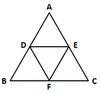

观察可以发现，图中面积最大的三角形为；

其次即为面积的一半：；

再次为面积的1/4：。

共计可组成3种面积不等的三角形。

故正确答案为A。

**考点**：几何结论类-三角形相关

**来源**：2014年天津市公务员录用考试《行测》题第6题

### 第 7 题

张先生今年70岁，他有三个孙子。长孙20岁，次孙13岁，幼孙7岁。问多少年后，三个孙子年龄之和与祖父的年龄相同：

A. 10

B. 15

C. 18

D. 20

第 7 题 · 答案与解析

**参考答案（粉笔题库参考内容）**

B

**解析**

三个孙子今年的年龄总和为40岁，每年各长1岁，则3个孙子共长3岁；张先生今年70岁，每年长一岁，爷孙的年龄差为30岁，每年孙子可追上祖父2岁，则需要年可以追上，即三个孙子的年龄总和与祖父年龄相同。

故正确答案为B。

**考点**：年龄问题

**来源**：2014年天津市公务员录用考试《行测》题第7题

### 第 8 题

小张练习写数码，从1，2，3······连续写至1000多才停止。写完一数，共写了3201个数码。请问，小张写的最后一个数是多少：

A. 1032

B. 1056

C. 1072

D. 1077

第 8 题 · 答案与解析

**参考答案（粉笔题库参考内容）**

D

**解析**

可从数位计算考虑。

当数字为个位数时，共计，9个数码；

当数字为两位数时，即，90个数字共计180个数码；

当数字为三位数时，即，900个数字共计2700个数码。

此时还剩下数码3201-2700-180-9=312个。由于已计算到四位数数值，则写了四位数数字共计个，从1000开始计算，第78个四位数为1077。

故正确答案为D。

**来源**：2014年天津市公务员录用考试《行测》题第8题

### 第 9 题

小船顺流而下航行36公里到达目的地。已知小船返回时多用了1小时30分钟，小船在静水中速度为10公里/时，问水流速度是多少：

A. 8公里/时

B. 6公里/时

C. 4公里/时

D. 2公里/时

第 9 题 · 答案与解析

**参考答案（粉笔题库参考内容）**

D

**解析**

由题干可知，小船顺流时所用的时间应为：；

逆流所用的时间应为：；

则逆流所用时间-顺流所用时间=1.5小时，即\-\=，解得水速=2。

故正确答案为D。

**考点**：流水行船

**来源**：2014年天津市公务员录用考试《行测》题第9题

### 第 10 题

王明抄写一份报告，如果每分钟抄写30个字，则用若干小时可以抄完。当抄完2/5时，将工作效率提高40%，结果比原计划提前半小时完成。问这份报告共有多少个字：

A. 6025

B. 7200

C. 7250

D. 5250

第 10 题 · 答案与解析

**参考答案（粉笔题库参考内容）**

D

**解析**

解法一：剩余工作量时，效率提高40%，即前后效率比为1：1.4=5：7，根据比例法，工作总量一定，时间和效率成反比，则前后时间比应为7：5。设完成后本来应用时间为t分钟，则，解得t=105分钟，所以前2/5用时为分钟，总时间为=105+70=175分钟，报告共有175×30=5250个字。

解法二：设报告的总字数为x。

抄前的报告用时；

抄后的报告效率提高了40%，即效率为30×1.4=42字/分钟，则抄后报告用时；

故实际用时。

比原计划提前半小时完成，原计划用时x÷30分钟，则可列方程为：，化简后代入选项只有当x=5250时满足等式。

故正确答案为D。

**考点**：给具体单位型

**来源**：2014年天津市公务员录用考试《行测》题第10题

### 第 11 题

在一堆桃子旁边住着5只猴子。深夜，第一只猴子起来偷吃了一个，剩下的正好平均分成5份，它藏起自己的一份，然后去睡觉。过了一会儿，第二只猴子起来也偷吃了一个，剩下的也正好平均分成5份，它也藏起自己的一份，然后去睡觉，第三、第四、第五只猴子也都依次这样做。问那堆桃子最少有多少个：

A. 4520

B. 3842

C. 3121

D. 2101

第 11 题 · 答案与解析

**参考答案（粉笔题库参考内容）**

C

**解析**

根据条件，“第一只猴子起来偷吃了一个，剩下的正好平均分成5份”，则可知桃子总数减1，应可被5整除，观察选项只有C、D符合，排除A、B项；题干要求求出桃子最少有多少个，则从较小数2101开始代入。2101-1=2100，分成5份且藏起一份后还剩：个。然后再被偷吃一个后还剩1679个，并不能被5整除，故D项不符合题干要求，排除。

验证：3121-1=3120；；2496-1=2495；。满足条件，当选。

故正确答案为C。

**考点**：和差倍比问题

**来源**：2014年天津市公务员录用考试《行测》题第11题

### 第 12 题

在下图小空格中已填上了1及7两个自然数，如果其他空格也填上相应不同的数，使得任意一个横行、任意一个纵列以及任意一条对角线上的3个数之和都等于111。请问，位于中间的小正方形里应填的数是：

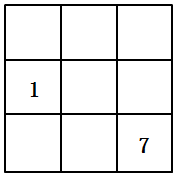

A. 61

B. 53

C. 41

D. 37

第 12 题 · 答案与解析

**参考答案（粉笔题库参考内容）**

D

**解析**

代入选项进行排除，只有中间的小正方形为37时，才可满足题干条件。当中间5号位为37时，6号位即为：111-1-37=73；则3号位为：111-7-73=31；则7号位为：111-31-37=43；1号位为：111-1-43=67；2号位为：111-67-31=13；8号位为：111-13-37=61；各个数字各不相同，符合条件。

故正确答案为D。

**来源**：2014年天津市公务员录用考试《行测》题第12题

### 第 13 题

假设7个相异正整数的平均数是14，中位数是18，则此7个正整数中最大数是多少：

A. 58

B. 44

C. 35

D. 26

第 13 题 · 答案与解析

**参考答案（粉笔题库参考内容）**

C

**解析**

7个正整数的平均值为14，则7个正整数的数值总和为。中位数为18，则表明7个正整数中有3个小于18，3个大于18。为了让正整数中最大的数最大，则应让其他5个数尽可能的小。小于18的最小数可以为：1、2、3；大于18的最小数可以为：19、20、x。则此时x数值最大，最大为98-1-2-3-18-19-20=35。

故正确答案为C。

**考点**：构造数列

**来源**：2014年天津市公务员录用考试《行测》题第13题

### 第 14 题

有一支参加阅兵的队伍正在进行训练，这支队伍的人数是5的倍数且不少于1000人，如果按每横排4人编队，最后少3人；如果按每横排3人编队，最后少2人；如果按每横排2人编队，最后少1人。请问，这支队伍最少有多少人：

A. 1045

B. 1125

C. 1235

D. 1345

第 14 题 · 答案与解析

**参考答案（粉笔题库参考内容）**

A

**解析**

根据题干含义。

第一个条件：“如果按每横排4人编队，最后少3人”，则意为，观察选项C，排除；

第二个条件：“如果按每横排3人编队，最后少2人”，则意为，观察选项B，排除；

第三个条件：“如果按每横排2人编队，最后少1人”，则意味，A、D两项均满足要求，则我们选出最小的一个即可，A项当选。

故正确答案为A。

**来源**：2014年天津市公务员录用考试《行测》题第14题

### 第 15 题

100个骨牌整齐地排成一列，依次编号为1、2、3、4、···99、100。如果第一次拿走所有偶数位置上的牌，第二次再从剩余牌中拿走所有偶数位置上的牌，第三次再从剩余牌中拿走所有奇数位置上的牌，第四次再从剩余牌中拿走所有奇数位置上的牌，第五次再从剩余牌中拿走所有偶数位置上的牌，以此类推，问最后剩下的一张骨牌的编号是多少：

A. 77

B. 53

C. 39

D. 27

第 15 题 · 答案与解析

**参考答案（粉笔题库参考内容）**

A

**解析**

依据题意：

第一次拿走所有偶数位置上的牌后，所剩牌号应为：1、3、5、7、···97、99，共50个奇数；

第二次再次拿走偶数位置上的牌（即3、7、11、15、···95、99），那么所剩牌号应为：1、5、9、13、···97，为公差为4的等差数列，共25个数；

第三次再拿走奇数位置上的牌，应该拿走13个数还剩12个。则所剩数应为：5、13、21、29、···93；

第四次再拿走所有奇数位置上的牌，应该为拿走6个还剩6个，分别为：13、29、45、61、77、93（公差为16的等差数列）；

第五次再拿走偶数位置上的牌，还剩下：13、45、77；

第六次再拿走偶数位置上的牌，还剩下：13、77；

第七次再拿走奇数位置上的牌，还剩下77号牌。

故正确答案为A。

**来源**：2014年天津市公务员录用考试《行测》题第15题

### 第 16 题

对诚实的否定固然令人遗憾，但人们尚可从精神上、道德上的肯定中得到\_\_\_\_\_\_\_。

填入画横线部分最恰当的一项是：

A. 偿还

B. 回报

C. 弥补

D. 欣慰

第 16 题 · 答案与解析

**参考答案（粉笔题库参考内容）**

C

**解析**

本题的考点是对实词的理解。

这道题的破题点在“但”字，“但”是转折词，前后两句所表达的意思相对。前面说到“遗憾”，后面相对应的表达就应是补偿、填补这种遗憾，故而选C项最为恰当。

故正确答案为C。

**考点**：关联关系-转折关系、实词填空

**来源**：2014年天津市公务员录用考试《行测》题第16题

### 第 17 题

我们尊重个体差异，倡导个性化发展，但我们更希望孩子们能得到与自身资质相\_\_\_\_\_\_\_的全面发展。

填入画横线部分最恰当的一项是：

A. 适应

B. 匹配

C. 一致

D. 符合

第 17 题 · 答案与解析

**参考答案（粉笔题库参考内容）**

B

**解析**

本题考点为实词中的近义词辨析。

文段开头提到尊重、倡导个性化发展，“但”转折之后，强调更希望孩子们能全面发展。只有适合自身资质的发展，才能全面发展。因此B选项最恰当。

“适应”强调主观与客观的互动作用产生状态。“一致”与“符合”是同义词，都表示没有分歧，但“一致”表述过于绝对化，故排除。

故正确答案为B。

**考点**：关联关系-转折关系、实词填空

**来源**：2014年天津市公务员录用考试《行测》题第17题

### 第 18 题

要写出＿＿＿＿＿＿的文字、写出时代的壮阔和生活的丰富，更需要阅历，更需要思想。

填入画横线部分最恰当的一项是：

A. 动人心弦

B. 石破天惊

C. 惊天动地

D. 动人心迹

第 18 题 · 答案与解析

**参考答案（粉笔题库参考内容）**

A

**解析**

横线处搭配“文字”，表达出“文字”的力量。A项“动人心弦”形容事物或语言激动人心，与“文字”搭配恰当，当选。B项“石破天惊”多比喻文章议论新奇惊人，搭配“观点”、“事件”等，与“文字”搭配不当，排除；C项“惊天动地”形容某个事件的声势或意义极大，搭配“事件”，与“文字”搭配不当，排除；D项“动人心迹”指改变人内心的真实想法，与“文字”搭配不当，排除。

故正确答案为A。

**考点**：成语填空、词的辨析-搭配对象

**来源**：2014年天津市公务员录用考试《行测》题第18题

### 第 19 题

国家助学贷款，是解决贫困家庭学生入学难的重要\_\_\_\_\_\_\_之一，是贫困家庭学生享受平等教育的重要\_\_\_\_\_\_\_。

依次填入画横线部分最恰当的一项是：

A. 措施 条件

B. 政策 保障

C. 途径 体现

D. 途径 保障

第 19 题 · 答案与解析

**参考答案（粉笔题库参考内容）**

D

**解析**

本题考查词语搭配。

国家助学贷款是解决贫困家庭学生入学难的一种方式、一种手段，而“政策”是国家或者政党为了实现一定历史时期的路线和任务而制定的国家机关或者政党组织的行动准则，范围过大，故排除；国家办助学贷款的目的就是为了让贫困家庭学生享受到平等教育，因此，国家助学贷款是享受平等教育的保障。

故正确答案为D。

**考点**：实词填空、对应关系-前后呼应、词的辨析-搭配对象

**来源**：2014年天津市公务员录用考试《行测》题第19题

### 第 20 题

18世纪以后，由科学革命、工业革命和政治革命构成的＿＿＿＿反应给予欧洲资本主义不可阻挡的＿＿＿＿＿＿，至1914年，欧洲列强在世界大部分地区建立的霸权，深刻地影响着殖民地和半殖民地社会的经济生活和社会结构。而欧洲之所以能够实现这种前所未有的＿＿＿＿，是因为其现代化进程一直在继续和加速。

依次填入画横线部分最恰当的一项是：

A. 连串 生命力 发展

B. 连锁 推动力 扩张

C. 系列 助推力 拓展

D. 连续 催化剂 扩展

第 20 题 · 答案与解析

**参考答案（粉笔题库参考内容）**

B

**解析**

本题为实词辨析题。

第一空，18世纪以后，科学革命、工业革命和政治革命是一环套一环，接连发生的，用“连锁”最为恰当，且连锁反应是固定搭配。其他三项“连串”“系列”“连续”都不能显示出三种革命一环扣一环的特点。

第二空，应填“推动力”或“助推力”，“生命力”“催化剂”不能显示它不可阻挡地前进发展的意思。

第三空，根据前面“建立的霸权······影响着殖民地······”可知，这是欧洲一次前所未有的“扩张”，而非“发展”“拓展”“扩展”，且“殖民扩张”也是固定搭配。

故正确答案为B。

**考点**：实词填空、对应关系-前后呼应、词的辨析-搭配对象

**来源**：2014年天津市公务员录用考试《行测》题第20题

### 第 21 题

其实“拥有秘密”是成年的一个\_\_\_\_\_\_\_，孩子要长大成人，必然要进入一个拥有秘密的世界。这是一个\_\_\_\_\_\_\_的过程，最初，孩子并没分清哪些是秘密，不知道如何保守秘密、不懂得给秘密分级，但是他们又极为渴望拥有秘密。于是，他们的生活变得\_\_\_\_\_\_\_，好像每个人都守着很多不能告诉别人的秘密。

依次填入画横线部分最恰当的一项是：

A. 标志 学习 神秘兮兮

B. 界线 成长 神秘莫测

C. 特征 积累 莫测高深

D. 象征 变化 深不可测

第 21 题 · 答案与解析

**参考答案（粉笔题库参考内容）**

A

**解析**

本题可从第三空入手，横线前搭配“他们”，“他们”指代前文的孩子。故横线处所填词语表示孩子拥有秘密的状态。A项“神秘兮兮”指很神秘的样子，符合文意，保留。B项“神秘莫测”、C项“莫测高深”、D项“深不可测”都形容非常神秘，难以揣测，与原文形容孩子们故作神秘的语境不符，均排除。

第一空，代入验证，“其实‘拥有秘密’是成年的一个标志”，符合文意，保留。

第二空，代入验证，强调从不懂到懂的过程，“学习”符合文意，当选。

故正确答案为A。

**考点**：对应关系-前后呼应、混搭填空

**来源**：2014年天津市公务员录用考试《行测》题第21题

### 第 22 题

中华民族在漫长的历史发展进程中，形成了＿＿＿＿＿＿的民族文化。这些节日久经沧桑传延至今，不仅有着群众＿＿＿＿＿＿的娱乐形式、丰富多彩的民俗文化，而且蕴藏着历代民众共同的理想和精神追求、＿＿＿＿＿＿ 着中华民族的民族精神和思想精华。

依次填入画横线部分最恰当的一项是：

A. 丰富多彩 脍炙人口 凝集

B. 博大精深 喜闻乐见 凝结

C. 包罗万象 喜闻乐道 凝固

D. 绚丽多姿 津津乐道 凝聚

第 22 题 · 答案与解析

**参考答案（粉笔题库参考内容）**

B

**解析**

第一空，根据后文“不仅有······而且蕴藏着······”可知，横线处应表示“民族文化”不仅多，而且蕴藏思想精华之意，B项“博大精深”指思想和学术广博高深，符合文意，当选。A项“丰富多彩”、C项“包罗万象”、D项“绚丽多姿”均只能体现出“多”之意，无法概括后文所说的“蕴藏思想精华”之意，排除。

第二空，代入验证。“喜闻乐见”比喻很受欢迎，与“民俗文化”搭配恰当。

第三空，代入验证。“凝结”与“精神、精华”搭配恰当，当选。

故正确答案为B。

**考点**：对应关系-前后呼应、混搭填空、词的辨析-搭配对象

**来源**：2014年天津市公务员录用考试《行测》题第22题

### 第 23 题

在职称评审过程中，各级评审组织几乎无法看到申报人的艺术实践能力，只能看到表格栏目里的论文和项目。在唯论文是重的标准下，音乐理论的教师还能体现一些真才实学，而表演艺术的教师则只能扬短避长、＿＿＿＿＿。

填入画横线部分最恰当的一项是：

A. 滥竽充数

B. 削足适履

C. 委曲求全

D. 弄虚作假

第 23 题 · 答案与解析

**参考答案（粉笔题库参考内容）**

B

**解析**

本题考查成语辨析。空格前有顿号，说明前后两词意思相近相关。“扬短避长”表达放弃了不该放弃的东西，在这里有强迫自己做不擅长的事情的意思，B项“削足适履”是指因为鞋小脚大，就把脚削去一块来凑和鞋的大小，有“不合理的迁就凑和”的意思，二者意思相近，都有不合理的迁就的意思。因此，结合选项应该选择B项。

A项“滥竽充数”比喻没有真才实学的人混在行家里面充数，或是以次充好，与文意不符，排除；D项“弄虚作假”比喻耍花招，用虚伪面目或假冒物品行骗，表演艺术的老师并没有作假和欺骗，排除；C项“委曲求全”指勉强迁就，以求保全，也指为了顾全大局而让步，与文意不符，排除。

故正确答案为B。

**考点**：关联关系-并列关系、对应关系-前后呼应、成语填空、词的辨析-搭配对象

**来源**：2014年天津市公务员录用考试《行测》题第23题

### 第 24 题

食品安全不仅由食品药品监督管理部门负责，还涉及工商、卫生、农业、质量检验检疫等部门的职责，“九龙治水”极易造成“\_\_\_\_\_\_\_”，论责任要各方分担、论利益却与其他部门无涉的工作，常常会由于缺少强力的调配、精确的协调和统一的部署而失去推动力。

填入画横线部分最恰当的一项是：

A. 各自为政

B. 一盘散沙

C. 群龙无首

D. 敷衍了事

第 24 题 · 答案与解析

**参考答案（粉笔题库参考内容）**

C

**解析**

根据文段“缺少强力的调配、精确的协调和统一的部署”可知，横线处表达缺少带头的，没有办法一起行动之意，C项“群龙无首”比喻没有领头的，无从统一行动，符合文意，且与“九龙治水”对应恰当，当选。

A项“各自为政”指各自按自己的主张办事，不互相配合，比喻不考虑全局，各搞一套，无法体现出没有领头之意，故与文意不符，排除；B项“一盘散沙”比喻人多却不团结、力量分散，文段并非强调各部门之间不配合、不团结，与文意不符，排除；D项“敷衍了事”指办事责任心不强，将就应付，强调态度不端正，与文意不符，排除。

故正确答案为C。

**考点**：关联关系-因果关系、对应关系-前后呼应、成语填空

**来源**：2014年天津市公务员录用考试《行测》题第24题

### 第 25 题

依次填入画横线部分最恰当的一项是：

①据此，我认为长期以来的疑惑已\_\_\_\_\_\_\_。

②我们要知道竹子的性质，就要特别栽种竹子，以研究它生长的过程，要把叶子切下来拿到显微镜下去观察，决不是\_\_\_\_\_\_\_就可以得到的知识。

③这首诗之所以成为\_\_\_\_\_\_\_的名篇，无论如何不在于如专家所认为的在两句诗中罗列了三座桥和一座山。

④他的这种奇谈怪论，看来决非是对历史的无知，而是\_\_\_\_\_\_\_地捏造谎言。

A. 毋庸置疑 一蹴而就 家喻户晓 居心叵测

B. 无可厚非 唾手可得 叹为观止 煞费苦心

C. 迎刃而解 袖手旁观 脍炙人口 别有用心

D. 不攻自破 不劳而获 流芳百世 千方百计

第 25 题 · 答案与解析

**参考答案（粉笔题库参考内容）**

C

**解析**

本题考查对成语的理解把握。

第一空，是本题的破题点。“据此”后面应跟肯定性的结论，即“我”的疑惑得到解决。因此排除A、B选项。又因为“不攻自破”的“攻”在文中并未体现，故答案锁定C选项。

第二空，强调的是要实践，而不是只看看就能学到知识的。因此用“袖手旁观”最为恰当。

第三空，根据描述的对象是“名篇”，可以确定是脍炙人口。脍炙人口：比喻好的诗文受到人们的称赞和传诵。描述对象是诗文。

第四空，可根据“奇谈怪论”“决非”“捏造谎言”等词判断出句子表达的是消极的感情倾向。

故正确答案为C。

**考点**：对应关系-前后呼应、成语填空

**来源**：2014年天津市公务员录用考试《行测》题第25题

### 第 26 题

公众层面的现象与专业层面的表现，看似相距甚远，实则紧密相连。不从事专业研究的社会公众固然不会参与科学技术前沿的创新，但实际上，公众素养是科技发展的土壤。离开了这个群众基础，即使我们凭借少数科技精英的努力能够实现“上天入地”，也很难持续不断地推动创新，真正迈入创新型国家的行列。

这段文字的核心观点是：

A. 提高全民科学素质势在必行

B. 科技发展是公民科学素养的“软实力”

C. 中国公民的科学素养亟待提高

D. 科技的发展依赖于公众素养的同步提高

第 26 题 · 答案与解析

**参考答案（粉笔题库参考内容）**

D

**解析**

文段开篇指出公众层面现象与专业层面表现紧密相连，紧接着通过转折关联词“但实际上”指出虽然社会公众不参与科学技术前沿的创新，但公众素养是科技发展的土壤，随后从反面进行论证，强调离开公众素养这一群众基础，仅凭少数科技精英的努力难以持续推动创新、迈入创新型国家行列。故文段重在强调科技发展离不开公众素养的支撑，对应D项。

A项“提高全民科学素质势在必行”、C项“中国公民的科学素养亟待提高”，文段未涉及我国公民科学素养水平低、需要提升的表述，无中生有，排除；

B项，文段强调公众素养是科技发展的基础，并非科技发展是公民科学素养的软实力，因果倒置，排除。

故正确答案为D。

**考点**：关联词-转折

**来源**：2014年天津市公务员录用考试《行测》题第26题

### 第 27 题

国家提高个税起征点，本意是照顾弱势群体，而其他公共政策如果以未缴纳税为由损害弱势群体的正当利益，不仅会使税收区别对待政策失去本来的意义，还会形成更大的社会不公。因此，国家一方面应该提高起征点以保护低收入群体的正当利益，另一方面需要大力更新观念，把税收作为公民的一种奉献而不是一种交换条件。只有这样，照顾绝大多数低收入群体的税收政策才会起到真正作用。

这段文字意在表明：

A. 如果以税收扣缴情况作为区别对待人群的先决条件，就会使弱势群体失去更多权益

B. 个人所得税政策提高起征点后，容易形成更大的社会不公

C. 当国家的税收政策与社会公平机制有所脱节时，就会引起社会的敏感反应

D. 个税政策的调整不应仅限于要提高起征点，还有许多问题需要完善

第 27 题 · 答案与解析

**参考答案（粉笔题库参考内容）**

D

**解析**

第一步，读文段找到主旨句。

文段第一句谈到了国家提高个税起征点本意是好的，但是会存在一些问题。第二句以结论词“因此”引出解决问题的具体对策，一方面是提高个税起征点保护低收入群体的正当利益，另一方面要更新观念。对策为主旨。

第二步，分析选项找答案。

D选项概括了文段所提的具体对策，前半句是对文段中第一项对策的同义替换，后半句“还有许多问题需要完善”也就是说，我们需要在政策的制定实施方面更新观念。

故正确答案为D。

**考点**：关联词-对策

**来源**：2014年天津市公务员录用考试《行测》题第27题

### 第 28 题

哲学家说，幸福是一种感觉，上午和下午感受都不一样。很多时候，也需要自我调适和社会调整。沿着这种思路，哲学家赵汀阳就认为，现代消费主义的宣传（比如消费广告刺激了大家的无限欲望），造就了“难以满足”的欲望。另一些心理学者说，很多幸福感就流失在“对比”之中，就如调查所验证的，收入分配是否“公平合理”成了影响幸福的重要因素——而不是收入是否“充足”。

这段文字表达的主要意思是：

A. 幸福的感觉因人而异，需要个人自我调适

B. 幸福是一种心理感觉，调节好自己的心态有利于获得幸福感

C. 要想获得幸福，首先要降低自己的期望

D. 哲学家和心理学家对幸福有着不同的理解

第 28 题 · 答案与解析

**参考答案（粉笔题库参考内容）**

D

**解析**

第一步，读文段找到主旨句。

文段一开始引用哲学家的话，引出本文段讨论的话题“幸福需要自我调适和社会调整”。接下来分别从哲学家和心理学家两个角度来谈论对幸福的理解。哲学家从自身难以满足的欲望来阐发幸福，强调的是幸福需要自我调适；心理学家从社会上人与人之间收入分配是否公平而非自身收入是否充足来阐发幸福，强调幸福需要社会调整。这就是文章主旨。

第二步，选择与主旨含义相同的选项。

D项对哲学家和心理学家的观点进行阐释，正确。

A项表述片面，错误；B项的“心态”在文段中没有提及，错误；C项表述无中生有，文段并没有讲述幸福获取的途径首先要降低自己的期望，错误。

故正确答案为D。

**考点**：关联词-并列

**来源**：2014年天津市公务员录用考试《行测》题第28题

### 第 29 题

随着市场经济潮流的冲击和社会不良风气的影响，有些人开始注重名和利，而学术则变成了谋取名利的工具。为了能够尽早地脱颖而出，有些学者甚至完全放弃学术之追求真理性认识的本然功能，将学术批判变成自我彰显的“噱头”，于是，专批名人、伟人，借助媒体虚造声势，以致钻进为批判而批判的死胡同。不难想象，当这种现象泛化为普遍之时，必将是学术死亡之日。

这段文字意在表明：

A. 当学术批判发展为普遍之时，将是学术死亡之日

B. 学术批判会被别有用心的人利用，转而演变成政治斗争的工具

C. 只有经过全面调查和研究，才能使批判真正做到“有的放矢”

D. 唯有坚持真理取向的学术批判才能真正促进学术的繁荣

第 29 题 · 答案与解析

**参考答案（粉笔题库参考内容）**

D

**解析**

第一步，读文段找到主旨句。

文段第一句首先给我们阐述了一种不良的学术背景，接着第二句说明了在这种背景下，学术批判存在一种为了批判而批判的问题，当这种问题不去纠正，学术研究也就迎来了死亡之日。也就是告诉我们，学术批判中追求真理的重要性。

第二步，分析选项找答案。

A项偷换概念，学术批判不能等同于“专批名人、伟人，借助媒体虚造声势，以致钻进为批判而批判的死胡同”，排除；B项和C项在文中都没有体现，排除；D项即是文段重点强调的内容，当选。

故正确答案为D。

**考点**：关联词-对策

**来源**：2014年天津市公务员录用考试《行测》题第29题

### 第 30 题

《三字经》《弟子规》《劝学诗》等作品之所以成为经典，也许是教育的惰性所致：读书人不需要思考和摸索，只需要单向填鸭式的学习和灌输，奉经典为准则，即可读书成才，成就教育的结果。如今，将经典中的糟粕删掉了事，只剩下与当今时代契合的部分，让孩子们重新仰视经典之为经典，这当然还是教育之惰性的延续，只不过把书多编辑一次罢了。

以下表述符合作者观点的是：

A. 《三字经》《弟子规》《劝学诗》等作品的广泛流传正是教育惰性的体现

B. 对经典作品中的糟粕采用“删去了事”的简单粗暴的处理方式，是一次失败的“拿来主义”

C. 对《三字经》《劝学诗》等经典作品应该取其精华，真正使之发扬光大

D. 对经典作品采用填鸭式的教学方式是教育界的败笔

第 30 题 · 答案与解析

**参考答案（粉笔题库参考内容）**

B

**解析**

文段通过《三字经》《弟子规》等作品成为经典的分析引出现今对经典中的糟粕的处理方式，由此可知文段论述的主题是“对经典作品中的糟粕进行简单地删减，并没有进行任何有价值的改动，仍然是一种错误的教育方式。”故作者的观点为B项。

A项表述对应首句，首句表述为“也许是教育的惰性所致”，故说法不严谨，此外，文段强调的是“如今”引导的后半部分，而不是前半部分，故A项偏离文段重心，排除；C项表述偏离文段重心，排除；D项填鸭式教学不是作者强调的重心，文段的重心在后半部分“经典的糟粕删除了事”，此外教育界的败笔用词也不当，排除。

故正确答案为B。

**考点**：关联词-转折

**来源**：2014年天津市公务员录用考试《行测》题第30题

### 第 31 题

动用公帑给低保户予以生活保障，过年过节给弱势群体送慰问金，都属于政策倾斜——某个人穷，某个群体生活有困难，很多时候不是某个人、某个群体造成的，“天之道，损有余而补不足”，“税收取之于民用之于民”，这种倾斜恰恰是在体现社会的公平正义。可是，反观“高层次人才子女中考予以加10分投档录取”，这种优惠取之于谁用之于谁呢？高层次人才子女有“不足”需要补吗？这种“补”所损害的其他人的子女，他们又何尝“有余”？

这段文字要表达的核心观点是：

A. 高层次人才子女考试加分政策有损公平竞争

B. 政策倾向于弱势群体才是社会公平正义的真正体现

C. 政策可以倾斜，但在倾斜时不能有违公平正义

D. 政策倾斜要符合“损有余而补不足”“税收取之于民用之于民”

第 31 题 · 答案与解析

**参考答案（粉笔题库参考内容）**

C

**解析**

第一步，读文段找到主旨。

文段先对动用公帑给低保户予以生活保障，过年过节给弱势群体送慰问金等行为属于体现社会公平正义的政策倾斜，予以肯定，由转折关联词“可是”通过反问的形式否定了有违公平的“高层次人才子女中考予以加10分投档录取”的政策。故文段主要表达的意思是政策可以倾斜，但当以公平正义为前提。即为文段的主旨。

第二步，选择与主旨含义相同的选项。

C项是作者要表达的观点。

A、B、D项均是关于具体事件的阐述，故偏离文段的重心。

故正确答案为C。

**考点**：关联词-转折

**来源**：2014年天津市公务员录用考试《行测》题第31题

### 第 32 题

“先老”即人口年龄结构的迅速变化，意味着我们的要素禀赋发生了变化，劳动力变得昂贵了，意味着我们在丧失原来在劳动密集型产业中的比较优势。“未富”则意味着，我们并不会在非常短的时间内，一下子在资本密集型和技术密集型产业中得到足够显著的比较优势。因此，这个阶段就比较优势来说，我们处于相对尴尬的境地，也可以不准确地说，我们面临着“比较优势真空”。

这段文字要表达的核心观点是：

A. “未富先老”的局面会制约我国经济的发展

B. 过去的发展方式会使我们丧失比较优势，不能支撑经济持续增长

C. 中国面临的挑战，集中表现为如何应对“未富先老”的困境

D. “未富先老”是经济发展的阶段性特征

第 32 题 · 答案与解析

**参考答案（粉笔题库参考内容）**

B

**解析**

文段首先介绍“先老”的含义，即人口年龄结构迅速变化导致我们丧失原来在劳动密集型产业中的比较优势；接着介绍“未富”的含义，即我国短期内难以在资本密集型和技术密集型产业中形成显著的新比较优势。尾句通过“因此”进行总结，指出我国现阶段处于比较优势尴尬境地，面临“比较优势真空”。故文段围绕“比较优势”展开，劳动密集型产业是我国过去主要依托的发展模式，其比较优势丧失、新的比较优势尚未形成，意味着原有发展模式难以为继，B项“过去的发展方式会使我们丧失比较优势，不能支撑经济持续增长”为文段重点内容的同义替换，当选。

A、C、D三项，均为结论前内容，非重点，且缺少核心话题“比较优势”，排除。

故正确答案为B。

【文段出处】人民论坛网《蔡昉：如何破解中国“未富先老”困境》

**考点**：关联词-因果

**来源**：2014年天津市公务员录用考试《行测》题第32题

### 第 33 题

语言到底是什么？假如它仅仅是交流工具，地球人都讲英语也就谈不上有啥危险。然而语言还是文化最原始、最根本的成分，是文化的载体和源泉。任何一种语言中都蕴藏着那个民族的智慧、技艺、信仰、风俗等丰富的内涵，一旦消亡，人类就会丧失对理解、认识和更新自我而言“不可替代的部分和瞬间”。一个语种的离去即是一种独一无二文明的死亡，只懂美式英语的人怕是难以理解这其中蕴含的悲恸和伤感。

对这段文字概括最准确的是：

A. 语言是人类真正的遗传密码

B. 英语成为地球上唯一的语言意味着文明的消亡

C. 语言是文化的载体，语种承载着文明形态

D. 不同的语言意味着不同的世界，抛弃一个语种就等于葬送一种文明形态

第 33 题 · 答案与解析

**参考答案（粉笔题库参考内容）**

C

**解析**

第一步，读文段找到主旨。

文段的主旨句是通过一个设问句来引导的，即语言到底是什么？接下来论述语言在民族中的地位和作用，以及语言消亡带来的伤害。语言还是文化最原始、最根本的成分，是文化的载体和源泉，概括来说，主旨句强调语言是一种文化。

第二步，选择与主旨含义相同的选项。

A项的遗传密码并没有在文中体现，排除；B项，文中只在第一句假设论述中提到了英语，并不是文段的主题，排除；D项“抛弃”在文中无法体现，排除；C项点明语言是文化的载体，文段主旨的替换，当选。

故正确答案为C。

**考点**：关联词-转折

**来源**：2014年天津市公务员录用考试《行测》题第33题

### 第 34 题

古人说过，“读书当用三余”。其中一“余”便是“岁余”。江南四大才子之一的文征明有诗云，“人家除夕正忙时，我自挑灯拣旧诗”。鲁迅过年时最喜欢上书市购书。他的日记载有：1913年春节，他曾四去书市购书60册；1915年正月初二“补春节休息，买《说文系统第一图》拓本”；1925年除夕“往琉璃厂买石印《王荆公百家唐诗选》一部六本”。鲁迅买书都是要读的，这也是他别开生面的一种过年方式。

这段文字要表达的深层涵义是（    ）。

A. 读书可以给人们的心灵以温暖、快乐和充实

B. 春节长假最适合读书

C. 古代人喜欢读书过年

D. 读书过年，更富文化内涵和精神品味

第 34 题 · 答案与解析

**参考答案（粉笔题库参考内容）**

D

**解析**

本题属于中心理解题。文段是总-分的行文结构，首句通过引用古人的说法提出观点，即“读书当用‘岁余’”，后通过文征明过年时读书和鲁迅过年时买书读书的例子对观点进行论证。从整个文段来看，文段一共有两个核心信息：过年、读书。

A项，未提及文段“过年”这一核心信息，不符合文意，排除；

B项，“最适合”的表述过于绝对，在原文未体现出来，排除；

C项，文中举了文征明和鲁迅的例子，显然鲁迅并不是古代人，所以该项“古代人”的说法就缩小了主体范围，不符合文意，排除；

D项，全面概括了文段的两个核心信息，是对原文的适当引申，当选。

故本题答案为D。

【文段出处】《为新年添一缕书香》

**考点**：特殊问法

**来源**：2014年天津市公务员录用考试《行测》题第34题

### 第 35 题

任何一种教育体制下，都存在着学生资质差异的问题。理想的教育体制，应该面向不同资质的学生，都提供相应的机会。但是，面对高考升学，面对社会对人才的遴选机制，我们常常是无奈地叹息。因此，天才对教育唯一可说的话，是古希腊哲学家第欧根尼的那句名言：“不要挡住我的阳光。”

这段文字表达的主要观点是：

A. 现在的教育体制忽视了学生的资质差异，不利于天才的培养

B. 理想的教育体制应该一视同仁，给学生提供平等的机会

C. 在当前的教育体制和人才遴选机制下，人们更多地表现出无奈

D. 现行教育体制在竭力挣扎却又难以走出误区

第 35 题 · 答案与解析

**参考答案（粉笔题库参考内容）**

A

**解析**

文段开篇引出问题，即教育体制普遍存在学生资质差异的问题，接着阐述理想教育体制要为不同资质学生匹配对应机会，随后通过“但是”论述当下高考升学、社会人才遴选机制带来的现实无奈，最后通过结论词“因此”进行总结，引用名言“不要挡住我的阳光”意在指出现有升学、人才选拔机制，没能差异化对待资质不同的学生，压制、阻碍天才成长，对应A项，当选。

B项，“理想的教育体制应该一视同仁，给学生提供平等的机会”表述错误，文段强调理想教育是差异化适配机会，而非一视同仁，且属于转折前铺垫内容，非重点，排除；

C项，“人们更多地表现出无奈”为结论前论述内容，非重点，排除；

D项，“竭力挣扎却又难以走出误区”文段并无相关表述，无中生有，排除。

故正确答案为A。

【文段出处】中国新闻网《读&lt;每一个孩子都是天使>：需延迟评价另类的孩子》

**考点**：关联词-因果

**来源**：2014年天津市公务员录用考试《行测》题第35题

### 第 36 题

医疗系统有必要去革除自身的陈弊，净化我们的医疗环境，在解决看病难问题上更有作为。但在滥用药物这件事情上，如果我们意识不到问题的主要根源所在，缺乏足够的执法跟进，以及必要的国民反省意识，而总习惯性地将这种责任强加于医者身上，制造出现实在逼迫人们滥用药物的悲情，不但对医生们不公平，也可能使问题难以得到正视和解决。

作者主要表述的观点是：

A. 医疗系统要在解决看病难问题上发挥自身作用

B. 药物滥用的责任不完全在医者

C. 在处理医患矛盾时，医生往往会成为替罪羊

D. 滥用药物的责任应归结于医疗系统本身，而不能强加在医生身上

第 36 题 · 答案与解析

**参考答案（粉笔题库参考内容）**

B

**解析**

文段开篇指出医疗系统要革除自身陈弊，在看病难问题上有作为，后文出现转折关联词“但”，转折之后重点强调在滥用药物这件事情上，问题根源在于缺乏执法跟进和国民反省意识。A项对应文段转折之前的内容，非重点，排除；C项“处理医患矛盾”与文段核心话题“滥用药物”不符，排除。对比B、D两项，D项“滥用药物的责任应归结于医疗系统本身”与文段表述不相符，文段强调滥用药物的根源在于缺乏执法跟进和国民反省意识，排除；B项“滥用药物”与文段讨论核心话题一致，当选。

故正确答案为B。

**考点**：关联词-转折

**来源**：2014年天津市公务员录用考试《行测》题第36题

### 第 37 题

保护，对于破坏来说是好词汇，对于改革来说却不一定是。我们过去不太尊重地方剧种，现在去尽力保护，心情可以理解。但是，我们要继续把中国文化推向创新之路的时候，非要保留那么多的东西是有问题的。能不能有更多的年轻艺术家，不要再分到一个已经没有太多希望、两年也没有一个观众的剧团里面去？有没有可能让他们汲取一些流行音乐、西方音乐剧的元素，创造出一种新的剧种，为当代人所喜欢？

这段文字要表达的核心观点是：

A. 要把中国文化推向创新之路需要有所舍弃

B. 一味地保护不利于改革和创新

C. 没有观众的剧团应该汲取一些新鲜元素，创造出一种新的剧种

D. 濒临灭绝的剧种缺的不是保护而是创新

第 37 题 · 答案与解析

**参考答案（粉笔题库参考内容）**

A

**解析**

第一步，读文段找到主旨。

文段第一句论述了保护对于改革来说不是好事。接下来明确提到要想将中国文化推向创新之路就不能保留太多，换言之，就是要有所舍弃。最后以年轻艺术家分到剧团为例，提倡他们吸取新的元素，创造新的剧种。进一步支持在文化创新上有所舍弃的观点。

第二步，选择与主旨含义相同的选项。

A项说中国文化创新需要有所舍弃，即为主旨，故A项正确。

B项太宽泛，没有提到“文化创新”的话题；C项的剧种只是作为一个例子来说明文化创新应该怎样做的，不是文段的核心内容；D项“不是保护而是创新”说法过于绝对，文段的意思是不能光保护，或者说不仅仅是保护这一种手段。

故正确答案为A。

**考点**：关联词-对策

**来源**：2014年天津市公务员录用考试《行测》题第37题

### 第 38 题

读《九叉》，就是在听一个特别能贫的十几岁小女子在耍贫嘴，又或者是在听单口相声，一不小心就笑得肚子抽筋、口吐白沫——事实上当下北京作家群中，大都有这种“贫”的本事，如时下风靡的冯唐。而《九叉》之可喜，在于作者顾异没有硬往这个“贫”里面塞进一些东西，她只是尽情地展现着自己的小心思、小欢喜、小理想、小纯情、小期待，就像是对镜开屏的孔雀，一心一意地绽放着自己的光彩，并且只给自己看。

作者被《九叉》深深吸引主要源于：

A. 这部小说语言的幽默性

B. 这部小说内涵的丰富性

C. 这部小说内容的纯粹性

D. 这部小说情节的生动性

第 38 题 · 答案与解析

**参考答案（粉笔题库参考内容）**

C

**解析**

C项，由“而《九叉》之可喜，在于作者顾异没有硬往这个‘贫’里面塞进一些东西，她只是尽情地展现着自己的······”可知，作者赞扬《九叉》内容的纯粹性，当选。

A项的“幽默性”和D项的“情节的生动性”文段均未提及，无中生有，排除；本题干扰选项是B项，“内涵的丰富性”意思是，内涵不止一种，比如说表现个人怎么样，另外还表现了社会怎样等等，这叫做内涵的丰富，《九叉》只表现了小女子的个人感受，排除。

故正确答案为C。

**考点**：细节判断题

**来源**：2014年天津市公务员录用考试《行测》题第38题

### 第 39 题

“被边缘化”大多是一种主观感受，而非客观事实。有的单位被赋予的任务已足够重要，有的干部被委派的工作已属量才适用，但这些单位和干部依然觉得被重视得不够。抱怨和不满，在很多情况下，不过是期望得到更多的同情和关注。然而，这种负面的心态不仅得不到同情与关注，反而会在怨天尤人中消磨工作热情和奋斗意志，自己把自己边缘化了，甚至最终出局。不排除确有被忽视的情况，但从根本上说，命运还是掌握在自己手里，奋斗和业绩是走向成功最好的通行证。

这段文字表达的主要观点是：

A. “被边缘化”往往并非客观事实

B. 抱怨和不满的情绪只会对工作产生消极影响

C. 没有边缘的岗位，谨防自己把自己边缘化

D. 摈弃“被边缘化”的消极思想，要以积极的行动掌控自己的命运

第 39 题 · 答案与解析

**参考答案（粉笔题库参考内容）**

D

**解析**

第一步，读文段找到主旨句。

文段第一句先说“被边缘化”是主观感受而非客观事实。接下来三句话具体阐述了“被边缘化”产生的主观心理以及所造成的危害。最后一句通过转折关联词“但”引出文段的主旨句，“命运还是掌握在自己里，奋斗和业绩是走向成功最好的通行证”。

第二步，选择与主旨含义相同的选项。

D项，是文段最后一句的同义替换，当选。

A项是第一句内容，B项说的是抱怨和不满的消极影响，C项偷换概念，均排除。

故正确答案为D。

**考点**：关联词-转折

**来源**：2014年天津市公务员录用考试《行测》题第39题

### 第 40 题

霍金认为，理论上讲，虫洞或时光隧道不仅仅能把我们带到别的星球。如果两端在同一个地方，且由时间而非距离分离，在遥远的过去，飞船就能在地球附近自由出入，或许恐龙会看到飞船登陆。但他同时又提出一个“疯狂科学家”悖论：一个科学家利用虫洞，仅需一分钟就来到过去，通过虫洞，科学家可以看到一分钟前的自己。如果这位科学家利用虫洞向以前的自己开枪，会发生什么？他现在已经一命呜呼。那又是谁开的枪呢？这便是悖论。这种时间机器会违反整个宇宙所遵循的基本规则。

下列哪项描述与霍金的观点一致？

A. 任何通过“虫洞”和其他方式回到过去的时间旅行都是不可能的

B. 利用“虫洞”穿越时空是不可能的

C. 利用“虫洞”进行任何形式的时间旅行是行不通的

D. 宇宙飞船可以通过虫洞或时光隧道把我们带到地球以外的其他星球

第 40 题 · 答案与解析

**参考答案（粉笔题库参考内容）**

A

**解析**

文段开篇指出霍金认为理论上可以通过虫洞或时光隧道进行时间旅行，可以在遥远的过去自由出入，随后出现转折关联词“但”提出悖论，这种时间机器会违反整个宇宙遵循的基本规则，即回到过去这种时间旅行是不可行的，对应A项。

B、C两项，“穿越时空”“时间旅行”表述范围扩大，文段重点强调“回到过去”不可行，排除；

D项，“宇宙飞船”的重要作用，文段并未提及，无中生有，排除。

故正确答案为A。

**考点**：细节判断题

**来源**：2016年重庆市选调优秀大学生到基层工作考试《行测》题第39题

### 第 41 题

现代企业不仅是物质生产者，也是文化观念的创造者；企业既生产自身，也创造人格；既创造满足市场需要的商品，也塑造企业文化人。观念创新的文化逻辑客观上要求现代企业要以经济与文化互动的模式，创造新的企业发展模式，这是企业文化境界的呈现。

这段文字的主旨是：

A. 呈现经济与文化互动的模式

B. 说明企业文化对企业发展的重要意义

C. 揭示企业文化境界生成的逻辑

D. 阐明观念创新是企业文化的核心思想

第 41 题 · 答案与解析

**参考答案（粉笔题库参考内容）**

C

**解析**

文段开篇指出现代企业兼具物质生产与文化观念创造的双重属性，既创造商品，也塑造企业文化人。随后通过“观念创新的文化逻辑客观上要求”引出核心内容，强调现代企业需以经济与文化互动的模式创造新的企业发展模式，尾句通过“这”总结前文，强调这一模式正是企业文化境界的呈现。故文段重点揭示了企业文化境界是如何生成、如何呈现的逻辑，对应C项。

A、B两项均是文段部分内容，表述片面，排除；

D项，“核心思想”文段未提及，无中生有，排除。

故正确答案为C。

**考点**：关联词-因果

**来源**：2014年天津市公务员录用考试《行测》题第41题

### 第 42 题

1953年出版的《新华字典》，是新中国第一部以白话释义、用白话举例的现代汉语规范字典。尽管这部字典内找不到任何编者的姓名，然而，“新华辞书社”五个字背后，汇集了一批声名卓著的大家：叶圣陶、魏建功、邵荃麟、陈原、王力、吕叔湘······《新华字典》集全国之力编著而成，从国家领导人、学术名家，到广大群众，都倾注了各自的心血。

对这段文字的概括准确的是：

A. 《新华字典》是举全国之力编辑而成的

B. 《新华字典》是名家大师的鼎力之作

C. 《新华字典》是我国第一部现代汉语字典

D. 《新华字典》在我国辞书史上具有里程碑意义

第 42 题 · 答案与解析

**参考答案（粉笔题库参考内容）**

A

**解析**

第一步，读文段找到主旨句。

文段第一句首先介绍了《新华字典》具有的价值，第二句用“尽管······然而······”引出文段重点部分，根据“汇集了一批声名卓著的大家”，“从国家领导人、学术名家，到广大群众，都倾注了各自的心血”，所以文段主要是说《新华字典》的编者阵容很强大。

第二步，选择与主旨含义相同的选项。

A项与文段的主旨最相符，故正确答案是A。

B项只强调大师的贡献，与文中的“从国家领导人、学术名家，到广大群众”的表述不符，排除；C项和D项均未涉及《新华字典》背后的参与人员，排除。

故正确答案为A。

**考点**：关联词-转折

**来源**：2014年天津市公务员录用考试《行测》题第42题

### 第 43 题

有科学实验表明，大多数人并没有同时处理多项任务的能力。只要一上网，人们的工作记忆就会严重超载，导致大脑额叶难以聚精会神地关注任何一件小事。同时，由于神经通路具有可塑性，上网越多，对大脑适应精力分散状态的训练就越多。这也是为什么习惯上网的人，只要离开互联网，就会感到无所适从。大脑的全面发展要求我们既能迅速解析各种信息，又能无拘无束地沉思冥想；既要能在互联网数字世界中积极工作，又要能隐退到田园中静思遐想。今天的问题在于，我们正在丧失在两种截然不同的思想状态之间保持平衡的能力。

根据上述文字，下列说法正确的一项是：

A. 网络限制了人类大脑的全面发展能力

B. 网络使人们处理多项任务的能力衰退

C. 上网会使人的记忆力下降，精力分散

D. 人类原本具备自由转换思想状态的能力

第 43 题 · 答案与解析

**参考答案（粉笔题库参考内容）**

A

**解析**

文段中提到“大脑的全面发展要求我们既能······又能······，既要······又要······。今天的问题在于，我们正在丧失在两种截然不同的思想状态之间保持平衡的能力”，这里的“今天”是指“网络普及的今天”，其中隐含着“网络正阻碍了大脑的全面发展”，故A项符合文意，当选。

B项，偷换概念，排除；

C项，原文说的是“工作记忆就会严重超载”而不是“记忆力下降”，排除；

D项，由最后一句“我们正在丧失在两种截然不同的思想状态之间保持平衡的能力”，所以我们原来具备的是保持平衡的能力，而不是自由转换能力，排除。

故正确答案为A。

**考点**：细节判断题

**来源**：2014年天津市公务员录用考试《行测》题第43题

### 第 44 题

趋“利”避“害”是资本的本性，地产商也不例外，所以挂创意之“头”卖地产之“肉”不能仅指责地产商，也在于，如今的创意产业园区进入门槛太低。放眼全国，创意园区遍地开花，其中很多都是“挂羊头卖狗肉”，做些简单但能赚钱的生意，比如搞带点创意色彩的餐饮、服饰、旅游工艺品等等，既没有文化，也没有创意。

这段文字意在表明：

A. 许多创意园区名不符实

B. 房地产商搞创意园区仅仅是个噱头

C. 创意园区的发展任重道远

D. 创意园区的准入门槛应该提高

第 44 题 · 答案与解析

**参考答案（粉笔题库参考内容）**

D

**解析**

文段首先指出资本趋利避害的本性，说明不能仅指责地产商 “挂创意之头卖地产之肉”，关键在于创意产业园区进入门槛太低；接着举例说明全国很多创意园区名不副实、缺乏真正文化与创意的现状。文段的重点在首句，核心问题是创意产业园区进入门槛低，故应提高创意园区的准入门槛，对应 D 项。

A 项，“名不副实” 是对应举例说明部分，非重点，排除；

B 项，“房地产商” 仅为话题引入部分内容，非重点，排除；

C 项，“任重道远” 表述不明确，未点明针对 “门槛低” 这一核心问题的对策，排除。

故正确答案为 D。

**考点**：关联词-对策

**来源**：2014年天津市公务员录用考试《行测》题第44题

### 第 45 题

家长、学生和雇主没有参与院校管理的当然权力，但有对高等院校社会责任的问责权。高等教育大众化，大学经费来源多元化，导致家长、学生以及雇主都成为高等院校的利益相关者。对于家长和学生而言，他们对高等院校责任的问责，更多在学生能否获得良好的学习经历和学习体验，学校能否培养出适合社会需求的毕业生上。雇主则要求高等院校不仅能够培养出适应岗位需求的毕业生，而且能够针对企业和社会需求，进行直接投入生产和增加效益的应用型研究。

从上述文字我们可以得出：

A. 高等教育大众化容易受到急功近利的社会风气影响

B. 高等院校应给予家长、学生和雇主社会责任问责权

C. 高等院校的发展应考虑家长、学生和雇主的利益诉求

D. 家长、学生和雇主的要求促进了应用型学科蓬勃发展

第 45 题 · 答案与解析

**参考答案（粉笔题库参考内容）**

C

**解析**

第一步，读文段找到主旨句。

第一句讲家长、学生和雇主对高等院校的社会责任有问责权，为文段主旨。下文具体阐述家长、学生和雇主对高校的利益诉求，不同的利益相关者对高校发展有着不同的问责重点。

第二步，选择与主旨含义相同的选项。

C项即为主旨句的同义替换，故正确答案是C。

A项无中生有；B项错在文中已明确说了家长、学生和雇主“有对高等院校社会责任的问责权”；D项过度引申，从文段不能看出他们促进了应用型学科蓬勃发展，均排除。

故正确答案为C。

**考点**：细节判断题

**来源**：2014年天津市公务员录用考试《行测》题第45题

### 第 46 题

①干细胞的重要性奠定了其在医药卫生、科技产业、国防等领域内的重要地位

②美国总统奥巴马上任之初就宣布取消前任总统对干细胞研究的限制

③干细胞因其在生命科学、新药试验和疾病研究这三大生物医药领域的重要作用而受到全世界医学界和政治人物的关注

④2009年，美国FDA批准了世界上首次人类胚胎干细胞治疗脊髓损伤的临床试验

⑤因此，干细胞的研究、开发和应用可以看作是人类的健康工程，预期在未来几年内会有很大的飞跃

⑥现在人们已经发现，癌症、糖尿病、帕金森氏症、心脑血管病、组织器官纤维化、自身免疫性疾病等一系列疾病都可能是干细胞数量减少或结构功能变异引起的

将以上6个句子重新排列，语序正确的是：

A. ③②①⑤⑥④

B. ①⑤③②⑥④

C. ③②④⑥①⑤

D. ①⑤⑥④③②

第 46 题 · 答案与解析

**参考答案（粉笔题库参考内容）**

C

**解析**

③讲的是干细胞的重要性，①则讲的是因干细胞的重要性所产生的影响，③明显在①之前。按照事件的发展顺序，应当是先取消限制，再批准试验，接下来才能取得研究成果，故②在④之前，且④应紧跟②。由⑥句“现在人们已经发现”和⑤句以“因此”开头含有总结之意，放在段尾也合适。

故正确答案为C。

**考点**：确定尾句、确定顺序

**来源**：2014年天津市公务员录用考试《行测》题第46题

## 材料 1

现在人们闻之色变的沙尘暴，即由于强烈的风将大量沙尘卷起，造成空气浑浊，能见度小于千米的风沙天气现象，其实古已有之。它本是雕塑大地外貌的自然力之一，是大自然的一项工程，并且在全球生态平衡中占有一席之地。

        在地质史上，风力对草原带的风化物质进行筛选分类：凡搬不动的粗大砾石，留在原地形成砾石戈壁滩；颗粒适中的粗沙和细沙被吹移到附近就聚集成沙漠；颗粒微小的粉沙细土和微尘，则被强上升气流扬上天空，作中长距离的输送。我国黄土高原的黄土层就是沙尘经数百万年堆积而成的，华夏文明就是在这块沙尘累积的黄土地上诞生和发展起来的。澳大利亚的沙尘乘着南半球的西风掠过塔斯曼海，使新西兰火山岛上的土壤更为肥沃，因而被称作“澳大利亚出口的珍贵产品”。从非洲内陆吹向地中海的强风帮助古罗马人使用帆船从埃及运回小麦，但也将撒哈拉大沙漠的沙尘带到意大利、西班牙和法国。沙尘暴固然使空气中的可吸入颗粒物增加，然而由于沙尘含有碱性，又可中和大气中酸性物质，减少酸雨的发生。

        风是地球上空的传送带，它将大陆的沙尘吹向海洋，又将海洋的水汽吹向大陆。沙尘和水汽相遇，便能结合为云，最终化作降水。可见，沙尘不仅在土壤的分布和补充上扮演着重要角色，而且在全球的水循环上也扮演着重要角色。可以说，沙尘也是决定全球生态平衡的因子。

        然而，近百年来，沙尘暴却已成为影响人类生产生活的一大灾害。构成我国沙尘暴的物质材料，多来自干旱、半干旱的草原区。在人为活动的干预下，特别是由于森林大量砍伐，土地过度开垦，工厂盲目建设，排放不加控制，结果造成生态巨变：原来有沙漠的地方沙漠扩大了；没有沙漠的地方沙漠产生了；内陆河流程缩短，水量减少，沼泽地消失；河流两岸的绿色走廊枯萎死亡。这样，来自大西北的沙尘暴，一路上还源源不断地获得裸地上新的沙尘源的补充，而且混入了工矿企业排放的有害成分和来自草原上牲畜粪便中的病菌病毒。总之，在受到人为因素的干扰后，自然界的风蚀速度已远远大于土壤的生成速度，一连串的灾害也就由此产生。

        哥德说过：“大自然是不会犯错误的，错误永远是人犯下的。”这或许能给我们某种启示。

### 第 47 题

下列对沙尘暴的解释，最准确的一项是：

A. 沙尘暴是由于风将大量沙尘卷起，使空气浑浊，能见度小于千米的风沙现象

B. 沙尘暴是雕塑大地外貌的自然力之一，是大自然保持全球生态平衡的一项工程

C. 从地质史上看，沙尘暴是风力对草原带的风化物质进行筛选分类的结果

D. 沙尘暴是那些颗粒适中的粗砂和细砂被大风吹移到附近就地聚集成沙漠形成的

第 47 题 · 答案与解析

**参考答案（粉笔题库参考内容）**

A

**解析**

根据文中“ 沙尘暴，即由于强烈的风将大量沙尘卷起，造成空气浑浊，能见度小于千米的风沙天气现象”，可知A项就是对沙尘暴的解释。

故正确答案为A。

**来源**：2014年天津市公务员录用考试《行测》题第47题

### 第 48 题

下列对“沙尘也是决定全球生态平衡的因子”这句话的理解，错误的一项是：

A. 沙尘这种天气现象古已有之，它在地球生态平衡中起着一定的作用

B. 沙尘逐渐积聚形成沙尘暴，在全球范围内起了保持生态平衡的作用

C. 沙尘含有碱性，能使大气中的酸性物质得到平衡，从而减少酸雨的发生

D. 沙尘不仅在土壤的分布和补充上，而且在全球水循环上也扮演着重要角色

第 48 题 · 答案与解析

**参考答案（粉笔题库参考内容）**

B

**解析**

B项表述不符合原文的意思，因为沙尘暴并不是由沙尘逐渐积聚形成的，更没有起到保持生态平衡的作用，只是说沙尘在生态平衡方面也是重要的一环。

A、C、D三项在文中都有体现，且都是关于沙尘对生态平衡的意义的表述，排除。

本题为选非题，故正确答案为B。

**来源**：2014年天津市公务员录用考试《行测》题第48题

### 第 49 题

下列对沙尘暴灾害加剧的原因，表述不正确的一项是：

A. 强上升气流把颗粒微小的粉沙细土和微尘扬上天空，作中长距离的输送

B. 森林大量砍伐，土地过度开垦，工厂盲目建设，排放不加控制，造成生态巨变

C. 沙尘暴中混入了工矿企业排放的有害成分和来自牲畜粪便中的病菌病毒

D. 在受到人为因素的干扰后，自然界的风蚀速度已远远大于土壤的生成速度

第 49 题 · 答案与解析

**参考答案（粉笔题库参考内容）**

A

**解析**

A项出现在第二段，是讲沙尘如何被风吹起来的，不属于沙尘暴灾害加剧的原因。

倒数第二段主要是讲沙尘暴成为人类生产生活灾害的原因，B、C、D项都是对原因的具体论述，排除。

本题为选非题，故正确答案为A。

**来源**：2014年天津市公务员录用考试《行测》题第49题

### 第 50 题

根据原文所提供的信息，以下推断正确的一项是：

A. 沙尘暴曾给新西兰、意大利、法国等国家带来好处，因而必将被人类所利用

B. 风将大陆的沙尘吹向海洋，又将海洋的水汽吹向大陆，这将会使海平面逐渐升高

C. 既然是人为因素加剧了沙尘暴的危害，人类也就完全有能力减少这种灾害的发生

D. 大自然是不会犯错误的，因此人类应当顺应大自然，而不要企图去改变大自然

第 50 题 · 答案与解析

**参考答案（粉笔题库参考内容）**

C

**解析**

C项“人类完全有能力减少这种灾害的发生”可以从文中推断出来。

A项前半句正确，但推不出后半句，沙尘暴曾给一些国家带来好处，只能说明它是有积极作用的，并不能说明它“必将被人类所利用”，排除；B项得不出“海平面逐渐升高”，排除；D项“不要企图去改变大自然”说法错误，排除。

故正确答案为C。

**来源**：2014年天津市公务员录用考试《行测》题第50题

### 第 51 题

我国《民法典》规定，公民具有民事权利能力的年龄时限为：

A. 从出生时起到18岁时止

B. 从14岁时起到死亡时止

C. 从18岁时起到死亡时止

D. 从出生时起到死亡时止

第 51 题 · 答案与解析

**参考答案（粉笔题库参考内容）**

D

**解析**

根据《中华人民共和国民法典》第十三条规定：“自然人从出生时起到死亡时止，具有民事权利能力，依法享有民事权利，承担民事义务。”

**考点**：民法典

**来源**：2014年天津市公务员录用考试《行测》题第51题

### 第 52 题

行政法在法律体系中的地位和作用，是由什么决定的？

A. 行政法律规范数量之多

B. 行政管理在国家生活中的地位

C. 行政法是基本部门法

D. 行政法关系到公民的权利和义务

第 52 题 · 答案与解析

**参考答案（粉笔题库参考内容）**

B

**解析**

行政法在法律体系中的地位和作用是由行政管理在国家生活中的地位决定的。第一，从行政法的调整对象来看，行政法调整着广泛而重要的社会关系，这类社会关系与国家权力、公民权利息息相关，是公民权利与国家权力关系的重要组成部分；第二，从行政法与《宪法》的关系来看，行政法是《宪法》的重要的实施法；第三，从行政法与其他基本法律部门的关系来看，行政法对其他部门法的影响越来越大。

故正确答案为B。

**考点**：行政法

**来源**：2014年天津市公务员录用考试《行测》题第52题

### 第 53 题

关于知识产权，说法错误的是：

A. 具有专用性、时间性、地域性

B. 仅包括财产权的内容而不涉及人身权

C. 必须具有首创性、新颖性

D. 必须有能为人感知的客观表现形式

第 53 题 · 答案与解析

**参考答案（粉笔题库参考内容）**

B

**解析**

知识产权具有双重性：既有某种人身权（如签名权）的性质，又包含财产权的内容。但商标权是一个例外，它只保护财产权，不保护人身权。

本题为选非题，故正确答案为B。

拓展：知识产权的特征概括起来有以下几个：

（1）无形财产权。

（2）确认或授予必须经国家专门立法直接规定。

（3）双重性：既有某种人身权（如签名权）的性质，又包含财产权的内容。但商标权是一个例外，它只保护财产权，不保护人身权。

（4）专有性：知识产权为权利主体所专有。权利人以外的任何人，未经权利人同意或者法律的特别规定，都不能享有或者使用这种权利。

（5）地域性：某一国法律所确认和保护的知识产权，只在该国领域内发生法律效力。

（6）时间性：法律对知识产权的保护规定一定的保护期限，知识产权只在法定期限内有效。

**考点**：劳动法和经济法

**来源**：2014年天津市公务员录用考试《行测》题第53题

### 第 54 题

德、意、日三个法西斯帝国挑起了第二次世界大战，历史上确定这次大战爆发的事件是：

A. 意大利进攻埃塞俄比亚

B. 德国进攻波兰

C. 德国进攻法国

D. 日本进攻我国北京郊区卢沟桥

第 54 题 · 答案与解析

**参考答案（粉笔题库参考内容）**

B

**解析**

目前较普遍的说法是1939年9月1日德国进攻波兰为二战全面爆发的标志性事件。

故正确答案为B。

**来源**：2014年天津市公务员录用考试《行测》题第54题

### 第 55 题

图案造型的基本形式法则不包括：

A. 对称与均衡

B. 照应与搭配

C. 对比与和谐

D. 节奏与律动

第 55 题 · 答案与解析

**参考答案（粉笔题库参考内容）**

B

**解析**

图案形式美的法则有：对称与均衡、比例与尺度、黄金分割律、主从与重点、稳定与轻巧、节奏与韵律、渗透与层次、和谐与对比、多样与统一。

故正确答案为B。

**考点**：生活常识

**来源**：2014年天津市公务员录用考试《行测》题第55题

### 第 56 题

建国以来，我国提出了一系列的外交方针或政策：

①“韬光养晦，有所作为”；

②“和平共处五项原则”“求同存异”；

③“搁置争议，共同开发”；

④“和谐共处”“合作共赢”。

上述方针政策按时间先后顺序排列正确的是：

A. ②③①④

B. ②①③④

C. ①②③④

D. ①②④③

第 56 题 · 答案与解析

**参考答案（粉笔题库参考内容）**

A

**解析**

“韬光养晦，有所作为”是邓小平1989年提出来的。

“和平共处五项原则”“求同存异”是周恩来分别在1953年和1955年提出来的。

“搁置争议，共同开发”是1979年由邓小平提出的。

“和谐共处”“合作共赢”是我国现在的外交政策。

故正确答案为A。

**考点**：中国历史

**来源**：2014年天津市公务员录用考试《行测》题第56题

### 第 57 题

下列说法错误的是：

A. 细胞工程技术可以用于生产动物疫苗

B. 目前人们采用生物克隆技术培育“试管婴儿”

C. 人们可以使用基因工程技术培育抗虫棉新品种

D. 使用蛋白质技术可以改造胰岛素，制造新型药物

第 57 题 · 答案与解析

**参考答案（粉笔题库参考内容）**

B

**解析**

试管婴儿在医学上的名称为体外受精—胚胎移植（简称IVF-ET）。以往在科学研究中，常使用试管，所以俗称为试管婴儿。试管婴儿具体是指从女性患者体内取出卵子，在体外培养，并与精子受精，再将在体外发育到一定阶段的胚胎移植到女性的宫腔内，使其着床发育成胎儿的过程。并非采用生物克隆技术。故B项错误。

本题为选非题，故正确答案为B。

**考点**：生物常识

**来源**：2014年天津市公务员录用考试《行测》题第57题

### 第 58 题

下列论述错误的是：

A. 产业“空心化”弱化物质生产的地位

B. 人口“老龄化”加重政府的财政负担

C. “城镇化”可以促进经济社会的发展

D. 经济“全球化”有助于化解金融风险

第 58 题 · 答案与解析

**参考答案（粉笔题库参考内容）**

D

**解析**

D项错误，经济“全球化”是指世界经济活动超越国界，通过对外贸易、资本流动等活动相互依存、相互联系而形成的全球范围的有机经济整体。全球经济链条日益紧密，能源价格大幅攀升、金融秩序严重失控、大国经济明显衰退诱发全球经济危机的可能性增大，且全球化会导致危机传播的速度和影响的深度空前增大，会加剧金融风险的危害。

本题为选非题，故正确答案为D。

【本题相关知识点】产业“空心化”是指以制造业为中心的物质生产和资本，大量地迅速地转移到国外，使物质生产在国民经济中的地位明显下降，造成国内物质生产与非物质生产之间的比例关系严重失衡。

**考点**：国际经济及组织

**来源**：2014年天津市公务员录用考试《行测》题第58题

### 第 59 题

“天下虽安，忘战必危”是我国古代著名的军事思想，充满着朴素的辩证法智慧。下列体现的哲学思想与这句话相同的是：

A. 不谋全局者不足以谋一域

B. 有心栽花花不开，无心插柳柳成荫

C. 贾人旱则资舟，水则资车，以待乏也

D. 富贵而恣势弄权，乃自取灭亡之道

第 59 题 · 答案与解析

**参考答案（粉笔题库参考内容）**

C

**解析**

“天下虽安，忘战必危”指国虽大，好战必亡，天下虽平，忘记了战备就一定会产生危机。体现了我国古代的一种朴素的辩证法的哲学思维。C项“贾人旱则资舟，水则资车，以待乏也”意思是商人旱天购买舟船，涝天购买车辆，等待缺乏（等待货有所缺，伺机卖出）。与之是同样的道理。

故正确答案为C。

**考点**：唯物论

**来源**：2014年天津市公务员录用考试《行测》题第59题

### 第 60 题

物联网中物体通过信息传感设备，与互联网相连接，进行信息交换和通信。下列不具备信息传感功能的设备是：

A. 激光扫描器

B. 红外感应器

C. 普通数码相机

D. 射频标签

第 60 题 · 答案与解析

**参考答案（粉笔题库参考内容）**

C

**解析**

A选项，激光扫描器通过扫描二维码或者条形码，可以读取相关信息，具备信息传感功能；

B选项，红外感应器可以发射红外信号，控制电器或者其他设备的开关，因此具备信息传感功能；

C选项，普通数码相机拍摄的图像不能直接导出，需要将存储卡取出用电脑读取信息，不能直接传导信息，因此不具备信息传感功能；

D选项，射频标签又叫电子标签，通过近距离感应可以读取其中的信息，如小区门禁卡、地铁卡等，因此具备信息传感功能。

本题为选非题，故正确答案为C。

**考点**：其他

**来源**：2014年天津市公务员录用考试《行测》题第60题

### 第 61 题

下列关于“九**·**一八”事变影响的表述，不正确的一项是：

A. 它使中日矛盾开始上升

B. 它使中国东北沦为日本的殖民地

C. 它使中共立即提出停止内战，一致抗日的主张

D. 它标志着中国人民的局部抗战开始了

第 61 题 · 答案与解析

**参考答案（粉笔题库参考内容）**

C

**解析**

1931年九**·**一八事变是日本强占我国东北地区的事件。“停止内战，一致抗日”的主张是1935年8月1日，中共在《为抗日救国告全国同胞书》（即《八一宣言》）中首次提出的。

故正确答案为C。

**考点**：中国历史

**来源**：2014年天津市公务员录用考试《行测》题第61题

### 第 62 题

下列疾病不是由病毒引起的是：

A. 足癣和手癣

B. 艾滋病

C. 鸡瘟或猪瘟

D. 非典

第 62 题 · 答案与解析

**参考答案（粉笔题库参考内容）**

A

**解析**

手足癣是发生于掌、跖与指、趾间皮肤的浅部真菌感染。致病菌手足癣主要有红色毛癣菌、须癣毛癣菌和絮状表皮癣菌。

故正确答案为A。

**考点**：生物常识

**来源**：2014年天津市公务员录用考试《行测》题第62题

### 第 63 题

下列叙述正确的是：

A. 酗酒会影响下一代

B. 长期酗酒的人一旦戒酒，就会得病

C. 喝酒能促进血液循环，对人体有益无害

D. 青少年正处于生长发育期，应少量饮酒

第 63 题 · 答案与解析

**参考答案（粉笔题库参考内容）**

A

**解析**

研究发现，在对酒精产生依赖以后，女性的大脑萎缩进程要比男性快。酒精对精子和卵子也有毒副作用，不管父亲还是母亲酗酒，都会造成下一代发育畸形、智力低下等不良后果。孕妇饮酒，酒精能通过胎盘进入胎儿体内直接毒害胎儿，影响其正常生长发育。而丈夫经常酗酒的家庭中平均人工流产次数比其他家庭高很多。

故正确答案为A。

**考点**：生活常识

**来源**：2014年天津市公务员录用考试《行测》题第63题

### 第 64 题

旱作农业的农作物中，占重要地位的是：

A. 小麦

B. 玉米

C. 大麦

D. 高粱

第 64 题 · 答案与解析

**参考答案（粉笔题库参考内容）**

A

**解析**

本题考查时事政治。

旱作农业是指无灌溉条件的半干旱和半湿润偏旱地区，主要依靠天然降水从事农业生产的一种雨养农业。我国干旱、半干旱地区的面积占全国土地面积半数以上。位于昆仑山—秦岭—淮河一线以北，大致包括北方15个省、市、自治区。而该区域是我国小麦的主产区。

故正确答案为A。

**考点**：时事政治-其他

**来源**：2014年天津市公务员录用考试《行测》题第64题

### 第 65 题

下列关于植物食用部分的叙述不正确的是：

A. 马铃薯的食用部分是根部

B. 洋葱的食用部分是茎部

C. 甘薯的食用部分是根部

D. 甘蓝的食用部分是叶部

第 65 题 · 答案与解析

**参考答案（粉笔题库参考内容）**

A

**解析**

A项错误，马铃薯的食用部分是块茎。

B、C、D三项均符合事实，故正确。

本题为选非题，故正确答案为A。

**考点**：生物常识

**来源**：2014年天津市公务员录用考试《行测》题第65题

### 第 66 题

下列表述的中国古代历代帝王在位先后顺序排列错误的是：

A. 汉高祖、汉文帝、汉景帝、汉武帝

B. 唐高祖、唐太宗、唐高宗、唐明皇

C. 明太祖、明成祖、明惠帝、明思宗

D. 清世祖、清宣宗、清穆宗、清德宗

第 66 题 · 答案与解析

**参考答案（粉笔题库参考内容）**

C

**解析**

1368年（至正二十八年）朱元璋击败各路农民起义军后，在应天府称帝，国号大明，年号洪武。明成祖1402年夺位登基，改元永乐。明惠帝是明太祖朱元璋之孙，朱元璋驾崩几天后，朱允炆于1398年6月30日在南京即位，时年21岁。明思宗1627－1644年在位，年号崇祯。因此明惠帝应在明成祖之前。

本题为选非题，故正确答案为C。

**考点**：中国历史

**来源**：2014年天津市公务员录用考试《行测》题第66题

### 第 67 题

隐形飞机出现在20世纪：

A. 60年代

B. 70年代

C. 80年代

D. 90年代

第 67 题 · 答案与解析

**参考答案（粉笔题库参考内容）**

A

**解析**

隐形飞机从最早的美国20世纪60年代的TR-1型飞机，发展到20世纪90年代的F-117“夜鹰”隐形战斗机、F-22型先进战术战斗机和A-12“复仇者”海军舰载隐形攻击机等，隐形和反隐形的不断较量将使未来飞机的结构设计和性能进一步优化。

故正确答案为A。

**来源**：2014年天津市公务员录用考试《行测》题第67题

### 第 68 题

下列说法错误的是：

A. 八股文在明代盛极一时，直到清光绪年间才完全废止

B. 三书是魏书、蜀书和汉书，到明朝时合为一体，后人称为《三国志》

C. 中国历代均设置专门记录和编撰历史的史官，我国最早的史学家就是从史官中产生的

D. 八卦代表了早期中国的哲学思想，除了占卜、风水之外，对我国古代医学、武术、军事等方面都产生了深远的影响

第 68 题 · 答案与解析

**参考答案（粉笔题库参考内容）**

B

**解析**

《三国志》是由西晋陈寿所著，记载中国三国时代历史的断代史，同时也是二十四史中评价最高的“前四史”之一。三国志最早以《魏志》、《蜀志》、《吴志》三书单独流传，直到北宋咸平六年（1003年）三书合为一书。

本题为选非题，故正确答案为B。

**考点**：文学常识

**来源**：2014年天津市公务员录用考试《行测》题第68题

### 第 69 题

下列事件按时间顺序排列正确的是：

（1）诸葛亮借东风（2）桃园三结义（3）败走麦城（4）草船借箭（5）三顾茅庐

A. （3）-（2）-（1）-（5）-（4）

B. （2）-（5）-（4）-（1）-（3）

C. （1）-（3）-（5）-（4）-（2）

D. （3）-（5）-（4）-（1）-（2）

第 69 题 · 答案与解析

**参考答案（粉笔题库参考内容）**

B

**解析**

《三国演义》中，刘、关、张桃园三结义为最早。排除A、C、D三项。此后刘关张开始发迹，经过三顾茅庐，请诸葛亮出山，加强了军事实力。后在赤壁之战中，孙刘联盟击退曹操。期间先是周瑜想要借刀杀人，害死诸葛亮，诸葛亮草船借箭，巧妙化解；后经借东风火烧战船，使曹操败走华容道，为奠定三分天下的格局打下基础。后刘备取汉中，封关羽为汉寿亭侯，镇守荆州。因与孙吴争夺荆州，吕蒙白衣渡江，击败关羽，关羽败走麦城，兵败身死。

故正确答案为B。

**考点**：文学常识

**来源**：2014年天津市公务员录用考试《行测》题第69题

### 第 70 题

“杂交水稻之父”袁隆平培育出高产的杂交水稻新品种，是利用了：

A. 基因的多样性

B. 染色体的多样性

C. 细胞的多样性

D. DNA的多样性

第 70 题 · 答案与解析

**参考答案（粉笔题库参考内容）**

A

**解析**

选用两个在遗传上有一定差异，同时它们的优良性状又能互补的水稻品种，利用了人工培育水稻与野生稻之间基因差异，进行杂交，生产具有杂种优势的第一代杂交种，用于生产，这就是杂交水稻。

故正确答案为A。

**考点**：生物常识

**来源**：2014年天津市公务员录用考试《行测》题第70题

### 第 71 题

从所给四个选项中，选择最合适的一个填入问号处，使之呈现一定的规律性：

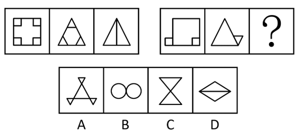

A. A

B. B

C. C

D. D

第 71 题 · 答案与解析

**参考答案（粉笔题库参考内容）**

D

**解析**

元素组成不同，且每幅图均由多个封闭图形构成，优先考虑图形间关系。观察发现，题干图形面与面之间都是通过线连接，则？处也应该满足同样的规律，而A、B、C三项中图形面与面之间均是通过点连接，只有D项符合。

故正确答案为D。

**考点**：特殊规律-图形间关系

**来源**：2020年北京市定向选调应届优秀大学毕业生《行测》题（网友回忆版）第36题

### 第 72 题

从所给四个选项中，选择最合适的一个填入问号处，使之呈现一定的规律性：

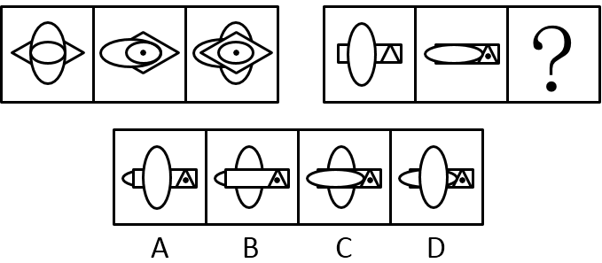

A. A

B. B

C. C

D. D

第 72 题 · 答案与解析

**参考答案（粉笔题库参考内容）**

B

**解析**

本题考点为元素叠加中的简单叠加。

前一组图形中，第一个图与第二个图相叠加，二者相同的部分出现在图形平面的上面，其余叠在该部分下面，组成第三个图形。按照这种规律，第二组图形中，长方形、三角形是相同的部分，应显现在第三个图形平面的上面。

故正确答案为B。

**考点**：样式规律-加减同异

**来源**：2014年天津市公务员录用考试《行测》题第72题

### 第 73 题

从所给四个选项中，选择最合适的一个填入问号处，使之呈现一定的规律性：

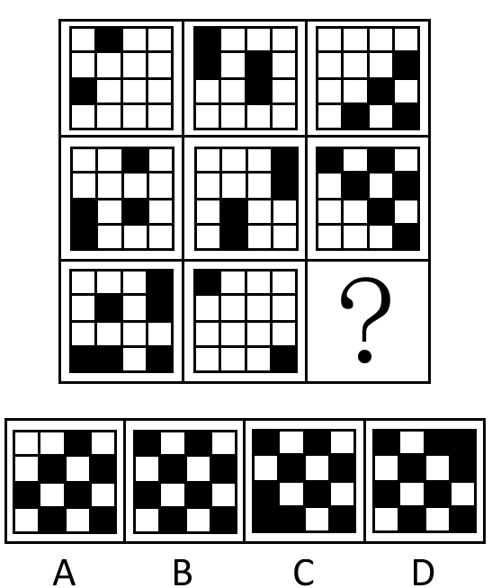

A. A

B. B

C. C

D. D

第 73 题 · 答案与解析

**参考答案（粉笔题库参考内容）**

B

**解析**

本题考点为数黑色正方形的个数。

每个正方形中黑色正方形的数量都是偶数，按照这种规律，问号处正方形中黑色正方形的数量也应是偶数。

故正确答案为B。

**考点**：数量规律-素

**来源**：2014年天津市公务员录用考试《行测》题第73题

### 第 74 题

请从所给四个选项中，选择最合适的一个填入问号处，使之呈现一定的规律性：

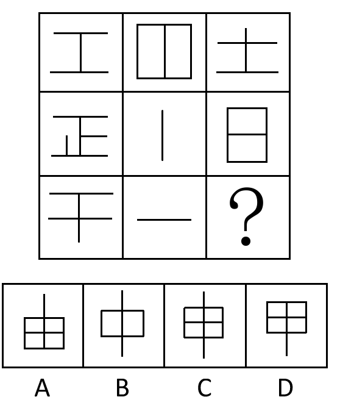

A. A

B. B

C. C

D. D

第 74 题 · 答案与解析

**参考答案（粉笔题库参考内容）**

B

**解析**

思路一：元素组成不同，考虑封闭空间数量。第一行封闭空间的数量分别为0、2、0，其和为2；第二行为0、0、2，其和为2；第三行为0、0、？。根据前两行的规律，问号处填2个封闭空间的选项。

思路二：元素组成不同，且无明显属性规律，优先考虑数量规律。题干出现了单一直线，考虑线的数量，整体数线无规律，考虑线的细化。观察发现每幅图中横线数量和竖线数量都相差1，选项中只有B项符合。

故正确答案为B。

**考点**：数量规律-线、数量规律-面

**来源**：2014年天津市公务员录用考试《行测》题第74题

### 第 75 题

从所给四个选项中，选择最合适的一个填入问号处，使之呈现一定的规律性：

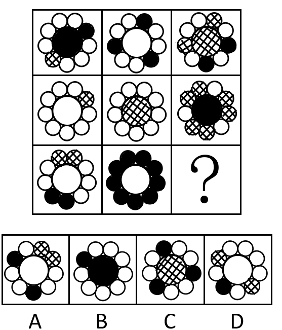

A. A

B. B

C. C

D. D

第 75 题 · 答案与解析

**参考答案（粉笔题库参考内容）**

D

**解析**

本题考查元素周遍。

题干中共出现白圆、黑圆、网状圆三种元素，观察元素出现频率，除了右下角的小圆圈没出现过网状圆元素以外，每种元素在其他圆圈位置上至少出现过一次，选项中只有D项的右下角是网状圆。

故正确答案为D。

**考点**：样式规律-遍历

**来源**：2014年天津市公务员录用考试《行测》题第75题

### 第 76 题

请从所给四个选项中，选择最合适的一个填入问号处，使之呈现一定的规律性：

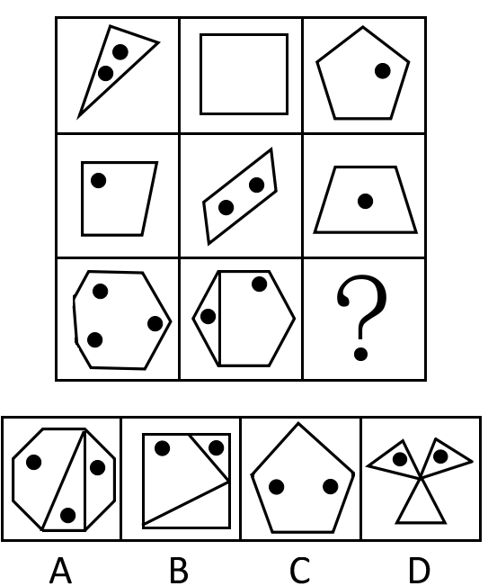

A. A

B. B

C. C

D. D

第 76 题 · 答案与解析

**参考答案（粉笔题库参考内容）**

D

**解析**

元素组成凌乱，属性无规律，考虑数量关系。本题考点为数角的数量。九宫格从纵向看，题目图形由点和线两套图形组成，所以分开看。对于点，第一列点的数量分别为2、1、3，第二列点的数量分别为0、2、2，数字规律为前两个数字的和为第三个数字，因此问号处需要有2个点；对于线构成的图形需要数角，第一列角的数量分别为3、4、7，第二列角的数量分别为4、4、8，数字规律仍为前两个数字的和为第三个数字，因此问号处图形角的数量为5+4=9个。

故正确答案为D。

**考点**：数量规律-素、数量规律-角

**来源**：2014年天津市公务员录用考试《行测》题第76题

### 第 77 题

从所给四个选项中，选择最合适的一个填入问号处，使之呈现一定的规律性：

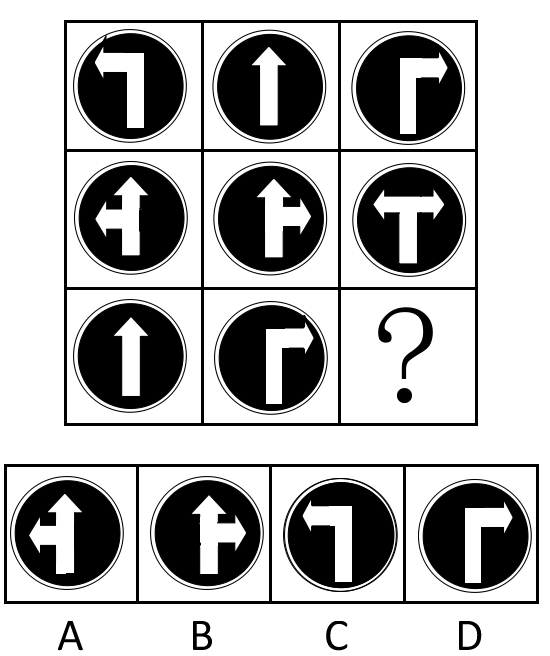

A. A

B. B

C. C

D. D

第 77 题 · 答案与解析

**参考答案（粉笔题库参考内容）**

C

**解析**

元素组成相似，考虑样式变化。本题考点为元素的简单叠加，元素组成相似是判断的依据。第一列、第二列中间的图形均是由该列第一、第三两个图形叠加形成的。

故正确答案为C。

**考点**：样式规律-加减同异

**来源**：2014年天津市公务员录用考试《行测》题第77题

### 第 78 题

请从所给四个选项中，选择最合适的一个填入问号处，使之呈现一定的规律性：

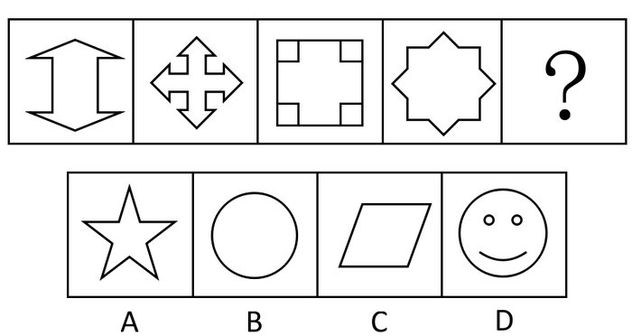

A. A

B. B

C. C

D. D

第 78 题 · 答案与解析

**参考答案（粉笔题库参考内容）**

B

**解析**

图形元素组成不同，优先考虑属性规律。观察发现题干图形既是轴对称图形又是中心对称图形，选项中只有B项满足。

故正确答案为B。

**考点**：属性规律-对称性

**来源**：2014年天津市公务员录用考试《行测》题第78题

### 第 79 题

从所给四个选项中，选择最合适的一个填入问号处，使之呈现一定的规律性：

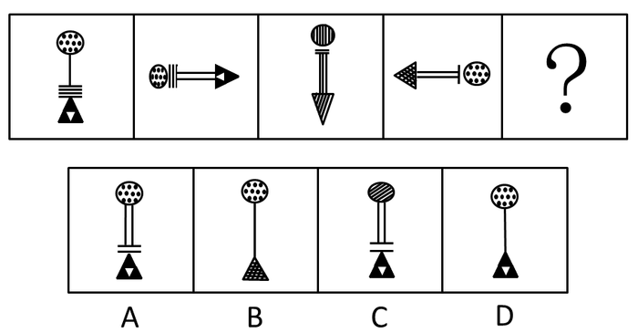

A. A

B. B

C. C

D. D

第 79 题 · 答案与解析

**参考答案（粉笔题库参考内容）**

B

**解析**

本题考点为数数、元素和属性的结合。

从左到右，小短线数依次为4、3、2、1，呈连续递减自然数列，故问号处横线应为0条，排除A、C两项。这组图整体呈现出类似对称的结构，左边两个图的三角是相同的，故而右侧的两个图的三角也应是相同的。

故正确答案为B。

**考点**：数量规律-素、数量规律-线

**来源**：2014年天津市公务员录用考试《行测》题第79题

### 第 80 题

从所给四个选项中，选择最合适的一个填入问号处，使之呈现一定的规律性：

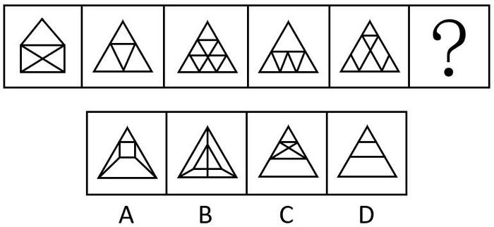

A. A

B. B

C. C

D. D

第 80 题 · 答案与解析

**参考答案（粉笔题库参考内容）**

C

**解析**

本题考点为数线中的一笔画问题。

从左到右，图形依次有2个奇点，0个奇点，0个奇点，0个奇点，2个奇点。均为一笔画完成（笔画数=奇点数÷2，其中，含0个或2个奇点的连通图可一笔画完成）。A项有4个奇点，需两笔画完成；B项有6个奇点，需三笔画完成；C项有0个奇点，一笔画完成；D项有4个奇点，需两笔画完成。

故正确答案为C。

**考点**：数量规律-线

**来源**：2014年天津市公务员录用考试《行测》题第80题

### 第 81 题

霸王条款是个别商家利用信息不对称、供求关系不平衡，以及自己的垄断地位将不平等的消费条款强加给消费者。表现为一些经营者单方面地逃避法定义务、违反公平原则、损害合同相对人利益的合同中的不平等条款，或者以违反通知、声明、店堂告示或者行业惯例等形式出现的合同内容。

根据上述定义，下列哪项中的现象不属于霸王条款：

A. 影楼规定，拍婚纱照时未选中的影像作品及底片、样本归影楼所有，顾客如有需要，必须另行付费

B. 某美容院规定，办理美容卡后，如果退卡，已半价消费的项目按全价结算

C. 通过活动出售的打折、特价商品不能退

D. 吃饭时，拒付饭店餐费，吃霸王餐

第 81 题 · 答案与解析

**参考答案（粉笔题库参考内容）**

D

**解析**

第一步：找到定义的关键词。

“霸王条款”的关键词是“商家”。

第二步：逐一判断选项。

A、B、C三项行为的主体都是商家，均符合定义。

D项是顾客的行为而不是商家的行为，不符合定义。

本题为选非题，故正确答案为D。

**考点**：主客体

**来源**：2014年天津市公务员录用考试《行测》题第81题

### 第 82 题

暴力慈善是一种慈善的暴力行为，以牺牲受赠人的尊严来获得自己的满足，是对“现金救穷”“高调行善”行事方式的一种概括。

根据以上定义，下列哪项中的现象不属于暴力慈善：

A. 某政府单位向敬老院送现金红包

B. 捐款的时候将现金垒成人民币墙并进行展示

C. 公司领导以命令的方式要求员工捐款

D. 朝每名受赠者鞠躬后送现金红包

第 82 题 · 答案与解析

**参考答案（粉笔题库参考内容）**

C

**解析**

第一步：找出定义关键词。

关键词为“牺牲受赠人的尊严”，包括“现金救穷”和“高调行善”。

第二步：逐一分析选项。

A项：现金红包属于牺牲敬老院老人的尊严的“现金救穷”，属于暴力慈善，排除；

B项：用人民币墙展示属于“高调行善”，是暴力慈善的方式，排除；

C项：强制捐款牺牲的是捐赠人的利益，未体现受赠人，不符合定义，当选；

D项：公开鞠躬捐现金，牺牲被捐赠人的尊严，属于“现金救穷”，是暴力慈善，排除。

本题为选非题，故正确答案为C。

**考点**：方式目的

**来源**：2016年重庆市选调优秀大学生到基层工作考试《行测》题第67题

### 第 83 题

农超对接是指农户和商家签订意向性协议书，由农户向超市、菜市场和便民店直供农产品的新型流通方式，主要是为优质农产品进入超市搭建平台。农超对接的本质是将现代流通方式引向广阔农村，将千家万户的小生产与千变万化的大市场对接起来，构建市场经济条件下的产销一体化链条，实现商家、农民、消费者共赢。

根据上述定义，下列哪项属于农超对接的作用：

A. 市场需要什么，农民就生产什么，避免生产的盲目性

B. 减少流通环节，降低流通成本

C. 有利于降低农产品的生产成本

D. 稳定农产品销售渠道和价格

第 83 题 · 答案与解析

**参考答案（粉笔题库参考内容）**

B

**解析**

第一步：找到定义关键词。

农超对接的关键词是一种“流通方式”。

第二步：逐一判断选项。

A项对应生产环节；

B项对应流通环节；

C项对应生产环节；

D项对应销售环节。

只有B项和定义相关，同属于流通环节。

故正确答案为B。

**考点**：方式目的

**来源**：2014年天津市公务员录用考试《行测》题第83题

### 第 84 题

低碳生活是指生活作息时所耗用的能量要尽力减少，从而减低碳，特别是二氧化碳的排放量，从而减少对大气的污染，减缓生态恶化。

根据上述定义，下列哪项中的现象不属于低碳生活的范畴：

A. 将废旧报纸铺垫在衣橱的最底层，不仅可以吸潮，还能吸收衣柜中的异味

B. 使用电脑时，尽量使用低亮度，开启程序少些；在午休和下班后关掉电脑电源

C. 选择晾晒衣物，避免使用滚筒式干衣机

D. 在跑步机上锻炼取代在公园中慢跑

第 84 题 · 答案与解析

**参考答案（粉笔题库参考内容）**

D

**解析**

第一步：找出定义关键词。

生活作息时所耗用的能量要尽力减少。

第二步：逐一判断选项。

A项：将废旧报纸用于衣橱吸潮除味，属于废物再利用，避免了新材料的生产与运输过程中的能源消耗，符合“生活作息时所耗用的能量要尽力减少”，符合定义，排除；

B项：调低电脑亮度、减少运行程序，并在午休和下班后关闭电源，有效节约了电能，符合“生活作息时所耗用的能量要尽力减少”，符合定义，排除；

C项：选择自然晾晒衣物，避免使用滚筒式干衣机，减少了电力消耗，符合“生活作息时所耗用的能量要尽力减少”，符合定义，排除；

D项：在跑步机上锻炼取代公园慢跑，跑步机需依赖电力驱动，而户外慢跑几乎不消耗额外能源。因此，该做法不仅未减少能源使用，反而增加了电能消耗，不符合“生活作息时所耗用的能量要尽力减少”，不符合定义，当选。

本题为选非题，故正确答案为D。

**考点**：方式目的

**来源**：2014年天津市公务员录用考试《行测》题第84题

### 第 85 题

红色旅游是指以1921年中国共产党建立以后的革命纪念地、纪念物及其所承载的革命精神为吸引物，组织接待旅游者进行参观游览，实现学习革命精神，接受革命传统教育和振奋精神、放松身心、增加阅历的旅游活动。

根据上述定义，下列哪项不属于红色旅游的特点：

A. 学习性

B. 故事性

C. 参与性

D. 趣味性

第 85 题 · 答案与解析

**参考答案（粉笔题库参考内容）**

D

**解析**

第一步：找到定义关键词。

“以1921年中国共产党建立以后的革命纪念地、纪念物及其所承载的革命精神为吸引物”、“组织接待旅游者进行参观游览”、“实现学习革命精神”、“接受革命传统教育和振奋精神、放松身心、增加阅历”。

第二步：逐一分析选项。

A项对应“学习革命精神”；

B项对应“革命传统教育”；

C项对应“进行参观游览”；

D项题干没有涉及。

此题为选非题，故正确答案为D。

**考点**：方式目的

**来源**：2014年天津市公务员录用考试《行测》题第85题

### 第 86 题

有机食品也叫生态食品、生物食品，是目前国际上对无污染天然食品比较统一的提法。有机食品是指来自于有机农业生产体系的食品，有机农业是指一种在生产过程中不使用人工合成的肥料、农药、生长调节剂和饲料添加剂的可持续发展的农业，它强调加强自然生命的良性循环和生物多样性。有机食品认证机构通过认证证明该食品的生产、加工、储存、运输和销售等环节均符合有机食品的标准。

根据上述定义，下列哪项不属于有机食品生产、加工的基本要求：

A. 生产基地未使用过农药、化肥等违禁物质

B. 作物在收获、清洁、干燥、储存和运输过程中未受化学物质的污染

C. 种子或种苗来自自然界，未经基因工程技术改造过

D. 种子或种苗在自然环境下生长，避免在温室大棚内种植

第 86 题 · 答案与解析

**参考答案（粉笔题库参考内容）**

D

**解析**

第一步：找到定义关键词。

“无污染天然食品”、“生产过程中不使用人工合成的肥料、农药、生长调节剂和饲料添加剂的可持续发展的农业”、“通过认证证明该食品的生产、加工、储存、运输和销售等环节均符合有机食品的标准”。

第二步：逐一分析选项。

A项对应“不使用人工合成的肥料、农药、生长调节剂和饲料添加剂”，排除；

B项对应运输环节的要求，排除；

C项对应天然食品，排除；

D项没有涉及，当选。

本题为选非题，故正确答案为D。

**考点**：单定义-其他句式

**来源**：2014年天津市公务员录用考试《行测》题第86题

### 第 87 题

社区矫正是指与监禁矫正相对的行刑方式，是指将符合社区矫正条件的罪犯置于社区内，由专门的国家机关，在相关社会团体和民间组织以及社会志愿者的协助下，在判决、裁定或决定确定的期限内，矫正其犯罪心理和行为恶习，并促进其顺利回归社会的非监禁刑罚执行活动。简单的说，就是让符合法定条件的罪犯在社区中执行刑罚。

根据上述定义，下列哪项不属于社区矫正的作用：

A. 有利于加大对罪犯的惩罚力度

B. 有利于罪犯掌握生活技能和相关社会知识

C. 有利于使人们改变对服刑人员的“标签”式看法

D. 有利于塑造罪犯符合社会正常生活的信念和人格

第 87 题 · 答案与解析

**参考答案（粉笔题库参考内容）**

A

**解析**

第一步：找到定义关键词。

“专门的国家机关”、“在相关社会团体和民间组织以及社会志愿者的协助下，在判决、裁定或决定确定的期限内，矫正其犯罪心理和行为恶习”、“促进其顺利回归社会的非监禁刑罚执行活动”。

第二步：逐一分析选项。

A项社区矫正相对于监禁矫正的惩罚力度在一定程度上是缩小了而不是加大，不符合题意；

其他各项均属于社区矫正的作用。

本题为选非题，故正确答案为A。

**考点**：单定义-其他句式

**来源**：2014年天津市公务员录用考试《行测》题第87题

### 第 88 题

所谓“城市病”是指由于城市人口、工业、交通运输过度集中而造成的种种弊病。它给生活在城市的人们带来了烦恼和不便，也对城市的运行产生了一些影响，所以被人们形象地称之为“城市病”。

根据上述定义，下列哪项中的现象不属于城市病的范畴：

A. 就业压力增大

B. 市民住宿紧张

C. 大城市的交通拥堵

D. 城市的经济实力下降

第 88 题 · 答案与解析

**参考答案（粉笔题库参考内容）**

D

**解析**

第一步：找到定义关键词。

“由于城市人口、工业、交通运输过度集中而造成的种种弊病”、“给生活在城市的人们带来了烦恼和不便，对城市的运行产生了一些影响”。

第二步：逐一分析选项。

A项和B项均是城市人口集中造成的弊端，排除；

C项对应交通运输造成的弊端，排除；

D项题干没有涉及，不属于城市病范畴。

本题为选非题，故正确答案为D。

**考点**：原因结果

**来源**：2014年天津市公务员录用考试《行测》题第88题

### 第 89 题

为了保护劳动者获得劳动报酬的权利，《刑法修正案（八）》规定，恶意欠薪者将被追究刑事责任，“以转移财产、逃匿等方法逃避支付劳动者的劳动报酬或者有能力支付而不支付劳动者的劳动报酬，数额较大，经政府有关部门责令支付仍不支付的，处3年以下有期徒刑或者拘役，并处或者单处罚金；造成严重后果的，处3年以上7年以下有期徒刑，并处罚金”。

根据上述定义，下列哪项属于恶意欠薪者的行为：

A. 某企业经营不善，陷入困境，拖欠员工一年的工资

B. 农民工小王向企业讨薪未果，并遭到企业打手的围殴

C. 小李超规定期限透支信用卡额度，发卡银行两次催收后超过3个月仍不归还后，以恶意透支罪对小李提起诉讼

D. 招投标之前，开发商与建筑施工企业就达成默契，双方约定，开发商将预付款打入施工企业的账户后，建筑施工企业要原封不动地返还给开发商，致使建筑施工企业无法支付工人的工资

第 89 题 · 答案与解析

**参考答案（粉笔题库参考内容）**

D

**解析**

第一步：找出定义关键词。

恶意欠薪是指“以转移财产、逃匿等方法逃避支付劳动者的劳动报酬或者有能力支付而不支付劳动者的劳动报酬”。

第二步：逐一分析选项。

A 项：某企业是无能力支付，不符合定义，排除；

B 项：未涉及题干中描述的几个方面，排除；

C 项：该项所述不是欠薪，不符合定义，排除；

D 项：属于转移财产逃避支付劳动报酬，符合定义，当选。

故正确答案为D。

**考点**：方式目的

**来源**：2014年天津市公务员录用考试《行测》题第89题

### 第 90 题

微表情是指人们通过做一些表情把内心感受表达给对方看，在人们做的不同表情之间，或是某个表情里，脸部会“泄露”出其他的信息。微表情最短可持续1/25秒，尽管一个下意识的表情可能只持续一瞬间，但它很容易暴露情绪。当面部在做某个表情时，这些持续时间极短的表情会突然一闪而过，而且有时表达相反的情绪。

根据上述定义，下列哪项属于微表情：

A. 售货员面对衣着寒酸的顾客，笑脸相迎中可能闪过一丝轻蔑的嗤笑

B. 间谍通过眨眼向同伙传递信息

C. 小王受到惊吓后，脸部不断地抽搐着

D. 迎着刺骨寒风行走，小李的上下牙齿不断抖动相撞

第 90 题 · 答案与解析

**参考答案（粉笔题库参考内容）**

A

**解析**

第一步：找出定义关键词。

“人们通过做一些表情把内心感受表达给对方看，在人们做的不同表情之间，或是某个表情里，脸部会‘泄露’出其它的信息”、“下意识的表情可能只持续一瞬间”、“容易暴露情绪”。

第二步：逐一分析选项。

A项：售货员笑脸相迎中闪过一丝轻蔑的嗤笑，属于在某个表情里脸部“泄露”出其他信息，且嗤笑一闪而过，是下意识、持续时间极短的表情，同时与表面笑脸表达相反的情绪，暴露真实想法，符合“人们通过做一些表情把内心感受表达给对方看，在人们做的不同表情之间，或是某个表情里，脸部会‘泄露’出其它的信息”、“下意识的表情可能只持续一瞬间”、“容易暴露情绪”，符合定义，当选；

B项：间谍通过眨眼向同伙传递信息，是刻意、有意识的行为，并非下意识、一瞬间泄露情绪，不符合“下意识的表情可能只持续一瞬间”、“容易暴露情绪”，不符合定义，排除；

C项：小王受到惊吓后脸部不断地抽搐，是持续明显的动作，并非持续时间极短、一闪而过的表情，不符合 “下意识的表情可能只持续一瞬间”，不符合定义，排除；

D项：小李迎着寒风上下牙齿不断抖动相撞，是受寒冷刺激产生的生理反应，并非表达内心感受、泄露情绪的表情，不符合“人们通过做一些表情把内心感受表达给对方看”、“脸部会‘泄露’出其他的信息”，不符合定义，排除。

故正确答案为A。

**考点**：大前提

**来源**：2014年天津市公务员录用考试《行测》题第90题

### 第 91 题

易教授去宫老师家做客，到门口后不知道宫老师住几楼，便问在门口乘凉的老奶奶和几个小朋友。小丽说：“宫老师不住一楼。”小梅说：“宫老师不住二楼。”小芳说：“宫老师不住三楼。”小红说：“宫老师不住四楼。”小玉说：“这楼只有四层，宫老师不住四楼只有住露天了。”这时，老奶奶笑着对易教授说：“这些孩子真调皮，但多数说的都是真话，只有一个人说了假话。”

据此，可以推出：

A. 宫老师住一楼

B. 宫老师住二楼

C. 宫老师住三楼

D. 宫老师住四楼

第 91 题 · 答案与解析

**参考答案（粉笔题库参考内容）**

D

**解析**

第一步：找出题干矛盾命题。

（1）小丽：宫老师不住一楼；

（2）小梅：宫老师不住二楼；

（3）小芳：宫老师不住三楼；

（4）小红：宫老师不住四楼；

（5）小玉：宫老师住四楼。

小红说的话和小玉说的话为矛盾关系，必有一真一假。

第二步：根据题干条件进行推理。

根据题干条件可知，五人中只有一人说了假话，所以小丽、小梅、小芳的话均为真，即，宫老师不住一楼，不住二楼，不住三楼，由此可知，宫老师住四楼。

故正确答案为D。

**考点**：只有一真/一假

**来源**：2014年天津市公务员录用考试《行测》题第91题

### 第 92 题

现在准备从赵、钱、孙、李、周、吴、郑七位工程师中选出四人组成攻关组，集中优势兵力研制A型高技术产品。为使工作更有成效，我们了解到以下情况：（1）赵去钱不去；（2）钱去李、郑不去；（3）孙、李至少去一人；（4）周、赵只能去一人；（5）吴与孙要么都去，要么都不去。

据此可知，攻关组的具体成员是：

A. 赵、李、吴、孙

B. 钱、孙、周、吴

C. 赵、李、吴、周

D. 钱、李、孙、吴

第 92 题 · 答案与解析

**参考答案（粉笔题库参考内容）**

AB

**解析**

第一步：翻译题干。

（1）赵→—钱;

（2）钱→—李—郑；

（3）孙李；

（4）周/赵；

（5）吴 且 孙/（-吴 且 -孙）。

第二步：排除错误选项。

根据（2）可以排除D项；

周、赵有且仅有一人进入攻关组；根据（4）（5）可以排除C项；

吴、孙要么都去，要么都不去，不能只去一人。剩下的A、B两项根据已知条件无法再排除。

故正确答案为AB。

**考点**：组合排列-单题-其他

**来源**：2014年天津市公务员录用考试《行测》题第92题

### 第 93 题

周日下午，连里的通讯员到炊事班来，正巧碰见新来的小刘、小陈、小李，顺便问起了他们的年龄。小刘说：“我22岁，比小陈小2岁，比小李大1岁。”小陈说：“我不是年龄最小的，小李和我差3岁。小李是25岁。”小李说：“我比小刘年纪小，小刘23岁，小陈比小刘大3岁。”这三个人爱开玩笑，他们每个人的回答都故意说错了一句。

由此，可以推出他们的具体年龄是：

A. 小刘24岁，小陈23岁，小李22岁

B. 小刘25岁，小陈22岁，小李23岁

C. 小刘22岁，小陈24岁，小李25岁

D. 小刘23岁，小陈25岁，小李22岁

第 93 题 · 答案与解析

**参考答案（粉笔题库参考内容）**

D

**解析**

题干信息量过大，考虑用代入法求解，代入后符合每人说错一句的题设条件即为正确选项。

A项、B项代入均能得到小刘说的三句话都是错的，排除；

C项代入满足小刘小陈2对1错的要求，但小李说的三句话都是错的，排除；

D项代入恰能满足三人都是2对1错的要求。

故正确答案为D。

**考点**：代入法

**来源**：2014年天津市公务员录用考试《行测》题第93题

### 第 94 题

甲、乙、丙、丁四人在一起工作，有人趁别人不在意拿走一件物品藏匿起来。领导发现后问是谁干的，甲说：“是乙干的”；乙说：“不是我干的”；丙说：“不是我干的”；丁没表态。现知三人中只有一个人说的是真话。

由此可以推出，拿走物品藏匿起来的人是：

A. 乙

B. 丁

C. 丙

D. 甲

第 94 题 · 答案与解析

**参考答案（粉笔题库参考内容）**

C

**解析**

第一步：找出题干矛盾命题。

甲：乙；

乙：-乙；

丙：-丙。

分析题干条件可知，甲和乙的说法为矛盾关系，必有一真一假。

第二步：根据题干条件推理。

根据题干条件可知，只有一个人说的是真话，所以丙说的是假话，即拿走物品藏匿起来的人是丙。

故正确答案为C。

**考点**：只有一真/一假

**来源**：2014年天津市公务员录用考试《行测》题第94题

### 第 95 题

今天的中国，改革依然是人心所向、大势所趋，在新的历史时期，在现有成就基础上，经济社会要持续保持又好又快发展，就需要以更大的勇气、魄力和力度来推进改革、深化改革，只有这样，才能在用好机遇、化解风险中奋力闯出“深水区”，开创中国现代化的新境界。

由此可推出：

A. 不深化改革，就无法闯出改革的“深水区”

B. 深化改革，可以闯出改革的“深水区”

C. 无法闯出改革的“深水区”，是因为没有深化改革

D. 闯出改革的“深水区”，就能深化改革

第 95 题 · 答案与解析

**参考答案（粉笔题库参考内容）**

A

**解析**

第一步：翻译题干。利用充分条件和必要条件。

（1）经济社会持续保持又好又快发展→推进改革、深化改革。

（2）闯出改革的“深水区”→推进改革、深化改革。

第二步：逐一翻译题干并判断正确答案。

A项：-深化改革→-闯出改革的“深水区”，根据逆否规则，等价于（2），正确；

B项：深化改革→闯出改革的“深水区”，是对（2）肯后，无法推出绝对化结论，错误；

C项：选项指出了“闯出改革的‘深水区’”和“深化改革”之间的因果关系，而题干中不涉及因果关系，无法推出，错误；

D项：闯出改革的“深水区”→深化改革，推导关系同（2），但不是闯出改革的“深水区”就能深化改革，而是闯出改革的“深水区”做到了深化改革，错误。

故正确答案为A。

**考点**：常规翻译

**来源**：2014年天津市公务员录用考试《行测》题第95题

### 第 96 题

有人认为，高考是很重要的考试，一年只有一次，应该让迟到考生进场考试。

如果以下各项为真，最能削弱上述观点的是：

A. 不让迟到考生进场，有可能错失选拔优秀人才的机会

B. 高考是很重要的考试，但并不一定会决定考生的命运

C. 美国的高考-SAT考试，允许迟到的考生进场考试

D. 遵守考场规则与考试的重要性、每年举行的次数无关

第 96 题 · 答案与解析

**参考答案（粉笔题库参考内容）**

D

**解析**

第一步：找到论点和论据。

论点：应该让高考迟到考生进场考试。

论据：高考是很重要的考试，一年只有一次。

第二步：判断削弱方式。

论点强调是否应该让迟到的考生进场考试，论据强调高考的重要性和每年举行的次数，二者之间没有直接关系，可以进行拆桥削弱论证。

第三步：逐一分析选项。

D项对考场规则和考试的重要性进行了拆桥，削弱了论证；

A项增加了新论据，说明不让迟到考生进场的坏处，加强了论点；

B项认为高考的重要性并不代表决定性，削弱了论据，但力度不及D项；

C项增加了新论据，举例说明了高考应该让迟到考生进场考试，加强了论点。

故正确答案为D。

**考点**：拆桥

**来源**：2014年天津市公务员录用考试《行测》题第96题

### 第 97 题

铝既能溶于酸，又能溶于碱，是人体维持正常运转所需的微量元素。实验表明，红烧肉在铝锅里存放一夜，铝在肉中的含量每公斤可高达120毫克至250毫克。但人体吸收铝元素后很难再从体内排出，容易造成早衰和老年痴呆症。

由此我们可以得出：

A. 铝是人体的必需元素

B. 老年痴呆症是由于过量摄入铝造成的

C. 红烧肉不能隔夜吃

D. 铝在人体内的含量很容易超标

第 97 题 · 答案与解析

**参考答案（粉笔题库参考内容）**

A

**解析**

本题属于日常结论类题型。

A项是原文的复述，可以根据“它是人体维持正常运转所需的微量元素”得到，为正确选项；

B项与文章的最后一句话有关，但原文说的是吸收入人体的铝无法排出容易患病，无法从文中得到该病是否由于“过量摄入”铝造成，因此错误，排除；

C项错误，原文说的是红烧肉不能放在铝锅里过夜，排除；

D项在原文中没有体现，属于无中生有，排除。

故正确答案为A。

**考点**：日常结论

**来源**：2014年天津市公务员录用考试《行测》题第97题

### 第 98 题

科学家最新发现被命名为“郑氏晓廷龙”的小恐龙是始祖鸟的“亲戚”，与生存于侏罗纪晚期的始祖鸟亲缘关系非常近。通过分析始祖鸟的形态，并对似鸟恐龙和早期鸟类的系统发育关系进行了重新分析，得出始祖鸟并非鸟类，而是原始恐爪龙类，即始祖鸟是迅猛龙的祖先，而不是鸟类的祖先。

如果以下各项为真，最不能质疑上述推测的是：

A. 恐爪龙类是一类与恐龙亲缘关系很近的鸟

B. 恐爪龙类是一类与鸟类亲缘关系很近的恐龙

C. 兽脚类恐龙的一支演化成植食性恐龙，再演化成鸟类

D. 始祖鸟标本被命名后，一直被认为是最原始、最古老的鸟类

第 98 题 · 答案与解析

**参考答案（粉笔题库参考内容）**

B

**解析**

第一步：找到论点和论据。

论点：始祖鸟并非鸟类，而是原始的恐爪龙类。

没有明显论据。

第二步：逐一判断选项作用。

A项指出恐爪龙类是鸟，具有削弱作用；

B项与A项相反，具有加强作用；

C项中兽脚类恐龙和题干始祖鸟主体不同，无关排除；

D项指出始祖鸟是鸟类，削弱题干。

故正确答案为B。

**考点**：削弱选非题

**来源**：2014年天津市公务员录用考试《行测》题第98题

### 第 99 题

1784年著名天文学家威廉·赫歇尔曾经写道，火星表面的黑暗区域是海洋，而较明亮区域则是陆地。赫歇尔推测，火星上肯定有智慧生命存在，它们或许与我们地球人差不多。赫歇尔的理论流行了一个多世纪，甚至其他一些天文学家也附和称，在一些颜色较亮的区域可以观测到植被。如果下列各项为真，哪项最能支持赫歇尔的推测？（    ）

A. 有智慧生命存在的地方必定有海洋、陆地

B. 凡是有植被的地方必定有智慧生命存在

C. 凡是有海洋、陆地的地方必定有智慧生命存在

D. 可以观测到植被的地方就可能有智慧生命存在

第 99 题 · 答案与解析

**参考答案（粉笔题库参考内容）**

C

**解析**

第一步：找到论点和论据。

论点：火星上肯定有智慧生命存在。

论据：火星表面有海洋和陆地。

论点强调智慧生命，论据强调海洋和陆地，二者对象不一致，需要在论点和论据之间搭桥以加强论证，搭桥方向为论据指向论点。

第二步：逐一分析选项。

A项，在论点和论据之间搭桥，但搭桥的方向错误，该项为无关选项，排除。

B项，搭桥的对象错误，该项为无关选项，排除。

C项，在海洋陆地和智慧生命之间搭桥，加强了论证，为正确选项，当选。

D项，搭桥的对象错误，该项为无关选项，排除。

故正确答案为C。

**考点**：搭桥

**来源**：2014年天津市公务员录用考试《行测》题第99题

### 第 100 题

植物生长调节剂是对植物的生长发育具有抑制或者促进作用的一类物质，包括人工合成的化合物和从生物中提取的天然植物激素，目前在全世界农业生产中广泛应用。针对人们对其安全性的质疑，业内人士指出，根据批量检测结果，看不出有植物生长调节剂的存在。因此，可以认为植物生长调节剂的安全性是比较可靠的。

下列哪项为真，最能质疑上述业内人士的观点：

A. 植物生长调节剂喷洒后，将长期存在于土壤中，不易分解

B. 有些发达国家对植物生长调节剂的使用有严格的管理规定

C. 从以往的经验看，即便是广泛使用的产品也未必是安全的

D. 有些植物生长调节剂即使含量检测不出，如果长期食用，也可能致病

第 100 题 · 答案与解析

**参考答案（粉笔题库参考内容）**

D

**解析**

第一步：找到论点和论据。

论点：植物生长调节剂安全性是可靠的。

论据：批量检测未检测出植物生长调节剂的存在。

本题中论点强调的是安全性，论据强调的是未检测出，论点论据话题不一致，优先考虑拆桥项。

第二步：逐一分析选项。

D项：在检测不出和安全性之间拆桥，削弱了论证，当选；

A项：涉及在土壤中不易分解，而不易分解到底是好还是坏并没有明确的表示，因此，不能削弱，排除；

B项：涉及使用的严格规定，与题干无关，为无关项，排除；

C项：是在广泛使用和安全性之间拆桥，对象错误，虽然也有削弱作用，但弱于D项，排除。

故正确答案为D。

**考点**：拆桥

**来源**：2014年天津市公务员录用考试《行测》题第100题

## 材料 2

据我国《2005年国民经济和社会发展统计公报》显示，2005年我国邮电通信业继续呈迅速增长态势，全年完成邮电业务总量12199亿元，同比增长24.6%。其中，邮政业务总量624亿元，增长10.1%；电信业务总量11575亿元，增长25.4%。全年新增局用交换机4608万门，总容量达到4.7亿门。新增城市固定电话用户1174万户，新增农村固定电话用户2694万户，年末总数达到35043万户，其中，城市电话用户23977万户，农村电话用户11066万户。新增移动电话用户5860万户，年末达到39343万户，其中，城市电话用户21457万户，农村电话用户17886万户。固定及移动电话总数同比增长15.05%，电话普及率已达到57部/百人。

### 第 101 题

2004年我国电信业务总收入比邮政业务总收入多出多少亿元：

A. 7551.3

B. 8663.7

C. 9243.6

D. 10130.1

第 101 题 · 答案与解析

**参考答案（粉笔题库参考内容）**

B

**解析**

根据题干所求“2004年······比······多出多少亿元”，结合材料时间为2005年，可判定本题为基期和差问题。定位文字材料可得，2005年电信业务总量11575亿元，增长25.4%，邮政业务总量624亿元，增长10.1%。故所求基期差。

故正确答案为B。

**考点**：基期和差、文字资料

**来源**：2014年天津市公务员录用考试《行测》题第101题

### 第 102 题

2005年农村固定电话增长率比城市固定电话增长率多几个百分点：

A. 27.3

B. 27.03

C. 24.8

D. 20.7

第 102 题 · 答案与解析

**参考答案（粉笔题库参考内容）**

B

**解析**

根据题干所求“2005年······增长率比······增长率多几个百分点”，可判定本题为现期增长率比较问题。选项差距较小，需精确求解。定位文字材料可得，“新增城市固定电话用户1174万户，新增农村固定电话用户2694万户。年末总数达到35043万户，其中，城市电话用户23977万户，农村电话用户11066万户”。故所求增长率之差，与B项最接近。

故正确答案为B。

**考点**：一般增长率、文字资料

**来源**：2014年天津市公务员录用考试《行测》题第102题

### 第 103 题

2004年移动电话用户总量是固定电话用户总量的几倍：

A. 3.15

B. 2.12

C. 1.47

D. 1.07

第 103 题 · 答案与解析

**参考答案（粉笔题库参考内容）**

D

**解析**

根据题干所求“2004年······是·····的几倍”，结合材料时间为2005年，可判定本题为基期倍数问题。定位文字材料可得，2005年，新增移动电话用户5860万户，年末达到39343万户。新增城市固定电话用户1174万户，新增农村固定电话用户2694万户，年末总数达到35043万户。故所求倍数≈≈1.06与D项最接近。

故正确答案为D。

**考点**：基期倍数、文字资料

**来源**：2014年天津市公务员录用考试《行测》题第103题

### 第 104 题

2004年邮政业务占邮电业务总收入的百分之多少：

A. 12.03

B. 10.26

C. 8.14

D. 5.79

第 104 题 · 答案与解析

**参考答案（粉笔题库参考内容）**

D

**解析**

根据题干所求“2004年······占······的百分之多少”，结合材料时间为2005年，可判定本题为基期比重问题。定位文字材料可得，2005年全年完成邮电业务总量12199亿元，同比增长24.6%。其中，邮政业务总量624亿元，增长10.1%。代入基期比重公式，与D选项最为接近。

故正确答案为D。

**考点**：基期比重、文字资料

**来源**：2014年天津市公务员录用考试《行测》题第104题

### 第 105 题

根据上述资料，可以推出：

（1）2004年邮电业务总收入达到9791亿元，同比增速3.4个百分点

（2）2005年局用交换机增幅10.87%

（3）2005年固定电话用户增长了14.52%

A. （1）（2）

B. （2）（3）

C. （3）

D. （2）

第 105 题 · 答案与解析

**参考答案（粉笔题库参考内容）**

D

**解析**

（1）定位文字材料可知，材料只提及2005年邮电业务总收入及同比增长率，可求得2004年邮电业务总收入，但是无法求同比增速，因此(1)错误，排除A项；

（2）定位文字材料可知，2005年新增局用交换机4608万门，总容量达到4.7亿门。故局用交换机增幅为，(2)项正确，排除C项；

（3）定位文字材料可知，2005年新增城市固定电话用户1174万户，新增农村固定电话用户2694万户，年末总数达到35043万户。故2005年固定电话用户增长率，(3)项错误，排除B项。

故正确答案为D。

**考点**：文字资料、综合分析

**来源**：2014年天津市公务员录用考试《行测》题第105题

## 材料 3

第五次全国人口普查以2000年11月1日零时为标准时点，S省常住人口34714835人，根据《全国人口普查条例》和国务院的决定，我国在2010年又以11月1日零时为标准时点进行了第六次全国人口普查。下面是S省常住人口的地区分布：

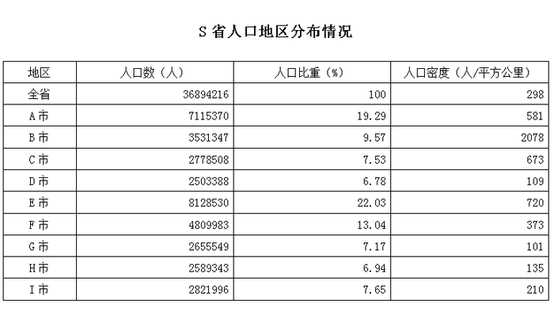

### 第 106 题

根据以上表格，以下说法不正确的是：

A. S省人口最多的是E市

B. S省面积最大的是H市

C. S省人口密度最大的是B市

D. S省人口密度最接近均值的是F市

第 106 题 · 答案与解析

**参考答案（粉笔题库参考内容）**

B

**解析**

A项，定位表格材料第二列可得，人口最多的是E市，正确。

B项， ，定位表格材料，比较G市和H市发现，G市人口数大于H市，人口密度小于H市，故G市面积大于H市，错误。

C项，定位表格材料最后一列可得，人口密度最大的是B市，正确。

D项，定位表格材料最后一列可得，人口密度最接近均值（298）的是F市（373），正确。

本题为选非题，故正确答案为B。

**考点**：综合分析、综合资料

**来源**：2014年天津市公务员录用考试《行测》题第106题

### 第 107 题

下面三个地区的面积从大到小排序正确的是：

A. B市、A市、E市

B. E市、A市、B市

C. A市、E市、B市

D. A市、B市、E市

第 107 题 · 答案与解析

**参考答案（粉笔题库参考内容）**

C

**解析**

根据题干所求“三个地区的面积从大到小排序”，，可判定本题为现期平均数比较问题。定位表格材料可得，A市面积为，B市面积为，E市面积为。故面积从大到小排序为A市、E市、B市，与C项符合。

故正确答案为C。

**考点**：现期平均数、综合资料

**来源**：2014年天津市公务员录用考试《行测》题第107题

### 第 108 题

人口密度超过全省平均人口密度的地区有：

A. 5个

B. 6个

C. 7个

D. 8个

第 108 题 · 答案与解析

**参考答案（粉笔题库参考内容）**

A

**解析**

定位表格材料最后一列可得，人口密度超过全省平均人口密度（298）的为A市（581）、B市（2078）、C市（673）、E市（720）、F市（373）共5个地区。

故正确答案为A。

**考点**：直接找数、综合资料

**来源**：2014年天津市公务员录用考试《行测》题第108题

### 第 109 题

同第五次全国人口普查相比，S省人口大约增长：

A. 6%

B. 6.3%

C. 6.5%

D. 7%

第 109 题 · 答案与解析

**参考答案（粉笔题库参考内容）**

B

**解析**

根据题干所求“同······相比，······增长”，结合选项为百分数，可判定本题为增长率计算问题。定位文字和表格材料可知，第五次人口普查时S省常住人口34714835人，第六次为36894216人。故所求增长率。（注：式子数字太大，可截位简化计算。）

故正确答案为B。

**考点**：一般增长率、综合资料

**来源**：2014年天津市公务员录用考试《行测》题第109题

### 第 110 题

按照前面十年的平均增长率，该省常住人口哪一年开始超过3800万：

A. 2013

B. 2015

C. 2017

D. 2019

第 110 题 · 答案与解析

**参考答案（粉笔题库参考内容）**

B

**解析**

根据题干所求“按照······平均增长率，······哪一年开始超过3800万”，可判定本题为现期追赶问题。根据109题可知，2010年相比2000年增长率为6.3%，则前十年平均增长率为0.63%。根据年均增长率公式可知，由于0.63%增长率过于小，根据近似公式可简化为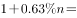，通过计算可知，n的值，即为2015年常住人口开始超过3800万。

故正确答案为B。

**考点**：现期计算、综合资料

**来源**：2014年天津市公务员录用考试《行测》题第110题

## 材料 4

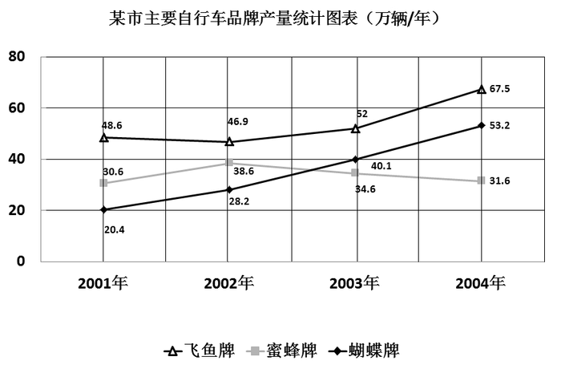

### 第 111 题

在主要自行车品牌中，年产量增幅最多的是哪种和哪一年：

A. 蝴蝶牌/2004年

B. 蝴蝶牌/2003年

C. 飞鱼牌/2004年

D. 蜜蜂牌/2000年

第 111 题 · 答案与解析

**参考答案（粉笔题库参考内容）**

B

**解析**

根据题干所求“年产量增幅最多”，可判定本题为增长率比较问题。定位图表材料可得，各品牌2001年-2004年产量，根据增长率公式计算即可。

A选项：蝴蝶牌2004年产量53.2万辆，2003年40.1万辆，故所求增长率；

B选项：蝴蝶牌2003年40.1万辆，2002年28.2万辆，故所求增长率；

C选项：飞鱼牌2004年67.5万辆，2003年52万辆，故所求增长率29%；

D项无法通过已知条件求解。

故正确答案为B。

**考点**：一般增长率、统计图

**来源**：2014年天津市公务员录用考试《行测》题第111题

### 第 112 题

在主要自行车品牌中，年产量减幅最少的是哪种和哪一年：

A. 蜜蜂牌/2002年

B. 蝴蝶牌/2004年

C. 蜜蜂牌/2004年

D. 飞鱼牌/2002年

第 112 题 · 答案与解析

**参考答案（粉笔题库参考内容）**

D

**解析**

根据题干所求“年产量减幅最少”，可判定本题为增长率比较问题。定位图表材料可得，各品牌2001年-2004年产量，根据增长率公式计算即可。

A选项：蜜蜂牌2002年产量38.6万辆，2001年30.6万辆，故所求增长率；

B选项：蝴蝶牌2004年产量53.2万辆，2003年40.1万辆，故所求增长率；

C选项：蜜蜂牌2004年产量31.6万辆，2003年34.6万辆，故所求增长率；

D选项：飞鱼牌2002年产量46.9万辆，2001年48.6万辆，故所求增长率 。

A、B两项为上涨，C、D两项中D项减幅更小。

故正确答案为D。

**考点**：一般增长率、统计图

**来源**：2014年天津市公务员录用考试《行测》题第112题

### 第 113 题

从2001-2004年间，蝴蝶牌自行车产量年均增长多少：

A. 31.2%

B. 33.6%

C. 37.7%

D. 38.4%

第 113 题 · 答案与解析

**参考答案（粉笔题库参考内容）**

C

**解析**

根据题干所求“2001-2004年······年均增长”，结合选项为百分数，可判定本题为年均增长率问题。定位图表材料可得，2001年蝴蝶牌自行车产量20.4万辆，2004年53.2万辆。代入年均增长率公式，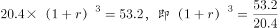≈2.6。年均增长率计算一般采用估算的方法，观察选项取值计算。若r=35%，，排除A、B两项；若r=38%，，故增长率介于35%和38%之间，只有C项符合。

故正确答案为C。

**考点**：年均增长率、统计图

**来源**：2014年天津市公务员录用考试《行测》题第113题

### 第 114 题

飞鱼牌自行车年产量变化的幅度最高与最低相差几个百分点？

A. 27个百分点

B. 31个百分点

C. 33个百分点

D. 35个百分点

第 114 题 · 答案与解析

**参考答案（粉笔题库参考内容）**

A

**解析**

根据题干“产量变化的幅度最高与最低相差几个百分点”，可判定本题为一般增长率问题。由本篇材料第一题可知，2004年飞鱼牌自行车增长率约为30%。由本篇材料第二题可知，2002年飞鱼牌自行车增长率约为-3%。定位图表材料可知，2003年产量52万辆，2002年产量46.9万辆，故2003年增长率。故变化的幅度最高与最低差约为30%－3%＝27%。

故正确答案为A。

**考点**：一般增长率、统计图

**来源**：2014年天津市公务员录用考试《行测》题第114题

### 第 115 题

某市主要自行车品牌2002年产量增长率为：

A. 11.43%

B. 14.16%

C. 16.07%

D. 20.21%

第 115 题 · 答案与解析

**参考答案（粉笔题库参考内容）**

B

**解析**

根据题干“······2002年产量增长率为”，可判定本题为增长率计算问题。定位图表材料可得，2002年产量为46.9+38.6+28.2万辆，2001年产量为48.6+30.6+20.4万辆。故所求增长率14%，与B项最接近。

故正确答案为B。

**考点**：一般增长率、统计图

**来源**：2014年天津市公务员录用考试《行测》题第115题

## 材料 5

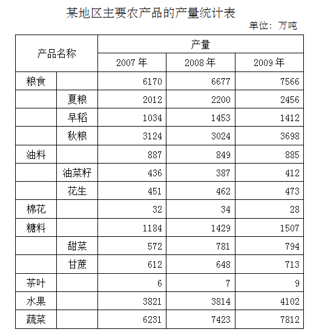

### 第 116 题

主要农业产品产量不是每年都增长的占百分之多少？

A. 35.71

B. 45.45

C. 42.86

D. 44.01

第 116 题 · 答案与解析

**参考答案（粉笔题库参考内容）**

B

**解析**

根据题干“······占百分之多少”，结合选项为百分数，可判定本题为现期比重问题。定位表格材料可得，不是每年都增长的农产品有：早稻、秋粮、油菜籽、棉花、水果5种，主要农业产品一共11种（注意粮食，油料，糖料不能重复计算）。故所求比重。

本题为选非题，故正确答案为B。

**考点**：现期比重、统计表

**来源**：2014年天津市公务员录用考试《行测》题第116题

### 第 117 题

在粮食中哪一样产品哪一年增长幅度最大？

A. 夏粮/2009年

B. 早稻/2008年

C. 秋粮/2008年

D. 秋粮/2009年

第 117 题 · 答案与解析

**参考答案（粉笔题库参考内容）**

B

**解析**

根据题干“······增长幅度最大”，可判定本题为增长率比较问题。定位表格材料可知，各项农产品2007-2009年具体产量，可根据增长率计算公式“增长率”计算各项增长率。

A项：夏粮2009年产量2456万吨，2008年2200万吨，故所求增长率；

B项：早稻2008年产量1453万吨，2007年1034万吨，故所求增长率；

C项：秋粮2008年产量同比减少，直接排除。

D项：秋粮2009年产量3698万吨，2008年3024万吨，故所求增长率。

故正确答案为B。

**考点**：一般增长率、统计表

**来源**：2014年天津市公务员录用考试《行测》题第117题

### 第 118 题

2007年的糖料产量是主要农业产品总产量的百分之多少？

A. 4.46

B. 4.76

C. 5.63

D. 6.46

第 118 题 · 答案与解析

**参考答案（粉笔题库参考内容）**

D

**解析**

根据题干“2007年······是······的百分之多少”，可判定本题为现期比重问题。定位表格材料可得，2007年糖料产量1184万吨，主要农业产品总产量=6170+887+32+1184+6+3821+6231万吨，故所求比重，与D项最接近。

故正确答案为D。

**考点**：现期比重、统计表

**来源**：2014年天津市公务员录用考试《行测》题第118题

### 第 119 题

2009年主要农业产品产量增长幅度排在前三位的是哪些产品？

A. 茶叶 粮食 糖料

B. 茶叶 秋粮 粮食

C. 蔬菜 粮食 大米

D. 粮食 糖料 秋粮

第 119 题 · 答案与解析

**参考答案（粉笔题库参考内容）**

B

**解析**

根据题干“2009年······增长幅度排在前三位······”，可判定本题为一般增长率比较问题。定位表格材料可知，各项农产品2008、2009年具体产量，可根据增长率计算公式“”可计算各项增长率。

茶叶：2009年产量9万吨，2008年产量7万吨，故所求增长率为；

粮食：2009年产量7566万吨，2008年产量6677万吨，故所求增长率为；

秋粮：2009年产量3698万吨，2008年产量3024万吨，故所求增长率为；

糖料：2009年产量1507万吨，2008年产量1429万吨，故所求增长率为；

蔬菜：2009年产量7812万吨，2008年产量7423万吨，故所求增长率为；

大米原表格中无数据，根据上述计算可知前三位为茶叶、秋粮、粮食。

故正确答案为B。

**考点**：一般增长率、统计表

**来源**：2014年天津市公务员录用考试《行测》题第119题

### 第 120 题

2009年主要农业产品产量增长百分比最多与最少的相差多少：

A. 18个百分点

B. 23个百分点

C. 32个百分点

D. 46个百分点

第 120 题 · 答案与解析

**参考答案（粉笔题库参考内容）**

D

**解析**

根据题干“增长百分比最多与最少的相差多少”，可判定本题为一般增长率比较问题。根据本材料第四题可知，2009年增长率最高的为茶叶，接近29%，观察表格可知，增长率最低的为棉花，负增长，其增长率为。故所求之差=29%-(-17.6%)=46.6%，与D项最接近。

故正确答案为D。

**考点**：一般增长率、统计表

**来源**：2014年天津市公务员录用考试《行测》题第120题

