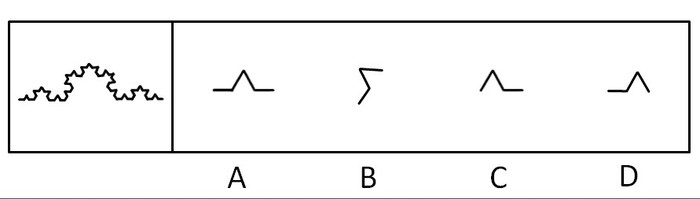
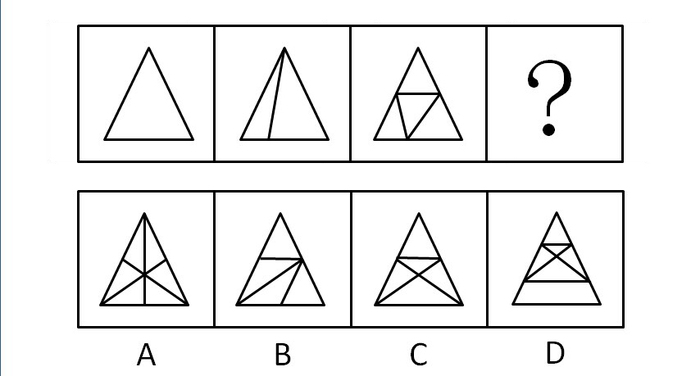
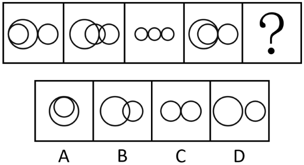
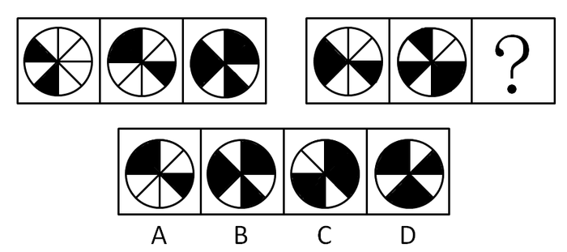
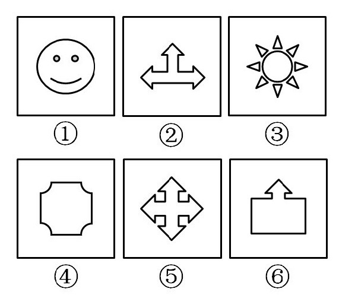
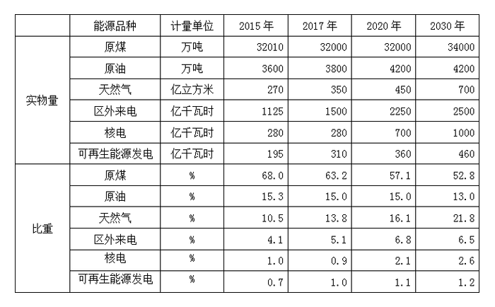
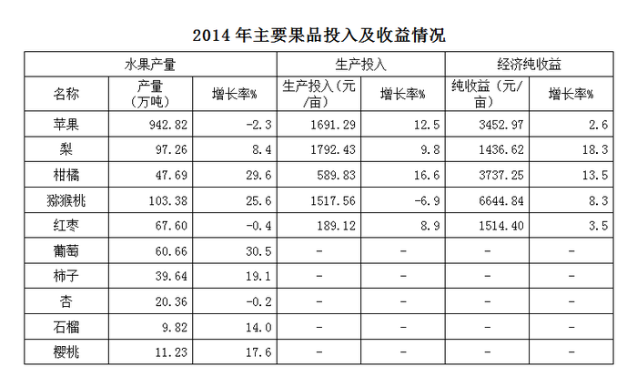
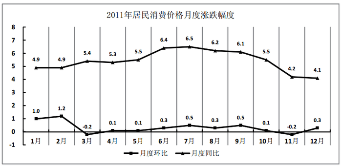
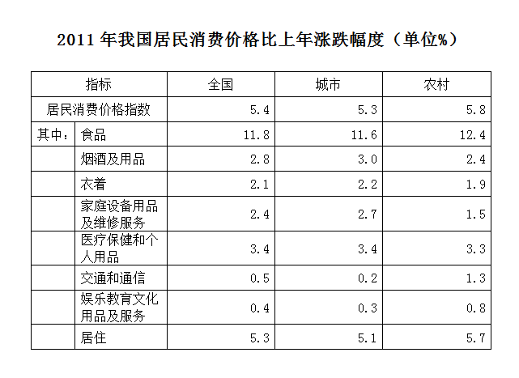

# 2015年天津市公务员录用考试《行测》题

<!-- gwy:overview:start -->
> **天津 · 2015 · 行测 · 统考** ｜ 120 题 · 图片 9 处 · 答案随题折叠

| 题型模块 | 题量 | 题号 |
| --- | ---: | ---: |
| 常识判断 | 20 | 1–20 |
| 言语理解 | 35 | 21–55 |
| 数量关系 | 15 | 56–70 |
| 判断推理 | 30 | 71–100 |
| 资料分析 | 20 | 101–120 |
| **合计** | **120** | |

导航：[题型与作答说明](#题型与作答说明) · [题目](#题目) · [材料 1](#材料-1)
<!-- gwy:overview:end -->

> 候选采集稿。参考答案及解析来自粉笔页面，不代表官方答案或真实高分答卷；来源使用许可与原卷对应关系仍需人工核实。

## 题型与作答说明

常识判断

（20题）

常识判断

言语理解

（35题）

言语理解

数量关系

（15题）

数量关系

判断推理

（30题）

判断推理

资料分析

（20题）

资料分析

## 题目

### 第 1 题

蔡元培先生曾经撰联挽某人曰：“为地方兴教育诸业，继起有人，岂惟孝子慈孙，尤属望南通后进；以文学名光宣两期，日记若在，用裨征文考献，当不让常熟遗篇”。该挽联所悼念之人的主要历史贡献是：

A. 领导革命，倡导民主共和

B. 热心洋务，主张中体西用

C. 兴办实业，投身实业救国

D. 思想解放，宣传民主科学

第 1 题 · 答案与解析

**参考答案（粉笔题库参考内容）**

C

**解析**

蔡元培先生所撰挽联悼念的是中国近代实业家、教育家张謇。张謇祖籍江苏常熟，1926年8月在南通病逝。他主张实业兴国，先后开办了20多个企业和大中小学370多所，发展了我国的近代工业和近代新型的教育事业。

故正确答案为C。

**考点**：中国历史

**来源**：2015年天津市公务员录用考试《行测》题第1题

### 第 2 题

“无言独上西楼，月如钩。寂寞梧桐深院锁清秋。剪不断，理还乱，是离愁。别是一番滋味在心头。”这种文学的特点是：

A. 辞藻华丽，手法夸张

B. 长短不齐，便于抒发感情

C. 可雅可俗，抒情叙事兼长

D. 题材多样，表现手法丰富

第 2 题 · 答案与解析

**参考答案（粉笔题库参考内容）**

B

**解析**

B项正确，题干的词句本身长短不一，且是在抒发感情，符合题意。题干词句出自南唐后主李煜的《相见欢》，属于宋词，其特点是长短不齐，便于抒发感情。

A项错误，此项是汉赋的特点。

C项错误，此项是元曲的特点。

D项错误，此项是明清小说的特点。

故正确答案为B。

**考点**：文学常识

**来源**：2015年天津市公务员录用考试《行测》题第2题

### 第 3 题

一辆客车夜晚行驶在公路上，发现油箱泄露，车厢里充满了汽油的气味，这时应该采取的措施是：

A. 洒水降温减少汽油蒸汽

B. 开灯查找漏油部位

C. 让车内的人集中到车厢后部

D. 打开所有车窗，严禁一切烟火，疏散乘客

第 3 题 · 答案与解析

**参考答案（粉笔题库参考内容）**

D

**解析**

D项正确，打开车窗可以让车厢通风，释放车厢中的汽油味，严禁一切烟火可以防止泄露出来的汽油燃烧，及时疏散乘客能确保乘客生命安全。

A项错误，汽油不溶于水，洒水降温无法减少汽油蒸汽。

B项错误，车厢中有汽油味，说明存在汽油蒸汽。汽油具有可燃性，与空气混合后遇明火或电火花容易发生爆炸，而开灯可能产生电火花，因此不宜采取此措施。

C项错误，遇到题干所述情况，应及时疏散乘客，保障乘客生命安全。

故正确答案为D。

**考点**：生活常识

**来源**：2015年天津市公务员录用考试《行测》题第3题

### 第 4 题

红色与黄色混合得到一种新颜色，红色与蓝色混合得到另一种新颜色，这两种新颜色分别是：

A. 绿色、紫色

B. 绿色、橙色

C. 橙色、紫色

D. 紫色、绿色

第 4 题 · 答案与解析

**参考答案（粉笔题库参考内容）**

C

**解析**

红色、黄色和蓝色合称为颜料三原色，又称作减色法三原色。这三种颜色按不同比例混合，可变化出各种颜色。红色和黄色按1比1比例混合是砖红色，按1比3混合是橙色。红色和蓝色按1比1比例混合是紫色。

故正确答案为C。

**考点**：物理常识

**来源**：2015年天津市公务员录用考试《行测》题第4题

### 第 5 题

一提到书法中的草书，人们便会想到“颠张醉素”，请问下列属于颠张的作品的是：

A. 自叙帖

B. 自言帖

C. 中秋帖

D. 黄州寒食帖

第 5 题 · 答案与解析

**参考答案（粉笔题库参考内容）**

B

**解析**

“颠张醉素”分别指唐朝书法家张旭和怀素。张旭性嗜酒，每大醉后呼叫狂走而后下笔，或以头濡墨作书，酒醒后自视所作，以为神，再模仿就达不到那种境界，时人称之为“张颠”。

A项错误，《自叙帖》是怀素的草书作品。

B项正确，《自言帖》是张旭的名帖。

C项错误，《中秋帖》是王献之的草书作品。

D项错误，《黄州寒食帖》是苏轼的书法作品，被誉为“天下第三行书”。

故正确答案为B。

**考点**：文化常识

**来源**：2015年天津市公务员录用考试《行测》题第5题

### 第 6 题

古诗云：“眼处心生句自神，暗中摸索总非真。画图临出秦川景，亲到长安有几人？”下列选项中与此诗所蕴含的哲理相同的是：

A. 近水楼台先得月，向阳花木易为春

B. 竹外桃花三两枝，春江水暖鸭先知

C. 纸上得来终觉浅，绝知此事要躬行

D. 日出江花红胜火，春来江水绿如蓝

第 6 题 · 答案与解析

**参考答案（粉笔题库参考内容）**

C

**解析**

题干诗句出自元好问《论诗三十首》中的第十一首，强调诗要抒写诗人的亲身真实感受，只在心中暗中摸索，临摹前人作品，就想画出秦川长安的真实图景是不可能的。其中蕴含的哲学原理是实践是认识的来源，实践决定认识。四个选项中，C项同样强调实践对认识的决定作用， A、B、D项均不符合题意。

故正确答案为C。

**考点**：唯物论

**来源**：2015年天津市公务员录用考试《行测》题第6题

### 第 7 题

明史专家吴晗在《朱元璋》一书中曾这样描述我国古代的君臣关系：“在宋以前有三公坐而论道的说法······到宋朝便不然了。从太祖以后，大臣上朝在皇帝面前无坐处，一坐群站，······到了明代，不但不许坐，站着都不行，得跪着说话了”。君臣关系从坐而站而跪，说明中国古代中央政治制度演变的重要特点是：

A. 中央对地方的管理日益加强

B. 内阁制度日渐成熟

C. 中央的权力日益向帝王集中

D. 丞相权力被六部分割

第 7 题 · 答案与解析

**参考答案（粉笔题库参考内容）**

C

**解析**

本题考查毛中特。

题干的关键词为“君臣关系”，大臣从坐而论道变成群站，再变成跪着说话，说明大臣的地位下降，君主加强了专制，反映出我国古代中央政治制度朝着中央权力逐渐向帝王集中的方向演变，C项正确。A、B、D项的特点题干并无体现。

故正确答案为C。

**考点**：党的历史

**来源**：2015年天津市公务员录用考试《行测》题第7题

### 第 8 题

调查研究发现，由于原料、人工等成本大幅攀升，很多农产品的价格上涨是成本推动型的，还有些是周期性的。这种通过调查研究得出结论的做法符合：

A. 一切从实际出发，实事求是的要求

B. 用发展的观点看问题的要求

C. 两点论和重点论相统一的要求

D. 唯物主义的方法论要求

第 8 题 · 答案与解析

**参考答案（粉笔题库参考内容）**

A

**解析**

题干“通过调查研究得出结论”体现的正是从实际出发，尊重客观事实，符合“一切从实际出发，实事求是”的要求。

故正确答案为A。

**考点**：唯物论

**来源**：2015年天津市公务员录用考试《行测》题第8题

### 第 9 题

DNA检测技术的应用对执法部门侦破案件起到重要作用，有效地减少了错案的出现。下列有关遗传物质的说法正确的是：

A. DNA是一种遗传物质，同一家族每个人都相同

B. DNA是一种蛋白质，每个人都不同

C. 只有染色体才是遗传物质，父子之间一模一样

D. DNA是一种遗传物质，它可由亲代遗传给子代

第 9 题 · 答案与解析

**参考答案（粉笔题库参考内容）**

D

**解析**

D项正确，DNA是一种遗传物质，多数生物的基因由脱氧核糖核酸（DNA）构成，并在染色体上作线状排列，DNA可由亲代遗传给子代，D项正确。A项错误，世界上没有两个人的DNA是完全相同的；B项错误，DNA属于核酸，不是蛋白质；C项错误，染色体并非遗传物质，只是遗传物质的载体。

故正确答案为D。

**考点**：生物常识

**来源**：2015年天津市公务员录用考试《行测》题第9题

### 第 10 题

以下衡量经济社会发展的重要指标中，解释错误的是：

A. 国内生产总值是在一国范围内生产的最终产品的价值，是一个地域概念

B. 国民生产总值中有一部分是本国拥有的生产要素在国外生产的最终产品价值

C. 国民收入不计算中间产品价值，也不包括固定资产折旧价值，而只计算净产值

D. 社会总产值既计算物质生产部门的劳动成果，也计算非物质生产部门的劳动成果

第 10 题 · 答案与解析

**参考答案（粉笔题库参考内容）**

D

**解析**

本题考查经济常识。

A项正确，国内生产总值（GDP）是一个国家（或地区），在一定时期内，生产的全部最终产品和服务价值的总和，是一个地域概念。

B项正确，国民生产总值（GNP）是某国国民所拥有的全部生产要素在一定时期内所生产的最终产品的市场价值，既包括在国内生产的最终产品，也包括在国外生产的最终产品，是一个国民概念。

C项正确，国民收入（NI）是一个国家在一定时期（通常为一年）内物质资料生产部门的劳动者新创造的价值的总和，社会总产品的价值扣除用于补偿消耗掉的生产资料价值的余额。因此国民收入不计算中间产品价值，也不包括固定资产折旧价值，而只计算净产值。

D项错误，社会总产值只计算社会各个物质生产部门在一定时期内（通常为一年）所生产出来的全部物质产品的价值总和，非物质生产部门的劳动成果不计其中。

本题为选非题，故正确答案为D。

**考点**：宏观经济与调控政策

**来源**：2015年天津市公务员录用考试《行测》题第10题

### 第 11 题

在我国农历的干支纪年中，从甲子年到癸亥年共六十年构成一个循环，如果将上一个甲子年当做本循环中的第1年，那么第31年是：

A. 甲戌年

B. 甲午年

C. 戊戌年

D. 庚午年

第 11 题 · 答案与解析

**参考答案（粉笔题库参考内容）**

B

**解析**

甲、乙、丙、丁、戊、己、庚、辛、壬、癸十个符号叫天干；子、丑、寅、卯、辰、巳、午、未、申、酉、戌、亥十二个符号叫地支。干支纪年就是把十天干和十二地支一对一进行相配，共可配成60个组合，用来表示年份的次序，周而复始，循环使用。如果把上一个甲子年当作本循环的第1年，那么第31年，天干的算法是31/10=3余1，1对应的天干就是甲，地支的算法是31/12=2余7，7对应的地支就是午，合起来第31年为甲午年。

故正确答案为B。

**考点**：文化常识

**来源**：2015年天津市公务员录用考试《行测》题第11题

### 第 12 题

郭沫若用“犀利”“恣肆”“浑厚”“峻峭”四个词语分别概括了先秦四大散文家作品的风格。符合这四种风格的散文家依次是：

A. 孟子、庄子、荀子、韩非子

B. 庄子、孟子、荀子、韩非子

C. 孟子、庄子、韩非子、荀子

D. 庄子、孟子、韩非子、荀子

第 12 题 · 答案与解析

**参考答案（粉笔题库参考内容）**

A

**解析**

郭沫若在《十批判书》中写道：“孟文的犀利，庄文的恣肆，荀文的浑厚，韩文的峻峭，单拿文章来讲，实在各有千秋。”

故正确答案为A。

**考点**：文化常识

**来源**：2015年天津市公务员录用考试《行测》题第12题

### 第 13 题

卜骨和卜甲是古代占卜器具，先民以其推测吉凶的主要依据是：

A. 甲骨上面钻出孔洞的形状

B. 甲骨被水浸泡后的表面条纹形状

C. 甲骨被敲碎后的碎片形状

D. 甲骨上面灼烧出的裂纹形状

第 13 题 · 答案与解析

**参考答案（粉笔题库参考内容）**

D

**解析**

古代先民使用甲骨进行占卜，需先取材、钻凿、再用火灼烧甲骨，根据灼烧形成的裂纹推测吉凶，决定行止。

故正确答案为D。

**考点**：中国历史

**来源**：2015年天津市公务员录用考试《行测》题第13题

### 第 14 题

如果一个社会10个人只有4个人就业，另外6个人失业，社会保障体系就要用4个人的收入支持另外6个人的保障；如果一个社会10个人中有9个人就业，只有1个人失业，那么社会保障体系就很容易高质量地建立起来。这说明：

A. 健全社会保障制度是维护劳动者合法权益的根本措施

B. 社会保障体系的完善需要经济发展为其奠定物质基础

C. 就业是民生之本，我们要实施积极的就业政策

D. 坚持权利与义务相统一是每个劳动者的正确选择

第 14 题 · 答案与解析

**参考答案（粉笔题库参考内容）**

B

**解析**

本题考查新思想。

从题干叙述“一个社会10个人中有9个人就业，只有1个人失业，那么社会保障体系就很容易高质量地建立起来”，9个人就业，意味着经济得到发展，就业充分，而就业一旦充分，社会保障体系便得以高效高质地建立，由此说明，社会保障体系的完善需要经济发展为其奠定物质基础，B项正确。A项错误，维护劳动者合法权益的根本措施是签订劳动合同。C项强调的是实施积极的就业政策，题干并没有谈及就业政策的问题，属于无关选项。D项强调的是劳动者权利与义务，同样与题干无关。

故正确答案为B。

**考点**：社会建设

**来源**：2015年天津市公务员录用考试《行测》题第14题

### 第 15 题

生物种间争夺资源和空间的竞争现象，竞争的结果往往对一方不利，甚至于被消灭。生物与生物之间的生活方式和习性、栖所及食物类型越接近，其竞争程度越激烈。下列成语和俗语中描写这种生物种间竞争现象的是：

A. 鸠占鹊巢

B. 一母生九子，连母十个样

C. 一山不容二虎

D. 螳螂捕蝉，黄雀在后

第 15 题 · 答案与解析

**参考答案（粉笔题库参考内容）**

A

**解析**

A项正确，鸠占鹊巢是指鸠不会筑巢，经常占据喜鹊的巢，反映了二者对资源和空间的竞争现象。

B项说的是生物间的差异，C项指的是种内生物间的斗争关系，D项描述的是生物之间的捕食关系。

故正确答案为A。

**考点**：生物常识

**来源**：2015年天津市公务员录用考试《行测》题第15题

### 第 16 题

下述特定时间里，气温最高的是：

A. 夏季阴天正午

B. 春季晴天14时

C. 春季晴天正午

D. 夏季晴天日出前

第 16 题 · 答案与解析

**参考答案（粉笔题库参考内容）**

A

**解析**

通常来说，夏季的气温要高于春季，先排除B、C项。一天当中，最高气温一般出现在14-15时，最低气温一般出现在日出前后，A项虽然是阴天，但处于正午，气温肯定比晴天日出前的温度要高。

故正确答案为A。

**考点**：自然地理

**来源**：2015年天津市公务员录用考试《行测》题第16题

### 第 17 题

以下关于我国古代命令文书的运用，说法一定错误的是：

A. 皇帝即位或驾崩，须昭告天下，颁布“诏书”

B. 皇帝封赠五品以下、七品以上官员，颁发“诰命”

C. 开馆修书、修史，大都先由皇帝颁发“敕谕”

D. 皇帝册立皇后、三公长官，颁发“册书”

第 17 题 · 答案与解析

**参考答案（粉笔题库参考内容）**

B

**解析**

诰命又称诰书，是皇帝封赠官员的专用文书。诰作为王命文书开始于西周。从宋代开始，凡文武官员的迁改职秩、追赠大臣、贬乏有罪、封赠其祖父妻室，都用诰命。明沿宋制，封赠一品至五品官员授以诰命。清沿明制，五品以上官员授以诰命，六品以下授以敕命（含六品），可见B项表述有误。

本题为选非题，故正确答案为B。

**考点**：中国历史

**来源**：2015年天津市公务员录用考试《行测》题第17题

### 第 18 题

今天，社会经济和结构调整，价值和利益多元多样，任何一项改革措施的出台，都要遇到不同声音，遭受很多阻力，这很正常，重要的是统筹各方利益，汇聚真知灼见，找到改革的“最大约数”，形成推动改革的合力。从哲学角度讲，这个“最大公约数”应该是：

A. 党和政府的政策主张

B. 人们对改革的正确认识

C. 改革开放的伟大实践

D. 最广大人民的根本利益

第 18 题 · 答案与解析

**参考答案（粉笔题库参考内容）**

D

**解析**

本题考查马克思主义。

从题干可知，要改革，就会触碰到各方利益，只有平衡好各方利益，找到平衡点，才能激发社会内生动力的关键点，形成推动改革的合力。从哲学角度讲，人民群众是社会变革的决定力量，因此改革的“最大公约数”，应当是最广大人民的根本利益。

故正确答案为D。

**考点**：唯物史观

**来源**：2015年天津市公务员录用考试《行测》题第18题

### 第 19 题

普朗克曾这样评论爱因斯坦的科学成就：“这个原理在物理世界观上所引起的革命，只有哥白尼世界体系的引入才能与之相提并论。”文中的“这个原理”是：

A. 相对论

B. 日心说

C. 量子假说

D. 万有引力定律

第 19 题 · 答案与解析

**参考答案（粉笔题库参考内容）**

A

**解析**

四个选项中，A项相对论由爱因斯坦提出，B项日心说由哥白尼提出，C项量子假说最早是由普朗克提出的，D项万有引力定律由牛顿提出。

故正确答案为A。

**考点**：物理常识

**来源**：2015年天津市公务员录用考试《行测》题第19题

### 第 20 题

老王的三位朋友分别在今天过七十大寿、乔迁新居、分店开业。下面三幅对联该如何送才恰当？（甲）大启而宇，长发其祥；（乙）交以道接以礼，近者悦远者来；（丙）室有芝兰春自永，人如松柏岁长新。

A. 甲送乔迁新居者；乙送分店开幕者；丙送七十大寿者

B. 甲送分店开幕者；乙送乔迁新居者；丙送七十大寿者

C. 甲送七十大寿者；乙送乔迁新居者；丙送分店开幕者

D. 甲送七十大寿者；乙送分店开幕者；丙送乔迁新居者

第 20 题 · 答案与解析

**参考答案（粉笔题库参考内容）**

A

**解析**

对联（甲）的意思是自从上天或是上帝开天辟地形成了宇宙，创造天地，长久发展成福庆吉祥的样子，适合用在乔迁新居的情景中。对联（乙）指以道义结交，以礼仪接待，这样，附近的国家会交好，而远方的国家也会前来依附，适合用于分店开幕的场合。对联(丙)下联明显是祝福人长寿，适合用于贺寿。综上，甲应送乔迁新居者；乙应送分店开幕者；丙应送七十大寿者。

故正确答案为A。

**考点**：文化常识

**来源**：2015年天津市公务员录用考试《行测》题第20题

### 第 21 题

（1）我还记得傅先生蹲在\_\_\_\_\_\_\_的牛舍中挤牛奶。（2）翅膀长在你的肩上，太在乎别人对于飞行姿势的\_\_\_\_\_\_，所以你飞不起来。（3）几米之遥，一盏昏黄的台灯，淡化在\_\_\_\_\_的夜色中。

填入横线部分最恰当的一项是：

A. 阴暗 评价 无尽

B. 昏暗 批评 无垠

C. 阴暗 批评 无尽

D. 昏暗 评价 无垠

第 21 题 · 答案与解析

**参考答案（粉笔题库参考内容）**

C

**解析**

第一空考查近义词辨析。“阴暗”意指光线不足，侧重于强调没有足够的光，常搭配“阴暗的小屋”等；昏暗并非无光，而是光线过暗、不够明亮，常搭配“灯光昏暗”等。第一句中搭配“牛舍”，阴暗更为合适。故排除B、D两项。

第二空“评价”为中性词，可好可坏；而“批评”为贬义词，意为指出缺点和错误。句中之所以不敢飞，飞不起来，正是因为别人的批评。试想如若是好的评价，反倒会鼓励我们飞起来。故第二空用“批评”更为准确，可排除A项。

第三空进行检验，无尽的夜色为常见的固定搭配，指没有穷尽；而“无垠”更多搭配具体实物，形容其非常辽阔，没有边际，如无垠的草原。

故正确答案为C。

**考点**：关联关系-因果关系、实词填空、词的辨析-搭配对象

**来源**：2015年天津市公务员录用考试《行测》题第21题

### 第 22 题

（1）因为滞后，后发优势至今仍有足够的\_\_\_\_\_空间，帮助中国制造在和美国制造的竞争中保持优势。

（2）我们将建立一个带给人民幸福的体系，这个信念我们\_\_\_\_\_\_。

（3）另一个时代的尘埃在这里沉淀，仿佛是无形的，但当你伸手去摸的时候，它们又像是溅起了\_\_\_\_\_\_\_泥浆的泥塘。

填入横线部分最恰当的一项是：

A. 发展 深信不疑 混浊

B. 释放 深信不疑 混浊

C. 释放 坚定不移 浑浊

D. 发展 坚定不移 浑浊

第 22 题 · 答案与解析

**参考答案（粉笔题库参考内容）**

C

**解析**

第一空考查搭配。文中搭配主语名词为“后发优势”，“释放后发优势”为常见固定搭配，即表达后发优势发挥作用之意；若用“发展”，整个语句应表达为“由于拥有后发优势，经济至今仍有长足的发展空间”，故第一空排除A、D两项。

第二空考查近义成语辨析。“深信不疑”一般用于表达对于别人告诉自己的事情表示充分的相信，毫不怀疑；“坚定不移”意为（立场、主张、意志等）非常坚固稳定，毫不动摇。文中“我们将建立一个带给人民幸福的体系”的信念是一种自我的信念，而非他人告知，且这种信念非常坚固，毫不动摇。故可排除B项。

第三空考查近义词辨析。“混浊”与“浑浊”均可表示水或空气含有杂质，不纯洁，不明澈；区别在于“浑浊”一般用于水中有固体或者沉淀而不清楚，相对应用偏向科学具体，而“混浊”更多用于空气或者社会，相对更抽象一点。句中用来修饰“泥浆”这一具体事物，用“浑浊”也更为合适。注：第三句出自《摩托日记：拉丁美洲游记》，为一本国外著作的译文，对于“混浊”的用法可能有失偏颇。

故正确答案为C。

**考点**：对应关系-前后呼应、混搭填空、词的辨析-搭配对象、词的辨析-词义侧重

**来源**：2015年天津市公务员录用考试《行测》题第22题

### 第 23 题

由于竞选活动需要雇用工作人员、制作竞选标语和招贴画、布置演讲场地、发布广播和电视广告等，因此花费高昂，这是近代民主政治的普遍现象。而在美国，总统选举从党内初选到两党全国代表大会再到最后投票历时至少一年，选举费用更是\_\_\_\_。

填入画横线部分最恰当的一项是：

A. 事随境迁

B. 水涨船高

C. 居高不下

D. 居高临下

第 23 题 · 答案与解析

**参考答案（粉笔题库参考内容）**

C

**解析**

根据横线前递进标志词“更”可知，横线处应表达选举费用高的意思。C 项“居高不下”形容某种情况保持在较高的水平或者状态，没有下降的趋势，填入文段语意合适。

A 项“事随境迁”意为事情随着环境的变化而变化，文段没有体现费用随着环境而变化，排除；B 项“水涨船高”比喻事物随着它所凭借的基础的提高而提高，文中并不存在连带关系，排除；D 项“居高临下”意为处在高处，俯视下面，形容处于有利的地位或傲视他人，与文意不符，排除。

故正确答案为C。

**考点**：成语填空、词的辨析-程度轻重

**来源**：2015年天津市公务员录用考试《行测》题第23题

### 第 24 题

2014年6月23日，《食品安全法（修订草案）》将\_\_\_\_\_\_\_十二届全国人大常委会第九次会议审议。国家食药监管总局官员介绍，“重典治乱”成为本次修法的主导思想，将设立最严格的程序\_\_\_\_\_法律制度，建立最严格的法律责任制度，大幅提高企业违法成本，政府失职将被\_\_\_\_。

填入横线部分最恰当的一项是：

A. 递交 监视 训责

B. 提交 监管 问责

C. 提交 监管 谴责

D. 交付 监督 审问

第 24 题 · 答案与解析

**参考答案（粉笔题库参考内容）**

B

**解析**

第一空，横线处体现《食品安全法（修订草案）》与十二届全国人大常委会第九次会议的关系。B、C两项“提交”指把需要讨论、审核、处理的问题提出来交付相关机构、部门或会议，且“提交审议”为惯用搭配，符合文意，保留。A项“递交”强调当面交送，如递交申请书，与文段中“审议”一词无法搭配使用，排除；D项“交付”意为付给，交给，一般用于交付物品等，与“审议”搭配不恰当，排除。

第二空，B、C两项均为“监管”，不易判断。

第三空，横线处体现“政府失职”之后的结果。B项“问责”指追究责任，置于文段能体现出对政府失职行为要进行责任追究，符合语境，当选。C项“谴责”侧重于责备、严正申斥，没有明确体现出对责任的追究，与文意不符，排除。

故正确答案为B。

【文段来源】《新京报》2014年6月《食品安全法修订草案今提交人大审议 将“重典治乱”》

**考点**：实词填空、对应关系-前后呼应、词的辨析-搭配对象

**来源**：2015年天津市公务员录用考试《行测》题第24题

### 第 25 题

那么国产电影市场需不需要职业导演？这是＿＿＿＿＿＿的。一个健康的市场，应该以职业导演打底，非职业导演＿＿＿＿＿＿。今年非职业导演崛起，说到底是电影市场在用一种艺高胆大的方式洗牌。

填入横线部分最恰当的一项是：

A. 见仁见智 登堂入室

B. 显而易见 精益求精

C. 毋庸置疑 锦上添花

D. 毋庸置疑 雪中送炭

第 25 题 · 答案与解析

**参考答案（粉笔题库参考内容）**

C

**解析**

第一空为首句问句的回答，结合后文“应该以职业导演打底”可知，这个答案并非“见仁见智”的，而是非常肯定的需要。故排除A项。

第二空，前文说“以职业导演打底”，即职业导演是基础，非职业导演只是在这个基础上好上加好，故可选择C项“锦上添花”。“雪中送炭”指雪天给人送炭取暖，比喻在别人急需的时候给予帮助，文中并无此意，排除D项；“精益求精”指已经很好了，还要更加完美，亦与文意不符，排除B项。

故正确答案为C。

【文段出处】《京华时报》2013年6月《上海电影节聚焦非职业导演 艺高人胆大不问出处》

**考点**：对应关系-前后呼应、成语填空

**来源**：2015年天津市公务员录用考试《行测》题第25题

### 第 26 题

餐厅经理表示，五一期间，到后海游玩的市民和外地游客挺多。昨天餐厅从11点开始就一直处于“客满”状态，前来购买外卖的市民更是\_\_\_\_\_\_，这让店里每天下午都难以打烊，出现了就餐人群从午饭时间一直\_\_\_\_\_到晚饭时间的火爆场面。

填入横线部分最恰当的一项是：

A. 川流不息 继续

B. 源源不断 连续

C. 络绎不绝 延续

D. 连绵不断 陆续

第 26 题 · 答案与解析

**参考答案（粉笔题库参考内容）**

C

**解析**

第一空对应前文中“客满状态”，意在强调“前来购买外卖的市民”非常多、不间断。A项“川流不息”用来形容来来往往的行人、车马等像水流一样连续不断；C项“络绎不绝”与川流不息语义相近，亦指行人车马来来往往，接连不断，故此二者与文意相符。B项“源源不断”虽指接连不断，但鲜与人搭配；D项“连绵不断”常与阴雨、山峦等搭配，也很少用来形容人，故可排除B、D两项。

第二空，“延续”强调不间断的持续，而“继续”有可能中断后重新再来，与文段中的“一直”无法匹配，故排除A项。

故正确答案为C。

【文段来源】《北京日报》2014年5月《五一小长假北京120家重点商家销售35.8亿》

**考点**：对应关系-前后呼应、混搭填空、词的辨析-搭配对象

**来源**：2015年天津市公务员录用考试《行测》题第26题

### 第 27 题

吴刚介绍，仔细品读《霍比特人》，诗歌也是不容错过的\_\_\_\_。无论是这本小说，还是后来的《魔戒》，托尔金在故事背景的穿插中，都有穿插诗歌的手法，这并非\_\_\_\_。“骨灰级”的托尔金迷，对这一点应\_\_\_\_。

填入横线部分最恰当的一项是：

A. 焦点 偶然 心知肚明

B. 热点 偶尔 心驰神往

C. 亮点 偶然 心领神会

D. 焦点 偶尔 心领神会

第 27 题 · 答案与解析

**参考答案（粉笔题库参考内容）**

C

**解析**

第一空考查近义词辨析。“焦点”指问题的关键或人们关注的集中点；“热点”指在一定时期内引人关注的事物或地方；“亮点”指美好的、值得称道而引人关注的人或事物。对于《霍比特人》这一文学作品而言，“热点”不可搭配，焦点亦并非诗歌，而“亮点”恰好体现了作品中的诗歌值得称道、引人关注之意，故基本确定正确答案为C。

第二空，“偶然”着重于意外，超出常规，跟“必然”相对；“偶尔”着重于出现或发生的次数少，跟“经常”相对。“这并非偶然”亦为常见搭配。

第三空，“心知肚明”指心里明白但不说破，形容心中有数；而“心领神会”指无须明说，就已经能够领会对方的意思，形容非常默契，与前文“骨灰级的托尔金迷”恰好对应。

故正确答案为C。

【文段来源】《文汇报》2013年2月《读托尔金，别错过诗歌与谜语》

**考点**：对应关系-前后呼应、混搭填空、词的辨析-搭配对象、词的辨析-词义侧重

**来源**：2015年天津市公务员录用考试《行测》题第27题

### 第 28 题

市区排水设施系统不能发挥作用，这个问题并不是仅出现在北京一地，而是中国很多城市的\_\_\_\_\_，这几年各地频繁上演的“海景房”就是一个佐证。

填入横线部分最恰当的一项是：

A. 硬伤

B. 顽疾

C. 通病

D. 陋习

第 28 题 · 答案与解析

**参考答案（粉笔题库参考内容）**

C

**解析**

此题考查语义对应。文段中强调市区排水设施系统不能发挥作用这个问题不仅仅出现在北京一地，很多城市都存在这个问题，显然对应最准确的为C项通病。

A项“硬伤”指很明显、常识性的错误；B项“顽疾”意指难以治理的社会问题；D项“陋习”意为不良习惯，与文意的对应都不及C项通病。

故正确答案为C。

【文段来源】《华夏时报》2012年7月《傅蔚冈:“城市的良心”需要商业逻辑》

**考点**：实词填空、对应关系-前后呼应

**来源**：2015年天津市公务员录用考试《行测》题第28题

### 第 29 题

美丽而又神秘的长白山令我\_\_\_\_\_\_，它曾不止一次出现在我的梦里；清新纯净的空气、浓密的原始森林使我\_\_\_\_，真怕住久了就不愿再回到喧嚣的都市；那一山一水、一草一木真让我怀疑山里人是不是生活在自己\_\_\_\_的神话里。

填入横线部分最恰当的一项是：

A. 向往 迷惑 编织

B. 向往 迷失 编造

C. 神往 迷惑 编造

D. 神往 迷失 编织

第 29 题 · 答案与解析

**参考答案（粉笔题库参考内容）**

D

**解析**

此题考查近义词辨析。

第一空区分“向往”和“神往”，二者均可指希望实现某种追求或理想，但“神往”的程度更重，内心的渴望也更为强烈。文段中强调长白山“不止一次出现在我的梦里”，“神往”的程度更为匹配。故排除A、B两项。

第二空区分“迷惑”和“迷失”，迷惑指分不清是非，弄不明白；而“迷失”指分辨不清方向，文段中“住久了不愿回到都市”暗指失去了今后生活的方向，故“迷失”更为合适。故排除C项。

再以第三空做验证，“编织神话”搭配得当。

故正确答案为D。

**考点**：实词填空、词的辨析-词义侧重

**来源**：2015年天津市公务员录用考试《行测》题第29题

### 第 30 题

与往年不同，今年的平板电视市场除了\_\_\_\_\_\_\_的充满热点与卖点外，还富有戏剧性——激光电视在第二季度的\_\_\_\_\_\_\_\_\_，为喧嚣的市场再添浓墨重彩的一笔。这也让许多业界观察者或多或少有些意外。

填入横线部分最恰当的一项是：

A. 自始至终 一鸣惊人

B. 始终如一 一鸣惊人

C. 一如既往 横空出世

D. 自始至终 横空出世

第 30 题 · 答案与解析

**参考答案（粉笔题库参考内容）**

C

**解析**

第一空考查近义成语辨析。“自始至终”和“始终如一”都强调从开始到结束都一样，而“一如既往”是强调现在跟过去一样。文段中很明显是今年与往年的对比，所以用C项“一如既往”最为恰当。

第二空验证，激光电视“横空出世”，强调激光电视突然出现，超群出众。

故正确答案为C。

【文段出处】2014年1月《激光电视量产:从徘徊不前到异军突起》

**考点**：对应关系-前后呼应、成语填空、词的辨析-词义侧重

**来源**：2015年天津市公务员录用考试《行测》题第30题

### 第 31 题

与其说孔子是丧家之犬，不如说今天的学术语言自身更像丧家之犬：它离家出走，自暴自弃，在娱乐文化的垃圾堆边东闻西嗅，四处溜达。与其说李白像古惑仔，不如说今天的学术语言自身更像古惑仔：在街头扮鬼脸、吐舌头、哗众取宠，既挑战了“家长”的权威，又骚扰了过往的行人。学术语言已经沦落到“古惑仔”和“丧家犬”的地步，暴露出传统学术思维方式的致命病理。

对造成学术语言现状的“致命病理”的分析推断，最恰当的一项是：

A. 离家出走，哗众取宠，不能享受学术研究枯燥和寂寞的乐趣

B. 若丧家之犬，自暴自弃，缺乏对学术语言应有的热衷和信念

C. 扮鬼脸、吐舌头，没有找到公众传播的有效途径或话语方式

D. 挑战权威、骚扰行人，放弃传统学术思维的理性话语原则

第 31 题 · 答案与解析

**参考答案（粉笔题库参考内容）**

D

**解析**

分析选项，A项“不能享受学术研究枯燥和寂寞的乐趣”在文段中并未提及，无中生有。B、C、D三项在文中能够找到对应，但从“致命病理”中的“致命”这一限定词可知，我们需要探寻的是最为根本最为重要的缘由，对比B项的“缺乏对学术语言应有的热衷和信念”、C项的“没有找到公众传播的有效途径或话语方式”而言，D项“放弃传统学术思维的理性话语原则”这一原因更为根本。

故正确答案为D。

【文段出处】《谁把李白贩卖成了古惑仔》

**考点**：实词

**来源**：2015年天津市公务员录用考试《行测》题第31题

### 第 32 题

文学作品有时会由于描写内容与普通人人生的亲近性而获得较广泛的读者。中国现代一部分作家曾力求以“写大众”实现“为大众”。事实上，尽管大众可能欢迎以自己的生活为描写对象的作品，他们仍然不会满足于这种亲近感。他们并非都爱看、只爱看、特别爱看反映自己处境的故事。

依据文意推断，下面结论不恰当的一项是：

A. 只有描写内容与普通人人生亲近的作家才能获得最为广泛的读者

B. 一些小说家不去表现平凡的、平常的生活，也能吸引数以万计的读者

C. 在“为大众”“写大众”与“被大众读”之间，潜存着深刻的矛盾

D. 鲁迅提倡和向往“文艺的大众化”，但是也难以获得普及性效果

第 32 题 · 答案与解析

**参考答案（粉笔题库参考内容）**

A

**解析**

文段提到“文学作品有时会由于描写内容与普通人人生的亲近性而获得较广泛的读者”，这并不意味着只有描写内容与普通人人生亲近的作家才能获得最为广泛的读者。A选项逻辑关系与题干不符，且“获得较广泛的读者”偷换成“获得最为广泛的读者”，与文意不符，当选。

本题为选非题，故正确答案为A。

**考点**：细节判断题

**来源**：2015年天津市公务员录用考试《行测》题第32题

### 第 33 题

“中央机关新录公务员超过八成来自普通家庭”，正是公务员考试“阳光”之体现。当前，还须让公务员考试更加阳光，需要有关部门进一步努力和探索，为招录优秀人才进公务员队伍提供平等机会。我国从1993年10月1日开始实施《国家公务员暂行条例》，2006年1月1日开始实施《公务员法》，“凡进必考”逐渐成为公务员人才招录的主要途径，国家公务员考试吸引了大批高校毕业生及社会人士踊跃报考。可以说，是这些制度的保障与支撑，让公务员考试赢得了公众的信任。

依据文意筛选信息，要让公务员考试更加阳光的关键在于：

A. 提供平等机会

B. “凡进必考”

C. 依法招录

D. 加强制度建设

第 33 题 · 答案与解析

**参考答案（粉笔题库参考内容）**

D

**解析**

文段首先以“需要”为标志，指出“让公务员考试更加阳光”在于进一步努力和探索如何提供平等机会。后文以两部法律法规举例说明做出哪些探索。尾句以“可以说”为标志，明确指出“制度的保障与支持”为招录公务员提供平等机会，进而使得公务员考试更加阳光。故关键在于制度建设。

故正确答案为D。

【文段来源】《公务员招录当有更充足的“阳光”》

**考点**：关联词-因果

**来源**：2015年天津市公务员录用考试《行测》题第33题

### 第 34 题

在国家教育部门越来越注重艺术基础教育的大趋势下，艺术基础教育必须承担起艺术人才培养最基本的职责，不要把孩子变成艺术考试或艺术类比赛的机器。目前基础教育不重视艺术教育，某种意义上是放弃了自己的职责，客观造成社会艺术培训机构大量出现；教育部加大艺术在升学中的权重，如果不建立一套好的评价机制，就有可能造成应试局面，危害可能更大。

依据文意进行推断，解决“艺考热”的关键是：

A. 国家教育部门要注重艺术基础教育，加强艺术类比赛

B. 艺术基础教育必须承担起艺术人才培养最基本的职责

C. 加大艺术在升学中的权重，限制社会艺术培训机构的发展

D. 建立完善的综合评价机制，改变单纯的应试局面

第 34 题 · 答案与解析

**参考答案（粉笔题库参考内容）**

D

**解析**

根据文意，“艺考热”实际源自教育部加大了艺术在升学中的权重，随后以“如果不······就······危害更大”的反证形式，强调建立一套好的评价机制的重要性，也是应对“艺考热”的关键所在。

故正确答案为D。

【文段来源】《文汇报》2012年3月《剖析艺考热:文化发展繁荣亟待艺术教育改革》

**考点**：关联词-对策

**来源**：2015年天津市公务员录用考试《行测》题第34题

### 第 35 题

榜样的力量是无穷的，精神的力量是伟大的。50年来，在雷锋精神的感召下，涌现了一大批雷锋式的先进人物，“当代雷锋”郭明义就是其中的杰出代表。今天，无论是遍布全国的上百支郭明义爱心分队，还是郭明义微博上的680万“粉丝”，或是郭明义先进事迹报告会上泪流满面的听众，无不表明随着时代的进步和社会发展，雷锋精神不但没有过时，而且越来越焕发出时代风尚的独特力量，越来越成为人们热切的心灵呼唤、强烈的道德自觉。

雷锋式先进人物的出现说明了：

A. 榜样的力量是无穷的，精神的力量是伟大的

B. 随着时代的进步和社会的发展，雷锋精神没有过时

C. 新的时代，雷锋精神依然是引领时代风尚的独特力量

D. 任何时代，人们都需要热切的心灵呼唤和强烈的道德自觉

第 35 题 · 答案与解析

**参考答案（粉笔题库参考内容）**

C

**解析**

根据文意，雷锋式先进人物的出现是受到雷锋精神的感召，并在尾句中以“不但······而且······”的递进句式，强调雷锋精神焕发出时代风尚的独特力量，同义替换为C项，并且C项中“新的时代”更具对当下的关注与指导，当选。

A、D两项，均未突出“雷锋精神”这一主题词，排除；

B项，“雷锋精神没有过时”为递进前语句，非文段重点，排除。

故正确答案为C。

【文段来源】《人民日报》2012年3月《弘扬雷锋精神 引领时代风尚》

**考点**：分述句特征-引入铺垫

**来源**：2015年天津市公务员录用考试《行测》题第35题

### 第 36 题

梳理历史事件、臧否历史人物、阐释历史典籍，我们既不能因循守旧、泥古不化，也不能数典忘祖、妄自尊大，以无知的狂妄去妖魔化古人。应以历史唯物主义的理性精神，严肃、客观、公正地对待历史，审慎地鉴别史实、历史地评价古人、科学地阐发经典，所有的结论都要用史实说话，持之有据、言之有理，绝不能想当然地凭空捏造杜撰。要把握传统文化精髓要义，用创造性的艺术想象帮助人们恢复历史的记忆，丰富文化的积累，提供前行的借鉴，为博大精深的中华民族优秀文化的继往开来开拓一方新的天地。

根据文意，要发扬“历史唯物主义的理性精神”，其基本态度应当是：

A. 既不能因循守旧、泥古不化； 也不能数典忘祖、妄自尊大

B. 审慎地鉴别史实、历史地评价古人、科学地阐发经典

C. 要用史实说话，持之有据、言之有理，绝不能想当然地凭空捏造杜撰

D. 用创造性的艺术想象帮助人们恢复历史的记忆，丰富文化的积累

第 36 题 · 答案与解析

**参考答案（粉笔题库参考内容）**

B

**解析**

题干所问为发扬“历史唯物主义的理性精神”的基本态度，首先定位原文第二句，可排除A、D两项。

对比B、C两项，B项中“审慎地······历史地······科学地······”都恰好体现了发扬历史唯物主义理性精神的基本态度，且C项中“要用史实说话”表述不够严谨，文段强调的是“所有的结论都要用史实说话”，B项更符合题意，当选。

故正确答案为B。

【文段来源】《历史不可娱乐化》

**考点**：中心理解题

**来源**：2015年天津市公务员录用考试《行测》题第36题

### 第 37 题

对地方权力实施监督，显然有一个“及时到达”的问题，监督必须属地化。地方权力支配地方资源，影响民众切身利益，理应受到当地纳税人和媒体的监督制约。对于权力的滥用，当地民众和媒体有着天然的敏感，在感知上也有时间与空间的便利，相应的监督制约离开他们是不可想象的。

对上述文字理解不正确的是：

A. 地方权力的属地化监督即地方权力属地政府层层监督

B. 对地方权力要实施属地化监督

C. 地方权力的监督主体包括了媒体和属地民众

D. “对地方权力实施监督”不能“山高皇帝远”

第 37 题 · 答案与解析

**参考答案（粉笔题库参考内容）**

A

**解析**

细节判断题，一一对应。B项对应首句为文段中心，即对地方权力的监督必须属地化，排除；C项对应“理应受到当地纳税人和媒体的监督制约”，排除；D项为文段中心的双重否定表述，不能“山高皇帝远”即必须属地化，排除；A项“属地政府层层监督”在文段中并未提及，为无中生有，当选。

本题为选非题，故正确答案为A。

【文段来源】《超标公车该由谁来监督?》

**考点**：细节判断题

**来源**：2015年天津市公务员录用考试《行测》题第37题

### 第 38 题

“暴力美学”是一种在纯粹暴力趣味的追求中发展起来的美学，在电影艺术中，它主要发掘枪战、武打动作或其他一些血腥暴力场面的形式感。暴力美学竭力弱化艺术作品的教化功能，在影片中规避直接的道德评价，因此它是一种把美学选择和道德判断还给观众的电影观。由于图像时代的全面来临，暴力美学与现实世界呈现出越来越密切的关系，它或直接或间接地影响着人们的思想和行为，对美育造成了不少负面影响。暴力美学通过对暴力内容的美学化的处理，降低了作品的社会功能，宣扬人们内心潜藏的暴力倾向，放大了人们对血腥的本能嗜好。所以，尽管暴力影片在形式上眩目诱人，但它严重干扰了人的道德评价。

下面对“暴力美学”阐述不准确的一项是：

A. “暴力美学”是一种在纯粹暴力趣味的追求中发展起来的美学，放大了人们对血腥的本能嗜好，宣传人们内心潜藏的暴力倾向

B. “暴力美学”在电影艺术中表现为对暴力内容进行美学化处理，发掘眩目诱人的枪战、武打动作，呈现一些血腥暴力场面

C. “暴力美学”与图像时代的发展相生相伴，广泛而深刻地影响着人们的思想和行为，对美育造成严重的负面影响

D. “暴力美学”竭力弱化艺术作品的教化功能，规避道德评价，降低了作品的社会功能，把美学选择和道德判断直接还给观众

第 38 题 · 答案与解析

**参考答案（粉笔题库参考内容）**

C

**解析**

细节判断题，一一对应。A、B、D三项在文段中均有完全相同的表述，C项中“广泛而深刻”“造成严重的负面影响”的表述较之文段中“直接或间接的影响”“造成不少负面影响”的表述程度过重，阐述不够准确。

本题为选非题，故正确答案为C。

【文段出处】《视觉文化时代“读图时代”》

**考点**：细节判断题

**来源**：2015年天津市公务员录用考试《行测》题第38题

### 第 39 题

与历史热相伴的“娱乐化”倾向，需要引起高度关注。有人称孔子是“怀抱理想，在现实世界找不到精神家园”的“丧家狗”；有人把梁山泊义士比附成危害社会稳定的恐怖分子；有人笔下岳飞成了大宋奸臣，秦桧反成了忠相；近期又有解梦派从《红楼梦》中“考证”出：“雍正皇帝是被曹雪芹毒杀的。”他们迎合某些猎奇的文化消费需求，打着学术的旗号，凭空臆想出一些阴暗、无稽、荒诞甚至情色的“历史”故事，用哗众取宠的惊人之语亵渎先贤，推翻历史定论，颠覆传统价值观念。

文段所列各种现象，不属于“颠覆传统价值观念”的一项是：

A. 孔子是现实世界找不到精神家园的“丧家狗”

B. 有人把梁山泊义士比附成危害社会稳定的恐怖分子

C. 有人笔下岳飞成了大宋奸臣，秦桧成了忠相

D. 解梦派考证的“雍正皇帝是被曹雪芹毒杀的”

第 39 题 · 答案与解析

**参考答案（粉笔题库参考内容）**

A

**解析**

根据文意可知，“颠覆传统价值观念”这一表述程度极重，换言之，其举例必须与绝大多数人的正常认知背道而驰。从这一角度分析，B、C、D三项的结论均可满足，而A项中对孔子的评价相对而言还保有一定的合理性，并且“丧家狗”一词用引号表特殊含义，其内在含义更为丰富，且众所周知，孔子虽被尊为圣人，但在当时亦并未得到各位国君的重用，故这一评价相对而言并非“颠覆传统价值观念”。

本题为选非题，故正确答案为A。

【文段来源】《历史不可娱乐化》

**考点**：细节判断题

**来源**：2015年天津市公务员录用考试《行测》题第39题

### 第 40 题

一个国际科学家小组携带数吨硫酸铁粉末启航前往南极，以研究能否以硫酸铁为“肥料”促进南极海域海藻等微生物的生长来减缓全球变暖的速度。铁元素可提高海洋生态系统生产力的理论在20世纪20年代就被提出，此后科学家们一直在对这一理论进行检验完善。科学家们近年来在位于赤道的太平洋海域进行实验时曾发现，硫酸铁不仅可大幅提高该海域硅藻等藻类的生长，而且一些微生物体内的叶绿素还因此增加了30多倍。

国际科学家小组所进行的研究，其可行性的依据是：

A. 20世纪20年代即已提出的铁元素可提高海洋生态系统生产力的理论

B. 科学家们一直致力于对海洋生产力提高理论的检验完善

C. 铁元素可提高海洋生态系统生产力，并已在某些海域试验成功

D. 硫酸铁使微生物体内的叶绿素增加30多倍

第 40 题 · 答案与解析

**参考答案（粉笔题库参考内容）**

C

**解析**

通过阅读可知，国际科学家小组研究的可行性依据是“铁元素可提高海洋生态系统生产力的理论”，故可排除D项。C项是A项与B项的结合，既包括了这一理论，还包括科学家们对这一理论的成功检验，表述更为全面，当选。

故正确答案为C。

**考点**：分述句特征-引入铺垫

**来源**：2015年天津市公务员录用考试《行测》题第40题

### 第 41 题

要想终结烟草研究参评科技奖的荒唐，已经不能光靠民间组织、一些有良知的科学家或相关人士的呼吁和反对。根本上，我们需要打破既有的控烟体系，切实加大控烟力度，扭转财税对烟草行业依赖的现状。除此之外，我们还要完善科技类荣誉评选的设计，避免给“中式烟草”之类的“伪科学”留下可以钻营的空间。

最能准确复述文意的一项是：

A. 目前的控烟体系和控烟力量不足以杜绝“中式烟草”参评科技奖

B. 要探索阻止烟草研究参评科技奖的多种途径

C. “中式烟草”参评科技奖是科技奖的耻辱

D. 烟草研究参评科技奖是因为政府从烟草行业的税收中获利

第 41 题 · 答案与解析

**参考答案（粉笔题库参考内容）**

B

**解析**

文段首句提出要解决的问题是“终结烟草研究参评科技奖的荒唐”，后文给出多种解决方式，即“不能光靠······根本上，我们需要······除此之外，我们还要······”，故概而言之，B项为对文段的全面概括，当选。

A项，“不足以杜绝”表述不明确，排除；C项“科技奖的耻辱”、D项“政府从烟草行业的税收中获利”文段均未提及，无中生有，排除。

故正确答案为B。

**考点**：关联词-对策、特殊问法

**来源**：2015年天津市公务员录用考试《行测》题第41题

### 第 42 题

很多农贸市场，对超薄塑料袋的使用几乎是不闻不问。执法部门对于超薄塑料袋往往采用突查的方法，但商贩玩起了“猫捉老鼠”的游戏。检查时，超薄塑料袋就被藏了起来，不见踪迹；检查一结束，却仍是老样子。处罚力度小也是“限塑令”难以彻底执行的原因之一。小商贩们一天的营业额三五百元，执法人员对其处罚时，金额多在数十元至百余元间，这样的处罚力度显然很难起到警示作用。同时，整个限塑工作事关工商、质监、城市执法、环保等多个行政部门，多部门管理容易造成推诿扯皮，最终导致无人管理。

这段文字没有告诉我们的是：

A. 塑料袋泛滥在于监管缺位

B. 执法部门的限塑检查应有常态机制

C. 三个和尚没水吃

D. 农贸市场是最大的塑料袋流出地

第 42 题 · 答案与解析

**参考答案（粉笔题库参考内容）**

D

**解析**

文段从突击执法、处罚力度小、多部门推诿扯皮三个方面着重分析农贸市场使用塑料袋无人过问的原因所在。A、C两项可对应第三方面原因，排除；B项针对第一方面原因给出对策，排除。唯有D项“最大”这一绝对化表述在文段中并未提及，当选。

本题为选非题，故正确答案为D。

【文段来源】《限塑令 怎一个尴尬了得》

**考点**：细节判断题

**来源**：2015年天津市公务员录用考试《行测》题第42题

### 第 43 题

究竟什么是地震预警呢？专家指出，“地震预警”是在地震已经发生，抢在严重灾难尚未形成之前发出警报，从而缩短反应时间，采取紧急措施来减少人员伤亡以及由地震引起的高铁、地铁、输油气、燃气管线、化工厂和核设施等重点工程的次生灾害。而“地震预报”是对尚未发生的可能地震事件提前发出通知。王暾说：“地震预报在全世界范围内仍是一道难题，但地震预警是完全可行的，地震预警技术的核心就是利用地震波和电波的时间差发出警报。”从地震知识角度看，地震预警与预报的主要区别是：

A. 时间不同

B. 内容不同

C. 科研难度不同

D. 使用的技术不同

第 43 题 · 答案与解析

**参考答案（粉笔题库参考内容）**

A

**解析**

文段比较地震预警与地震预报，其最大的差别在于地震预警是在地震已经发生之后发出警报，而地震预报要在地震尚未发生之时便发出通知，即发布时间不同。

故正确答案为A。

【文段出处】《科技日报》2012年5月《“地震预警警报”手机软件是否有用? 》

**考点**：关联词-并列

**来源**：2015年天津市公务员录用考试《行测》题第43题

### 第 44 题

“如果城市规划意在通过仿古建筑提供具有传统意向的休闲、旅游、购物场所也未尝不可，但这与文化无关。历史文化不是以舞台背景搭建出来的，它需要原汁原味的留存，而不是热衷作假。”在伍江看来，现在一些城市管理者既要通过各种手段发展经济，又要显得很有品位，要与文化挂钩，觉得这是一件一举两得的事。“利用文化、传统的元素发展经济没错，但如果发展文化的目的就是为了发展经济，那就走进了发展误区，是本末倒置。”

对这段文字理解错误的是：

A. 城市建设既要发展经济，又要发展文化

B. 大搞仿古建筑不是真正的城市文化建设

C. 发展城市文化的目的不只是发展经济

D. 真正的历史文化要有历史遗存

第 44 题 · 答案与解析

**参考答案（粉笔题库参考内容）**

A

**解析**

细节判断题，一一对应。A项表述的观点为伍江批评的观点，且通过阅读后文可知，作者对于这一观点亦并不认同，故A项对文段理解错误，当选；B项对应“如果城市规划意在通过仿古建筑……但这与文化无关”，排除；C项对应“但如果发展文化的目的就是为了发展经济，那就走进了发展误区，是本末倒置”，排除；D项对应“历史文化不是以舞台背景搭建出来的，它需要原汁原味的留存，而不是热衷作假”，排除。

本题为选非题，故正确答案为A。

【文段来源】《光明日报》2012年5月《新一轮城市建设大吹“复古风”专家:“仿古”之风不可长》

**考点**：细节判断题

**来源**：2015年天津市公务员录用考试《行测》题第44题

### 第 45 题

早在20世纪90年代中期，一些实践部门就逐步发现，在供给低保等复杂的社区保障服务时，仅凭单个部门的力量已经越来越不足以获得充分的信息了。进入21世纪以来，更多立足于民生的社区服务（如廉租房等）被推出，这些服务的实现日益依赖多个“条线”政府部门之间的协同。从这个意义上说，追求部门间的协同性是未来社区服务发展的重要趋势。

最能体现文段主旨的一项是：

A. 政府部门之间的协同性

B. 未来的社区服务需要部门之间的协调与配合

C. 社区服务的发展趋势

D. 社区服务的实现依赖多个政府部门

第 45 题 · 答案与解析

**参考答案（粉笔题库参考内容）**

B

**解析**

文段中心句为尾句，即强调未来社区服务发展的重要趋势是追求部门间的协同性，对应B项。

故正确答案为B。

**考点**：关联词-因果

**来源**：2015年天津市公务员录用考试《行测》题第45题

### 第 46 题

如果让政府部门为药品安全负责，那么新药的研发和上市速度就要大为减缓。被审批出来的新药如果发生了什么安全事故，审批官员可能要为此承担连带责任。但如果药品审批过慢，给等待新药的患者带来什么损失，人们看不到，也无从追究审批官员的责任，因此药监局会偏于保守，从而阻碍了新药的研发和上市速度，而这意味着有很多患者可能要在漫长的等待中丧失最佳医疗时机。

这段话意在说明：

A. 药监局的行政权力过大

B. 药监局对于药业的负面作用可以很大

C. 应该取消药监局

D. 药监局的负面作用大于正面作用

第 46 题 · 答案与解析

**参考答案（粉笔题库参考内容）**

B

**解析**

文段开篇通过假设介绍政府与药业的关系，即政府部门为药业负责，对新药的研发和上市会产生阻力。接着通过转折词“但”强调，药品审批过慢的不良影响，并通过结论词“因此”得出结论，即药监局会偏保守，再次通过结论词“从而”强调药监局对药业的负面影响，故文段的核心话题为“药监局”与“药业”，重点为药监局对药业的不良影响，对应B项。

A项，“药监局的行政权力过大”，文段未涉及，无中生有，且缺少核心话题“药业”，排除；

C项，“应该取消药监局” 文段未涉及，无中生有，排除；

D项，“药监局的负面作用大于正面作用” 文段未涉及，无中生有，排除。

故正确答案为B。

【文段出处】《药监局为什么靠不住》

**考点**：关联词-因果

**来源**：2015年天津市公务员录用考试《行测》题第46题

## 材料 1

为了说明发生在原始地球的化学反应能够产生像氨基酸这样复杂的有机分子，美国科学家米勒在1952年设计了一个具有划时代意义的实验。他在密封的烧瓶内放入氧、甲烷、氢气和水，并加热烧瓶底部迫使水蒸气循环，以模拟原始地球的海洋和大气，同时他又对烧瓶内的气体连续放电以模拟电闪雷击，经过一个星期后，米勒检测了烧瓶内的“海洋”溶液，发现甲烷中的碳约有15%转化为18种有机物，其中2%的碳转化为氨基酸。这个实验曾经使人们相信原始海洋和大气能够通过自身的化学过程产生合成蛋白质所需的氨基酸。

        可是随着时间的推移，<u>这幅由早期实验所描画的图画逐渐变得模糊起来。</u>起初人们发现米勒的实验对原始大气的假设是错误的，原始大气主要是二氧化碳和氮气组成，只含有少量的甲烷和氢气。后来人们又越来越清楚地认识到米勒烧瓶里的氨基酸是不能用来合成蛋白质的。原来氨基酸分子的几何形状在合成蛋白质的过程中有着决定成败的重要作用。蛋白质分子是以氨基酸分子为单体，按照不同的比率和不同的排列方式而合成的高聚合物。构成蛋白质的氨基酸单体共有20种之多，它们被称为标准氨基酸。它们的分子结构有两种不同的空间排列方式，就是所谓氨基酸分子的两种构型或手性，分别叫做L-氨基酸和D-氨基酸，我们也常常称它们为左手性氨基酸和右手性氨基酸。在化学反应中形成两种手性分子的几率是相同的，因此在化学反应的生成物里左手性分子和右手性分子数量相等，这种不同手性分子数量相等的混合物称为消旋混合物。米勒实验生成的氨基酸就是消旋混合物，它们是无法合成蛋白质的。

### 第 47 题

根据文意，下面对米勒实验目的的理解不正确的一项是：

A. 证明原始地球上能产生复杂的有机分子

B. 证明氨基酸存在于地球上的海洋和大气中

C. 找到原始地球上合成蛋白质的物质

D. 探寻地球上生命的最初来源

第 47 题 · 答案与解析

**参考答案（粉笔题库参考内容）**

D

**解析**

题干针对米勒实验的目的设问，首段首句即以“为了”开头，对应“目的”，故定位首段。A项为首句的同义替换，排除；B、C两项与首段中的尾句对应，排除；D项“生命的最初来源”在文段中并未提及，属于无中生有，当选。

本题为选非题，故正确答案为D。

**来源**：2015年天津市公务员录用考试《行测》题第47题

### 第 48 题

跟据文意，对画线句的理解正确的一项是：

A. 时间越长越久，人们的记忆就不大清晰了

B. 人们研究的领域拓宽了，米勒的实验就已经过时了

C. 米勒实验的假设是错的，人们也就不再相信他的理论了

D. 随着认识的深入，人们发现米勒实验的结论也是错的了

第 48 题 · 答案与解析

**参考答案（粉笔题库参考内容）**

D

**解析**

定位原文，结合前后文分析。画线句为第二段首句，即两段之间的承上启下过渡句。首段介绍米勒实验的重要意义，后文则从假设、论证乃至结果几个方面阐述米勒实验的错误所在，D项为画线句的同义替换，当选。

A项，理解过于表面，排除；B项，“过时”与后文的内容相比程度过轻；C项，“人们也就不相信他的理论”为无中生有。

故正确答案为D。

**来源**：2015年天津市公务员录用考试《行测》题第48题

### 第 49 题

根据文意，下列推断恰当的一项是：

A. 人们一度相信是地球自身产生的氨基酸合成了蛋白质

B. 米勒的实验不应该在烧瓶中放进甲烷和氧气

C. 弄清了氨基酸的来源，就找到了蛋白质的来源

D. 只有不同手性的分子结合到一起，才能产生蛋白质

第 49 题 · 答案与解析

**参考答案（粉笔题库参考内容）**

A

**解析**

细节判断题，一一对应，但本题难度较高，需结合整个文段加以理解。A项根据首段尾句可知表述正确，当选；B项表述过于绝对，“原始大气······含有少量的甲烷和氢气”，排除；C项为无中生有，排除；D项表述与文意恰好相反，“不同手性分子数量相等的混合物称为消旋混合物……它们是无法合成蛋白质的”，排除。

故正确答案为A。

**来源**：2015年天津市公务员录用考试《行测》题第49题

### 第 50 题

对本文所提供的信息，理解不正确的一项是：

A. 米勒的实验没有考虑到组成蛋白质的氨基酸分子的比率和不同排列方式

B. L-氨基酸和D-氨基酸能分别聚合成蛋白质

C. 米勒的实验对人们认识氨基酸的产生具有划时代意义

D. 米勒烧瓶里所生成的氨基酸是分子数量相等的L-氨基酸和D-氨基酸混合而成的消旋混合物

第 50 题 · 答案与解析

**参考答案（粉笔题库参考内容）**

B

**解析**

细节判断题，一一对应。A项为米勒实验结论错误的原因所在，排除；C项通过首段内容可知，排除；D项对应文段尾句，排除；B项在文段中并未提及，为无中生有的干扰项，当选。

本题为选非题，故正确答案为B。

**来源**：2015年天津市公务员录用考试《行测》题第50题

## 材料 2

“市民杨女士去茶馆打牌后遗落5000元现金，服务员帮忙收起来并归还，杨女士因此拿出了200元表示感谢，没想到服务员收下了。事后杨女士认为服务员这种行为不对，打电话给报社希望曝光。这样的‘客气’与‘不客气’，你怎么看？”海南《南国都市报》12日在微博上发布的这一调查引发了网友关注。

        在超过3.7万次转发与过万次评论中，绝大部分网友都认为在失主主动的情况下，收取酬谢这一行为是正确的。网友之所以一边倒地支持收取酬金的行为，一方面是基于我们所面临的道德现状。虽然近来涌现出不少道德模范人物，但道德滑坡仍是一个不争的事实。在“好人难做”的语境下，拾金不昧已是一种稀缺的品质，我们还有什么理由去苛求拾金不昧的成立，况且还是失主的主动行为，在法律上这是一种赠与行为。也就是说，服务员收下酬金，不仅合情合理，而且合法。

        ...........。时光倒退几十年，“做好事不留名”是一种社会共识，倘若有人拾金不昧要求收取酬金，必然遭到社会舆论的批判。再往后，人们对“做好事不求回报”这个命题产生了动摇，一些不同的声音开始响起。而至今日，绝大多数人认可收取酬金，包括在法律层面鼓励有偿做好事——我个人认为，这种观念上的变化不仅是从当下社会道德严重滑坡中得到的一种教训，事实上也是一种理性和常识的回归。

        换句话说，越来越多的人认识到这样一个道理：绝大多数人都是不完美的，都有利己的一面，而人又是可以改良和引导的，正是因为人是可以改良和引导的。正是因为人是不完美的，所以才需要有道德约束，才需要制度上的激励和社会舆论的反馈，甚至包括利益上的奖惩，来激发人性向善的一面，抑制向恶的一面。如果我们先假定人性是完美无瑕的，道德只是一种本能，不应附带任何条件，那么很容易陷入一种“道德原教旨主义”，即把道德绝对化、空洞化，认为道德可以解决一切问题——可是，怎么来解决道德本身的问题呢？

        呵护行善者的利益诉求，是时代进步的表现，也是推动社会前行的一种正能量，某种意义上说，这比个体某一次的拾金不昧更有价值。因为人人都可能是一个行善者，也可能是被助者，只有在这种相互宽容和理解的社会氛围中，道德的成长才拥有无限的可能性，做好事才有可能成为一种生活方式。

【文段出处】

《呵护行善者的利益诉求也是一种进步》

### 第 51 题

对作者在第二段表达的观点理解不正确的是：

A. 能做到拾金不昧的人很少

B. “好人难做”是当下人们的共识

C. 拾金不昧者接受失主的主动酬谢不应蒙受道德谴责

D. 拾金不昧而又主动索要酬金是不当的

第 51 题 · 答案与解析

**参考答案（粉笔题库参考内容）**

D

**解析**

由文段中“在‘好人难做’的语境下，拾金不昧已是一种稀缺的品质”可知A、B两项符合文意，排除；第二段最后“也就是说”之后简洁明了地阐明观点，作者认为服务员收下酬金，不仅合情合理，而且合法，C项符合文意，排除；D项“主动索要酬金”的情况文段并未提及，无中生有，当选。

本题为选非题，故正确答案为D。

**来源**：2015年天津市公务员录用考试《行测》题第51题

### 第 52 题

加在第三段省略号处的最恰当的句子应该是：

A. 对于拾金不昧，人们态度的变化证明了社会心态的日趋理性

B. 对于拾金不昧，历来争议不断，公众的态度也在争议中日益宽容

C. 这样的争议，并不止一次地出现在公共视野，而伴随着这些争议，公众的态度也在悄然发生变化

D. 这样的争议由来已久，但支持拾金有偿才是法治社会的应然选择

第 52 题 · 答案与解析

**参考答案（粉笔题库参考内容）**

C

**解析**

横线位于第三段开头，需起到两段之间承上启下的作用。前两段阐明事件、由此事产生的争议以及网友的态度，第3段由“倒退几十年”到“再往后”再到“至今日”详细阐述了公众态度的变化过程。C项先以“这样的争议”承上，再以“态度悄然发生变化”启下，当选。

A、B两项论述话题不一致，文段中产生争议的并非对于“拾金不昧”，而是“拾金不昧后应否有偿”，排除；D项，观点过于确定，与后文无法衔接，排除。

故正确答案为C。

**来源**：2015年天津市公务员录用考试《行测》题第52题

### 第 53 题

对第四段的“道理”概括最准确的是：

A. 如果假定人性完美，道德是一种本能，就会把道德绝对化，空洞化

B. 道德无法解决道德本身的问题

C. 因为人是不完美的，所以才要抑恶扬善

D. 人大多是不完美的，都有利己的一面，但可以改良和引导

第 53 题 · 答案与解析

**参考答案（粉笔题库参考内容）**

D

**解析**

定位原文，第4段首句以冒号为标志，冒号后的语句恰好为对“道理”的解释说明，即D项表述。

A、B、C三项都是后文对这一“道理”的进一步论述，并非“道理”的内容本身，排除。

故正确答案为D。

**来源**：2015年天津市公务员录用考试《行测》题第53题

### 第 54 题

某种意义上，呵护行善者的利益诉求比个体某一次的拾金不昧更有价值，是因为：

A. 人人都可以成为善行的呵护者

B. 人人都可能需要帮助并成为帮助他人的人

C. 呵护行善者的利益诉求比拾金不昧更容易做到

D. 呵护行善者的利益诉求就是“人人为我，我为人人”

第 54 题 · 答案与解析

**参考答案（粉笔题库参考内容）**

B

**解析**

以题干定位原文最后一段，题干提问原因，重点关注“因为人人都可能是一个行善者，也可能是被助者，······”一句。B项为同义替换，当选。

A项“善行的呵护者”仅为“行善者”的同义表述，过于片面，排除；C项“更容易做到”为无端比较，排除；D项过度推断，且“人人为我，我为人人”这一表述本身内涵逻辑有问题，正确顺序应为“我为人人，人人为我”,排除。

故正确答案为B。

**来源**：2015年天津市公务员录用考试《行测》题第54题

### 第 55 题

本文主要告诉我们：

A. 对茶馆服务员接受酬金应予理解

B. 公众对行善者的利益诉求应予理解

C. 呵护行善者的利益诉求比拾金不昧更有价值

D. 呵护行善者的利益诉求是一种进步

第 55 题 · 答案与解析

**参考答案（粉笔题库参考内容）**

D

**解析**

概括整篇文章主旨。文段由一具体个案展开，引出“拾金不昧能否接受酬谢、应否有偿”这一话题，通过对网友观点、态度变迁及理论层面的论证，尾段得出结论，即“呵护行善者的利益诉求，是时代进步的表现，也是推动社会前行的一种正能量”，D项为同义替换。

A、B两项虽在文段中体现，但并非尾段升华后的重点所在，排除；C项迷惑较大，并非呵护行善者的利益诉求比拾金不昧更有价值，文段中表述为“某种意义上说，这比个体某一次的拾金不昧更有价值”，而忽略了“某种意义”“个体某一次”这些限定词后的表述则过于绝对，排除。

故正确答案为D。

**来源**：2015年天津市公务员录用考试《行测》题第55题

### 第 56 题

4/5，16/17，16/13，64/37，（    ）。

A. 64/25

B. 64/21

C. 35/26

D. 75/23

第 56 题 · 答案与解析

**参考答案（粉笔题库参考内容）**

A

**解析**

本题考查分数数列，分子分母反向约分得：8/10、16/17、32/26、64/37、（    ），分子为公比为2的等比数列，故所求项的分子为64×2=128；分母作差依次为7、9、11、（13），故所求项的分母为37+13=50。则所求项为128/50，约分为64/25。

故正确答案为A。

**来源**：2015年天津市公务员录用考试《行测》题第56题

### 第 57 题

-3，12，25/3，42/5，（ ）

A. 73/9

B. 89/11

C. 9

D. 10

第 57 题 · 答案与解析

**参考答案（粉笔题库参考内容）**

C

**解析**

分数数列，反约分得3/(−1)、12/1、25/3、42/5。分子依次为3、12、25、42、（    ），分子作差后可得：9、13、17、（21）为等差数列，公差为4，因此所求项的分子为42+21=63；分母为基础数列，且为等差数列，公差为2，分母依次为-1、1、3、5、（7）。则所求项为63/7，即9。

故正确答案为C。

**来源**：2015年天津市公务员录用考试《行测》题第57题

### 第 58 题

1.5，9.5，24.5，48.5，（    ）

A. 83.5

B. 88.5

C. 98.5

D. 68.5

第 58 题 · 答案与解析

**参考答案（粉笔题库参考内容）**

A

**解析**

作差依次为8，15，24，（    ）。8=2×4，15=3×5，24=4×6，（35=5×7），故所求项为48.5+35=83.5。

故正确答案为A。

**来源**：2015年天津市公务员录用考试《行测》题第58题

### 第 59 题

0，3，10，21，(    )

A. 55

B. 36

C. 28

D. 47

第 59 题 · 答案与解析

**参考答案（粉笔题库参考内容）**

B

**解析**

一次作差依次为3、7、11、（    ），再次作差得4、4、（4），所以得出一次作差的所求项为15。原数列所求项为21+15=36。

故正确答案为B。

**来源**：2015年天津市公务员录用考试《行测》题第59题

### 第 60 题

2016，2015，2014，(    )，2010

A. 2014

B. 2013

C. 2012

D. 2011

第 60 题 · 答案与解析

**参考答案（粉笔题库参考内容）**

C

**解析**

将原数列各数字左右分为两组，前半部分均为20；后半部分为16，15，14，（    ），10，这是从16开始依次递减的连续合数数列，所求项后半部分应为12，因此所求项为2012。

故正确答案为C。

**来源**：2015年天津市公务员录用考试《行测》题第60题

### 第 61 题

由于汛期暴雨某路段发生塌陷，要进行抢修，需在规定日期内完成，如果由甲工程队修，恰好按期完成；如果由乙工程队修，则要超过规定日期3天。如果两个工程队合作了2天，余下的部分由乙工程队单独做，正好在规定日期内完成。则规定日期的天数是：

A. 4

B. 5

C. 6

D. 7

第 61 题 · 答案与解析

**参考答案（粉笔题库参考内容）**

C

**解析**

乙单独完成“要超过规定日期3天”，如果甲帮忙做2天，乙“正好在规定日期内完成”，已知甲2天的工作量等于乙3天的工作量。即甲、乙的效率比为3∶2，设甲的效率为3，乙的效率为2，规定的天数为N，根据题意得3×N＝2×（N+3），解得 N＝6。

故正确答案为C。

**考点**：给效率比例型

**来源**：2015年天津市公务员录用考试《行测》题第61题

### 第 62 题

某科学兴趣小组在进行一项科学实验，从装满100克浓度为80％的盐水中倒出40克盐水后，再倒入清水将杯倒满，搅拌后再倒出40克盐水，然后再倒入清水将杯倒满，这样反复三次后，杯中盐水的浓度是：

A. 11.52%

B. 17.28%

C. 28.8%

D. 48%

第 62 题 · 答案与解析

**参考答案（粉笔题库参考内容）**

B

**解析**

每次倒出40克盐水再加满清水，相当于倒出去总溶液量的40%再稀释，相当于每次减少溶质的40%，留下溶质的60%，因此每次操作后浓度均为未操作之前的浓度的60%。由此可知，这样反复三次后，杯中盐水的浓度为80%×60%×60%×60%＝17.28%。

故正确答案为B。

**来源**：2015年天津市公务员录用考试《行测》题第62题

### 第 63 题

某一实验小学的少先队员在“希望工程”的募捐活动中，为偏远山区失学儿童捐献了一批图书，计划把这批书的1/10又6本送给青山希望小学；把余下的一部分送给刘村希望小学，送给刘村希望小学的书比送给青山希望小学的3倍还多136本；又把第二次余下的75%又80本送给石桥希望小学；最后剩下的300本，由少先队员代表直接交给了林杨希望小学。某一实验小学的少先队员们一共捐了多少本书？

A. 2000

B. 2400

C. 2600

D. 2800

第 63 题 · 答案与解析

**参考答案（粉笔题库参考内容）**

D

**解析**

根据题意“把第二次余下的75%又80本送给石桥希望小学”“最后剩下的300本”，因此第二次余下的25%是300+80=380本，则第二次余下的书数量为380÷25%=1520本。设捐书的总数量为x本，则送给青山希望小学的数量为（x/10+6）本，送给刘村希望小学的数量为（3/10x+18+136）本，得出x - (1/10x + 6 + 3/10x + 154) = 1520，解得x=2800。

故正确答案为D。

**考点**：和差倍比问题

**来源**：2015年天津市公务员录用考试《行测》题第63题

### 第 64 题

一个由边长25人和15人组成的矩形方阵，最外面两圈人数总和为：

A. 232

B. 144

C. 165

D. 196

第 64 题 · 答案与解析

**参考答案（粉笔题库参考内容）**

B

**解析**

代入公式，最外圈人数和为（25+15）×2–4=76；相邻两层相差8，所以第二层为68，则最外面两圈人数总和为76+68=144。

故正确答案为B。

**来源**：2015年天津市公务员录用考试《行测》题第64题

### 第 65 题

汽博会开幕在即，甲、乙、丙三个人得到了两张参观票，于是三个人通过抽签决定这两张票的归属。在所设计的三个签中有两个签上写着“有”，一个签上写着“无”，抽签顺序是甲先、乙次、丙最后抽取。如果乙已经抽到了参观票，则甲也抽到参观票的概率是：

A. 2/3

B. 1/2

C. 1/3

D. 1

第 65 题 · 答案与解析

**参考答案（粉笔题库参考内容）**

B

**解析**

由于乙已经确定“有”，在剩下的两张票（一张“有”和一张“无”）中，甲抽中的概率就是1/2。

故正确答案为B。

**考点**：给情况求概率

**来源**：2015年天津市公务员录用考试《行测》题第65题

### 第 66 题

某水果超市购进苹果和葡萄共计100千克，总值若干元，定价标准是苹果降价20％，葡萄提价20％，这样苹果和葡萄每千克价格均为9.6元，总值比原来减少140元。计算一下，该超市购进苹果有多少千克：

A. 65

B. 70

C. 75

D. 80

第 66 题 · 答案与解析

**参考答案（粉笔题库参考内容）**

C

**解析**

设苹果x千克，葡萄y千克，由已知条件可知：

苹果原定价9.6 ÷ (1−20%) = 12元，葡萄原定价9.6 ÷ (1 + 20%) = 8元；则{12x+8y=9.6×100+140, x+y=100}，解得x=75，y=25。

故正确答案为C。

**考点**：经济利润问题

**来源**：2015年天津市公务员录用考试《行测》题第66题

### 第 67 题

某汽车座垫加工厂生产一种汽车座垫，每套成本是144元，售价是200元。一个经销商订购了120套这种汽车座垫，并提出：如果每套座垫的售价每降低2元，就多订购6套。按经销商的要求，该加工厂获得最大利润需售出的套数是：

A. 144

B. 136

C. 128

D. 142

第 67 题 · 答案与解析

**参考答案（粉笔题库参考内容）**

A

**解析**

方法一：一元二次函数法。设利润为y元，降价2x元，则多订购6x套。根据题意，得y＝（200 – 2x – 144）（120 ＋ 6x）＝（56 – 2x）（120＋6x），令y=0，解得x_1=28，x_2=-20。当x = (x1 + x2)/2 = 4时，_y_取得最大值，此时套数为120＋6x＝144。

方法二：倍数法。“如果每套座垫的售价每降低2元，就多订购6套”，则多订购的套数也必然是6的倍数，由于120是6的倍数，故最终的套数一定是6的倍数，结合选项可直接选A。

故正确答案为A。

**考点**：函数最值问题、经济利润问题

**来源**：2015年天津市公务员录用考试《行测》题第67题

### 第 68 题

某商场销售某种商品，第一个月将此商品的进价加价20％作为销售价，共获利6000元，第二个月商场搞促销活动，将商品的进价加价10％作为销售价，第二个月的销售量比第一个月增加了100件，并且商场第二个月比第一个月多获利2000元。此商品第二个月的销售件数是：

A. 270

B. 260

C. 170

D. 160

第 68 题 · 答案与解析

**参考答案（粉笔题库参考内容）**

D

**解析**

设进价为x元，则第一个月的销量为6000/0.2x，第二个月的销量为(6000+2000)/0.1x，所以8000/0.1x − 6000/0.2x = 100，解得x=500元，所以第二个月的销量为8000/(0.1×500)=160件。

故正确答案为D。

**考点**：经济利润问题

**来源**：2015年天津市公务员录用考试《行测》题第68题

### 第 69 题

要计算某高三学生在四次外语模拟考试中得到四个分数的平均分数，算法如下：每次选出其中的三个分数算出它们的平均数，再加上另外一个分数，用这种方法算了四次，分别得到以下四个分数：86、92、100、106。这四次模拟考试成绩的平均分数是多少分？

A. 56

B. 50

C. 48

D. 46

第 69 题 · 答案与解析

**参考答案（粉笔题库参考内容）**

C

**解析**

设四次考试的成绩分别为a、b、c、d，则依据题意可列方程组为：

(a+b+c)/3＋d＝86……①

(a+c+d)/3＋b＝92……②

(a+b+d)/3＋c＝100……③

(b+d+c)/3＋a＝106……④

化简方程组后得：3×（86＋92＋100＋106）＝6×四次成绩总和，则四次分数总和=192分，那么该学生这四次模拟考试成绩的平均分数为192÷4＝48分。

故正确答案为C。

**来源**：2015年天津市公务员录用考试《行测》题第69题

### 第 70 题

某高校大学生数学建模竞赛协会共有240名会员，今欲调查参加过国家级竞赛和省级竞赛会员的人数，发现每个会员至少参加过一个级别的竞赛。调查结果显示：有7/12的会员参加过国家级竞赛，有1/4的会员两个级别的竞赛都参加过。问参加过省级竞赛的会员人数是多少人？

A. 160

B. 120

C. 100

D. 140

第 70 题 · 答案与解析

**参考答案（粉笔题库参考内容）**

A

**解析**

参加国家级竞赛的人数为240 × 7/12 = 140，两个级别的竞赛都参加过的人数为240 × 1/4 = 60。设参加过省级竞赛的会员人数是x人，由两集合容斥原理公式：A+B-A∩B=总数-都不，可知140+x-60=240-0，解得x=160。

故正确答案为A。

**考点**：两集合

**来源**：2015年天津市公务员录用考试《行测》题第70题

### 第 71 题

以下分形图是由哪个基本图形迭代生成的：

A. A

B. B

C. C

D. D

第 71 题 · 答案与解析

**参考答案（粉笔题库参考内容）**

A

**解析**

题干的含义即为找出构成分形图的最基本的“单元”，可从图形的最左边或最右边着手。观察可知，分形图均由A项平移相交或叠加而成。B、C、D三项均无法迭代形成题干分形图。

故正确答案为A。

**考点**：数量规律-素

**来源**：2015年天津市公务员录用考试《行测》题第71题

### 第 72 题

从所给四个选项中，选择最合适的一个填入问号处，使之呈现一定的规律性。

A. A

B. B

C. C

D. D

第 72 题 · 答案与解析

**参考答案（粉笔题库参考内容）**

B

**解析**

方法一：观察题干图形，分别由1、3、5、（ ）个三角形构成，构成数量为连续奇数列，故下一项图形应由7个三角形构成。A、C、D三项三角形构成数量均超过10个，与规律不符，只有B项由7个三角形构成。

方法二：观察题干图形，分别由3、4、6条直线构成，且分别包含1、2、4个面，直线与面的数量差值为2。按此规律，只有B项符合。

故正确答案为B。

**考点**：数量规律-素

**来源**：2015年天津市公务员录用考试《行测》题第72题

### 第 73 题

从所给四个选项中， 选择最合适的一个填入问号处，使之呈现一定的规律性。

A. A

B. B

C. C

D. D

第 73 题 · 答案与解析

**参考答案（粉笔题库参考内容）**

C

**解析**

元素组成不同，且题干图形出现多个封闭面连在一起，考虑图形间关系。观察发现，题干前四幅图中都存在圆相切，且每幅图均至少包含一组外切圆，故？处也应选择一个至少包含一组外切圆的图形，只有C项符合。

故正确答案为C。

**考点**：特殊规律-图形间关系

**来源**：2015年天津市公务员录用考试《行测》题第73题

### 第 74 题

从所给四个选项中， 选择最合适的一个填入问号处，使之呈现一定的规律性。

A. A

B. B

C. C

D. D

第 74 题 · 答案与解析

**参考答案（粉笔题库参考内容）**

C

**解析**

观察每幅图的相同位置，根据第一组图可知：黑＋黑＝黑；白＋白＝黑；黑＋白＝白；白＋黑＝白。照此规律推断，第二组图形对应叠加后，只有C项符合。

故正确答案为C。

**考点**：样式规律-黑白运算

**来源**：2015年天津市公务员录用考试《行测》题第74题

### 第 75 题

把下面的六个图形分为两类，使每一类图形都有各自的共同特征或规律，分类正确的一项是：

A. ①②⑤，③④⑥

B. ①②⑥，③④⑤

C. ①④⑤，②③⑥

D. ①⑤⑥，②③④

第 75 题 · 答案与解析

**参考答案（粉笔题库参考内容）**

B

**解析**

方法一：观察题干图形，所有图形均为轴对称图形，且①②⑥仅包含1条对称轴，③④⑤包含多条对称轴，按此分组可知B项正确。

方法二：观察题干图形，所有图形均为轴对称图形，且①②⑥仅为轴对称，③④⑤不仅轴对称且中心对称，按此分组可知B项正确。

故正确答案为B。

**考点**：属性规律-对称性

**来源**：2015年天津市公务员录用考试《行测》题第75题

### 第 76 题

名茶：龙井

A. 桦树：树

B. 曼联：利物浦

C. 红楼梦：西游记

D. 驰名商标：娃哈哈

第 76 题 · 答案与解析

**参考答案（粉笔题库参考内容）**

D

**解析**

第一步：判断题干词语间逻辑关系。

“龙井”是“名茶”的一种，二者之间为种属关系。

第二步：判断选项词语间逻辑关系。

A项中“桦树”是“树”的一种，是种属关系，但与题干位置颠倒，排除；

B项中“曼联”与“利物浦”为并列关系，同为著名足球俱乐部，非种属关系，排除；

C项中“红楼梦”与“西游记”同样为并列关系，同为中国四大名著，非种属关系，排除；

D项中“娃哈哈”是“驰名商标”的一种，符合种属关系，当选。

故正确答案为D。

**考点**：逻辑关系-包容关系

**来源**：2015年天津市公务员录用考试《行测》题第76题

### 第 77 题

衣服：衣领：衣袖

A. 鱼：鱼头：鱼尾

B. 警察：刑警：交警

C. 音乐：古典音乐：流行音乐

D. 人民币：美元：韩币

第 77 题 · 答案与解析

**参考答案（粉笔题库参考内容）**

A

**解析**

第一步：判断题干词语间逻辑关系。

一件“衣服”包含“衣领”和“衣袖”，“衣服”与“衣领”“衣袖”之间为整体与部分的组成关系。

第二步：判断选项词语间逻辑关系。

A项中“鱼”包含“鱼头”和“鱼尾”，“鱼”与“鱼头”“鱼尾”之间为组成关系，符合题干逻辑关系，当选；

B项中“警察”包含“刑警”与“交警”，但“警察”与“刑警”“交警”之间为种属关系，“刑警”与“交警”同为“警察”的一种，与题干逻辑关系不符，排除；

C项中“音乐”与“古典音乐”“流行音乐”同样为种属关系，与题干逻辑关系不符，排除；

D项中“人民币”“美元”“韩币”三者为并列关系，与题干逻辑关系不符，排除。

故正确答案为A。

**考点**：逻辑关系-包容关系、逻辑关系-并列关系

**来源**：2015年天津市公务员录用考试《行测》题第77题

### 第 78 题

森林：树

A. 鸟：鹰

B. 山脉：山

C. 大学：北京大学

D. 兔子：胡萝卜

第 78 题 · 答案与解析

**参考答案（粉笔题库参考内容）**

B

**解析**

第一步：判断题干词语间逻辑关系。

森林与树之间为组成关系，很多的树构成森林。

第二步：判断选项词语间逻辑关系。

A项：鸟与鹰为种属关系，鹰为鸟类的一种，非组成关系，排除；

B项：山脉与山之间为组成关系，很多的山构成山脉，符合题干逻辑关系，当选；

C项：大学与北京大学之间为种属关系，非组成关系，排除；

D项：兔子与胡萝卜之间为对应关系，与题干逻辑关系不符，排除。

故正确答案为B。

**考点**：逻辑关系-包容关系

**来源**：2015年天津市公务员录用考试《行测》题第78题

### 第 79 题

非法：非难

A. 非但：非凡

B. 非礼：非洲

C. 非议：非分

D. 非诚勿扰：非常完美

第 79 题 · 答案与解析

**参考答案（粉笔题库参考内容）**

C

**解析**

第一步：判断题干词语间逻辑关系。

非法为形容词，非法中的“非”意为“不”，例：非法之徒；非难为动词，例：无可非难，意为“指责”。

第二步：判断选项词语间逻辑关系。

A项，非但为关联词，即为“不但”，词性与题干不符，排除；

B项，非洲为名词，词性与题干不符，排除；

C项，非议为动词，例：无可非议，同样意为指责；非分为形容词，例：非分之想。无论是词性还是词意，都与题干交叉对应，当选；

D项，非常完美中的非为副词，词性与题干不符，排除。

故正确答案为C。

**考点**：语义-其他、语法关系

**来源**：2015年天津市公务员录用考试《行测》题第79题

### 第 80 题

佩服：尊敬

A. 喜欢：爱慕

B. 压迫：剥削

C. 配偶：夫妻

D. 亲戚：邻居

第 80 题 · 答案与解析

**参考答案（粉笔题库参考内容）**

A

**解析**

第一步：判断题干词语间逻辑关系。

佩服和尊敬均含有可敬的意思，二者为近义关系，且均为动词、褒义词。

第二步：判断选项词语间逻辑关系。

A项：喜欢和爱慕均含有喜爱的意思，二者为近义关系，且均为动词、褒义词，与题干逻辑关系一致，当选；

B项：压迫和剥削均含有压制的意思，二者为近义关系，且均为动词，但压迫和剥削均为贬义词，与题干逻辑关系不一致，排除；

C项：配偶和夫妻意思相近，但二者均为名词，与题干逻辑关系不一致，排除；

D项：亲戚和邻居无明显关系，与题干逻辑关系不一致，排除。

故正确答案为A。

**考点**：语义-其他

**来源**：2015年天津市公务员录用考试《行测》题第80题

### 第 81 题

在协调运行的社会中，社会对个人倾向施加限制，使每个人都可以隐约地感受到实现个人志向的极大限制。这样，所有社会成员就有了共同的目标，社会得以稳定有序。如果打乱社会秩序，社会对个人意愿的控制就会失效，社会就会放任个人自行其是。涂尔干将此称为“失范”。

根据上述定义，以下属于“失范”行为的是：

A. 学生逃学，老师惩罚学生

B. 女性遭遇家庭暴力

C. 某人总担心失业

D. 张三在网络注册信息被泄露了

第 81 题 · 答案与解析

**参考答案（粉笔题库参考内容）**

B

**解析**

第一步：找到定义关键词。

“失范行为将打乱社会秩序，社会对个人意愿控制失效”、“放任个人自行其是”。

第二步：逐一分析选项。

A项：老师惩罚学生没有体现关键词“放任个人自行其是”，不符合定义，排除；

B项：女性遭遇家庭暴力符合“失范行为将打乱社会秩序，社会对个人意愿控制失效”、“放任个人自行其是”，是一种社会失范行为，符合定义，当选；

C项：担心失业是一种心理活动，并非行为，不符合定义，排除；

D项：张三在网络注册信息被泄露了，只提到了张三个人的情况，是否打乱了社会秩序不明确，不符合定义，排除。

故正确答案为B。

**考点**：原因结果

**来源**：2015年天津市公务员录用考试《行测》题第81题

### 第 82 题

柔性领导是指依靠领导者的非权力影响力，采取非强制命令的方式，在人们心目中产生一种潜在的说服力，使其自觉服从和认同，从而把组织意志变为人们自觉的行动的领导行为。

根据上述定义，下列属于柔性领导的是：

A. 校长决定给全体教师涨工资

B. 校长作为教书育人楷模成为全体教师的偶像

C. 校长提出教师创新激励计划

D. 资深教师张老师说话很有感召力

第 82 题 · 答案与解析

**参考答案（粉笔题库参考内容）**

B

**解析**

第一步：找出定义关键词。

“领导者”、“非权力影响”、“非强制命令”、“产生一种潜在的说服力，使其自觉服从和认同”

第二步：逐一分析选项。

A项：校长给全体教师涨工资，是校长利用领导权力的行为，不符合“非权力影响”，不符合定义，排除；

B项：校长是“领导者”，同时作为教书育人楷模成为全体教师的偶像，是一种“非强制的命令”，能够在教师心中产生潜在的说服力，既然是偶像，那么教师们会从内心中认同校长这种教书育人的组织意志，符合定义，当选；

C项： 校长提出教师创新激励计划，无法确定是否为“非强制的命令”，也不确定是否能够在教师心中产生潜在的说服力并使教师们自觉服从和认同，因此相比较B项而言，不如B项更加符合定义，不符合定义，排除;

D项：资深教师张老师不属于“领导者”，不符合定义，排除。

故正确答案为B。

**考点**：方式目的

**来源**：2015年天津市公务员录用考试《行测》题第82题

### 第 83 题

如果认为对局部来说成立的东西，对总体也必然成立，那就犯了“合成谬误”。“合成谬误”理论阐述了个体理性是怎样演绎成群体非理性的，是论述由少到多的行为转变过程的理论。分解谬误则与合成谬误相反，它论证说：如果整体或集合具有某种性质，则它的每一部分或元素也必然具有此种性质。它未能认识到在整体和部分之间不存在这种转换关系。

根据上述定义，下列各项不属于合成谬误的是：

A. 宇宙已存在一百亿年，宇宙是由分子组成的，因此宇宙中的每个分子都存在一百亿年

B. 如果某一农场主获得丰收，他的收入会增加，那么所有农场主都丰收了，大家就都共同富裕了

C. 如果某个行业的一家公司从大规模地做广告得到了好处，这表明该行业的所有公司如果都大做广告，它们都能取得类似的增加销售额的好处

D. 露天剧场中，一个人踮起脚尖看戏，可以比其他人看得更清楚，但这种行为引发其他的人都踮起脚尖看戏，其结果不仅是大家仍然看不清楚戏，而且每个人都要额外付出踮脚看戏的成本

第 83 题 · 答案与解析

**参考答案（粉笔题库参考内容）**

A

**解析**

第一步：找出定义关键词。

合成谬误定义的关键词为：“局部成立，则整体成立”、“阐述了个体理性是怎样演绎成群体非理性的”；分解谬误定义的关键词为：“整体成立，则局部成立”。

第二步：逐一分析选项。

A项：宇宙存在一百亿年，则分子存在一百亿年。属于“整体成立，则局部成立”，为分解谬误，当选；

B项：一个农场主丰收，则所有农场主丰收。属于“局部成立，则整体成立”，为合成谬误，排除；

C项：一家公司得到好处，则所有公司都取得好处。属于“局部成立，则整体成立”，为合成谬误，排除；

D项：一个人踮脚可以看得清楚，则所有人踮脚就看不清楚，符合合成谬误的关键词“阐述了个体理性是怎样演绎成群体非理性的”，为合成谬误，排除。

本题为选非题，故正确答案为A。

**考点**：常规问法

**来源**：2015年天津市公务员录用考试《行测》题第83题

### 第 84 题

高凝聚力的群体在进行决策时，成员的思维会高度倾向于一致，以至于使其他变通行动路线的现实性评估受到压抑。这种群体决策时的倾向性思维方式叫作群体盲思，也叫群体迷思。

根据上述定义，下列属于群体盲思的是：

A. 开会中少数人的声音被淹没

B. 张三的意见跟专家意见不同

C. 某科学家认为达尔文的进化论不正确

D. 房价下降导致的业主围攻打砸售楼处现象

第 84 题 · 答案与解析

**参考答案（粉笔题库参考内容）**

A

**解析**

第一步：查找关键词。

定义的关键信息为：“成员的思维会高度倾向于一致”、“其他变通行动路线的现实性评估受到压抑”。

第二步：逐一分析选项。

A项中开会中少数人的声音被多数人淹没，符合“成员（多数人）的思维高度一致”、“其他变通路线（少数人）受到压抑”，与定义信息相符，当选；

B项中张三与专家同为个人，并未涉及多数人、少数人，与定义信息不符，排除；

C项中某科学家的变通思维并未受到压抑，仅说明其认为达尔文的进化论不正确，与定义信息不符，排除；

D项中所购房价下降的业主并非“高凝聚力群体”，同时没有体现出少数人的变通路线受到压抑，与定义信息不符，排除。

故正确答案为A。

**考点**：原因结果

**来源**：2015年天津市公务员录用考试《行测》题第84题

### 第 85 题

角色冲突是当一个人扮演一个角色或同时扮演几个不同的角色时，由于不能胜任，造成不合时宜而发生的矛盾和冲突。角色间冲突是指一个人所担任的不同角色之间发生的冲突。主要表现为两个情形：一是空间和时间上的冲突；二是行为模式内容上的冲突。

根据上述定义，下列不属于角色间冲突的是：

A. 小强放学回家要做家务，并给弟弟辅导功课，直到凌晨才能完成学习任务

B. 王林结婚之后，妻子和母亲关系不和，忙于工作的同时还要在二人之间斡旋

C. 李红高考想报临床医学专业，父母要她报考经济类专业，老师建议她报英文专业

D. 杨明最近由普通员工被提升为部门副总监，新的挑战使他忙得焦头烂额

第 85 题 · 答案与解析

**参考答案（粉笔题库参考内容）**

C

**解析**

第一步：查找关键词。

定义的关键信息为：“一人扮演一个或多个角色时，不能胜任，造成冲突”，分为“空间和时间上的冲突”、“行为模式内容上的冲突”。

第二步：逐一分析选项。

A项，小强扮演了多个角色：儿子、哥哥、学生，需要忙到凌晨才能完成任务，造成了“空间和时间上的冲突”，符合定义概念，排除；

B项，王林扮演了多个角色：丈夫、儿子、工作者，造成了“时间和空间上的冲突”，符合定义概念，排除；

C项，李红的高考志愿，众人意见不同，非角色上的冲突，而是他人的指导建议，与定义概念不符，当选；

D项，由“普通员工”到“副总监”角色上的转变，导致杨明在“行为模式内容上”发生了冲突，符合定义概念，排除。

本题为选非题，故正确答案为C。

**考点**：常规问法

**来源**：2015年天津市公务员录用考试《行测》题第85题

### 第 86 题

新闻营销指企业在真实、不损害公共利益的前提下，主动利用具有新闻价值的事件，或者有计划地策划、组织各种形式的活动，借此制造“新闻热点”来吸引媒体和社会公众的注意与兴趣，以达到提高社会知名度、塑造企业良好形象并最终促进产品或服务销售的目的。

根据上述定义，下列属于新闻营销的是：

A. 某高校发明多项世界领先技术专利被国内外媒体广泛报道

B. 某公司由于产品质量问题被媒体曝光后经过危机公关重塑了企业形象

C. 某化妆品品牌出巨资邀请一位韩国国际明星代言，引起舆论热议，轰动一时

D. 某市汽车4S店大力传播“限牌”消息，使销售异常火爆，并借机涨价

第 86 题 · 答案与解析

**参考答案（粉笔题库参考内容）**

C

**解析**

第一步：查找关键词。

定义的关键信息为：“真实、不损害公共利益”，“主动利用具有新闻价值的事件制造热点”，“促进销售”。

第二步：逐一分析选项。

A项中技术专利被广泛报道，被媒体报道非主动制造热点，且并非以促进销售为目的，排除；

B项中同样为被媒体报道非主动制造热点，且并非以营销为目的，排除；

C项中邀请明星代言，符合定义关键信息“利用具有新闻价值的事件，制造热点，塑造企业良好形象”、“促进销售”，当选；

D项中大力传播“限牌”消息，借机涨价，不符合定义“真实、不损害公共利益”，同时不能塑造企业良好形象，反而会破坏企业形象，排除。

故正确答案为C。

**考点**：大前提

**来源**：2015年天津市公务员录用考试《行测》题第86题

### 第 87 题

涓滴效应指在经济发展过程中并不给予贫困阶层、弱势群体或贫困地区特别的优待，而是由优先发展起来的群体或地区通过消费、就业等方面惠及贫困阶层或地区，带动其发展和富裕。

根据上述定义，下列属于涓滴效应的是：

A. 国家加大对西部扶贫力度

B. 政府为应届毕业大学生创业营造便利条件

C. 劳动部门为下岗职工举办免费技能培训班

D. 五一假期城市近郊农家乐旅游逐年升温

第 87 题 · 答案与解析

**参考答案（粉笔题库参考内容）**

D

**解析**

第一步：查找关键词。

定义的关键信息为：“不给贫困地区/阶层特别优待”、“通过优先发展惠及贫困地区/阶层”。

第二步：逐一分析选项。

A、B、C三项均是政府为“贫困地区/阶层”提供优待，与题干定义不符，排除；

D项中城市的发展带动了近郊农家乐旅游升温，指出“优先发展地区”与“贫困地区”的联系，即优先发展地区的发展惠及贫困地区，符合题干定义，当选。

故正确答案为D。

**考点**：方式目的

**来源**：2015年天津市公务员录用考试《行测》题第87题

### 第 88 题

木桶理论指组成木桶的木板如果长短不齐，那么木桶的盛水量不是取决于最长的那一块木板，而是取决于最短的那一块木板。

根据上述定义，下列属于木桶理论的是：

A. 某名校毕业小王在某单位实习期间，由于个人疏忽，酿成重大事故，使母校名誉受损

B. 某名校毕业小王在某单位实习期间，由于个人疏忽，酿成重大事故，被追究法律责任

C. 某名校毕业小王在某单位实习期间，表现突出，给母校增光

D. 某名校毕业小王在某单位实习期间，表现突出，受到用人单位好评

第 88 题 · 答案与解析

**参考答案（粉笔题库参考内容）**

A

**解析**

第一步：查找关键词。

定义的关键信息为：“木桶盛水量取决于最短的一块”，即短板会给整体带来不良影响，或影响整体效果。

第二步：逐一分析选项。

A项：指出的为不良影响，同时给整体带来不良影响，符合概念，当选；

B项：被追究法律责任，并未影响到“木桶的整体盛水量”，即未给整体带来不良影响，不符合概念，排除；

C、D项：指出的为好的影响，与“最短的一块”不良影响概念不符，排除。

故正确答案为A。

**考点**：故事类

**来源**：2015年天津市公务员录用考试《行测》题第88题

### 第 89 题

睡眠者效应是指人们忘记信息源比忘记信息的内容更快。信息源是低可信性时，往往不能使人们在初始阶段恰当地估计信息的内容，但三个星期后，由于信息源本身的影响消失了，使得人们对信息的评价有可能上升的现象。

根据上述定义，以下符合睡眠者效应的是：

A. 反动组织组织小孩子进行反动宣传，小孩子对其言听计从

B. 在生活中，专家的话比普通人的话具有更大的可信度

C. 名人广告开始有轰动效应，随后却导致观众审美疲劳

D. 张三对同事的印象由难以相处到平易近人的改变

第 89 题 · 答案与解析

**参考答案（粉笔题库参考内容）**

C

**解析**

第一步：查找关键词。

其定义的关键信息为：“忘记信息源比忘记信息内容更快”、“使人们不能在初始阶段恰当地估计信息内容”。

第二步：逐一分析选项。

A项：小孩子并无分辨能力，无法与“低可信性”对应，排除；

B项：仅说明信息源问题，并未涉及到信息内容，与概念不符，排除；

C项：说明名人效应仅开始有效，随后却被人忘记，符合“忘记信息源比忘记信息内容更快”，同时“导致观众审美疲劳”，符合“使人们不能在初始阶段恰当地估计信息内容”，与定义完全吻合，当选；

D项：并未涉及到信息的内容，与“忘记信息源比忘记信息内容更快”这一信息不对应，排除。

故正确答案为C。

**考点**：单定义-其他句式

**来源**：2015年天津市公务员录用考试《行测》题第89题

### 第 90 题

共生又叫互利共生，是两种生物彼此互利地生存在一起，缺此失彼都不能生存的一类种间关系，是生物之间相互关系的高度发展。共生的生物在生理上相互分工，互换生命活动的产物，在组织上形成了新的结构。

依据上述定义，下列现象中不属于共生的是：

A. 海葵常固定在寄居蟹的外壳上，当它靠刺细胞防御敌害时，能对寄居蟹起到间接的保护作用。而寄居蟹到处爬行，可使海葵得到更多的食物

B. 廯是皮肤感染霉菌后而引起的一种疾病，霉菌主要侵害皮肤、毛发和指（趾）甲，依据发病部位可分为头廯、手廯、足癣、甲癣、体癣等

C. 鞭毛虫寄居在白蚁或其他动物的消化道里，消化纤维供给宿主，宿主则为其提供营养和栖所

D. 科学家们发现一种桶形仙人掌，它的顶端有不断生产花蜜的“蜜厂”，这些花蜜养活了一些蚂蚁。蚂蚁就尽心尽力地保护仙人掌的种子在自行脱落前不被虫子吃掉

第 90 题 · 答案与解析

**参考答案（粉笔题库参考内容）**

B

**解析**

第一步：查找关键词。

定义的关键词为：“两种生物彼此互利”、“缺此失彼都不能生存”。

第二步：逐一分析选项。

A项中海葵对寄居蟹起到保护作用，寄居蟹使海葵得到更多的食物，彼此互利共生，符合定义，排除；

B项中癣与霉菌并非互利共生，癣仅为感染霉菌后的一种疾病，不符合定义，当选；

C项中鞭毛虫消化纤维供给白蚁，白蚁为鞭毛虫提供营养和栖所，二者互利共生，符合定义，排除；

D项中仙人掌生产花蜜养活蚂蚁，蚂蚁保护仙人掌种子不被虫吃，二者互利共生，符合定义，排除。

此题为选非题，故正确答案为B。

**考点**：主客体

**来源**：2015年天津市公务员录用考试《行测》题第90题

### 第 91 题

研究人员宣布，他们发现了小鼠进食后部分物质如何使大脑产生吃饱的感觉。此前的研究已发现，小鼠进食时，在作为食欲中枢的丘脑下部室旁核中，一种称为“nesfatin-1”的蛋白质会增加，让小鼠产生吃饱感。但具体机制如何运作一直是个谜。研究人员在小鼠的室旁核中取出脑神经细胞，标定了一些含有“nesfatin-1”蛋白质的细胞，并发现这种细胞能与高浓度的葡萄糖和胰岛素发生反应并被激活，这一反应是大脑产生吃饱感的原因。

上述论证要想成立，必须补充的前提是：

A. 小鼠与人体大脑具有相同的运作机制

B. 小鼠脑神经细胞的蛋白质含量保持不变

C. “nesfatin-1”一类的蛋白质的氨基酸和类脂化合物对吃饱感会产生影响

D. 在进食米饭和面包等碳水化合物后，小鼠血液中的葡萄糖和胰岛素的浓度会增加

第 91 题 · 答案与解析

**参考答案（粉笔题库参考内容）**

D

**解析**

第一步：分析题干，找到论点和论据。

论点：“nesfatin-1”蛋白质增加，会让小鼠产生吃饱感。

论据：“nesfatin-1”蛋白质的细胞能与高浓度的葡萄糖和胰岛素发生反应并被激活。

第二步：逐一分析选项。

A项：人体大脑与题干表述毫无关联，排除；

B项：题干已表明“nesfatin-1”蛋白质增加会让小鼠产生吃饱感，而蛋白质含量保持不变，否定了论点，为质疑项，排除；

C项：蛋白质的氨基酸和类脂化合物对吃饱感会产生影响，与论据中“葡萄糖和胰岛素”不能进行搭桥，无法加强论点，排除；

D项：小鼠进食——“nesfatin-1”的蛋白质细胞能与高浓度的葡萄糖和胰岛素发生反应并被激活——大脑产生吃饱感，D项在进食和高浓度的葡萄糖和胰岛素间搭桥，加强论证。

故正确答案为D。

**考点**：搭桥

**来源**：2015年天津市公务员录用考试《行测》题第91题

### 第 92 题

研究机构针对医患关系的一项调查显示，患者对医生、护士、医院的总体满意度分别达到了94.6%、93.5%和79.8%，从调查数据看，患者对医护人员的服务态度、就医环境、就诊便利程度等项目的满意度都在70%以上。而患者最不满意的项目中，排在前三项的分别是药品价格、检查费用和就医总费用。因此有人认为，就医高消费是导致患者对医院以致整个医疗体系不满意的根本原因，近年来发生的一些患者对医护人员个人的纠纷甚至暴力事件只是个别现象，就医高消费并不是医患暴力冲突的根本原因。以下哪项如果为真，能够削弱上述观点？

A. 调查显示，医护人员对医患关系的评价仅60分，甚至低于患者的评价

B. 医护人员是医院和医疗体系的代表

C. 就医成本过高是导致就医高消费的根本原因

D. 医方和患方是两个群体，而非个人

第 92 题 · 答案与解析

**参考答案（粉笔题库参考内容）**

B

**解析**

第一步：找出论点和论据。

论点：患者对医院和医疗体系不满的根源是就医高消费，医患暴力冲突是个别现象，其根源不是就医高消费。

论据：患者对医疗服务本身满意度较高，不满主要集中在各项就医花费上面。

本题论据指出患者对就医花费（即医疗体系方面）不满，论点基于该事实继续推论，二者均围绕“就医高消费”展开，话题基本一致，削弱优先考虑削弱论点。

第二步：逐一分析选项。

A项：该项没有讨论就医高消费是否为患者对医疗体系不满以及医患冲突的根本原因，话题不一致，无法削弱，排除；

B项：医护人员是医院和医疗体系的代表，那么患者因为就医高消费而对医院和整个医疗体系积攒的不满，就会发泄到作为代表的医护人员身上，进而说明就医高消费也是医患暴力冲突的根本原因，削弱论点，可以削弱，当选；

C项：该项讨论的是就医高消费的原因，与论点话题不一致，无法削弱，排除；

D项：论点前半句表示就医高消费引发的是患者对医院和医疗体系（即群体层面）的不满，该项说医方和患方是群体而非个人，印证了医患双方的矛盾是群体层面的，而医患之间暴力冲突又是个人层面的， 可以说明就医高消费不是医患冲突（即个人层面）的根本原因，可以加强，无法削弱，排除。

故正确答案为B。

**考点**：拆桥

**来源**：2015年天津市公务员录用考试《行测》题第92题

### 第 93 题

近日，研究人员发现了首个有助于抗老年痴呆的基因变异类型，携带这种基因变异类型的人进入老年后出现痴呆症状的风险会大大降低。研究人员对1795名研究对象进行健康调查和基因测序后发现，影响老年痴呆症的基因——淀粉样前体蛋白基因有不同的变异类型，有些携带其中一个变异类型的人，相对来说更不容易出现老年痴呆症。研究人员解释说，老年痴呆症的病因是大脑中出现β淀粉样蛋白堆积。这是由于β淀粉样前体蛋白裂解酶1会把大块蛋白质“剪”成小块引起的。而淀粉样前体蛋白基因上的这个变异类型就可以限制β淀粉样前体蛋白裂解酶1的功能，从而降低老年痴呆症的风险。

以下哪项如果为真，能够支持研究人员的结论？

A. 限制β淀粉样前体蛋白裂解酶1的功能，可以抑制β淀粉样蛋白堆积

B. 研究发现，β淀粉样前体蛋白裂解酶1功能活跃的人患老年痴呆的比例极大增加

C. 研究人员发现，携带淀粉样前体蛋白基因变异的人寿命相对更长，活到85岁的几率比其他人高出50%

D. 就活到85岁而仍不出现严重的认知能力下降、记忆力减退等症状的几率而言，携带淀粉样前体蛋白基因变异的人是其他人的7.5倍

第 93 题 · 答案与解析

**参考答案（粉笔题库参考内容）**

A

**解析**

第一步：分析题干，找出论点和论据。

论点：携带淀粉样前体蛋白基因变异类型的人进入老年后出现痴呆症状的风险会大大降低。

论据：老年痴呆症的病因是大脑中出现β淀粉样蛋白堆积。这是由于β淀粉样前体蛋白裂解酶1会把大块蛋白质“剪”成小块引起的。而淀粉样前体蛋白基因上的这个变异类型就可以限制β淀粉样前体蛋白裂解酶1的功能。

本题论点论据都在讨论携带淀粉样前体蛋白基因变异类型的人进入老年后出现痴呆的风险降低，话题一致，加强优先考虑补充论据。

第二步：逐一分析选项。

A项：限制裂解酶1的功能就能限制蛋白质堆积，也就能预防老年痴呆，补充论据，能够加强，当选；

B项：指出β淀粉样前体蛋白裂解酶1功能活跃的人患老年痴呆的比例极大增加，但是并不能推出β淀粉样前体蛋白裂解酶少的人患老年痴呆的比例就减少，没有加强作用，排除；

C项：涉及到的寿命与老年痴呆之间并不存在确定的联系，为无关选项，排除；

D项：涉及的认知能力下降、记忆力减退与老年痴呆之间并不存在确定的联系，为无关选项，排除。

故正确答案为A。

**考点**：补充论据

**来源**：2015年天津市公务员录用考试《行测》题第93题

### 第 94 题

统计数据表明，大多数汽车事故出在中等速度的行驶中，极少的事故是出在高于150公里/小时的行驶速度中，这就意味着高速行驶比较安全。

以下最能反驳上述论证的一项是：

A. 高速行驶如果发生爆胎的话是很危险的

B. 由于多数人是中等速度开车，所以多数事故出在中等速度的行驶中

C. 高速行驶的时候，特别是当有突发事件发生时，由于速度过快就很难控制住

D. 与中等速度行驶中出现的汽车事故损害后果相比，高速行驶出现的汽车事故损害后果要严重得多

第 94 题 · 答案与解析

**参考答案（粉笔题库参考内容）**

B

**解析**

第一步：找出论点和论据。

论点：高速行驶比较安全。

论据：大多数汽车事故出在中等速度的行驶中，极少的事故是出在高于150公里/小时的行驶速度中。题干通过事故发生的次数判断行驶的安全性，只需通过比例论证说明，大多数人都是中等速度开车，即中等速度开车的基数较大，从而说明并非高速行驶安全导致高速行驶事故较少。

第二步：逐一分析选项。

A项：高速行驶爆胎非常危险，仅说明高速行驶的危险性，与事故发生的多少无关，排除；

B项：多数人都是中等速度开车，说明中等速度开车的人本身就多，所以发生的次数也会较多，故不能说明高速行驶比较安全，依此反驳题干论证，当选；

C、D两项同A项，仅说明高速行驶的危险性，并未表明事故发生的概率或者数量，属于偷换概念，不能反驳题干论证，排除。

故正确答案为B。

**考点**：拆桥

**来源**：2015年天津市公务员录用考试《行测》题第94题

### 第 95 题

所有成功人士都要穿衣吃饭，我不是成功人士，所以，我不必穿衣吃饭。以下哪个选项所犯逻辑错误与题干最为类似？

A. 小王是大学生，小王不讲卫生，所以大学生不讲卫生

B. 法官是懂法律的，他不是法官，所以他不是懂法律的

C. 武汉的风景名胜不是一天能够游览完的，黄鹤楼是武汉的风景名胜，所以黄鹤楼不是一天内能够游览完的

D. 英雄是难过美人关的，我是难过美人关的，所以我是英雄

第 95 题 · 答案与解析

**参考答案（粉笔题库参考内容）**

B

**解析**

第一步：分析题干推理形式。

翻译为：所有成功人士→穿衣吃饭，我→—成功人士，所以我→—穿衣吃饭，逻辑结构为“否前推否后”。

第二步：逐一分析选项。

A项：翻译为：小王→大学生，小王→不讲卫生，所以大学生→不讲卫生，逻辑结构并非“否前推否后”，与题干推理形式不一致，排除；

B项：翻译为：法官→懂法律，他→—法官，所以他→—懂法律，逻辑结构为“否前推否后”，与题干推理形式一致，当选；

C项：翻译为：武汉的风景名胜→不是一天能够浏览完的，黄鹤楼→武汉的风景名胜，所以黄鹤楼→不是一天能够浏览完的，逻辑结构为“肯前推肯后”，与题干推理形式不一致，排除；

D项：翻译为：英雄→难过美人关，我→难过美人关，所以我→英雄，逻辑结构为“肯后推肯前”，与题干推理形式不一致，排除。

故正确答案为B。

**考点**：推理形式

**来源**：2015年天津市公务员录用考试《行测》题第95题

### 第 96 题

数据资料表明：“不让一个孩子落后”法案实施后，四年级、八年级学生的英语阅读科目和数学科目平均得分确实明显提高了。因此，得出结论：这一教育改革法案在美国各地中小学取得了惊人的成就。

以下哪项如果为真，对上述论证的质疑力度最弱？

A. 十二年级学生的英语阅读科目平均得分在同一时期出现了明显下降

B. 只关注英语阅读和数学成绩的变化，并把它作为评价教育改革成果的标志，这是很片面的

C. 改进教育体制确实很难，想要在这个带有极大惰性的庞大官僚体制上作一番改动，需要大量金钱、努力和时间

D. 四年级、八年级学生的英语阅读科目和数学科目平均得分从20世纪90年代开始就在逐年按基本相同的比例提高，这种状况早在法案通过前就出现了

第 96 题 · 答案与解析

**参考答案（粉笔题库参考内容）**

C

**解析**

第一步：找出论点和论据。

论点：教育改革法案在美国各地中小学取得了惊人的成就。

论据：法案实施后，四年级、八年级学生的英语阅读科目和数学科目平均得分得到了明显提高。题干要求选出质疑力度最弱的一项。

第二步：逐一分析选项。

A项：十二年级的学生英语阅读科目成绩出现了下降，说明改革法案仅使部分年级的学生提高了成绩，有些年级成绩甚至出现了下降，说明论据的选择并不具备代表性，削弱论证，排除；

B项：说明仅通过“英语阅读与数学”科目的成绩来作为改革成果的评价标准是片面的、不公正的，其评价标准应更加全面、系统，同样说明论据的选择不具备代表性，不能够类比推出改革法案取得的成就惊人的结论，削弱论证，排除；

C项：“需要大量金钱、努力和时间”与题干表述毫无关联，为无关项，不能削弱题干论证，为质疑力度最弱项，当选；

D项：说明法案改革前已经出现了成绩提高的现象，即改革前后无明显变化，通过前后对比削弱论证，排除。

本题为选非题，故正确答案为C。

**考点**：削弱选非题

**来源**：2015年天津市公务员录用考试《行测》题第96题

### 第 97 题

不可能所有的改革都会取得实效。

如果上述命题是真的，那么，以下哪个命题必然是真的？

A. 所有的改革都难以取得实效

B. 有的改革能够取得实效

C. 有的改革不能取得实效

D. 经济改革一般能够促进经济发展

第 97 题 · 答案与解析

**参考答案（粉笔题库参考内容）**

C

**解析**

“不可能所有的改革都会取得实效”等价于“并非（可能所有的改革都会取得实效）”。转化成矛盾命题时，括号内的模态词与量词均需转化，即为“必然有的改革不会取得实效”，符合C项表达的含义。

故正确答案为C。

**来源**：2015年天津市公务员录用考试《行测》题第97题

### 第 98 题

根据法律规定，如果多次打骂妻子，不给治病，这就是虐待行为；如果是虐待行为，就是犯罪行为；如果是犯罪行为，就必须受到法律的惩罚。张三多次打骂妻子，不给妻子治病。

由此可以推导出：

A. 张三不打骂妻子，给其治病就是好丈夫

B. 张三没有虐待行为就是没有犯罪

C. 张三应该受到法律的制裁

D. 张三的行为属于虐待行为

第 98 题 · 答案与解析

**参考答案（粉笔题库参考内容）**

D

**解析**

题干的逻辑关系为：打骂且不给治病→虐待行为→犯罪行为→受到法律惩罚。

题干指出“张三多次打骂妻子，不给妻子治病”，肯定第一要件，故直接可以推出第二要件，即张三的行为属于虐待行为。C选项需要过程的推导，不如D项更加直接，且C选项“应该受到法律的制裁”相比于题干“必须受到法律的惩罚”程度上弱化。

故正确答案为D。

**考点**：常规翻译

**来源**：2015年天津市公务员录用考试《行测》题第98题

### 第 99 题

某地工商管理部门对商户的纳税情况总结如下：

（1）该地所有人员都缴纳营业税了。

（2）该地的卖鱼的商户缴纳营业税了。

（3）张三是最早缴纳营业税的人。

（4）该地有人没有缴纳营业税。

经过详细考察，发现上述断定中只有两个是对的。以下哪项结论可以从上述条件必然推出：

A. 该地卖鱼的商户缴纳营业税了

B. 该地有人没有缴纳营业税

C. 该地所有人都缴纳营业税了

D. 该地没有一个人缴纳营业税

第 99 题 · 答案与解析

**参考答案（粉笔题库参考内容）**

B

**解析**

第一步：分析题干找关系。

（1）所有人都缴纳了；

（2）卖鱼的缴纳了；

（3）张三最早缴纳了；

（4）有人没缴纳。

（1）、（4）之间为矛盾关系，必有一真一假。

第二步：看其余。

根据（1）（4）一真一假，可确定（2）（3）也一真一假。

当（2）为真、（3）为假时，仅能推出张三不是最早缴纳的人，此时无法确定（1）（4）的真假；

当（2）为假、（3）为真时，可以推出卖鱼的没有缴纳，可以推出有人没有缴纳，B项正确。

故正确答案为B。

注：本题不严谨，本题问法为“必然推出”，但B项仅为一种假设情况下成立的结果，并非必然推出，但不考虑此种情况，本题将没有答案。

**考点**：两真两假

**来源**：2015年天津市公务员录用考试《行测》题第99题

### 第 100 题

有一句歌词：“不经历风雨，怎能见彩虹”。下面哪一个选项不是上面这句歌词的逻辑推论（    ）。

A. 只有经历风雨，才能看见彩虹

B. 若经历风雨，则能看见彩虹

C. 除非经历风雨，否则不能看见彩虹

D. 凡看见彩虹的都应该是经历过风雨的

第 100 题 · 答案与解析

**参考答案（粉笔题库参考内容）**

B

**解析**

第一步：翻译题干。

歌词的含义可以转化为“如果不经历风雨，就见不到彩虹”，其翻译为：-风雨→-彩虹。

第二步：逐一分析选项。

A项：彩虹→风雨，是对题干的否后必否前，与题干逻辑关系一致，排除；

B项：风雨→彩虹，为题干的否前形式，与题干逻辑关系不一致，当选；

C项：彩虹→风雨，是对题干的否后必否前，与题干逻辑关系一致，排除；

D项：彩虹→风雨，是对题干的否后必否前，与题干逻辑关系一致，排除。

本题为选非题，故正确答案为B。

**考点**：常规翻译

**来源**：2015年天津市公务员录用考试《行测》题第100题

## 材料 3

K省部分能源消费水平预测数据

|  | 能源品种 | 计量单位 | 2015年 | 2017年 | 2020年 | 2030年 |
| --- | --- | --- | ---: | ---: | ---: | ---: |
| 实物量 | 原煤 | 万吨 | 32010 | 32000 | 32000 | 34000 |
| 实物量 | 原油 | 万吨 | 3600 | 3800 | 4200 | 4200 |
| 实物量 | 天然气 | 亿立方米 | 270 | 350 | 450 | 700 |
| 实物量 | 区外来电 | 亿千瓦时 | 1125 | 1500 | 2250 | 2500 |
| 实物量 | 核电 | 亿千瓦时 | 280 | 280 | 700 | 1000 |
| 实物量 | 可再生能源发电 | 亿千瓦时 | 195 | 310 | 360 | 460 |
| 比重 | 原煤 | % | 68.0 | 63.2 | 57.1 | 52.8 |
| 比重 | 原油 | % | 15.3 | 15.0 | 15.0 | 13.0 |
| 比重 | 天然气 | % | 10.5 | 13.8 | 16.1 | 21.8 |
| 比重 | 区外来电 | % | 4.1 | 5.1 | 6.8 | 6.5 |
| 比重 | 核电 | % | 1.0 | 0.9 | 2.1 | 2.6 |
| 比重 | 可再生能源发电 | % | 0.7 | 1.0 | 1.1 | 1.2 |

### 第 101 题

从未来发展看，消费水平比重呈下降态势的能源品种有：

A. 原煤与天然气

B. 原油与核电

C. 原煤与原油

D. 原油与区外来电

第 101 题 · 答案与解析

**参考答案（粉笔题库参考内容）**

C

**解析**

根据选项，只需判断原煤、天然气、原油、核电、区外来电等能源品种消费水平比重是否呈下降态势。定位表格材料下半部分可得：

原煤比重：2015年(68.0%)＞2017年(63.2%)＞2020年(57.1%)＞2030年(52.8%)；

原油比重：2015年(15.3%)＞2017年(15.0%)=2020年(15.0%)＞2030年(13.0%)；

天然气比重：2015年(10.5%)＜2017年(13.8%)＜2020年(16.1%)＜2030年(21.8%)；

区外来电比重：2015年(4.1%)＜2017年(5.1%)＜2020年(6.8%)＞2030年(6.5%)；

核电比重：2015年(1.0%)＞2017年(0.9%)＜2020年(2.1%)＜2030年(2.6%)。

比较可知，比重呈现逐步下降的有原煤与原油。

故正确答案为C。

**考点**：直接找数、统计表

**来源**：2015年天津市公务员录用考试《行测》题第101题

### 第 102 题

预测数据表明，天然气2030年比2015年增长了：

A. 1倍

B. 1.6倍

C. 2倍

D. 2.6倍

第 102 题 · 答案与解析

**参考答案（粉笔题库参考内容）**

B

**解析**

根据题干“……2030年比2015年增长了……倍”，可判定本题为一般增长率问题。定位表格材料第四行可得：天然气2030年为700亿立方米，2015年为270亿立方米。由增长率 = (现期−基期)/基期=现期/基期-1，可得：天然气2030年比2015年增长了700/270 - 1 ≈2.6−1=1.6倍。

故正确答案为B。

**考点**：一般增长率、统计表

**来源**：2015年天津市公务员录用考试《行测》题第102题

### 第 103 题

预测结果显示，2030年原煤的消费水平所占比重比2015年下降了：

A. 15.2个百分点

B. 52.8个百分点

C. 68.0个百分点

D. 10.0个百分点

第 103 题 · 答案与解析

**参考答案（粉笔题库参考内容）**

A

**解析**

定位表格材料第八行可得：2015年原煤比重为68%，2030年原煤比重为52.8%。故2030年原煤比重-2015年原煤比重=52.8%-68%=-15.2%，即2030年原煤比重比2015年下降了15.2个百分点。

故正确答案为A。

**考点**：简单加减计算、统计表

**来源**：2015年天津市公务员录用考试《行测》题第103题

### 第 104 题

从未来发展看，消费结构中上升最强劲的能源品种是：

A. 核电

B. 区外来电

C. 天然气

D. 可再生能源发电

第 104 题 · 答案与解析

**参考答案（粉笔题库参考内容）**

C

**解析**

根据题干“······上升最强劲”，且题目中数据均为比重，可判定本题为增长量问题，且只需要比较核电、区外来电、天然气、可再生能源发电这四种能源品种的增长量。定位表格材料下半部分可得：2015年，核电比重为1.0%，区外来电比重为4.1%，天然气比重为10.5%，可再生能源发电比重为0.7%；2030年，核电比重为2.6%，区外来电比重为6.5%，天然气比重为21.8%，可再生能源发电比重为1.2%。由增长量=现期-基期，可知天然气的增量为21.8%-10.5%=11.3%，即11.3个百分点，增长最大，所以上升最强劲的能源品种是天然气。

故正确答案为C。

**考点**：增长量计算、统计表

**来源**：2015年天津市公务员录用考试《行测》题第104题

### 第 105 题

预测数据表明：

A. 煤的消费绝对量和比重均呈现上升趋势

B. 天然气的消费绝对量和比重发展方向相反

C. 2030年与2015年相比，各种能源消费比重的顺序发生了变化

D. 2030年消费量最大的能源品种依然是原油

第 105 题 · 答案与解析

**参考答案（粉笔题库参考内容）**

C

**解析**

A 项：定位表格材料第二行和第八行可得，2015年、2017年、2020年、2030年原煤的实物量分别为32010万吨、32000万吨、32000万吨、34000万吨；比重分别为68%、63.2%、57.1%、52.8%。故煤的消费绝对量呈现先降后升趋势，比重呈现下降趋势，错误。

B 项：定位表格材料第四行和第十行可得，2015年、2017年、2020年、2030年的天然气实物量分别为：270亿立方米、350亿立方米、450亿立方米、700亿立方米；比重分别为10.5%、13.8%、16.1%、21.8%。故天然气消费的绝对量和比重均增大，即天然气消费的绝对量和比重都是上升趋势，发展方向一致，错误。

C 项：定位表格材料可得：2015年，原煤比重为68.0%，原油比重为15.3%，天然气比重为10.5%，区外来电比重为4.1%，核电比重为1.0%，可再生能源发电比重为0.7%；2030年，原煤比重为52.8%，原油比重为13.0%，天然气比重为21.8%，区外来电比重为6.5%，核电比重为2.6%，可再生能源发电比重为1.2%。故2015年各种能源消费比重从大到小的排序为：原煤、原油、天然气、区外来电、核电、可再生能源发电；2030年各种能源消费比重从大到小的排序为：原煤、天然气、原油、区外来电、核电、可再生能源发电。观察可知，2030年和2015年相比，原油和天然气的比重顺序调换，正确。

D 项：定位表格材料最后一列上半部分可得：2030 年消费量最大的能源品种是原煤，错误。

故正确答案为C。

**考点**：统计表、综合分析

**来源**：2015年天津市公务员录用考试《行测》题第105题

## 材料 4

E省统计局公布的数据显示，2014年上半年，E省实现地区生产总值（GDP）5141.7亿元，同比增长了6.8%，比全国平均水平低了0.6个百分点。

        分产业来看，第一产业增加值268.79亿元，同比增长4.0%；第二产业增加值3127.32亿元，增长5.9%；第三产业增加值1745.59亿元，增长9.0%。从外贸、投资和消费方面来看，投资仍然是推动经济增长的最主要力量。

        2014年上半年，全省累计完成外贸进出口总值125.39亿美元，同比增长2.2%，高于全国平均增速1.0个百分点。其中，出口总值26.79亿美元，同比下降20%；进口总值98.61亿美元，同比增长10.6%。此外，上半年全省实际利用外资39.03亿美元，同比增长12.5%。

        2014年上半年，全省完成固定资产投资4155.7亿元，同比增长17%，增速比一季度提升0.3个百分点。其中，全省民间投资总额达3065.69亿元，同比增长17.9%，占全部投资比重73.8%。

        2014年上半年，全省实现社会消费品零售总额2843.64亿元，同比增长12.1%，增速比一季度提升0.3个百分点。

        2014年上半年，E省居民消费价格（CPI）同比上涨2.1%，低于全国平均涨幅0.2个百分点。其中，食品类价格上涨3.5%，高于当期全国平均涨幅0.1个百分点。E省CPI涨幅在全国居第18位，处于平稳适度的区间。

        2014年上半年，E省城乡常住居民人均可支配收入为11542元，同比增长9.9%，高于全国平均增速0.3个百分点；农村常住居民人均可支配收入5279 元，同比增长12.5%，高于全国平均增速0.5个百分点。上半年全省城乡居民的收入增速均保持了高于GDP的水平，为实现2014年城乡居民收入增长跑赢GDP奠定了坚实的基础。

### 第 106 题

2014年上半年与上年同期相比，E省地区生产总值增加了（    ）亿元？

A. 4814.3

B. 349.6

C. 5491.3

D. 327.4

第 106 题 · 答案与解析

**参考答案（粉笔题库参考内容）**

D

**解析**

根据题干“2014年上半年与上年同期相比，……增加了……亿元”，可判定本题为增长量计算问题。定位文字材料第一段第一句可得：2014年上半年，E省实现地区生产总值（GDP）为5141.7亿元，增长率为6.8%。故r = 6.8% ≈ 1/15，即n=15。由增长量 = 现期量/(1 + n)，可得：2014年上半年与上年同期相比，E省地区生产总值增长量=5141.7/(1+15)=5141.7/16≈320+亿元，与D项最接近。

故正确答案为D。

**考点**：增长量计算、文字资料

**来源**：2015年天津市公务员录用考试《行测》题第106题

### 第 107 题

2014年上半年，全国食品类价格涨幅比居民消费价格（CPI）涨幅：

A. 低1.1个百分点

B. 低1.4个百分点

C. 高1.1个百分点

D. 高1.4个百分点

第 107 题 · 答案与解析

**参考答案（粉笔题库参考内容）**

C

**解析**

定位文字材料第六段可得：2014年上半年，E省居民消费价格（CPI）同比上涨2.1%，低于全国平均涨幅0.2个百分点；食品类价格上涨3.5%，高于当期全国平均涨幅0.1个百分点”。故全国食品类价格涨幅为3.5%-0.1%=3.4%，全国居民消费价格（CPI）涨幅为2.1%+0.2%=2.3%，所以全国食品类价格涨幅比居民消费价格（CPI）涨幅高3.4%-2.3%=1.1%，即2014年上半年全国食品类价格涨幅比居民消费价格（CPI）涨幅高1.1个百分点。

故正确答案为C。

**考点**：文字资料、简单加减计算

**来源**：2015年天津市公务员录用考试《行测》题第107题

### 第 108 题

2014年上半年，E省第一、二、三产业增加值的比例为：

A. 1:11.6:6.5

B. 1:6.5:11.6

C. 6.5:11.6:1

D. 11.6:6.5:1

第 108 题 · 答案与解析

**参考答案（粉笔题库参考内容）**

A

**解析**

根据题干“……的比例为”，可判定本题为比值计算问题。定位文字材料第二段可得：第一产业增加值为268.79 亿元，第二产业增加值为3127.32 亿元，第三产业增加值为1745.59 亿元。故2014年上半年，E省第一、二、三产业增加值的比例为268.79:3127.32:1745.59，结合选项均为1、6.5、11.6三个数做比，由于三大产业增加值由大到小排序为：第二产业、第三产业、第一产业，故A项符合大小关系 。

故正确答案为A。

**考点**：文字资料、比值计算

**来源**：2015年天津市公务员录用考试《行测》题第108题

### 第 109 题

2013年上半年，E省外贸进出口总值顺差（+）或逆差（-）为多少亿美元？

A. +55.67

B. \-55.67

C. +125.4

D. \-125.4

第 109 题 · 答案与解析

**参考答案（粉笔题库参考内容）**

B

**解析**

根据题干“2013年上半年……顺差（+）或逆差（-）为多少亿美元”，结合文字材料中数据为2014年，可判定本题为基期和差问题。定位文字材料第三段第二句可得：2014 年上半年，E 省外贸出口总值为26.79 亿美元，同比下降20% ；进口总值为98.61亿美元，同比增长10.6%。由基期量 = 现期量/(1+r)，可得：2013年上半年E省外贸进出口总值差值=2013年上半年E省外贸出口总值−2013年上半年E省外贸进口总值=26.79/(1-20%)-98.61/(1+10.6%)≈ 27/0.8 − 99/1.1 ≈34−90=−56，与B项最接近。

故正确答案为B。

**考点**：基期和差、文字资料

**来源**：2015年天津市公务员录用考试《行测》题第109题

### 第 110 题

下列说法正确的是：

A. 从投资和消费看，E省2014年上半年的增幅比第一季度都有所增长，表明全省宏观经济正在回暖

B. 2014年上半年，E省城乡常住人均可支配收入增速慢于全国

C. 2014年上半年，E省城乡居民的收入增速均低于GDP的水平

D. 2014年上半年，E省CPI涨幅在全国处于剧烈震荡的区间

第 110 题 · 答案与解析

**参考答案（粉笔题库参考内容）**

A

**解析**

A项，定位文字材料第四段第一句可得：2014年上半年，全省完成固定资产投资增速比一季度提升0.3个百分点。定位文字材料第五段可得：全省实现社会消费品零售总额增速比一季度提升0.3个百分点。可知全省宏观经济正在回暖，正确；

B项，定位文字材料最后一段第一句可得：2014年上半年，E省城乡常住居民人均可支配收入增速高于全国平均增速0.3个百分点，错误；

C项，定位文字材料最后一段第二句可得：上半年全省城乡居民的收入增速均保持了高于GDP的水平，错误；

D项，定位文字材料第六段第三句可得：E省CPI涨幅在全国居第18位，处于平稳适度的区间，错误。

故正确答案为A。

**考点**：文字资料、综合分析

**来源**：2015年天津市公务员录用考试《行测》题第110题

## 材料 5

S省统计局日前发布《2014年S省果业发展统计公报》，初步核算，2014年全省果业增加值达320亿元，比上年增加3.5%，占全省种植业增加值30.2%，比上年提高0.1%。

### 第 111 题

资料显示，2014年S省种植业增加值为（）亿元？

A. 1039.6

B. 1059.6

C. 1027.6

D. 1047.6

第 111 题 · 答案与解析

**参考答案（粉笔题库参考内容）**

B

**解析**

根据题干“······增加值为······亿元”，结合文字材料给出全省果业增加值及其占全省种植业的比重，可判定本题为现期比重问题。定位文字材料可得：2014年全省果业增加值320亿元，占全省种植业增加值的30.2%。由总体=部分/比重，可得：2014年S省种植业增加值= 320/30.2% ≈320/0.3 ≈ 1060^+，与B项最接近。

故正确答案为B。

**考点**：现期比重、综合资料

**来源**：2015年天津市公务员录用考试《行测》题第111题

### 第 112 题

2014年，苹果、梨、柑橘、猕猴桃和红枣等主要果品总投入占总收益的比例为：

A. 0.34：1

B. 0.38:1

C. 0.43:1

D. 0.54:1

第 112 题 · 答案与解析

**参考答案（粉笔题库参考内容）**

A

**解析**

根据题干“……占……的比例”，可判定本题为比值计算问题。定位表格材料可得：苹果、梨、柑橘、猕猴桃和红枣等主要果品的生产投入分别为1691.29元/亩、1792.42元/亩、589.83元/亩、1517.56元/亩、189.12元/亩；苹果、梨、柑橘、猕猴桃和红枣等主要果品的经济纯收益分别为3452.97元/亩、1436.62元/亩、3737.25元/亩、6644元/亩、1514.40元/亩。故苹果、梨、柑橘、猕猴桃和红枣等主要果品总投入=苹果每亩生产投入额+梨每亩生产投入额+柑橘每亩生产投入额+猕猴桃每亩生产投入额+红枣每亩生产投入额=1691.29+1792.42+589.83+1517.56+189.12 ≈ 1700+1800 + 600 + 1500+200=5800元/亩；苹果、梨、柑橘、猕猴桃和红枣等主要果品的总收益=苹果每亩纯收益额+梨每亩纯收益额+柑橘每亩纯收益额+猕猴桃每亩纯收益额+红枣每亩纯收益额=3452.97+1436.62+3737.25 + 6644+1514.40 ≈3500 + 1400+3700+6600+1500=16700元/亩。故2014年，苹果、梨、柑橘、猕猴桃和红枣等主要果品总投入占总收益的比例=总投入:总收益≈5800:16700 ≈0.34:1。

故正确答案为A。

**考点**：比值计算、综合资料

**来源**：2015年天津市公务员录用考试《行测》题第112题

### 第 113 题

2014年，S省主要水果产量最高增速与最低增速之差为：

A. 27.3个百分点

B. 28.2个百分点

C. 31.9个百分点

D. 32.8个百分点

第 113 题 · 答案与解析

**参考答案（粉笔题库参考内容）**

D

**解析**

定位表格材料第三列可得：最高增速是葡萄产量(30.5%)，最低增速是苹果产量-2.3%。故S省主要水果产量最高增速与最低增速之差=葡萄产量增长率-苹果产量增长率=30.5%-(-2.3%)=30.5%+2.3%=32.8%，即32.8个百分点。

故正确答案为D。

**考点**：简单加减计算、综合资料

**来源**：2015年天津市公务员录用考试《行测》题第113题

### 第 114 题

资料显示，2013年S省果业增加值占种植业增加值的比重为：

A. 26.7%

B. 29.2%

C. 30.1%

D. 31.2%

第 114 题 · 答案与解析

**参考答案（粉笔题库参考内容）**

C

**解析**

根据题干“2013年······占······的比重······”，结合文字材料中数据为2014年，可判定本题为基期比重问题。定位文字材料可得：2014年全省果业增加值占全省种植业增加值30.2%，比上年提高0.1%，则2013年比重为30.2%-0.1%=30.1%。

故正确答案为C。

**考点**：基期比重、综合资料

**来源**：2015年天津市公务员录用考试《行测》题第114题

### 第 115 题

下列说法正确的是：

A. 资料表明，2013年S省石榴产量为11.9万吨

B. 2014年红枣收益与投入比为8：1

C. 2013年S省果业增加值为310亿元

D. 2014年主要果品中，收益与投入比值最大的是柑橘

第 115 题 · 答案与解析

**参考答案（粉笔题库参考内容）**

B

**解析**

A项：定位表格材料可得：2014年石榴为9.82万吨，增长14.0%。由基期量 = 现期量/(1+r)，可得：2013年S省石榴产量= 9.82/(1 + 14.0%) ＜9.82 ＜ 11.9万吨，错误；

B项：定位表格材料可得：2014年红枣生产投入为189.12元/亩，经济纯收益为1514.40元/亩。故2014年红枣收益与投入比=2014年红枣收益：2014年红枣投入=1514.4:189.12≈ 1500 : 190≈8:1，正确；

C项：定位文字资料可得：2014年全省果业增加值达320亿元，比上年增加3.5%。由基期量 = 现期量/(1+r)，可得：2013年果业增加值= 320/(1+3.5%)≈320 × (1 − 3.5%)= 320 - 320 × 3.5%= 320 - 11.2\=308.8＜310，错误；

D项：定位表格资料可得：2014年，苹果的投入为1691.29元/亩，收益为3452.97元/亩；梨的投入为1792.43元/亩，收益为1436.62元/亩；柑橘的投入为589.83元/亩，收益为3737.25元/亩；猕猴桃的投入为1517.56元/亩，收益为6644.84元/亩；红枣的投入为189.12元/亩，收益为1514.40元/亩。故苹果收益与投入比值= 3452.97/1691.29 ≈ 2^+，梨收益与投入比值= 1436.62/1792.43 ＜ 1，柑橘收益与投入比值=3737.25/589.83≈6^+，猕猴桃收益与投入比值= 6644.84/1517.56 ≈ 4^+，红枣收益与投入比值= 1514.40/189.12 ≈ 8。比较可得，2014年主要果品中，收益与投入比值最大的是红枣，错误。

故正确答案为B。

**考点**：综合分析、综合资料

**来源**：2015年天津市公务员录用考试《行测》题第115题

## 材料 6

我国2011年居民消费价格指数资料如下：

### 第 116 题

在全国居民消费价格指数中，增幅最大的为：

A. 居住

B. 衣着

C. 食品

D. 交通和通信

第 116 题 · 答案与解析

**参考答案（粉笔题库参考内容）**

C

**解析**

定位表格材料可得：全国居民消费价格指数中，居住涨幅为5.3%，衣着涨幅为2.1%，食品涨幅为11.8%，交通和通信涨幅为0.5%。比较可得，食品的增幅（11.8%）最大。

故正确答案为C。

**考点**：直接找数、综合资料

**来源**：2015年天津市公务员录用考试《行测》题第116题

### 第 117 题

在城市与农村的居民消费价格指数中，涨跌变化方向一致的项目有：

A. 8个

B. 4个

C. 1个

D. 0个

第 117 题 · 答案与解析

**参考答案（粉笔题库参考内容）**

A

**解析**

定位表格材料可得：所有指标项目均为上涨趋势。由于表格中有9个指标，但是第一个“居民消费价格指数”是总括性的数据，并非题目所指项目，故在城市与农村的居民消费价格指数中，涨跌变化方向一致的项目有8个。

故正确答案为A。

**考点**：直接找数、综合资料

**来源**：2015年天津市公务员录用考试《行测》题第117题

### 第 118 题

在我国居民消费价格月指数中，比上月下降的月份有：

A. 0个

B. 2个

C. 3个

D. 4个

第 118 题 · 答案与解析

**参考答案（粉笔题库参考内容）**

B

**解析**

定位图形材料可得：3月和11月的月度环比是负数，即代表这两个月的消费价格指数比上一个月下降。

故正确答案为B。

**考点**：直接找数、综合资料

**来源**：2015年天津市公务员录用考试《行测》题第118题

### 第 119 题

在城市与农村的居民消费价格指数中，差异最大的指标项目是：

A. 交通和通信

B. 烟酒及用品

C. 食品

D. 家庭设备用品及维修服务

第 119 题 · 答案与解析

**参考答案（粉笔题库参考内容）**

D

**解析**

定位表格材料可得：

城市的交通和通信消费价格指数为0.2%，农村的交通和通信消费价格指数为1.3%；

城市的烟酒及用品消费价格指数为3.0%，农村的烟酒及用品消费价格指数为2.4%；

城市的食品消费价格指数为11.6%，农村的食品消费价格指数为12.4%；

城市的家庭设备用品及维修服务消费价格指数为2.7%，农村的家庭设备用品及维修服务消费价格指数为1.5%。

故城市与农村的交通和通信消费价格指数差=1.3%-0.2%=1.1%；

城市与农村的烟酒及用品消费价格指数差=3.0%-2.4%=0.6%；

城市与农村的食品消费价格指数差=12.4%-11.6%=0.8%；

城市与农村的家庭设备用品及维修服务消费价格指数差=2.7%-1.5%=1.2%。

比较可得，在城市与农村的居民消费价格指数中，差异最大的指标项目是家庭设备用品及维修服务。

故正确答案为D。

**考点**：直接找数、综合资料

**来源**：2015年天津市公务员录用考试《行测》题第119题

### 第 120 题

从上图、表资料中可以得出：

A. 我国城市居民消费价格涨幅大于农村

B. 城市医疗保健和个人用品涨幅与全国保持一致

C. 在食品消费中，农村居民消费价格的增长低于城市居民消费价格的增长

D. 在居民消费价格的涨跌变化中，涨幅最大的是居住类消费的价格

第 120 题 · 答案与解析

**参考答案（粉笔题库参考内容）**

B

**解析**

A项：定位表格材料第二行可得，我国城市居民消费价格涨幅为5.3%，农村居民消费价格涨幅为5.8%。比较可得：城市居民消费价格涨幅小于农村居民消费价格涨幅，错误；

B项：定位表格材料第七行可得，全国医疗保健和个人用品涨幅与城市医疗保健和个人用品涨幅都为3.4%。故城市医疗保健和个人用品涨幅与全国保持一致，正确；

C项：定位表格材料第三行可得，食品消费中，城市为11.6%，农村为12.4%。故在食品消费中，农村居民消费价格的增长高于城市居民消费价格的增长，错误；

D项：定位表格可得，在居民消费价格的涨跌变化中，涨幅最大的是食品消费的价格（全国为11.8%，城市为11.6%，农村为12.4%），错误。

故正确答案为B。

**考点**：综合分析、综合资料

**来源**：2015年天津市公务员录用考试《行测》题第120题

