# 2015年天津市选调生选拔考试 综合知识试卷（精选）

<!-- gwy:overview:start -->
> **天津 · 2015 · 行测 · 选调** ｜ 140 题 · 图片 11 处 · 答案随题折叠

| 题型模块 | 题量 | 题号 |
| --- | ---: | ---: |
| 数字推理 | 5 | 1–5 |
| 数学运算 | 5 | 6–10 |
| 选词填空 | 5 | 11–15 |
| 语句表达 | 5 | 16–20 |
| 段落阅读 | 5 | 21–25 |
| 阅读理解 | 5 | 26–30 |
| 类比推理 | 5 | 31–35 |
| 演绎推理 | 5 | 36–40 |
| 图形推理 | 5 | 41–45 |
| 资料分析 | 5 | 46–50 |
| 公共基础知识-单项选择题 | 50 | 51–100 |
| 公共基础知识-多项选择题 | 15 | 101–115 |
| 公共基础知识-判断题 | 25 | 116–140 |
| **合计** | **140** | |

导航：[题型与作答说明](#题型与作答说明) · [题目](#题目) · [材料 1](#材料-1)
<!-- gwy:overview:end -->

> 候选采集稿。参考答案及解析来自粉笔页面，不代表官方答案或真实高分答卷；来源使用许可与原卷对应关系仍需人工核实。

## 题型与作答说明

数字推理

（5题）

共5题。给出一个数列，但其中缺少一项，要求你仔细观察数列的排列规律，然后从四个供选择的选项中选择你认为最合理的一项，来填补空缺项。

数学运算

（5题）

共5题。你可以在草稿纸上运算，遇到难题，可以跳过去不做，待有时间再返回解决它。

选词填空

（5题）

共5题。要求你从四个选项中选出一个填空，使句子的意思表达得最准确。

语句表达

（5题）

共5题。要求你从语气、语序、语法结构等方面对有关语句做出判断。

段落阅读

（5题）

共5题。每道题包含一段短文，短文后面是一个不完整的表述，要求你从四个选项中选出一项来完成这一陈述。

阅读理解

（5题）

共5题。给出一段短文，短文后面有5道小题，根据题目要求，在四个选项中选出一个最恰当的答案。

类比推理

（5题）

共5题。每道题先给出一组相关的词，要求你在备选答案中找出一组与之在逻辑关系上最为贴近、相似或匹配的词。

演绎推理

（5题）

共5题。每题给出一段陈述，这段陈述被假设是正确的，不容置疑的。要求你根据这段陈述，选择一个答案。注意：正确的答案应与所给的陈述相符合，不需要任何附加说明即可从陈述中直接推出。

图形推理

（5题）

共5题。请从所给的四个选项中，选择最适合的一个填在问号处，使之呈现一定的规律性，或按题目要求作答。

资料分析

（5题）

共5题。所给出的资料有若干个问题要你回答。你应根据资料提供的信息进行分析、比较、计算和判断处理。

公共基础知识-单项选择题

（50题）

下列各题的备选答案中，只有一项是最符合题意的，请把这个答案选出，并将答题卡相应题号后的选项涂黑。

公共基础知识-多项选择题

（15题）

下列每小题备选答案中，至少有两项是符合题意的，请将所选答案在答题卡相应题号后的选项涂黑，多选、少选或错选均不给分。

公共基础知识-判断题

（25题）

对下列命题作出判断，正确的在答题卡上相应题号后涂A，错误的涂B。

## 题目

### 第 1 题

1.01，2.02，3.04，5.07，（    ），13.16

A. 7.09

B. 7.10

C. 8.10

D. 8.11

第 1 题 · 答案与解析

**参考答案（粉笔题库参考内容）**

D

**解析**

数列中均为小数，优先以小数点为基准对数列进行前后分组。小数点前构成新数列1、2、3、5、（    ）、13，观察发现1+2=3，2+3=5，即第一项+第二项=第三项。则（    ）处应为3+5=8，验证5+8=13，满足。

小数点后构成数列，01、02、04、07、（    ）、16，两两相减可得，1、2、3，构成公差为1的等差数列，因此下一项为4，则（    ）处应为7+4=11，验证16-11=5，满足二级数列是公差为1的等差数列。

因此，原数列（    ）处应为8.11。

故正确答案为D。

**来源**：2015年天津市选调生选拔考试 综合知识试卷（精选）第1题

### 第 2 题

0，0，2，12，（  ）

A. 8

B. 36

C. 12

D. 32

第 2 题 · 答案与解析

**参考答案（粉笔题库参考内容）**

B

**解析**

数列变化幅度不大且大部分呈递增趋势，优先考虑作差，无规律，则考虑因式分解。原数列各项进行因式分解：0 = (−1)^2 × 0，0=0^2×1，2=1^2×2，12 = 2^2 × 3。分解后的数列左子列为(-1)^2，0^2， 1^2， 2^2，该数列是平方数列，底数是公差为1的等差数列；右子列0，1，2，3，是公差为1的等差数列，故所求项的左子列=(2+1)^2=3^2，右子列=3+1=4，即所求项为3^2 × 4 = 36。

故正确答案为B。

**来源**：2015年天津市选调生选拔考试 综合知识试卷（精选）第2题

### 第 3 题

763951，59367，7695，967，（    ）

A. 97

B. 72

C. 79

D. 82

第 3 题 · 答案与解析

**参考答案（粉笔题库参考内容）**

C

**解析**

数列位数逐渐减少，考虑位数变化规律。观察可得，从第二项开始，后项分别比前项少一个数，因此（    ）处的数字应比967少一个数，即（    ）处应为967三个数字中的两个，排除B、D两项。另外缺少一个数后，数字相对顺序也进行颠倒，则（    ）处应为79。

故正确答案为C。

**来源**：2015年天津市选调生选拔考试 综合知识试卷（精选）第3题

### 第 4 题

3，0，5，-2，7，（    ）

A. 9

B. 0

C. \-9

D. \-4

第 4 题 · 答案与解析

**参考答案（粉笔题库参考内容）**

D

**解析**

方法一：数列无明显特征且起伏较小，优先考虑作差。作差后得到新数列为：-3、5、-7、9，奇数项为负数，偶数项为正数，且各位数字绝对值构成公差为2的等差数列，因此下一项应为-11，则（    ）处为7-11=-4。

方法二：将各选项两两相加可得新数列，3、5、3、5，以3、5为周期的周期数列，则下一项应为3，故（    ）处为3-7=-4。

故正确答案为D。

**来源**：2015年天津市选调生选拔考试 综合知识试卷（精选）第4题

### 第 5 题

2，9，64，625，（    ）

A. 1728

B. 3456

C. 7776

D. 5184

第 5 题 · 答案与解析

**参考答案（粉笔题库参考内容）**

C

**解析**

数列变化起伏大，且存在典型幂次数，优先考虑幂次数列。观察可知，各项分别为2^1、3^2、4^3、5^4，则（    ）处应为6^5=7776。

故正确答案为C。

**来源**：2015年天津市选调生选拔考试 综合知识试卷（精选）第5题

### 第 6 题

在一块直角三角形绿地的周边上植树，共植了12棵树，如果树间距为一米，绿地面积是6平方米，问在绿地的斜边上最多能植多少棵树？

A. 7

B. 5

C. 6

D. 8

第 6 题 · 答案与解析

**参考答案（粉笔题库参考内容）**

C

**解析**

方法一：根据题意可知，该直角三角形的周长为12米，两直角边的乘积为6×2=12米，故该绿地两条直角边边长分别为3米，4米，斜边长为5米。要使斜边上种树最多，则斜边两头需各栽一棵，故在绿地的斜边上最多能植5/1 + 1 = 6棵。

方法二：根据题意可知，该直角三角形的周长为12，两直角边的乘积为12。设直角三角形两直角边长为a、b，斜边长为√(a^2+b^2)，则a + b + √(a^2 + b^2) = 12，(1/2)ab=6。解得a+b=7，则斜边长√(a^2+b^2) = 12−7 = 5。要使斜边上种树最多，则斜边两头需各栽一棵，故在绿地的斜边上最多能植5/1 + 1 = 6棵。

故正确答案为C。

**考点**：几何结论类-三角形相关

**来源**：2015年天津市选调生选拔考试 综合知识试卷（精选）第6题

### 第 7 题

一公司有甲、乙、丙三个分公司，共有员工500人，三个公司员工人数的比例为2：3：5，问员工人数最多的分公司有多少人？

A. 100人

B. 150人

C. 200人

D. 250人

第 7 题 · 答案与解析

**参考答案（粉笔题库参考内容）**

D

**解析**

三个公司共有500人，比例为2：3：5，则人数最多的占比为5/(2+3+5)=5/10=1/2。可知人数最多的公司有500 × 1/2 = 250人。

故正确答案为D。

**考点**：和差倍比问题

**来源**：2015年天津市选调生选拔考试 综合知识试卷（精选）第7题

### 第 8 题

1999^1999的末位数是几？

A. 1

B. 2

C. 7

D. 9

第 8 题 · 答案与解析

**参考答案（粉笔题库参考内容）**

D

**解析**

要求1999^1999的末位数即尾数，因此计算9^1999的尾数即可。9的幂次数的尾数按照9、1进行循环，1999/2=999……1，余数为1，因此9^1999的尾数为9，即1999^1999的尾数应为9。

故正确答案为D。

**来源**：2015年天津市选调生选拔考试 综合知识试卷（精选）第8题

### 第 9 题

已知今天是星期五，那么过50天后是星期几？

A. 星期四

B. 星期五

C. 星期六

D. 星期日

第 9 题 · 答案与解析

**参考答案（粉笔题库参考内容）**

C

**解析**

一周为7天，以7为周期，50/7 = 7……1，即经过了7周余1天，星期五后一天是星期六。

故正确答案为C。

**考点**：星期日期问题

**来源**：2015年天津市选调生选拔考试 综合知识试卷（精选）第9题

### 第 10 题

一个停车场有50辆汽车，其中红色轿车35辆，夏利轿车28辆，既不是红色轿车又不是夏利轿车8辆，问停车场有红色夏利轿车多少辆？

A. 14辆

B. 21辆

C. 15辆

D. 22辆

第 10 题 · 答案与解析

**参考答案（粉笔题库参考内容）**

B

**解析**

两者容斥问题，套用公式：A+B-A∩B=总数-都不满足。红色轿车+夏利轿车-红色夏利轿车=总数-既不是红色轿车又不是夏利轿车，即35+28-红色夏利轿车=50-8，故停车场有红色夏利轿车=35+28-50+8=21辆。解得红色夏利轿车有21辆。

故正确答案为B。

**考点**：两集合

**来源**：2015年天津市选调生选拔考试 综合知识试卷（精选）第10题

### 第 11 题

我们要认真＿＿＿＿、＿＿＿＿、＿＿＿＿考试的内容和形式，使它逐步完善起来。

填入划横线部分最恰当的一项是（  ）。

A. 研究 试验 改进

B. 试验 改进 研究

C. 改进 试验 研究

D. 试验 研究 改进

第 11 题 · 答案与解析

**参考答案（粉笔题库参考内容）**

A

**解析**

由文段中的“、”可知，所填词语之间为并列关系，根据“逐步完善起来”可知，题目所考查的“研究”“试验”“改进”为三个行为步骤，故按照事情发展的先后顺序排列，应先进行理论研究，再试验，也就是对研究结果进行检验，最终改进提高，故正确顺序应为研究、试验、改进，对应选项为A。

故正确答案为A。

**考点**：实词填空、对应关系-前后呼应、词的辨析-搭配对象

**来源**：2015年天津市选调生选拔考试 综合知识试卷（精选）第11题

### 第 12 题

送货上门当然是个好办法，但如果我们送上门去的不是优质品，甚至是假冒伪劣商品，又怎能受到客户的＿＿＿＿呢？

填入划横线部分最恰当的一项是（  ）。

A. 表扬

B. 好感

C. 青睐

D. 垂青

第 12 题 · 答案与解析

**参考答案（粉笔题库参考内容）**

C

**解析**

根据文意可知，所填词语搭配“客户”，B项“好感”指对人对事满意或喜欢的情绪，与“受到”搭配不当，排除；所填词语用来形容客户得到优质品后的态度，A项“表扬”指对好人、好事公开称赞，文段意在强调客户对优质品的喜爱，而非公开称赞，故不符合语境，排除；D项“垂青”指尊重喜爱，通常用于形容上级对下级的态度，与语境不符，排除。C项“青睐”指喜爱重视，可用于上级对下级，也可用于平级之间，符合文意，且能体现出客户对于优质品的喜爱，语意合适，当选。

故正确答案为C。

**考点**：实词填空、对应关系-前后呼应、词的辨析-搭配对象

**来源**：2015年天津市选调生选拔考试 综合知识试卷（精选）第12题

### 第 13 题

由于供求关系不断变化，在房地产市场出现一些＿＿＿＿不足为奇，进入市场经济的中国也不例外。

填入划横线部分最恰当的一项是（  ）。

A. 异常

B. 涨价

C. 反常

D. 泡沫

第 13 题 · 答案与解析

**参考答案（粉笔题库参考内容）**

D

**解析**

根据文意可知，所填内容用来形容供求关系发生变化后，给房地产市场造成的结果。根据“不足为奇”可知，文段认为这种结果是正常的，A项“异常”指不同于平常的，C项“反常”指跟正常情况不同的，均与文意相悖，排除；B项“涨价”指物价上涨，与“一些”搭配不当，排除。D项“泡沫”指因投机交易极度活跃，金融证券、房地产等的市场价格脱离实际价值大幅上涨，造成表面繁荣的经济现象，属于正常的结果，符合文意，当选。

故正确答案为D。

【文段出处】《房地产市场总体上没有多少泡沫》

**考点**：关联关系-因果关系、实词填空、对应关系-前后呼应、词的辨析-搭配对象

**来源**：2015年天津市选调生选拔考试 综合知识试卷（精选）第13题

### 第 14 题

（1）这家报社花巨资引进了一套先进设备，实现了切纸、印刷、分装全自动化，大大提高了新闻的＿＿＿＿性。

（2）航空电子客票是信息时代的产物，它通过对旅客的订座、支付、乘机全过程进行严格管理，＿＿＿＿了旅客乘机程序。

（3）深夜11点钟，我们到了洛西渡口，这里无法过江，＿＿＿＿江水太急了。

填入划横线部分最恰当的一项是（  ）。

A. 时效 简化 因为

B. 实效 简省 由于

C. 时效 简省 因为

D. 实效 简化 由于

第 14 题 · 答案与解析

**参考答案（粉笔题库参考内容）**

A

**解析**

第一空，根据“实现了切纸、印刷、分装全自动化”可知，提高了报道新闻的效率。A、C两项“时效”指在一定时间内能起的作用，“提高时效性”可体现报道时间缩短、效率提高之意，符合文意，保留；B、D两项“实效”指实际的效果，与时间、效率无关，排除。

第二空，搭配“旅客乘机程序”，A项“简化”指使复杂的变成简单的，搭配恰当，且表意积极，符合信息时代严格管理的语境，保留；C项“简省”指节约、省略，可知并非是将旅客乘机程序省略取消，排除。

第三空，代入验证，可知“江水太急”为“无法过江”的原因，“因为”用于表示原因，符合文意，当选。

故正确答案为A。

**考点**：实词填空、对应关系-前后呼应、词的辨析-搭配对象

**来源**：2015年天津市选调生选拔考试 综合知识试卷（精选）第14题

### 第 15 题

＿＿＿＿＿＿＿＿的东西，可能我们最缺乏了解；平平常常的东西，可能最富有魅力。

填入划横线部分最恰当的一项是（  ）。

A. 鲜为人知

B. 稀奇古怪

C. 习以为常

D. 司空见惯

第 15 题 · 答案与解析

**参考答案（粉笔题库参考内容）**

D

**解析**

根据“；”可知，前后分句呈现并列结构，由“平平常常”和“最富有魅力”可知，分句内前后语义相反，因此所填成语应与“最缺乏了解”表述相反，A项“鲜为人知”指很少有人知道；B项“稀奇古怪”指很少见，很奇异，不同一般，都与“最缺乏了解”意思相近，与文意相悖，排除。对比C、D两项，虽然均可表述习惯、熟悉之意，但是C项“习以为常”指常做某种事情或常见某种现象，成了习惯，就觉得很平常了，多侧重于行为动作；D项“司空见惯”指经常看到的事物，已经不足为奇，可形容行为动作，也可用于形容具体的事物，故D项搭配“东西”更为合适，排除C项。

故正确答案为D。

**考点**：关联关系-并列关系、成语填空、词的辨析-搭配对象

**来源**：2015年天津市选调生选拔考试 综合知识试卷（精选）第15题

### 第 16 题

从给出的几句话中选出有语病的一句（  ）。

A. 有人在那里发表意见。

B. 共产党员应该在各项活动中当先锋。

C. 对于这个小组的成员，由于分散在各个班级，集中起来开会不很容易。

D. 经过讨论，我们决定租车去参观。

第 16 题 · 答案与解析

**参考答案（粉笔题库参考内容）**

C

**解析**

C项滥用介词，“对于”放在“这个小组的成员”前面，使得整句话缺少主语，可将“对于”去掉。另外，根据语法可知，副词与否定词连用时，副词应该在否定词之前，所以“不很容易”语序不当，应改为“很不容易”或“不是很容易”，存在语病，当选。

A、B、D三项均无明显语病，排除。

本题为选非题，故正确答案为C。

**来源**：2015年天津市选调生选拔考试 综合知识试卷（精选）第16题

### 第 17 题

下列没有语病的一句是（  ）。

A. 建国初期，县委就抓紧进行绿化的工作，不仅在山地植树造林，而且增加经济林木的结果是改善了人民的生活，也为国家积累了资金。

B. 由于地球上有生命，有人类，人类总希望有地球外的文明，总是在进行寻找地球外文明的努力，然而至今毫无结果。

C. 中国大力发展股份制的方向不会改变，但是一定要做到严格管理，并且要将收集到的资金用于生产。

D. 清政府宁肯与外国侵略者妥协，谋求议和，结束第二次鸦片战争，因为它不希望人民群众起来抗英。

第 17 题 · 答案与解析

**参考答案（粉笔题库参考内容）**

B

**解析**

A项，“增加经济林木”为具体对策，与“改善人民生活”的结果句式杂糅，不能用于同一句话。应改为“而且增加经济林木，结果是改善了人民的生活”，故存在语病，排除；

C项，“并且”表并列，但是“做到严格管理”与“收集到的资金用于生产”并非并列的两件事情，而是有先后顺序的顺承关系，故应为“而且”，存在语病，排除；

D项，“宁肯”后缺少关联词，应为“也不结束第二次鸦片战争”，故存在语病，排除；

B项无明显语病，当选。

故正确答案为B。

**来源**：2015年天津市选调生选拔考试 综合知识试卷（精选）第17题

### 第 18 题

下述各句无歧义的是（  ）。

A. 中共中央、国务院发出了关于防御特大洪水的紧急指示，要求长江、淮河地区各地政府努力做好防汛工作。

B. 我校团委组织团员们学习雷锋的“钉子精神”，努力挤时间读书，为学雷锋活动做出了贡献。

C. 区教育局运动全体教师了解教育战线上的形势，分析存在的问题，为进一步教育改革奠定了基础。

D. 环保局李局长最近在干部大会上，要求各级领导带头学习中央有关规定并深入基层同群众一起学习。

第 18 题 · 答案与解析

**参考答案（粉笔题库参考内容）**

A

**解析**

A项，表述没有歧义，当选；

B项，“为学雷锋活动做出贡献”主语存在歧义，可能是我校团委做出了贡献，也可能是团员们做出了贡献，存在歧义，排除；

C项，“奠定了基础”主语存在歧义，可能是区教育局为进一步教育改革奠定了基础，也可能是全体教师为进一步教育改革奠定了基础，存在歧义，排除；

D项，“深入基层同群众一起学习”主语存在歧义，可能为李局长深入基层同群众一起学习，也可能为各级领导被要求深入基层同群众一起学习，存在歧义，排除。

故正确答案为A。

**来源**：2015年天津市选调生选拔考试 综合知识试卷（精选）第18题

### 第 19 题

下述四个句子中有歧义的是（  ）。

A. 中国实现现代化，达到各族人民的共同富裕，需要经过几代人的艰苦奋斗。

B. 中国是发展中的社会主义大国，经济建设必须依靠自己的力量。

C. 出席表彰大会的各条战线的劳动楷模和先进工作者，人人情绪高涨、精神振奋。

D. 参加颁奖大会的有各级领导、各单位的代表及获奖者80多人。

第 19 题 · 答案与解析

**参考答案（粉笔题库参考内容）**

D

**解析**

D项，“80多人”前主语表述存在歧义，可能是各级领导、各单位的代表及获奖者共80多人，也可能是获奖者80多人，故存在歧义，当选。

A、B、C三项均无歧义，排除。

本题为选非题，故正确答案为D。

**来源**：2015年天津市选调生选拔考试 综合知识试卷（精选）第19题

### 第 20 题

下列各句的“在”，哪一句用错了？（  ）

A. 在一个拥有十三亿人口的大国，计划生育工作十分重要。

B. 他拿起一根棍子，把棍子放在水桶里洗了洗。

C. 人们常常在脑子里钻出些想不通的问题。

D. 在阿联酋干旱的年头，每年都要进口2000万吨雨水来灌溉土地。

第 20 题 · 答案与解析

**参考答案（粉笔题库参考内容）**

D

**解析**

D项，“在”位于句子开头，导致整句话缺少主语，当选。

A、B、C三项“在”字均使用正确，排除。

本题为选非题，故正确答案为D。

**来源**：2015年天津市选调生选拔考试 综合知识试卷（精选）第20题

### 第 21 题

教育、科学、文化、艺术是需要很高天赋和爱好才能有所成就的职业，从事这些职业的人，不说献身也应当有一点愿意为她放弃些什么的精神。

这段话主要支持了这样一种观点（  ）。

A. 从事这些职业的个人应具有很高的天赋和爱好及牺牲精神

B. 人应该有献身精神

C. 文化人不是富翁

D. 教育、科学、文化、艺术是高尚的职业

第 21 题 · 答案与解析

**参考答案（粉笔题库参考内容）**

A

**解析**

文段首先列举某些职业需要天赋和爱好才能有所成就，然后又指出从事这些职业的人要有一定的献身精神。A项涵盖文段提到的两个方面，概括全面，当选。

B、D两项，分别只对应文段的一个方面内容，概括不全面，排除；

C项，“文化人”无中生有，排除。

故正确答案为A。

**考点**：关联词-并列

**来源**：2015年天津市选调生选拔考试 综合知识试卷（精选）第21题

### 第 22 题

在现代社会中，当一个人追求幸福生活时不应忽视接受教育方面的需求。如果没有对于人类在科学、文学和艺术等方面的成就的欣赏能力并从这种欣赏中获得满足，那么，一个人就算不上获得真正的生活，只不过是生存而已。

这段话主要支持了这样一种观点，即教育（    ）。

A. 可以使人获得维持生活的基本能力

B. 可以使人更充分地享受生活的乐趣

C. 主要教授有关科学、文学和艺术方面的内容

D. 并不关注于某些具体的内容

第 22 题 · 答案与解析

**参考答案（粉笔题库参考内容）**

B

**解析**

文段首句提出观点，即“追求幸福生活时不应忽视接受教育”，强调教育对于幸福生活的重要性，接下来通过反面论证，指出如果没有对科学、文学和艺术等方面的欣赏能力并从中获得满足，就不算获得真正的生活。其中，“科学、文学和艺术等方面”即是教育，由此可知文段重在强调真正的生活应懂得从教育中欣赏和满足，对应B项。

A项，“维持生活的基本能力”文段并未提及，无中生有，排除；

C项，文段主要阐述教育对生活的影响，主要教授的内容不是文段的重点，排除；

D项，“不关注于某些具体的内容”文段并未提及，无中生有，文段主要阐述的是教育对生活的重要作用，排除。

故正确答案为B。

**考点**：关联词-对策

**来源**：2017年福建省选调生考试《行政职业能力测验》第46题

### 第 23 题

盘龙类在头部背面有一块很大的骨，用以支持颌骨，在兽孔类中，这块骨头已大大缩小了，而四角龙的这块骨要较兽孔类大，又较盘龙类稍小，更为重要的是，四角龙的头角上有个骨架，穿越颞孔的咀嚼肌像兽孔类那样直接依附其上，而不像盘龙类那样由肌腱相接。

文中“直接依附其上”的“其”字指代的是（  ）。

A. 四角龙的头角

B. 头角上的骨架

C. 被穿越的颞孔

D. 穿越颞孔的肌肉

第 23 题 · 答案与解析

**参考答案（粉笔题库参考内容）**

B

**解析**

首先定位原文“四角龙的头角上有个骨架，穿越颞孔的咀嚼肌像兽孔类那样直接依附其上”，根据就近原则，“其”指代头角上的骨架，B项当选。

故正确答案为B。

**考点**：代词

**来源**：2015年天津市选调生选拔考试 综合知识试卷（精选）第23题

### 第 24 题

文化中心的嬗变和逆转是一个发人深省的话题，成为一个难解的文化之谜。

下列理解最恰当的一项是（  ）。

A. 发人深省的话题就会成为文化之谜

B. 文化中心的嬗变和逆转往往成为一个难解的文化之谜

C. 表明了关于文化中心的建设问题

D. 说明了当前文化的困惑

第 24 题 · 答案与解析

**参考答案（粉笔题库参考内容）**

B

**解析**

A项，偷换主语，将“文化中心的嬗变和逆转”偷换为“发人深省的话题”，成为难解的文化之谜的是“文化中心的嬗变和逆转”，并不是发人深省的话题，排除。

B项，是原文的同义替换，当选。

C项，“文化中心的建设问题”无中生有，排除；

D项，“文化的困惑” 无中生有，排除。

故正确答案为B。

**考点**：主题词

**来源**：2015年天津市选调生选拔考试 综合知识试卷（精选）第24题

### 第 25 题

即使只是在一个单独的历史事例上发展唯物主义的观点，也是一项要求多年冷静钻研的科学工作，因为很明显，在这里只说空话是无济于事的，只有靠大量的，审查过的，充分掌握了的历史资料，才能完成这样的任务。

上述文字内容的具体意思是（  ）。

A. 发展唯物主义观点要经过多年冷静钻研

B. 不要妄想靠说空话来发展唯物主义观点

C. 只在一个单独的历史事例上来发展唯物主义的观点是不够的

D. 发展唯物主义观点是必须完成的一项历史任务

第 25 题 · 答案与解析

**参考答案（粉笔题库参考内容）**

A

**解析**

文段首先提出观点“发展唯物主义的观点要求多年冷静钻研的科学工作”，后文解释原因，即“只有靠大量的，审查过的，充分掌握了的历史资料，才能完成这样的任务”。A项，对应“果”，是文段的中心，当选；

B项，是对文段观点的论证，不是文段的重点，排除；

C、D两项无中生有，文段没有提及“单独的历史事例”、“历史任务”，排除。

故正确答案为A。

**考点**：分述句特征-其他

**来源**：2015年天津市选调生选拔考试 综合知识试卷（精选）第25题

## 材料 1

在5千万到7千万年前，一类或几类陆生哺乳动物第二次入水，其中有些还适应了淡水生活。由它们逐渐形成了进化树上的新分支——鲸目。它分为三个亚目：古鲸亚目、齿鲸亚目、须鲸亚目。其中古鲸亚目的种类于始新世晚期灭绝。

        白垩纪末期，曾经统治地球的恐龙类全部灭绝，原始的哺乳动物，特别是真兽类繁荣起来。其中有蹄类由其祖先踝节类演化而出。第三纪初期，这类动物特别是其中的与猪、鹿、骆驼相近的偶蹄类中的部分种类返回海中生活，逐渐产生了最早的鲸类：古鲸亚目。

        研究者们在巴基斯坦发现了由陆生向水生演化的鲸类过渡种Pakicetus inachus化石。它们生活于始新世早期，是一种在古Tethys海域浅水中捕鱼为食的水、陆两栖的动物。由它再发展成为完全水生的古鲸类。<u>到这时，古鲸类与其祖先在结构上已经发生了很大的变化。</u>

        虽然有些科学家认为古鲸亚目不是齿鲸亚目和须鲸亚目的直接祖先，但一般认为后二者来源于前者为较满意推论。齿鲸类和须鲸类均来源于被认为是与古鲸亚目中古鲸科同源的祖先。齿鲸类起源于3千万年前渐新世早期，而须鲸类在2.7万年前的中期出现。

        <u>现代齿鲸类和须鲸类是其祖先以两种不同途径进化的产物</u>：一类保留牙齿，并进一步向单根、圆锥形的同型齿演化，并逐渐增加牙齿数量。另一类失去了牙齿，而发展了鲸须。

### 第 26 题

第一段所说的“5千万到7千万年前”，指的是（  ）

A. 白垩纪末期

B. 始新世中期

C. 始新世早期

D. 始新世之前

第 26 题 · 答案与解析

**参考答案（粉笔题库参考内容）**

D

**解析**

根据文段首句，“在5千万到7千万年前，一类或几类陆生哺乳动物第二次入水······逐渐形成了进化树上的新分支——鲸目”。可知5千万到7千万年前，产生了鲸目。根据第二段，“白垩纪末期”恐龙灭绝，原始哺乳动物繁荣，第三纪初期，逐渐产生了最早的鲸类：古鲸亚目，即白垩纪末期在最早鲸目产生之前，即白垩纪末期早于“在5千万到7千万年前”，排除A项；

B、C两项，根据第三段，“发现了由陆生向水生演化的鲸类过渡种化石，它们生活于始新世早期，由它再发展成为完全水生的古鲸类”，说明在始新世早期就已经有了鲸类过渡种，那么“一类或几类陆生哺乳动物第二次入水”应该在此之前，即在5千万到7千万年前在始新世早期之前，排除B、C两项，对应D项。

故正确答案为D。

**来源**：2015年天津市选调生选拔考试 综合知识试卷（精选）第26题

### 第 27 题

第二段“这类动物特别是······”中的“特别是”一语，强调了（  ）。

A. 偶蹄类动物演变为鲸类是生物进化的重要史实

B. 与鲸类起源关系最密切的是某些偶蹄类动物入水

C. 返回海中生活，是鲸类之所以产生的重要环节

D. 进化为鲸类的是与猪、鹿、骆驼相近的偶蹄类

第 27 题 · 答案与解析

**参考答案（粉笔题库参考内容）**

B

**解析**

首先定位原句“第三纪初期，这类动物特别是其中的与猪、鹿、骆驼相近的偶蹄类中的部分种类返回海中生活，逐渐产生了最早的鲸类：古鲸亚目。”可知，这类动物入水之后逐渐产生了最早的鲸类，即“这类动物入水”与鲸类的起源有关，对应B项。

A、D两项，没有涉及“这类动物”是否入水，对应不全面，排除；

C项，没有提及是否是“这类动物入水”，扩大了范围，排除。

故正确答案为B。

**来源**：2015年天津市选调生选拔考试 综合知识试卷（精选）第27题

### 第 28 题

第三段和第五段画线句子中的“祖先”分别是指（  ）

A. 古鲸亚目和一种原始的哺乳动物

B. 古鲸亚目和一种水陆两栖动物

C. 一种水、陆两栖动物和古鲸亚目

D. 一种水、陆两栖动物和偶蹄类动物

第 28 题 · 答案与解析

**参考答案（粉笔题库参考内容）**

D

**解析**

首先定位原文，第三段“古鲸类与其祖先在结构上已经发生了很大的变化”，根据“是一种在古Tethys海域浅水中捕鱼为食的水、陆两栖的动物。由它再发展成为完全水生的古鲸类”可知，“祖先”是指一种水、陆两栖动物，排除A、B两项。

第五段“现代齿鲸类和须鲸类是其祖先以两种不同途径进化的产物”，根据“齿鲸类和须鲸类均来源于被认为是与古鲸亚目中古鲸科同源的祖先”可知，古鲸亚目不是齿鲸类和须鲸类的祖先，并且根据“同源的祖先”可知，其祖先是“偶蹄类”，对应D项。

故正确答案为D。

**来源**：2015年天津市选调生选拔考试 综合知识试卷（精选）第28题

### 第 29 题

文中谈到的下列事件，其时间顺序是（  ）

①齿鲸类起源

②须鲸类出现

③恐龙灭绝

④发现Pakicetus inachus化石

⑤古鲸类的形成

⑥古鲸亚目的灭绝

A. ③⑥⑤④①②

B. ①②④⑤⑥③

C. ③⑤⑥①②④

D. ③④⑤⑥①②

第 29 题 · 答案与解析

**参考答案（粉笔题库参考内容）**

C

**解析**

首先，根据选项，对比①③两句，根据文段第二段可知，白垩纪末期恐龙灭绝之后“有蹄类由其祖先踝节类演化而出”，而有蹄类是鲸类的祖先，③句在①句之前，排除B项。

根据选项，对比④⑤⑥三句，“发现Pakicetus inachus化石”是在现代发现的，④句在最后，对应C项。

代入验证，根据第二段“第三纪初期，这类动物特别是其中的与猪、鹿、骆驼相近的偶蹄类中的部分种类返回海中生活，逐渐产生了最早的鲸类：古鲸亚目”、第四段“齿鲸类和须鲸类均来源于被认为是与古鲸亚目中古鲸科同源的祖先”可知，⑤⑥两句在①②两句之前，符合原文。

故正确答案为C。

**来源**：2015年天津市选调生选拔考试 综合知识试卷（精选）第29题

### 第 30 题

以上五段文字内容概括起来，说的是（  ）

A. 齿鲸类和须鲸类的进化

B. 鲸类的起源和进化

C. 原始哺乳动物再次入水

D. 古鲸类的分支及灭绝

第 30 题 · 答案与解析

**参考答案（粉笔题库参考内容）**

B

**解析**

文段按照时间的顺序，从“鲸目”的产生，到“发展成为完全水生的古鲸类”，再到“现代齿鲸类和须鲸类”，介绍了鲸类的起源和演化，对应B项；

A项，概念缩小，文段讲述的是整个鲸类的起源和进化，并不只是“齿鲸类和须鲸类”，排除；

C、D项，是鲸类的起源和进化的中间节点，概括不全面，排除。

故正确答案为B项。

**来源**：2015年天津市选调生选拔考试 综合知识试卷（精选）第30题

### 第 31 题

电脑：计算机

A. 公斤：千克

B. 公务员：领导

C. 长度：公里

D. 专家：学者

第 31 题 · 答案与解析

**参考答案（粉笔题库参考内容）**

A

**解析**

第一步：判断题干词语间逻辑关系。

电脑和计算机是同一事物的不同称谓，二者是全同关系。

第二步：判断选项词语间逻辑关系。

A项：公斤和千克是全同关系，与题干逻辑关系一致，当选；

B项：有的公务员是领导，有的领导是公务员，二者是交叉关系，与题干逻辑关系不一致，排除；

C项：公里是表示长度的单位，二者是对应关系，与题干逻辑关系不一致，排除；

D项：有的专家是学者，有的学者是专家，二者是交叉关系，与题干逻辑关系不一致，排除。

故正确答案为A。

**考点**：逻辑关系-全同关系

**来源**：2015年天津市选调生选拔考试 综合知识试卷（精选）第31题

### 第 32 题

糖精：糖

A. 果园：水果

B. 人造黄油：黄油

C. 验光师：精神病人

D. 客户：费用

第 32 题 · 答案与解析

**参考答案（粉笔题库参考内容）**

B

**解析**

第一步：判断题干词语间逻辑关系。

糖精是人工合成甜味剂，糖是天然蔗糖，即天然甜味剂，二者是并列关系。

第二步：判断选项词语间逻辑关系。

A项：果园种植水果，是产地和产品的对应关系，与题干逻辑关系不一致，排除；

B项：人造黄油是指一些餐桌上用的涂抹油脂和一些用于起酥的油脂，黄油是用牛奶加工出来的一种固态油脂，二者都是油脂的一种，是并列关系，与题干逻辑关系一致，当选；

C项：验光师是指能够使用验光仪器及辅助设备，对眼睛进行视力检查并能操作光学加工机械设备，进行眼镜研磨、加工和维修的人员，与精神病人，没有明显的逻辑关系，与题干逻辑关系不一致，排除；

D项：客户消费会产生费用，二者是对应关系，与题干逻辑关系不一致，排除。

故正确答案为B。

**考点**：逻辑关系-并列关系

**来源**：2015年天津市选调生选拔考试 综合知识试卷（精选）第32题

### 第 33 题

谬误：语法

A. 饼干：面粉

B. 庸俗：文章

C. 快乐：兴奋

D. 木头：煤

第 33 题 · 答案与解析

**参考答案（粉笔题库参考内容）**

B

**解析**

第一步：判断题干词语间逻辑关系。

谬误是一种语法错误，谬误可以用来形容语法。

第二步：判断选项词语间逻辑关系。

A项：面粉是饼干的原材料，二者是原材料和产品的对应关系，与题干逻辑词关系不一致，排除；

B项：庸俗的文章，庸俗可以用来形容文章，与题干逻辑词关系一致，当选；

C项：快乐和兴奋都是作描述心情的，二者是并列关系，与题干逻辑词关系不一致，排除；

D项：木头和煤都可以做燃料，二者是并列关系，与题干逻辑词关系不一致，排除。

故正确答案为B。

**考点**：逻辑关系-对应关系

**来源**：2015年天津市选调生选拔考试 综合知识试卷（精选）第33题

### 第 34 题

焊接工：护目镜

A. 妇女：泼妇

B. 技工：电话

C. 骑士：盾

D. 水生物：鲸

第 34 题 · 答案与解析

**参考答案（粉笔题库参考内容）**

C

**解析**

第一步：判断题干词语间逻辑关系。

护目镜是焊接工保护眼睛的工具，二者是人员和保护工具的对应关系。

第二步：判断选项词语间逻辑关系。

A项：泼妇是蛮横不讲理的女人，泼妇是妇女，二者是种属关系，与题干逻辑关系不一致，排除；

B项：技工和电话之间没有明显的逻辑关系，与题干逻辑关系不一致，排除；

C项：盾是保护骑士的身体的工具，二者是人员和保护工具的对应关系，与题干逻辑关系一致，当选；

D项：鲸是一种水生物，二者是种属关系，与题干逻辑关系不一致，排除。

故正确答案为C。

**考点**：逻辑关系-对应关系

**来源**：2015年天津市选调生选拔考试 综合知识试卷（精选）第34题

### 第 35 题

义务警员：警察

A. 狮子：小羊

B. 肖像：装饰

C. 小偷：模范

D. 死刑：刑罚

第 35 题 · 答案与解析

**参考答案（粉笔题库参考内容）**

B

**解析**

第一步：判断题干词语间逻辑关系。

义务警员不是警察，但是具有警察的职能，二者是对应关系。

第二步：判断选项词语间逻辑关系。

A项：狮子和小羊是动物，二者是并列关系，与题干逻辑关系不一致，排除；

B项：肖像不是装饰，但是具有装饰的功能，二者是对应关系，与题干逻辑关系一致，当选；

C项：小偷和模范之间没有明显的逻辑关系，与题干逻辑关系不一致，排除；

D项：死刑是一种刑罚，二者是种属关系，与题干逻辑关系不一致，排除。

故正确答案为B。

**考点**：逻辑关系-对应关系

**来源**：2015年天津市选调生选拔考试 综合知识试卷（精选）第35题

### 第 36 题

作为意识的“本体”的人脑，必须是现实的人脑；现实的人脑总是长在现实的人身体上的，而现实的人又总是处在一定的社会关系之中的。因此（  ）。

A. 人脑是意识的真正本体

B. 人本身是意识的真正本体

C. 意识没有真正的本体

D. 社会关系是意识的真正本体

第 36 题 · 答案与解析

**参考答案（粉笔题库参考内容）**

D

**解析**

本题为日常结论题。题干信息指出，意识的“本体”是现实的人脑，现实的人脑离不开现实的人，现实的人依附于社会关系存在，即人脑、人都只是意识的中间载体，追到最终根源，社会关系才是意识的真正本体。

故正确答案为D。

**考点**：日常结论

**来源**：2015年天津市选调生选拔考试 综合知识试卷（精选）第36题

### 第 37 题

世界食品需求能否保持平衡，取决于人口和经济增长的速度，人口增长会导致食物摄取量的增加；另一方面，经济增长会促使畜产品消费增加，改变人们的食物结构，从而对全球的谷物需求产生影响。据此可知（  ）。

A. 经济的增长可降低全球谷物的需求

B. 改变食物结构将降低全球的谷物需求

C. 人口的增长将影响全球的谷物需求

D. 人口的增长会导致世界畜产品消费的增加

第 37 题 · 答案与解析

**参考答案（粉笔题库参考内容）**

A

**解析**

根据题干所给信息逐一分析选项。

A项：根据“经济增长会促使畜产品消费增加，改变人们的食物结构，从而对全球的谷物需求产生影响”，可推出经济的增长会降低谷物的需求，可以推出，当选；

B项：根据“经济增长会促使畜产品消费增加，改变人们的食物结构，从而对全球的谷物需求产生影响”可知要改变全球的谷物需求，根本需增加畜产品消费，仅仅是改变食物结构并不一定会降低全球的谷物需求，推不出来，排除；

C项：题干阐述了经济增长会对全球的谷物需求产生影响，没有提及人口增长对谷物需求的影响，由题干推不出来，排除；

D项：题干阐述了经济增长会促使畜产品消费增加，没有提及人口增长与畜产品的消费的关系，由题干推不出来，排除。

故正确答案为A。

**考点**：日常结论

**来源**：2015年天津市选调生选拔考试 综合知识试卷（精选）第37题

### 第 38 题

人文社会科学与自然科学在更高层次上具有统一性和共同性。在我国人文社会科学领域，许多伪劣产品是在人文社会科学与自然科学的学术规范不同的借口之下生产出来，甚至受到好评的。据此可以得出（  ）。

A. 自然科学要引入人文社会科学的学术规范

B. 人文社会科学要引入自然科学的学术规范

C. 人文社会科学与自然科学需要遵守共同的学术规范

D. 人文社会科学与自然科学的两种学术规范是相互独立的

第 38 题 · 答案与解析

**参考答案（粉笔题库参考内容）**

C

**解析**

根据题干所给信息逐一分析选项。

A项：题干提及人文社会科学与自然科学具有统一性和共同性，没有提及自然科学要引入人文社会科学的学术规范，无中生有，排除；

B项：题干提及人文社会科学与自然科学具有统一性和共同性，没有提及人文社会科学要引入自然科学的学术规范，无中生有，排除；

C项：由“人文社会科学与自然科学具有统一性和共同性”和“由于两者的学术规范不同产生伪劣产品”，可以推出人文社会科学与自然科学需要遵守共同的学术规范，当选；

D项：“人文社会科学与自然科学的两种学术规范是相互独立的”，题干阐述了两者具有统一性和共同性，与题干说法矛盾，推不出来，排除。

故正确答案为C。

**考点**：日常结论

**来源**：2015年天津市选调生选拔考试 综合知识试卷（精选）第38题

### 第 39 题

我国是一个农业大国，农业是国民经济的基础，减轻农民负担，就是要保护和调动农民的积极性，促进农业、农村经济和国民经济的发展。如果不注意农民的利益，随意向农民乱收费，必将挫伤农民的生产积极性。所以（  ）。

A. 不减轻农民的负担，将会影响农村的社会稳定

B. 要发展经济，特别是发展农村基础设施，国家财政支持是非常重要的

C. 发展经济与减轻农民负担两者并不矛盾，他们之间是互相促进的关系

D. 国家取消农业税收受到农民欢迎

第 39 题 · 答案与解析

**参考答案（粉笔题库参考内容）**

C

**解析**

根据题干所给信息逐一分析选项。

A项：题干提及减轻农民负担，会促进农业、农村经济方面的发展，没有说不减轻农民负担的结果，也没有提及农村的社会稳定问题，无法推出，排除；

B项：题干没有提及农村基础设施及国家财政支持的问题，无中生有，排除；

C项：根据“减轻农民负担，就是要保护和调动农民的积极性，促进农业、农村经济和国民经济的发展”，减轻农民负担，在一定程度上可以促进农业发展，进而发展经济，发展了经济又为减轻农民负担提供保障，说明发展经济与减轻农民负担两者并不矛盾，是相互促进的，当选；

D项：题干没有提及农民欢迎的问题，无中生有，排除。

故正确答案为C。

**考点**：日常结论

**来源**：2015年天津市选调生选拔考试 综合知识试卷（精选）第39题

### 第 40 题

制度包括正式的法律原则和非正式的风俗习惯两方面。它是交易的结果，制度确立之后便形成相对稳定的利益格局，从而产生制度惯性。在这种惯性中，风俗习惯的变迁与法律规则的变迁都是比较缓慢的。所以（    ）。

A. 制度的变迁是渐进的过程

B. 制度形成后便不会发生变化

C. 制度变迁是自发式的

D. 随着制度的完善，制度变迁会越来越慢，甚至“终结”

第 40 题 · 答案与解析

**参考答案（粉笔题库参考内容）**

A

**解析**

根据题干所给信息逐一分析选项。

A项：由“制度包含正式的法律规则和非正式的风俗习惯两个方面”和“风俗习惯的变迁与法律规则的变迁都比较缓慢”可以推出制度的变迁是渐进的过程，当选；

B项：由“风俗习惯的变迁与法律规则的变迁都比较缓慢”可以推出制度是会发生变化的，选项错误，排除；

C项：没有提到风俗习惯的变迁与法律规则的变迁的自发的问题，无中生有，无法推出，排除；

D项：由“风俗习惯的变迁与法律规则的变迁都比较缓慢”可以推出制度是会发生变化的，虽然缓慢，但会不会终结，没有提到，无中生有，排除。

故正确答案为A。

**考点**：日常结论

**来源**：2019年1月天津市定向招录选调生考试综合能力测试试卷（精选）第29题

### 第 41 题

从所给四个选项中，选择最合适的一个填入问号处，使之呈现一定的规律性：

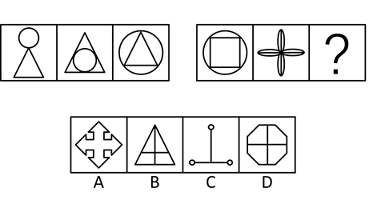

A. A

B. B

C. C

D. D

第 41 题 · 答案与解析

**参考答案（粉笔题库参考内容）**

C

**解析**

元素组成不同，优先考虑属性规律。观察图形，第一组图形都是由直线和曲线构成的图形，第二组图运用该规律，故？处也应填一个图形既有直线又有曲线，选项A、B、D都是直线图形，只有选项C符合。

故正确答案为C。

**考点**：属性规律-曲直性

**来源**：2015年天津市选调生选拔考试 综合知识试卷（精选）第41题

### 第 42 题

从所给四个选项中，选择最合适的一个填入问号处，使之呈现一定的规律性：

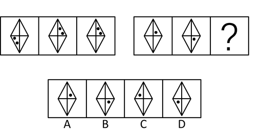

A. A

B. B

C. C

D. D

第 42 题 · 答案与解析

**参考答案（粉笔题库参考内容）**

B

**解析**

元素组成相同，优先考虑位置规律，观察发现位置规律不成立，考虑样式规律，在第一组图形中，空白+空白=空白，空白+黑点=黑点，黑点+空白=空白，第二组运用该规律，符合条件的只有选项B。

故正确答案为B。

**考点**：样式规律-黑白运算

**来源**：2015年天津市选调生选拔考试 综合知识试卷（精选）第42题

### 第 43 题

从所给四个选项中，选择最合适的一个填入问号处，使之呈现一定的规律性：

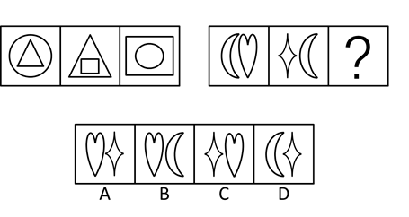

A. A

B. B

C. C

D. D

第 43 题 · 答案与解析

**参考答案（粉笔题库参考内容）**

A

**解析**

观察图形，发现每个图形都由2个元素组成。在第一组图中，圆、三角形、方块均出现两次，且位置内外遍历；第二组运用该规律，月亮出现两次，心形和四角星只出现一次，则？处心形和四角星应各出现一次，且位置左右遍历，只有选项A符合。

故正确答案为A。

**考点**：样式规律-遍历

**来源**：2015年天津市选调生选拔考试 综合知识试卷（精选）第43题

### 第 44 题

从所给四个选项中，选择最合适的一个填入问号处，使之呈现一定的规律性：

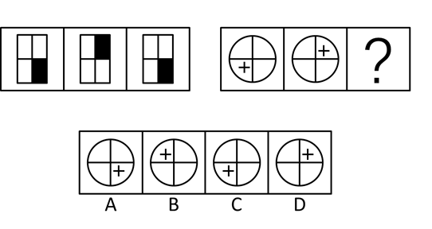

A. A

B. B

C. C

D. D

第 44 题 · 答案与解析

**参考答案（粉笔题库参考内容）**

C

**解析**

元素组成相同，优先考虑位置规律，观察发现位置规律不成立，考虑样式规律。观察发现第一组图形由黑白块组成，考虑黑白叠加，第一组图中，白+白=白，白+黑=白，黑+白=黑，第二组运用规律，白+白=白，白+加号=白，加号+白=加号，符合条件的只有选项C。

故正确答案为C。

**考点**：样式规律-黑白运算

**来源**：2015年天津市选调生选拔考试 综合知识试卷（精选）第44题

### 第 45 题

从所给四个选项中，选择最合适的一个填入问号处，使之呈现一定的规律性：

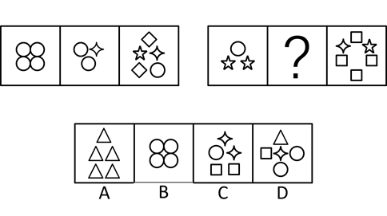

A. A

B. B

C. C

D. D

第 45 题 · 答案与解析

**参考答案（粉笔题库参考内容）**

C

**解析**

元素组成不同，且无明显属性规律，优先考虑数量规律。在第一组图形中，第一个图与第二个图有1个相同元素，第二个图与第三个图有2个相同元素，第二组运用该规律，A项与第一个图没有相同元素，排除；第三个图与B项没有相同元素，排除。第一组图中，共有4种元素，第二组图中，已有4种元素，？处不能再有新的元素，只有C项符合。

故正确答案为C。

**考点**：数量规律-素

**来源**：2015年天津市选调生选拔考试 综合知识试卷（精选）第45题

## 材料 2

下面的菱形表示红星市六种产业的数量按地域划分所占的百分比，图上的字母表示相关产业。菱形的四个顶点表示100%，与顶点相对应的最长线为基线，表示0%。

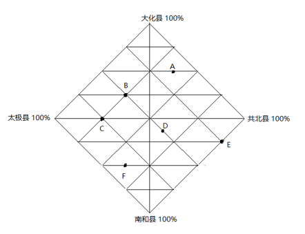

A——冶金业

B——纺织业

C——食品业

D——养殖业

E——房地产业

F——种植业

### 第 46 题

大约有百分之几的养殖业地处共北县？

A. 75%

B. 25%

C. 15%

D. 12.5%

第 46 题 · 答案与解析

**参考答案（粉笔题库参考内容）**

D

**解析**

养殖业为D点，如图所示，从D点做竖直垂线可知，D点在共北县的基线到顶点八分之一的位置，约为12.5％。

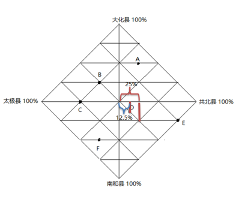

故正确答案为D。

**考点**：直接找数、统计图

**来源**：2015年天津市选调生选拔考试 综合知识试卷（精选）第46题

### 第 47 题

哪两种产业在太极县的分布大致相等？

A. 冶金业和养殖业

B. 食品业和养殖业

C. 纺织业和种植业

D. 纺织业和食品业

第 47 题 · 答案与解析

**参考答案（粉笔题库参考内容）**

C

**解析**

将各点向太极县的基线做竖直垂线可知，B点(纺织业)和F点(种植业)在同一条线上，在太极县占25%。

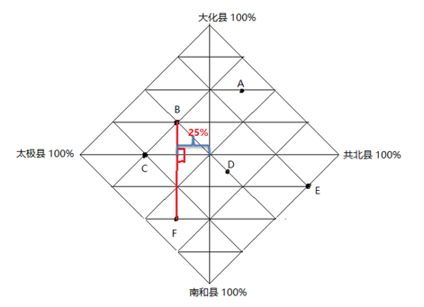

故正确答案为C。

**考点**：直接找数、统计图

**来源**：2015年天津市选调生选拔考试 综合知识试卷（精选）第47题

### 第 48 题

分布在南和县的种植业与养殖业之比接近于（    ）。

A. 2:1

B. 4:1

C. 3:2

D. 1:4

第 48 题 · 答案与解析

**参考答案（粉笔题库参考内容）**

B

**解析**

根据题干“······与······之比接近于”，结合选项均为比值，可判定本题为比值计算问题。D点为养殖业F点为种植业，分别向南和县的基线做垂直竖线可知，种植业在南和县占50%，养殖业占12.5%，则二者比值为50%:12.5%=4:1。

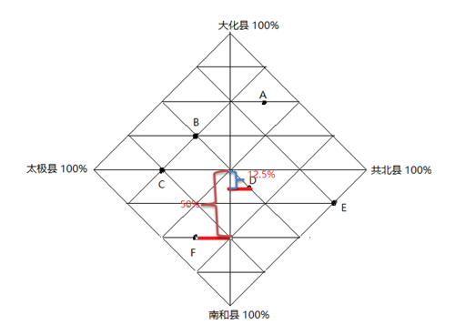

故正确答案为B。

**考点**：比值计算、统计图

**来源**：2015年天津市选调生选拔考试 综合知识试卷（精选）第48题

### 第 49 题

在太极县和大化县分布大致相等的产业是（    ）。

A. 食品业

B. 纺织业

C. 种植业

D. 冶金业

第 49 题 · 答案与解析

**参考答案（粉笔题库参考内容）**

B

**解析**

将各选项产业分别向太极县与大化县的基线做竖直垂线可知，B（纺织业）在太极县和大化县分布大致相等，均为25%。

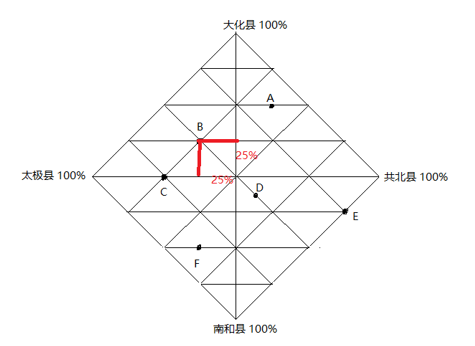

故正确答案为B。

**考点**：直接找数、统计图

**来源**：2015年天津市选调生选拔考试 综合知识试卷（精选）第49题

### 第 50 题

分别分布在太极、大化和南和县比例相等的产业是（  ）。

A. 食品业、冶金业和种植业

B. 纺织业、冶金业和种植业

C. 食品业、纺织业和房地产业

D. 养殖业、食品业和冶金业

第 50 题 · 答案与解析

**参考答案（粉笔题库参考内容）**

A

**解析**

将各项产业分别向太极县、大化县与南和县的基线做竖直垂线可知： C点（食品业）在太极县的分布为50%，A点（冶金业）在大化县分布为50%，F点（种植业）在南和县分布为50%，A项正确。

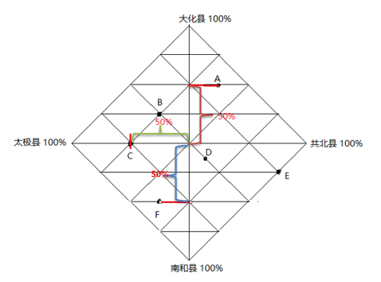

故正确答案为A。

**考点**：直接找数、统计图

**来源**：2015年天津市选调生选拔考试 综合知识试卷（精选）第50题

### 第 51 题

对哲学上的物质概念的正确理解是（  ）。

A. 物质是客观世界的各种现象

B. 物质是除意识之外的万事万物的总和

C. 物质是看不见摸不着的无形实物

D. 物质是不依赖于人的意识并能为人的意识所反映的客观实在

第 51 题 · 答案与解析

**参考答案（粉笔题库参考内容）**

D

**解析**

本题考查马克思主义哲学。

A项错误，物质概括了一切客观存在着的事物和现象的共同本质，而不单单指现象。

B项错误，物质是对万事万物的抽象和概况，不是万事万物的总和。

C项错误，物质有两种存在形式：一种是有形的，如实体；一种是无形的，如磁场。

D项正确，马克思主义哲学认为，物质是标志客观实在的哲学范畴，这种客观实在是人通过感觉感知的，它不依赖于我们的感觉而存在，为我们的感觉所复写、摄影、反映。客观实在性是物质的唯一特性。

故正确答案为D。

**考点**：唯物论

**来源**：2015年天津市选调生选拔考试 综合知识试卷（精选）第51题

### 第 52 题

“不入虎穴，焉得虎子”这句话体现的哲学原理是（  ）。

A. 实践是认识的来源

B. 实践是认识发展的动力

C. 实践是检验认识正确与否的唯一标准

D. 实践是认识的目的

第 52 题 · 答案与解析

**参考答案（粉笔题库参考内容）**

A

**解析**

本题考查马克思主义哲学。

A项正确，“不入虎穴，焉得虎子”，比喻不经历艰险，就不能取得成功；也指不经历艰苦实践，就难以取得真知。这反映在哲学上，体现了实践是认识的来源，只有实践才能让人认识到事物的本来面貌。

B项错误，实践推动认识由低级到高级、由浅入深、由片面到更多方面的发展。实践的发展不断地给认识提出新课题，规定了认识发展的方向，推动人们从事新的探索，形成新的理论。选项表述正确，但与题干无关。

C项错误，实践具有把主观和客观联系起来的特征，认识是否正确，不是依主观上觉得如何而定的，而是依客观上社会实践的结果如何而定。除了实践没有别的东西能够成为检验真理的标准。选项表述正确，但与题干无关。

D项错误，认识是从实践中得出来的，而认识的目的是指导实践，所以说实践是认识的目的和归宿。选项表述正确，但与题干无关。

故正确答案为A。

**考点**：认识论

**来源**：2015年天津市选调生选拔考试 综合知识试卷（精选）第52题

### 第 53 题

唯物辩证法认为，“发展”的实质是（  ）。

A. 旧事物的灭亡和新事物的产生

B. 事物之间的相互联系

C. 矛盾双方的相互转化

D. 矛盾双方的相互斗争

第 53 题 · 答案与解析

**参考答案（粉笔题库参考内容）**

A

**解析**

本题考查马克思主义哲学。

A项正确，发展是揭示事物运动、变化的整体趋势和方向性的范畴，是具有前进性质的运动，是事物由低级向高级、由简单向复杂、由无序向有序的上升运动，其实质是新事物的产生和旧事物的灭亡。新事物是指符合发展的前进方向、符合事物发展的客观规律、具有远大前途的事物。

B项错误，唯物辩证法的总特征是普遍联系和永恒发展。即事物的普遍联系是唯物辩证法的特征之一，但不是发展的实质。

C、D两项错误，体现了矛盾的同一性和斗争性，但不是发展的实质。

故正确答案为A。

**考点**：认识论

**来源**：2015年天津市选调生选拔考试 综合知识试卷（精选）第53题

### 第 54 题

意识同动物心理的一个重要区别在于（  ）。

A. 是自然界长期发展的产物

B. 具有感性的反映形式

C. 可以适应外界的变化

D. 能够反映事物的本质

第 54 题 · 答案与解析

**参考答案（粉笔题库参考内容）**

D

**解析**

本题考查马克思主义哲学。

A项错误，意识是自然界长期发展的产物，但这一点并不属于重要区别。

B项错误，意识的产生大体经历了三个决定环节：从无生命的物质到低等生物的刺激感应性；从低等生物的刺激感应性到高等动物的感觉和心理；从高等动物的感觉和心理到人类意识。所以说高等动物也有感性的反映形式（感觉）。

C项错误，意识和动物心理都可以适应外界的变化。

D项正确，意识是自然界长期发展的产物，它的本质是人脑对客观存在的主观映象。并且，意识能够充分发挥其能动作用，反映事物的本质和规律，这是意识与动物心理的重要区别。

故正确答案为D。

**考点**：唯物辩证法

**来源**：2015年天津市选调生选拔考试 综合知识试卷（精选）第54题

### 第 55 题

“物必先腐，而后虫生”所体现的哲理是（  ）。

A. 必然性与偶然性的辩证关系

B. 内因与外因的辩证关系

C. 可能性与现实性的辩证关系

D. 现象与本质的辩证关系

第 55 题 · 答案与解析

**参考答案（粉笔题库参考内容）**

B

**解析**

本题考查马克思主义哲学。

A项错误，必然性是指事物联系和发展中一定要发生的、不可避免的趋势。偶然性是指事物联系和发展中不确定的趋向。必然性和偶然性是对立统一的关系，但与题干表述无关。

B项正确，“物必先腐，而后虫生”，是指事物一定是自己先腐烂了，虫子才会生出来。这句话强调了事物自身对事物发展的重要性，揭示了内因是事物变化发展的根据，外因是事物变化发展的条件，外因通过内因起作用。

C项错误，可能性与现实性是反映事物过去、现在和将来的相互关系的一对范畴。现实性是指已经产生出来的、有内在根据的、合乎必然性的存在。可能性是指事物发展过程中潜在的东西，是包含在事物之中并预示事物发展前途的种种趋势。与题干表述无关。

D项错误，现象是事物的外在方面，是表面的、多变的、丰富多彩的、肤浅的。本质是事物的内在方面，是深藏的、相对稳定的、单纯的、深刻的。现象是感觉器官可以直接感知的，本质则只能运用抽象思维，间接地被人认识。与题干表述无关。

故正确答案为B。

**考点**：唯物辩证法

**来源**：2015年天津市选调生选拔考试 综合知识试卷（精选）第55题

### 第 56 题

“只要有信心，黄土变成金”所蕴含的哲理是（  ）。

A. 意识对物质具有能动的反作用

B. 意识活动本身可以改变客观世界

C. 人们的精神动力依赖于物质活动

D. 社会意识决定社会存在

第 56 题 · 答案与解析

**参考答案（粉笔题库参考内容）**

A

**解析**

本题考查马克思主义哲学。

A项正确，“只要有信心，黄土变成金”体现了物质与意识的辩证关系，即正确的意识对客观事物的发展具有促进作用，也就是说意识对物质具有能动的反作用。

B项错误，选项本身表述有误。意识活动对改变客观世界具有指导作用，而并非意识活动本身可以改变客观世界。实践是人有目的地、能动地改造世界的客观物质活动。

C项错误，人们的精神动力的确依赖于物质活动，反映了物质决定意识。选项表述正确，但与题干无关。

D项错误，选项本身表述有误。社会存在决定社会意识，社会意识是社会存在的反映。社会意识来源于社会存在，有什么样的社会存在就会有什么样的社会意识与之相适应。

故正确答案为A。

**考点**：认识论

**来源**：2015年天津市选调生选拔考试 综合知识试卷（精选）第56题

### 第 57 题

社会主义初级阶段必须毫不动摇地鼓励、支持和引导非公有制经济发展，其根本原因是（  ）。

A. 发展非公有制经济可以调动社会各方面的积极性

B. 非公有制经济在发展生产力中有不可替代的地位和作用

C. 非公有制经济是社会主义市场经济的有机组成部分

D. 非公有制经济适应现代社会化大生产的要求

第 57 题 · 答案与解析

**参考答案（粉笔题库参考内容）**

B

**解析**

本题考查社会主义市场经济体制。

 A、C、D三项错误，非公有制经济包括个体经济、私营经济、混合所有制经济中的非公有制成分等。此三项的内容都属于鼓励、支持和引导非公有制经济发展的原因，但却并不是其根本原因。

B项正确，非公有制经济是我国社会主义市场经济的重要组成部分，在加强社会主义建设方面有着不可替代的作用，必须毫不动摇地鼓励、支持和引导非公有制经济发展，根本上来说是由它们在发展社会生产力中不可替代的地位和作用决定的。

故正确答案为B。

**考点**：市场经济

**来源**：2015年天津市选调生选拔考试 综合知识试卷（精选）第57题

### 第 58 题

公安人员甲为获得证据，对犯罪嫌疑人乙施以暴力，结果导致乙肢体残疾，则甲的行为（  ）。

A. 构成刑讯逼供罪

B. 构成刑讯逼供罪和故意伤害罪

C. 构成过失重伤罪

D. 构成故意伤害罪

第 58 题 · 答案与解析

**参考答案（粉笔题库参考内容）**

D

**解析**

本题考查刑法。

A、B两项错误，D项正确，根据《中华人民共和国刑法》第二百四十七条规定：“【刑讯逼供罪、暴力取证罪】司法工作人员对犯罪嫌疑人、被告人实行刑讯逼供或者使用暴力逼取证人证言的，处三年以下有期徒刑或者拘役。致人伤残、死亡的，依照本法第二百三十四条、第二百三十二条的规定定罪从重处罚。” 刑法二百三十四条规定的是故意伤害罪，甲的行为构成刑讯逼供罪和故意伤害罪的竞合，以故意伤害罪定罪论处。

C项错误，根据《刑法》第二百三十五条规定：“【过失致人重伤罪】过失伤害他人致人重伤的，处三年以下有期徒刑或者拘役。本法另有规定的，依照规定。”

故正确答案为D。

**考点**：刑法

**来源**：2015年天津市选调生选拔考试 综合知识试卷（精选）第58题

### 第 59 题

人民代表大会制度作为我国的根本政治制度，是经由1954年9月召开的第一届全国人民代表大会第一次会议通过的（  ）正式确立。

A. 《中国人民政治协商会议共同纲领》

B. 《中华人民共和国宪法》

C. 《中华人民共和国中央人民政府组织法》

D. 《中国人民政治协商会议组织法》

第 59 题 · 答案与解析

**参考答案（粉笔题库参考内容）**

B

**解析**

本题考查毛中特。

A项错误，1949年9月29日，中国人民政治协商会议第一届全体会议选举了中央人民政府委员会，宣告了中华人民共和国的成立，并且通过了起临时宪法作用的《中国人民政治协商会议共同纲领》。

B项正确，第一部《中华人民共和国宪法》于1954年9月20日在第一届全国人民代表大会第一次会议上通过，共4章106条。被称为五四宪法。五四宪法是一部较为完善的宪法。在五四宪法中正式将人民代表大会制度作为我国的根本政治制度。

C项错误，1949年9月27日中国人民政治协商会议第一届全体会议通过《中华人民共和国中央人民政府组织法》。

D项错误，《中国人民政治协商会议组织法》是一部专为政协会议组织以及管理而诞生的法则，于1949年9月27日中国人民政治协商会议第一届全体会议通过。

故正确答案为B。

**考点**：党的历史

**来源**：2015年天津市选调生选拔考试 综合知识试卷（精选）第59题

### 第 60 题

刘某向孙某借款1万元，许诺1年后还款，并约定人死不赖账，三年半后，孙某向刘某讨债，那么（  ）。

A. 已过诉讼时效，刘某对该债务已失去所有权

B. 当事人约定抛弃时效利益，时效未过，法院应予以保护

C. 已过时效，刘某已取得所有权，原债权消灭

D. 若刘某自愿清偿，则不可以“时效已过，孙某不当得利”为由索还

第 60 题 · 答案与解析

**参考答案（粉笔题库参考内容）**

D

**解析**

本题考查程序法。

A项错误，根据《中华人民共和国民法总则》第一百八十八条规定：“向人民法院请求保护民事权利的诉讼时效期间为三年。法律另有规定的，依照其规定。诉讼时效期间自权利人知道或者应当知道权利受到损害以及义务人之日起计算。”本题中约定一年后还款，而三年半后，距离诉讼时效到期还有半年时间，因此诉讼时效未过。且债权人孙某依然享有债权，而债务人刘某也依然负有债务，刘某对债务的所有权并不会随诉讼时效是否过时而消失。

B项错误，诉讼时效是强制性规定，当事人不能约定抛弃。

C项错误，诉讼时效未过，且债权人的实体债权也未消灭。

D项正确，最高人民法院《关于审理民事案件适用诉讼时效制度若干问题的规定》第二十二条规定：“诉讼时效期间届满，当事人一方向对方当事人作出同意履行义务的意思表示或者自愿履行义务后，又以诉讼时效期间届满为由进行抗辩的，人民法院不予支持。”虽然债权未过诉讼时效，但如果债务人自愿清偿，那么不可以诉讼时效已过或者不当得利为由要求索还。

故正确答案为D。

**考点**：诉讼法

**来源**：2015年天津市选调生选拔考试 综合知识试卷（精选）第60题

### 第 61 题

农民王某在买菜过程中和市民李某发生冲突，造成市民李某轻微伤。公安机关可以依据《治安管理处罚法》对王某处以（  ）。

A. 拘留

B. 拘役

C. 罚金

D. 诉讼

第 61 题 · 答案与解析

**参考答案（粉笔题库参考内容）**

A

**解析**

本题考查行政法。

A项正确，根据《治安管理处罚法》第十条第一款规定：“治安管理处罚的种类分为：(一)警告；(二)罚款；(三)行政拘留；(四)吊销公安机关发放的许可证。对违反治安管理的外国人，可以附加适用限期出境或者驱逐出境。”因此公安机关可依据《治安管理处罚法》对违法行为人进行行政拘留。

B项错误，根据《刑法》第三十三条规定：“主刑的种类如下：(一)管制；(二)拘役；(三)有期徒刑；(四)无期徒刑；(五)死刑。”因此拘役属于刑罚主刑的一种，不属于行政处罚。

C项错误，根据《刑法》第三十四条规定：“附加刑的种类如下：(一)罚金；(二)剥夺政治权利；(三)没收财产。附加刑也可以独立适用。”因此罚金属于刑罚附加刑的一种，不属于行政处罚。

D项错误，诉讼，指纠纷当事人通过向具有管辖权的法院起诉另一方当事人解决纠纷的形式。诉讼只能由行政相对人王某提起，公安机关作为行政主体不能提起行政诉讼，因此该选项表述错误。

故正确答案为A。

**考点**：行政法

**来源**：2015年天津市选调生选拔考试 综合知识试卷（精选）第61题

### 第 62 题

党的组织制度和领导制度是（  ）。

A. 少数服从多数

B. 民主集中制

C. 下级服从上级

D. 人民代表大会制度

第 62 题 · 答案与解析

**参考答案（粉笔题库参考内容）**

B

**解析**

本题考查毛中特。

B项正确、AC项错误，根据《中国共产党章程》第二章 党的组织制度 第十条规定：“党是根据自己的纲领和章程，按照民主集中制组织起来的统一整体。党的民主集中制的基本原则是：（一）党员个人服从党的组织，少数服从多数，下级组织服从上级组织，全党各个组织和全体党员服从党的全国代表大会和中央委员会······”党的组织制度和领导制度是民主集中制，而少数服从多数、下级服从上级仅仅是民主集中制的基本原则之一。

D项错误，人民代表大会制度是我国的根本政治制度，根据《宪法》第二条第二款规定：“人民行使国家权力的机关是全国人民代表大会和地方各级人民代表大会。”

故正确答案为B。

**考点**：党的历史

**来源**：2015年天津市选调生选拔考试 综合知识试卷（精选）第62题

### 第 63 题

行政管理是指国家行政机关依法管理（  ）的组织活动。

A. 国家事务

B. 社会事务

C. 民族事务

D. 国家事务和社会事务

第 63 题 · 答案与解析

**参考答案（粉笔题库参考内容）**

D

**解析**

本题考查行政管理。

行政管理是运用国家权力依法对国家和社会公共事务的一种管理活动，也可以泛指一切企业、事业单位的行政事务管理工作。随着社会的发展，行政管理的对象日益广泛，包括经济建设、文化教育、市政建设、社会秩序、公共卫生、环境保护等各个方面。因此，行政管理是指国家行政机关依法管理国家事务和社会事务。选项D正确，ABC项错误。

故正确答案为D。

**来源**：2015年天津市选调生选拔考试 综合知识试卷（精选）第63题

### 第 64 题

古代官德中，讲“以民为本”，它主要包括民为邦本、爱民如子、富民利民、（  ）。

A. 为民请命

B. 为民谋利

C. 为民做主

D. 为民伸冤

第 64 题 · 答案与解析

**参考答案（粉笔题库参考内容）**

C

**解析**

本题考查人文历史。

古代官德中讲“以民为本”，它主要包括民为邦本、爱民如子、富民利民和为民做主。古代官员处理与民众关系的伦理原则就是“爱民”，这一原则可具体表现为知、情、意、行四个方面：（1）民为邦本、以民为本的理性认识；（2）爱民如子、与民同乐的道德情感；（3）为民做主的道德意志；（4）富民利民的道德行为。因此选项C正确，选项ABD错误。

故正确答案为C。

**考点**：文化常识

**来源**：2015年天津市选调生选拔考试 综合知识试卷（精选）第64题

### 第 65 题

近代首先喊出“振兴中华”的口号的是（  ）。

A. 孙中山

B. 毛泽东

C. 周恩来

D. 邓小平

第 65 题 · 答案与解析

**参考答案（粉笔题库参考内容）**

A

**解析**

本题考查人文历史。

“振兴中华”是孙中山在建立兴中会时提出的挽救国家危亡的口号。1894年，孙中山在《兴中会章程》提出：“是会（兴中会）之设，专为振兴中华、维持国体起见。”

故正确答案为A。

**考点**：中国历史

**来源**：2015年天津市选调生选拔考试 综合知识试卷（精选）第65题

### 第 66 题

抗日战争时期，八路军进行的一次规模最大、时间最长的战略进攻性战役是（  ）。

A. 平型关大捷

B. 徐州会战

C. 武汉会战

D. 百团大战

第 66 题 · 答案与解析

**参考答案（粉笔题库参考内容）**

D

**解析**

本题考查毛中特。

A项错误，平型关大捷是八路军为了配合第二战区的友军作战，阻挡日军攻势，由115师师长林彪、副师长聂荣臻指挥，充分发挥近战和山地战的特长，首次集中较大兵力对日军进行的一次成功伏击战，八路军在平型关取得首战大捷。平型关大捷是八路军出师华北抗日战场后首战大捷，同时也是抗战以来的首次大捷。

B项错误，徐州会战是抗日战争时期中日双方在以江苏省徐州为中心的津浦(天津至浦口)、陇海(宝鸡至连云港)铁路地区进行的一次大规模防御战役，其中以1938年三四月间的台儿庄大战最为著名，因围歼日军一万余人，史称之为台儿庄大捷。徐州会战对日军给予了巨大的打击，大大迟滞了日军进攻的脚步，为中方部署武汉会战赢得了时间。徐州会战作战双方为国民党军队与日军。

C项错误，武汉会战，是抗日战争时期中国军队在武汉地区同日本侵略军展开的一场会战。武汉会战是抗日战争战略防御阶段规模最大、时间最长、歼敌最多的一次战役。武汉会战作战双方为国民党军队与日军。

D项正确，百团大战是1940年下半年，彭德怀指挥八路军一二九师和晋察冀军区等共105个团20余万兵力与日军在中国华北地区晋察冀边区发生的一次规模最大、持续时间最长、战果最辉煌的战役。

故正确答案为D。

**考点**：党的历史

**来源**：2015年天津市选调生选拔考试 综合知识试卷（精选）第66题

### 第 67 题

中国共产党领导全国各族人民，经过长期的反对帝国主义、封建主义、（  ）资本主义的革命斗争，取得了新民主主义革命的胜利。

A. 剥削

B. 权贵

C. 官僚

D. 垄断

第 67 题 · 答案与解析

**参考答案（粉笔题库参考内容）**

C

**解析**

本题考查宪法。

根据《宪法》序言规定：一九四九年，以毛泽东主席为领袖的中国共产党领导中国各族人民，在经历了长期的艰难曲折的武装斗争和其他形式的斗争以后，终于推翻了帝国主义、封建主义和官僚资本主义的统治，取得了新民主主义革命的伟大胜利，建立了中华人民共和国。从此，中国人民掌握了国家的权力，成为国家的主人。

故正确答案为C。

**考点**：宪法

**来源**：2015年天津市选调生选拔考试 综合知识试卷（精选）第67题

### 第 68 题

（  ）的发表，是马克思主义党的学说创立的主要标志。

A. 《共产主义者同盟章程》

B. 《共产党宣言》

C. 《共产主义原理》

D. 《关于波兰的演说》

第 68 题 · 答案与解析

**参考答案（粉笔题库参考内容）**

B

**解析**

本题考查中共党史。

A项错误，1847年6月世界上第一个共产党的党章——《共产主义者同盟章程》诞生，在章程中对入党誓言作过规定，这是入党誓词的雏形。《共产主义者同盟章程》的基本框架、基本原则和基本内容，是此后世界各国共产党的党章一直坚持的原则和模式。

B项正确，《共产党宣言》是第一部较为完整而系统地阐述科学社会主义基本原理的伟大著作。它标志着马克思主义的诞生，是马克思主义党的学说创立的主要标志，开辟了国际工人运动和社会主义运动的新局面，成为世界无产阶级的锐利思想武器。

C项错误，《共产主义原理》是为共产主义者同盟撰写的纲领草案。该书通过对25个问题的回答阐述了科学共产主义的基本原理，是《共产党宣言》的重要准备著作。

D项错误，《关于波兰的演说》是1847年11月29日，马克思和恩格斯在伦敦举行的纪念1830年波兰起义十七周年的国际大会上各自发表了重要演说，论述了民族问题与所有制关系的联系。

故正确答案为B。

**考点**：中国历史

**来源**：2015年天津市选调生选拔考试 综合知识试卷（精选）第68题

### 第 69 题

中国共产党的领导地位是由（  ）决定的。

A. 党的执政地位

B. 我国的政党制度

C. 党的性质

D. 我国的国情

第 69 题 · 答案与解析

**参考答案（粉笔题库参考内容）**

C

**解析**

本题考查毛中特。

中国共产党是中国工人阶级的先锋队，同时也是中国人民和中华民族的先锋队。党不仅代表中国工人阶级的利益，而且代表整个中华民族和中国最广大人民的根本利益。从诞生的那一天起，党就把最广大人民的利益放在第一位，把全心全意为人民服务作为自己的根本宗旨，把实现好、维护好、发展好最广大人民的根本利益作为自己一切行动的根本出发点和落脚点。中国共产党95载波澜壮阔的伟大历程雄辩证明：党的领导地位不是自封的，是由党的性质和宗旨决定的，是历史和人民的选择。

故正确答案为C。

**考点**：党的历史

**来源**：2019年1月天津市定向招录选调生考试综合能力测试试卷（精选）第37题

### 第 70 题

建国初期进行的“三反”斗争的内容是（  ）。

A. 反贪污、反受贿、反主观主义

B. 反贪污、反浪费、反官僚主义

C. 反贪污、反受贿、反官僚主义

D. 反浪费、反受贿、反主观主义

第 70 题 · 答案与解析

**参考答案（粉笔题库参考内容）**

B

**解析**

本题考查毛中特。

“三反”运动是指1951年底到1952年上半年，中国共产党和国家机关内部发动了一场反对贪污、反对浪费、反对官僚主义的运动。这场运动旨在通过肃清和惩戒一切政权内部的贪污腐败分子的办法，来消除在干部间日趋严重的贪腐、拜金现象。因此选项B正确，ACD错误。

故正确答案为B。

**考点**：党的历史

**来源**：2015年天津市选调生选拔考试 综合知识试卷（精选）第70题

### 第 71 题

关于我国国土资源基本特征描述不正确的是（  ）。

A. 总量多、人均少

B. 质量比较好，但利用效果不理想

C. 土地资源分布不平衡

D. 平地少，山地多

第 71 题 · 答案与解析

**参考答案（粉笔题库参考内容）**

B

**解析**

本题考查国情省情。

A项正确，我国国土资源绝对数量大，种类齐全，其中有不少在世界上居优势地位。但因人口众多，人均占有量大大低于世界平均水平。

B项错误，由于中国自然条件的复杂性和各地历史发展过程的特殊性，中国土地资源利用的情况极为复杂，并不是效果不理想。

C项正确，我国土地资源分布不平衡，土地生产力地区间差异显著。东南部季风区土地生产力较高；西北内陆区光照充足，热量也较丰富，但干旱少雨，水源少，沙漠、戈壁、盐碱面积大，土地自然生产力低。青藏高原地区大部分海拔在3000米以上，日照虽充足，但热量不足，高而寒冷，土地自然生产力低，而且不易利用。

D项正确，我国地形复杂多样，陆地地形的基本类型在我国都有分布；其中，山地占33%，高原占26%，盆地占19%，平原占12%，丘陵占10%。

本题为选非题，故正确答案为B。

**考点**：中国地理

**来源**：2015年天津市选调生选拔考试 综合知识试卷（精选）第71题

### 第 72 题

以下不属于第三产业的是（  ）。

A. 交通运输业

B. 通讯业

C. 飞机制造业

D. 金融保险业

第 72 题 · 答案与解析

**参考答案（粉笔题库参考内容）**

C

**解析**

本题考查宏观经济。

根据社会生产活动历史发展的顺序 （劳动对象的加工程度） 可将产业结构划分为三种：产品直接取自自然界的部门称为第一产业；对初级产品进行再加工的部门称为第二产业；为生产和消费提供各种服务的部门称为第三产业。第三产业范围比较广泛，主要包括交通运输业、通讯产业、餐饮业、金融保险业、房地产业、教育产业、公共服务等非物质生产部门。

A、B、D项正确，交通运输业、通讯业、金融保险业均属于第三产业。

C项错误，飞机制造业属于第二产业。第二产业主要指工业和建筑业。

本题为选非题，故正确答案为C。

**考点**：宏观经济与调控政策

**来源**：2015年天津市选调生选拔考试 综合知识试卷（精选）第72题

### 第 73 题

下列说法不正确的是（  ）。

A. 海南省三沙市管辖西沙、南沙、中沙三个群岛

B. 我国水能资源总量居世界首位

C. 我国地势东高西低，山地、高原和丘陵约占陆地面积的67%

D. 松辽平原是我国重要的粮食生产基地，是世界著名的玉米带

第 73 题 · 答案与解析

**参考答案（粉笔题库参考内容）**

C

**解析**

本题考查国情省情。

A项正确，2012年6月21日，民政部公告宣布，国务院正式批准，撤销西沙群岛、南沙群岛、中沙群岛办事处，建立地级三沙市，管辖西沙群岛、中沙群岛、南沙群岛的岛礁及其海域，政府驻西沙永兴岛。

B项正确，我国水能资源蕴藏量约6.8亿千瓦，居世界第一位，其中长江水系、雅鲁藏布江、黄河中上游和珠江水系尤其丰富。

C项错误，中国地势西高东低，呈阶梯状分布，山地、高原和丘陵约占陆地面积的69%（山地占33%，高原占26%，丘陵占10%），盆地和平原分别占陆地面积的19%、12%。

D项正确，松辽平原位于东北平原，土地肥沃，是全球仅有的三大黑土区域之一，是中国重要的粮食、大豆、畜牧业生产基地，被称为中国的玉米带。

本题为选非题，故正确答案为C。

**考点**：中国地理

**来源**：2015年天津市选调生选拔考试 综合知识试卷（精选）第73题

### 第 74 题

（  ）属于中国四大国粹之一。

A. 古琴

B. 象棋

C. 风筝

D. 中医

第 74 题 · 答案与解析

**参考答案（粉笔题库参考内容）**

D

**解析**

本题考查人文历史。

A项错误，古琴，又称瑶琴、玉琴、丝桐和七弦琴，是中国的传统乐器，至少有三千五百年以上的历史。古琴不属于中国四大国粹之一。

B项错误，象棋，中国传统棋类益智游戏，在中国有着悠久的历史，具体诞生时间存在争议，但先秦时期已有记载。象棋不属于中国四大国粹之一。

C项错误，风筝是我国古代劳动人民发明的一种传统工艺，至今已2000多年。最早使用木头制成的木鸟，后来改用竹子制作。直至东汉期间，蔡伦改进造纸术后，坊间才开始以纸做风筝，称为“纸鸢”。风筝不属于中国四大国粹之一。

D项正确，中医，是研究人体生理、病理以及疾病的诊断和防治等的一门学科，一般指以中国汉族劳动人民创造的传统医学为主的医学，所以也称汉医。中医与中国武术、京剧和书法并称中国四大国粹。

故正确答案为D。

**考点**：文化常识

**来源**：2015年天津市选调生选拔考试 综合知识试卷（精选）第74题

### 第 75 题

我国是一个多民族的国家，其中少数民族中人口最多的民族是（  ）。

A. 朝鲜族

B. 回族

C. 满族

D. 壮族

第 75 题 · 答案与解析

**参考答案（粉笔题库参考内容）**

D

**解析**

本题考查国情省情。

根据第六次人口普查，我国少数民族中，人口过千万的有4个，分别是（按人口排名）壮族、回族、满族和维吾尔族，其中壮族人口最多，人数为16926381。

故正确答案为D。

**考点**：中国地理

**来源**：2015年天津市选调生选拔考试 综合知识试卷（精选）第75题

### 第 76 题

以下说法不正确的是（  ）。

A. 长江三峡水利枢纽工程是当今世界上最大的水利枢纽工程

B. 北京故宫是世界上现存规模最大的木质结构的宫殿型建筑

C. 丝绸之路是古代中国传播文化的重要国际通道

D. 青藏铁路是全球海拔最高和最长的铁路

第 76 题 · 答案与解析

**参考答案（粉笔题库参考内容）**

D

**解析**

本题考查国情省情。

A项正确，长江三峡水利枢纽工程是当今世界上最大的水利枢纽工程，也是中国有史以来建设最大型的工程项目。

B项正确，北京故宫又叫紫禁城，是世界上现存规模最大、保存最为完整的木质结构的宫殿型建筑。

C项正确，丝绸之路是古代亚欧互通有无的商贸大道，同时它还是亚欧各国和中国友好往来得重要通道，促进了民族融合、艺术文化交流，是一条沟通东西方文化的友谊之路。

D项错误，青藏铁路东起青海西宁，南至西藏拉萨，全长1956千米，其中海拔4000米以上的路段960千米，是世界海拔最高、线路最长的高原铁路，但青藏铁路并非世界最长的铁路，一般认为世界最长的铁路是俄罗斯西伯利亚铁路，全长9288公里，从莫斯科到符拉迪沃斯托克跨越8个时区。

本题为选非题，故正确答案为D。

**考点**：中国地理

**来源**：2015年天津市选调生选拔考试 综合知识试卷（精选）第76题

### 第 77 题

下列关于中国北斗卫星导航系统认识不正确的是（  ）。

A. 它实现了导航功能的全球覆盖

B. 它有利于维护我国的国家安全

C. 它有助于提高我国的国际地位

D. 它推动了我国经济社会的发展

第 77 题 · 答案与解析

**参考答案（粉笔题库参考内容）**

A

**解析**

本题考查科技知识。

A项错误，目前北斗系统的发射卫星数量还无法做到导航功能的全球覆盖。北斗卫星导航系统计划在2020年前后，建成北斗全球系统，向全球提供服务。

B项正确，北斗卫星导航系统是我国着眼于国家安全和经济社会发展需要，自主建设、独立运行的卫星导航系统。

C项正确，北斗卫星导航系统可以深化国际合作，共享卫星导航发展成果，与其他卫星导航系统携手，提高全球卫星导航系统的综合应用效益，同时也有助于提高我国的国际地位。

D项正确，推进北斗系统市场化、规模化应用，发展北斗产业，服务经济社会发展和民生改善也是其发展目标之一。

本题为选非题，故正确答案为A。

**考点**：科技理论与成就

**来源**：2015年天津市选调生选拔考试 综合知识试卷（精选）第77题

### 第 78 题

根据邓小平同志关于加强社会主义精神文明建设的指导思想和多次论述，党中央提出，我国社会主义精神文明建设的基本方针是（    ）。

A. 全党动员，齐抓共管

B. 统筹兼顾，协调发展

C. 综合治理

D. 重在建设

第 78 题 · 答案与解析

**参考答案（粉笔题库参考内容）**

D

**解析**

本题考查中国特色社会主义理论体系。

在十四届六中全会通过的《中共中央关于加强社会主义精神文明建设若干重要问题的决议》中指出：社会主义精神文明建设，必须是围绕和推动社会主义现代化建设的精神文明建设，必须是促进全面改革和实行对外开放的精神文明建设，必须是坚持四项基本原则的精神文明建设。精神文明“重在建设”，加大精神文明建设的工作力度，把精神文明建设提高到一个新水平，在实践中我们必须重在建设。

故正确答案为D。

**考点**：其他建设

**来源**：2015年天津市选调生选拔考试 综合知识试卷（精选）第78题

### 第 79 题

政府机构改革的难点是（    ）。

A. 精简机构

B. 裁减人员

C. 提高效率

D. 转变政府职能

第 79 题 · 答案与解析

**参考答案（粉笔题库参考内容）**

D

**解析**

本题考查行政管理。

党的十八大以来，以习近平同志为总书记的党中央对深化行政体制改革提出了明确要求。十八届二中全会指出，转变政府职能是深化行政体制改革的核心。

故正确答案为D。

**来源**：2019年1月天津市定向招录选调生考试综合能力测试试卷（精选）第47题

### 第 80 题

“公务员的职务应当对应相应的级别”，对这一法条的正确理解是（    ）。

A. 同一职务上的公务员其级别相同

B. 公务员职务与级别的对应关系可以根据机关职能确定

C. 公务员在不晋升职务的情况下可以晋升级别

D. 公务员的级别根据其工作实绩确定

第 80 题 · 答案与解析

**参考答案（粉笔题库参考内容）**

C

**解析**

本题考查法律常识。

A项错误，根据《中华人民共和国公务员法》第二十一条第三款规定：“公务员的级别根据所任领导职务、职级及其德才表现、工作实绩和资历确定。公务员在同一领导职务、职级上，可以按照国家规定晋升级别。”因此公务员可以同职不同级。

B项错误，根据《中华人民共和国公务员法》第十九条第一款规定：“公务员职务与级别的对应关系，由国务院规定。”

C项正确，根据《中华人民共和国公务员法》第十九条第三款规定：“公务员在同一职务上，可以按照国家规定晋升级别。”因此公务员可以在不晋升职务的情况下晋升级别。

D项错误，根据《中华人民共和国公务员法》第十九条第三款规定：“公务员的级别根据所任职务及其德才表现、工作实绩和资历确定。”因此不能单单看工作业绩一项。

故正确答案为C。

**考点**：行政法

**来源**：2015年天津市选调生选拔考试 综合知识试卷（精选）第80题

### 第 81 题

国家公务员交流制度不包括（    ）。

A. 调任

B. 转任

C. 提拔

D. 挂职锻炼

第 81 题 · 答案与解析

**参考答案（粉笔题库参考内容）**

CD

**解析**

本题考查法律常识。

C、D两项错误，根据2018年修改的《公务员法》第六十九条的规定：“国家实行公务员交流制度。公务员可以在公务员和参照本法管理的工作人员队伍内部交流，也可以与国有企业和不参照本法管理的事业单位中从事公务的人员交流。交流的方式包括调任、转任。”挂职不再被视为交流制度。

本题为选非题，故正确答案为CD。

**考点**：行政法

**来源**：2015年天津市选调生选拔考试 综合知识试卷（精选）第81题

### 第 82 题

“决议”属于（  ）。

A. 会议文件

B. 规范性文件

C. 领导指导性文件

D. 公布性文件

第 82 题 · 答案与解析

**参考答案（粉笔题库参考内容）**

C

**解析**

本题考查公文的基本知识。

A项错误，会议文书是各类社会组织在其职权范围内制定的公开发布并反复适用，用以规范行为、具有普遍约束力的文件。包括开会通知、会议议程、会议记录和会议纪要。

B项错误，规范性文件一般是指属于法律范畴（即宪法、法律、行政法规、地方性法规、自治条例、单行条例、国务院部门规章和地方政府规章）的立法性文件和除此以外的由国家机关和其他团体、组织制定的具有约束力的非立法性文件（条例、规定、通告、办法、决定等）的总和。

C项正确，领导指导性公文（文件）的一般特点是：公文内容对规定受文者的行为具有强制约束力，有关下级机关及有关个人必须认真遵行；公文所针对的问题带有一定的随机性，涉及特定的问题、特定的人，一般不具有普遍性；有效期一般不长，时过境迁公文即失去执行效用；与规范性公文相比生效程序相对简约，除决定、决议等之外，只要发文机关的法定代表对公文的效用予以确认（如签发），即为有效。主要包括：批复、命令、决定、决议等。

D项错误，公布性公文的一般特点是：公文一经形成即直接公之于众，无保密要求；所涉及事项性质重要且具有普遍意义或重复发生的特点；除少部分公文为重要消息只需国内或国内国外各方面广泛知晓外，大部分公文对有关方面的行为具有强制约束力，要求严格遵守施行；有关规范多为政策且是反复适用的，所涉及的是多数人和普遍性事务而非特定具体的人或事，有效适用期限虽不如规范性公文长，但比一般的领导指导性公文要长远。主要包括：公告和通报等。

故正确答案为C。

**来源**：2015年天津市选调生选拔考试 综合知识试卷（精选）第82题

### 第 83 题

机关之间的工作关系决定了公文传递的（  ）。

A. 时间

B. 顺序

C. 方向

D. 目的

第 83 题 · 答案与解析

**参考答案（粉笔题库参考内容）**

C

**解析**

本题考查公文的基本知识。

机关之间的工作关系是由各自的组织系统或专业系统归属、地位、职责、权利范围等因素决定的。它对行文关系有决定性的影响，规定着公文传递的基本方向。上下级关系的机关间公文传递用上行文或下行文，同级或不相隶属机关之间公文传递为平行文。

故正确答案为C。

**来源**：2015年天津市选调生选拔考试 综合知识试卷（精选）第83题

### 第 84 题

以下公文种类，属于联系类公文的是（  ）。

A. 公告

B. 请示

C. 合同

D. 函

第 84 题 · 答案与解析

**参考答案（粉笔题库参考内容）**

D

**解析**

本题考查公文的基本知识。联系类公文是机关或单位之间相互商洽工作、询问和答复问题的公文，行文方向为平行文。

A项错误，公告是“适用于向国内外宣布重要事项或法定事项”的行政公文，属于公布性公文。

B项错误，请示是指下级机关向上级机关请求对某项工作、问题作出指示，对某项政策界限给予明确，对某事予以审核批准时使用的一种请求性公文。

C项错误，合同是当事人或当事双方之间设立、变更、终止民事关系的协议，不属于公文类型。

D项正确，函是指不相隶属机关之间商洽工作、询问和答复问题时所使用的公文，属于联系类公文。

故正确答案为D。

**来源**：2015年天津市选调生选拔考试 综合知识试卷（精选）第84题

### 第 85 题

辽宁省人民政府向中华人民共和国教育部主送的公文属于（  ）。

A. 上行文件

B. 下行文件

C. 平行文件

D. 呈请性文件

第 85 题 · 答案与解析

**参考答案（粉笔题库参考内容）**

C

**解析**

本题考查公文的基本知识。

A项错误，上行文，是指下级机关或业务部门向所属上级领导机关或业务主管部门的一种行文，如请示、报告。

B项错误，下行文，是指上级领导机关或业务主管部门对所属的下级机关的一种行文，如通知、批复等。

C项正确，平行文，是指同级机关，或者不相隶属的，没有领导与指导关系的机关、部门、单位之间的一种行文，如函等。本题中，辽宁省人民政府与教育部属于同级，不具有隶属关系，两者主送的公文属于平行文。

D项错误，呈请性公文是上行文的一种，主要有请示、报告等。

故正确答案为C。

**来源**：2015年天津市选调生选拔考试 综合知识试卷（精选）第85题

### 第 86 题

下列选项中属于用公文格式制发调查报告的标题的是（  ）。

A. 《340名大学生公德状况的调查》

B. 《XX公司是如何提高全员素质的》

C. 《奉献为人——来自一个乡村田野的调查报告》

D. 《关于加大XX的技术发展力度的调查报告》

第 86 题 · 答案与解析

**参考答案（粉笔题库参考内容）**

D

**解析**

本题考查公文的基本知识。

A、B项错误，公文标题由发文机关名称、事由和文种组成，其中，发文机关和事由均可省略，但文种不可省略，A、B项无文种，不符合标题格式的规定。

C项错误，公文标题应当准确简要地概括公文的主要内容并标明公文种类，一般标题中，除法规、规章名称加书名号外，一般不用标点符号。

D项正确，该项公文标题符合公文格式的标题的要求。

故正确答案为D。

**来源**：2015年天津市选调生选拔考试 综合知识试卷（精选）第86题

### 第 87 题

有人说：“自古华山一条路，只有上大学才有前途。”其实，很多著名科学家、文学家、政治家都没上过大学，像英国物理学家法拉第、美国科学家富兰克林、爱迪生、俄国文学家高尔基，我国著名革命家毛泽东、萧楚女都没上过大学，他们都是靠自学成才的。这段话运用的论证方法是（    ）。

A. 例证法

B. 类比法

C. 喻证法

D. 反驳法

第 87 题 · 答案与解析

**参考答案（粉笔题库参考内容）**

D

**解析**

本题考查人文常识。

A项错误，例证法，又称举例论证，是亮明观点后举出具体实例证明观点的论证方法。

B项错误，类比法，又称比较类推法，是指由一类事物所具有的某种属性，可以推测与其类似的事物也应具有这种属性的推理论证方法。

C项错误，喻证法，又称比喻论证法，是指用人们熟知的事物来作比喻证明文章观点的一种论证方法。

D项正确，反驳法一般可分为三种：驳论点（直接反驳对方论点）；驳论据（通过反驳对方论据来驳倒对方论点）；驳论证（通过反驳对方的论证过程来驳倒对方论点）。本题中，“只有上大学才有前途”是论点，强调了“上大学”对“前途”的重要性，从后面的“其实”（转折词），以及“都没上过大学”“靠自学成才的”，可以看出，后面的语句是反驳第一句话的论点。因此，这段话运用的论证方法是反驳法中的驳论点。

故正确答案为D。

**考点**：文化常识

**来源**：2015年天津市选调生选拔考试 综合知识试卷（精选）第87题

### 第 88 题

公务员要按照规定的（    ）和程序认真履行职责，努力提高工作效率。

A. 任务

B. 义务

C. 权利

D. 权限

第 88 题 · 答案与解析

**参考答案（粉笔题库参考内容）**

D

**解析**

本题考查法律常识。

D项正确，根据《公务员法》第十四条规定：“公务员应当履行下列义务：（一）忠于宪法，模范遵守、自觉维护宪法和法律，自觉接受中国共产党领导；（二）忠于国家，维护国家的安全、荣誉和利益；（三）忠于人民，全心全意为人民服务，接受人民监督；（四）忠于职守，勤勉尽责，服从和执行上级依法作出的决定和命令，按照规定的权限和程序履行职责，努力提高工作质量和效率；（五）保守国家秘密和工作秘密；（六）带头践行社会主义核心价值观，坚守法治，遵守纪律，恪守职业道德，模范遵守社会公德、家庭美德；（七）清正廉洁，公道正派；（八）法律规定的其他义务。”因此，ABC项均不符合题意。

故正确答案为D。

**考点**：行政法

**来源**：2015年天津市选调生选拔考试 综合知识试卷（精选）第88题

### 第 89 题

以下关于公务员受处分的法律后果不正确的是（    ）。

A. 受警告处分的公务员在受处分期间内不得晋升工资档次

B. 受记过处分的公务员在受处分期间不得晋升职务、级别

C. 受降级处分的公务员在受处分期间不仅不得晋升职务也不能晋升工资档次

D. 受开除处分的公务员不得再次被录用为公务员

第 89 题 · 答案与解析

**参考答案（粉笔题库参考内容）**

A

**解析**

本题考查法律常识。

A项错误，B、C两项正确，根据《公务员法》第六十四条第一款规定：“公务员在受处分期间不得晋升职务和级别，其中受记过、记大过、降级、撤职处分的，不得晋升工资档次。”

D项正确，根据《公务员法》第二十六条规定：“下列人员不得录用为公务员：（一）曾因犯罪受过刑事处罚的；（二）曾被开除公职的；（三）有法律规定不得录用为公务员的其他情形的。”

本题为选非题，故正确答案为A。

**考点**：行政法

**来源**：2015年天津市选调生选拔考试 综合知识试卷（精选）第89题

### 第 90 题

邓小平同志建设有中国特色社会主义理论首要的理论问题是（  ）。

A. 社会主义初级阶段理论

B. 什么是市场经济，怎样建设社会主义市场经济体制

C. 解放思想，实事求是

D. 什么是社会主义，怎样建设社会主义

第 90 题 · 答案与解析

**参考答案（粉笔题库参考内容）**

D

**解析**

本题考查中国特色社会主义理论体系。

A项错误，社会主义初级阶段的理论是邓小平理论的重要组成部分，是邓小平理论的重要基石之一。

B项错误，“什么是市场经济，怎样建设社会主义市场经济体制”，是邓小平社会主义市场经济体制需要回答的问题。

C项错误，“解放思想，实事求是”是邓小平理论的精髓。

D项正确，“什么是社会主义、怎样建设社会主义”是邓小平同志在领导改革开放和现代化建设这一新的革命过程中，不断提出和反复思考的首要的基本的理论问题。邓小平理论就是在围绕对“什么是社会主义，怎样建设社会主义”这个首要的基本问题的再认识基础上逐步形成和发展起来的。

故正确答案为D。

**来源**：2015年天津市选调生选拔考试 综合知识试卷（精选）第90题

### 第 91 题

关于人事争议仲裁，以下说法正确的是（  ）。

A. 提交仲裁以双方自愿为前提

B. 一方申请仲裁就可以受理

C. 仲裁委员会的组成人员人数应当是三人以上

D. 仲裁裁决并不是向法院起诉的前置程序

第 91 题 · 答案与解析

**参考答案（粉笔题库参考内容）**

B

**解析**

本题主要考点劳动法。

A项错误、B项正确，只要发生劳动争议，并符合劳动争议仲裁范围，一方当事人即可以提起仲裁，不以双方自愿为前提。

C项错误，根据《劳动争议调解仲裁法》第十九条第一款规定：“劳动争议仲裁委员会由劳动行政部门代表、工会代表和企业方面代表组成。劳动争议仲裁委员会组成人员应当是单数。”法律并未规定仲裁委员会的组成人员人数必须是三人以上。

D项错误，根据《劳动法》第七十九条规定：“劳动争议发生后，当事人可以向本单位劳动争议调解委员会申请调解；调解不成，当事人一方要求仲裁的，可以向劳动争议仲裁委员会申请仲裁。当事人一方也可以直接向劳动争议仲裁委员会申请仲裁。对仲裁不服的，可以向人民法院提起诉讼”。以及法释(2001)14号《关于审理劳动争议案件适用法律若干问题的解释》第一条规定：“当事人不服劳动争议仲裁委员会作出的裁决，依法向人民法院起诉的，人民法院应当受理。”因此，劳动仲裁裁决是法院起诉的前置程序。

故正确答案为B。

**考点**：劳动法和经济法

**来源**：2015年天津市选调生选拔考试 综合知识试卷（精选）第91题

### 第 92 题

习近平总书记在天津考察工作时强调，要加快发展服务业，形成与（  ）地位相适应的服务经济体系。

A. 北方经济中心

B. 现代化大都市

C. 国际型大都市

D. 全国经济中心

第 92 题 · 答案与解析

**参考答案（粉笔题库参考内容）**

B

**解析**

本题考查时事政治。

2013年5月14日至15日，习近平总书记在天津考察时强调，要以滨海新区为龙头，积极调整优化产业结构，加快转变经济发展方式，推动产业集成集约集群发展。同时，要加快发展服务业，形成与现代化大都市地位相适应的服务经济体系。因此，ACD项不符合题意。

故正确答案为B。

**来源**：2015年天津市选调生选拔考试 综合知识试卷（精选）第92题

### 第 93 题

2014年12月9日，中央经济工作会议在北京举行，会议指出2015年，保持经济稳定增长的关键是保持稳增长和调结构之间平衡，坚持宏观政策要（  ）、微观政策要（  ）、社会政策要（  ）的总体思路。

A. 足 灵 放活

B. 稳 活 托底

C. 准 活 完善

D. 明 足 见效

第 93 题 · 答案与解析

**参考答案（粉笔题库参考内容）**

B

**解析**

本题考查时事政治。

2014年12月9日，中央经济工作会议在北京举行，会议指出2015年，保持经济稳定增长的关键是保持稳增长和调结构之间平衡，坚持宏观政策要稳、微观政策要活、社会政策要托底的总体思路。因此，ACD项不符合题意。

故正确答案为B。

**考点**：重要会议讲话

**来源**：2015年天津市选调生选拔考试 综合知识试卷（精选）第93题

### 第 94 题

2014年7月15日，金砖国家领导人第六次会晤决定成立金砖国家开发银行，并将总部设在（  ）。

A. 里约热内卢

B. 莫斯科

C. 上海

D. 孟买

第 94 题 · 答案与解析

**参考答案（粉笔题库参考内容）**

C

**解析**

本题考查时事政治。

2014年7月15日，金砖国家领导人第六次会晤在巴西福塔莱萨举行。中国国家主席习近平、巴西总统罗塞夫、俄罗斯总统普京、印度总理莫迪、南非总统祖马出席。五国领导人决定成立金砖国家开发银行，并将总部设在上海。因此，ABD项不符合题意。

故正确答案为C。

**考点**：重要事件

**来源**：2015年天津市选调生选拔考试 综合知识试卷（精选）第94题

### 第 95 题

党的十八届四中全会提出，全面推进依法治国，总目标是（  ）。

A. 实现中华民族伟大复兴的中国梦

B. 实现经济发展、政治清明、文化昌盛、社会公正、生态良好

C. 完善立体化社会治安防御体系，保障人民生命财产安全

D. 建设中国特色社会主义法治体系，建设社会主义法治国家

第 95 题 · 答案与解析

**参考答案（粉笔题库参考内容）**

D

**解析**

本题考查时事政治。

2014年10月20日至23日，党的十八届四中全会在北京举行，会议审议通过了《中共中央关于全面推进依法治国若干重大问题的决定》，提出全面推进依法治国，总目标是建设中国特色社会主义法治体系，建设社会主义法治国家。因此，ABC项不符合题意。

故正确答案为D。

**考点**：其他建设、重要文件

**来源**：2015年天津市选调生选拔考试 综合知识试卷（精选）第95题

### 第 96 题

党的十八大报告指出，（  ）是中国特色社会主义理论体系最新成果，是中国共产党集体智慧的结晶，是指导党和国家全部工作的强大思想武器。

A. 科学发展观

B. 实事求是原则

C. 邓小平理论

D. “三个代表”重要思想

第 96 题 · 答案与解析

**参考答案（粉笔题库参考内容）**

A

**解析**

本题考查时事政治。

2012年11月8日，党的十八大在北京举行，党的十八大报告指出，科学发展观是中国特色社会主义理论体系最新成果，是中国共产党集体智慧的结晶，是指导党和国家全部工作的强大思想武器。因此，BCD项不符合题意。

故正确答案为A。

**考点**：其他建设、重要文件

**来源**：2015年天津市选调生选拔考试 综合知识试卷（精选）第96题

### 第 97 题

中国（天津）自由贸易试验区不包含（  ）。

A. 天津市内六区

B. 天津滨海新区中心商务区

C. 天津东疆保税港区

D. 天津港保税区（含空港经济区）

第 97 题 · 答案与解析

**参考答案（粉笔题库参考内容）**

A

**解析**

本题考查时事政治。

2014年12月12日，中国政府在天津市滨海新区设立自由贸易试验区，即中国（天津）自由贸易试验区，该试验区总面积为119.9平方公里，主要涵盖3个功能区，天津港片区、天津机场片区、以及滨海新区中心商务片区。

A项错误，天津市内六区分别是和平区、河西区、南开区、河东区、河北区和红桥区，均不在自由贸易试验区范围内。

B项正确，天津滨海新区中心商务区属于三大功能区之一。

C项正确，天津东疆保税港区位于三大功能区之一的天津港片区内。

D项正确，天津港保税区（含空港经济区）位于三大功能区之一天津机场片区内。

本题为选非题，故正确答案为A。

**来源**：2015年天津市选调生选拔考试 综合知识试卷（精选）第97题

### 第 98 题

2014年3月，中共中央、国务院印发的《国家新型城镇化规划（2014-2020年）》指出，当今中国，城镇化与工业化、信息化和农业现代化同步发展，是现代化建设的（  ），彼此相辅相成。

A. 重要基础

B. 核心内容

C. 新的活力

D. 发展的动力

第 98 题 · 答案与解析

**参考答案（粉笔题库参考内容）**

B

**解析**

本题考查时事政治。

2014年3月16日，中共中央、国务院印发《国家新型城镇化规划（2014-2020年）》，该规划指出：当今中国，城镇化与工业化、信息化和农业现代化同步发展，是现代化建设的核心内容，彼此相辅相成。因此，ACD项不符合题意。

故正确答案为B。

**考点**：重要文件

**来源**：2015年天津市选调生选拔考试 综合知识试卷（精选）第98题

### 第 99 题

2014年2月27日，十二届全国人大常委会第七次会议经表决通过将（  ）确定为中国人民抗日战争胜利纪念日。

A. 7月7日

B. 8月15日

C. 9月3日

D. 12月13日

第 99 题 · 答案与解析

**参考答案（粉笔题库参考内容）**

C

**解析**

本题考查时事政治。

2014年2月27日，十二届全国人大常委会第七次会议经表决通过了两个决定，分别将9月3日确定为中国人民抗日战争胜利纪念日，将12月13日确定为南京大屠杀死难者国家公祭日。因此，ABD项不符合题意。

故正确答案为C。

**考点**：重要事件

**来源**：2015年天津市选调生选拔考试 综合知识试卷（精选）第99题

### 第 100 题

2014年8月16日，第二届夏季青年奥林匹克运动会在（  ）隆重开幕。

A. 广州

B. 东莞

C. 南京

D. 苏州

第 100 题 · 答案与解析

**参考答案（粉笔题库参考内容）**

C

**解析**

本题考查时事政治。

C项正确，A、B、D三项错误，2014年8月16日至8月28日，第二届夏季青年奥林匹克运动会在南京召开，开幕式于2014年8月16日在南京奥林匹克体育中心体育场举行。

故正确答案为C。

**考点**：重要事件

**来源**：2015年天津市选调生选拔考试 综合知识试卷（精选）第100题

### 第 101 题

下列哪些说法反映了意识的能动性？（  ）

A. 审时度势

B. 运筹帷幄

C. 巧妇难为无米之炊

D. 根据实际情况决定工作方针

第 101 题 · 答案与解析

**参考答案（粉笔题库参考内容）**

ABD

**解析**

本题考查马克思主义哲学。意识的能动性有两方面的含义：一是人们能动地认识客观世界（意识活动的目的性和计划性；意识活动的主动创造性）；二是在认识的指导下能动地改造客观世界（意识对改造客观世界具有指导作用；意识对人体生理功能具有控制和调节作用）。

A项正确，审时度势指观察分析时势，估计情况的变化，体现了人们能动地认识客观实际情况。

B项正确，运筹帷幄指在军帐内对军略做全面计划，常指在后方决定作战方案，体现了意识对实际工作的指导作用。

C项错误，巧妇难为无米之炊指再聪明能干的妇女，没米也做不出饭来，说明巧妇的主观能动性必须依赖一定的物质条件，体现的哲理是主观能动性的发挥受客观条件的制约。

D项正确，根据实际情况决定工作方针指在认识客观实际情况的前提下做出工作方针，体现了意识对实际工作的指导作用。

故正确答案为ABD。

**考点**：认识论

**来源**：2015年天津市选调生选拔考试 综合知识试卷（精选）第101题

### 第 102 题

辩证唯物主义之所以是唯一科学的世界观，是因为（  ）。

A. 它揭示了自然界、人类社会和思维发展的最一般规律

B. 它对世界的看法既是唯物的，又是辩证的

C. 它是伟大的马克思和恩格斯所创立的学说

D. 它是对自然知识和社会知识的概括和总结，是一种系统化、理论化的世界观

第 102 题 · 答案与解析

**参考答案（粉笔题库参考内容）**

AB

**解析**

本题考查马克思主义哲学。

A项正确，辩证唯物主义揭示了自然界、人类社会以及人类思维领域发展最一般规律的科学，它在坚持唯物论观点的基础上，研究世界的运行状况、形态和发展规律，是科学的世界观和方法论。

B项正确，辩证唯物主义坚持的观点既是彻底的唯物论，又是彻底的辩证法，体现了唯物主义和辩证法的高度统一。

C项错误，不能因为是某人所创立的学说就认为观点是对的，不符合辩证唯物主义的观点。

D项错误，任何哲学都是对自然知识、社会知识和思维知识的概括和总结，是系统化、理论化的世界观。但哲学也有正确和错误之分，错误的哲学不是科学的世界观。

故正确答案为AB。

**考点**：唯物论

**来源**：2015年天津市选调生选拔考试 综合知识试卷（精选）第102题

### 第 103 题

“社会主义初级阶段是很长的历史发展过程，我们对这个阶段的状况、矛盾、演变及其规律的认识，在许多方面还知之不多，知之不深。我们的许多方针、政策和理论还有待于发展，要随着实践的发展，不断经受检验，得以补充、修正和提高。”这段话体现的哲理是（  ）。

A. 认识发展的反复性、无限性和上升性

B. 实践是认识发展的动力

C. 实践是认识的基础

D. 前进性和曲折性是统一的

第 103 题 · 答案与解析

**参考答案（粉笔题库参考内容）**

ABCD

**解析**

本题考查马克思主义哲学。

A项正确，题干中“不断经受检验，得以补充、修正和提高”，说明了认识发展的反复性、无限性和上升性。

B、C两项正确，题干中“我们的许多方针、政策和理论（认识）······要随着实践的发展······得以补充、修正和提高”体现了实践是认识的基础，是认识发展的动力。

D项正确，前进性和曲折性是统一的是指事物发展的总趋势是前进的，但道路是曲折的。题干中“很长的历史发展过程”说明了社会主义初级阶段是不断发展的，即总趋势是前进的，但同时“在许多方面还知之不多，知之不深”，即发展的道路是曲折的，体现了前进性和曲折性的统一。

故正确答案为ABCD。

**考点**：认识论

**来源**：2015年天津市选调生选拔考试 综合知识试卷（精选）第103题

### 第 104 题

公务员的交流范围在法律中的规定是（  ）。

A. 可以在公务员队伍内部交流

B. 可以与企业事业单位进行外部交流

C. 可以与人民团体、群众团体进行外部交流

D. 可以与国有企业单位进行外部交流

第 104 题 · 答案与解析

**参考答案（粉笔题库参考内容）**

ACD

**解析**

本题考查行政法。

A、C、D三项正确，根据《公务员法》第六十九条规定：“国家实行公务员交流制度。公务员可以在公务员和参照本法管理的工作人员队伍内部交流，也可以与国有企业和不参照本法管理的事业单位中从事公务的人员交流。交流的方式包括调任、转任。”

B项错误，根据《公务员法》第六十九条规定，只能在国有企业事业单位进行外部交流，错误。

故正确答案为ACD。

**考点**：行政法

**来源**：2015年天津市选调生选拔考试 综合知识试卷（精选）第104题

### 第 105 题

公务员法明确规定了对有某些亲属关系的公务员在职务任用上需要回避的情况，以下哪些属于需要回避的亲属关系？

A. 夫妻关系

B. 直系血亲关系

C. 三代以内旁系血亲关系

D. 近姻亲关系

第 105 题 · 答案与解析

**参考答案（粉笔题库参考内容）**

ABCD

**解析**

本题考查行政法。

根据《公务员法》第七十四条第一款规定：“公务员之间有夫妻关系、直系血亲关系、三代以内旁系血亲关系以及近姻亲关系的，不得在同一机关双方直接隶属于同一领导人员的职位或者有直接上下级领导关系的职位工作，也不得在其中一方担任领导职务的机关从事组织、人事、纪检、监察、审计和财务工作。”

故正确答案为ABCD。

**考点**：行政法

**来源**：2015年天津市选调生选拔考试 综合知识试卷（精选）第105题

### 第 106 题

诉讼的构成必须有（  ）方。

A. 原告（控）

B. 被告（被控）

C. 证（证明人）

D. 审判（法庭）

第 106 题 · 答案与解析

**参考答案（粉笔题库参考内容）**

ABD

**解析**

本题考查程序法。诉讼是指国家审判机关即人民法院，依照法律规定，在当事人和其他诉讼参与人的参加下，依法解决讼争的活动。

《民事诉讼法》第一百一十九条规定：“起诉必须符合下列条件：（一）原告是与本案有直接利害关系的公民、法人和其他组织；（二）有明确的被告；（三）有具体的诉讼请求和事实、理由；（四）属于人民法院受理民事诉讼的范围和受诉人民法院管辖。”所以诉讼构成必须要有原告、被告和法院，证人不是必须构成，A、B、D三项正确，C项错误。

故正确答案为ABD。

**考点**：诉讼法

**来源**：2015年天津市选调生选拔考试 综合知识试卷（精选）第106题

### 第 107 题

犯罪的主观方面包括（  ）。

A. 犯罪的主体

B. 犯罪表示

C. 犯罪的目的

D. 犯罪的故意

第 107 题 · 答案与解析

**参考答案（粉笔题库参考内容）**

CD

**解析**

本题考查刑法。

A项错误，犯罪主体是指实施危害社会的行为、依法应当负刑事责任的自然人和单位，不属于犯罪的主观方面。

B项错误，犯罪表示一般是指以口头、书面或者其他方法，将真实犯罪意图表现于外部的行为，不属于犯罪的主观方面。

C项正确，犯罪的目的是指行为人所追求的犯罪结果，属于主观方面的表现。

D项正确，犯罪的主观方面就是指犯罪分子犯罪时的主观心态，包括故意和过失，具体包括直接故意和间接故意，过于自信的过失和疏忽大意的过失。犯罪的故意属于主观方面的表现。

故正确答案为CD。

**考点**：刑法

**来源**：2015年天津市选调生选拔考试 综合知识试卷（精选）第107题

### 第 108 题

下列属于政府职能范围的有（  ）。

A. 企业的生产经营活动

B. 打击走私

C. 取缔非法组织

D. 反垄断

第 108 题 · 答案与解析

**参考答案（粉笔题库参考内容）**

BCD

**解析**

本题考查行政管理。政府职能也叫行政职能，是指行政主体作为国家管理的执法机关，在依法对国家政治、经济和社会公共事务进行管理时应承担的职责和所具有的功能。主要包括政治职能、经济职能、文化职能、社会职能。

A项错误，在社会主义市场经济体制下，政府不直接干预企业的生产经营活动。

B、C两项正确，打击走私、取缔非法组织是为维持社会秩序，属于政府的政治职能。政治职能是指政府为维护国家统治阶级的利益，对外保护国家安全，对内维持社会秩序的职能。

D项正确，反垄断属于政府的经济职能。经济职能是指政府为国家经济的发展，对社会经济生活进行管理的职能。

故正确答案为BCD。

**来源**：2015年天津市选调生选拔考试 综合知识试卷（精选）第108题

### 第 109 题

行政决策信息系统包括（  ）。

A. 省政府政策研究室

B. 电子计算机

C. 信息处理人员

D. 信息传送工具

第 109 题 · 答案与解析

**参考答案（粉笔题库参考内容）**

BCD

**解析**

本题考查行政管理。行政信息系统的主要任务是收集和加工处理各类行政信息，为决策中枢系统和咨询系统服务。行政信息是行政决策的基础，行政信息系统的工作在整个行政决策过程中起着基础作用。决策信息系统由决策信息专职人员、信息机械设备、信息技术程序等构成，专门从事信息的收集、加工、贮存、传递工作。

A项错误，省政府政策研究室属于行政决策咨询系统，它是一个为行政决策服务的辅助机构，主要由各专业科学研究机构和政策研究机构和政策研究机构及其人员组成，又可称为行政决策的“智能团”“思想库”“头脑公司”或“脑库”。

B、D两项正确，电子计算机和信息传送工具属于信息机械设备。

C项正确，信息处理人员属于信息专职人员。

故正确答案为BCD。

**来源**：2015年天津市选调生选拔考试 综合知识试卷（精选）第109题

### 第 110 题

金融业在电子商务中具体应用可包括（  ）。

A. 投资银行

B. 网络银行

C. 手机银行

D. 网上支付

第 110 题 · 答案与解析

**参考答案（粉笔题库参考内容）**

BCD

**解析**

本题考查微观经济。

A项错误，投资银行是主要从事证券发行、承销、交易、企业重组、兼并与收购、投资分析、风险投资、项目融资等业务的非银行金融机构，它是与商业银行相对应的一类金融机构，在电子商务出现之前就已存在，并非是利用电子商务发展起来的。

B、C、D三项正确，网络银行、手机银行、网上支付均是在电子设备上进行金融理财，是电子商务在金融业中发展起来的新兴应用。

故正确答案为BCD。

**考点**：微观经济

**来源**：2015年天津市选调生选拔考试 综合知识试卷（精选）第110题

### 第 111 题

国家财政收入包括（    ）。

A. 企业利润

B. 预算收入

C. 个人收入

D. 预算外收入

第 111 题 · 答案与解析

**参考答案（粉笔题库参考内容）**

BD

**解析**

本题考查宏观经济。

国家财政收入是指国家通过一定的形式和渠道筹集资金从而为政府履行职能、实施公共政策和提供公共物品与服务提供物质保障。通常按照政府取得财政收入的形式可将其分为税收收入、国有资产收益、国债收入和收费收入等。

A项错误，企业利润是指企业在一定时期内生产经营的财务成果，等于销售产品的总收益与生产商品的总成本两者之间的差额，包括营业利润、投资收益和营业外收支净额。企业利润的持续获得是一家企业稳健持续发展的重要保障，不属于国家财政收入。

B项正确，预算收入是指在预算年度内通过一定的形式和程序，有计划地筹措到的归国家支配的资金，是实现政府职能的财力保障。从来源上看，预算收入包括税收收入、国有资产收益、专项收入、其他收入等。因此，预算收入是国家财政收入的重要组成部分。

C项错误，个人收入是指个人在一年内通过各种途径获得的各项收入的总和，包括工资、租金收入、股利股息及社会福利等。个人收入可完全由个人支配用以满足自身需求，因此，不属于国家财政收入。

D项正确，预算外收入是指不通过国家预算管理的财政收入，主要包括行政事业性收费和政府性基金等。因此，预算外收入也是国家财政收入的组成部分。

故正确答案为BD。

**考点**：宏观经济与调控政策

**来源**：2015年天津市选调生选拔考试 综合知识试卷（精选）第111题

### 第 112 题

股份有限公司（    ）。

A. 注册资本由等额股份构成

B. 通过发行股票或债券来筹集资本

C. 股东以其认购股份对公司承担无限责任

D. 公司以其全部资产对公司债券承担有限责任

第 112 题 · 答案与解析

**参考答案（粉笔题库参考内容）**

ABD

**解析**

本题考查商法。

A项正确，根据《中华人民共和国公司法》第一百二十五条规定：“股份有限公司的资本划分为股份，每一股的金额相等。”

B项正确，根据《中华人民共和国公司法》第九十二条第二款规定“以募集方式设立股份有限公司公开发行股票的，还应当向公司登记机关报送国务院证券监督管理机构的核准文件。”第一百六十一条规定：“上市公司经股东大会决议可以发行可转换为股票的公司债券，并在公司债券募集办法中规定具体的转换办法。上市公司发行可转换为股票的公司债券，应当报国务院证券监督管理机构核准。”因此可以通过发行股票或债券来筹集资本。

C项错误，根据《中华人民共和国公司法》第三条规定：“股份有限公司的股东以其认购的股份为限对公司承担责任。”

D项正确，根据《中华人民共和国公司法》第三条规定：“公司是企业法人，有独立的法人财产，享有法人财产权。公司以其全部财产对公司的债务承担责任。有限责任公司的股东以其认缴的出资额为限对公司承担责任；股份有限公司的股东以其认购的股份为限对公司承担责任。”

故正确答案为ABD。

**考点**：劳动法和经济法

**来源**：2015年天津市选调生选拔考试 综合知识试卷（精选）第112题

### 第 113 题

中国人民解放战争经过哪几个阶段？

A. 战略防御阶段

B. 战略相持阶段

C. 战略进攻阶段

D. 战略决战阶段

第 113 题 · 答案与解析

**参考答案（粉笔题库参考内容）**

ACD

**解析**

本题考查毛中特。

A项正确，1946年6月，国民党军队大举进攻中原解放区，全面内战爆发。解放战争进入战略防御阶段。

B项错误，抗日战争胜利以后，蒋介石向解放区发动全面进攻。毛泽东洞察形势，与国民党反动派针锋相对、坚决斗争，并且提出人民解放战争分为战略防御阶段、战略进攻阶段、战略决战阶段三个阶段的理论。因此，不存在战略相持阶段。

C项正确，1947年6月，刘伯承、邓小平率晋冀鲁豫解放军主力渡过黄河，挺进大别山，揭开战略反攻的序幕。解放战争进入战略进攻阶段。

D项正确，1948年秋，敌我力量发生重大变化。中共中央认为决战时机已经到来，于是连续爆发了辽沈、淮海、平津三大战役。解放战争进入战略决胜阶段。

故正确答案为ACD。

**考点**：党的历史

**来源**：2015年天津市选调生选拔考试 综合知识试卷（精选）第113题

### 第 114 题

以下说法正确的是（    ）。

A. 中国已是世界第一货物贸易大国

B. 中国已是世界最大进口国

C. 中国已是最大外汇储备国

D. 中国已是全球第二大经济体

第 114 题 · 答案与解析

**参考答案（粉笔题库参考内容）**

ACD

**解析**

本题考查国情社情。

A项正确，从2013年开始，中国已成为世界第一货物贸易大国。对外贸易已成为推动我国经济社会发展的重要力量。

B项错误，自2009年起，我国已连续9年保持全球货物贸易第一大出口国和第二大进口国地位，目前，美国仍是世界最大进口国，因此，中国已是世界最大进口国表述错误。

C项正确，中国是全球第一大外汇储备国，目前我国外汇储备总量高于30000亿美元。

D项正确，我国已经成为世界第二大经济体，对世界经济增长的贡献超过了30%，是世界经济增长的主要稳定器和动力源。

故正确答案为ACD。

**考点**：中国地理

**来源**：2015年天津市选调生选拔考试 综合知识试卷（精选）第114题

### 第 115 题

2013年12月23日，中共中央办公厅印发《关于培育和践行社会主义核心价值观的意见》。将核心价值观分成3个层面，其中国家层面的价值目标包括（    ）。

A. 富强

B. 民主

C. 文明

D. 和谐

第 115 题 · 答案与解析

**参考答案（粉笔题库参考内容）**

ABCD

**解析**

本题考查中国特色社会主义理论体系。党的十八大提出，倡导富强、民主、文明、和谐，倡导自由、平等、公正、法治，倡导爱国、敬业、诚信、友善，积极培育和践行社会主义核心价值观。其中，富强、民主、文明、和谐是国家层面的价值目标，自由、平等、公正、法治是社会层面的价值取向，爱国、敬业、诚信、友善是公民个人层面的价值准则。

A项正确，富强即国富民强，是国家繁荣昌盛、人民幸福安康的物质基础，是中华民族梦寐以求的美好夙愿。

B项正确，民主即就是人民民主，其实质和核心是人民当家作主。坚持民主是创造人民美好幸福生活的政治保障。

C项正确，文明是社会进步的重要标志，是对面向现代化、面向世界、面向未来的社会主义文化的概括，是实现中华民族伟大复兴的重要支撑。

D项正确，和谐是中国传统文化的基本理念，是社会主义现代化国家在社会建设领域的价值诉求，是经济社会和谐稳定、持续健康发展的重要保证。

故正确答案为ABCD。

**考点**：文化建设、重要文件

**来源**：2015年天津市选调生选拔考试 综合知识试卷（精选）第115题

### 第 116 题

劳动者是指直接参与生产的体力劳动者。（    ）

第 116 题 · 答案与解析

**参考答案（粉笔题库参考内容）**

B

**解析**

本题考查马克思主义哲学。

劳动者是指通过自身参加劳动，从而获得收入并以此作为生活资料主要来源的人。可从以下两个方面对此进行深入理解：（1）劳动者所指的参加劳动的人既包括体力劳动者同时也包括脑力劳动者；（2）劳动者指的是以自己的劳动收入作为生活资料主要来源的人。题干中对劳动者的理解较为片面。

故表述错误。

**考点**：唯物史观

**来源**：2015年天津市选调生选拔考试 综合知识试卷（精选）第116题

### 第 117 题

社会主义的根本任务是集中力量发展社会生产力。（    ）

第 117 题 · 答案与解析

**参考答案（粉笔题库参考内容）**

A

**解析**

本题考查中国特色社会主义理论体系。

社会主义的根本任务是集中力量发展社会生产力。发展生产力是社会主义本质的内在要求，是解决社会主义初级阶段主要矛盾的客观要求，是体现社会主义制度优越性的基本条件。只有大力发展社会生产力，才能为巩固社会主义制度建立雄厚的物质技术基础，才能摆脱经济文化落后状态，缩小与发达国家的差距，赶上以至超过发达国家，充分展示社会主义的优越性，才能不断增强综合国力，提高我国的国际地位。

故表述正确。

**来源**：2015年天津市选调生选拔考试 综合知识试卷（精选）第117题

### 第 118 题

原始社会末期由于暴力掠夺而产生了阶级。（    ）

第 118 题 · 答案与解析

**参考答案（粉笔题库参考内容）**

B

**解析**

本题考查马克思主义哲学。

阶级是在生产力有一定发展而又发展不足的情况下存在和产生的。阶级的产生具有两个基本前提：一是剩余产品的出现；二是私有制的形成。原始社会末期，随着对劳动工具的不断创造和使用，社会生产力水平得到较大发展，促进了剩余产品和私有制的产生，进而产生了阶级。题干中所说的暴力掠夺是阶级斗争的一种方式，而不是阶级产生的主要和直接原因。

故表述错误。

**考点**：唯物史观

**来源**：2015年天津市选调生选拔考试 综合知识试卷（精选）第118题

### 第 119 题

在社会主义条件下，劳动仍是劳动者谋生的手段。（    ）

第 119 题 · 答案与解析

**参考答案（粉笔题库参考内容）**

A

**解析**

本题考查马克思主义政治经济学。

劳动是指人们运用一定的生产工具，作用于劳动对象，创造物质财富和精神财富的有目的的活动。

在社会主义条件下，旧的分工还没有消失，劳动还存在着重大的差别，劳动者依然需要通过参加劳动获得劳动报酬并以此作为生活资料主要来源，因此，劳动依然是劳动者谋生的手段。

故表述正确。

**考点**：资本主义制度

**来源**：2015年天津市选调生选拔考试 综合知识试卷（精选）第119题

### 第 120 题

因为质变是量变的必然结果，所以有量变必然有质变。（  ）

第 120 题 · 答案与解析

**参考答案（粉笔题库参考内容）**

B

**解析**

本题考查马克思主义哲学。

量变是事物数量的增减或场所的变更，是一种渐进的、不显著的变化；质变是事物根本性质的变化，是渐进过程的中断。二者是事物变化发展的两种基本形态。质变是量变的必然结果，但有量变并非必然有质变，而只有量变达到一定程度后才会引起质变。

故表述错误。

**考点**：认识论

**来源**：2015年天津市选调生选拔考试 综合知识试卷（精选）第120题

### 第 121 题

我国《宪法》规定：一切国家机关要实行精简的原则。（  ）

第 121 题 · 答案与解析

**参考答案（粉笔题库参考内容）**

A

**解析**

本题考查宪法。

根据我国《宪法》第二十七条第一款规定：“一切国家机关实行精简的原则，实行工作责任制，实行工作人员的培训和考核制度，不断提高工作质量和工作效率，反对官僚主义。”

故表述正确。

**考点**：宪法

**来源**：2015年天津市选调生选拔考试 综合知识试卷（精选）第121题

### 第 122 题

我国公民享有的平等权是指公民在法律面前一律平等。（  ）

第 122 题 · 答案与解析

**参考答案（粉笔题库参考内容）**

A

**解析**

本题考查宪法。

平等权是中国公民的一项基本权利，它是指公民同等地依法享有权利和履行义务。根据我国《宪法》第三十三条第二款规定：“中华人民共和国公民在法律面前一律平等。”

故表述正确。

**考点**：宪法

**来源**：2015年天津市选调生选拔考试 综合知识试卷（精选）第122题

### 第 123 题

法律关系是人们根据自己的意愿结成的权利和义务关系。（  ）

第 123 题 · 答案与解析

**参考答案（粉笔题库参考内容）**

B

**解析**

本题考查法理学。

法律关系是指法律规范在调整人们行为过程中形成的权利义务关系。人们根据自己的意愿结成的权利和义务关系的活动叫做法律行为。它是当事人根据个人意愿形成的一种有意识的活动，它是在社会生活中人们实施的能够发生法律效力，产生法律效果的行为。

故表述错误。

**考点**：法理学

**来源**：2015年天津市选调生选拔考试 综合知识试卷（精选）第123题

### 第 124 题

甲打伤乙的侵权行为属于民事法律行为。（  ）

第 124 题 · 答案与解析

**参考答案（粉笔题库参考内容）**

B

**解析**

本题考查民法。

《中华人民共和国民法典》第一百三十三条规定：“民事法律行为是民事主体通过意思表示设立、变更、终止民事法律关系的行为。”而侵权行为是民事主体违反民事义务，侵害他人合法权益，依法应当承担民事责任的行为。故甲打伤乙的侵权行为属于民事侵权行为，不属于民事法律行为。

故表述错误。

**考点**：民法典

**来源**：2015年天津市选调生选拔考试 综合知识试卷（精选）第124题

### 第 125 题

根据《宪法》，我国公民的政治自由包括：言论、出版、集会、结社、游行、示威和宗教信仰自由。（  ）

第 125 题 · 答案与解析

**参考答案（粉笔题库参考内容）**

B

**解析**

本题考查宪法。

政治自由，即公民表达自己政治意愿的自由。根据《宪法》第三十五条规定：“中华人民共和国公民有言论、出版、集会、结社、游行、示威的自由。”而宗教自由不属于政治自由。

故表述错误。

**考点**：宪法

**来源**：2015年天津市选调生选拔考试 综合知识试卷（精选）第125题

### 第 126 题

所有制与所有制的实现形式是两个既有联系、又有区别的概念。（  ）

第 126 题 · 答案与解析

**参考答案（粉笔题库参考内容）**

A

**解析**

本题考查社会主义市场经济体制。

所有制指的是资产的最终归属，即归谁所有，包括所有、占有、支配、使用等关系。所有制的实现形式则是这些经济关系借以实现的具体形式，主要是指资产的经营方式和组织形式。二者一个是内容，一个是形式。一种所有制可以有多种实现形式，不同所有制也可以有同一种实现形式。

故表述正确。

**考点**：市场经济

**来源**：2015年天津市选调生选拔考试 综合知识试卷（精选）第126题

### 第 127 题

社会主义的本质是生产资料为社会占有。（  ）

第 127 题 · 答案与解析

**参考答案（粉笔题库参考内容）**

B

**解析**

本题考查中国特色社会主义理论体系。

1992年初，邓小平在“南方谈话”中明确指出:“社会主义的本质，是解放生产力，发展生产力，消灭剥削，消除两极分化，最终达到共同富裕”。

故表述错误。

**来源**：2015年天津市选调生选拔考试 综合知识试卷（精选）第127题

### 第 128 题

我国社会主义经济发展的基础是农业。（  ）

第 128 题 · 答案与解析

**参考答案（粉笔题库参考内容）**

B

**解析**

本题考查社会主义市场经济体制。

我国现阶段的基本经济制度是公有制经济为主体，多种所有制经济共同发展。公有制是社会主义的根本经济特征，是社会主义经济制度的基础。所以我国社会主义经济发展的基础是公有制。

故表述错误。

**考点**：市场经济

**来源**：2015年天津市选调生选拔考试 综合知识试卷（精选）第128题

### 第 129 题

我国现阶段所坚持的公有制经济为主体是指坚持国有经济为主体。（  ）

第 129 题 · 答案与解析

**参考答案（粉笔题库参考内容）**

B

**解析**

本题考查社会主义市场经济体制。

我国的公有制经济包括国有经济、集体经济和混合所有制当中的国有成分和集体成分。我国现阶段所坚持的公有制为主体，其中不仅包括国有经济，还包括了集体经济和混合所有制当中的国有和集体成分。

故表述错误。

**考点**：市场经济

**来源**：2015年天津市选调生选拔考试 综合知识试卷（精选）第129题

### 第 130 题

紧缩性货币政策是指货币供应量大于货币的实际需求量，它的实施目的在于抑制需求的增加。（  ）

第 130 题 · 答案与解析

**参考答案（粉笔题库参考内容）**

B

**解析**

本题考查宏观经济。

紧缩性货币政策是通过削减货币供应量来降低总需求水平的一种宏观经济政策。在通货膨胀较严重时，通常可以采用紧缩性的货币政策来抑制需求的增加。所以本题前半句错误，后半句正确。

故表述错误。

**考点**：宏观经济与调控政策

**来源**：2015年天津市选调生选拔考试 综合知识试卷（精选）第130题

### 第 131 题

上级不改变其决定或者命令，或者要求立即执行的，公务员应当执行该决定或者命令，执行后的后果由上级负总责，公务员承担连带责任。（  ）

第 131 题 · 答案与解析

**参考答案（粉笔题库参考内容）**

B

**解析**

本题考查行政法。

根据《公务员法》第六十条规定：“公务员执行公务时，认为上级的决定或者命令有错误的，可以向上级提出改正或者撤销该决定或者命令的意见：上级不改变该决定或者命令，或者要求立即执行的，公务员应当执行该决定或者命令，执行的后果由上级负责，公务员不承担责任：但是，公务员执行明显违法的决定或者命令的，应当依法承担相应的责任。”故题干表述错误，公务员不承担连带责任。

故表述错误。

**考点**：行政法

**来源**：2015年天津市选调生选拔考试 综合知识试卷（精选）第131题

### 第 132 题

公务员晋级领导职务的应当按照有关规定实行任职前公示制度和任职试用期制度。（  ）

第 132 题 · 答案与解析

**参考答案（粉笔题库参考内容）**

A

**解析**

本题主要考查行政法。

根据《公务员法》第四十八条规定：“公务员晋升领导职务的，应当按照有关规定实行任职前公示制度和任职试用期制度。”

故表述正确。

**考点**：行政法

**来源**：2015年天津市选调生选拔考试 综合知识试卷（精选）第132题

### 第 133 题

所有的公文都应当加盖印章，否则应视为无效。（  ）

第 133 题 · 答案与解析

**参考答案（粉笔题库参考内容）**

B

**解析**

本题考查公文的基本知识。

根据《党政机关公文处理工作条例》第九条第十三项规定：“公文中有发文机关署名的，应当加盖发文机关印章，并与署名机关相符。有特定发文机关标志的普发性公文和电报可以不加盖印章。”故并非所有公文都要加盖印章才生效。

故表述错误。

**来源**：2015年天津市选调生选拔考试 综合知识试卷（精选）第133题

### 第 134 题

中共R省委向各地、市和省属各委、办、厅发出通知，要求他们组织广大党员和人民群众，认真学习并贯彻落实领导七一讲话精神。（  ）

第 134 题 · 答案与解析

**参考答案（粉笔题库参考内容）**

B

**解析**

本题考查公文的基本知识。

《党政机关公文处理工作条例》第八条规定：“（八）通知。适用于发布、传达要求下级机关执行和有关单位周知或者执行的事项，批转、转发公文。”中共R省委是党委部门，各地、市和省属各委、办、厅是政府部门，中共R省委向各地、市和省属各委、办、厅发出通知出现了党政交叉，应改为“R省政府向各地、市和省属各委、办、厅发出通知，要求他们组织广大党员和人民群众，认真学习并贯彻落实领导七一讲话精神。”

故表述错误。

**来源**：2015年天津市选调生选拔考试 综合知识试卷（精选）第134题

### 第 135 题

环渤海经济圈包括北京、天津、河北、山东、辽宁、山西、内蒙古中部地区。（  ）

第 135 题 · 答案与解析

**参考答案（粉笔题库参考内容）**

A

**解析**

本题考查国情省情。

环渤海地区是指环绕着渤海全部及黄海的部分沿岸地区所组成的广大经济域，位于中国沿太平洋西岸的北部。直到2004年，环渤海经济圈概念基本形成。环渤海经济圈在中国对外开放的沿海发展战略中占据重要地位，其范围包括北京、天津、河北、辽宁、山东、山西、内蒙古中部地区，共五省（区）二市。

故表述正确。

**考点**：中国地理

**来源**：2015年天津市选调生选拔考试 综合知识试卷（精选）第135题

### 第 136 题

行政系统的函用于平级和不相隶属机关之间相互商洽工作、询问和答复问题，向有关主管部门请求批准。（  ）

第 136 题 · 答案与解析

**参考答案（粉笔题库参考内容）**

A

**解析**

本题考查公文的基本知识。

函属于平行文。函是不相隶属或平行机关之间商洽工作、询问和答复问题、请求批准和答复审批事项，或者向有关主管部门请求批准事项时所使用的公文。向不相隶属的有关主管部门请求批准事项时所使用的函叫做请批函。

故表述正确。

**来源**：2015年天津市选调生选拔考试 综合知识试卷（精选）第136题

### 第 137 题

我国地方各级人民政府具有双重性质，既要服从上级政府的统一领导，又要执行本级人民代表大会对本行政区域内重大事项的决定。（  ）

第 137 题 · 答案与解析

**参考答案（粉笔题库参考内容）**

A

**解析**

本题考查宪法。

根据《宪法》第一百一十条规定：“地方各级人民政府对本级人民代表大会负责并报告工作。县级以上的地方各级人民政府在本级人民代表大会闭会期间，对本级人民代表大会常务委员会负责并报告工作。地方各级人民政府对上一级国家行政机关负责并报告工作。全国地方各级人民政府都是国务院统一领导下的国家行政机关，都服从国务院。”

我国政府职能的实施主体是各级人民政府，要服从上级行政机关的决定和命令。各级政府是各级人大的执行机关。各级政府属于国家行政机关，属于国家权力机关的执行机关。

故表述正确。

**考点**：宪法

**来源**：2015年天津市选调生选拔考试 综合知识试卷（精选）第137题

### 第 138 题

重视调查研究是我们党做好领导工作的重要传家宝。（  ）

第 138 题 · 答案与解析

**参考答案（粉笔题库参考内容）**

A

**解析**

本题考查时事政治。

习近平同志在《谈谈调查研究》中所说，“重视调查研究是我们党在革命、建设、改革各个历史时期做好领导工作的重要传家宝”。马克思主义的辩证唯物主义、历史唯物主义世界观和方法论，党的实事求是的思想路线，党的从群众中来、到群众中去的根本工作路线，都要求我们的领导工作和领导干部必须始终坚持和不断加强调查研究。调查研究是做好领导工作的一项基本功，调查研究能力是领导干部整体素质和能力的一个组成部分。

故表述正确。

**考点**：其他建设

**来源**：2015年天津市选调生选拔考试 综合知识试卷（精选）第138题

### 第 139 题

南水北调东线工程起点在长江下游的江都，终点到天津。（  ）

第 139 题 · 答案与解析

**参考答案（粉笔题库参考内容）**

A

**解析**

本题考查国情社情。

南水北调工程共有东线、中线和西线三条调水线路，通过三条调水线路与长江、黄河、淮河和海河四大江河的联系，构成以“四横三纵”为主体的总体布局。其中东线工程起点位于江苏扬州江都水利枢纽，终点在天津。

故表述正确。

**考点**：中国地理

**来源**：2015年天津市选调生选拔考试 综合知识试卷（精选）第139题

### 第 140 题

2014年11月11日，第十届中国国际航空航天博览会在山东青岛开幕。（    ）

第 140 题 · 答案与解析

**参考答案（粉笔题库参考内容）**

B

**解析**

本题考查时事政治。

2014年11月11日上午，第十届中国国际航空航天博览会在广东省珠海市开幕。11日-16日期间国内外近700参展商将同台竞技展示本国航空工业风采，也有众多明星机型耀眼现身舞动蓝天。

故表述错误。

**考点**：重要事件

**来源**：2015年天津市选调生选拔考试 综合知识试卷（精选）第140题

