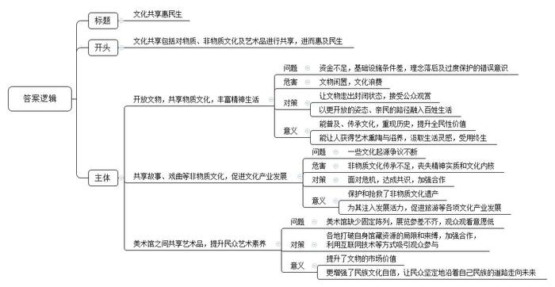
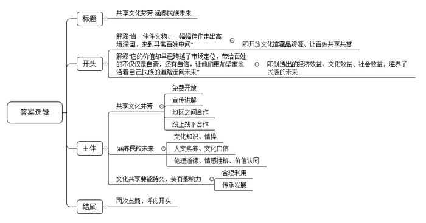

# 2018年公务员多省联考《申论》题（天津卷）

<!-- gwy:overview:start -->
> **天津 · 2018 · 申论 · 统考** ｜ 4 题 · 图片 4 处 · 答案随题折叠

导航：[题目](#题目) · [材料 1](#材料-1)
<!-- gwy:overview:end -->

> 候选采集稿。参考答案及解析来自粉笔页面，不代表官方答案或真实高分答卷；来源使用许可与原卷对应关系仍需人工核实。

## 给定材料

### 材料 1

互联网的风起云涌，不仅从根本上颠覆了许多传统行业，同时也创造了新的行业和机遇。21世纪初，有学者提出了互联网时代协同消费的理念和发展模式，并将其分为若干阶段。最初，是代码共享，即通过互联网向用户提供信息，但信息流是单向的，用户不能参与其中进行评论和交流。当互联网进入Web2.0时代，用户开始通过网络平台向陌生人分享信息、表达观点，但其分享局限于内容或信息，不涉及实物交易，一般也不存在金钱报酬，仅仅是生活共享或是内容共享。

随着物物相联时代到来，网络平台公司通过互联网重新整合社会闲散资源和富余劳动力，然后再按需精准配置，实现物尽其用，社会分配从专业化向社会化转变，真正实现了离线资源的共享，即线上的分享协作渗透和延伸至线下，并由此改变了我们的文化和经济世界。如今，需求方不但可以享受到低价与个性化服务，也得到了社交机会。对企业而言，随着加入网络的节点及节点间的连接增加，网络的价值会随着用户数量的平方数增加而增加。作为一种新的商业模式，其势必会对现行制度和秩序造成冲击，为此，政府应积极提供相应的法律制度保障，才能实现可持续发展。同时，任何商业行为都是以盈利为目标，任何市场的开发也都需要资金的支持，但过度的资本运作可能导致市场滥用其优势地位，甚至违背市场规律采取不正当竞争。政府理应鼓励相关企业采取科学的商业模式，新经济应当创造真正的消费者，而不仅是通过补贴来吸引消费者。

在新经济模式中，个体成为自由劳动者，劳动力价值能充分实现并完全由自己支配。供求双方通过互联网发布自己可供分享或需求的物品，不仅能为特定的供给者或需求者提供可选择的交易对象，还有助于掌握交易对象更多的信息，避免不公平交易，降低了交易成本。对闲置物资的再利用使得前期投入的成本要么已得到回收，要么当做沉没或折旧成本而收费较低廉而令闲置物资的边际成本更低，体现出更大的成本和资源利用效率优势。由于这一系列商业活动完全有别于过往经济行为，加强政府的监督与引导，显得尤为重要。建立新的监管规则体系迫在眉睫。在新的规则出台之前，可以运用相关的法理，借鉴现行的法律法规,引导市场建立内部自律监督机制，维护市场的正常秩序。

### 材料 2

美国某租赁房屋公司曾发生一起恶性事故。一名房东发现她的公寓被从该公司网站上招来的房客洗劫一空。她在给该公司的信上写道：“他们在我柜子上凿了个洞，劫走了里面的护照、现金、信用卡和我奶奶的珠宝首饰，不仅如此，他们又搜走了我的照相机、老式电脑和装有我所有相片、日志等备份的外接硬盘。他们掠走了我的一切。”这大概是所有人对互联网时代协同消费经济模式的顾虑了。某调查公司针对美国用户对这一经济模式的调研数据显示，参与其中的人群中，57%的人表示，“对这种消费模式感兴趣，但是仍有顾虑”，而在熟悉这种经济模式的人群中，69%的人认为，“除非信任的人推荐，否则将不会相信。”

共享充电宝在成为许多市民生活“标配”的同时，也引发了不少争议。除了共享充电宝自身的质量安全外，使用者可能还会面临个人信息泄露的风险。曹先生是一位互联网公司的程序员，他说：“每次看到有人使用共享充电宝，我都为他们捏把汗。其实它本质上就是一台电脑，有电脑的地方就会有黑客。现在大数据、算法不断发展，数据公司和社交软件合作，无孔不入地对个人信息进行收集。如今，我们消费时常扫二维码，通过第三方支付对其进行授权，但是第三方支付其实都绑定了个人身份信息、银行卡信息，在扫码过程中，就存在信息泄露的可能。”

本应更方便、更优惠的互联网协同消费经济，有时还会让人陷入更大的麻烦。随着家庭用品加速升级换代，如何让闲置物品流转起来，使旧物出售和消费变成“动动手指就能办成的事”，成为商家瞄准的一片蓝海。不过，由于买卖无需“打照面”、交钱与交货环节分离等原因，网络二手交易平台的信誉难以尽如人意，“省时省力不省心”，是不少人的共同印象。与一般商品不同，非标准化是二手商品的最大特点，其损耗程度、保养情况等很难得到最合理的评估、考证。如何让踏实放心取代买卖双方的彼此猜忌，除了考验平台的服务智慧、相关部门的治理决心，还有赖于社会征信体系的建立。

由于制度建设的相对滞后，经济活动过程中产生的纠纷，也让人颇费思量。租车、私厨、保洁……“互联网+”催生了很多以APP为平台的服务业务，通过APP和客户建立联系进行服务，是否就算是和APP的运营公司建立了劳动关系?邓先生、孙先生等7名厨师，通过某公司的APP网约客户，成为上门掌勺的“私厨”。日前，他们起诉要求法院确认自己和该公司存在劳动关系，要求支付双倍工资、休息加班费等酬劳。该公司认为，根据双方签订的商务合作协议，孙先生等通过其旗下的APP平台，依照客户需求接单提供服务，是否接单和工作时间孙先生等人均自行掌握，他们不接受公司管理，因此双方非劳动关系。有法律界人士认为，“互联网+”劳务是近年来兴起的劳务形式，网络服务平台运营方与加入平台的劳动者间是否构成劳动关系是一个尚有争议的法律问题，这就造成劳动权益被侵害的风险加大。

某些网站只需付费即可杜撰发布不实词条，让人对这场新经济的盛宴又多添了几分忧虑。有网友打趣，互联网平台在实现“与世界分享你的知识、经验和见解”的同时，也在分享着以假乱真的故事。一方面，这一创新模式让人们醉心于知识的汪洋；另一方面，利益架构起来的知识岛屿往往会误导人们求知的航向。一位哲人曾说，一切背离了公正的知识都应叫做狡诈，而不应称为智慧。平台的开放性与真实性从来都不是背道而行，更不容许贪婪的欲望主导信息的传播。每个人不管是主动分享，还是被动接收，都应遵守规则、承担责任，用客观理性的观念培育知识的植株，做一名慧眼识珠的花匠、恪尽职守的护花使者，知识的花朵才会灿然盛开、传递芬芳。

### 材料 3

2016年开始，A省省立医院尝试建立了“移动医疗平台”，上线临床医技科室53个、医生500余名，连接西南多省的市县医院及基层社区卫生服务中心100余家。2016年底，位于西南边陲的瑶族自治县人民医院骨科的张医生遇到一疑难病例，通过A省省立医院建立的“移动医疗平台”，张医生与省立医院医生联动，很快拿出会诊结论，确定了下一步治疗方案。

“移动医疗平台”让基层医院分享到优质的医疗资源，让基层患者分享到高水平的诊疗医术。通过它，让优质医疗资源上下贯通，提升基层医疗服务能力，一定程度上化解了民众“看病难、看病贵”的难题，提高了公众对医疗卫生服务的满意度。

在新技术不断出现的今天，提升公众对公共服务的满意度，既需要国家拿出顶层设计，也需要各行各业多一些改革探索，多一些奇妙创意，多一些以弱势群体为中心的行动自觉。

日前，B市一家养老机构探索“老少融合”养老新模式，养老院里不光住老人，年轻人也能入住。不过，年轻人必须为老人提供多种形式的志愿服务，通过累积服务时间来兑换住宿权和抵扣房租。

这家养老机构坐落在一栋大楼里，一楼是医院，老人的居住区分布在高层的几个楼层，共有300个床位。而在老人的居室之间，第13层则是专门开辟出来供年轻人居住的公益房——“志愿者之家”。走进“志愿者之家”，首先看到的是公共活动区，区内干净整洁、设施齐全，配有桌球、跑步机、电视、沙发、冰箱等。该机构负责人表示，他们开设公益房的目的，就是为了吸引年轻人参与养老事业，增强敬老、爱老、助老之风，同时也为年轻人解决房租太贵的现实问题。

年轻人怎样才能住进养老院的公益房呢？该负责人表示，首先要具备养老服务的热情，然后要通过院方考核,最终达成入住协议。获得入住“志愿者之家”资格的志愿者需要填写《志愿者报名表》《志愿者承诺书》，承诺每周参与志愿服务不低于一定次数。志愿住进养老院的公益房，是不是就意味着可以免费入住，不用负担房租了呢?答案并非如此。年轻人要想抵扣房租，就要付出劳动。据介绍，目前租金抵扣的方式是：志愿者每周参与一定次数的服务活动且完成服务内容，即可获得具有租金抵扣资格的印花，凭印花抵扣房租,印花的多少决定抵扣房租的多少。

年轻人入住养老机构的模式，在业内也引发了热议。有业内人士指出，尽管此种模式在国外早有先例，但是在国内试水，要小心公益变味。对此工作人员表示，此种模式目前在起步阶段，“志愿者之家”内部也提前制定了相应的考评规则，每次志愿服务后都会对老人进行满意度调查，目前并无强制规定能入住多久或者一定要服务到什么程度。不过，机构每半年进行一次志愿者服务考核，按照志愿者参与积极性及完成效果，决定其是否延续入住。

### 材料 4

“观众想细看养心殿的文物，不用再趴窗户了。”据媒体报道，从2016年9月28日到2017年2月，深藏于故宫博物院养心殿的268件文物“移驾”首都博物馆，接受公众的检阅，这也是养心殿文物首次“出宫”。大批珍贵文物走出故宫，不仅仅是博物馆系统内部的一次完美合作，而且有着更为深广的意义。即文物不再一味地深“藏”不露，矜持内敛，而是正在以越来越开放的姿态，越来越亲民的路径，融入老百姓的生活。正如一位学者所言，一个一流的博物馆并不在于藏品有多么丰富，而在于人们要有机会看到这个馆里大量珍贵的藏品，并将博物馆文化融入自己的生活中去，从中汲取有助于现实生活的灵感。

如今飞入寻常百姓家的王谢堂前燕，可谓比比皆是。如公众像“追剧”一样密切关注海昏侯墓的考古挖掘。无论是展示时间，还是展览手段，均创下了纪录。这样的努力，既是一种文化普及，也是一次全民性的价值提升。遗憾的是，从全国范围看，文物休眠的情形不在少数。由于资金缺乏，在许多县级文保所，众多国宝级文物多年深藏在地库之中。有些文保所甚至连一个像样的仓库都没有，大量宝贵的出土文物就随意堆放在地上，令人叹息。第三次全国文物普查数据显示，全国登记的不可移动文物高达76万处，而全国重点文物保护单位为4295处。这里面有多少文物常年深藏“冷宫”、不为人知？听任文物闲置，无疑是一种极大的文化浪费。而国内不少地方，虽然也建起了宏伟富丽的博物馆，但由于理念的落后以及过度保护的错误意识，能够展出来与公众见面的文物仍十分有限。文物就应该走出封闭状态，接受公众的观赏，让民众共享。文化的传承、历史的重现、艺术的熏陶，往往在这种亲炙一面中得以完成。一个人若有幸在众多传承有序、历史和文化价值极高的文物精品中获得滋养，也一定是受用终生。

### 材料 5

从16世纪开始，关于梁祝故里的争议就一直不断。在各地反映梁祝故事的戏曲和民间文艺作品中，梁祝的故乡一直没有得到确定。据考证，梁祝故事的流传涉及多个城市。一直以来，各地都言之凿凿，声称自己是正宗嫡派。相对于竞争故里的热闹，中国民俗保护开发研究中心的陈教授在田野调查时发现，如今能原汁原味将梁祝传说从头至尾讲一个钟头的人，只剩寥寥几位老人了。“人们所熟悉的梁祝，只剩一个简单的故事、一个概念。它所蕴含的精神实质和文化内核，实已到了濒危的境地！”面对这样的危机，各地都认识到，合作才能共赢，一花独放不是春，百花齐放春满园。经过多方协商，这些城市达成共识，共同发布“梁祝传说”联合申遗倡议书，确立起“天下梁祝文化是一家”的理念。终于，“梁祝传说”进入我国第一批非物质文化遗产名录。

在这些城市的共同协作下，对梁祝遗存的保护与抢救也取得了很大成绩：抢救了一批梁祝文化传承人的录音、录像；整理了一批梁祝传说、歌谣；收集了一批历代有关梁祝的记载与相关文物、资料；保护了一批与梁祝传说有关的遗址遗迹；创作了一批关于梁祝的文艺作品，出版了《梁祝文化大观》《梁祝文库》等专著。与此同时，共享“梁祝”品牌资源，也给各遗存地注入了发展活力。依托梁祝文化资源，有的城市举办中国梁祝婚俗节、建设梁祝文化园，有的打造梁祝文化小镇，以此带动婚纱摄影、婚庆、休闲旅游等文化产业发展，有的对景区进行改造，恢复传统的观蝶节等。

2011年，全国美术馆开始实行免费开放，在一片叫好声中，也有人担心：面对国内美术馆缺少固定陈列、展览参差不齐的现状，观众愿不愿意走进去？即便走进去了，在公众审美需求不断变化的今天，怎样吸引他们驻足？从2012年开始，文化部年年组织推出“全国美术馆馆藏精品展出季”活动，除以国家重点美术馆为代表的一些大型综合美术馆每年都推出重磅展览之外，还有一些地市级甚至县级的基层美术馆也积极参与其中。参与的美术馆多了，藏在深闺的作品露脸频繁了，公共教育与推广的手段也丰富了。各美术馆打破自身馆藏资源的局限和束缚，加强合作，惠民措施层出不穷。像D省美术馆的“水印年华——省美术馆馆藏版画作品精选”巡展至西部多个省，某著名画家私人艺术馆的“艺术回顾展”巡展至公立美术馆，都吸引了大量观众；C省美术馆将展出的所有馆藏精品用微信平台展现，方便观众查阅、分享和收藏，吸引了3500余名观众参与。5年来，“全国美术馆馆藏精品展出季”共推出展览150余个，展出藏品近18000件（套），观众总量约800万人次。一位知名学者说，当一件件文物、一幅幅佳作走出高墙深闺，来到寻常百姓中间，虽然它的容颜依旧，它的价值却早已跨越了市场定位，带给百姓的不仅仅是自豪，还有自信，让他们更加坚定地沿着自己民族的道路走向未来。

### 材料 6

只需缴纳99元押金，便可免费把书从书店带回家；10天内归还可享免费借阅，押金随时退还；3个月内读完12本可享返还押金的8%作为“阅读奖学金”……日前，W省新华发行集团旗下的某书店以首创“共享书店”的身份正式亮相。这家书店一度走红网络，有着“全国最美书店”“全国首家O2O智慧书城”等称号。“共享书店”实现了由买书到借书，把书店变成自家书房，由个人阅读到共享阅读的重大转变。

“共享书店”是基于对用户需求的分析和把握，依托实体书店的原有资源，通过运营模式的颠覆式变革，实现阅读服务的转型升级。该集团总经理说：“近年来，消费者阅读习惯和购买方式发生了巨大变化，我们相信未来所有的书店都会实现共享。如今，我们的‘阅+线上平台’已经进驻100多家全国知名泛娱乐、自媒体、新媒体，未来还将推出更多理财产品、研学游产品等等，打造‘阅+生态圈’。”

与W省新华发行集团异曲同工，商务印书馆的《新华字典》APP日前正式上线。据了解，这款APP提供了单字、词语、汉语拼音、部首、笔画数、四角号码等一框式检索渠道，并且支持手写、摄像头取字和语音输入等功能，全面满足了用户查字、输字需求。它还具有两大特色功能，一是提供了动态和静态两种标准笔顺，并支持屏幕跟写，用户可识别、掌握3500个基础汉字的笔画；二是由专业播音员对1万余个汉字进行播读，用户也可以点击“朗读”键测试自己普通话的准确性。此外，该APP还开发了生字本、知识问答、汉字游戏等增值服务，并完整收录《新华字典》最新纸质版全部内容，提供数字版与纸质版对照查阅功能。但同时，该APP每天仅有2个字免费体验、完整版需付费40元的情况也引发了争议。有媒体认为《新华字典》的收费行为是“思维落后”“缺乏诚意”，单靠权威不足以赢得市场；也有媒体称，“《新华字典》作为一本工具书，具有较强的社会服务功能，但它本身也是一种文化产品，是商品。通过有偿服务来维护版权以及促进软件研发是行业通行惯例，有其合理性。”从现有的手机应用市场来看，国际流行的语言字典价格均在百余元甚至数百元人民币，远超《新华字典》的40元定价。

知识付费近年来已被社会逐渐接受，这是对知识的一种尊重，也是保持产品持续发展、服务用户的必要方式。《新华字典》作为有价值的知识产品，出品方推出APP时考虑营利因素，无可厚非。但是，直接向用户收费的方式是否与现阶段新媒体产业的发展有些脱节？开放和共享是互联网经济的主要特征，一款收费的APP既相对封闭，也无法体现共享精神。《新华字典》要在互联网时代取得成功，前提是符合互联网产品的逻辑、适应互联网发展的生态。

## 题目

### 第 1 题

**根据给定材料2，概括互联网协同消费经济存在哪些问题？（15分）**

关联材料：材料 2

作答要求：全面、准确、简明、有条理，字数不超过250字。

第 1 题 · 答案与解析

**参考答案（粉笔题库参考内容）**

1.租赁平台对用户行为监管难。出租方财产易被侵害。

2.共享产品安全难保证。存在质量安全隐患，个人信息面临泄露风险。

3.网络二手交易平台信誉差。商品合理评估、考证难，导致信任危机。

4.劳动关系法律界定不明确。“互联网+”劳务纠纷维权难，劳动权益被侵害风险大。

5.网络平台信息真实性不足。可任意杜撰、传播不实信息。

**解析**

**参考答案说明：**本参考答案从“租赁平台”“共享产品”“网络二手交易平台”“互联网劳务关系”“网络平台信息”这五个方面展开，各条答案要点之间在内容上相互并列，没有交叉。

**考点**：问题类

**来源**：2018年公务员多省联考《申论》题（天津卷）

### 第 2 题

**根据给定材料3，简述资料中的做法在改善和提高公共服务方面有哪些可借鉴的经验？（20分）**

关联材料：材料 3

作答要求：

（1）紧扣材料，内容具体；

（2）逻辑清晰、层次分明；

（3）字数不超过300字。

第 2 题 · 答案与解析

**参考答案（粉笔题库参考内容）**

提升公共服务满意度，一靠国家强化顶层设计，加强政策指导；二靠行业积极探索，创新创意，行动上自觉以弱势群体为中心。

具体有：1.建立移动医疗平台。依托新技术实现临床科室、医生上线；连接偏远地区的市县医院及基层社区卫生服务中心；推动优质医疗资源均等化，提升基层医疗服务水平和能力，化解民众看病难题。

2.探索“老少融合”的养老新模式。专门开辟公益房，完善设施，吸引年轻人参与养老事业，解决房租问题；限定入住条件，审查资格，签订协议；填写报名表和承诺书，明确志愿服务次数、内容，以此抵扣房租；制定考评规则，及时调查老人满意度；定期考核服务的积极性及完成效果，考核结果与续住挂钩。

**解析**

**参考答案说明：**本参考答案形式上呈“总分”结构，先介绍了提升公共服务的总体经验；其次分别从“建立移动医疗平台”和“探索‘老少融合’的养老新模式”两个方面介绍了具体经验，各条要点在内容上相互并列，没有交叉。

**考点**：经验启示类

**来源**：2018年公务员多省联考《申论》题（天津卷）

### 第 3 题

**假设你是某文化报的记者，请根据给定材料4\-5，以“文化共享惠民生”为题，写一篇短评。（25分）**

关联材料：材料 4、材料 5

作答要求：

（1）紧扣主题，内容具体；

（2）层次分明，语言流畅；

（3）字数不超过500字。

第 3 题 · 答案与解析

**参考答案（粉笔题库参考内容）**

文化共享惠民生

文化共享包括对物质、非物质文化及艺术品进行共享，进而惠及民生。

开放文物，共享物质文化，丰富精神生活。过去，由于资金不足，基础设施条件差，理念落后及过度保护的错误意识，导致文物闲置，文化浪费。让文物走出封闭状态，接受公众观赏，以更开放的姿态、亲民的路径融入百姓生活，不仅能普及、传承文化，重现历史，提升全民性价值，还能让人获得艺术熏陶与滋养，汲取生活灵感，受用终生。

共享故事、戏曲等非物质文化，促进文化产业发展。一些文化起源争议不断，导致非物质文化传承不足，丧失精神实质和文化内核。如梁祝文化。我们面对危机，达成共识，加强合作，不仅保护和抢救了非物质文化遗产，还为其注入发展活力，促进旅游等各项文化产业发展。

美术馆之间共享艺术品，提升民众艺术素养。过去美术馆缺少固定陈列，展览参差不齐，观众观看意愿低。各地打破自身馆藏资源的局限和束缚，加强合作，利用互联网技术等方式吸引观众参与。提升了文物的市场价值，更增强了民族文化自信，让民众坚定地沿着自己民族的道路走向未来！

**解析**

**参考答案说明：**（1）本参考答案写到了标题和正文两个部分。（2）正文部分：一方面从内容来看，围绕着“文化共享”这一主题，开头部分总体介绍了“文化共享”的内涵，主体部分从“共享物质文化，丰富精神生活”“共享非物质文化，促进文化产业发展”“共享艺术品，提升民众艺术素养”三个方面展开，指出了文化共享惠民生的三个层面。另一方面从形式来看，本参考答案进行分段撰写，做到了层次分明，为了体现公文题的逻辑性，还加上了“然而”“导致”等连接词承接上下文。

**考点**：评论类

**来源**：2018年公务员多省联考《申论》题（天津卷）

### 第 4 题

**根据你对给定资料5中划线部分“当一件文物、一幅幅佳作走出高墙深闺，来到寻常百姓中间，虽然它的容颜依旧，它的价值却早已跨越了市场定位，带给百姓的不仅仅是自豪，还有自信，让他们更加坚定地沿着自己民族的道路走向未来”的理解，自拟题目，写一篇议论性文章。（40分）**

关联材料：材料 1、材料 2、材料 3、材料 4、材料 5、材料 6

作答要求：

（1）自选角度，立意明确；

（2）联系实际，不拘泥于给定材料；

（3）思路清晰，语言流畅；

（4）字数在1000字左右。

第 4 题 · 答案与解析

**参考答案（粉笔题库参考内容）**

**共享文化芬芳 涵养民族未来**

全国美术馆实行免费开放、私人艺术馆举办巡展、故宫博物院镇馆藏品频频集体“出宫”……十八大以来，以开放文化馆藏品资源、让百姓共享共赏为主旋律的文化惠民工程不断推进，公共文化服务体系建设进入新阶段。在我看来，不管是历史文物还是名人佳作都是国家的文化资源、全民的精神财富，让人民群众共享应成为基本共识与原则。这一努力所创造出的经济效益、文化效益、社会效益，滋养了民族的未来。

何谓共享文化芬芳？**首先要免费向社会公众开放，拆除门槛，创造机会，让共享更普惠、更广泛；其次要加强宣传讲解文物佳作背后的故事，让共享更系统、更深刻；最后还要加强地区之间合作、线上线下结合，让共享更丰富、更便捷**。博物馆、美术馆、文化馆等公共文化设施免费开放是时代大势，也是群众文化需求的必然。事实证明，政府这项文化惠民工程深得民心，真正实现了公共文化资源服务广大群众的理念。进一步来讲，民众在欣赏文物佳作的同时，将文化内化于心，才是政策的本意。所以，门票虽免费，服务不能免，方能吸引观众、留住观众。比如提供讲解咨询、推动各地区馆际交流等，还可以借助微信、微博、移动客户端等技术手段，展现馆藏资源，方便民众随时随地查阅、分享和收藏。

文化共享，它的价值早已跨越了市场定位，还有着更为深广的意义。即**文化已融入到寻常百姓的日常生活中去，人们从中丰富了文化知识、陶冶了情操，汲取到有助于现实生活的灵感，进而提升了全民的人文素养和文化自信，孕育出全民族相通的伦理道德、情感性格和价值认同**。我们在《诗词大会》选手的妙语连珠中领悟到了诗词的优美和大义，我们在毛笔筷子等器物中见识了古代工匠的智慧和技艺，我们在原始古朴的贺兰山岩画前，触摸到了远古先民对生活的勇气和情感……当这些优秀文化融入生活，转化为人民的情感认同和行为习惯时，就会推动全民性的价值提升。同时，中华儿女因这源远流长的文化纽带，紧紧连在一起，烧烙出了不可磨灭的华夏印记，磨合出了无比坚定的民族认同。

为了让文化共享的芬芳更可持续，释放出更多价值，并进一步扩大中华文化影响力，我们**要合理利用这些优秀文化，在传承中发展它，做大、做强、做优文化产业**。在现代文明里，市场是最好的保护，使用是最好的传承。文物、佳作如果只是放在馆内静态展示，容易造成机构因经费短缺陷入难以为继的境地，更遑论与公众共享了。所以，我们要以现代商业意识推动文化资源向文化资本转变，让优秀文化资源真正“活起来”“活得精彩”“活得长久”，走上一条可持续发展道路。这既需要我们舍得投入人财物，科学开发利用文化资源，打响东方文化品牌，也需要我们建立健全机制体制，规范文化产业市场，呈现出更多优质产品。

文化为人类连接了昨天和今天，也为走向明天提供了精神食粮。对于一个民族而言，文化是集体记忆，更是前行力量。我们必须清醒地认识到，历史文化传统决定了一个民族的道路选择，不忘本来，方能更加坚定地走向未来。

**解析**

**文章分析**

**共享文化芬芳 涵养民族未来**

【**标题的优点：**首先，范文的标题“共享文化芬芳 涵养民族未来”突出了“文化共享”这一主题。其次，它在形式上采用对称式结构，前半句点出主题，后半句点出了意义，使标题更加完整、饱满。】

全国美术馆实行免费开放、私人艺术馆举办巡展、故宫博物院镇馆藏品频频集体“出宫”……（1）十八大以来，<u>以开放文化馆藏品资源</u>、<u>让百姓共享共赏为主旋律的文化惠民工程不断推进</u>，<u>公共文化服务体系建设进入新阶段</u>。在我看来，（2）不管是<u>历史文物</u>还是<u>名人佳</u>作都<u>是国家的文化资源、全民的精神财富</u>，<u>让人民群众共享应成为基本共识与原则</u>。（3）这一努力所<u>创造出的经济效益、文化效益、社会效益</u>，<u>滋养了民族的未来</u>。

【**开头的优点：**★内容方面。范文的开头是紧扣题目给定的“当一件件文物、一幅幅佳作走出高墙深闺，来到寻常百姓中间，虽然它的容颜依旧，它的价值却早已跨越了市场定位，带给百姓的不仅仅是自豪，还有自信，让他们更加坚定地沿着自己民族的道路走向未来”这句话展开的。首先，开头点出主题，做到了主题明确。其次，对“文化共享”这一主题进行了分析阐述，（1）先指出了“十八大以来，文化惠民工作的成果”；（2）接着指出了“文化的重要意义”；（3）最后指出了“文化共享的积极作用”。★文字表达方面：使用了“不管……还是……”等关联词，使语言表达有逻辑性。此外，使用了比喻这一修辞手法，使文字表达更加形象、有力。】

何谓共享文化芬芳？**首先要免费向社会公众开放，拆除门槛，创造机会，让共享更普惠、更广泛；其次要加强宣传讲解文物佳作背后的故事，让共享更系统、更深刻；最后还要加强地区之间合作、线上线下结合，让共享更丰富、更便捷**。（1）博物馆、美术馆、文化馆等<u>公共文化设施免费开放是时代大势</u>，也是<u>群众文化需求的必然</u>。事实证明，（2）政府这项<u>文化惠民工程深得民心</u>，真正<u>实现了公共文化资源服务广大群众的理念</u>。进一步来讲，民众在欣赏文物佳作的同时，<u>将文化内化于心</u>，<u>才是政策的本意</u>。所以，（3）<u>门票虽免费</u>，<u>服务不能免</u>，<u>方能吸引观众、留住观众</u>。比如提供<u>讲解咨询</u>、<u>推动各地区馆际交流</u>等，还可以<u>借助</u>微信、微博、移动客户端等<u>技术手段</u>，<u>展现馆藏资源</u>，<u>方便民众随时随地查阅、分享和收藏</u>。

【**论述段1的优点：**★观点句：范文的观点句是紧扣“文化共享”这一文章主题提出的。形式上，它在段首处直接写出，位置突出，容易发现。内容上，关键词突出，内容要点明确，可以明显看出它是从“具体方式”入手，指出了“文化共享的措施”。★论述内容：（1）先介绍了“公共文化设施免费开放是一种趋势”；（2）接着介绍了“政府的文化惠民工程深得民心”；（3）最后介绍了“通过合作提升服务质量吸引观众、留住观众”。注意：以上三个方面的内容都是紧扣“首先要免费向社会公众开放，拆除门槛，创造机会，让共享更普惠、更广泛；其次要加强宣传讲解文物佳作背后的故事，让共享更系统、更深刻；最后还要加强地区之间合作、线上线下结合，让共享更丰富、更便捷”这个观点句进行分析论述的，论述的针对性强，内容层次丰富。最后，在论述方法和论据的选取上做到了讲道理、举例子相结合，做到了丰富多样。】

文化共享，它的价值早已跨越了市场定位，还有着更为深广的意义。即**文化已融入到寻常百姓的日常生活中去，人们从中丰富了文化知识、陶冶了情操，汲取到有助于现实生活的灵感，进而提升了全民的人文素养和文化自信，孕育出全民族相通的伦理道德、情感性格和价值认同**。（1）我们在<u>《诗词大会》</u>选手的妙语连珠中领悟到了<u>诗词的优美和大义</u>，我们在<u>毛笔筷子</u>等器物中见识了<u>古代工匠的智慧和技艺</u>，我们在原始古朴的<u>贺兰山岩画</u>前，触摸到了远古<u>先民对生活的勇气和情感</u>……<u>当这些优秀文化融入生活</u>，<u>转化为人民的情感认同和行为习惯时</u>，就会<u>推动全民性的价值提升</u>。同时，（2）<u>中华儿女因这源远流长的文化纽带</u>，<u>紧紧连在一起</u>，烧烙出了不可磨灭的<u>华夏印记</u>，磨合出了无比坚定的<u>民族认同</u>。

【**论述段2的优点：**★观点句：范文的观点句是紧扣“文化共享”这一文章主题提出的。形式上，它在段首处直接写出，位置突出，容易发现。内容上，关键词突出，内容要点明确，可以明显看出它是从“积极影响”入手，指出了“文化共享的重要意义”。★论述内容：（1）先介绍了“优秀文化融入生活推动全民性的价值提升”；（2）接着介绍了“中华儿女因文化相连，进而产生民族认同”。注意：以上两个方面的内容都是紧扣“文化已融入到寻常百姓的日常生活中去，人们从中丰富了文化知识、陶冶了情操，汲取到有助于现实生活的灵感，进而提升了全民的人文素养和文化自信，孕育出全民族相通的伦理道德、情感性格和价值认同”这个观点句进行分析论述的，论述的针对性强，内容层次丰富。最后，在论述方法和论据的选取上做到了讲道理、举例子相结合，做到了丰富多样。】

为了让文化共享的芬芳更可持续，释放出更多价值，并进一步扩大中华文化影响力，我们**要合理利用这些优秀文化，在传承中发展它，做大、做强、做优文化产业**。（1）在<u>现代文明</u>里，<u>市场是最好的保护</u>，<u>使用是最好的传承</u>。<u>文物、佳作</u>如果<u>只是放在馆内静态展示</u>，容易造成<u>机构因经费短缺陷入难以为继的境地</u>，更遑论与公众共享了。所以，<u>我们要以现代商业意识推动文化资源向文化资本转变</u>，让优秀文化资源真正“活起来”“活得精彩”“活得长久”，<u>走上一条可持续发展道路</u>。（2）这既需要我们<u>舍得投入人财物</u>，<u>科学开发利用文化资源</u>，<u>打响东方文化品牌</u>，也需要我们<u>建立健全机制体制</u>，<u>规范文化产业市场</u>，<u>呈现出更多优质产品</u>。

【**论述段3的优点：**★观点句：范文的观点句是紧扣“文化共享”这一文章主题提出的。形式上，它在段首处直接写出，位置突出，容易发现。内容上，关键词突出，内容要点明确，可以明显看出它是从“保护传承文化”入手，指出了“文化共享的措施”。★论述内容：（1）先介绍了“市场思维对于激活文化资源的意义”；（2）接着介绍了“运用市场思维保护文化的具体措施”。注意：以上两个方面的内容都是紧扣“我们要合理利用这些优秀文化，在传承中发展它，做大、做强、做优文化产业”这个观点句进行分析论述的，论述的针对性强，内容层次丰富。最后，在论述方法和论据的选取上做到了讲道理、举例子相结合，做到了丰富多样。】

文化为人类连接了昨天和今天，也为走向明天提供了精神食粮。（1）<u>对于一个民族而言</u>，<u>文化是集体记忆</u>，<u>更是前行力量</u>。（2）我们必须清醒地认识到，<u>历史文化</u>传统决定了一个民族的道路选择，<u>不忘本来</u>，<u>方能更加坚定地走向未来</u>。

【**结尾的优点：**（1）范文的结尾回扣了“共享文化”这一主题；（2）发出了号召、阐述了深远意义】

**考点**：文章写作题

**来源**：2018年公务员多省联考《申论》题（天津卷）

