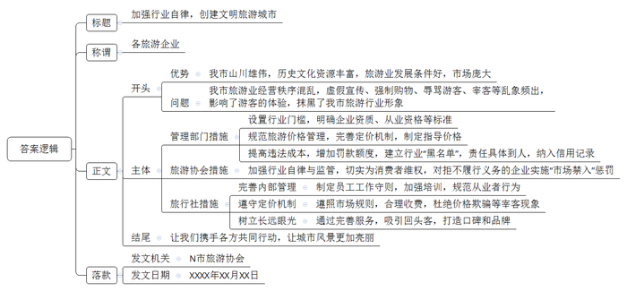
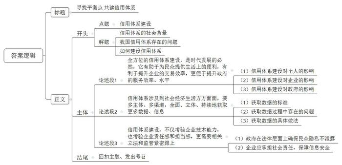

# 2019年公务员多省联考《申论》题（天津卷）

> 候选采集稿。参考答案及解析来自粉笔页面，不代表官方答案或真实高分答卷；来源使用许可与原卷对应关系仍需人工核实。

## 给定材料

### 材料 material-81dcda119d95fdf5

一年前，小张从北京到杭州工作，在租房时，她惊喜地被中介告知，由于她的信用记录良好，所以不用缴纳两倍于月租的租房押金；而北京的胡先生，却遇上了一件让他颜面尽失的事情。原本在假期准备租辆宝马车和朋友外出自驾游玩，没想到却被租车公司拒绝。原来，胡先生由于欠款许久未还，已经被列入了“老赖”名单，导致自己的信用数据不佳，被禁止租车。

2018年2月起，到E市妇女儿童医疗中心就诊的病患们发现，只要自己的信用度足够好，在医疗中心就可以“先诊疗后付费”，而无需一次次在诊室、检查室和交费处之间奔波，大大节省了自己的时间和精力。

信用骑车、信用住店、信用借书、公交车扫码乘车……这一幕一幕，都是真真切切正在我们身边发生的场景，告诉我们中国正在迈进信用社会。随着大数据时代的来临，信用成为每个人的“第二张身份证”。每个人、每个机构的信用度都可以被量化，曾经“看不见”“摸不到”的信用，正在逐步“变现”。

信用也提升了交易效率，为新经济提供支撑。对于废旧手机回收利用创业者向先生而言，信用就为他解决了“先收手机还是先付款”的难题。“先收手机，用户不放心。先付款，我们也怕损失。”向先生说，引入信用后，对高分用户优先付款，不仅订单量上浮一倍，也没有出现违约情况。

有了信用的助力，企业经营效率变得更高。目前，多家共享单车企业已实现信用免押金，大大方便了新用户开通使用。一些共享汽车、共享租衣企业也在研究信用梯度收费等模式，最大限度吸引用户。用户对信用的珍视也令人惊喜。以租车为例，引入信用分后，行业租金欠款率下降了52%，违章罚款欠款率下降了27%。

在网络高度发达的今天，资源的分布不再局限于有形市场，很多资源分布在网络上。资金资源不再集中在类似于银行这种金融机构身上，而是通过互联网分散分布。一个人只要拥有足够的信用水平，在网络上就能够筹集到资金。所以，信用社会给予了人们一个公平发展的环境。“信用既是商业社会的内在原则，也创造价值和财富。”某研究员说，随着信用体系不断完善，每个人都能在社会中获得公平发展的机会，这将大大激发全社会创业创新热情。

在某信用机构负责人看来，10年后，国内绝大多数城市都将成为信用城市。诚实守信的市民和商家，会享受到非常大的便利，政府的管理效率也将大大提高。信用体系的建立可以推动整个社会综合治理的发展。

在S市，26万老人领取养老金不用亲自跑腿去现场，只需要在手机上进行一次信用认证。购房者提取公积金时也不需要准备大量证明材料，柜台的人脸识别系统扫描后，他的相关信用信息迅速呈现。在促进政务精细化管理方面，“信用”正在发挥越来越重要的作用，有着高信用值的市民在通过实名认证之后，越来越多的政务服务都可以通过互联网进行办理，“刷脸”即可，而无需到窗口排队。

凑一堆人就走的“中国式过马路”、不走寻常路玩“跨越”、开车煲电话粥、没事打开远光灯……这些交通违规行为带来安全隐患，给城市管理增加了困难。当前，有的城市把这些交通违规行为纳入个人信用记录，已经能实现这样的应用场景：一名过马路闯红灯的路人，被监控系统识别身份，达到一定次数将扣除相应信用分，降低信用等级，严重的甚至影响贷款。这种做法背后的逻辑是，一个不尊重交规的人，也可能做出不尊重其他公共规则的行为。个人信用信息就是对个人的一种人格勾勒。在一个公民素质发育成熟的社会，对公民的信用评估，往往是以公民在公共事务中的态度和做法为基本出发点的。信用既是一种道德品质，也是一种制度和规则。信用体系全面建立的意义不仅在于解决押金带来的纠纷，更在于塑造一个和谐的社会，换言之，每个人都更规矩——因为违反社会规则，将令你寸步难行。

### 材料 material-6246abaed0e2e25c

“我做网店这么多年，深知经营者一旦失信，市场就会被扰乱，当你的客户不再相信你时，网店也到了尽头。所以我们必须诚信经营，这样市场才会越做越活，路子越走越远。”凭着多年的努力，为满足客户需求上下求索，诚信经营，40岁农民张某走出了自己的电商致富路。

张某夫妇2014年创办了网店，主要销售地区特色农产品。在张某的心中，做电商想要销路好，最关键的是“诚信”。对于客户提出的问题和要求，他做到有问必答；对于电商上做得不好的细节，他有错必改，直到客户满意。有一次，张某发送给广东的“菜煎饼”专用饼，客户在收到货后，发现饼已经变质。客户把这一问题反映过来后，张某立即查阅物流信息，发现货物在途中多耽误了两天。但是，不管责任在谁，绝不能让客户受到损失，张某毫不犹豫地给客户补发了货物。客户知道原因后要求和他共同承担责任，被他坚决拒绝了。从此，客户对他的产品更加青睐了。从一穷二白做起，凭着诚信经营，张某的网店经营范围逐步扩大，卖出的产品越来越多，收到的好评也越来越多，新客户、回头客络绎不绝。

近年来，随着大数据、云计算等互联网技术的大规模应用，电子商务迅猛发展，已成为我国国民经济的组成部分和重要增长点。对电子商务而言，诚信是其健康发展的重要基础，这已成为众多电商的行业共识。多家电商平台联合成立诚信联盟，签署《电子商务诚信公约》。该联盟旨在通过互联网手段促进行业自律。根据约定，联盟将建立信息共享机制，设立专属网站，实现联盟成员之间的信息互通，并向公众公开联盟工作成果。

多家电子商务平台也以各自的方式开展诚信建设活动。某平台推出企业诚信查询平台。用户登录后，只需在网站输入企业名称或法定代表人信息，就能查询其信用等级以及企业相关情况。该平台还发布处罚公告，宣布永久关闭平台上36家以不正当手段谋取利益的商家店铺。

为了使用户享有便捷、可信、有保障的二手车服务，某二手车平台推出三大透明计划：检测报告、委托/交易合同、服务内容收费标准100%全公开，并做出三大必赔保障承诺：车况不符、车价赚差价、服务费不实必赔。另外，平台会分别通过管理、技术、监管等多个角度对车商进行识别筛除，要求平台的加盟商家签署《诚信商家承诺书》。

“电商诚信问题有时候不是道德问题，而是技术能力和服务水平的问题。”一家电子商务平台的负责人说。电子商务让消费者头疼的一个问题就是售后服务跟不上。为此该平台专门设立只卖服务产品的社区店，围绕平台经营做好售后服务工作；同时，也为周边居民提供家装、维修和保洁等综合服务。在个人隐私保护方面，某快递公司也设计了加密运单，让个人信息不再随包裹“裸奔”。据介绍，作为加密运单的快件，在派件时只有当班次出仓快件的收派员，才能通过手持智能终端扫描看到收件人的电话信息，而在快件运输环节中，没有人能看到隐藏的信息，保证了收寄件人的信息安全。

为促进电商市场的健康发展，国家接连出台法规和政策，推动电子商务领域诚信体系建设。2017年1月，国家发改委等九部门发布《关于全面加强电子商务领域诚信建设的指导意见》。2018 年7月，商务部印发《2018年商务信用建设工作要点》，部署了包括电子商务在内的四个重点领域的信用工作。2018年8月31日，十三届全国人大常委会第五次会议表决通过《电子商务法》，明确提出要“推进电子商务诚信体系建设”。

地方政府也在积极响应。2018年8月，Y市正式出台了《全面加强电子商务领域诚信建设的实施意见》，逐步建立统一的电子商务信用评价体系。该市的茶叶电商办协会负责人说：“电商具有非常明显的跨地域性，不像传统线下商务那么直接、容易受到属地政府部门或者行业组织的监管。电商平台模式对平台方信用程度的要求更高，政府部门、行业组织或信用机构依法进行信用监管，是维护电子商务良好秩序的关键。”

### 材料 material-89c5222ae1e6e5e5

随着社会的发展，旅游已成为一种美好的生活需求，是老百姓生活中的一道亮丽风景线。N市山川雄伟，拥有丰富的历史文化资源，而且经济发展迅速，市民收入水平高，具有得天独厚的发展旅游业的条件。该市旅游业正在飞速发展，相关企业、从业人员和游客数量众多，旅游市场庞大。但遗憾的是，该市的旅游市场一直比较混乱，经常受到诟病。

余先生近日报名参加了一家旅行社组织的环城周边三日游。“仅仅在一家景区就进了七八个购物店，导游一直向我们推荐玉石和银器，我们进店不买东西导游就不肯带队离开，有一个购物店我们足足待了2个小时。行程安排上的景点多数只停留一刻钟，拍拍照就草草结束了，标榜的‘豪华游’最终变成了购物游。”余先生说，有的团员没有购买任何东西，导游不仅不给好脸色，还对游客进行言语攻击。

李先生一家利用孩子放暑假的机会报名参加了某旅行社的亲子游。旅游即将结束时，导游向他们推荐不在旅游范围内的另一个风景点。在听了天花乱坠的“描述性推介”后，听说每个人只要150元，李先生一家觉得价钱好像也不贵，而且时间也正巧来得及，就决定掏钱一游。回来后李先生在网上一查，原来到那个风景点去旅游最高也就90元，李先生连呼“上当”，旅游的好心情顿时化为乌有。

此类现象缘何屡禁不止？在N市经营旅行社的王经理认为：“某些旅行社管理混乱，不重视服务质量，一味以低价诱惑顾客，导致旅游行业很不规范。”随着旅游成为朝阳产业，旅行社犹如春笋般破土而出，近两年，N市大大小小旅行社达百余家，其中难免鱼龙混杂，泥沙俱下。在王经理看来，有些旅行社根本就是“不怕你不上当，就怕你不来。”报价低得出奇，不可能有利润，就是想引诱顾客，然后千方百计“宰客”。他们多做“一锤子买卖”，不指望什么“回头客”。旅行社经营秩序混乱的问题，已引起有关部门重视，旅游部门整顿过很多次。但是，这些旅行社往往抱着“逮着了认罚、没逮着我狠”的态度，我行我素，大不了换身行头重新登场。“很重要的原因就是惩罚太轻，违法成本太低。”该市旅游协会曾会长说，一些不合理低价游已经形成了灰色利益链条。受利益驱动，很多旅行社把“宝”全部押在游客身上，有的甚至将游客“转卖”给导游，收取人头费牟利，导游需要先期支付现款，一旦游客不买或买得少，导游就难以获得回扣，这个团就难以获利，甚至有可能大面积亏损。导游为了赚回成本及利润，就不得不依靠回扣，设法让游客多购物。游客购物多，导游服务态度就好；购物少，导游便冷嘲热讽。

最近，N市提出打造文明旅游城市。但没有良好的旅游市场，文明旅游城市只能是空中楼阁。曾会长说，守住底线关键在于增加失信违法的成本。专家建议，将处罚责任具体到人，并通过全国联网的信用记录等方式，“让失信者寸步难行”。监管和维权体系要更广泛，不仅政府要发挥自身职能，还应包括行业组织。在欧洲一些国家，相关的行业组织以行业自律形式切实为消费者维权，拒不履行义务的企业有可能面临“市场禁入”的严惩。古诗有云“人面桃花相映红”。桃花再红，也需“人”来欣赏；人与风景同在，旅途才会更美。相信在各方的共同推动下，N市的风景会更靓丽。

### 材料 material-23b7ff3e6b3e42aa

人无信不立，业无信不兴。诚信不仅是个人安身立命的根本，也是社会良序发展的基石。

党的十八大以来，党和国家高度重视诚信建设。习近平总书记在多个不同场合围绕诚信主题发表了一系列重要论述，从战略高度为新时代中国的诚信建设提供了基本遵循。他从历史维度、价值维度、实践维度对诚信问题进行了深刻阐述，进一步指出中华文化关于诚信的思想和理念，不论过去还是现在，都有其鲜明的民族特色，都有其永不褪色的时代价值。他强调，要运用法治手段解决道德领域突出问题。对突出的诚信缺失问题，既要抓紧建立覆盖全社会的诚信系统，又要完善守法诚信褒奖机制和违法失信惩戒机制，使人不敢失信、不能失信。对见利忘义、制假售假的违法行为，要加大执法力度，让败德违法者受到惩治、付出代价。

为全面推进诚信建设，党和国家作出了一系列重要部署。中共中央办公厅印发的《关于培育和践行社会主义核心价值观的意见》强调：“以诚信建设为重点，加强社会公德、职业道德、家庭美德、个人品德教育，形成修身律己、崇德向善、礼让宽容的道德风尚。”中央文明委发布《关于推进诚信建设制度化的意见》，明确规定通过曝光失信当事人、限制严重失信者高消费行为等手段打击失信行为。这是我国第一份强调从制度层面推进国家诚信建设的中央文件。国务院先后发布《关于建立完善守信联合激励和失信联合惩戒制度加快推进社会诚信建设的指导意见》《关于加快推进失信被执行人信用监督、警示和惩戒机制建设的意见》，建立起社会诚信奖惩制度，并进一步完善了失信惩戒制度。诚信建设从注重教育走向教育与制度建设并重。

## 题目

### 第 1 题

**“给定资料**2**”中提到“随着大数据时代的来临，信用成为每个人的‘第二张身份证’”，请你谈谈对这句话的理解。（15分****）**

关联材料：material-81dcda119d95fdf5

作答要求：

要求：全面、准确、简明，有条理，字数不超过250字。

### 第 2 题

**根据“给定资料**4**”，假定你是某市市场监督管理局的工作人员，请就加强本市电商诚信体系建设提出对策建议。(20分)**

关联材料：material-6246abaed0e2e25c

作答要求：

要求：

（1）紧扣资料，内容具体；

（2）层次分明，建议可行；

（3）字数不超过300字。

### 第 3 题

**根据“给定资料**5**”，假定你是N市旅游协会的会长，请对全市旅游企业写一份“加强行业自律，为创建文明旅游城市出力”的倡议书。（25分）**

关联材料：material-89c5222ae1e6e5e5

作答要求：

要求：

（1）紧扣资料，内容具体；

（2）条理清楚，层次分明；

（3）字数不超过500字。

### 第 4 题

**“给定资料**6**”中提到，“信用体系建设，既要获取更多数据勾勒人格特征，也要注重保护每个人的隐私”。请你根据对这句话的理解，自拟题目，写一篇议论性文章。(40分)**

关联材料：material-23b7ff3e6b3e42aa

作答要求：

要求：

（1）自选角度，立意明确；

（2）联系实际，不拘泥于“给定资料”；

（3）思路清晰，语言流畅；

（4）字数1000字左右。

## 答案与解析

第 1 题

**参考答案（粉笔题库参考内容）**

该句指大数据推动社会信用化，信用融入经济社会中，可被量化，能勾勒人格特征，是个人、企业、政府的识别工具。

信用的作用：1.方便民众生活。节省时间、精力、减轻生活负担。2.支撑新经济发展。提升交易、经营效率，降低经营风险。3.促进社会公平。利于筹集资金，激发创业热情。4.推动社会治理综合发展。提高管理效率，促进政务精细化、数字化。5.塑造和谐社会。惩戒失信者，倒逼公民守信。

我们要利用大数据推动信用社会建设。

**解析**

**参考答案说明**：思路方面，本参考答案按照“总体释义+展开解释+总结”的答题思路展开。内容方面，本参考答案先对“随着大数据时代的来临，信用成为每个人的‘第二张身份证’”这句话进行了解释；“展开解释”部分从“方便民众生活”“支撑新经济发展”“促进社会公平”“推动社会治理综合发展”“塑造和谐社会”等不同角度分析了“信用建设”的作用；最后进行了总结。

**考点**：考点词句解释类

**来源**：来源2019年公务员多省联考《申论》题（天津卷）

粉笔申论页面对本题只提供「解析视频」入口，该入口是会员推广位，页面无视频地址与文字解析。

第 2 题

**参考答案（粉笔题库参考内容）**

1.引导电商诚信经营。及时响应，满足用户需求，不断优化细节，提高客户满意度；主动承担责任，保障客户利益。

2.引导电商平台加强行业自律。成立诚信联盟，签署诚信公约，建立信息共享机制，实现内部信息互通，并公开工作成果；推出企业诚信查询平台，永久关闭不正当谋利的店铺；全面优化服务，服务信息、赔偿标准公开透明；识别筛除不合格商家。

3.引导电商优化技术能力、服务水平。设立社区店，提升平台售后服务质量，并提供综合生活服务；推广加密面单，保护用户个人信息。

4.完善政策法规，加强监管。建立统一的电子商务信用评价体系；加强地区间政府、行业组织的合作，依法监管，并设立监督举报平台。

**解析**

**参考答案说明**：本参考答案分别从“引导电商诚信经营”“引导电商平台加强行业自律”“引导电商优化技术能力、服务水平”“完善政策法规，加强监管”这四个方面展开，各条答案要点分条罗列，在内容上无交叉。

**考点**：考点提出对策类

**来源**：来源2019年公务员多省联考《申论》题（天津卷）

粉笔申论页面对本题只提供「解析视频」入口，该入口是会员推广位，页面无视频地址与文字解析。

第 3 题

**参考答案（粉笔题库参考内容）**

加强行业自律，创建文明旅游城市

各旅游企业：

我市山川雄伟，历史文化资源丰富，旅游业发展条件好，市场庞大。然而，我市旅游业经营秩序混乱，虚假宣传、强制购物、辱骂游客、宰客等乱象频出，影响了游客的体验，抹黑了我市旅游行业形象。

针对这些现象，管理部门研究相关措施：如设置行业门槛，明确企业资质、从业资格等标准；规范旅游价格管理，完善定价机制，制定指导价格；提高违法成本，增加罚款额度，建立行业“黑名单”，责任具体到人，纳入信用记录。同时，旅游协会也应加强行业自律与监管，切实为消费者维权，对拒不履行义务的企业实施“市场禁入”惩罚。

希望各旅行社能够做到：一、完善内部管理。制定员工工作守则，加强培训，规范从业者行为。二、遵守定价机制。遵照市场规则，合理收费，杜绝价格欺骗等宰客现象。三、树立长远眼光。通过完善服务，吸引回头客，打造口碑和品牌。

让我们携手各方共同行动，让我市风景更加靓丽！

N市旅游协会

XXXX年XX月XX日

**解析**

**参考答案说明：**（1）格式方面，本参考答案写到了“标题”“称谓”“正文”“落款”。（2）正文部分，一方面，从内容来看，围绕着“加强行业自律，创建文明旅游城市”这一主题，本参考答案的开头先写到了N市创建文明旅游城市的优势、问题；主体部分从“管理部门”“旅游协会”“旅行社”这三个主体出发给出了具体的建议；结尾进行总结、呼吁。另一方面，形式上，本参考答案做到了分段、分条撰写，整体上条理较为清晰。（3）本参考答案能够结合“倡议书”的特点，在语言表达上做到了有感染力、流畅。

参考答案二

加强行业自律，创建文明旅游城市

各旅游企业：

我市山川雄伟，历史文化资源丰富，旅游业发展条件好，市场庞大。然而，我市旅游业经营秩序混乱，虚假宣传、强制购物、辱骂游客、宰客等乱象频出，影响了游客的体验，抹黑了我市旅游行业形象。

目前协会切实为消费者维权，对拒不履行义务的企业实施“市场禁入”惩罚，而管理部门也加大整治力度提高了违法成本，将处罚责任具体到人，并纳入全国联网的信用记录。行业形象靠大家来维护，为此我们倡议：

一、规范行业行为。企业要自觉拒绝“转卖”游客，避免导游前期付款，同时定期加强培训，规范从业者行为。

二、坚持诚信经营。自觉遵照市场规则，合理收费，不夸大宣传景点，杜绝价格欺骗等宰客现象。

三、树立长远眼光。企业要重视管理及服务质量，吸引回头客，打造口碑和品牌。

人与风景同在，旅途才会更美。让我们携起手来，联合各方共同行动，让我市风景更靓丽！

N市旅游协会

XXXX年XX月XX日

**考点**：考点宣传类

**来源**：来源2019年公务员多省联考《申论》题（天津卷）

粉笔申论页面对本题只提供「解析视频」入口，该入口是会员推广位，页面无视频地址与文字解析。

第 4 题

**参考答案（粉笔题库参考内容）**

**寻找平衡点 共建信用体系**

伴随着“陌生人”社会到来，人际交往中，诚信的重要性越发凸显。但我国目前信用体系建设面临征信角度单一、覆盖人群少、个人信息遭泄露等问题。因此，信用体系的建设，既要注重多主体、多渠道地收集数据，保障信息的全面性，也要通过法律、监管、技术等手段，规范信息的收集、使用，保障个人隐私，在信息获取的开放性与使用的封闭性中做到平衡。

**全方位的信用体系建设，是时代发展的必然，它有助于为民众提供生活上的便利，有利于提升企业的交易效率，更便于提升政府的服务效率、水平。**就现实而言，随着我国信用体系建设的不断完善，无论是租用共享单车，还是个人贷款，信用良好的人往往能快速获得他人认可，进而给自己生活、工作带来更多的便利。与此同时，在互联网时代，企业口碑、信誉愈发受到各方重视，因此，良好的信用可使企业的交易成本降低，交易效率大大提高。除此之外，信用在政府管理方面的价值也令人惊喜。只要有信用认证，众多政务服务就可以在互联网上进行。一次“刷脸”，省去了群众的千里奔波，也提升了政府的办事效率，促进了政府的精细化管理。

**信用体系涉及到社会经济生活方方面面，因此，要多主体、多渠道，全面、立体、持续地获取更多数据、信息。**当下，我国建立了统一的信息采集标准，初步形成了奖惩机制，“一处失信、处处受限”的格局逐步呈现。在这个背景下，如果个人数据收集是不全面的，必然会导致奖惩机制公平性的丧失。但就现实而言，我国信用体系建设存在诸多问题：覆盖人群少、涉及领域少、民间征信机构征信角度单一……片面的数据，所折射出的个人信用必然是有误差的，它就更无法全面反映出一个人的个人品德、家庭美德、职业道德、社会公德。从这个角度而言，就必然要全方位地收集数据，引入民间征信企业，扩大征信领域，增加征信人群……

**在全方位收集数据过程中，必然会面临信息泄露等问题，信用体系建设，这不仅考验企业技术能力，也考验企业责任感和担当感，更需要相关立法和监管紧密跟上。**个人征信牵涉到个人隐私，引入民营征信机构是否会泄露个人信息，是民众最大的担忧。我们要提防信息收集和记录变为一场隐私泄露的闹剧，就必须补上法律漏洞，严格审核民营机构的资质，制定严格准入标准，提高机构质量的同时也更好保障信用信息的准确性，避免出现造假作弊，信息良莠不齐，真伪难辨，为民众信息安全兜底。企业也需不断提升自身实力，研发技术，遵守行业规则，做好自律，担起社会责任，保障信息安全。

古人云：“图垂成之功者，如挽上滩之舟，莫少停一棹。”信用体系的全方位建设，我们还在路上，仍需各方的不懈努力！

**解析**

**文章分析**

**寻找平衡点 共建信用体系**

【**标题的优点：**首先，范文的标题“寻找平衡点 共建信用体系”突出了“信用体系建设”这一主题。其次，形式上，文字简洁明快。】

（1）伴随着“陌生人”社会到来，人际交往中，诚信的重要性越发凸显。（2）但我国目前信用体系建设面临征信角度单一、覆盖人群少、个人信息遭泄露等问题。（3）因此，信用体系的建设，既要注重多主体、多渠道地收集数据，保障信息的全面性，也要通过法律、监管、技术等手段，规范信息的收集、使用，保障个人隐私，在信息获取的开放性与使用的封闭性中做到平衡。

【**开头的优点：**★内容方面：范文的开头是紧扣“信用体系建设”这一主题展开的。首先，开头点出主题，做到了主题明确。其次，对“信用体系建设”这一主题进行了分析阐述：（1）先指出了“社会背景”；（2）接着指出了“我国信用体系存在的问题”；（3）最后指出了“如何建设信用体系”。★文字表达方面：使用了“但……”“既要……也要……”等关联句式，使语言表达有逻辑性。】

**全方位的信用体系建设，是时代发展的必然，它有助于为民众提供生活上的便利，有利于提升企业的交易效率，更便于提升政府的服务效率、水平。**就现实而言，（1）随着我国信用体系建设的不断完善，无论是租用共享单车，还是个人贷款，信用良好的人往往能快速获得他人认可，进而给自己生活、工作带来更多的便利。与此同时，（2）在互联网时代，企业口碑、信誉愈发受到各方重视，因此，良好的信用可使企业的交易成本降低，交易效率大大提高。除此之外，（3）信用在政府管理方面的价值也令人惊喜。只要有信用认证，众多政务服务就可以在互联网上进行。一次“刷脸”，省去了群众的千里奔波，也提升了政府的办事效率，促进了政府的精细化管理。

【**论述段****1****的优点：**★观点句：范文的观点句是紧扣“信用体系建设”这一文章主题提出的。形式上，它在段首处直接写出，位置突出，容易发现。内容上，关键词突出，内容要点明确，可以明显看出它是从“个人、企业、政府”三个主体入手，指出了“信用体系建设的积极影响”。★论述内容：（1）先介绍了“信用体系建设对个人的影响”；（2）接着介绍了“信用体系建设对企业的影响”；（3）最后介绍了“信用体系建设对政府的影响”。注意：以上三个方面的内容都是紧扣“全方位的信用体系建设，是时代发展的必然，它有助于为民众提供生活上的便利，有利于提升企业的交易效率，更便于提升政府的服务效率、水平”这个观点句进行分析论述的，论述的针对性强，内容层次丰富。最后，在论述方法和论据的选取上做到了讲道理、举例子相结合，做到了丰富多样。】

**信用体系涉及到社会经济生活方方面面，因此，要多主体、多渠道，全面、立体、持续地获取更多数据、信息。**当下，（1）我国建立了统一的信息采集标准，初步形成了奖惩机制，“一处失信、处处受限”的格局逐步呈现。在这个背景下，如果个人数据收集是不全面的，必然会导致奖惩机制公平性的丧失。但就现实而言，（2）我国信用体系建设存在诸多问题：覆盖人群少、涉及领域少、民间征信机构征信角度单一……片面的数据，所折射出的个人信用必然是有误差的，它就更无法全面反映出一个人的个人品德、家庭美德、职业道德、社会公德。从这个角度而言，（3）就必然要全方位地收集数据，引入民间征信企业，扩大征信领域，增加征信人群……

【**论述段****2****的优点：**★观点句：范文的观点句是紧扣“信用体系建设”这一文章主题提出的。形式上，它在段首处直接写出，位置突出，容易发现。内容上，关键词突出，内容要点明确，可以明显看出它是从“获取信用数据”入手，指出了“如何建设信用体系”。★论述内容：（1）先介绍了“获取数据的标准”；（2）接着介绍了“获取数据过程中存在的问题”；（3）最后介绍了“获取数据的具体做法”。注意：以上三个方面的内容都是紧扣“信用体系涉及到社会经济生活方方面面，要多主体、多渠道，全面、立体、持续地获取更多数据、信息”这个观点句进行分析论述的，论述的针对性强，内容层次丰富。最后，在论述方法的选取上主要采用了讲道理的方式，论述比较深刻。】

**在全方位收集数据过程中，必然会面临信息泄露等问题，信用体系建设，这不仅考验企业技术能力，也考验企业责任感和担当感，更需要相关立法和监管紧密跟上。**个人征信牵涉到个人隐私，引入民营征信机构是否会泄露个人信息，是民众最大的担忧。我们要提防信息收集和记录变为一场隐私泄露的闹剧，（1）就必须补上法律漏洞，严格审核民营机构的资质，制定严格准入标准，提高机构质量的同时也更好保障信用信息的准确性，避免出现造假作弊，信息良莠不齐，真伪难辨，为民众信息安全兜底。（2）企业也需不断提升自身实力，研发技术，遵守行业规则，做好自律，担起社会责任，保障信息安全。

【**论述段****3****的优点：**★观点句：范文的观点句是紧扣“信用体系建设”这一文章主题提出的。形式上，它在段首处直接写出，位置突出，容易发现。内容上，关键词突出，内容要点明确，可以明显看出它是从“保护民众隐私”入手，指出了“如何建设信用体系”。★论述内容：（1）先介绍了“政府在法律层面上确保民众隐私不泄露”；（2）接着介绍了“企业应承担社会责任，保障信息安全”。注意：以上两个方面的内容都是紧扣“信用体系建设，不仅考验企业技术能力，也考验企业责任感和担当感，更需要相关立法和监管紧密跟上”这个观点句进行分析论述的，论述的针对性强，内容层次丰富。最后，在论述方法的选取上主要采用了讲道理的方式，论证比较有力。】

【**论述段之间的关系：**★内容的内在逻辑：范文的论述段之间有两层逻辑。第一层，整体上是从“影响”到“对策”的逻辑展开的。第二层，其中观点2和观点3又是从“如何建设信用体系”出发，论述段2先写了“建设全面立体的信用体系”，论述段3再写了“保护公民隐私”。★段与段的外在衔接：论述段3的段首处的过渡句“在全方位收集数据过程中，必然会面临信息泄露等问题”，起到了承接论述段2、引出了论述段3的作用。】

古人云：“图垂成之功者，如挽上滩之舟，莫少停一棹。”（1）信用体系的全方位建设，（2）我们还在路上，仍需各方的不懈努力！

【**结尾的优点**：范文的结尾回扣了“信用体系建设”这一主题。（1）再次提到了“信用体系建设”；（2）发出了号召希望。】

**考点**：考点文章写作题

**来源**：来源2019年公务员多省联考《申论》题（天津卷）

粉笔申论页面对本题只提供「解析视频」入口，该入口是会员推广位，页面无视频地址与文字解析。

