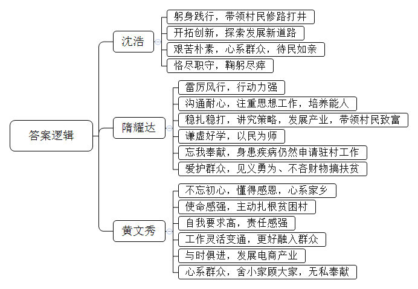
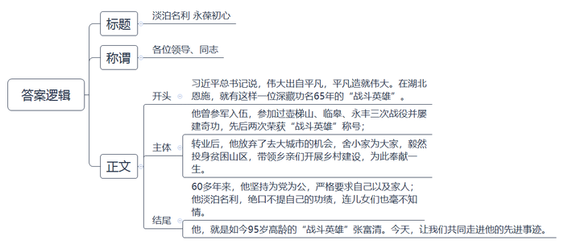
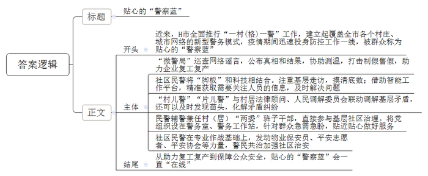
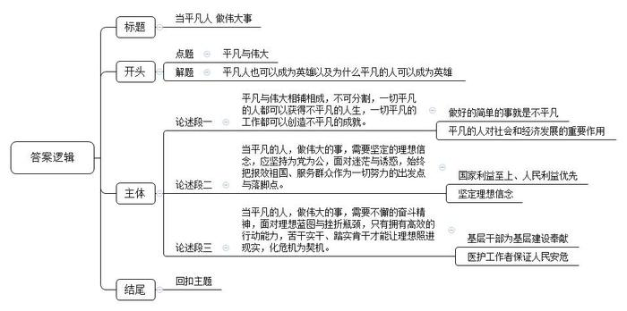

# 2020年0725公务员多省联考《申论》题（天津A卷）

<!-- gwy:overview:start -->
> **天津 · 2020 · 申论 · A类** ｜ 4 题 · 图片 4 处 · 答案随题折叠

导航：[题目](#题目) · [材料 1](#材料-1)
<!-- gwy:overview:end -->

> 候选采集稿。参考答案及解析来自粉笔页面，不代表官方答案或真实高分答卷；来源使用许可与原卷对应关系仍需人工核实。

## 给定材料

### 材料 1

他说过这样一句话：“一个人的名字，早晚是要消失的，能把自己微薄的力量融进强国的事业之中，也就足以欣慰了。”他一生都在实践这句话。虽然没有留过洋，却无碍他成为世界一流的理论物理学家。他是中国工程物理研究院高级科学顾问、研究员，中国科学院院士，却隐姓埋名二十八载，长期领导并参加核武器的理论研究和设计，填补了中国原子核理论的空白。

他是我国著名核物理学家，在原子核理论研究的巅峰时期，毅然服从国家需要，开始从事氢弹理论的探索研究工作。那是上个世纪60年代，一切从头开始，装备非常简陋，除了一些桌椅外，只有几把算尺和一块黑板。一台每秒万次的计算机，需要解决各方面涌来的问题，仅有5%的时长可以留给他进行氢弹设计。“百日会战”的日日夜夜，他埋头于堆积如山的计算机纸带，做密集的报告，率领大家发现了氢弹自持热核燃烧的关键，找到了突破氢弹技术的路径，形成了从原理、材料到构型完整的氢弹物理设计方案。

1967年6月17日，罗布泊沙漠深处，蘑菇云腾空而起，一声巨响震惊世界。新华社对外庄严宣告：中国第一颗氢弹在西部地区上空爆炸成功！从第一颗原子弹爆炸到第一颗氢弹试验成功，美国用了7年，前苏联用了4年，中国仅用了2年8个月。《中国军事百科全书——核武器分册》记载：他在氢弹原理突破中起了关键作用。有人尊称他为“氢弹之父”，他却说，这是成千上万人的事业。

在国庆50周年群众游行的观礼台上，刚刚被授予“两弹一星”功勋奖章的他感慨万分：“这是历史赋予我们每个科学家义不容辞的使命。”2015年1月，他荣获2014年度国家最高科学技术奖。1926年，他出生于天津宁河一个小职员家庭，2019年1月16日，他溘然长逝，享年93岁。他就是“共和国勋章”获得者于敏。愿将一生献宏谋，他兑现了对祖国的诺言！

### 材料 2

选派优秀机关干部到村任第一书记，是加强农村基层党组织促脱贫攻坚的重要举措，这一举措已经实施多年。在我国著名的小岗村，就有一位让人难以忘怀的第一书记。“一朝越过温饱线，20年没进富裕门”是小岗村当时的写照。2004年，40岁的沈浩从安徽省财政厅来到这里之后，带领村民修路、打井，支持青年创业致富……渐渐地，他找到了一条适合小岗村发展的新路，让小岗村发生了巨变。他住的那间十几平方米的小屋，床头贴着村民联系电话。大门从不上锁，谁都能推门而入。他也成了群众心中“离不开的干部”。

40多年前，小岗村的18位村民曾按下红手印，改变了这个村子的命运。沈浩到来后，群众们又两次用这种方式表达了他们最真实的心愿——在沈浩任期届满时，留住他。2009年11月6日，因积劳成疾，沈浩突发心脏病倒在工作岗位上，村民们再一次集体按下红手印，请求将这位好书记安葬在小岗村。

从省直机关来到贫困山村的还有一位“羊书记”——隋耀达。在海南省保亭黎族苗族自治县共村群众眼中，他经常穿着迷彩服，做事雷厉风行。来到共村之初，为了“扶志”，隋耀达给村里的一个贫困户做思想工作，帮助他一步一步成了致富能人，还当了村里的后备干部。一个家庭的变化激发了整个村子的动力。村民们有了精神头，隋耀达开始着手发展产业。种植红毛丹，圈养黑山羊，编织黎锦工艺品，建设光伏发电站……经过3年多发展，羊场的黑山羊产值近60万元，贫困户家家分红，户户增收，实现了良性循环。其他的三个项目也形势喜人，共村摘掉了“贫穷帽”。谈到为什么选择这些产业，隋耀达有自己的诀窍，他说要当好带头人，不能盲目地指挥，“农民都是专家，要向他们请教学习。”

别看这位“70后”书记干起工作来风风火火，其实在2014年省里派选驻村干部时，他刚被查出颈动脉瘤，不能过度劳累，但他还是主动报了名。不仅如此，这些年来，无论遇到什么样的情况，隋耀达都会第一时间站出来保护群众，连见义勇为获得的奖金也全部拿出来用于扶贫。

在第一书记的队伍里，还有更年轻的“战士”。1989年出生的黄文秀，在同学们的心中是个“爱美，喜欢穿裙子，会弹古筝”的姑娘。她牢记着父亲的话——“没有共产党，我们家不可能脱贫”，硕士毕业后，选择回到家乡广西百色革命老区成为市委宣传部干部，并主动请缨到贫困村担任驻村第一书记。刚到村里的时候，群众并不信任这个“女娃娃”，甚至对她有些排斥。她到贫困户家走访，群众也不愿意过多交谈，觉得她是个“小年轻”，跟她聊了也没用。面对这种情况，黄文秀着急得睡不着觉。但是很快她就改变方式方法，从帮着贫困户干活，到学习说桂柳话，慢慢地融入了这个村子，群众开始接受她。解决基础设施问题，发展特色产业，对接市场，建立电商服务站，在黄文秀的带领下，这个贫困山村开始发生变化。2018年，百坭村88户贫困户实现脱贫，贫困发生率从22.88%下降到2.71%。

2019年6月16日，黄文秀回家陪护刚做完肝癌手术的父亲后，看着天气突变，便急着要返回百坭村。病床上的父亲担心她的安全，劝她第二天一早再回。她说怕村里受灾，便启了程，临走前还嘱咐父亲要按时吃药。一路上她不断与村里的干部联系，询问灾情，特别叮嘱要立即组织群众防灾救灾。此时，雨越下越大，山洪突发。她给自己的哥哥发信息说，“被困住了，两头都走不了。”而这却成为她留给家里人的最后一句话。

脱贫攻坚决胜小康，是黄文秀心中的“长征”，而她美丽的生命已经永远定格在这条“长征”路上。8年前，也是在6月份，她加入了中国共产党。当初，她在自己的入党申请书中写下这样一句话：“一个人要活得有意义，生存得有价值，就不能光为自己而活。”百坭村有位村民，两个孩子都在读大学，生活困难。黄文秀生前曾帮他家申请了助学的“雨露计划”，还和他聊起自己为什么选择回到农村工作。村民听后很受触动，要求自己的两个孩子在学校好好学习，也要争取早日入党。

### 材料 3

自湖北武汉发生新冠肺炎疫情后，中南大学三所附属医院各级党组织和共产党员立即集结。在抗击新冠肺炎疫情防控阻击战中，党员干部冲锋在第一线、战斗在最前沿，鲜红的党旗在没有硝烟的战场上高高飘扬。

湘雅医院启动新冠肺炎疫情防控工作以来，值班的一线护士，每人要穿5层防护衣，戴上口罩、面罩、眼罩等，4个小时轮班下来，全身都被汗水浸湿。由于感染病科人力捉襟见肘，谭德明、范学工、谢玉桃、鲁猛厚等老教授得知情况后，主动提出分担科室的诊疗任务，并针对此次疫情提出建设性意见。段艳坤、李亮、陈若蝉、黄泽炳几位年轻医生连续8小时默默扛起所有晚夜班。刘翠梅、汪玲、刘征波几位年近50岁的医生，一起和年轻人在发热门诊轮班。湘雅医院第六党总支麻醉科党支部向医院党委提交请战书，湘雅医院第一党总支呼吸内科党支部全体34名党员向医院党委提交请战书……这样的党员还有很多。

湘雅二医院感染科党支部是医院新冠肺炎防控的第一梯队，也是主战场，支部28位共产党员，除2位出国，春节期间均在上班，连续奔波在疫情防控第一线工作10余天。党支部书记贺志飚带头坚守一线，从医22年，这是他第19个没有回家的春节。放射科党支部向全体职工和共产党员发出倡议，以战时状态奋力投入疫情防控阻击战，用行动诠释责任与大义。检验综合党支部书记胡敏带领支部党员同志，与时间赛跑，克服重重困难，建立新型冠状病毒核酸检测的新方法，为“早发现、早隔离、早治疗”提供了有力支持。

湘雅三医院第一时间组建了由感染科、呼吸内科专家和全院党员志愿者组成的工作团队，而他们的一组背影被大家称为“年三十最温暖的背影”。因为穿了隔离服认不清谁是谁，医护人员就在背后写上自己的名字，并互相打气加油。有网友说：“看着他们的背影，感觉到安心和放心。没有什么岁月静好，都是因为你们在守护着我们！”中共党员、感染科医生龚健大年初一坐诊发热门诊8小时，期间极少喝水，没有上卫生间，他说一来不想让就诊人员久等，二来物资紧张，不想浪费一件隔离服。一天高强度工作下来，他还不忘自嘲：“不经历这个特殊时期，都不知道自己这么能忍。”

### 材料 4

2014年以来，H市全面推行“一村（格）一警”工作，建立起覆盖全市各个村庄、城市网络的新型警务模式。自新冠肺炎疫情防控阻击战打响以来，H市的7806个警务室、4.3万个警务工作站，9834名社区民警和4.3万名辅警，迅速投身防控工作一线，被群众称为贴心的“警察蓝”。

2020年2月的一天，派出所刘所长接到“微警局”案件通报：辖区一家口罩生产公司高层确诊新冠肺炎，公司数十名技术员和工人纷纷停下生产机器，抱着行李往外跑。刘所长、“村儿警”小李感到事态严重，该公司日产上百万只口罩，一旦停产，影响不小。两人决定先去现场劝说工人，再寻找信源。两人很快就查清：公司一名外来人员的远房亲戚确诊，与此人无关，更没有传染公司员工。谣言澄清，人心安定。疫情期间，“微警局”加强巡查网络谣言，由驻村民警及时公布事实真相、处理结果。同时，协助测控体温、打击制假售假，保障辖区40家口罩、防护服生产企业复工复产。

社区民警小宋2018年初到基层时，一头雾水。老民警教他，迈开两条腿，练就“铁脚板”，摸清底数，才能心里有数。小宋用5个多月时间走遍了123个楼栋1803户群众，了解到老旧小区情况后，便着手推动对小区进行封闭管理、技防物防改造。与此同时，他手机上安装了“一村（格）一警”智能工作平台。该平台可以提醒社区民警“今天任务”“走访考察任务清单”，做到信息精细推送、要素智能采集、任务精准派单、矛盾隐患动态清零、档案自动生成、考核实时完成。凡是需要关注的人员，平台会及时推送信息，民警也能够及时上门走访。2020年1月24日下午，小宋接到社区通知，有一名疑似患者，需要紧急隔离，可此人情绪激动，拒绝配合社区人员。小宋冒着被感染的风险，迅速赶到疑似患者家门口，讲风险、说政策，终于说服其住进定点医院。

“村儿警”“片儿警”常年“泡”在基层，与村居法律顾问、人民调解委员会联动调解，还可以及时发现苗头，化解矛盾纠纷。3月1日，马庄村“讲理堂”，村警务室的民警小许主持化解了一起持续多年的邻里纠纷。村民金某和顾某因为争执80厘米宽的一垄地，互不相让。近日，两家矛盾升级，金某脸被划破，住进医院。小许眼见小纠纷越闹越凶，于是联合村干部到田间测量地块，到家里耐心说服。最终，金某和顾某各退一步，达成和解协议，确保春季正常备耕。

小何不仅是“片儿警”，而且兼任滨河社区党支部副书记，直接参与基层社区治理。和民警小何一样，H市有8452名社区民警、34756名社区辅警进村（居）“两委”班子，兼任村（居）党组织副书记、村（居）委会副主任，兼任率分别达到100%和98.5%。将党组织设在警务室、警务工作站，针对群众急需急盼，贴近贴心做好服务。2020年2月初开始，大部分居民自觉“宅”在家里。可是，困难群众的生活却成了问题。滨河社区的老章腿有残疾，独自居住。社区民警小何了解情况后，组织辖区党员、退役军人、志愿者组成“暖心小分队”，及时采购、捐赠生活物资，送给老章等困难户。老章感动不已：“社区不仅‘零疫情’，而且‘最温暖’。”

文化路派出所黄所长说：“社区民警既要专业作战，又要发动物业保安员、平安志愿者、平安协会等力量。”文化路派出所辖区的商圈有20平方公里，住了近20万人，客流量大、租房户多，一度案件高发。社区民警小张到任后，督促商场、小区增加保安力量，增设高清监控设备；协同文化路派出所警力，集中侦破手机扒窃、入室盗窃、电信诈骗等“硬骨头”案件。仅用3年时间，原来每天案发20多起的社区，实现200多天“零发案”。一次，社区一位女租户买菜回家，见房门敞开，客厅有陌生男子在翻箱倒柜。她试问对方身份，说是房东儿子，而房东无子。女租户立刻岔开话题，择机拍下人像，待对方离开后迅速报警。情急中拍的照片模糊，无法比对。小张仔细分析案情，发现其对周围环境十分熟悉，很可能是本地住户。他叮嘱保安密切关注，一旦发现目标，立即报警。小张日夜蹲守，逐户摸排。一天早上，他进电梯巡查，正巧撞见嫌疑人。他一边稳住对方，一边呼叫增援，在保安赶来后迅速将其拿下，当场搜出三部被盗手机。

### 材料 5

“老吴，老吴，我是兰花社区的小刘呀，今天是周末，我和楼栋长来看看你，开一下门哦。”上午9点多，J镇兰花社区网格员小刘和楼栋长老张敲着独居低保户吴大爷的门喊道。“小刘啊，我摔倒了。”连续的敲门声后，屋里传来吴大爷微弱的声音。

听到声音不对，小刘立刻联系吴大爷的几个亲属，但受疫情影响，他们都不能来到现场。还好，吴大爷的二弟告诉小刘，家里有个备用钥匙放在窗台上，请小刘帮忙开门后看一下老吴伤得严不严重。一开门，小刘就发现了摔倒在地上的吴大爷。原来，吴大爷早上准备出门，不小心摔倒了。小刘立即拨打了120，同时给社区和镇里反映了此事。吴大爷说：“小刘呀，你扶我坐起来就好了，不用去医院。”小刘知道，吴大爷是怕承担不起医药费。“吴大爷，你不用担心医疗费的问题。对于困难群众遇到各类重大急难问题，解决基层群众突发性、紧迫性、临时性基本生活困难，我们镇有临时救助备用金制度。”小刘解释道，“我已将你的情况报告了领导，你符合救助条件。”在小刘的协助下，镇上派人送老吴到了医院，并经过备用金专管员同意，使用临时救助备用金为他垫付了住院费。

为贯彻落实习近平总书记提出的“两不愁三保障”重要指示精神，J镇在2019年建立了基层救助“蓄水池”——将上级拨的专项救助金和公益补助金归集起来，统一存入“临时救助”专户，并形成了临时救助备用金制度。

“在这项制度之前，如果群众遇到了急需救助的情况，需要层层上报、层层审核，救助款至少要2、3天才能到位。而有了临时救助备用金制度后，从收到救助信息到确认审核、拨付款项，最快1小时就能完成。”镇党委梁书记说，“下一步，我们还要加强监督监管，确保确有困难的群众能及时享受该项政策。”

### 材料 6

2019年9月29日，中共中央总书记、国家主席、中央军委主席习近平在国家勋章和国家荣誉称号颁授仪式上强调，<u>英雄模范们用行动再次证明，伟大出自平凡，平凡造就伟大。只要有坚定的理想信念、不懈</u><u>的</u><u>奋斗精神，脚踏实地把每件平凡的事做好，一切平凡的人都可以获得不平凡的人生，一切平凡的工作都可以创造不平凡的成就。</u>

在湖北恩施，有一位深藏功名65年的“战斗英雄”张富清，他的事迹直到2018年底才被人知晓。

95岁的老党员张富清是原西北野战军359旅718团2营6连战士。1948年3月，张富清光荣入伍，加入到王震所领导的英雄部队。6月，壶梯山战役，张富清担任突击组长，第一次被授予“战斗英雄”称号，并记师一等功。8月，张富清如愿入党。9月，临皋战役，张富清担任班长。11月，永丰战役打响，张富清担任突击连连长，战斗胜利结束后张富清荣立军一等功，并再次获得“战斗英雄”称号，王震亲自为他佩戴勋章。永丰战役后，西北野战军进入到战略反攻阶段。1949年底到1951年两年间，张富清随所在的部队，一路从陕北挺进新疆，最后将红旗插到帕米尔高原。张富清先后荣获西北野战军军一等功一次，师一等功、二等功各一次，团一等功一次，两次荣获“战斗英雄”称号，被西北野战军记“特等功”。

1955年，张富清转业，他原本可以选择去大城市，或回到老家陕西汉中，但他却选择去往湖北恩施，来到湖北省最偏远的来凤县工作，为贫困山区人民奉献了一生。“他总是一个月在农村20多天，我们根本见不上他的面。”提及童年时期对父亲的印象，张富清的小儿子张建全这样说：“相比别人都有的趴在爸爸背上的记忆，我们都几乎没有。”但在当地山区年长的村民的印象里，却正是这个小个子党员干部，带领组织大家建电站、修公路，一步步让村民的日子好了起来。直至80年代初，张富清才调回到县里的建设银行支行担任副行长直至离休。

60多年来，张富清坚持为党为公，严格要求自己，严格要求家人。“人要自立，不能给组织添麻烦”，这几乎是张富清随时挂在嘴边的话。张富清刻意尘封功绩，连儿女也不知情。2018年底，在退役军人信息采集中，张富清的事迹被发现，这段英雄往事重现在人们面前。“父亲从来不让我们碰他的皮箱，更没跟我们讲过这些事情。”张建全说：“直到这次信息采集，我们让他配合组织工作，他才拿出了这些。”

## 题目

### 第 1 题

**根据****“给定资料**2**”，请你概括三位脱贫攻坚第一书记所展现的优秀品格。（15分）**

关联材料：材料 2

作答要求：

要求：全面、准确、有条理，字数不超过250字。

第 1 题 · 答案与解析

**参考答案（粉笔题库参考内容）**

沈浩：躬身践行，带领村民修路打井；开拓创新，探索发展新道路；艰苦朴素，心系群众，待民如亲；恪尽职守，鞠躬尽瘁。

隋耀达：雷厉风行，行动力强；沟通耐心，注重思想工作，培养能人；稳扎稳打，讲究策略，发展产业，带领村民致富；谦虚好学，以民为师；忘我奉献，身患疾病仍然申请驻村工作；爱护群众，见义勇为、不吝财物搞扶贫。

黄文秀：不忘初心，懂得感恩，心系家乡；使命感强，主动扎根贫困村；自我要求高，责任感强；工作灵活变通，更好融入群众；与时俱进，发展电商产业；心系群众，舍小家顾大家，无私奉献。

**参考答案说明：**本参考答案对“沈浩”“隋耀达”“黄文秀”三位脱贫攻坚第一书记所展现的优秀品格进行了分条撰写；各条答案要点之间在内容上相互并列，没有交叉。

**解析状态：unknown（来源未提供）**

### 第 2 题

**某局机关党委拟举办张富清同志先进事迹报告会，假如你是主持人，请根据****“给****定****资料**6**”拟写一篇报告会开始时的主持词。（20分）**

关联材料：材料 6

作答要求：

要求：

（1）紧扣资料，内容具体；

（2）条理清晰、语言流畅；

（3）字数不超300字。

第 2 题 · 答案与解析

**参考答案（粉笔题库参考内容）**

淡泊名利 永葆初心

各位领导、同志：

习近平总书记说，伟大出自平凡，平凡造就伟大。在湖北恩施，就有这样一位深藏功名65年的“战斗英雄”。

他曾参军入伍，参加过壶梯山、临皋、永丰三次战役并屡建奇功，先后两次荣获“战斗英雄”称号；转业后，他放弃了去大城市的机会，舍小家为大家，毅然投身贫困山区，带领乡亲们开展乡村建设，为此奉献一生。

60多年来，他坚持为党为公，严格要求自己以及家人；他淡泊名利，绝口不提自己的功绩，连儿女们也毫不知情。他，就是如今95岁高龄的“战斗英雄”张富清。今天，让我们共同走进他的先进事迹。

**参考答案说明：**（1）格式部分，本参考答案按照“标题+称谓+正文”的格式展开。（2）正文部分，一方面从内容来看，围绕着“张富清同志先进事迹”这一主题，本参考答案开头先用背景介绍，引出张富清同志。主体部分包括“战斗中的先进事迹”和“工作中的先进事迹”两个方面。结尾部分写了张富清同志身上体现的精神品质，并过渡到本次报告会。另一方面，形式上，本参考答案做到了分段撰写，整体上条理颇为清晰。

**解析状态：unknown（来源未提供）**

### 第 3 题

**假如你是****H市公安局宣传处工作人员，请你根据“给定资料**4**”以“贴心的‘警察蓝’”为题目，撰写一篇新闻宣传稿。（25分）**

关联材料：材料 4

作答要求：

要求：

（1）紧扣资料，内容完整；

（2）重点突出，语言流畅；

（3）字数不超过500字。

第 3 题 · 答案与解析

**参考答案（粉笔题库参考内容）**

贴心的“警察蓝”

近来，H市全面推行“一村（格）一警”工作，建立起覆盖全市各个村庄、城市网络的新型警务模式，疫情期间迅速投身防控工作一线，被群众称为贴心的“警察蓝”。

“微警局”巡查网络谣言，公布真相和结果，协助测温，打击制假售假，助力企业复工复产。

社区民警将“脚板”和科技相结合。注重基层走访，摸清底数；借助智能工作平台，精准获取需要关注人员的信息，及时解决问题。

“村儿警”“片儿警”与村居法律顾问、人民调解委员会联动调解基层矛盾，还可以及时发现苗头，化解矛盾纠纷。

民警辅警兼任村（居）“两委”班子干部，直接参与基层社区治理。将党组织设在警务室、警务工作站，针对群众急需急盼，贴近贴心做好服务。

社区民警在专业作战基础上，发动物业保安员、平安志愿者、平安协会等力量，警民共治加强社区治安。

从助力复工复产到保障公众安全，贴心的“警察蓝”会一直“在线”！

**参考答案说明：**（1）格式方面，本参考答案写到了“标题”“正文”。（2）正文部分，一方面从内容来看，围绕着“贴心的‘警察蓝’”这一主题，本参考答案的开头先对“贴心的‘警察蓝’”进行背景介绍，主体分别从“‘微警局’助力企业复工复产”“将‘脚板’和科技相结合”“调解基层矛盾”“参与基层社区治理”“警民共治”等五个方面介绍了警务工作的具体内容。另一方面，形式上，本参考答案做到了分段、分条撰写，整体上条理颇为清晰。

**解析状态：unknown（来源未提供）**

### 第 4 题

**请你根据****“给定资料**6**”中划线部分“****英雄模范们用行动再次证明，伟大出自平凡，平凡造就伟大。只要有坚定的理想信念、不懈****的****奋斗精神，脚踏实地把每件平凡的事做好，一切平凡的人都可以获得不平凡的人生，一切平凡的工作都可以创造不平凡的成就****”的理解，自拟题目，写一篇议论性文章。（40分）**

关联材料：材料 1、材料 2、材料 3、材料 4、材料 5、材料 6

作答要求：

要求：

（1）自选角度，立意明确；

（2）联系实际，不拘泥于“给定资料”；

（3）思路清晰，语言流畅；

（4）字数在1000字左右。

第 4 题 · 答案与解析

**参考答案（粉笔题库参考内容）**

**当平凡人 做伟大事**

提起“英雄”，人们脑海中闪现出的往往是一些成就斐然、崇高伟大、光辉闪烁的形象。其实，仔细观察这些频现报端的英雄人物和光荣事迹，不难发现英雄也是平凡人。他们有着普通的姓名、平凡的模样、寻常的家庭，那么为何英雄之名能够为他们所享？那是因为，他们虽然平凡，但是却用实际行动，持续践行着那些超出常人耐受力，却惠及国家、社会与百姓的伟大之事。可见，伟大源自平凡，但平凡也足以造就伟大。

**平凡与伟大相辅相成，不可分割，一切平凡的人都可以获得不平凡的人生，一切平凡的工作都可以创造不平凡的成就。**人们常说：把每一件简单的事做好就是不简单，把每一件平凡的事做好就是不平凡。城市清晨早起的环卫工人，日复一日，守护着城市的清洁与卫生；烈日之下，与红绿灯为邻的值勤交警，坚持在岗位上，守护一方平安；穿梭在大街小巷的外卖小哥，争分夺秒，只为尽快把外卖送到消费者手上……这些人用实际行动论证了平凡与伟大的辩证法。他们的坚守，看似平凡，却创造了不凡的社会价值；而我们的社会有序发展，经济欣欣向荣，这份了不起也正源自无数的普通劳动者兢兢业业，勤勤恳恳。

**当平凡的人，做伟大的事，需要坚定的理想信念，****应坚持为党为公，****面对迷茫与诱惑，始终把****报效祖国****、服务群众作为一切努力的出发点与落脚点。**我们所说的“英雄”都有着这样的共性：他们能够不为现实所挡、不为利益所迷、不为乱象所惑，他们的眼中只有群众利益，他们的心里只有国家荣誉。比起科研一线的高风险环境，于敏原本可以有更好的选择，但是他依然坚定国家利益至上、人民利益优先，在中国的原子核理论领域中，写下了浓墨重彩的一笔。这是老一辈科学工作者的理想信念，也是新一代英雄楷模的信念，正是他们对理想信念的坚定与忠贞，才能让老百姓们把中国故事说得栩栩如生、荡气回肠。

**当平凡的人，做伟大的事，需要****不懈的奋斗精神，****面对理想蓝图与挫折瓶颈，****只有****拥有高效的行动能力，苦干实干、踏实肯干才能让理想照进现实，化危机为契机。**正所谓：一勤天下无难事。身为平凡的基层干部，张富清、沈浩、隋耀达、黄文秀等人的足迹遍布基层每个角落，在基层建设的日日夜夜里，他们的关怀照满乡村。2020年，新冠病毒席卷全国，各个领域、不同行业、全体人民都在此刻按下了“暂停键”。当人们被无奈、焦灼与惶恐的情绪围剿时，大量医护人员迅速应急，抵挡灾害势态的持续扩大，挽救病患的生命，保证人民的安危。他们都是平凡的人，却无惧危难，身赴一线，用实际行动做出了让人敬佩的伟大事情。

天下大事必作于细，天下难事必作于易。英雄可以来自于平淡无奇的群众，伟大也可以源自于悄无声息的平凡。我们无需畏惧平凡、害怕平凡、辜负平凡，反而应当为非凡的普通鸣响礼炮，为伟大的平凡奏响赞歌！

**文章分析**

**当平凡人** **做伟大事**

【**标题的优点：**首先，范文的标题“当平凡人 做伟大事”突出了“平凡与伟大”这一主题。其次，它在形式上采用对称式结构，标题更加完整、饱满。】

（1）提起“英雄”，人们脑海中闪现出的往往是一些<u>成就斐然</u>、<u>崇高伟大</u>、<u>光辉闪烁的形象</u>。其实，仔细观察这些频现报端的<u>英雄人物和光荣事迹</u>，不难发现<u>英雄也是平凡人</u>。他们<u>有着普通的姓名</u>、<u>平凡的模样</u>、<u>寻常的家庭</u>，那么为何英雄之名能够为他们所享？（2）那是因为，他们虽然平凡，但是却<u>用实际行动</u>，<u>持续践行着那些超出常人耐受力</u>，却<u>惠及国家</u>、<u>社会与百姓的伟大之事</u>。可见，伟大源自平凡，但平凡也足以造就伟大。

【**开头的优点：**★内容方面。范文的开头是紧扣题目给定的“平凡与伟大”这一主题展开的。首先，开头第一句话点出主题，做到了主题明确。其次，对“平凡与伟大”这一主题进行了分析阐述：（1）先指出了“平凡的人也能成为英雄”。（2）再指出了“平凡的人为什么能够成为英雄”。★文字表达方面。使用了“那么”“因为”等关联词，使语言表达有逻辑性。】

**平凡与伟大相辅相成，不可分割，一切平凡的人都可以获得不平凡的人生，一切平凡的工作都可以创造不平凡的成就**。（1）人们常说：<u>把每一件简单的事做好就是不简单</u>，<u>把每一件平凡的事做好就是不平凡</u>。城市清晨早起的环卫工人，日复一日，守护着城市的清洁与卫生；烈日之下，与红绿灯为邻的值勤交警，<u>坚持在岗位上</u>，<u>守护一方平安</u>；穿梭在大街小巷的外卖小哥，争分夺秒，只为尽快把外卖送到消费者手上……<u>这些人用实际行动论证了平凡与伟大的辩证法</u>。（2）<u>他们的坚守</u>，<u>看似平凡</u>，<u>却创造了不凡的社会价值</u>；而我们<u>的社会有序发展</u>，<u>经济欣欣向荣</u>，<u>这份了不起也正源自无数的普通劳动者兢兢业业</u>，<u>勤勤恳恳</u>。

【**论述段****1的优点：**★观点句：范文的观点句是紧扣“平凡与伟大”这一文章主题提出的。形式上，它在段首处直接写出，位置突出，容易发现。内容上，关键词突出，内容要点明确，可以明显看出它是从“关系”入手，指出了“平凡如何造就伟大”。★论述内容：（1）先介绍了“做好的简单的事就是不平凡”；（2）再介绍了“平凡的人对社会和经济发展的重要作用”。注意：以上两个方面的内容都是紧扣“平凡与伟大相辅相成，不可分割，一切平凡的人都可以获得不平凡的人生，一切平凡的工作都可以创造不平凡的成就”这个观点句进行分析论述的，论述的针对性强，内容层次丰富。最后，在论述方法和论据的选取上做到了讲道理、举例子相结合，做到了丰富多样。】

**当平凡的人，做伟大的事，需要坚定的理想信念，应坚持为党为公，面对迷茫与诱惑，始终把报效祖国、服务群众作为一切努力的出发点与落脚点**。（1）我们所说的“英雄”都有着这样的共性：<u>他们能够不为现实所挡</u>、<u>不为利益所迷</u>、<u>不为乱象所惑</u>，<u>他们的眼中只有群众利益</u>，<u>他们的心里只有国家荣誉</u>。比起科研一线的高风险环境，于敏原本可以有更好的选择，但是他依然<u>坚定国家利益至上</u>、<u>人民利益优先</u>，在中国的原子核理论领域中，写下了浓墨重彩的一笔。（2）这是<u>老一辈科学工作者的理想信念</u>，<u>也是新一代英雄楷模的信念</u>，<u>正是他们对理想信念的坚定与忠贞</u>，才能让老百姓们<u>把中国故事说得栩栩如生</u>、<u>荡气回肠</u>。

【**论述段****2****的优点：**★观点句：范文的观点句是紧扣“平凡与伟大”这一文章主题提出的。形式上，它在段首处直接写出，位置突出，容易发现。内容上，关键词突出，内容要点明确，可以明显看出它是从“理想信念”入手，指出了“平凡如何造就伟大”。★论述内容：（1）先介绍了“国家利益至上、人民利益优先”；（2）再介绍了“坚定理想信念”。注意：以上两个方面的内容都是紧扣“当平凡的人，做伟大的事，需要坚定的理想信念，应坚持为党为公，面对迷茫与诱惑，始终把报效祖国、服务群众作为一切努力的出发点与落脚点”这个观点句进行分析论述的，论述的针对性强，内容层次丰富。最后，在论述方法和论据的选取上做到了讲道理、举例子相结合，做到了丰富多样。】

**当平凡的人，做伟大的事，需要不懈的奋斗精神，面对理想蓝图与挫折瓶颈，只有拥有高效的行动能力，苦干实干、踏实肯干才能让理想照进现实，化危机为契机。**（1）正所谓：一勤天下无难事。身为平凡的<u>基层干部</u>，张富清、沈浩、隋耀达、黄文秀等人的足迹遍布基层每个角落，<u>在基层建设的日日夜夜里</u>，<u>他们的关怀照满乡村</u>。（2）2020年，新冠病毒席卷全国，各个领域、不同行业、全体人民都在此刻按下了“暂停键”。当人们被无奈、焦灼与惶恐的情绪围剿时，大量医护人员迅速应急，抵挡灾害势态的持续扩大，挽救病患的生命，<u>保证人民的安危</u>。他们都是平凡的人，却<u>无惧危难</u>，身赴一线，<u>用实际行动做出了让人敬佩的伟大事情</u>。

【**论述段****3****的优点：**★观点句：范文的观点句是紧扣“平凡与伟大”这一文章主题提出的。形式上，它在段首处直接写出，位置突出，容易发现。内容上，关键词突出，内容要点明确，可以明显看出它是从“奋斗精神”入手，指出了“平凡如何造就伟大”。★论述内容：（1）先介绍了“基层干部为基层建设奉献”；（2）再介绍了“医护工作者保证人民安危”。注意：以上两个方面的内容都是紧扣“当平凡的人，做伟大的事，需要不懈的奋斗精神，面对理想蓝图与挫折瓶颈，只有拥有高效的行动能力，苦干实干、踏实肯干才能让理想照进现实，化危机为契机”这个观点句进行分析论述的，论述的针对性强，内容层次丰富。最后，在论述方法和论据的选取上做到了讲道理、举例子相结合，做到了丰富多样。】

天下大事必作于细，天下难事必作于易。<u>英雄可以来自于平淡无奇的群众</u>，<u>伟大也可以源自于悄无声息的平凡</u>。我们<u>无需畏惧平凡</u>、<u>害怕平凡</u>、<u>辜负平凡</u>，<u>反而应当为非凡的普通鸣响礼炮</u>，<u>为伟大的平凡奏响赞歌</u>！

【**结尾的优点：**范文的结尾回扣了“平凡与伟大”这一主题。（1）再次提到“平凡与伟大”；（2）发出了号召，强调了平凡造就伟大的做法。】

**解析状态：unknown（来源未提供）**

