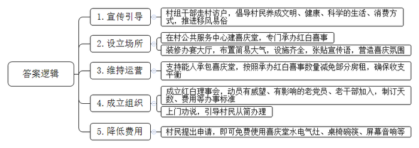
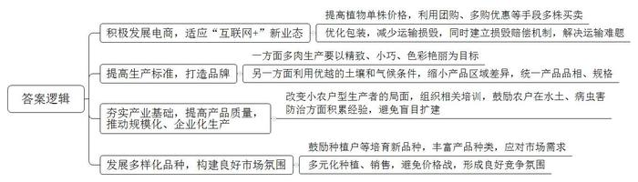
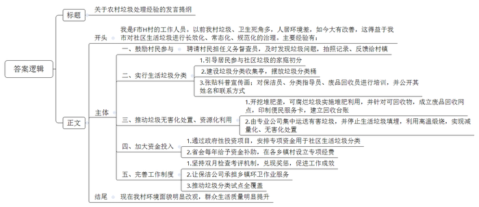
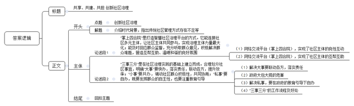

# 2020年0725公务员多省联考《申论》题（天津B卷）

<!-- gwy:overview:start -->
> **天津 · 2020 · 申论 · B类** ｜ 4 题 · 图片 4 处 · 答案随题折叠

导航：[题目](#题目) · [材料 1](#材料-1)
<!-- gwy:overview:end -->

> 候选采集稿。参考答案及解析来自粉笔页面，不代表官方答案或真实高分答卷；来源使用许可与原卷对应关系仍需人工核实。

## 给定材料

### 材料 1

在S村，说起“喜庆堂”，妇孺皆知，大人们直竖大拇指夸赞，孩子们忙带路领来人前往！“喜庆堂”是S村2014年投入使用、鼓励村民移风易俗的重要场所。

“去年为儿子操办婚事时，开始想自己办，花费不菲还很麻烦，思来想去一时理不清头绪。”S村61岁的周任林说。后来，他找到村党总支书记周久海商量，最终在“喜庆堂”把儿子的婚事给办了。

“亲戚朋友200多人，如果在家里办婚事，起码要请几十人帮忙，按照风俗要折腾3天。“在‘喜庆堂’，一天两顿就结束了。”周任林笑着说，“婚事不仅办得热闹喜庆，还省了不少事，亲戚朋友都夸‘办得漂亮’！”

前些年，当地村民攀比操办婚丧嫁娶等红白喜事，一些人为了所谓的“脸面”，不惜举债办酒席，规模越来越大。“不能让这股铺张浪费和攀比之风蔓延。”S村党总支书记周久海说，“要让老百姓既不丢‘面子’，又改变农村不健康消费的风气，只有移风易俗。”

4年前，村组干部走村访户，对村民宣传倡导文明、健康、科学的生活、消费方式。同时，在S村公共服务中心建成“喜庆堂”，专门承办村里的红白喜事。

承包“喜庆堂”的是返乡能人钱文彬，他平时对外承接零散客人，村里则按照他承办红白喜事的数量减免部分房租。“除去厨师和服务员的工资及房租、水电煤气费外，基本能持平。”钱文彬说，他并不指望靠此赚钱。

在“喜庆堂”建成的同时，S村还动员那些有威望、有影响的老党员、老干部等组织成立红白理事会。红白理事会为村里红白喜事制订了办事标准，即操办红事不超过1天，操办白事不超过3天，每桌酒席花费不超过500元，烟、酒单价分别不超过20元和100元，份子钱不超过400元。

S村党群服务中心，一袭白墙黑瓦。三层楼的底层，半是政务大厅，半是红字标示的“喜庆堂”。“我儿子在这儿办婚宴，特省钱！”指着牌匾，村民吴义松说。

进入“喜庆堂”大厅里，二十余张桌子铺着大红色的桌布，简易而大气，电子显示屏、舞台等设施齐全。“喜事新办，节俭养德，文明理事”“破除陈规陋习，倡导健康生活……”的宣传语随处可见，让人感受到浓浓的喜庆氛围。

“喜庆堂面积大约200平方米。”兼任红白理事会会长的古中举说，这块地方原来是村里举办活动、接待游客用的，经过装修、置办，成为了宽敞的办宴大厅。只要村民提出申请，就能免费使用这里的水电气灶、桌椅碗筷、屏幕音响等。

可最初，吴义松还想在城里办婚宴：“就这一个儿子，还不风光点？”古中举得知，上门劝说：“进城要坐轮渡的，拖家带口多不方便！再说，城里租个大屏幕，就得七八千！吃饭店的酒席，哪有自己备料、亲戚帮厨划算？”

吴义松没吭声。古中举再进一步：“你在饭店把门一关，除了亲戚，谁能瞧见你风光？在‘喜庆堂’办，村里人一走一过，还能凑个热闹。再把鞭炮放放，不比城里欢腾？”

吴义松想通了。然而，当把新计划告诉女方时，又出现了插曲：外地的儿媳妇，在网上咋也搜不到“喜庆堂”，以为地方不怎么样，心里犯了嘀咕。直到她进了村子，看见“喜庆堂”宽敞明亮，墙上贴着不少村民的笑脸，才安下心来，点头同意。

吴义松提交“喜庆堂”的使用申请时，古中举不忘提醒：“既然要在村里办，就得守规矩。酒席别超过10桌，每桌菜别超过500元，车别超过3辆……”

### 材料 2

近年来，因为萌萌的体态、超高的颜值、诗意的名字，多肉植物俘获了大众的“芳心”，市场的需求迅速增大。多肉植物之所以能成为产业，电商功不可没。“我们必须要更加适应‘互联网+’这种新业态。”G县商务部门的一位负责人说，“以前我们一般认为，因为植物单株价格低、运输易造成损毁、运费高昂等原因，包括多肉植物在内的花卉业不太适合电商模式，但数据告诉我们这种想法其实不对。”

“我们是‘多肉大县’，却不能算‘多肉强县’。”G县多肉协会副会长老叶强调，“国内标准化要求不高，主要依靠品相吸引消费者，因此精致、小巧、色彩艳丽是多肉生产的目标。我们县由于小农户型生产者居多，产品区域差异明显，品相参差不齐，规格难以统一。”

“其实我们G县的土壤和气候是适合大部分多肉植物的。”一位园艺专家在一次花博会上对记者说道，“目前，我们县的多肉种植是以小农户为主，真正企业化生产的极少，而且即使是企业化生产，也是往往在某一个品种的量上面下功夫，一旦市场饱和，恐怕他们也难以应对。此外，我们的多肉种植起步不算晚，但整个花卉产业基础薄弱，相当一部分个体种植户缺乏经验，不知道在水土上做文章、在病虫害防治等方面多下功夫，吃到盲目扩建的亏后，要么改种其他花植，要么干脆迁居外县另起炉灶。”

G县多肉产业主要集中在景天科多肉，品种较单一。“大家都卖桃蛋这一个品种，就相互踩价。现在我们这的桃蛋已经降到8毛钱一株了，可还是看的人多，买的人少，这可怎么办哟？”说到销售，多肉种植大户老王一筹莫展。G县多肉植物滞销率约为40%，而多肉的销售旺季主要在春秋两季。以前花农们通过降价促销基本能全部出货，但现在这个策略似乎失效了。“有的种植户只是‘抓一把、赶紧跑’，只想快点回本赚钱，我们G县多肉的招牌怎么能打响哟？”

### 材料 3

退休教师老马是单车骑行爱好者，在村里经常能看到他骑车的身影。最初他骑车是为了看风景，但自从5年前他有了一个新的身份——“社区人居环境整治义务督查员”后，他就会在骑行时随身带上相机和小本子，既看景也看垃圾，看到哪里有垃圾就拍下照片，并用小本子记下发现垃圾的具体地址，再反馈给村镇处理。

F市是K省省会下辖的县级市，H村（H村属于F市）的人居环境在以前并不好，“垃圾靠风刮，污水靠蒸发；房里现代化，屋外脏乱差。”这是当地人对当时社区人居环境的评价，也是老马刚开始担任督查员时，他的相机和小本子所记录的景象。

“以前，房前屋后、路边、河边都能看到垃圾，一到夏天气味难闻。从去年开始，市里搞垃圾分类，还有污水治理，现在环境比以前好多了。”谈起这些年来的变化，74岁的老周打开了话匣子，“垃圾清运、分类，公厕改造，污水处理，这些都由政府投入，老百姓不用掏一分钱。我现在知道家里的垃圾需要分开装，像菜叶子、剩饭属于可以腐烂的垃圾，像塑料袋属于不可腐烂的垃圾。”老周家门口，有一绿一黄两个小型垃圾桶，分别写着“可腐烂垃圾”和“不可腐烂垃圾”，他觉得社区垃圾的家庭初分，既简单又方便。

村口建设这古色古香的亭子作为垃圾分类收集亭，摆放着四种不同颜色的240升标准垃圾分类桶，分别收纳可腐烂、可回收、有害和其他等四类生活垃圾。亭内设有图文并茂的垃圾分类科普宣传画，还有受过培训的保洁员、垃圾分类指导员、废品回收员的姓名和联系方式。

“垃圾分类不是目的，最终是要实现垃圾的无害化处置和资源化利用。”F市农环办韩主任告诉记者。目前F市共开挖了205处堆肥垄，像菜叶、瓜皮、树叶等可腐烂垃圾就在此消化堆肥。除了堆肥利用外，F市还对可回收物做到应收尽收，鼓励各乡镇（街道）成立废品回收网点，印制便民服务卡，建立回收台账。同时，F市对有害垃圾进行了无害处置，通过收集、中转后，由专业公司集中运送至有害垃圾处置厂，实行集中无害化处置。2017年9月起，F市停止了生活垃圾填埋的处置方式，利用当地水泥公司的水泥窑高温煅烧，实现了其他类生活垃圾处置的减量化和无害化。

“社区垃圾治理，政府要舍得投入。”韩主任说。2017年F市财政投入1200万元专项资金用于社区环境治理，通过政府性投资项目安排3000万元专项资金用于全域垃圾治理；安排2000万元专项资金用于社区生活垃圾分类。同时，K省省会每年给予一定的资金补助，各乡镇村里也设立了专项经费。2019年，F市财政投入用于环境治理的经费达8200万元。

韩主任表示，近年来，政府修订制定了《F市推进社区生活垃圾分类减量化处理和资源化利用工作实施意见》《F市社区生活垃圾治理和环境整治考核奖惩办法》《F市社区生活垃圾全域治理巡查管理办法》等各项工作制度，坚持双月检查考评机制，通过严格考评，兑现奖惩，促进了全市社区生活垃圾治理工作始终保持在高质状态。截至2019年5月，共有13家保洁公司承担着全市17个乡镇（街道）的环卫作业服务，配备了保洁员2514名；全市160个村（居）实现垃圾分类试点全覆盖，已有524个自然村落实了垃圾分类。

老马的照片和小本子清楚地反映了F市社区人居环境的改变：最初骑行一小时能记录十几处卫生死角，而现在常常几个小时也发现不了一处。老马义务督查员的身份也面临着“退休”的风险。他高兴地告诉记者，“F市社区的环境越来越好，现在不仔细去找，很难看到卫生死角了。社区生活垃圾治理长效化、常态化、规范化，社区生态环境改善了，群众生活质量提高了，环境面貌明显改观，生活生态质量明显提升。”

### 材料 4

四合院作为老北京人世代居住的主要建筑形式，是由东、西、南、北四面房子围合起来形成的内院式住宅，关起门来自成天地。四合院院落宽绰疏阔，四面房屋各自独立，又有游廊连接彼此，庭院方阔、尺度合宜，大小空间分而不隔、互相渗透。院内，四面房门都开向院落，交流沟通便利，拉近了人心、增进了情感，生活气息浓厚，起居十分方便，彼此熟悉，相互帮忙，其乐融融。四合院为创造亲切和睦的生活起了很大作用。

Z街道拥有上个世纪80年代北京市第一个整体开发建设的大型居住社区，常住居民有3万多户、常住人口达8.8万人，下设16个社区，有223栋居民楼。2018年以来，Z街道党员干部跟居民拉家常、交朋友、问需求，添加居民为微信好友，邀请他们进入每栋楼的微信群。加入楼宇微信群的居民数量超过5万，微信群覆盖了四分之三的居民。大家在群里注明了房间号，近七成住户实名入群。一个楼宇群基本可以保证所有家庭代表入群。这个群里，不仅有左邻右舍、物业人员还有居委会的管楼干部，以及书记、主任等，辖区内的党员全部入群，Z街道干部、社区工作人员全部分片入群。

Z街道办事处代主任说，居民入驻了微信群，让高楼变成了“掌上四合院”。街道有事，信息能在第一时间精准推送到群内的每家每户，居民有诉求，也能在第一时间上达街道层面，日常生活里的大事小情都能在群里解决，社区里的大事小情都通过“掌上四合院”找到了良策。

Z街道党工委方书记说，以前，有的同志接到群众诉求，能拖就拖、能混就混。现在就大不一样了，群里的数字不会说谎，群里的问题都能追溯，干部的表现群里居民都在看着。市委组织部挂职干部小王说，街道干部和社区工作者不再是朝九晚五、机关坐班式工作状态，而是走出办公室、走到群众身边，与群众建立了扁平化的直接联系，跟着问题走、带着感情干。Z街道的居民群众说：“在Z街道住了三十年，之前整天抬头不见低头见的邻居，楼上楼下都不知道是谁，这回进了群终于‘对上号’了。”以前是“长住对门不相识”，现在，曾经陌生的居民们在群里开始熟悉，邻里关系紧密了，遇到难事大家互相帮助，有事情大家一起商量，社区真正成了大家的家。

### 材料 5

党的十九大报告提出，要打造共建共治共享的社会治理格局，加强社区治理体系建设，实现政府治理和社会调节、居民自治良性互动。

N区作为Q市的主城核心区，肩负着老城区更新和社区开发的双重职责，80万常住人口中有30万农转非安置人口和进城农民工，还有近30万流动人口。古楼湾片区有55栋20世纪80年代的老建筑，分属两个社区，周围被四条主干道包围，没有围墙。社区人员流动大，管理难度高，治安隐患大，仅2013年就发生多起刑事案件。古楼湾社区的九龙花园是一个老旧小区，基础设施落后，200余户居民来自四面八方，生活习性不一，长期无物业管理，小区内污水横流，垃圾乱堆，群众怨声载道。

社区余主任说，传统行政式的社区管理方式，曾让她疲于奔命还难有效果，曾经一年时间里群众诉求1600件次。街道社区管得越多矛盾似乎越多，管得越细群众意见反而越大。这也是N区近年来基层社会治理中干部们普遍存在的困惑：民生投入越来越多，生活环境越来越好，为什么群众的满意度却没有越来越高？基层管理越来越细，基层干部越来越忙，为什么群众的认同感却没有越来越强？城市建设越来越好，生活水平越来越高，为什么群众的幸福感没有越来越强？

2013年，N区花园街道开始了社会治理中的大事、小事和私事分流处理工作。花园街道党工委李书记说，街道坚持及时划清街道、社区、居民各自责任，不大包大揽，不介入过多具体事务。分解责任、事务，不在于分得多清楚，更重要的是培养居民责任意识，引导居民广泛参与社区事务，该由政府办的公共事务，要全力办好；该由社区处理的事务，要在自治的前提下，依法办得群众满意；属于社区居民自己家的私事，由政府和社区引导，主要由私人办好。政府既不能大包大揽做“物管”，也不能不闻不问不管，简单把责任完全推给居民了事。只强调加大投入和权利赋予，没有相应的责任共担和公平的投入机制，政府投入再多，群众满意度也不会随之提高。只强调自上而下的精细管理，没有自下而上的广泛参与，政府管得再细，群众认同感也不会随之上升。只强调旧城改造和新区开发，没有把群众组织起来同步推进社会建设，城市发展再快，面临的矛盾和问题也不会随之减少。

2013年，N区峡口镇在农村危房改造工作中提出，凡是涉及群众个体的事，群众自己也要承担一部分费用。这样实施下来的结果是，群众对所办的事更加积极，更加用心，对所办的事也更加满意。

九龙花园引导居民自治，组织成立了楼委会、议事委员会等自治组织，引导居民议定出《小区楼规民约》等5个制度规则，形成了“小区事、大家议、协商办、共监督”的自治管理流程。经过居民议事协商，由每户居民出资30元，公益事业发展基金支持2.5万元，街道配套1.8万元，改善了小区的出行等设施，同时组织志愿者对绿化等进行完善，有效地改变了居住环境。古楼湾片区安装摄像头需要28.5万元，社区两个月内召开听证会、协调会30余次，让居民充分表达意愿，最终达成“居民出、社会筹，自己事情自己办”的共识，3327户居民(91%的参与率)出资7.2万元，社会单位支持19.6万元，在重要路口、案件高发区安装摄像头73个，使年均发案率同比下降45%，居民安全感大幅上升。近几年来，N区先后获得了全国文明城区、国家卫生城区等20多项国家级荣誉。

### 材料 6

N区在总结基层社区治理探索实践基础上，建立了一套合理划分大事、小事、私事的机制。“大事”即：政府管理事项及公共服务，由政府部门负责解决；“小事”是村(居)公共事项及公益服务，由村（居）委会为主导，社区自治组织、社区社会组织和社区单位共同协商解决；“私事”是村（居）民个人事务和市场服务，由群众自行解决或寻求市场服务。虽然把事项进行了分流，归根结底是“事”要解决，N区建立了一套快速解决各类事项分类办理的机制和流程。一是落实责任，“大事”快办；二是基层协商，“小事”共办；三是注重引导，“私事”自办。换言之，“大事”是大公事，由政府部门负责解决；“小事”是小公事，由村（居）委会主导，社区自治组织、社区社会组织和社会单位等共同解决；“私事”是居民个人事务，由政府引导居民自行解决或寻求市场服务。

据N区民政局负责人介绍，具体工作流程有找事、分事、办事、反馈评估四步工作。第一步：找事。找事也就是需求收集。找事的第一责任主体是村（居）委会。所找的“事”是以居民的需求为导向，尤其是居民反映需要解决的问题。在收集需求中，通过“走出去”和“请进来”双重方式，收集社区干部、社区公益站、社区民警、社区社工和志愿者、社区社会组织等渠道所反映的有关居民需求的事项。第二步：分事。分事也就是通过协商进行分流，将事情按“大事”、“小事”和“私事”，分流到相关的承办部门和人头上。在分事中，由村（居）党组织、村（居）委员会在充分征求意见的基础上，提出协商议题，然后由协商主体开会协商决定哪些事按“大事”来办，哪些事按“小事”来办，哪些事属“私事”引导居民自己办。在分事的同时，明确具体的办理单位和人头、办成事的标准和时间，以及经费等具体事情。第三步：办事。在协商分事后，所有的事便有了具体办事的“主”（包括私事）和具体的办事方法，因而事情办理起来就不会有推诿扯皮的现象出现。第四步：反馈评估。所有分流的事办完后，都要进行反馈评估。反馈就是将项目执行的结果反馈给需求方和项目有关参与方，评估就是对项目实施的过程、效率和经验、群众的满意度等，进行收集总结。在反馈评估中，对所办事项还要在社区进行公示，以接受群众的监督和评价。

## 题目

### 第 1 题

**根据“给定资料1”，概括S村倡导红白喜宴简单办理的新举措。（15分）**

关联材料：材料 1

作答要求：

要求：全面准确，简洁，有条理。不超过250字。

第 1 题 · 答案与解析

**参考答案（粉笔题库参考内容）**

1.宣传引导。村组干部走村访户，倡导村民养成文明、健康、科学的生活、消费方式，推进移风易俗。

2.设立场所。在村公共服务中心建喜庆堂，专门承办红白喜事；装修办宴大厅，布置简易大气，设施齐全，张贴宣传语，营造喜庆氛围。

3.维持运营。支持能人承包喜庆堂，按照承办红白喜事数量减免部分房租，确保收支平衡。

4.成立组织。成立红白理事会，动员有威望、有影响的老党员、老干部加入，制订天数、费用等办事标准；上门劝说，引导村民从简办理。

5.降低费用。村民提出申请，即可免费使用喜庆堂水电气灶、桌椅碗筷、屏幕音响等。

**参考答案说明：**本参考答案从“宣传引导”“设立场所”“维持运营”“成立组织”“降低费用”五个方面展开，各条答案要点之间在内容上相互并列，没有交叉。

**解析状态：unknown（来源未提供）**

**考点**：概括措施类

**来源**：2020年0725公务员多省联考《申论》题（天津B卷）

### 第 2 题

**根据“给定资料2”，假如你是G县政府的工作人员，请就发展G县多肉产业提出对策建议。（20分）**

关联材料：材料 2

作答要求：

要求：

（1）紧扣资料，内容具体；

（2）层次分明，建议可行；

（3）字数不超过300字。

第 2 题 · 答案与解析

**参考答案（粉笔题库参考内容）**

1.积极发展电商，适应“互联网+”新业态。提高植物单株价格，利用团购、多购优惠等手段多株买卖；优化包装，减少运输损毁，同时建立损毁赔偿机制，解决运输难题。

2.提高生产标准，打造品牌。一方面多肉生产要以精致、小巧、色彩艳丽为目标；另一方面利用优越的土壤和气候条件，缩小产品区域差异，统一产品品相、规格。

3.夯实产业基础，提高产品质量，推动规模化、企业化生产。改变小农户型生产者的局面，组织相关培训，鼓励农户在水土、病虫害防治方面积累经验，避免盲目扩建。

4.发展多样化品种，构建良好市场氛围。鼓励种植户等培育新品种，丰富产品种类，应对市场需求；多元化种植、销售，避免价格战，形成良好竞争氛围。

**解析**

**参考答案说明：**（1）本参考答案从“积极发展电商”“提高生产标准，打造品牌”“夯实产业基础，提高产品质量”“发展多样化品种，构建良好市场氛围”四方面进行了分条撰写。（2）各条要点之间在内容上是并列的，没有交叉。

**考点**：提出对策类

**来源**：2020年0725公务员多省联考《申论》题（天津B卷）

### 第 3 题

**外地的相关人员来学习农村垃圾治理的经验，假如你是H村的工作人员，请根据“给定资料3”，写一篇介绍农村垃圾处理经验的发言提纲。（25分）**

关联材料：材料 3

作答要求：

要求：条理清晰，内容具体，不超过500字。

第 3 题 · 答案与解析

**参考答案（粉笔题库参考内容）**

关于农村垃圾处理经验的发言提纲

我是F市H村的工作人员。以前我村垃圾、卫生死角多，人居环境差，如今大有改善，这得益于我市对社区生活垃圾进行长效化、常态化、规范化的治理。主要经验有：

一、鼓励村民参与。聘请村民担任义务督查员，及时发现垃圾问题，拍照记录、反馈给村镇。二、实行生活垃圾分类。1.引导居民参与社区垃圾的家庭初分。2.建设垃圾分类收集亭，摆放垃圾分类桶。3.张贴科普宣传画；对保洁员、分类指导员、废品回收员进行培训，并公开其姓名和联系方式。三、推动垃圾无害化处置、资源化利用。1.开挖堆肥垄，可腐烂垃圾实施堆肥利用，并针对可回收物，成立废品回收网点，印制便民服务卡，建立回收台账。2.由专业公司集中运送有害垃圾，并停止生活垃圾填埋，利用高温煅烧，实现减量化、无害化处置。四、加大资金投入。1.通过政府性投资项目，安排专项资金用于社区生活垃圾分类。2.省会每年给予资金补助，在各乡镇村设立专项经费。五、完善工作制度。1.坚持双月检查考评机制，兑现奖惩，促进工作成效。2.让保洁公司承担乡镇环卫作业服务。3.推动垃圾分类试点全覆盖。

现在我村环境面貌明显改观，群众生活质量明显提升。

**解析**

**参考答案说明：**（1）格式方面，本参考答案写到了“标题”“正文”两个部分。（2）正文部分，一方面从内容上来看，围绕“农村垃圾处理”这一主题，本参考答案的开头先写到了“H村以前存在的问题，垃圾处理的背景”等；主体部分从“鼓励村民参与”“实行生活垃圾分类”“推动垃圾无害化处置、资源化利用”“加大资金投入”“完善工作制度”五个方面总结了具体经验；最后，结尾部分对垃圾处理工作取得的成效进行了总结。另一方面，形式上，本参考答案做到了分段、分条撰写，整体上条理较为清晰。

**考点**：总结类

**来源**：2020年0725公务员多省联考《申论》题（天津B卷）

### 第 4 题

**根据“给定资料4\-6”中的“掌上四合院”和“三事三分”的启示，围绕“社区治理”，自拟标题，自选角度，写一篇议论文。（40分）**

关联材料：材料 1、材料 2、材料 3、材料 4、材料 5、材料 6

作答要求：

要求：观点明确，联系实际，不拘泥于给定资料，1000字左右。

第 4 题 · 答案与解析

**参考答案（粉笔题库参考内容）**

**共享、共建、共担 创新社区治理**

这是一个最好的时代，经济发展、社会进步、文化繁荣；这是一个最坏的时代，权责不清、治理混乱、环境污染……传统行政式的社区管理方式，让管理者疲于奔命，让参与者怨声载道，核心问题在于社区治理格局的畸形。“掌上四合院”和“三事三分”是社区治理的创新，是政府治理和社会调节、居民自治良性互动的方式，是在社区这个“小世界”中，打造一个最优的时代，实现“大事”能快办，“小事”能共办，“私事”能自办，共享、共建、共担。

**“掌上四合院”是打造智慧社区治理平台的方式。它能连接社区多元主体，让社区主体共同参与，实现治理主体力量最大化；能及时回应群众监督，充分听取群众意见，积极解决群众难题，营造互帮互助、温暖和谐的良好氛围。**

实现社区主体之间的良性互动，就需要借助互联网技术，搭建网络交流平台。“掌上四合院”就是搭建网络平台，激发多元主体力量的典型，通过建立微信群，将居民、物业、辖区党员以及社区干部等纳入其中，其中的居民可及时反馈基层问题，帮助社区干部掌握基层痛点；可反映生活问题，方便其他居民及干部及时提供帮助；可实时监督社区工作，倒逼干部认真履责……可见，通过网络交流平台，不仅可拉近社区主体之间的距离，还能实现互帮互助，解决大小事宜，最终实现共享共治的局面。

**“三事三分”是在社区治理实践的基础上建立而成。合理划分社区事宜，明确“大事”要快办，落实责任，联动各方，提升效率；“小事”要共办，调动社区群众积极性，共同协商；“私事”要自办，既要发挥群众的自主性，也要注重教育引导。**

一方面要认识到“民生无小事，枝叶总关情”，只要是涉及群众切身利益的公共事项及公共服务，都是“大事”，是最基本、最迫切的民生需求。“大事”的解决不是某个干部、某个部门的一家之责，需要协调各部门，加强联动，以此精简环节、提高效率。另一方面要承认，过去政府为群众办实事办好事，却大包大揽，基层干部疲于奔命，群众产生“等靠要”的依赖思想。最后，要明白“清官难断家务事”，对于家庭私事，倡导“自办”。但这并不意味着政府、社区袖手旁观，而应为其提供普惠性服务，注重教育和引导。总之，发展为了人民，更要依靠人民，社区治理也要听民意、汇民智、集民力。既有政府的投入与权力赋予，也有群众的责任共担，才能求得自上而下精细管理与自下而上广泛参与的“最大公约数”。当然要让“三事分流”工作法真正落实地、见实效，需要系统性、全面性、全方位的过程把控，真正做到准确“找事”、合理“分事”、高效“办事”、全面“反馈评估”。

古人云：“图垂成之功者，如挽上滩之舟，莫少停一棹。”社区治理关系到群众的切身利益，且并非一朝一夕之功，任重而道远。因此，需要社会各界携起手来，才能提高治理效率，让社区和谐之花充分绽放！

**文章分析**

**共享、共建、共担 创新社区治理**

【**标题的优点：**标题中含有“创新社区治理”这一主题词，文章主题突出、清晰。】

（1）<u>这是一个最好的时代</u>，<u>经济发展、社会进步、文化繁荣</u>；<u>这是一个最坏的时代</u>，<u>权责不清、治理混乱、环境污染</u>……传统行政式的社区管理方式，让管理者疲于奔命，让参与者怨声载道，核心问题在于<u>社区治理格局的畸形</u>。（2）“掌上四合院”和“三事三分”<u>是社区治理的创新</u>，<u>是政府治理和社会调节、居民自治良性互动的方式</u>，是在社区这个“小世界”中，打造一个最优的时代，实现“大事”能快办，“小事”能共办，“私事”能自办，共享、共建、共担。

【**开头的优点：**★内容方面。范文的开头是紧扣“创新社区治理”这一主题展开的。（1）介绍了时代背景，指出传统社区管理方式存在不足；（2）点明了主题“创新社区治理”。★文字表达方面。使用了排比的修辞手法以及长短句结合的形式，使语言表达清晰有力、有节奏感。】

**“掌上四合院”是打造智慧社区治理平台的方式。它能连接社区多元主体，让社区主体共同参与，实现治理主体力量最大化；能及时回应群众监督，充分听取群众意见，积极解决群众难题，营造互帮互助、温暖和谐的良好氛围。**

（1）<u>实现社区主体之间的良性互动</u>，就需要<u>借助互联网技术</u>，<u>搭建网络交流平台</u>。<u>“掌上四合院”就是搭建网络平台</u>，<u>激发多元主体力量的典型</u>，通过建立微信群，将居民、物业、辖区党员以及社区干部等纳入其中，其中的居民可及时反馈基层问题，帮助社区干部掌握基层痛点；可反映生活问题，方便其他居民及干部及时提供帮助；可实时监督社区工作，倒逼干部认真履责……（2）可见，<u>通过网络交流平台</u>，<u>不仅可拉近社区主体之间的距离</u>，<u>还能实现互帮互助</u>，解决大小事宜，最终实现共享共治的局面。

【**论述段1的优点：**★观点句：范文的观点句是紧扣“创新社区治理”这一文章主题提出的。形式上，它用单独段落呈现，位置突出，容易发现。内容上，关键词突出，内容要点明确，可以明显看出它主要介绍了“掌上四合院”带来的启示。★论述内容：（1）指出了网络交流平台（掌上四合院），实现了社区主体的良性互动；（2）指出了网络交流平台（掌上四合院），实现了社区主体的互帮互助。注意：以上两个方面的内容都是紧扣观点句进行分析论述的，层次清晰，论述的针对性强。在论证方法上主要采用了讲道理的方式，论证比较充分。】

**“三事三分”是在社区治理实践的基础上建立而成。合理划分社区事宜，明确“大事”要快办，落实责任，联动各方，提升效率；“小事”要共办，调动社区群众积极性，共同协商；“私事”要自办，既要发挥群众的自主性，也要注重教育引导。**

（1）一方面要认识到“民生无小事，枝叶总关情”，<u>只要是涉及群众切身利益的公共事项及公共服务</u>，都是“大事”，<u>是最基本、最迫切的民生需求</u>。“<u>大事”的解决不是某个干部、某个部门的一家之责</u>，<u>需要协调各部门</u>，<u>加强联动</u>，<u>以此精简环节、提高效率</u>。（2）另一方面要承认，<u>过去政府为群众办实事办好事</u>，却大包大揽，基层干部疲于奔命，群众产生“等靠要”的依赖思想。（3）最后，要明白“清官难断家务事”，<u>对于家庭私事</u>，<u>倡导</u>“<u>自办</u>”。但这并不意味着政府、社区袖手旁观，而应为其提供普惠性服务，<u>注重教育和引导</u>。（4）总之，发展为了人民，更要依靠人民，<u>社区治理也要听民意、汇民智、集民力</u>。既有<u>政府的投入与权力赋予</u>，也有<u>群众的责任共担</u>，才能求得自上而下精细管理与自下而上广泛参与的“最大公约数”。当然要让“<u>三事分流”工作法真正落实地、见实效</u>，需要系统性、全面性、全方位的过程把控，真正做到准确“找事”、合理“分事”、高效“办事”、全面“反馈评估”。

【**论述段2的优点：**★观点句：范文的观点句是紧扣“创新社区治理”这一文章主题提出的。形式上，它用单独段落呈现，位置突出，容易发现。内容上，关键词突出，内容要点明确，可以明显看出它主要介绍了“三事三分”带来的启示。★论述内容：（1）指出了解决大事要联动各方，落实责任；（2）指出了政府大包大揽的危害；（3）指出了解决私事，要在政府的教育引导下自办；（4）指出了“三事三分”的工作流程及好处。注意：以上四个方面的内容都是紧扣观点句进行分析论述的，层次清晰，论述的针对性强。在论证方法上主要采用了讲道理的方式，做到了论证充分。】

【**论述段之间的关系：**★内容的内在逻辑：范文的论述段之间是依照“并列”的逻辑展开的。论述段1是“掌上四合院”带来的启示；论述段2是“三事三分”带来的启示。两个论述段逻辑清晰。】

古人云：“图垂成之功者，如挽上滩之舟，莫少停一棹。”<u>社区治理</u>关系到群众的切身利益，且并非一朝一夕之功，任重而道远。因此，<u>需要社会各界携起手来</u>，<u>才能提高治理效率</u>，<u>让社区和谐之花充分绽放</u>！

【**结尾的优点**：范文的结尾回扣了文章主题，语言精悍，不拖沓。】

**解析状态：unknown（来源未提供）**

**考点**：文章写作题

**来源**：2020年0725公务员多省联考《申论》题（天津B卷）

