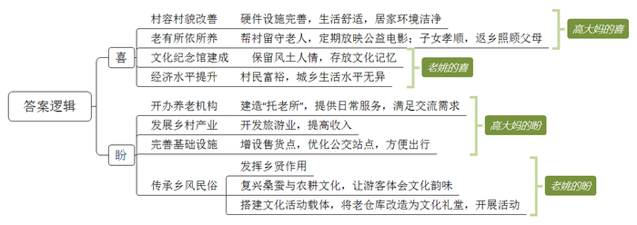
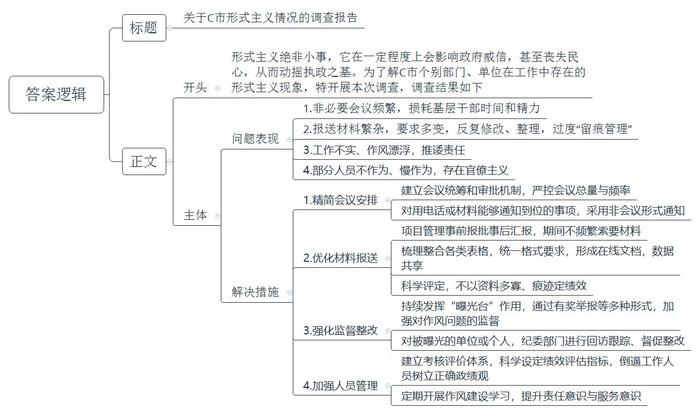
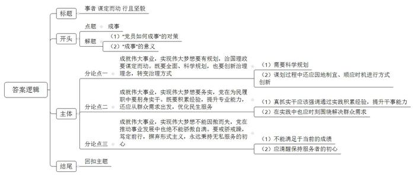

# 2021年公务员多省联考《申论》题（天津区县卷）

<!-- gwy:overview:start -->
> **天津 · 2021 · 申论 · 区县卷** ｜ 4 题 · 图片 4 处 · 答案随题折叠

导航：[题目](#题目) · [材料 1](#材料-1)
<!-- gwy:overview:end -->

> 候选采集稿。参考答案及解析来自粉笔页面，不代表官方答案或真实高分答卷；来源使用许可与原卷对应关系仍需人工核实。

## 给定材料

### 材料 1

新春伊始，《新农村》记者小梁到基层调研，以下是他在南北方两个乡村采访的片段。

“村子真干净”，这是外来人对东各村的第一印象。村道上见不到一张纸片，家家院里院外也清清爽爽，79岁的高大妈笑着把小梁往屋里迎。冬季取暖煤改电以后，高大妈家装了地暖，外面再冷屋里也舒服。高大妈自己收拾得利索，家里拾掇得干净，屋里屋外的花儿都修剪得齐齐整整，言语间也透着喜悦，“儿子孝顺，春节前辞了城里的工作回来，专门照顾我们老两口。”“爸妈上了年纪，身体都不大好，有个头疼脑热，身边没个人照顾那肯定不成。”高大妈的儿子小曾买完菜刚一进门就接过了话头。

东各村是太行山脉的一个小山村。村子不大，一共250多口人，但老龄化程度不低，60岁以上的老人就有70多位。平时，村里就是这些老人“守着”，村委会一周放两次公益电影，捧场的也都是这些老人。“村里的大爷大妈都是居家养老，儿女负责赡养。子女外出打工的，只能是老两口互相照顾。村里打算建个‘托老所’，解决老人的吃饭和活动、照料问题。”村党支部委员李大姐介绍说，她时常会到高大妈家来看看，帮衬帮衬。听说要建“托老所”，高大妈觉得不错，“老姊妹能时常见上一面，唠唠嗑。”“老爸腿脚不好，出不了门，还得我们在跟前伺候着放心。”小曾说，村里买东西不太方便，买点油盐酱醋、买点菜都得去镇上，单程4公里，走到公交站就得一刻钟，这对老年人是个“大挑战”。儿子能在身边尽孝，高大妈心里高兴，可也着急。她跟李大姐商量：“咱村里能不能办个产业，让我儿子也能有点收入，不然他光照顾我们了，以后咋办？”

李大姐说，东各村边有条远近闻名的宋代古道，村内还保留着古道上唯一的一座三孔拱桥，来的游客不少。村里已经有10多户拿到了农家乐的经营执照，她说：“要是乡村旅游搞起来，不愁您儿子没事儿干！”

坐落在太湖之滨的水乡小村开弓村，则是另一种景象。弯弯的小清河穿村而过，如箭在弦，村名由此而来。上世纪30年代，费孝通先生来此调研，写下著名的经济调研报告。岁月变迁，费老留下的精神财富，成了开弓村重要的文化资源和发展动力。

甜茶、昆曲、桥文化……在开弓村文化纪念馆，或图文，或影像，或模型，地方风土人情跃然眼前。陈列厅里，一件件旧物什，散发着浓浓的年代感。“有不少是村民自己捐赠的，像这排老式碗橱，还有那套八仙桌椅，现在已经很难看到了。”被村里人称为“农民教授”的老姚感叹，这里存放的是村民共同的乡村文化记忆。开弓村越来越富，村民的生活和城里无异，但老姚喜中有忧，开弓村曾经是“处处倚蚕箔，家家下鱼筌”；如今，农耕文化、蚕桑文化却有淡化之势。“这是我们的根啊！”老姚颇有感慨。

如何传承乡风民俗？“首先要发挥好乡贤的力量。大家都有共识，要有个乡贤议事会。”老姚说。在成立后的乡贤议事会上，大家一致认为，要以有形的形式展现开弓村文化，如熏豆制作工艺，婚嫁习俗，摇三橹船，桑、蚕、丝到蚕丝被的一条龙产业……为什么要以“有形的形式”？老姚的期盼是：“让来到开弓村的人，从亲身参与民俗活动中体味到农耕文化和蚕桑文化的韵味。”村民的文化活动要有载体，开弓村发展较早，能用的土地已经不多，怎么解决？经过商议，村里准备把老仓库改造成文化礼堂。“脚手架已经搭起来了，估计5月份就能启用。”老姚高兴地说，按照规划，礼堂能容纳100人左右，今后村里的党员活动、大型培训、会议、文艺演出都可以使用。

未来，开弓村的文化回味必定更悠长。

### 材料 2

古城派出所辖区，有古城、古塔、世界地质公园等知名景区。“辖区就是景区，景区就是辖区，居民区也是景区”，这给古城民警提出了不小的挑战。最大的挑战是什么？“山地救援！”派出所杨副所长脱口而出。入职20年来，他和同事们平均每年接到山地救援警情百起左右，解救上百名迷路、被困、遇险群众。景区林中古木参天，山势险要，一些缺少经验的游客可能会迷路，由于山中没有基站，手机定位、无人机巡航常常派不上用场，搜救只能靠杨副所长对山中一草一木的记忆。“从哪里出发、附近是什么植物”“见过什么石头、翻过哪些河谷”“正对面能看到哪些景色”……几个问题一问，杨副所长就能判断个八九不离十。对救援者而言，进山救援同样面临极大的安全挑战。尤其是入冬后，有的地方积雪四五十厘米，一旦落入石缝或者滑下深渊，后果不堪设想。

有天凌晨，游客赖先生报警求援，当天山上寒风夹着大雪，能见度仅5米。在地图上标注好大致位置、规划好路线，顶着寒风，踏着齐腰的深雪，杨副所长和同事们凭着经验前去救援。经过一处斜坡时，一名队员脚下打滑差点摔下去，大家拿绳子把他拉上来一看，下面是万丈悬崖。一路上，杨副所长每隔十几分钟，就电话联系赖先生，一再叮嘱他不能睡觉，一定要不停走动增加身体热量。最终，民警在海拔3700米处的烟雨亭附近找到了他。上百次救援，并非每次都能成功。“如果游客私自进入非游览区域，特别危险。”杨副所长说，他希望游客不要贸然进山，“毕竟一旦救援不成功，可就是一条命啊！”

古城有4000多家酒吧客栈，杨副所长认识九成以上的客栈经营者，“这家的老板来自南京，他有个女儿。”“那家是浙江人”……沿街走一圈，才知道杨副所长所言不虚。别人问他怎么做到的，他说上心了就能记住。刚入职时，古城仅有70多家客栈，剩下的4000多家，都是他看着建起来的。开设客栈要到派出所办证，通过协调手续，他认识了绝大多数客栈经营者。“登记办证，给人家出主意；遇到纠纷，去帮忙调解。时间久了，大家就都熟了。”杨副所长说，记住人不难，关键还是转变理念，“别只想着怎么管理，多想想怎么服务。”

杨副所长将4000多家客栈分片建立了34个微信群，通过微信群与业主交流互动。尽管这些群每天“嘀嘀嘀”响个不停，杨副所长却很心安。因为只要“嘀嘀嘀”的声音在，就有信息源，也就能有的放矢，抓好旅店行业管理。“要是用脚走，我们14名民警，即便每人每天走访20户，也要半个多月时间，开展其他工作的时间就少了。”杨副所长把客栈经营者当朋友，客栈经营者自然不会把他当外人。“我是派出所民警老杨，我知道生态搬迁大家有想不通的地方，我过来就是想和大家聊聊，有啥实际困难尽管说……”在划定内湖生态保护拆迁过程中，一名客栈经营者拒不配合，杨副所长带领民警赶到现场，聊了3个多小时，终于做通了工作。

对游客来说，假期漫步在古城大街小巷，也许意味着浪漫与惬意。而对杨副所长来说，却意味着陪伴家人的时间更少了。尽管家就在当地，可从警以来，每一年春节杨副所长都没能在家。派出所李所长说，大多数人放假时，也是民警最忙的时间。有时候饭刚吃了口，就要出警；夜晚遇到警情，经常一宿无眠。李所长说，“越是节假日，对我们快速处置警情的要求就越高。所里只留几个人值守，其他全部布置到岗亭和街面，以便发生警情后5分钟就能出警。”“为的就是给游客安全感。”杨副所长说。11月的一天，一对从外省来的夫妇报警称其儿子小吴离家出走已半年，最近在古城有活动轨迹，请求帮助寻找。杨副所长立即开展工作，发现小吴于前几日曾在古城某网吧上网。他将小吴照片及基本信息发到每个客栈群后，一家客栈的经营者马上回话，称小吴就在其客栈内，失踪大半年的小吴终于被找到。

“游客的事，都是大事！不管归哪个部门管，只要游客拨打了110，古城派出所就不会不管。”杨副所长说。

### 材料 3

“每天不是在开会，就是在开会的路上。”频繁又非必要的会议，让C市柳云村党支部书记老文很是头疼。老文工作的村子地处沿海，夏秋之际，台风频繁。“大家白天入户排查情况、宣传防台政策，还得抽时间应付各种会议。”老文告诉记者，“有的会议只是花几分钟传达下文件精神，其实用电话或者材料就能通知到位。”

“刚刚签订战略合作协议，实质项目还没落地，就要准备一堆汇报材料。”C市大华街道干部小李对报送“材料”的苦恼，也引起了扶贫干部小吴的共鸣。小吴是2018年起驻村负责57户建档立卡贫困户的工作。回想近两年的工作，小吴说，驻村扶贫工作不易，但最让人头疼的，却是应付各项检查以及反复整理、填写、修改各种资料和表格。“最多的时候，我手里同时有20多个表格要填。有一个表，因为不同要求反复修改，弄了大半年。”如果遇到过于重视迎检资料的领导，可能出现以资料多寡、“痕迹”是否明显来定绩效的情况，基层干部就不得不加班加点找资料，熬更守夜补台账。

2020年，C市纪检监察机关紧扣“四风”问题，设立了转变作风“曝光台”。采取有奖举报、外聘专家、记者采访等形式，对工作不实、作风漂浮的给予定期曝光。被曝光的单位或个人，市纪委监委将回访跟踪、督促整改。市新区小学师生则是这一举措的直接受益者。该小学位于上塘路交叉口，2018年新建了一座高架桥，由于未设置隔音屏，800多名师生不得不在滚滚车流带来的噪音中上课。工程完成伊始，学校和学生家长就多次反映问题，希望加装隔音屏。该街道住建科负责人表示，隔音屏属于高架桥附属工程，高架桥是谁建的，隔音屏就该谁来建。而建设主体市建委则表示，该段高架已移交市城管委养护，应由该委负责加装隔音屏。市城管委称，隔音屏在工程建设过程中，是由原建设单位负责实施的，需要增补应由属地政府负责落实。这一次上“曝光台”，市建委马上邀请市信访、城管、环保等部门和街道进行协调。一个多月后，长达近两年的问题得以解决。

市纪委张副书记说，在作风建设方面，今年C市一举推出了多项措施，重点整饬形式主义顽疾。“我对这样的做法表示肯定。”C市党校刘教授说，不少面向群众的基层政府人员，依然存在不作为、慢作为等现象，而这绝不是小事，甚至会在一定程度上影响政府威信，丧失民心，动摇执政基础。

### 材料 4

1949年3月23日下午，西柏坡阳光明媚，毛泽东同志从住了10个月的小院里走出来，正好碰到迎上来的周恩来同志。他望着远处连绵雄伟的太行山，意味深长地说：“今天是进京赶考的日子。”周恩来答道：“我们都应当考及格，不要退回来。”毛泽东坚定地说：“退回来就失败了。我们决不当李自成！我们共产党人进北平，是要继续革命，建设社会主义，直到实现共产主义。”

2013年7月，习近平总书记在河北省调研时指出：“当年党中央离开西柏坡时，毛泽东同志说是‘进京赶考’。60多年过去了，我们取得了巨大进步，中国人民站起来了，富起来了，但我们面临的挑战和问题依然严峻复杂，应该说，党面临的‘赶考’远未结束。”

2020年10月，党的十九届五中全会审议通过了《中共中央关于制定国民经济和社会发展第十四个五年规划和二〇三五年远景目标的建议》。2021年3月，十三届全国人大四次会议审议通过了《中华人民共和国国民经济和社会发展第十四个五年规划和二〇三五年远景目标纲要》。对于中国发展来说，“五年规划”是党治国理政的重要方式，也是量度中国步伐的显著路碑。从1953年新中国开始实行第一个“五年计划”，到2020年“十三五”规划完成，一个又一个五年，诠释了不同时期的历史标识，推动中华民族迎来了从站起来、富起来到强起来的伟大飞跃。

《管子·乘马》言：“<u>是故事者生于虑，成于务，失于傲。不虑则不生，不务则不成，不傲则不失</u>。”虽说前路并非一片坦途，但要坚信的是，一往无前、永不止步，戒骄戒躁，从来都是成就伟大事业的最正确姿态。

## 题目

### 第 1 题

**根据给定资料**1**，请分别概括高大妈和老姚****“喜”和“盼”的内容。（15分）**

关联材料：材料 1

作答要求：

要求：准确、全面、简明、有条理，不超过250字。

第 1 题 · 答案与解析

**参考答案（粉笔题库参考内容）**

参考答案一：

喜：1.村容村貌改善。硬件设施完善，生活舒适，居家环境洁净。2.老有所依所养。帮衬留守老人，定期放映公益电影；子女孝顺，返乡照顾父母。3.文化纪念馆建成。保留风土人情，存放文化记忆。4.经济水平提升。村民富裕，城乡生活水平无异。

盼：1.开办养老机构。建造“托老所”，提供日常服务，满足交流需求。2.发展乡村产业。开发旅游业，提高收入。3.完善基础设施。增设售货点，优化公交站点，方便出行。4.传承乡风民俗。发挥乡贤作用；复兴桑蚕与农耕文化，让游客体会文化韵味；搭建文化活动载体，将老仓库改造为文化礼堂，开展活动。

**参考答案说明**：本参考答案宏观上围绕“喜”和“盼”两个方面展开。在“喜”的方面，分别从“村容村貌改善”“老有所依所养”“文化纪念馆建成”“经济水平提升”四个方面分条撰写；在“盼”的方面分别从“开办养老机构”“发展乡村产业”“完善基础设施”“传承乡风民俗”四个方面分条撰写；各条要点在内容上是并列且无交叉的。

参考答案二：

高大妈的喜：1.村容村貌改善。硬件设施完善，生活舒适，环境洁净。2.老有所养所依。帮衬留守老人，放映公益电影；子女孝顺，返乡照顾父母。盼：1.开办养老机构。提供日常服务，满足交流需求。2.发展乡村产业。开发旅游业，提高收入。3.完善基础设施。增设售货点，优化公交站点，方便出行。

老姚的喜：1.文化纪念馆建成。保留风土人情，存放文化记忆。2.经济水平提升。村民富裕，城乡生活水平无异。盼：1.传承乡风民俗。发挥乡贤作用；2.复兴桑蚕与农耕文化，让游客体会文化韵味；搭建文化活动载体，将老仓库改造为文化礼堂，开展活动。

**解析状态：unknown（来源未提供）**

### 第 2 题

**根据给定资料**2**，请谈谈古城民警在工作中遇到****过****哪些难题，他们是如何解决的？（****20分）**

关联材料：材料 2

作答要求：

要求：紧扣资料，内容全面，层次分明，条理清晰，不超过300字。

第 2 题 · 答案与解析

**参考答案（粉笔题库参考内容）**

难题：1.山地救援难。救援警情多发，景区情况复杂，迷路风险高；缺乏基站，现代化救援设备无效，只能依靠经验，救援风险高。2.管理难度大。经营场所多，业主情况复杂，民警数量少，存在部分经营者不配合情况。3.节假日警情高发、突发。处置时间长，警员压力大，要求快速处置警情。

对策：1.提升救援技能。充分了解景区情况，预先做好规划，救援队员互相帮助，教授求救者自救技能。2.转变服务理念。用心了解经营者，做好服务工作，增加熟悉度；分片建立微信群，与业主交流互动，定位信息源，做好针对性管理；理解业主，真诚沟通、耐心交流，解决实际困难。3.优化工作方法。分配值班执勤警力，发动经营者提供线索，提高办事效率，面对警情事无巨细。

**参考答案说明：**本参考答案整体上分为难题、对策两大类。在“难题”方面，从“山地救援难”“管理难度大”“节假日警情高发、突发”三个方面进行了分条撰写；在“对策”方面，本参考答案从“提升救援技能”“转变服务理念”“优化工作方法”三个方面进行了分条撰写。同时，各条答案要点之间在内容上相互并列，没有交叉。

**解析状态：unknown（来源未提供）**

### 第 3 题

**给定资料**3**反映了****C****市个别部门、单位在工作中存在的形式主义现象，请你就此写一个调查报告提纲，供相关部门参考。****（****25分****）**

关联材料：材料 3

作答要求：

要求：

（1）紧扣资料，针对性强。

（2）条理清晰，层次分明。

（3）不超过500字。

第 3 题 · 答案与解析

**参考答案（粉笔题库参考内容）**

关于C市形式主义情况的调查报告

调查背景：形式主义绝非小事，它在一定程度上会影响政府威信，甚至丧失民心，从而动摇执政之基。为了解C市个别部门、单位在工作中存在的形式主义现象，特开展本次调查，调查结果如下：

问题表现：1.非必要会议频繁，损耗基层干部时间和精力。2.报送材料繁杂，要求多变，反复修改、整理，过度“留痕管理”。3.工作不实、作风漂浮，推诿责任。4.部分人员不作为、慢作为，存在官僚主义。

解决措施：1.精简会议安排。建立会议统筹和审批机制，严控会议总量与频率；对用电话或材料能够通知到位的事项，采用非会议形式通知。2.优化材料报送。项目管理事前报批事后汇报，期间不频繁索要材料；梳理整合各类表格，统一格式要求，形成在线文档，数据共享；科学评定，不以资料多寡、痕迹定绩效。3.强化监督整改。持续发挥“曝光台”作用，通过有奖举报等多种形式，加强对作风问题的监督；对被曝光的单位或个人，纪委部门进行回访跟踪、督促整改。4.加强人员管理。建立考核评价体系，科学设定绩效评估指标，倒逼工作人员树立正确政绩观；定期开展作风建设学习，提升责任意识与服务意识。

**参考答案说明：**本题要求写“调查报告提纲”，不必考虑格式，但保险起见，加上了标题。在内容上，正文的开头部分介绍了“形式主义”的危害及发文目的；主体部分先从“会议频繁”“材料繁杂”“工作不实”“人员管理”四个方面指出了“形式主义”问题，接着针对以上问题提出了解决措施。各条答案要点进行了分类分条撰写，在内容上相互并列，没有交叉。

**解析状态：unknown（来源未提供）**

### 第 4 题

**请深入理解给定资料**4**中的划线句子****“****是故事者生于虑，成于务，失于傲。不虑则不生，不务则不成，不傲则不失****。****”联系实际****，****自选角度，自拟题目，写一篇议论性文章。****（****40分****）**

关联材料：材料 1、材料 2、材料 3、材料 4

作答要求：

要求：

（1）观点明确，见解深刻；

（2）参考给定资料，但不拘泥于给定资料；

（3）思路清晰，语言流畅；

（4）字数在1000字左右。

第 4 题 · 答案与解析

**参考答案（粉笔题库参考内容）**

**事者** **谋定而动** **行且坚毅**

《管子·乘马》言：“是故事者生于虑，成于务，失于傲。不虑则不生，不务则不成，不傲则不失。”在庆祝改革开放40周年大会上，习近平总书记引用了这句古语，强调伟大的梦想与事业都是拼出来、干出来的，想要成就一番事业，党员就要当好带头人，发挥示范作用，用深谋远虑的眼光、真抓实干的行动和自我警醒的意识来干事创业，推动国家站起来、富起来、强起来的伟大飞跃。

**成就伟大事业，实现伟大梦想要有规划，治国理政要谋定而动。****既****要全面、科学规划，也要创新治理理念，转变治理方式。**只有深谋远虑才能行稳致远，否则看似稳步向前，实际上却透支了发展潜力，也难以实现国家富强。因此，深惟重虑，从攻坚脱贫到乡村振兴、从对外开放到一带一路、从服务型政府到数字化政府建设，我党在不同时期制定了不同的发展战略，不断突破自我、挑战自我，为国家建设提供指导性的政策规划。同时，还在治理中顺应时代潮流，创新体制机制，不断简政放权，丰富治理主体，号召群众参与，以民生导向助力社会发展。

**成就伟大事业，实现伟大梦想要务实，****党在为民履职中要躬身实干。既要积累经验，提升专业能力，还应从群众需求出发，优化民生服务。**“任何业绩的质变都来自于量变的积累”，基层工作长期面临“上面千条线、下面一根针”，更需躬下身子狠抓落实，在深入基层时强调工作方式的合理性，在实干担当方面“加满油”。如果说扎实肯干是干部为民服务的基础，那随着美好生活的不断发展，当下我们还应聚焦民生所需，真正为民所想。我党在推动“美丽乡村”建设过程中，始终围绕群众需求，既改善了生存环境，还通过农家乐等确保了民众就业、提高收入，更是运用新乡贤等方式完善治理，实现高品质服务。

面对新形势下的挑战，做成一件事的关键不仅在于谋划决策的战略眼光、真抓实干的精气神，还要时刻警惕“傲”这一顽疾，始终保持谦虚谨慎、戒骄戒躁的作风，强化谦逊的血脉传承。

**成就伟大事业，实现伟大梦想不能因傲而失，党在推动事业发展中也绝不能骄傲自满。要戒骄戒躁，笃定前行，摒弃形式主义，永远秉持无私服务的初心。**“骄兵必败，骄和躁历来是革命工作的大敌”，习近平总书记告诫全体党员，越是发展顺利的时期，越是容易出错的时期，必须进一步强化忧患意识，毫不懈怠，只争朝夕。同时，纠正“四风”不能止步，作风建设永远在路上，要高举实事求是的旗帜，发扬求真务实的精神，真调研、真落实，坚持用事实说话。唯有永葆初心，将国家的发展、人民的幸福放在心头，党员干部才能所向披靡，战胜一切险阻。

奋斗百年路，启航新征程。面对挑战和问题，我们不能退缩，要肩负时代重任，为努力实现中华民族伟大复兴而砥砺前行！

**文章分析**

**事者 谋定而动 行且坚毅**

【**标题的优点：**标题中含有“事者”，即指代“成事”这一主题词，文章主题更突出、清晰。】

《管子·乘马》言：“是故事者生于虑，成于务，失于傲。不虑则不生，不务则不成，不傲则不失。”在庆祝改革开放40周年大会上，习近平总书记引用了这句古语，（1）<u>强调伟大的梦想与事业都是拼出来、干出来的</u>，<u>想要成就一番事业</u>，<u>党员就要当好带头人，发挥示范作用</u>，<u>用深谋远虑的眼光</u>、<u>真抓实干的行动和自我警醒的意识来干事创业</u>，（2）<u>推动国家站起来、富起来、强起来的伟大飞跃</u>。

【**开头的优点：**★内容方面。范文的开头是紧扣“成事”这一主题展开的。首先，开头在段首处点出主题，做到了主题明确。其次，对“成事”这一主题进行了分析阐述，指出了（1）“党员如何成事”的对策；（2）“成事”的意义。★文字表达方面。使用了名言警句，增强了文章的说服力。】

**成就伟大事业，实现伟大梦想要有规划，治国理政要谋定而动。既要全面、科学规划，也要创新治理理念，转变治理方式。**只有深谋远虑才能行稳致远，否则看似稳步向前，实际上却透支了发展潜力，也难以实现国家富强。因此，深惟重虑，从攻坚脱贫到乡村振兴、从对外开放到一带一路、从服务型政府到数字化政府建设，（1）<u>我党在不同时期制定了不同的发展战略</u>，<u>不断突破自我</u>、<u>挑战自我</u>，<u>为国家建设提供指导性的政策规划</u>。同时，（2）<u>还在治理中顺应时代潮流，创新体制机制</u>，<u>不断简政放权</u>，<u>丰富治理主体</u>，<u>号召群众参与</u>，<u>以民生导向助力社会发展</u>。

【**论述段****1****的优点：**★观点句：范文的观点句是紧扣“成事”这一文章主题提出的。形式上，它在段首处直接写出，位置突出，容易发现。内容上，关键词突出，内容要点明确，可以明显看出它侧重于“成事要能有谋虑，能够谋划”入手。★论述内容：（1）需要科学规划；（2）谋划过程中还应因地制宜、顺应时机进行方式创新。注意：以上两个方面层次清晰，论述的针对性强。在论述方法上主要采用了讲道理、举例子相结合的方式。】

**成就伟大事业，实现伟大梦想要务实，党在为民履职中要躬身实干。既要积累经验，提升专业能力，还应从群众需求出发，优化民生服务。**“任何业绩的质变都来自于量变的积累”，基层工作长期面临“上面千条线、下面一根针”，更需躬下身子狠抓落实，（1）<u>在深入基层时强调工作方式的合理性</u>，<u>在实干担当方面“加满油</u>”。如果说扎实肯干是干部为民服务的基础，那随着美好生活的不断发展，当下我们<u>还应聚焦民生所需</u>，<u>真正为民所想</u>。我党在推动“美丽乡村”建设过程中，（2）<u>始终围绕群众需求</u>，<u>既改善了生存环境</u>，<u>还通过农家乐等确保了民众就业</u>、<u>提高收入</u>，<u>更是运用新乡贤等方式完善治理</u>，<u>实现高品质服务</u>。

【**论述段****2****的优点：**★观点句：范文的观点句是紧扣“成事”这一文章主题提出的。形式上，它在段首处直接写出，位置突出，容易发现。内容上，关键词突出，内容要点明确，可以明显看出它侧重于“在实践中应当扎实落地，追求真抓实干的行动”。★论述内容：（1）真抓实干应该强调通过实践积累经验，提升干事能力；（2）在实践中也应时刻围绕解决群众需求。注意：以上两个方面都是紧扣观点句进行分析论述展开，论述的针对性强，内容层次丰富。】

面对新形势下的挑战，做成一件事的关键不仅在于谋划决策的战略眼光、真抓实干的精气神，还要时刻警惕“傲”这一顽疾，始终保持谦虚谨慎、戒骄戒躁的作风，强化谦逊的血脉传承。

【**过渡段的优点：**★过渡段旨在指出能够成事不仅应当有谋略的眼光、真抓实干的实践，还不能有“傲”，进而引出下文，点明“不傲”就是谦虚谨慎、戒骄戒躁。★文字表达方面。使用了“不仅”“还要”等连接词，使语言表达有逻辑性。】

**成就伟大事业，实现伟大梦想不能因傲而失，党在推动事业发展中也绝不能骄傲自满。要戒骄戒躁，笃定前行，摒弃形式主义，永远秉持无私服务的初心。**（1）“<u>骄兵必败</u>，<u>骄和躁历来是革命工作的大敌</u>”，习近平总书记告诫全体党员，越是发展顺利的时期，越是容易出错的时期，<u>必须进一步强化忧患意识</u>，<u>毫不懈怠</u>，<u>只争朝夕</u>。同时，纠正“四风”不能止步，（2）<u>作风建设永远在路上</u>，<u>要高举实事求是的旗帜</u>，<u>发扬求真务实的精神</u>，真调研、真落实，坚持用事实说话。唯有永葆初心，将国家的发展、人民的幸福放在心头，党员干部才能所向披靡，战胜一切险阻。

【**论述段****3****的优点：**★观点句：范文的观点句是紧扣“成事”这一文章主题提出的。形式上，它在段首处直接写出，位置突出，容易发现。内容上，关键词突出，内容要点明确，可以明显看出它是从“在获得一定发展成绩后应当戒骄戒躁”入手。★论述内容：（1）不能满足于当前的成绩；（2）应清醒保持服务者的初心。注意：以上几个方面的内容都是紧扣观点句进行分析论述的，论述的针对性强，内容层次丰富。在论述方法上采用了讲道理、举例子相结合，做到了丰富多样。】

【**论述段之间的关系：**★内容的内在逻辑：按时间顺序展开，论述段1从谋略论证成事的前提，论述段2从实干层面论证成事的过程，论述段3从戒骄戒躁层面论证成事后的进一步延续。三个论述段相互并列，逻辑清晰。】

奋斗百年路，启航新征程。面对挑战和问题，我们不能退缩，要肩负时代**重任**，为努力实现中华民族伟大复兴而砥砺前行！

【**结尾的优点**：范文的结尾回扣了我党发展历程百年这一时间节点，点出我们要勇担时代责任，语言精悍富有文采，不拖沓。】

**解析状态：unknown（来源未提供）**

