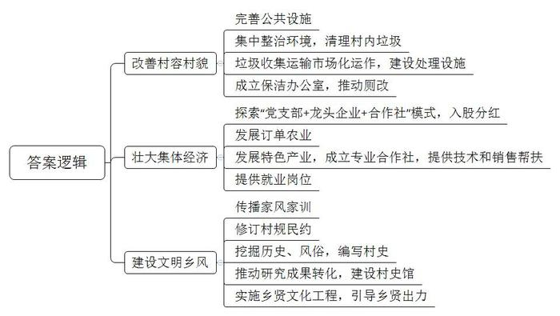
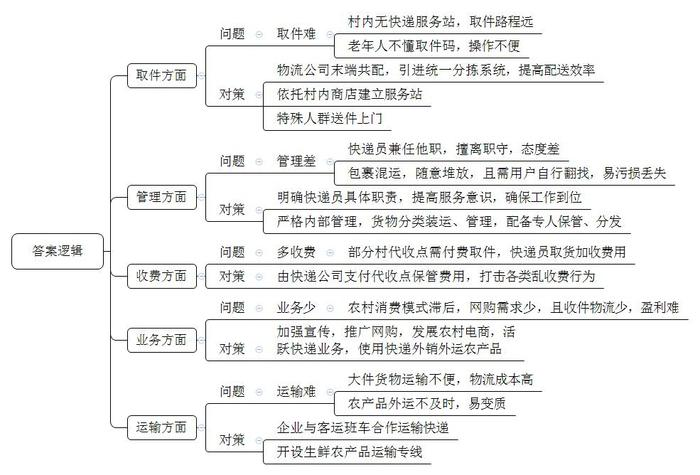
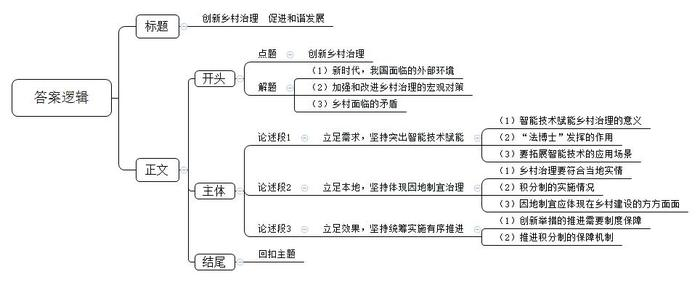

# 2022年公务员多省联考《申论》题（天津区级卷）

<!-- gwy:overview:start -->
> **天津 · 2022 · 申论 · 区级卷** ｜ 3 题 · 图片 3 处 · 答案随题折叠

导航：[题目](#题目) · [材料 1](#材料-1)
<!-- gwy:overview:end -->

> 候选采集稿。参考答案及解析来自粉笔页面，不代表官方答案或真实高分答卷；来源使用许可与原卷对应关系仍需人工核实。

## 给定材料

### 材料 1

对于家乡的旧貌，土生土长的洋下镇梨洋村村民老钟仍记忆犹新，“我们村虽然有得天独厚的优美山水，但过去，村里污水横流，垃圾满地，‘室内现代化、室外脏乱差’，说的就是我们这里，经常被隔壁村的人看不起。”时隔两年，再次走进梨洋村，村里荒废的角落建起了休闲广场，健身器材、文化走廊、公共洗手间样样俱全，泥泞的乡间小路变成了宽阔的水泥路，农户房前院里，整齐地种着各种蔬菜和绿植，村容村貌焕然一新。“我们村开展环境卫生整治后，村庄道路宽了，出行更方便了，我家房前屋后也变得越来越整洁。乡亲们吃完饭，就在休闲广场上散步聊天，生活质量比以前提高了不少，‘腰杆子’都挺直了。”村民老吴自豪地说。

2021年以来，梨洋村已经开展了10余次集中环境整治，组织党员干部、村民、返乡大学生对村里的垃圾、牛羊粪、废弃建筑材料等进行了全面清扫。村委会胡主任介绍：“我们还通过招标方式实现生活垃圾收集运输市场化运作，建立了小型微动力污水处理系统，生活垃圾处理站的两台焚烧炉每天能‘吃掉’6吨生活垃圾，有效解决了大家的生活垃圾和污水处理难题。”

村里还成立了保洁办公室，将人居环境整治转向物业化管理、市场化经营。在保洁办公室的推动下，村里陆续对村民家里的旱厕进行了水冲厕所改造。村民老张家的卫生间已经改造完成，新安装的马桶上贴着一张用户联系卡，上面标有维修、监督和村级联系人的电话。

为壮大村集体经济，村里积极探索“党支部+龙头企业+合作社”的模式，以入股的方式增加村集体收入，带动村民增收。胡主任介绍道，梨洋村在镇里的农产品开发公司投入股金80万元，村集体经济收入按占股比例分红，每年保底收益为5万元。同时，公司还通过订单种植养殖、订单收购带动240户农户增收致富。今年，村里将发展以肉鸭养殖为主的项目，推动村民收入水平再上新台阶。

今年开春以来，村民老吕忙得不亦乐乎，每天不仅要饲养好自己养的5000多只鸭子，还要忙着收捡鸭蛋，然后送到附近的合作社加工。而就在几年前，他还只是一个养鸭规模不大的农户。“过去养殖规模很小，现在一年收入有10万元左右，这得益于产业发展的带动。”老吕高兴地说。为了更好地带动群众增收，村里还引导村民成立了专门的养殖合作社，不仅免费为像老吕这样的养殖户提供更多的养殖技术，还就近收购他们的产品进行深加工。在壮大集体经济的同时，也为村民提供了更多的就业岗位。

“村子近年来变化很大，房子漂亮，住着舒服，每天都有专门的人打扫卫生，村容村貌改进非常明显，更重要的是邻里关系和睦，家家户户门口都挂有家风家训。”村民老王说，村里建设的“家风家训一条街”对教育后代帮助很大，村里的孩子现在都能把家风家训背出来了。

今年年初，在村委会的指导下，梨洋村召开了村民代表大会，大家一致举手通过了新修订的村规民约。此外，村里还组织大学生返乡开展社会实践，通过实地走访老前辈、查阅文史资料，挖掘梨洋村的历史文化，探究过去的风俗习惯，编写了一本图文并茂的《梨洋村史》。下一步，村里还要推进村史研究成果转化，建设村史馆，并进一步实施乡贤文化工程，引导乡贤为本村的发展建言献策、出资助力。这些举措得到了镇政府的肯定，多次组织镇村干部前来“取经”。胡主任高兴地跟大家说道：“村里的发展，既要摘掉‘穷帽子’，又要改变‘老样子’，还要留住‘好根子’。”

### 材料 2

农村寄递物流是农产品出村进城、消费品下乡进村的重要渠道之一。近年来，Z县农村寄递物流体系建设取得了长足进步，但与群众的期待尚存在“最后一公里”不顺畅的问题。日前，Z县在线上开展了关于Z县农村寄递物流体系建设意见征集活动，网友们纷纷留言反映意见建议。

我常年在外面打工，有时会网购一些生活用品给家里的老人和小孩，但村里没有收发快递的服务站，需要自己到镇上取，路途遥远，十分麻烦。此外，老人也不懂“取件码”，取快递存在很多困难，请邻居帮忙取件也不是长久之计。

快递可以到镇里，但我们村到镇里还很远，遇到农忙时节，根本没时间去取。而且快递代收员还兼做其他事情，经常不在，有时态度也不好，过去一趟要提前预约，有时还要在那里等很久。这样一来，包裹长期存放在那里，很容易损坏或丢失。

快递虽然可以到村，但经常把我们的包裹和农药、化肥等一同装车，包裹被压坏、摔坏、污染，甚至丢失。寄来的东西随意堆放，也没人管，还要我们自己去找，翻来找去，还容易把别人的东西弄坏了。

这两年，村里虽然有了快递代收点，但普遍需要付费。有一次，我收到短信说快递已经送到镇上，便赶到快递站取，没想到工作人员却告诉我必须到村代收点付费收取。他们就是为了赚这笔钱，这不是强制收费吗？

我所在的乡镇快递站连公司规定发件率的20%都无法完成，加上派件收费较低，送件入村很不划算，送货到村民家中，基本是“送一单赔一单”，所以只要是寄往农村的快递，都是通知收件人自取。其实，这里农村出产葡萄、蔬菜等优质农产品，但多数农民还不善于使用快递外销外运农产品。如果村民能够用快递物流运输农产品，对于村民和快递企业将是双赢。

我们镇里的农村通路比较窄，大货车进出困难，经常有大件货物，只能依靠面包车多次往返运输，成本增加不少。村里曾经与客运班车开展合作运输农产品，由于班车的班次和空间有限，农产品往往不能及时发出，新鲜农产品面临变质的风险，如果能够与快递企业合作，这些难题应该可以得到解决。

多个快递公司末端共同配送是当前“快递进村”的一种方式，可以在快递到达县级网点后，共同发放到村级站点，节约人力物力，也提升了派送效率，但是整合快递资源却不是一件易事，市场上大多数末端共配公司，没有使用同一套分拣系统，在操作上也不尽相同，统一起来难度较大。

留守村民文化程度往往不高，消费模式相对滞后，电商购物需求少，而且物流主要是送货单向物流，缺乏收件物流，农村物流量较小，快递公司很难盈利甚至亏本经营。建议应该广泛宣传和推动“快递进村”，只有货件货源多起来，快递业务才能活跃起来。

我们村的电商服务站就设在村里的一个小卖部，村民们把自己的农产品定点送往服务站，由服务站统一收取发往乡镇的集散中心，小卖部对村里的情况很了解，同时人流为小卖部带来人气，也降低了小卖部的服务成本。

村里的板栗、核桃、鸡蛋、蘑菇等农特产品要往外发，不到乡镇网点，根本办不成。如果请快递员来“取货”，每一单都要加收费用，有的干脆嫌远，或嫌路难走，根本不愿意进村来。一些售价低廉的农产品，其本身价格可能还不如物流费高。

我是乡镇快递网点的，我们也想为大家服务，可是有些村子只住着几十户人家，甚至是“单家独户”，一个星期才十多单快递，进村的道路又不像城里那么好走，如果快递到站就跑一趟，成本实在太高。因为跑一趟，有时就一件东西；不跑呢，有些食品类的东西又不能放太久。所以，在客户允许的情况下，我们往往会托人把快递有偿捎带过去。

## 题目

### 第 1 题

**结合给定材料**1**，谈一谈梨洋村是如何让村民挺直腰杆的？（20分）**

关联材料：材料 1

作答要求：

要求：全面、准确、有条理，不超过200字。

第 1 题 · 答案与解析

**参考答案（粉笔题库参考内容）**

1.改善村容村貌。完善公共设施；集中整治环境，清理村内垃圾；垃圾收集运输市场化运作，建设处理设施；成立保洁办公室，推动厕改。

2.壮大集体经济。探索“党支部+龙头企业+合作社”模式，入股分红；发展订单农业；发展特色产业，成立专业合作社，提供技术和销售帮扶；提供就业岗位。

3.建设文明乡风。传播家风家训；修订村规民约；挖掘历史、风俗，编写村史；推动研究成果转化，建设村史馆；实施乡贤文化工程，引导乡贤出力。

**解析**

**参考答案说明**：本参考答案从“改善村容村貌”“壮大集体经济”和“建设文明乡风”这三个方面展开。各条答案要点在内容上相互并列，没有交叉。

**考点**：概括措施类

**来源**：2022年公务员多省联考《申论》题（天津区级卷）

粉笔申论页面对本题只提供「解析视频」入口，该入口是会员推广位，页面无视频地址与文字解析。

### 第 2 题

**请根据给定资料**2**，梳理当前Z县农村寄递物流体系存在的问题，并提出相应的改进建议。（30分）**

关联材料：材料 2

作答要求：

要求：

（1）问题梳理全面、准确、有条理；

（2）所提建议与问题相对应，具体明确、切实可行；

（3）不超过400字。

第 2 题 · 答案与解析

**参考答案（粉笔题库参考内容）**

1.问题：取件难。村内无快递服务站，取件路程远；老年人不懂取件码，操作不便。建议：物流公司末端共配，引进统一分拣系统，提高配送效率；依托村内商店建立服务站；特殊人群送件上门。

2.问题：管理差。快递员兼任他职，擅离职守，态度差；包裹混运，随意堆放，且需用户自行翻找，易污损丢失。建议：明确快递员具体职责，提高服务意识，确保工作到位；严格内部管理，货物分类装运、管理，配备专人保管、分发。

3.问题：多收费。部分村代收点需付费取件，快递员取货加收费用。建议：由快递公司支付代收点保管费用，打击各类乱收费行为。

4.问题：业务少。农村消费模式滞后，网购需求少，且收件物流少，盈利难。建议：加强宣传，推广网购，发展农村电商，活跃快递业务，使用快递外销外运农产品。

5.问题：运输难。大件货物运输不便，物流成本高；农产品外运不及时，易变质。建议：企业与客运班车合作运输快递，开设生鲜农产品运输专线。

**解析**

**参考答案说明：**本参考答案分别围绕“取件”“管理”“收费”“业务”“运输”这五个方面的问题及对应的建议展开，进行了分条撰写；各条具体要点之间在内容上相互并列，没有交叉。

**考点**：提出对策类

**来源**：2022年公务员多省联考《申论》题（天津区级卷）

粉笔申论页面对本题只提供「解析视频」入口，该入口是会员推广位，页面无视频地址与文字解析。

### 第 3 题

**根据给定材料**3**中的“法博士”和“积分制”，围绕乡村治理写一篇议论性文章。（50分）**

关联材料：材料 1

作答要求：

要求：

（1）紧扣资料，内容全面；

（2）条理清晰，结构完整；

（3）字数在1000字左右。

第 3 题 · 答案与解析

**参考答案（粉笔题库参考内容）**

**创新乡村治理 促进和谐发展**

乡村治，百姓安，天下稳。新时代新征程，我们面临的外部环境更加错综复杂，需要进一步加强和改进乡村治理，探索乡村治理的新路子、新途径，与时俱进，顺势而为地提升乡村治理的现代化水平，形成治理的良性循环，增强广大农民的获得感、幸福感、安全感。

乡村正面临着需求不断升级和资源欠缺的矛盾，也面临着难点问题突出和乡村规划落后的矛盾，更面临着制度日趋完善和制度难以落地的矛盾，种种矛盾无一不指引着我们要敢于去创新治理方法，探索乡村治理之道。

**立足****需求****，****坚持突出智能技术赋能****。**以人工智能、数字技术赋能乡村治理，提升乡村治理智能化、精细化、专业化、高效化、个性化水平，切实解决群众的日常问题和实际需求。贝鹏村的“法博士”依托语音交互等人工智能技术，为咨询者解决多个领域的日常法律问题，不仅为群众提供了一个法律咨询的互动交流平台，同时有效弥补了农村法律资源欠缺等短板。它的出现让村民矛盾少了，让村民更快更便捷地享受法律服务。“法博士”只是智能技术在乡村治理运用的一个缩影，目前它已经广泛运用于治安治理、农业发展、公共服务等各个领域，未来，我们还需开拓更多的应用场景，真正实现智慧治村、智慧兴业、智慧惠民。

**立足本地，****坚持****体现****因地制宜****治理****。**抓实抓好乡村治理，要大胆实践、勇于创新，形成符合本地实际情况、具有本地特色的乡村治理机制。港头镇多村多人口，实施积分制试点工作存在不少现实难点问题，为此进行了充分调研论证，将乡村治理的事项进行了分类、整合，梳理出重点难点问题，既推动了积分制试点工作，也让这项工作更具有针对性，让利好制度不再流于形式。因地制宜既是尊重科学的方法论，也是造福本地的有效途径，应体现在乡村的产业发展、环境治理、民生建设等方方面面。

**立足效果，坚持统筹实施有序推进。**每一项创新举措的推进，都需要完善的制度和机制保障。港头镇为确保积分制统筹实施、有序推进，完善了领导小组和联席会议制度，组建了各村、组积分制工作推进专班，形成镇、村、组三级联动的保障机制，专班进行逐户登门讲解，为村民提供指导和服务，有序地推进了积分试点工作。

我们要以更大的决心、更明确的目标、更有力的举措，坚持智能化，坚持因地制宜，坚持有序推进，继续走好走稳乡村治理的创新之路，让农村社会充满活力又和谐有序。

**解析**

**文章分析**

**创新乡村治理 促进和谐发展**

【**标题的优点：**首先，范文的标题突出了“乡村治理”这一主题。其次，它在形式上采用对称式结构，使标题更加完整、饱满。】

乡村治，百姓安，天下稳。（1）新时代新征程，我们面临的外部环境更加错综复杂，（2）需要进一步加强和改进乡村治理，探索乡村治理的新路子、新途径，与时俱进，顺势而为地提升乡村治理的现代化水平，形成治理的良性循环，增强广大农民的获得感、幸福感、安全感。

（3）乡村正面临着需求不断升级和资源欠缺的矛盾，也面临着难点问题突出和乡村规划落后的矛盾，更面临着制度日趋完善和制度难以落地的矛盾，种种矛盾无一不指引着我们要敢于去创新治理方法，探索乡村治理之道。

【**开头的优点：**★内容方面：范文的开头是紧扣“乡村治理”这一主题展开的。首先，开头点出主题，做到了主题明确。其次，对“乡村治理”这一主题进行了分析阐述，指出了（1）新时代，我国面临的外部环境；（2）加强和改进乡村治理的宏观对策；（3）乡村面临的矛盾。★文字表达方面：使用了排比的修辞手法，使文字表达更加有力，同时长短句配合使用，使语言表达有节奏感。】

**立足需求，坚持突出智能技术赋能**。（1）以人工智能、数字技术赋能乡村治理，提升乡村治理智能化、精细化、专业化、高效化、个性化水平，切实解决群众的日常问题和实际需求。（2）贝鹏村的“法博士”依托语音交互等人工智能技术，为咨询者解决多个领域的日常法律问题，不仅为群众提供了一个法律咨询的互动交流平台，同时有效弥补了农村法律资源欠缺等短板。它的出现让村民矛盾少了，让村民更快更便捷地享受法律服务。（3）“法博士”只是智能技术在乡村治理运用的一个缩影，目前它已经广泛运用于治安治理、农业发展、公共服务等各个领域，未来，我们还需开拓更多的应用场景，真正实现智慧治村、智慧兴业、智慧惠民。

【**论述段****1的优点：**★观点句：范文的观点句是紧扣“乡村治理”这一文章主题提出的。形式上，它在段首处直接写出，位置突出，容易发现。内容上，关键词突出，内容要点明确，可以明显看出是从“智能技术”的角度切入，对主题展开论述。★论述内容：（1）先介绍了智能技术赋能乡村治理的意义；（2）接着介绍了“法博士”发挥的作用；（3）最后介绍了要拓展智能技术的应用场景。注意：以上三个方面的内容都是紧扣“立足需求，坚持突出智能技术赋能”这个观点句进行分析论述的，论述的针对性强，内容层次丰富。在论述方法上采用了讲道理、举例子相结合的方式，论证充实透彻。】

**立足本地，坚持体现因地制宜治理**。（1）抓实抓好乡村治理，要大胆实践、勇于创新，形成符合本地实际情况、具有本地特色的乡村治理机制。（2）港头镇多村多人口，实施积分制试点工作存在不少现实难点问题，为此进行了充分调研论证，将乡村治理的事项进行了分类、整合，梳理出重点难点问题，既推动了积分制试点工作，也让这项工作更具有针对性，让利好制度不再流于形式。（3）因地制宜既是尊重科学的方法论，也是造福本地的有效途径，应体现在乡村的产业发展、环境治理、民生建设等方方面面。

【**论述段****2****的优点：**★观点句：范文的观点句是紧扣“乡村治理”这一文章主题提出的。形式上，它在段首处直接写出，位置突出，容易发现。内容上，关键词突出，内容要点明确，可以明显看出是从“因地制宜”的角度切入，对主题展开论述。★论述内容：（1）先介绍了乡村治理要符合当地实情；（2）接着介绍了积分制的实施情况；（3）最后介绍了因地制宜应体现在乡村建设的方方面面。注意：以上三个方面的内容都是紧扣“立足本地，坚持体现因地制宜治理”这个观点句进行分析论述的，论述的针对性强，内容层次丰富。在论述方法上采用了讲道理、举例子相结合的方式，论证充实透彻。】

**立足效果，坚持统筹实施有序推进**。（1）每一项创新举措的推进，都需要完善的制度和机制保障。（2）港头镇为确保积分制统筹实施、有序推进，完善了领导小组和联席会议制度，组建了各村、组积分制工作推进专班，形成镇、村、组三级联动的保障机制，专班进行逐户登门讲解，为村民提供指导和服务，有序地推进了积分试点工作。

【**论述段****3****的优点：**★观点句：范文的观点句是紧扣“乡村治理”这一文章主题提出的。形式上，它在段首处直接写出，位置突出，容易发现。内容上，关键词突出，内容要点明确，可以明显看出是从“统筹实施”的角度切入，对主题展开论述。★论述内容：（1）先介绍了创新举措的推进需要制度保障；（2）接着介绍了推进积分制的保障机制。注意：以上两个方面的内容都是紧扣“立足效果，坚持统筹实施有序推进”这个观点句进行分析论述的，论述的针对性强，内容层次丰富。在论述方法上采用了讲道理、举例子相结合的方式，论证充实透彻。】

【**论述段之间的关系**：★内容的内在逻辑：范文的论述段之间是依照“并列”的逻辑展开的。论述段1先写了“立足需求，坚持突出智能技术赋能”，论述段2再写了“立足本地，坚持体现因地制宜治理”，论述段3最后写了“立足效果，坚持统筹实施有序推进”。】

我们要以更大的决心、更明确的目标、更有力的举措，坚持智能化，坚持因地制宜，坚持有序推进，继续走好走稳乡村治理的创新之路，让农村社会充满活力又和谐有序。

【**结尾的优点：**范文的结尾回扣了主题，并且进行了总结和展望。】

**考点**：文章写作题

**来源**：2022年公务员多省联考《申论》题（天津区级卷）

粉笔申论页面对本题只提供「解析视频」入口，该入口是会员推广位，页面无视频地址与文字解析。

