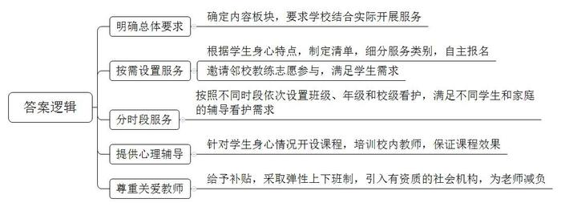
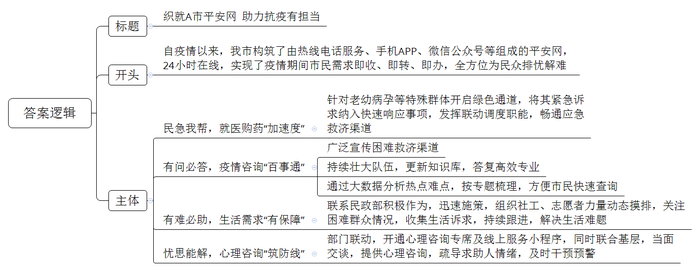
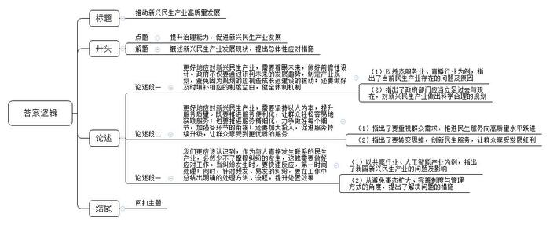

# 2022年公务员多省联考《申论》题（天津市级卷）

> 候选采集稿。参考答案及解析来自粉笔页面，不代表官方答案或真实高分答卷；来源使用许可与原卷对应关系仍需人工核实。

## 给定材料

### 材料 material-69027cd58c180ec6

“下班后我就顺路来学校带孩子回家，她在学校把作业都做完了，还跟着教练学了一节篮球课。”张大姐高兴地说，“以前一到三点半，厂房的机器在响，我的耳边也响起了学校的放学铃，心里可着急了。现在有了课后服务，真是解了我们双职工家庭的燃眉之急。”

“随着我国城市化进程加快，双职工家庭越来越多，父母下班时间与子女放学时间不同步的问题越来越突出。课后服务是我们努力解决群众实际困难的一个举措。”H市教育局李局长说，“我们要求课后服务包括课业辅导，体育锻炼和素质拓展三个板块，然后各个学校根据自身实际开展课后服务。”

“这是我每天最期待的时刻！”小薇今年读小学四年级，她和小伙伴们在操场上一边跳着绳，一边开心地说。她们在等待市体校张教练的到来。每天课后服务时间，张教练都会准时来给孩子们上花样跳绳课。“我们根据小学生的身体和心理发育特点，制定出课后服务清单，让孩子们自主报名。比如体育锻炼就细分为篮球、足球、羽毛球、越野跑等很多类别，这样就能充分满足孩子们的不同需求。”班主任季老师说，“我们学校没有那么多体育师资怎么办呢？正好市体校就在我们隔壁，就请体校的教练来开展志愿活动。张教练的花样跳绳给了孩子们很大的新鲜感和乐趣，非常受孩子们的欢迎。”

“放学后在学校写作业，有不会的问题直接问老师，很方便。”小强今年读初二，以前放学回家后遇到数学难题，爸爸妈妈都不会辅导，为此他很苦恼。现在，学校的课后服务提供作业辅导，这让他很开心。小强的学校把课后服务分为三段：15：30到16：30是班级看护，学生在教室写作业、轮值教师在教室辅导；16：30到17：30是年级看护，学校设置了丰富多彩的社团活动，同年级的同学可以跨班级组团；17：30到18：00是校级看护，有少数同学还没回家，学校集中安排教室，让大家阅读、下棋，轮值教师在教室进行看护。“我家离学校很近，爸爸妈妈下班又迟，以前放学回家后只有一个人，就觉得很无聊。有了校级看护，我就可以和同学交换课外书看。”小强说，“这样安排太棒了，像我这样少数情况的人也照顾到了。”不过小强觉得也有美中不足的地方，“有时是英语老师轮值，可是我的数学作业遇到了难题，这时就没办法了。”

闭上眼睛，有些疲倦的你，最先想到的是怎样的画面？“我想到前年和爸爸妈妈去海边，看到蓝色的海，黄色的落日。”“你听到了什么？”“我听到大海拍击沙滩的声音。”这是一所中学为初三学生开设的情绪管理辅导课。“我们考虑到初三的学生正值青春期，又加上学业压力大，情绪容易不稳定，而且情绪管理是人一生都要处理的课题，就开了这门课程。”这所中学的宋校长说，“希望我们提供的课后服务能对学生有长远的帮助，让他们今后回忆起母校都能满怀温情。”给同学们上情绪管理课的是学校的欧老师，欧老师原本就是学校的心理辅导老师，平时主要是针对个别学生进行心理辅导，举办一些心理学的普及性讲座，要面对初三学生开设一个学期的情绪管理课，欧老师还是觉得压力很大。“学校一再强调课后服务要追求质量，不能玩花架子。”欧老师说，“去请社会辅导机构吧，对他们不了解，不放心。学校后来决定部分课程还是由校内老师来承担，利用暑假组织我们进行了针对性的培训，这才让我站在讲台上觉得有底气。”

“我们学校几乎所有老师都参与了课后服务，没有一个老师推辞。”宋校长说，根据教育局制定的课后服务收费和补助标准，课后服务每节课补助58元，“这是对老师劳动的尊重。实际上老师们平时教学任务比较重，课后服务大大增加了老师负担，学校也想办法关爱教师，采取教师弹性上下班制，部分课程聘请有资质的社会机构，尽量减轻些老师的负担。我们还在考虑怎样突破学校场地限制，让课后服务走出校园，让学生在更广阔的天地里收获更丰富的经历。”李局长说：“我市的课后服务已经基本实现了义务教育学校全覆盖，目前，我们正在对寒暑假校内托管服务开展试点工作，今后学生可以按照就近原则跨校参加托管服务，着力破解中小学生假期‘看护难’这一群众急难愁盼问题。”

### 材料 material-ac4e68a66e1b7d6b

A市自今年3月突发疫情以来构筑了由热线电话服务、手机APP、微信公众号、小程序、微信群等组成的A市平安网，并临时设置了网络总调度工作室，在抗疫中发挥了巨大作用。这其中，“12345”政务服务热线、“民生在线”求助热线、全市24个镇街396个村（社区）服务热线等各类热线电话日夜不停，各微信公众号和小程序也充分发挥了作用。这些“指尖上的热线”交叉组合，做到即收、即转、即办，满足战“疫”期间市民的需求。

这天晚上，因为疫情交通管制，王先生的应急药“卡”在路上，面临变质风险，急得团团转的王先生拨通了“12345”求助。接到求助后，“12345”开通了紧急绿色通道，晚上9点多快递工作人员在大量滞留物件中找到了王先生的快递，迅速从中转场发出。为保障快递能快速通行，“12345”工作人员连夜在线调度市邮政管理局，建立了“急药星夜专递”临时微信群协调相关镇疫情指挥部提供快递通行保障。深夜，药物终于成功送到王先生手中。疫情发生以来，“12345”为老人、幼儿、孕妇等特殊群体开通绿色通道，将特殊群体就医用药等紧急诉求纳入快速响应事项，发挥联动调度职能，畅通应急救济渠道。

A市平安网广泛发布专属二维码、专属语音键和抗疫小短片，引导群众有困难及时找到救济渠道。作为关注民生、倾听民意的平台，A市平安网担当起了疫情咨询“总客服”，通过壮大队伍、更新知识库等措施，让答复更高效专业，让市民心里更有底。A市平安网的话务员、工单员、疑难协调员、信息员，很多是热心的志愿者，在平凡的岗位上默默战斗，他们通过大数据分析市民关心的热点难点，按防疫动态、重点区域、检测接种等专题梳理，让市民可快速查询。仅仅一个月，A市平安网解答次数已达30万次。

一天，在“民生在线”热线电话上，常平镇的李女士焦急地说，她已怀孕数月，因为疫情封控滞留在一家展览馆里，目前身体感觉不适……“请放心，我们现在帮您处理。”“马上到，请留在原地等我们。”常平镇公共服务办立即安排社工赶到现场，不到半小时就协助李女士到医院就诊。疫情当下，部分群众在生活上出现了困难。针对这些特殊情况，A市平安网联系民政部积极作为、迅速施策，组织各镇街社工、志愿服务力量动态摸排，随时关注困难群众基本情况，收集困难群众生活诉求，通过A市平安网予以跟进，帮扶陷入困境的人员1186人。一个个通过热线连接的暖心帮扶故事在A市上演：家住谢港镇的谢老伯早年丧子，前些年老伴去世了，在疫情影响下生活时没了着落，接到他的求助后，A市平安网迅速对接有关企业为他安排了一份社区保安的工作；患有视力一级残疾的小华因疫情原因导致生活困顿，镇村社工接到热线网转来的求助后，立即核实情况，又通过A市平安网为他申请了临时生活救助金，解决了燃眉之急。“在困难面前，我们互相帮助，拧成一股绳，凸显热线力量，搭建全心全意解决百姓诉求的‘暖心桥’。”一位一线调度人员说。

突如其来的疫情，打乱了人们的正常生活规律，尤其对于隔离区居民以及学生、家长等群体来说，疫情是身心的双重考验。针对心理咨询服务，市心理公益服务专线以及市政务服务数据管理局、公安局、教育局、妇联等部门加强联动，“12345”心理咨询专席，“知音相伴”心理关爱等线上服务小程序陆续上线，为市民提供即时的情绪辅导，心理咨询、心理危机预警及危机干预等服务。

“我已经在大松镇被隔离多日，无法工作，没有任何收入，心里很慌很难受。”这天，“12345”心理咨询专席收到市民王女士的一通求助电话。原来，王女士自大松镇实施封控管理后，失去了收入来源，出现了失眠、焦虑、身体不适等状况，导致情绪激动。电话这头，心理咨询师郑欣通过及时的情绪疏导、心理干预，帮助王女士情绪慢慢稳定。郑欣将王女士的求助通过热线调度转派至大松镇。很快，镇妇联社工联系到了王女士，通过面对面交谈，帮助她卸下心理负担，并为王女士申请了抗疫纾困“能量包”和基本生活物资。此外，疫情防控居家隔离期间，线上听课的青少年及其家庭成员心理健康、缓解压力与情绪的问题也显著上升，对这部分有亲子关系、情绪调适、人际关系困惑的青少年及其家庭成员，“知音相伴”服务小程序也专门提供“一对一”线上心理支援服务。

## 题目

### 第 1 题

**“给定资料**1**”中提到，H市在开展中小学课后服务方面做了一些探索，请概括其主要做法。（20分）**

关联材料：材料 material-69027cd58c180ec6

作答要求：

要求：全面、准确、有条理，不超过200字。

### 第 2 题

**假设****“给定资料**2**”是《A市日报》上的一篇报道，请你为这篇报道写一则短评。（30分）**

关联材料：材料 material-ac4e68a66e1b7d6b

作答要求：

要求：

（1）观点明确，简明深刻；

（2）紧扣资料，重点突出；

（3）有逻辑性，语言流畅；

（4）不超过400字。

### 第 3 题

**“给定资料**3**”中划线部分提到“成长的烦恼总是在成长中化解的”，发展难免会带来新问题，而新问题是新发展的契机。请联系实际，自选角度，自拟题目，写一篇议论性文章。（50分）**

关联材料：材料 material-69027cd58c180ec6

作答要求：

要求：

（1）观点明确，见解深刻；

（2）参考“给定资料”，但不拘泥于“给定资料”；

（3）思路清晰，语言流畅；

（4）字数在1000字左右。

## 答案与解析

第 1 题

**参考答案（粉笔题库参考内容）**

1.明确总体要求。确定内容板块，要求学校结合实际开展服务。

2.按需设置服务。根据学生身心特点，制定清单，细分服务类别，自主报名；邀请邻校教练志愿参与，满足学生需求。

3.分时段服务。按照不同时段依次设置班级、年级和校级看护，满足不同学生和家庭的辅导看护需求。

4.提供心理辅导。针对学生身心情况开设课程，培训校内教师，保证课程效果。

5.尊重关爱教师。给予补贴，采取弹性上下班制，引入有资质的社会机构，为老师减负。

**解析**

**参考答案说明：**本参考答案从“明确总体要求”“按需设置服务”“分时段服务”“提供心理辅导”和“尊重关爱教师”五个方面展开，各条答案要点之间在内容上相互并列，没有交叉。

**考点**：考点概括措施类

**来源**：来源2022年公务员多省联考《申论》题（天津市级卷）

粉笔申论页面对本题只提供「解析视频」入口，该入口是会员推广位，页面无视频地址与文字解析。

第 2 题

**参考答案（粉笔题库参考内容）**

织就A市平安网 助力抗疫有担当

自疫情以来，我市构筑了由热线电话服务、手机APP、微信公众号等组成的平安网，24小时在线，实现了疫情期间市民需求即收、即转、即办，全方位为民众排忧解难。

民急我帮，就医购药“加速度”。针对老幼病孕等特殊群体开启绿色通道，将其紧急诉求纳入快速响应事项，发挥联动调度职能，畅通应急救济渠道。

有问必答，疫情咨询“百事通”。广泛宣传困难救济渠道；持续壮大队伍，更新知识库，答复高效专业；通过大数据分析热点难点，按专题梳理，方便市民快速查询。

有难必助，生活需求“有保障”。联系民政部积极作为，迅速施策，组织社工、志愿者力量动态摸排，关注困难群众情况，收集生活诉求，持续跟进，解决生活难题。

忧思能解，心理咨询“筑防线”。部门联动，开通心理咨询专席及线上服务小程序，同时联合基层，当面交谈，提供心理咨询，疏导求助人情绪，及时干预预警。

**解析**

**参考答案说明：**（1）本参考答案按照“短评”的作答结构，写到了“标题+正文”两个部分。（2）正文部分：一方面从内容来看，围绕着“A市平安网”这一主题，开头部分对A市平安网进行了概括，并给出观点。主体部分分别写到了“民急我帮，就医购药‘加速度’”“有问必答，疫情咨询‘百事通’”“有难必助，生活需求‘有保障’”“忧思能解，心理咨询‘筑防线’”这四个方面的内容；另一方面从形式来看，本参考答案做到了分段、分条撰写，各条要点在内容上各自独立，没有交叉。

**考点**：考点评论类

**来源**：来源2022年公务员多省联考《申论》题（天津市级卷）

粉笔申论页面对本题只提供「解析视频」入口，该入口是会员推广位，页面无视频地址与文字解析。

第 3 题

**参考答案（粉笔题库参考内容）**

**推动新兴民生产业高质量发展**

经济社会的高速发展催生了越来越多的新兴民生产业：智慧医疗、在线教育、新零售……，它们不仅满足了人民日益增长的需求，还为经济发展带来了新机遇。但这些新兴民生产业在发展的过程中，却渐渐暴露出了规划滞后、制度缺失、服务品质低等系列问题。民生产业关乎民生，问题待解决，前路需笃行，要推动新兴民生产业高质量发展，不仅需要具备前瞻性思维和应对解决纠纷的能力，更要不断提升服务水平，始终将人民放在心中。

**更好地应对新兴民生产业，需要着眼未来，做好前瞻性设计。政府不仅要通过研判未来的发展趋势，制定产业规划，避免因为规划的短视造成长远建设的被动；还要做好及时填补相应的制度空白，健全体制机制。**“凡事预则立，不预则废”。从养老服务机构摇号进入，到直播行业虚假宣传、价格误导……这些问题都是由于产业发展初期，政府只从当下需求和利益出发而做出相应的规划设计，但是随着产业不断发展，起初的规划设计逐渐远远落后于现实，导致问题频发。因此，在面对新兴民生产业时，政府部门必须通过研究产业的过去与现在，根据产业发展规模和速度的趋势，制定出具有可预见性的计划与部署，并且提前出台支撑产业发展的政策体系，为新事物打造良好的发展环境。

**更好地应对新兴民生产业，需要坚持以人为本，提升服务质量。既要推进服务便利化，让群众轻松容易地获取服务；也要推进服务精细化，力争做好每个细节，加强各环节的衔接；还要加大投入，促进服务持续升级，让群众享受到更优质的服务。**民生产业为人民，必须坚持以人民为中心，将群众需求放到首位，不断推动服务向便利化、精细化、优质化转型，加快新兴民生产业高质量发展。正如新材料产业通过特殊技术，为人们提供衣食住行新体验；新零售产业打通线上线下，给消费者带来更加贴心的服务。我们既要转变思维，想人民之所想，创新服务内容，还要查缺补漏，不断精进，强化资金支持，持续优化服务水平，让人民群众充分享受新兴民生产业发展红利。

**我们更应该认识到，作为与人直接发生联系的民生产业，必然少不了摩擦纠纷的发生，这就需要做好应对工作。当纠纷发生时，要快速反应，第一时间处理；同时，针对频发、易发的纠纷，要在工作中总结出明确的处理方法、流程，提升处置效果。**“前途是光明的，道路是曲折的”。从共享行业泄露个人信息，到人工智能冲击传统产业，再到新能源汽车充电难……不可否认，我国在新兴民生产业发展过程中存在问题，引起了人们的质疑和批判，制约了产业的进一步发展。如何快速解决并避免类似情况发生呢？一方面，我们要全面了解并根据实际情况，快速给出合理处置，做好解释工作，避免事态扩大；另一方面，要认真分析问题产生的深层次原因，通过完善制度、规范管理等方式堵塞漏洞，构建长效处理机制。

春天的道路依然充满泥泞。回顾过去，我们曾经面对很多看似难以克服的问题，但发展本身正是一个不断解决问题的过程。相信通过不断提高治理能力，新兴民生产业的发展必将蹄疾步稳、充满活力。

**解析**

**文章分析：**

**推动新兴民生产业高质量发展**

【**标题的优点：**标题中含有主题词，使文章主题更突出、清晰。】

（1）经济社会的高速发展催生了越来越多的新兴民生产业：智慧医疗、在线教育、新零售……，它们不仅满足了人民日益增长的需求，还为经济发展带来了新机遇。（2）但这些新兴民生产业在发展的过程中，却渐渐暴露出了规划滞后、制度缺失、服务品质低等系列问题。（3）民生产业关乎民生，问题待解决，前路需笃行，要推动新兴民生产业高质量发展，不仅需要具备前瞻性思维和应对解决纠纷的能力，更要不断提升服务水平，始终将人民放在心中。

【**开头的优点：**★内容方面。范文的开头是紧扣题目给定的“提升治理能力，促进新兴民生产业发展”这一主题展开的。（1）介绍了新兴民生产业发展的良好态势及影响；（2）指出了当前新兴民生产业发展中存在的问题；（3）从整体上指出了推动新兴民生产业发展的措施。★文字表达方面。使用了“不仅……还”“但……”“不仅……更”等连接词，使语言表达具有严谨的逻辑性。】

**更好地应对新兴民生产业，需要着眼未来，做好前瞻性设计。政府不仅要通过研判未来的发展趋势，制定产业规划，避免因为规划的短视造成长远建设的被动；还要做好及时填补相应的制度空白，健全体制机制。**（1）“凡事预则立，不预则废”。从养老服务机构摇号进入，到直播行业虚假宣传、价格误导……这些问题都是由于产业发展初期，政府只从当下需求和利益出发而做出相应的规划设计，但是随着产业不断发展，起初的规划设计逐渐远远落后于现实，导致问题频发。（2）因此，在面对新兴民生产业时，政府部门必须通过研究产业的过去与现在，根据产业发展规模和速度的趋势，制定出具有可预见性的计划与部署，并且提前出台支撑产业发展的政策体系，为新事物打造良好的发展环境。

【**论述段****1的优点：**★观点句：范文的观点句是紧扣“提升治理能力，促进新兴民生产业发展”这一文章主题提出的。形式上，它在段首处直接写出，位置突出，容易发现。内容上，关键词突出，内容要点明确，可以明显看出是从“前瞻规划”角度，对“促进新兴民生产业发展”展开了论述。★论述内容：（1）以养老服务业、直播行业为例，指出了当前民生产业存在的问题及原因；（2）指出了政府部门应当立足过去与现在，对新兴民生产业做出科学合理的规划。注意：以上两个方面的内容都是紧扣“更好地应对新兴民生产业，需要着眼未来，做好前瞻性设计。政府不仅要通过研判未来的发展趋势，制定产业规划，避免因为规划的短视造成长远建设的被动；还要做好及时填补相应的制度空白，健全体制机制”这个观点句进行分析论述的，论述的针对性强，内容层次丰富。在论述方法上采用了摆事实、讲道理相结合的方式，论述清晰透彻。】

**更好地应对新兴民生产业，需要坚持以人为本，提升服务质量。既要推进服务便利化，让群众轻松容易地获取服务；也要推进服务精细化，力争做好每个细节，加强各环节的衔接；还要加大投入，促进服务持续升级，让群众享受到更优质的服务。**（1）民生产业为人民，必须坚持以人民为中心，将群众需求放到首位，不断推动服务向便利化、精细化、优质化转型，加快新兴民生产业高质量发展。正如新材料产业通过特殊技术，为人们提供衣食住行新体验；新零售产业打通线上线下，给消费者带来更加贴心的服务。（2）我们既要转变思维，想人民之所想，创新服务内容，还要查缺补漏，不断精进，强化资金支持，持续优化服务水平，让人民群众充分享受新兴民生产业发展红利。

【**论述段****2的优点：**★观点句：范文的观点句是紧扣“提升治理能力，促进新兴民生产业发展”这一文章主题提出的。形式上，它在段首处直接写出，位置突出，容易发现。内容上，关键词突出，内容要点明确，可以明显看出是从“提升服务质量”角度，对“促进新兴民生产业发展”展开了论述。★论述内容：（1）指出了要重视群众需求，推进民生服务向高质量水平跃进；（2）指出了要转变思维，创新民生服务，让群众享受发展红利。注意：以上两个方面的内容都是紧扣“更好地应对新兴民生产业，需要坚持以人为本，提升服务质量。既要推进服务便利化，让群众轻松容易地获取服务；也要推进服务精细化，力争做好每个细节，加强各环节的衔接；还要加大投入，促进服务持续升级，让群众享受到更优质的服务”这个观点句进行分析论述的，论述的针对性强，内容层次丰富。在论述方法上采用了摆事实、讲道理相结合的方式，论述清晰透彻。】

**我们更应该认识到，作为与人直接发生联系的民生产业，必然少不了摩擦纠纷的发生，这就需要做好应对工作。当纠纷发生时，要快速反应，第一时间处理；同时，针对频发、易发的纠纷，要在工作中总结出明确的处理方法、流程，提升处置效果。**（1）“前途是光明的，道路是曲折的”。从共享行业泄露个人信息，到人工智能冲击传统产业，再到新能源汽车充电难……不可否认，我国在新兴民生产业发展过程中存在问题，引起了人们的质疑和批判，制约了产业的进一步发展。（2）如何快速解决并避免类似情况发生呢？一方面，我们要全面了解并根据实际情况，快速给出合理处置，做好解释工作，避免事态扩大；另一方面，要认真分析问题产生的深层次原因，通过完善制度、规范管理等方式堵塞漏洞，构建长效处理机制。

【**论述段****3的优点：**★观点句：范文的观点句是紧扣“提升治理能力，促进新兴民生产业发展”这一文章主题提出的。形式上，它在段首处直接写出，位置突出，容易发现。内容上，关键词突出，内容要点明确，可以明显看出是从“应对摩擦纠纷”角度，对“促进新兴民生产业发展”展开了论述。★论述内容：（1）以共享行业、人工智能产业为例，指出了我国新兴民生产业的问题及影响；（2）从避免事态扩大、完善制度与管理方式的角度，提出了解决问题的措施。注意：以上两个方面的内容都是紧扣“我们更应该认识到，作为与人直接发生联系的民生产业，必然少不了摩擦纠纷的发生，这就需要做好应对工作。当纠纷发生时，要快速反应，第一时间处理；同时，针对频发、易发的纠纷，要在工作中总结出明确的处理方法、流程，提升处置效果”这个观点句进行分析论述的，论述的针对性强，内容层次丰富。在论述方法上采用了摆事实、讲道理相结合的方式，论述清晰透彻。】

【**论述段之间的关系：**三个论述段分别从“前瞻规划”“提升服务质量”“应对摩擦纠纷”等三个角度，对文章主题“提升治理能力，促进新兴民生产业发展”展开了论述，在内容上，彼此之间呈现出并列的逻辑。】

春天的道路依然充满泥泞。回顾过去，我们曾经面对很多看似难以克服的问题，但发展本身正是一个不断解决问题的过程。相信通过不断提高治理能力，新兴民生产业的发展必将蹄疾步稳、充满活力。

【**结尾的优点：**范文的结尾回扣了为社会发展“提升治理能力，促进新兴民生产业发展”这个主题，并且进行了总结升华。】

**考点**：考点文章写作题

**来源**：来源2022年公务员多省联考《申论》题（天津市级卷）

粉笔申论页面对本题只提供「解析视频」入口，该入口是会员推广位，页面无视频地址与文字解析。

