# 2022年天津市公务员录用考试《行测》试题（网友回忆版）

<!-- gwy:overview:start -->
> **天津 · 2022 · 行测 · 统考** ｜ 90 题 · 图片 12 处 · 答案随题折叠

| 题型模块 | 题量 | 题号 |
| --- | ---: | ---: |
| 数量关系 | 10 | 1–10 |
| 言语理解与表达 | 25 | 11–35 |
| 常识判断 | 10 | 36–45 |
| 判断推理 | 30 | 46–75 |
| 资料分析 | 15 | 76–90 |
| **合计** | **90** | |

导航：[题型与作答说明](#题型与作答说明) · [题目](#题目) · [材料 1](#材料-1)
<!-- gwy:overview:end -->

> 候选采集稿。参考答案及解析来自粉笔页面，不代表官方答案或真实高分答卷；来源使用许可与原卷对应关系仍需人工核实。

## 题型与作答说明

数量关系

（10题）

在这部分试题中，每道题呈现一段表述数字关系的文字，要求你迅速、准确地计算出答案。

言语理解与表达

（25题）

本部分包括表达与理解两方面的内容。请根据题目要求，在四个选项中选出一个最恰当的答案。

常识判断

（10题）

根据题目要求，在四个选项中选出一个最恰当的答案。

判断推理

（30题）

本部分包含图形推理、定义判断、类比推理和逻辑判断四个部分，根据题目的表述选择最佳选项。

资料分析

（15题）

所给出的图、表、文字或综合性资料均有若干个问题需要你回答。你应根据资料提供的信息进行分析、比较、计算和判断处理。

## 题目

### 第 1 题

某商场1月尝试采购一款新产品进行销售，每月进货量固定为1000件，1月的销售量为800件。销售一段时间发现，从2月开始，每月的销售量均比上月高10%。问几月份会出现第1次库存清零？

A. 4月

B. 5月

C. 6月

D. 7月

第 1 题 · 答案与解析

**参考答案（粉笔题库参考内容）**

C

**解析**

若想出现第1次库存清零，则需当月的累计销量＞累计进货量。根据题意可列表如下：

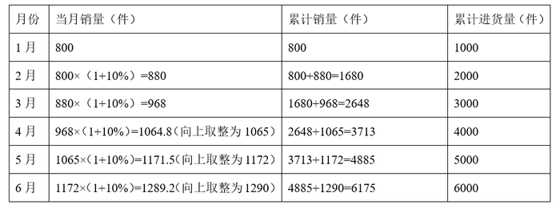

| 月份 | 当月销量（件） | 累计销量（件） | 累计进货量（件） |
| --- | --- | --- | ---: |
| 1 月 | 800 | 800 | 1000 |
| 2 月 | 800×（1+10%）=880 | 800+880=1680 | 2000 |
| 3 月 | 880×（1+10%）=968 | 1680+968=2648 | 3000 |
| 4 月 | 968×（1+10%）=1064.8（向上取整为 1065） | 2648+1065=3713 | 4000 |
| 5 月 | 1065×（1+10%）=1171.5（向上取整为 1172） | 3713+1172=4885 | 5000 |
| 6 月 | 1172×（1+10%）=1289.2（向上取整为 1290） | 4885+1290=6175 | 6000 |

通过上表可知，第1次累计销量大于累计进货量的月份为6月，则6月份会出现第1次库存清零。

故正确答案为C。

**考点**：数列问题

**来源**：2022年天津市公务员录用考试《行测》试题（网友回忆版）第1题

### 第 2 题

一个袋子里红球、白球、蓝球的数量比例为3：8：4，再向袋子中放入14个红球和若干个蓝球后，红球、白球、蓝球的数量比例变为5：4：3。如果此时从袋子里取出10个红球、6个白球和2个蓝球后，袋子里剩余红球、白球、蓝球的数量比例为：

A. 1：2：1

B. 2：3：1

C. 1：1：2

D. 1：1：1

第 2 题 · 答案与解析

**参考答案（粉笔题库参考内容）**

D

**解析**

设袋子里最初红球、白球、蓝球的数量分别为3x、8x、4x个，放入14个红球和若干个蓝球后，白球数量未变，根据红球数量/白球数量=(3x+14)/8x=5/4，解得x=2，白球数量=8x=16个，此时白球数量/蓝球数量=4/3=16/蓝球数量，则蓝球数量=12个。最后从袋子里取出10个红球、6个白球和2个蓝球，此时袋子里剩余红球3x+14-10=3×2+4=10个，剩余白球16-6=10个，剩余蓝球12-2=10个，即袋子里剩余红球、白球、蓝球的数量比例=10：10：10=1：1：1。

故正确答案为D。

**考点**：和差倍比问题

**来源**：2022年天津市公务员录用考试《行测》试题（网友回忆版）第2题

### 第 3 题

甲、乙二人合作计划30天完成一项工程，甲的工作效率是乙的2倍。两人合作10天后，甲的效率提升25%，乙的效率提升50%。又合作10天后，乙因其他任务撤出，甲单独完成剩余任务。问最终工作比预计时间：

A. 早2天

B. 晚2天

C. 早4天

D. 晚4天

第 3 题 · 答案与解析

**参考答案（粉笔题库参考内容）**

A

**解析**

由于题干只给出工作效率的比例关系，故赋值乙的工作效率为1，则甲的工作效率为2，则工作总量=（1+2）×30=90。合作10天后，剩余工作总量=90-（1+2）×10=60，此时甲的工作效率为2×（1+25%）=2.5，乙的工作效率为1×（1+50%）=1.5。又合作10天后，剩余工作总量=60-（1.5+2.5）×10=20，甲单独完成剩余任务还需20/2.5=8天，总共需要10+10+8=28天，则最终工作比预计时间早30-28=2天。

故正确答案为A。

**考点**：给效率比例型

**来源**：2022年天津市公务员录用考试《行测》试题（网友回忆版）第3题

### 第 4 题

某健身房近期推出甲、乙、丙、丁4项课程，每项课程的一次消费分别为200元、300元、400元、500元，会员可根据充值卡内余额自行进行消费。会员小李充值卡内还剩2200元，打算在有效期内每项课程都至少消费1次，且将充值卡内余额恰好用完，问他消费这4项课程的组合有多少种不同的可能性？

A. 3

B. 4

C. 5

D. 6

第 4 题 · 答案与解析

**参考答案（粉笔题库参考内容）**

C

**解析**

根据题干，若每项课程都先消费1次，将消费200+300+400+500=1400元，此时充值卡内剩余2200-1400=800元，题干要求将充值卡内余额恰好用完无剩余，故消费组合的总情况较少，对情况进行枚举可得：

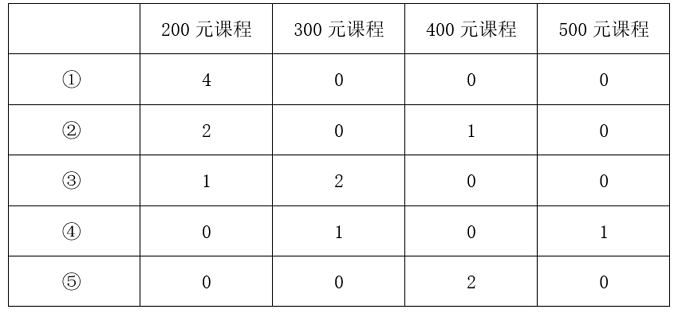

综上可知，小李消费这4项课程的组合共有5种不同的可能。

故正确答案为C。

**考点**：基础排列组合

**来源**：2022年天津市公务员录用考试《行测》试题（网友回忆版）第4题

### 第 5 题

某水果采摘园门票为每人x元，采摘水果20元/斤，采摘满3斤可免除一半门票费用，采摘满5斤可免除全部门票费用。已知采摘6斤的价格是采摘2斤价格的2倍。问采摘8斤的价格比采摘4斤多多少元？

A. 70

B. 80

C. 90

D. 100

第 5 题 · 答案与解析

**参考答案（粉笔题库参考内容）**

A

**解析**

根据题意，采摘满5斤可免除全部门票费用，即采摘6斤花费6×20=120元，设门票为每人x元，则采摘2斤的价格=120÷2=2×20+x，解得x=20，即门票为每人20元。故采摘4斤花费4×20+20/2=90元，则采摘8斤的价格-采摘4斤的价格=8×20-90=70元，即多70元。

故正确答案为A。

**考点**：和差倍比问题、经济利润问题

**来源**：2022年天津市公务员录用考试《行测》试题（网友回忆版）第5题

### 第 6 题

某部门共7人，其中有2人博士毕业，5人硕士毕业。某日，该部门随机分成3个小组参加3项不同的活动，3个小组人数各不相同。问其中2位博士毕业人员分在同一小组的概率在以下哪个范围内？

A. 不到25%

B. 在25%到35%之间

C. 在35%到45%之间

D. 45%以上

第 6 题 · 答案与解析

**参考答案（粉笔题库参考内容）**

B

**解析**

根据题意可知，把7人分成人数不同的3个小组，3个小组的人数只能分别为1人，2人和4人。3个小组参加3项不同的活动，总的情况数=C_7^1×C_6^2×C_4^4×A_3^3=630种。2位博士毕业人员分在同一小组，分类讨论：①只有2位博士毕业人员组成一组有C_2^2=1种可能，其余两个小组有（C_5^1×C_4^4）种可能，则此时有C_2^2×C_5^1×C_4^4×A_3^3 = 30种情况；②2位博士毕业人员和2位硕士毕业人员组成一组，有C_5^2种可能，其余两个小组有（C_3^1 × C_2^2）种可能，则此时有C5^2×C3^1×C2^2×A3^3=180种情况。因此，满足2位博士毕业人员分在同一小组的情况数＝30＋180＝210种。则所求概率= 满足条件的情况数/总的情况数 = 210/630 ≈ 33.3%，在B项范围内。

故正确答案为B。

**考点**：给情况求概率

**来源**：2022年天津市公务员录用考试《行测》试题（网友回忆版）第6题

### 第 7 题

某地组织大型公益演出，临时抽调一支一百多人的志愿服务队。其中，20至30岁（不含30岁）的人数占总人数的68%，30岁及以上的人数是不到20岁人数的7倍。已知30岁以下的人数比30岁及以上的人数多66人，问这支服务队共多少人？

A. 90

B. 120

C. 150

D. 180

第 7 题 · 答案与解析

**参考答案（粉笔题库参考内容）**

C

**解析**

因“20至30岁（不含30岁）的人数占总人数的68%”，则20至30岁(不含30岁)的人数/总人数 = 68/100 = 17/25，设总人数为25x，则20至30岁（不含30岁）的人数为17x，30岁及以上的人数和不到20岁的人数总计为25x-17x=8x，因“30岁及以上的人数是不到20岁人数的7倍”，则30岁及以上的人数为7x，不到20岁的人数为x。根据条件“30岁以下的人数比30岁及以上的人数多66人”，可列式：（17x+x）-7x=66，解得x=6人，则这支服务队共25x=25×6=150人。

故正确答案为C。

**考点**：和差倍比问题

**来源**：2022年天津市公务员录用考试《行测》试题（网友回忆版）第7题

### 第 8 题

冬奥会男子短道速滑1500米比赛中，A、B两位运动员同时出发，已知本次比赛需要绕场地滑13.5圈，假设每位运动员滑完全程的速度是不变的，A运动员滑完全程需要2分15秒，B运动员滑一圈比A运动员少用时1秒，则A开始滑第几圈时，B运动员正好领先A运动员一整圈？

A. 9

B. 10

C. 11

D. 12

第 8 题 · 答案与解析

**参考答案（粉笔题库参考内容）**

B

**解析**

由题可知，A运动员滑完全程13.5圈需要2分15秒（即135秒），则A运动员滑一圈需要135/13.5=10秒，B运动员滑一圈比A运动员少用时1秒，故B运动员滑一圈需要10-1=9秒。根据“路程相同，速度与时间成反比”，则A、B两位运动员速度比为9：10。比赛中，A、B两位运动员同时出发，“时间相同，路程与速度成正比”，则A运动员刚滑完第9圈，开始滑第10圈时，B运动员滑完第10圈，此时B运动员正好领先A运动员一整圈。

故正确答案为B。

**考点**：相遇追及

**来源**：2022年天津市公务员录用考试《行测》试题（网友回忆版）第8题

### 第 9 题

有一个20世纪八九十年代出生的人，在21世纪，恰好有一年，他年龄的平方数等于那一年的年份。这个人是哪年出生的？

A. 1995

B. 1990

C. 1985

D. 1980

第 9 题 · 答案与解析

**参考答案（粉笔题库参考内容）**

D

**解析**

根据题意，在21世纪的某年，这个人年龄的平方数等于该年的年份，21世纪年份为平方数的只有45^2=2025年，即2025年这个人45岁，则此人出生于2025-45=1980年。

故正确答案为D。

**考点**：年龄问题

**来源**：2022年天津市公务员录用考试《行测》试题（网友回忆版）第9题

### 第 10 题

某班期末考试结束后统计，物理、化学均不及格的人数占全班的14%，物理及格的人数比化学及格的人数多10人，且化学及格的人数占全班人数的60%。已知全班人数不超过70人，问物理及格的人中化学也及格的有多少人？

A. 25

B. 26

C. 27

D. 28

第 10 题 · 答案与解析

**参考答案（粉笔题库参考内容）**

C

**解析**

根据题意可得物理、化学均不及格的人数/全班人数 = 14/100 = 7/50，总人数为50的整数倍，又由于全班人数不超过70人，则全班人数为50人，物理、化学均不及格的人数为7人。化学及格的人数为50×60%=30人，物理及格的人数为30+10=40人。根据两集合容斥公式：A+B−A∩B=总数−都不，可得：40+30-物理、化学均及格的人数=50-7，则物理、化学均及格的人数为27人，即物理及格的人中化学也及格的有27人。

故正确答案为C。

**考点**：两集合

**来源**：2022年天津市公务员录用考试《行测》试题（网友回忆版）第10题

### 第 11 题

要增强风险意识，研判未来5年、15年乃至30年我国人口老龄化、人均预期寿命提升、受教育年限增加、劳动力结构变化等发展趋势，分析社会保障可能面临的新情况新问题，提高工作预见性和主动性，            采取应对措施。

填入划横线部分最恰当的一项是：

A. 大刀阔斧

B. 未雨绸缪

C. 双管齐下

D. 因地制宜

第 11 题 · 答案与解析

**参考答案（粉笔题库参考内容）**

B

**解析**

根据横线前“增强风险意识”“提高工作预见性和主动性”可知，横线处所填成语应体现提前做好准备之意。B项“未雨绸缪”意为趁着天没下雨，先修缮房屋门窗，比喻事先做好准备，符合文意，当选。

A项“大刀阔斧”形容办事果断而有魄力，与文意不符，排除；

C项“双管齐下”比喻从两方面同时进行，文段并未涉及从两个方面去应对，排除；

D项“因地制宜”指根据各地的具体情况，制定适宜的办法，强调针对性，无法体现提前准备之意，排除。

故正确答案为B。

【文段出处】中国科技网《习近平：促进我国社会保障事业高质量发展、可持续发展》

**考点**：对应关系-前后呼应、成语填空

**来源**：2022年天津市公务员录用考试《行测》试题（网友回忆版）第11题

### 第 12 题

共青团紧扣党在不同历史时期的中心任务，团结带领广大团员青年积极投身人民群众的壮阔实践，在民族复兴征程上勇当先锋、倾情奉献，发挥生力军和突击队作用，使实现民族复兴成为中国青年运动            的恢弘主流。

填入划横线部分最恰当的一项是：

A. 勇往直前

B. 前赴后继

C. 一以贯之

D. 齐心协力

第 12 题 · 答案与解析

**参考答案（粉笔题库参考内容）**

C

**解析**

横线处搭配“中国青年运动”且根据“共青团紧扣党在不同历史时期的中心任务······发挥生力军和突击队作用”可知，横线处所填成语应体现实现民族复兴是中国青年运动在不同历史时期始终坚持的任务。C项“一以贯之”指用一种思想贯穿始终，体现“思想”的连续性，可与前文“不同历史时期”形成对应，当选。

A项“勇往直前”强调人有勇气，勇敢地一直向前，B项“前赴后继”指前面的人冲上去了，后面的人就迅速跟上去，形容人奋勇前进，均强调“人”勇敢向前，与“中国青年运动”搭配不当，且无法体现中国青年运动始终坚持的任务是实现民族复兴，排除；

D项“齐心协力”指认识一致，共同努力，强调“共同”，无法体现中国青年运动始终坚持的任务是实现民族复兴，与文意不符，排除。

故正确答案为C。

【文段出处】新华社《习近平：在庆祝中国共产主义青年团成立100周年大会上的讲话》

**考点**：词的辨析-搭配对象、对应关系-前后呼应、成语填空

**来源**：2022年天津市公务员录用考试《行测》试题（网友回忆版）第12题

### 第 13 题

随着媒介技术快速发展，数字化交往空间开始重构城市与乡村的关系。人们对乡村的集体记忆和整体认知，不再        在实体的物理空间和生活场景中，新媒体产品折射出的乡味、野趣和新农村面貌等，        了大众的乡村印象。

依次填入划横线部分最恰当的一项是：

A. 围绕 颠覆

B. 封闭 改变

C. 局限 重塑

D. 限制 反映

第 13 题 · 答案与解析

**参考答案（粉笔题库参考内容）**

C

**解析**

第一空，根据文意可知，人们对乡村的集体记忆和整体认知已超出了实体的物理空间和生活场景，横线前出现“不再”，故横线处表达在一定范围内之意，B项“封闭”指隔绝、使不能通行或随便打开，C项“局限”指限制在某个范围内，D项“限制”指不允许超过规定的范围，填入文段均符合文意，保留。A项“围绕”指以某个问题或事情为中心，围在周围转动， “围绕在······中”置于此处用法错误，排除。

第二空，根据文意可知，横线处表达新媒体产品使乡村印象发生了变化，且根据“数字化交往空间开始重构城市与乡村的关系”可知，这种变化是颠覆性的，程度较重。C项“重塑”指重新塑造，符合文意且程度较重，当选。B项“改变”指发生差别，程度过轻，无法与“重构”对应，排除；D项“反映”比喻把客观事物的实质表现出来，与文意无关，排除。

故正确答案为C。

【文段出处】人民日报海外版《乡村生活短视频为啥走红？》

**考点**：词的辨析-搭配对象、词的辨析-程度轻重、实词填空、对应关系-前后呼应

**来源**：2022年天津市公务员录用考试《行测》试题（网友回忆版）第13题

### 第 14 题

马克思主义能不能在实践中发挥作用，关键在于能否把马克思主义基本原理同中国实际和时代特征结合起来。面对快速变化的世界和中国，如果            、思想僵化，没有理论创新的勇气，不能科学回答中国之问、世界之问、人民之问、时代之问，不仅党和国家事业无法继续前进，马克思主义也会失去         、说服力。

依次填入划横线部分最恰当的一项是：

A. 纸上谈兵 发展力

B. 固步自封 凝聚力

C. 墨守成规 生命力

D. 临渴掘井 持久力

第 14 题 · 答案与解析

**参考答案（粉笔题库参考内容）**

C

**解析**

第一空，根据顿号“、”可知，横线处所填成语应与“思想僵化”构成近义并列，语义相近，且根据横线后“没有理论创新的勇气，不能科学回答中国之问······”可知，横线处所填成语应体现出做事守旧，死板、不灵活、不懂变通之意，B项“固步自封”比喻因循守旧，安于现状，不求创新进取，C项“墨守成规”指思想保守，守着老规矩不肯改变，均符合文意，保留。A项“纸上谈兵”比喻空谈理论，不能解决实际问题，D项“临渴掘井”比喻不早做准备，事到临头才仓促想办法，均无法体现出守旧、不懂变通之意，与文意不符，排除。

第二空，根据横线前“不仅党和国家事业无法继续前进，马克思主义也”“马克思主义能不能在实践中发挥作用，关键在于能否把马克思主义基本原理同中国实际和时代特征结合起来”可知，与时代特征结合对马克思主义的重要性，故横线处所填词语应体现出没有理论创新的马克思主义便不能在实践中发挥作用、不能继续下去之意，C项“生命力”指维持生命活动的能力，符合文意，当选。B项“凝聚力”比喻使人或事物聚合到一起的力量，与文意不符，排除。

故正确答案为C。

【文段出处】光明网《以中国与时代为观照建构中国自主的知识体系》

**考点**：对应关系-前后呼应、混搭填空、关联关系-并列关系

**来源**：2022年天津市公务员录用考试《行测》试题（网友回忆版）第14题

### 第 15 题

管理犹如治水，疏堵结合才能            。事实上，“堵”的手段强调严明纪律、形成震慑，操作起来也简单有效，但关键在于是否能够以条令法规为依据进行科学把握。若对待部队建设中带有倾向性、          的问题，动辄要求“全部清除”“一律禁止”，甚至“乱打板子”，不仅很难达到目的，还会导致问题累积、矛盾升级。

依次填入划横线部分最恰当的一项是：

A. 一劳永逸 紧迫性

B. 标本兼治 普遍性

C. 防微杜渐 安全性

D. 事半功倍 关键性

第 15 题 · 答案与解析

**参考答案（粉笔题库参考内容）**

B

**解析**

第一空，横线处表达疏堵结合所带来的效果，根据后文“‘堵’的手段强调严明纪律、形成震慑，操作起来也简单有效，但关键在于是否能够以条令法规为依据进行科学把握”可知，疏堵结合才能更好地管理，B项“标本兼治”指对事物的枝节和根本都加以治理，D项“事半功倍”指花费的气力小，收到的成效大，均符合文意，保留。A项“一劳永逸”指辛苦一次，把事情办好，以后就不再费事了，文段并无一次性解决问题之意，排除；C项“防微杜渐”指在错误或坏事萌芽的时候及时制止，不让它发展，文段并无错误或坏事萌芽之意，排除。

第二空，横线处搭配“问题”，根据后文“动辄要求‘全部清除’‘一律禁止’”可知，部队建设中存在的问题较多、具有广泛性，B项“普遍性”指存在的面很广泛，具有共同性之意，符合文意，当选。D项“关键性”指事物最关紧要的部分，对事情起决定作用的因素，与文意不符，排除。

故正确答案为B。

【文段出处】中国军网《疏堵结合才能标本兼治》

**考点**：词的辨析-搭配对象、对应关系-前后呼应、混搭填空

**来源**：2022年天津市公务员录用考试《行测》试题（网友回忆版）第15题

### 第 16 题

缩微技术是目前国际公认的最为        的珍贵文献长期保存手段。一方面，保存缩微胶片所需空间远小于纸质书籍；另一方面，缩微胶片能保存更长时间。缩微拍摄后，古籍原件可以被更好地保护起来，古籍的内容也能“化身千百”、广为传播，而不是被“            ”。

依次填入划横线部分最恰当的一项是：

A. 传统 与世隔绝

B. 常见 视而不见

C. 有效 束之高阁

D. 流行 隐姓埋名

第 16 题 · 答案与解析

**参考答案（粉笔题库参考内容）**

C

**解析**

第一空，根据“一方面，保存缩微胶片所需空间远小于纸质书籍；另一方面，缩微胶片能保存更长时间。缩微拍摄后，古籍原件可以被更好地保护起来”可知，横线处应体现缩微技术对于珍贵文献长期保存的重要作用。C项“有效”指能实现预期目的，有效果，符合文意，保留。A项“传统”指世代相传或相沿已久并具有特点的，侧重“流传”，与文意不符，排除；B项“常见”指经常见到，文段并未侧重“经常见到”，而是强调有作用，与文意不符，排除；D项“流行”指广泛传布，盛行，侧重“到处都是”，与文意不符，排除。

第二空，代入验证。根据“能······而不是······”可知，横线处语义与“‘化身千百’、广为传播”相反，应体现不能够传播之意，C项“束之高阁”指扔在一边，不去用它或管它，符合文意，当选。

故正确答案为C。

【文段出处】人民网《方寸之间传承文化遗产》

**考点**：对应关系-前后呼应、混搭填空、对应关系-形象表达

**来源**：2022年天津市公务员录用考试《行测》试题（网友回忆版）第16题

### 第 17 题

仅靠未成年人发挥自律性，主动去抵御网络诱惑并不现实。通过学校和家长的共同努力，可以实现一定程度的控制，但这需要一直盯着孩子，也很困难，还容易        。此前，为彻底落实游戏防沉迷措施，监管部门发布了一系列严规，给游戏平台戴上了“          ”，获得非常好的成效。

依次填入划横线部分最恰当的一项是：

A. 回落 保护套

B. 反弹 紧箍咒

C. 失效 防盗网

D. 逆反 连环扣

第 17 题 · 答案与解析

**参考答案（粉笔题库参考内容）**

B

**解析**

本题可从第二空入手，根据“为彻底落实游戏防沉迷措施，监管部门发布了一系列严规，给游戏平台戴上了······”可知，横线处所填词语意在表达监管部门通过发布新规，对游戏平台进行严格控制，以防止未成年人沉迷网络。B项“紧箍咒”常用以比喻束缚人或使人难受的事物，置于此处可表达新规对游戏平台起到了监管作用，符合文意，保留。A项“保护套”指为特定物品起保护作用，所设计及生产出来的外套，C项“防盗网”指起防护作用的金属网，用以防止侵入，D项“连环扣”指几个结组成的扣子，比喻连绵交织的情思、错综复杂的矛盾，均与文意不符，排除。

第一空，代入验证。B项“反弹”指运动的物体遇到障碍后向相反的方向弹回，填入文段表达学校和家长虽然可以实现一定程度的控制，但却容易引起孩子的抵触情绪，符合语境，当选。

故正确答案为B。

【文段出处】中国日报《未成年人保护升格，APP进入“去沉迷”时代》

**考点**：词的辨析-词义侧重、实词填空、对应关系-形象表达

**来源**：2022年天津市公务员录用考试《行测》试题（网友回忆版）第17题

### 第 18 题

从世界百年未有之大变局看，稳住农业基本盘、守好“三农”基础是应变局、开新局的“          ”。对我们这样一个拥有14亿人口的大国来说，“三农”向好，全局主动。当前，国际环境日趋复杂，不稳定性不确定性日益增加，新冠肺炎疫情影响广泛深远，经济全球化遭遇        ，世界进入动荡变革期。对此，我们要有清醒认识，做好打          的准备。

依次填入划横线部分最恰当的一项是：

A. 总开关 障碍 车轮战

B. 压舱石 逆流 持久战

C. 定盘星 停滞 攻坚战

D. 助推器 波折 拉锯战

第 18 题 · 答案与解析

**参考答案（粉笔题库参考内容）**

B

**解析**

第一空，根据“稳住农业基本盘、守好‘三农’基础”可知，农业对于“应变局、开新局”起到稳定全局的基础性作用。B项“压舱石”原意指在空船上，船的整体重心在水面以上，极易翻船，为此空船航行时都备有“压舱石”，以免翻船，故用来比喻稳定全局的基础性作用，C项“定盘星”指杆秤上的第一个星，把秤砣挂在这里正好能与秤盘上重量平衡，依然侧重强调其稳定全局的基础性作用，均符合文意，保留。A项“总开关”侧重强调对事物的全局起到最为关键的作用，D项“助推器”指对事件的发展有推动促进作用的因素，均无法体现稳定全局的基础性作用，与文意不符，排除。

第二空，根据“当前，国际环境日趋复杂，不稳定性不确定性日益增加，新冠肺炎疫情影响广泛深远”可知，横线处所填词语用以表达经济全球化发展遭遇困境的含义。B项“逆流”指逆着水流方向，同主流方向相反的水流，C项“停滞”指因受阻碍而长时间停止或前进极慢，不能顺利发展，均符合文意，保留。

第三空，根据“当前，国际环境日趋复杂，不稳定性不确定性日益增加，新冠肺炎疫情影响广泛深远······世界进入动荡变革期”可知，横线处所填词语表达面对当前世界各种复杂形势，我们应做长期准备的含义。B项“持久战”指持续时间较长的战争，可体现长期之意，符合文意，当选。C项“攻坚战”是一种战斗的形式，指攻克敌设有坚固防御的要地如城池、关隘、要塞或据点的作战，体现不出长期之意，与文意不符，排除。

故正确答案为B。

【文段出处】海外网《「学习小组」习近平：举全党全社会之力推动乡村振兴》

**考点**：实词填空、对应关系-前后呼应、对应关系-形象表达

**来源**：2022年天津市公务员录用考试《行测》试题（网友回忆版）第18题

### 第 19 题

传统手工艺产品一般在产业基地集中生产再销往全国乃至全世界，这使得各地旅游景点销售的手工艺产品常常来源一致，            。以各地博物馆为代表的单位已积极对地方物质文化遗产进行文化创意产品开发，有意识地进行地方资源的          创新，而包括非物质文化遗产在内的传统手工艺尚缺乏产品设计新意，未能        地方手工艺特色。

依次填入划横线部分最恰当的一项是：

A. 大同小异 针对性 突显

B. 如出一辙 颠覆式 展现

C. 索然无味 突破性 涵盖

D. 乏善可陈 开放式 抓准

第 19 题 · 答案与解析

**参考答案（粉笔题库参考内容）**

A

**解析**

第一空，由“使得”可知，横线处与前文构成因果关系。根据前文“传统手工艺产品一般在产业基地集中生产”可知，横线处应表示传统手工艺产品因集中生产而带来的问题，A项“大同小异”指大部分相同，只有小部分不同，B项“如出一辙”指好像从同一个车辙出来，形容事情非常相像，均可体现因集中生产所带来雷同的现象，符合文意，保留。C项“索然无味”形容枯燥，一点兴趣和意味也没有，D项“乏善可陈”指没有什么好的地方可以称道，均未能体现集中生产所带来的影响，与文意不符，排除。

第二空，根据“积极对地方物质文化遗产进行文化创意产品开发”“地方手工艺特色”可知，横线处应体现各单位对不同的地方资源有特色地进行创新，A项“针对性”指对确定的对象采取具体措施，符合文意，保留。B项“颠覆性”指突破很大，与文意不符，且程度过重，排除。

第三空，代入验证，搭配“特色”，A项“突显”指突出地显露，搭配恰当，当选。

故正确答案为A。

【文段出处】中国文化报《求解！以手工艺带动传统文化综合发展》

**考点**：对应关系-前后呼应、混搭填空、关联关系-因果关系

**来源**：2022年天津市公务员录用考试《行测》试题（网友回忆版）第19题

### 第 20 题

化工企业在环保治理和达标排放上的确存在着            的现象，少数企业偷排乱放严重污染了当地环境，败坏了化工行业的        。专家认为，对这种违法企业无论怎样处罚都不为过，但是，简单粗暴的“一刀切”会让企业            ，正常的生产运营受到严重影响，这有悖环保风暴的初衷。

依次填入划横线部分最恰当的一项是：

A. 愈演愈烈 风气 分崩离析

B. 良莠不齐 声誉 人人自危

C. 竭泽而渔 道德 如履薄冰

D. 变本加厉 操守 难以为继

第 20 题 · 答案与解析

**参考答案（粉笔题库参考内容）**

B

**解析**

第一空，横线处形容“环保治理和达标排放”，且根据后文“少数企业偷排乱放······”可知，横线处应体现出在环保治理和达标排放中依然存在一些问题，B项“良莠不齐”意为好的和坏的夹杂在一起，置于此处可体现出部分化工企业依然存在问题，保留。A项“愈演愈烈”意为事情、情况等越加恶化、严重，C项“竭泽而渔”比喻只图眼前利益，不作长远打算，D项“变本加厉”指情况变得比本来更加严重，均用于完全消极的语境，与“环保治理和达标排放”在少数企业有问题的情况不符，排除。

第二空，代入验证，B项“声誉”意为名誉、声望，“败坏声誉”搭配恰当，保留。

第三空，代入验证，B项“人人自危”意为人人都感到自己处境有危险，指局势或气氛十分紧张，置于此处与“简单粗暴的‘一刀切’”及“正常的生产运营受到严重影响”对应恰当，符合文意，当选。

故正确答案为B。

【文段出处】中国化工报《执法不能一“关”了之》

**考点**：对应关系-前后呼应、混搭填空

**来源**：2022年天津市公务员录用考试《行测》试题（网友回忆版）第20题

### 第 21 题

今年受新冠肺炎疫情冲击和国际经济下行影响，一度有近3000万农民工留乡返乡。在这种情况下，社会大局能够保持稳定，没有出什么乱子，关键是农民在老家还有块地、有栋房，回去有地种、有饭吃、有事干，即使不回去心里也踏实。全面建设社会主义现代化国家是一个长期过程，农民在城里没有彻底扎根之前，不要急着断了他们在农村的后路，让农民在城乡间可进可退。这就是中国城镇化道路的特色，也是我们应对风险挑战的回旋余地和特殊优势。

这段文字意在说明：

A. 应坚持用大历史观来看待三农问题

B. 抓好农业生产能够有效应对风险挑战

C. 中国城镇化道路是符合中国国情的独特道路

D. 城乡发展不平衡仍是社会主要矛盾的集中体现

第 21 题 · 答案与解析

**参考答案（粉笔题库参考内容）**

A

**解析**

文段首句引出话题，即在当下疫情和经济下行的背景下，大量农民工留在农村、返回农村。而农民在农村有地有房对于保持社会大局稳定非常重要。随后进一步阐述，全面建设社会主义现代化国家是一个长期过程，不可为了追求现代化、城镇化而操之过急的断掉农民在农村的后路。尾句强调，这种看长期、重长远、求稳定的路线，作为中国城镇化道路的特色，对于应对风险具有重要意义。根据分析可知，文段重在强调处理三农问题，必须坚持“大历史观”，即依据整个人类的发展历史对未来即将发生的一切做出合理的判断，用长远的、比较的思维来看待问题的认识方法，切不可只看眼前、好高骛远。对应A项。

B项，“抓好农业生产”无中生有，排除；

C项，“中国城镇化道路”无法体现出注重长期、不只看眼前这一核心语义，且文段并非重在强调是否符合中国国情，而是以给农民在农村留房留地的重要意义，阐述这一做法的正确性并且应该坚持下去，C项偏离文段重点，排除；

D项，“城乡发展不平衡”“社会主要矛盾”无中生有，排除。

故正确答案为A。

【文段出处】求是网《坚持把解决好“三农”问题作为全党工作重中之重 举全党全社会之力推动乡村振兴》

**考点**：主题词

**来源**：2022年天津市公务员录用考试《行测》试题（网友回忆版）第21题

### 第 22 题

伴随着社会发展，家庭教育面临着复杂多变的形势和前所未有的困境。一个非常突出的问题是，一些通行的家庭教育方式方法，违背了孩子身心健康成长的心理规律和教育教学规律。家庭教育的知识本位导致家长形成一种担忧孩子“输在起跑线上”的恐慌心理。因此，很多家长带着孩子奔波于各种校外辅导机构，提前学习各科知识。儿童心理成熟是一个自然的过程，教育不能改变其发展的主要时间进程，只有儿童心理和认知水平成熟到一定程度以后，人为教育和训练才会起作用。人为地提前训练，可能一时一地占有一定优势，但这种优势不会长期保持下去。

这段文字意在说明：

A. 提前学习违背了儿童心理成熟发展规律

B. 一切教育形式都必须遵循人格发展的规律

C. 知识本位已成为我国家庭教育的“背景底色”

D. 人为教育只有在儿童认知水平成熟后才有意义

第 22 题 · 答案与解析

**参考答案（粉笔题库参考内容）**

A

**解析**

文段开篇指出家庭教育面临着困境，接着通过“非常突出”强调一些家庭教育方式方法违背了孩子的心理规律和教育教学规律，后文指出家长担忧孩子输在起跑线上，因此带着孩子提前学习，后文对提前学习的违背儿童心理规律进行具体解释，故文段重在强调提前学习违背了孩子的心理规律，对应A项。

B项，“一切教育”表述太宽泛，文段仅强调“提前学习”，排除；

C项，“知识本位”非重点，文段重在强调“提前学习”的不足，排除；

D项，对应文段解释说明中的内容，非重点，排除。

故正确答案为A。

【文段出处】光明网《家庭教育如何摆脱焦虑》

**考点**：关联词-对策

**来源**：2022年天津市公务员录用考试《行测》试题（网友回忆版）第22题

### 第 23 题

慈善是一个历史变动中的概念，所含内容在不同历史时期并不完全一致。譬如古代慈善事业多系直接性物质救济，呈现出重养轻教的特征。但近代以来，愈发重视慈善教育的功能，强调教养并重。当代中国慈善事业更是朝着社会公益服务的多元化方向发展。但是，不管如何变化，慈善的根本内涵没有改变，即民间社会各界秉持人道善心，救助、关怀社会弱势群体与困难群众，这也是慈善本义内容所在。至于慈善的外延表现，则会随着时代的变化而变化，譬如慈善动机、慈善形式、慈善流程等。我们在讨论慈善概念的时候，应该对其内涵与外延予以区分，在此基础上考察慈善发展的历史。

这段文字意在说明：

A. 公益服务慈善的核心要义

B. 教养并重是当代慈善的主要特点

C. 慈善的社会教育功能越来越受到重视

D. 慈善的内涵并不随外延的变化而变化

第 23 题 · 答案与解析

**参考答案（粉笔题库参考内容）**

D

**解析**

文段首先引出“慈善”的话题，表明慈善在不同历史时期概念并不完全一致，接着通过“譬如”举例论证。然后通过转折关联词“但是”强调慈善的内涵没有改变。后文通过慈善的外延会随着时代的变化而变化，且在探讨慈善概念时，应对内涵与外延予以区分，来进一步论证慈善的内涵不会随着变化而变化，故文段强调慈善内涵并不改变，对应D项。

A项，“公益服务”对应转折之前的内容，非重点，且“核心要义”表述不明确，排除；

B项“教养并重”及C项“慈善的社会教育功能”均为文段例子部分的内容，非重点，排除。

故正确答案为D。

【文段出处】光明网《内涵与外延：慈善概念再思考》

**考点**：关联词-转折

**来源**：2022年天津市公务员录用考试《行测》试题（网友回忆版）第23题

### 第 24 题

美学经济时代，伴随着消费需求与消费体验的不断升级，以美学价值为核心的生产要素在产品的价值生产、企业的品牌建设以及产业价值链的提升中发挥着越来越重要的作用。电影产业作为当前经济中吸附资本能力最强、生产时效最快、引爆审美迭代和文化价值翻新变异的内容产业，对产业升级和经济增长的重要性不言而喻。电影是当代新文化、新时尚、新美感、新神话、新观念的重要策源地，牢牢占据着内容产业的头部位置，既对社会整体风尚与价值发挥引领作用，也会优化赋能全经济产业链。

这段文字意在说明：

A. 电影产业长期处于内容产业的龙头位置

B. 电影对中国产业的转型升级具有重要推动作用

C. 电影产业的发展引领着美学经济时代的整体风尚

D. 美学经济时代以价值为核心的生产要素愈发重要

第 24 题 · 答案与解析

**参考答案（粉笔题库参考内容）**

C

**解析**

文段开篇指出在美学经济时代，以美学价值为核心的生产要素发挥着越来越重要的作用，紧接着通过程度词“最强”、“最快”、“引爆”强调“电影产业”这一话题，并指出电影产业在美学经济时代的重要性，尾句进一步指出电影是新时尚、新美感的策源地，对于社会整体风尚和经济产业链都发挥重要作用。故文段重点强调“电影产业”对“美学经济时代”的重要性，对应C项。

A项，“处于内容产业的龙头位置”非重点，排除；

B项，没有提及文段的核心话题“美学”，排除；

D项，没有提及文段的核心话题“电影产业”，排除。

故正确答案为C。

【文段出处】光明网《美学经济助力发展电影产业》

**考点**：主题词

**来源**：2022年天津市公务员录用考试《行测》试题（网友回忆版）第24题

### 第 25 题

青藏高原是除南北极以外冰雪储量最大的地区，是亚洲十多条大江大河的发源地，被称为“亚洲水塔”。过去50年，青藏高原及其相邻地区的冰川面积由5.3万平方公里缩减至4.5万平方公里；青藏高原大于1平方公里的湖泊数量从1081个增加到1236个，湖泊面积从4万平方公里增加到近5万平方公里；受冰川融水径流量增长影响，雅鲁藏布江、印度河上游年径流量呈增加趋势。随之而来的将是灾害风险的加剧。专家表示，全球变暖是大趋势，我们能做一些“减缓”工作，但“适应”始终是核心，这就需要建立相应的预警体系，把损失降到最低。

这段文字意在说明：

A. 亚洲水塔的生态环境岌岌可危

B. 全球变暖加剧了亚洲水塔的生态危机

C. 建立亚洲水塔灾害监测预警体系势在必行

D. 亚洲水塔变化影响着大批人的生存和发展

第 25 题 · 答案与解析

**参考答案（粉笔题库参考内容）**

C

**解析**

文段首先指出青藏高原被称为“亚洲水塔”，随后通过数据资料详细介绍了过去50年该地区的冰川面积、湖泊数量、湖泊面积以及雅鲁藏布江、印度河上游年径流量的变化情况，紧接着提出问题，即青藏高原的这一系列变化加剧了灾害风险，最后通过转折词“但”引出文段重点，并通过“需要”提出对策，要在青藏高原地区建立相应的预警体系，对应C项。

A项，“生态环境岌岌可危”文段并未提及，无中生有，排除；

B项，“全球变暖”属于转折前的部分内容，非重点，排除；

D项，“影响着大批人的生存和发展”文段并未提及，无中生有，排除。

故正确答案为C。

【文段出处】科技日报《亚洲水塔全球最脆弱 我国建立灾害监测预警体系》

**考点**：关联词-对策、关联词-转折

**来源**：2022年天津市公务员录用考试《行测》试题（网友回忆版）第25题

### 第 26 题

碳酸铅为无机化合物，它以白铅矿的形式存在于自然界中。像碳酸铅这样的无机样本很难直接进行年代测定。这是因为，自然界中的碳元素主要有3种同位素，其中碳14为天然放射性同位素，碳测年法就是利用生物体死亡后体内碳14含量随时间减少的规律进行年代测定的技术，主要用于测定生物物质，例如动植物遗骸，也可以测定藏品中木器、竹器、牙骨器、纸张、纺织物等含碳有机物的年代。虽然碳酸铅含有放射性碳，可惜长期以来，科学家一直没能找到直接测定碳酸铅年代的方法。

接下来最可能说的是：

A. 测定碳酸铅年代的新方法

B. 碳测年法的优势和弊端

C. 碳酸铅和考古的关系

D. 碳测年法的技术原理

第 26 题 · 答案与解析

**参考答案（粉笔题库参考内容）**

A

**解析**

文段开篇指出碳酸铅为无机化合物，很难直接进行年代测定，随后分析原因：碳测年法是利用生物体死亡后体内碳14含量随时间减少的规律进行测年，其主要应用领域是测定生物物质或一些含碳有机物的年代。由此可见，碳酸铅作为无机化合物不在其适用范围内。尾句指出，科学家一直没有找到直接测定碳酸铅年代的方法。故后文应继续围绕“测定碳酸铅年代的方法”这一话题展开论述，对应A项。

B项，“碳测年法”偏离文段核心话题，文段围绕“碳酸铅的年代测定”展开论述，与文段衔接不当，排除；

C项，文段未提及“碳酸铅和考古的关系”的相关话题，无中生有，排除；

D项，“技术原理”文段中已详细论述过，后文不会再论述，且偏离文段核心话题，排除。

故正确答案为A。

【文段出处】科技日报《确定远古物品年龄有新方法——白色颜料所含碳酸铅年代可直接测定》

**考点**：接语选择题

**来源**：2022年天津市公务员录用考试《行测》试题（网友回忆版）第26题

### 第 27 题

作家都是在坚守文学信念的同时找寻创作的突破口，力争在文化的海洋腾起美丽的浪花。这需要作家深入挖掘现实生活，以丰富的创作手法、生动的艺术语言，塑造更多折射时代的面孔。但值得注意的是，作家要克服内容空洞的创作倾向，并不是写当代就是现实题材作品，真实是创作基调，一些只是故事发生时间为当代，却与当代生活割裂的作品，并不是真正意义上的现实题材作品。现实题材作品不是将时代符号写进作品、对社会生活细节简单还原，也不是同质化回忆的机械陈列，而是要传达出作者对人生、对历史、对现实的深刻思考。

这段文字意在说明：

A. 文学创作应紧跟时代发展的步伐

B. 文学创作应警惕内容空洞的创作倾向

C. 现实题材作品必须传达出作者深刻的思考

D. 好的文学创作应不断拓宽题材、丰富表现手法

第 27 题 · 答案与解析

**参考答案（粉笔题库参考内容）**

C

**解析**

文段开篇指出作家需要深入挖掘现实生活，塑造折射时代的作品。接下来通过“但”转折指出真实是创作的基调，一些只是故事发生时间为当代，却与当代生活割裂的作品，并不是真正意义上的现实题材作品。尾句通过“不是······而是”及对策标志词“要”重点强调现实题材作品要传达出作者对人生、对历史、对现实的深刻思考。文段重点在尾句，强调现实题材作品要传达出作者的深刻思考，对应C项。

A项，“紧跟时代发展的步伐”是针对“与当代生活割裂”提出的对策，非重点，排除；

B项，“内容空洞”对应尾句对策之前的内容，非重点，排除；

D项，“拓宽题材、丰富表现手法”对应文段转折前的内容，非重点，排除。

故正确答案为C。

【文段出处】中国作家网《以现实题材精品拓宽网络文学版图》

**考点**：关联词-对策

**来源**：2022年天津市公务员录用考试《行测》试题（网友回忆版）第27题

### 第 28 题

牛顿提出了著名的运动定律，为我们理解太阳系，乃至一切物体质量与施加于其上的力之间的关系奠定了基础。在用这些定律描述行星绕太阳如何运动后，牛顿又开始思索：如果有第三个天体（如月球）闯入其间会发生什么呢？当两个（或三个大小和距离差别很大的物体）绕一个中心点旋转时，用牛顿运动定律很容易计算出它们的运动轨道。但如果这三个物体的大小和与中心点的距离均相当，则整个系统将陷入混沌。而一旦混沌发生，就不可能用常规数学方法研究物体的运动，困扰科学家数百年的“三体问题”也由此浮出水面。

这段文字主要讲的是：

A. “三体问题”带来的影响

B. “三体问题”产生的原因

C. 牛顿运动定律自身的局限性

D. 科学界对“三体问题”的探索

第 28 题 · 答案与解析

**参考答案（粉笔题库参考内容）**

B

**解析**

文段开篇指出牛顿运动定律的意义，接着通过牛顿的思索提出“第三个天体”的问题，随后通过转折关联词“但”指出很难用常规数学方法研究三个差别不大的物体运动，尾句通过指代词“由此”总结前文，强调“三体问题”由此产生。故文段重在强调“三体问题”的产生和由来，对应B项。

A项“‘三体问题’带来的影响”与D项“科学界对‘三体问题’的探索”，文段均未提及，无中生有，排除；

C项，“局限性”对应结论之前的内容，非重点，且未提及文段主题词“三体问题”，排除。

故正确答案为B。

【文段出处】科技日报《300多年前难倒牛顿的“三体问题”或有解了》

**考点**：关联词-转折

**来源**：2022年天津市公务员录用考试《行测》试题（网友回忆版）第28题

### 第 29 题

长期以来，考试大纲规定了考试的内容、范围、知识点，规定了各学科知识点的考试权重，规定了各个知识点的考试题型，其“标准”明确、具体、直观，对教师教学的导向极其强烈。一方面，它缩小了国家课程标准关于各学科教学内容的范围；另一方面，它规定了各学科知识点在考试中的权重，教师的学科教学活动“做题化”“训练化”倾向越发严重。在考试大纲的这种强大的导向下，教学过程几乎“窄化”“异化”成了考试训练过程，让教育教学活动陷入应试教育的“泥潭”无力自拔。

这段文字意在说明：

A. 考试大纲的强导向作用亟待弱化

B. 考试大纲的存在不符合时代要求

C. 考试大纲的出现强化了应试教育

D. 考试大纲偏离了素质教育的要求

第 29 题 · 答案与解析

**参考答案（粉笔题库参考内容）**

C

**解析**

文段首先介绍了考试大纲对于考试内容、范围、知识点及其考试权重、考试题型等与考试相关的各个方面的明确规定，进而对教师教学产生了极其强烈的导向性，即将教学内容、教学活动完全导向应对考试。随后从两个方面对此进行详细论述。尾句进一步重申，考试大纲让教学过程异化成为了考试而训练的过程，让教育教学活动完全被应试教育所挟持。因此，文段通篇都在阐述考试大纲的出现进一步强化了教育的应试作用，对应C项。

A项，“强导向作用”未明确体现考试大纲对应试的导向作用，表述不明确，排除；

B项，“不符合时代要求”概念扩大，与文意不符，排除；

D项，文中仅讨论考试大纲与应试教育之间的关系，“素质教育”无中生有，排除。

故正确答案为C。

【文段出处】新华网《当学习不再围着考试转，将会怎样》

**考点**：主题词、分述句特征-引入铺垫

**来源**：2022年天津市公务员录用考试《行测》试题（网友回忆版）第29题

### 第 30 题

棕色脂肪组织是一种功能特化为产热的组织，低温时动物通过激活棕色脂肪组织和促进白色脂肪棕色化的方式增加产热，以维持体温。团队科研人员利用不同的抗生素配方处理小鼠以清除小鼠的肠道菌群，发现缺失肠道菌群的小鼠体温调控机制受到破坏，研究发现肠道菌群的缺失减弱了棕色脂肪组织中UCP-1蛋白表达量的增加，降低了白色脂肪组织的棕色化水平。科研人员认为，产生这种作用的原因可能是在寒冷条件下，肠道菌群被破坏后，动物不能消化足够数量的食物，以满足寒冷条件下的热量需求。

根据这段文字，下列说法正确的是：

A. 拥有肠道菌群的动物能够抵御寒冷

B. 小鼠的体温控制机制和人类类似

C. 动物只能依靠棕色脂肪组织维持体温

D. UCP-1蛋白的表达量与肠道菌群的数量成正比

第 30 题 · 答案与解析

**参考答案（粉笔题库参考内容）**

A

**解析**

A项，根据“低温时动物通过激活棕色脂肪组织和促进白色脂肪棕色化的方式增加产热，以维持体温”以及“缺失肠道菌群的小鼠体温调控机制受到破坏······降低了白色脂肪组织的棕色化水平”可知，肠道菌群可以促进白色脂肪棕色化从而抵御寒冷，表述正确，当选；

B项，文段并未将小鼠的体温控制机制和人类进行对比，无法得出二者体温控制机制类似，无关对比，排除；

C项，根据“棕色脂肪组织是一种功能特化为产热的组织，低温时动物通过激活棕色脂肪组织和促进白色脂肪棕色化的方式增加产热，以维持体温”可知，文段并未强调动物只能依靠棕色脂肪组织维持体温，表述过于绝对，排除；

D项，根据“团队科研人员利用不同的抗生素配方处理小鼠以清除小鼠的肠道菌群······研究发现肠道菌群的缺失减弱了棕色脂肪组织中UCP-1蛋白表达量的增加，降低了白色脂肪组织的棕色化水平”可知，文段论述的是清除肠道菌群后，即没有肠道菌群会减弱棕色脂肪组织中UCP-1蛋白表达量的增加，无法得出数量成正比的关系，表述错误，排除。

故正确答案为A。

【文段出处】《肠道菌群有助于动物在寒冷条件下维持核心体温》

**考点**：细节判断题

**来源**：2022年天津市公务员录用考试《行测》试题（网友回忆版）第30题

### 第 31 题

广义地讲，只要如实记录身边的人与事、景与物，都属于纪实摄影，它们虽然较为零散、碎片化，但拍摄者和存世数量巨大，蕴藏着丰富的社会生活信息。在专业摄影领域，很多摄影师通过深度采访与调研，全面、系统、生动地进行图文记录与展示，大大地拓展了纪实摄影的概念、范畴和价值。当今时代，人人都是摄影师，拍摄传播便利及时，为时代造像的广度和深度得到了空前的拓展，摄影的价值渐趋超越其本体意义，成为厚重的人文、社会、历史价值的视觉承载。

这段文字意在说明：

A. 人人都是摄影师的时代已经来临

B. 纪实摄影是对现实社会的生动记录

C. 摄影反映时代的深度和宽度日益拓展

D. 纪实摄影承载着厚重的人文和社会价值

第 31 题 · 答案与解析

**参考答案（粉笔题库参考内容）**

D

**解析**

文段开篇引出广义上的纪实摄影，介绍其蕴藏着丰富的社会生活信息，然后介绍专业摄影师拓展了纪实摄影的概念、范畴和价值，接着又指出当今时代，摄影的价值渐趋超越其本体意义，最后给出结论，即纪实摄影成为厚重的人文、社会、历史价值的视觉承载。故文段重点论述“纪实摄影”成为人文、社会价值的载体，对应D项。

A项，未提及主题词“纪实摄影”，偏离文段核心话题，排除；

B项，对应前文“蕴藏着丰富的社会生活信息”，非文段重点，排除；

C项，“摄影”范围扩大，且“反映时代的深度和宽度日益拓展”对应“为时代造像的广度和深度得到了空前的拓展”，为尾句之前的内容，非文段重点，排除。

故正确答案为D。

【文段出处】光明日报《纪实摄影：承载厚重的人文、历史、社会价值》

**考点**：主题词、分述句特征-引入铺垫

**来源**：2022年天津市公务员录用考试《行测》试题（网友回忆版）第31题

### 第 32 题

互联网深度融入个体日常生活的今天，它的双刃剑效应也日益显现。一方面它确实为用户提供了极大的便利。可以说，现代人的生活已离不开网络。但另一方面，                    ，也在不断发生。在笔者看来，这些乱象主要包括三类：第一类是在网络空间出现的虚假信息、网络暴力、煽动性信息伤害到现实生活中的个体；第二类是利用网络非法窃取或者未经同意而使用他人隐私数据，并通过这些数据获取利益；第三类则是通过网络恶意引导，操控舆论，影响民众选择。

填入划横线部分最恰当的一项是：

A. 与互联网发明初衷背道而驰的乱象

B. 严重扰乱人们正常生活秩序的行为

C. 超出人们想象的各种社会公共事件

D. 阻碍互联网发展与进步的各种情形

第 32 题 · 答案与解析

**参考答案（粉笔题库参考内容）**

A

**解析**

横线出现在文段中间，需结合前后文内容进行分析。文段开篇引出互联网的双刃剑效应的话题，随后展开具体论述，即一方面互联网为用户提供了便利，另一方面通过转折词“但”引出横线处内容，且结合横线后对网络乱象的具体论述可知，横线处应体现出互联网给人们带来了种种乱象，对应A项。

B项，“严重扰乱人们正常生活秩序”未提及文段核心话题“互联网”，衔接不当，排除；

C项，前后文均未提及“各种社会公共事件”，衔接不当，排除；

D项，后文主要介绍了互联网给人们带来的消极影响，而非“阻碍互联网发展与进步”，衔接不当，排除。

故正确答案为A。

【文段出处】《以契约拯救互联网 愿望很美好，现实很骨感》

**考点**：横线在中间

**来源**：2022年天津市公务员录用考试《行测》试题（网友回忆版）第32题

### 第 33 题

世界充满了流动，人类社会也是这样，现代智人出现以来，经历了大陆、岛屿间的漫长迁徙历史，而小麦和玉米等物种也实现了跨大陆流动。从世界文明进程来看，同样是流动促进了人类文明的存续与发展。某一区域的文化传播到世界各地，会与当地文化结合产生新的文化形态，但                    ，结合得好就成为新的文明方式，如佛教从印度传入中国后，受到中国固有传统思想的改造和融合，经1000多年形成了独具特质的新体系，相反，结合得不好就“水过地皮湿”。

填入划横线部分最恰当的一项是：

A. 看待文化流动所带来的价值

B. 这种新文化形态也会有不同的命运

C. 文化传播也应兼顾当地文化的特殊属性

D. 文化流动在各地发挥的作用是不一样的

第 33 题 · 答案与解析

**参考答案（粉笔题库参考内容）**

D

**解析**

横线位于文段中间，需结合上下文内容进行分析。横线前先引出“流动”的话题，并阐述了“人类社会”的流动，接着引出“文化流动”的话题，并表明文化传播到世界各地时会与当地文化结合产生新的文化形态。横线后指出流动文化与当地文化结合得好时会产生新的文明方式，而结合得不好时就不会有深刻的影响。故横线处内容应与前文构成转折关系并衔接后文，即文化的流动可能与当地文化产生新的文明方式，带来巨大影响，也可能对当地的作用微乎其微，即文化的流动发挥的作用大小不一，对应D项。

A项，“看待······带来的价值”即强调“文化流动”会带来价值，与后文有价值和几乎没有价值两种情况衔接不当，且文段强调在不同地方会体现出不同的价值，该项并未体现，排除；

B项，结合前后文可知，文段的核心话题为“文化流动”，并非“新文化形态”，且文段并非重点论述“文化”的命运，而是发挥不同的作用，排除；

C项，“兼顾当地文化”文段并未提及，与前后文衔接不当，排除。

故正确答案为D。

【文段出处】中国社会科学网《文化流动与“一带一路”建设》

**考点**：横线在中间

**来源**：2022年天津市公务员录用考试《行测》试题（网友回忆版）第33题

### 第 34 题

①中国特色社会主义的辉煌成就充分证明，这条道路适合中国国情、符合中国特点、顺应时代发展要求，走得对、行得通

②在中华民族积贫积弱、任人宰割的时期，形形色色的主义和思潮都试过了，但都没能解决中国的前途和命运问题

③中国共产党带领中国人民立足中国国情，历尽千辛万苦、付出巨大牺牲进行艰难探索，独立自主走出了一条成功道路，从而使中国大踏步赶上了时代并开始引领时代

④方向决定道路，道路决定命运

⑤只有这条道路才能发展中国、富强中国，才是通往民族复兴的康庄大道、人间正道

⑥一个国家实行什么样的主义，关键要看这个主义能否解决这个国家面临的历史性课题

将以上6个句子重新排列，语序正确的一项是：

A. ③①②⑥④⑤

B. ②③①④⑥⑤

C. ⑥①④②③⑤

D. ④⑥②③①⑤

第 34 题 · 答案与解析

**参考答案（粉笔题库参考内容）**

D

**解析**

对比选项，确定首句。②句介绍在中华民族积贫积弱、任人宰割的时期，各类主义和思潮都没能解决中国问题，③句介绍中国共产党带领人民独立自主走出一条成功道路，④句提出“方向决定道路，道路决定命运”的观点，⑥句提出国家主义与解决历史性课题的相关话题，从形式上判断，四句均可作首句。但按照一般逻辑顺序，应先介绍各类主义和思潮都无法解决中国的前途和命运问题，再强调中国共产党可以解决，故②句应在③句之前，排除A项。

继续观察题干及选项，①句出现指代词“这条道路”，①句前分别是③句和⑥句，③句提出中国共产党探索出“成功道路”，③①两句可以构成捆绑，保留B、D两项。⑥句内容与“道路”无关，⑥①两句无法构成捆绑，排除C项。

对比B、D两项，⑤句同样出现“这条道路”，⑤句前分别是①句和⑥句，⑥句未提到“道路”，⑥⑤两句无法构成捆绑，排除B项。

故正确答案为D。

【文段出处】求是网《求是网评论员：“三个深刻领悟”》

**考点**：确定捆绑、确定顺序

**来源**：2022年天津市公务员录用考试《行测》试题（网友回忆版）第34题

### 第 35 题

①商代晚期才有长篇铭文，其主要进步是能完整叙述一连串事件且有清晰的因果联系

②显然，这类铭文的书写重心是“功勋”与“赏赐”，它代表着主人最有价值的荣誉，因此他希望通过铜器精确地传达给祖先或后世

③事实上，商周铭文绝大多数内容都是围绕这一主题展开的

④比如《小子高卣》铭文有四十七字，叙述器主参与一项军事行动有功因而受到上级的赏赐，又因此制作了铜器以祭祀、告慰其亡母

⑤因为对当时的贵族来说，用铭文记录其所立的功劳和所受的封赏，不仅是其人生价值的展现，也是其家族政治地位的宣示和保障

⑥最早的铜器铭文非常简单，有的仅由一个或数个名词组成，稍复杂的也仅是一个主谓句

将以上6个句子重新排列，语序正确的一项是：

A. ⑥④⑤②③①

B. ⑥①④②③⑤

C. ①③④②⑤⑥

D. ①④⑤②③⑥

第 35 题 · 答案与解析

**参考答案（粉笔题库参考内容）**

B

**解析**

对比选项，确定首句，①句介绍商代晚期出现长篇铭文以及长篇铭文的进步之处，⑥句介绍最早的铜器铭文的特点，根据日常逻辑顺序，应先介绍最早的铜器铭文，再介绍取得进步的长篇铭文，故⑥句在①句之前，排除C、D两项。

继续观察，发现④句通过“比如”进行举例，具体论述了《小子高卣》的铭文字数以及关联事件中的逻辑关系，故前文观点应与铭文字数和关联事件的逻辑关系有关，④句前有①句和⑥句，①句恰好叙述长篇铭文能够完整叙述事件的因果联系，与④句衔接恰当，B项当选。⑥句论述最早的铜器铭文非常简单，与④句语义相悖，排除A项。

故正确答案为B。

【文段出处】光明网《从青铜器铭文的发展看中国早期的生命价值观》

**考点**：确定顺序

**来源**：2022年天津市公务员录用考试《行测》试题（网友回忆版）第35题

### 第 36 题

根据十三届全国人大五次会议审议通过的《政府工作报告》，下列符合2022年我国经济社会发展政策取向和要求的是（ ）。

A. 推动能耗“双控”向碳排放总量和强度“双控”转变

B. 加快发展工业互联网，培育壮大物联网、在线教育等数字产业

C. 保持宏观政策连续性，实施积极的财政政策和适度宽松的货币政策

D. 对制造业、小微企业和个体工商户继续实施阶段性免征增值税政策

第 36 题 · 答案与解析

**参考答案（粉笔题库参考内容）**

A

**解析**

本题考查政治常识。

A项正确，《政府工作报告》在“三、2022年政府工作任务”部分指出：“（八）持续改善生态环境，推动绿色低碳发展。加强污染治理和生态保护修复，处理好发展和减排关系，促进人与自然和谐共生······有序推进碳达峰碳中和工作······提升生态系统碳汇能力。推动能耗‘双控’向碳排放总量和强度‘双控’转变，完善减污降碳激励约束政策，发展绿色金融，加快形成绿色低碳生产生活方式。”

B项错误，《政府工作报告》在“三、2022年政府工作任务”部分指出：“（四）深入实施创新驱动发展战略，巩固壮大实体经济根基。推进科技创新，促进产业优化升级，突破供给约束堵点，依靠创新提高发展质量······促进数字经济发展。加强数字中国建设整体布局······加快发展工业互联网，培育壮大集成电路、人工智能等数字产业，提升关键软硬件技术创新和供给能力。完善数字经济治理，培育数据要素市场，释放数据要素潜力，提高应用能力，更好赋能经济发展、丰富人民生活。”

C项错误，《政府工作报告》在“三、2022年政府工作任务”部分指出：“（一）着力稳定宏观经济大盘，保持经济运行在合理区间······提升积极的财政政策效能。今年赤字率拟按2.8%左右安排、比去年有所下调，有利于增强财政可持续性······加大稳健的货币政策实施力度。发挥货币政策工具的总量和结构双重功能，为实体经济提供更有力支持。”

D项错误，《政府工作报告》在“三、2022年政府工作任务”部分指出：“（二）着力稳市场主体保就业，加大宏观政策实施力度。完善减负纾困等政策，夯实经济稳定运行、质量提升的基础。实施新的组合式税费支持政策。坚持阶段性措施和制度性安排相结合，减税与退税并举。一方面，延续实施扶持制造业、小微企业和个体工商户的减税降费政策，并提高减免幅度、扩大适用范围。对小规模纳税人阶段性免征增值税。对小微企业年应纳税所得额100万元至300万元部分，再减半征收企业所得税。各地也要结合实际，依法出台税费减免等有力措施，使减税降费力度只增不减，以稳定市场预期······”

故正确答案为A。

**考点**：经济建设、重要文件

**来源**：2022年天津市公务员录用考试《行测》试题（网友回忆版）第36题

### 第 37 题

2021年，《中共中央 国务院关于完整准确全面贯彻新发展理念做好碳达峰碳中和工作的意见》发布。根据此意见，关于我国碳达峰碳中和工作的主要目标，下列说法错误的是（ ）。

A. 到2025年，森林蓄积量达到180亿立方米

B. 到2030年，二氧化碳排放量达到峰值并实现稳中有降

C. 到2035年，绿色低碳循环发展的经济体系初步形成

D. 到2060年，非化石能源消费比重达到80%以上

第 37 题 · 答案与解析

**参考答案（粉笔题库参考内容）**

C

**解析**

本题考查政治常识。

A项正确，C项错误，《中共中央 国务院关于完整准确全面贯彻新发展理念做好碳达峰碳中和工作的意见》在“二、主要目标”部分指出：“到2025年，绿色低碳循环发展的经济体系初步形成，重点行业能源利用效率大幅提升。单位国内生产总值能耗比2020年下降13.5%；单位国内生产总值二氧化碳排放比2020年下降18%；非化石能源消费比重达到20%左右；森林覆盖率达到24.1%，森林蓄积量达到180亿立方米，为实现碳达峰、碳中和奠定坚实基础。”

B项正确，《中共中央 国务院关于完整准确全面贯彻新发展理念做好碳达峰碳中和工作的意见》在“二、主要目标”部分指出：“到2030年，经济社会发展全面绿色转型取得显著成效，重点耗能行业能源利用效率达到国际先进水平。单位国内生产总值能耗大幅下降；单位国内生产总值二氧化碳排放比2005年下降65%以上；非化石能源消费比重达到25%左右，风电、太阳能发电总装机容量达到12亿千瓦以上；森林覆盖率达到25%左右，森林蓄积量达到190亿立方米，二氧化碳排放量达到峰值并实现稳中有降。”

D项正确，《中共中央 国务院关于完整准确全面贯彻新发展理念做好碳达峰碳中和工作的意见》在“二、主要目标”部分指出：“到2060年，绿色低碳循环发展的经济体系和清洁低碳安全高效的能源体系全面建立，能源利用效率达到国际先进水平，非化石能源消费比重达到80%以上，碳中和目标顺利实现，生态文明建设取得丰硕成果，开创人与自然和谐共生新境界。”

本题为选非题，故正确答案为C。

**考点**：重要文件、生态文明建设

**来源**：2022年天津市公务员录用考试《行测》试题（网友回忆版）第37题

### 第 38 题

关于我国国家机构，下列说法正确的是：

A. 全国人大和全国人大常委会之间是领导和被领导的关系

B. 全国人大常委会有权修改国务院制定的同宪法相抵触的行政法规

C. 我国军委主席有任期限制，需对全国人大及其常委会负责

D. 我国的上下级检察院之间是监督与被监督的关系

第 38 题 · 答案与解析

**参考答案（粉笔题库参考内容）**

A

**解析**

本题考查法律常识。

A项正确，根据《宪法》第五十七条规定：“中华人民共和国全国人民代表大会是最高国家权力机关。它的常设机关是全国人民代表大会常务委员会。”第六十九条规定：“全国人民代表大会常务委员会对全国人民代表大会负责并报告工作。”因此，全国人大和全国人大常委会之间是领导和被领导的关系。

B项错误，根据《宪法》第六十七条第七项规定：“全国人民代表大会常务委员会行使下列职权：（七）撤销国务院制定的同宪法、法律相抵触的行政法规、决定和命令。”全国人大常委会有权撤销国务院制定的同宪法相抵触的行政法规，但无权修改。

C项错误，根据《宪法》第九十三条第四款规定：“中央军事委员会每届任期同全国人民代表大会每届任期相同。”第九十四条规定：“中央军事委员会主席对全国人民代表大会和全国人民代表大会常务委员会负责。”因此，中央军委主席没有任期限制。

D项错误，根据《宪法》第一百三十七条第二款规定：“最高人民检察院领导地方各级人民检察院和专门人民检察院的工作，上级人民检察院领导下级人民检察院的工作。”

故正确答案为A。

**考点**：宪法

**来源**：2022年天津市公务员录用考试《行测》试题（网友回忆版）第38题

### 第 39 题

近几年，随着“三农”工作重心转向全面推进乡村振兴，习近平总书记地方考察调研重点，也越来越多地转向“谋划振兴"。下列出现在总书记地方考察讲话中的特色产业与其走访地区的对应，不准确的是（ ）。

A. 要把包括苗绣在内的民族传统文化传承好、发展好——贵州

B. 把沙县小吃打造成富民特色产业——广东

C. 做好茶文化、茶产业、茶科技这篇大文章——福建

D. 让黄花成为乡亲们的“致富花”——山西

第 39 题 · 答案与解析

**参考答案（粉笔题库参考内容）**

B

**解析**

本题考查政治常识。

A项正确，2021年2月，习近平总书记视察贵州时指出：“民族的就是世界的。特色苗绣既传统又时尚，既是文化又是产业，不仅能够弘扬传统文化，而且能够推动乡村振兴，要把包括苗绣在内的民族传统文化传承好、发展好。”

B项错误，2021年3月，习近平总书记在福建考察时指出：“沙县人走南闯北，把沙县小吃打造成了富民特色产业。乡村要振兴，因地制宜选择富民产业是关键。要抓住机遇、开阔眼界，适应市场需求，继续探索创新，在创造美好生活新征程上再领风骚。”

C项正确，2021年3月，习近平总书记在福建考察时强调：“要统筹做好茶文化、茶产业、茶科技这篇大文章，坚持绿色发展方向，强化品牌意识，优化营销流通环境，打牢乡村振兴的产业基础。要深入推进科技特派员制度，让广大科技特派员把论文写在田野大地上。”

D项正确，2020年5月，习近平总书记在山西考察时指出：“乡亲们脱贫后，我最关心的是如何巩固脱贫、防止返贫，确保乡亲们持续增收致富。希望把黄花产业保护好、发展好，做成大产业，做成全国知名品牌，让黄花成为乡亲们的‘致富花’。”

本题为选非题，故正确答案为B。

**考点**：重要会议讲话、社会建设

**来源**：2022年天津市公务员录用考试《行测》试题（网友回忆版）第39题

### 第 40 题

下列学习数学的情形中，最不可能出现的是：

A. 战国时期学生在背诵“九九乘法表”

B. 东汉时期出现了介绍勾股定理的书

C. 秦朝时期人们用负数表示零下温度

D. 隋唐时期老师在课堂上教学圆周率

第 40 题 · 答案与解析

**参考答案（粉笔题库参考内容）**

C

**解析**

本题考查人文常识。

A项正确，九九乘法表是数学中的乘法口诀，别名有九九歌，产生年代是春秋战国。在当时的许多著作中，已经引用部分乘法口诀。最初的九九歌是以“九九八十一”起到“二二如四”止，共36句口诀。所以战国时期学生背诵“九九乘法表”的情形可能出现。

B项正确，周朝时期商高提出了“勾三股四弦五”的勾股定理的特例。编写于公元前一世纪以前的《周髀算经》中记录着商高的一段话：“······故折矩，勾广三，股修四，经隅五。”意为：当直角三角形的两条直角边分别为3（勾）和4（股）时，经隅（弦）则为5。以后人们就简单地把这个事实说成“勾三股四弦五”，根据该典故称勾股定理为商高定理。所以东汉时可能出现介绍勾股定理的书。

C项错误，从史料来看，中国人很早就确立了寒、冷、温、热的“温度”概念，先秦时期观察“瓶中之冰”、南朝已使用“腋下温度”，还通过“火候”“物候”来测定超高温、预测未来气温趋势等。但中国古人没有定量的温度标度概念，只有相对固定的“基准点”，比如体温。古人测量温度更多是通过对比，天冷的时候对比水面是否结冰，常温天对比体温，更高的温度，则是观察火候带来的颜色变化。所以秦朝时期人们用负数这种具体数字来表示温度的情形不可能出现。

D项正确，约成书于公元前1世纪的《周髀算经》中即有“径一而周三”的记载。公元263年，中国数学家刘徽用“割圆术”计算圆周率。世界上第一个将圆周率精确到小数点后7位的人是中国南北朝时期的数学家祖冲之。所以隋唐时期老师在课堂上教学圆周率的情形可能出现。

本题为选非题，故正确答案为C。

**考点**：中国历史

**来源**：2022年天津市公务员录用考试《行测》试题（网友回忆版）第40题

### 第 41 题

下列不同气候区和景观的对应错误的是：

A. 热带草原气候——纺锤树

B. 热带雨林气候——板状根

C. 热带沙漠气候——海市蜃楼

D. 亚热带季风气候——硬叶常绿林

第 41 题 · 答案与解析

**参考答案（粉笔题库参考内容）**

D

**解析**

本题考查地理国情。

A项正确，热带草原气候全年气温高，年平均气温约25°C，且分明显干季和湿季，其自然景观为热带稀树草原。纺锤树是热带稀树草原上的典型植物，其主要生长在南美洲的巴西高原上，是一种身材高大、体形别致的树木。

B项正确，热带雨林气候主要分布在赤道两侧南北纬10°之间，终年高温多雨，季节分配均匀，无干旱期。板状根是一种热带木本植物所特有的板状不定根，也是热带雨林气候下的一种特殊生态现象。

C项正确，热带沙漠气候分布在南北回归线至南北纬30°之间的大陆内部或大陆西岸，其特点为年平均气温高，年温差较大，日温差更大，降水稀少。海市蜃楼是一种光学幻景，是地球上物体反射的光经大气折射和全反射而形成的虚像。多发生于热带沙漠气候地区，夏天沙漠下层空气温度比上层高，密度比上层小，故当沙质或石质地表热空气上升，使得光线发生折射作用，于是就产生了海市蜃楼。

D项错误，亚热带季风气候夏热冬温，四季分明，季风发达，主要分布在亚热带大陆东岸，纬度25°\-35°之间。硬叶常绿林是指在地中海气候下发育的一种常绿乔木或灌木植被类型。

本题为选非题，故正确答案为D。

**考点**：自然地理

**来源**：2022年天津市公务员录用考试《行测》试题（网友回忆版）第41题

### 第 42 题

关于太阳系相关常识，下列说法错误的是：

A. 彗星的尾巴主要是灰尘和气体

B. 太阳是太阳系中最强的电磁波辐射源

C. 1个天文单位的距离为地球和太阳之间的平均距离

D. 类木行星和类地行星主要区别在公转周期的长短

第 42 题 · 答案与解析

**参考答案（粉笔题库参考内容）**

D

**解析**

本题考查科技常识。

A项正确，彗星是指进入太阳系内亮度和形状会随日距变化而变化的绕日运动的天体，分为彗核、彗发、彗尾三部分。彗核是彗星最中心、最本质、最主要的部分，一般认为是固体，由石块、铁、尘埃及氨、甲烷、冰块组成。彗尾被认为是由气体和尘埃组成。彗发是彗核周围由气体和尘埃组成星球状的雾状物。

B项正确，太阳辐射是指太阳以电磁波的形式向外传递能量，太阳是太阳系中最强的电磁波辐射源，也是唯一常态化发出可见光的天体。

C项正确，天文单位是天文学中计量天体之间距离的一种单位，1个天文单位指的是太阳到地球的平均距离，以A.U.表示，其数值为1.5亿千米。

D项错误，类地行星是以硅酸盐石作为主要成分的行星，体积小，密度大，自转慢、卫星少，属于类地行星的有水星、金星、地球、火星；类木行星主要由氢、氦、冰、氨、甲烷等物质组成，体积大、密度低，自转相当快、卫星较多，还有由碎石、冰块或气尘组成的环系。属于类木行星的有木星、土星、天王星、海王星。因此类木行星和类地行星主要区别在主要成分不同。

本题为选非题，故正确答案为D。

**考点**：物理常识

**来源**：2022年天津市公务员录用考试《行测》试题（网友回忆版）第42题

### 第 43 题

关于金属和人类健康，下列说法错误的是：

A. 长期使用铝制食品容器更容易导致脑损伤

B. 钾、钠离子维持着人体内细胞内外渗透压平衡

C. 铁是人体中许多酶的激活剂，能促进新陈代谢

D. 锌能参与血红蛋白的合成，维持红细胞代谢

第 43 题 · 答案与解析

**参考答案（粉笔题库参考内容）**

D

**解析**

本题考查科技常识。

A项正确，长期使用铝制食品容器，可能导致过量的铝元素进入人体。铝元素是一种慢性的、蓄积性的毒素，若长期摄入人体的铝“超标”，铝元素会沉积在大脑、肺脏、骨骼和睾丸等组织中，会影响磷、钙代谢以及阻滞神经递质传导，引起脑萎缩、神经元变形，甚至造成儿童智力发育缓慢、阿尔茨海默病等。

B项正确，钾是细胞内的主要阳离子，能维持细胞内液的渗透压和体液的酸碱平衡，参与细胞内糖和蛋白质的代谢。钠是人体中一种重要的无机元素，是细胞外液中的主要阳离子，能够参与水的代谢，保证体内水的平衡，调节体内水分与渗透压。

C项正确，铁是人体必需的微量元素，是血红蛋白的重要组成部分，在血液中参与氧的输送。铁是许多酶的组成成分和氧化还原反应酶的激活剂，能促进人体的新陈代谢。

D项错误，人体内的铁元素参与血红蛋白的合成，是合成血红蛋白的原料。血红蛋白的合成是由原卟啉和亚铁离子结合成血红素，血红素再结合珠蛋白生成血红蛋白。锌具有维持人体正常食欲、增强人体免疫力、帮助生长发育、智力发育的生理功能，锌是调节基因表达即调节DNA复制、转译和转录的DNA聚合酶的必需组成部分。

本题为选非题，故正确答案为D。

**考点**：生活常识

**来源**：2022年天津市公务员录用考试《行测》试题（网友回忆版）第43题

### 第 44 题

下列与物理学相关的说法正确的是：

A. 高山上压强小，煮水易沸腾

B. 声波是以磁场的形式传播的

C. 红外线的穿透性可用于灭菌

D. 太阳的亮度与观察方向有关

第 44 题 · 答案与解析

**参考答案（粉笔题库参考内容）**

A

**解析**

本题考查科技常识。

A项正确，水的沸点与气压有关，气压增大，沸点升高；气压减小，沸点降低。高山上的空气稀薄，大气压强有所降低，水的沸点会低于平原地区，所以水一般不到100摄氏度就会沸腾了。

B项错误，声音是以声波的形式传播的，发声体产生的振动在空气或其他物质中的传播叫做声波，声波借助各种介质向四面八方传播。磁场是指传递实物间磁力作用的场，磁体间的相互作用以磁场作为媒介，声波与磁场无关。

C项错误，红外线是频率介于微波与可见光之间的电磁波，一般利用红外线的穿透性制成医用红外线仪，其作用于治疗部位，直接使肌肉和皮下组织产生热效应，从而加速血液循环、增加新陈代谢、缓解疼痛，而不是用于灭菌。紫外线具有杀菌作用，医院里的病房会利用紫外线消毒灭菌。

D项错误，恒星的亮度由其温度和表面积决定，温度愈高光度愈大，表面积愈大光度也愈大，太阳是位于太阳系中心的恒星，其采用核聚变的方式不断向太空各方向释放光和热，太阳亮度与观察方向无关。

故正确答案为A。

**考点**：物理常识

**来源**：2022年天津市公务员录用考试《行测》试题（网友回忆版）第44题

### 第 45 题

关于信息传递，下列说法错误的是：

A. 互联网通信中的IP协议应用于网络层

B. 光纤通信是将电信号和光信号进行转换

C. 微波通信具有建设周期短但建设费用高的特点

D. 抗震救灾时卫星通信是一种非常可靠的通信手段

第 45 题 · 答案与解析

**参考答案（粉笔题库参考内容）**

C

**解析**

本题考查科技常识。

A项正确，IP指网际互连协议，是TCP/IP体系中的网络层协议。设计IP的目的是提高网络的可扩展性：一是解决互联网问题，实现大规模、异构网络的互联互通；二是分割顶层网络应用和底层网络技术之间的耦合关系，以利于两者的独立发展。

B项正确，光纤即为光导纤维的简称，光纤通信是以光波作为信息载体，以光纤作为传输媒介的一种通信方式。光纤通信的原理是：在发送端首先要把传送的信息（如话音）变成电信号，然后调制到激光器发出的激光束上，使光的强度随电信号的幅度（频率）变化而变化，并通过光纤发送出去；在接收端，检测器收到光信号后把它变换成电信号，经解调后恢复原信息。

C项错误，微波通信是使用波长在0.1毫米至1米之间的电磁波，即微波进行的通信。微波通信具有传输容量大、长途传输质量稳定、投资少、建设周期短、维护方便、建设费用低等特点，得到了广泛的应用。

D项正确，卫星通信简单地说就是地球上（包括地面和低层大气中）的无线电通信站间利用卫星作为中继而进行的通信。卫星通信的特点是：通信范围大；只要在卫星发射的电波所覆盖的范围内，从任何两点之间都可进行通信；不易受陆地灾害的影响（可靠性高）；只要设置地球站电路即可开通（开通电路迅速）；同时可在多处接收，能经济地实现广播、多址通信（多址特点）；电路设置非常灵活，可随时分散过于集中的话务量；同一信道可用于不同方向或不同区间（多址联接）。

本题为选非题，故正确答案为C。

**考点**：物理常识

**来源**：2022年天津市公务员录用考试《行测》试题（网友回忆版）第45题

### 第 46 题

从所给的四个选项中，选择最合适的一个填入问号处，使之呈现一定的规律性：

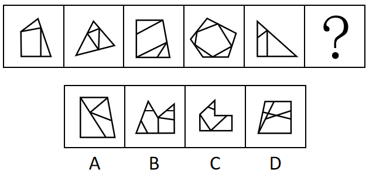

A. A

B. B

C. C

D. D

第 46 题 · 答案与解析

**参考答案（粉笔题库参考内容）**

C

**解析**

元素组成不同，且无明显属性规律，考虑数量规律。题干图形被分割，封闭区域明显，优先考虑面数量，总的面数量依次为3、4、4、6、3无规律，故进一步考虑面的细化。观察发现题干中均存在明显最大面，且最大面的边数量与外框边数量相同，只有C项符合。

故正确答案为C。

**考点**：数量规律-面

**来源**：2022年天津市公务员录用考试《行测》试题（网友回忆版）第46题

### 第 47 题

把下面的六个图形分为两类，使每一类都有各自的共同特征或规律，分类正确的一项是：

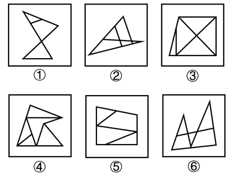

A. ①②③，④⑤⑥

B. ①③⑤，②④⑥

C. ①⑤⑥，②③④

D. ①②⑥，③④⑤

第 47 题 · 答案与解析

**参考答案（粉笔题库参考内容）**

C

**解析**

本题为分组分类题目。元素组成不同，且无明显属性规律，考虑数量规律。观察发现，题干图①为“日”字变形图，图③为“田”字变形图，考虑笔画数。图①⑤⑥的奇点数均为2，为一笔画图形，图②③④的奇点数均为4，为两笔画图形。即图①⑤⑥一组，图②③④一组。

故正确答案为C。

**考点**：数量规律-线

**来源**：2022年天津市公务员录用考试《行测》试题（网友回忆版）第47题

### 第 48 题

把下面的六个图形分为两类，使每一类都有各自的共同特征或规律，分类正确的一项是：

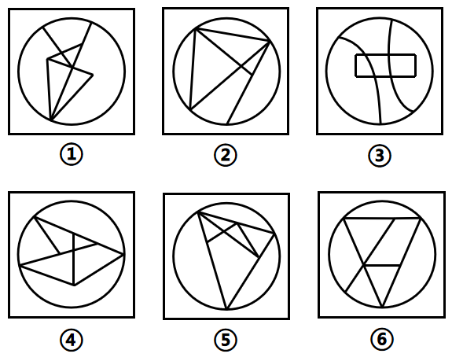

A. ①②③，④⑤⑥

B. ①④⑤，②③⑥

C. ①②⑥，③④⑤

D. ①③⑥，②④⑤

第 48 题 · 答案与解析

**参考答案（粉笔题库参考内容）**

B

**解析**

本题为分组分类题目。元素组成不同，且无明显属性规律，考虑数量规律。观察图形发现，每幅图线条交叉明显，且都有圆形外框，内部线条与外框有明显相交，考虑数框上交点，图①④⑤框上交点为3，图②③⑥框上交点为4。

故正确答案为B。

**考点**：数量规律-点

**来源**：2022年天津市公务员录用考试《行测》试题（网友回忆版）第48题

### 第 49 题

左边给定的是纸盒的外表面，下面哪项能由它折叠而成？

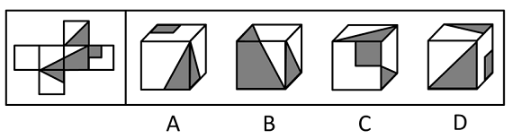

A. A

B. B

C. C

D. D

第 49 题 · 答案与解析

**参考答案（粉笔题库参考内容）**

B

**解析**

将展开图标上序号（如下图所示），逐一进行分析。

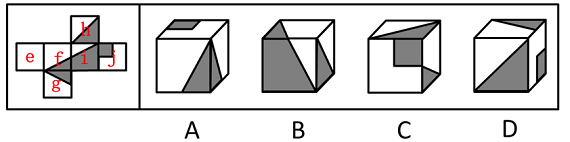

A项：选项由面f、面g和面j构成，其中面f和面j为相对面，不可能同时出现，选项与题干展开图不一致，排除；

B项：选项由面f、面i和面h构成，选项与题干展开图一致，当选；

C项：选项正面为面j，顶面为面h，右面为面f或面g，因为面j和面f为相对面，面h和面g为相对面，故右面不可能和面j或面h（即正面或顶面）同时出现，选项与题干展开图不一致，排除；

D项：选项正面为面h，右面为面j，顶面为面f或面g，因为面j和面f为相对面，面h和面g为相对面，故顶面不可能和面h或面j（即正面或右面）同时出现，选项与题干展开图不一致，排除。

故正确答案为B。

**考点**：空间类-空间重构-六面体

**来源**：2022年天津市公务员录用考试《行测》试题（网友回忆版）第49题

### 第 50 题

下列立体图形能由①②③组成的是：

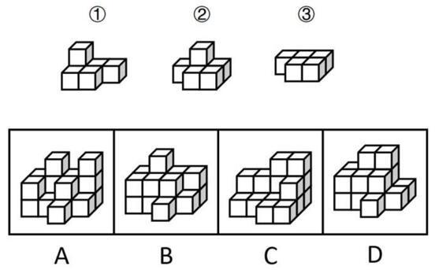

A. A

B. B

C. C

D. D

第 50 题 · 答案与解析

**参考答案（粉笔题库参考内容）**

C

**解析**

本题考查立体拼合。如下图所示，C项可由①②③拼合而成。

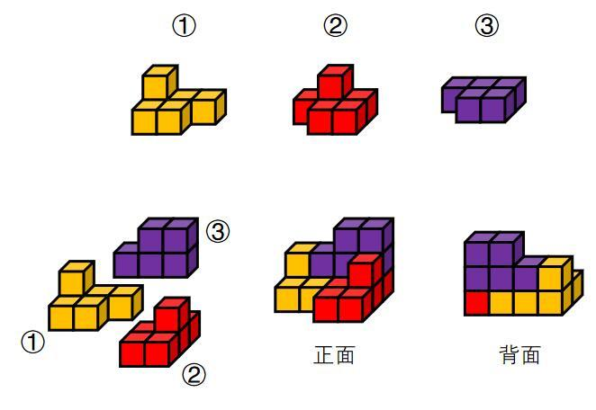

故正确答案为C。

**考点**：空间类-立体拼合

**来源**：2022年天津市公务员录用考试《行测》试题（网友回忆版）第50题

### 第 51 题

标签效应是指当一个人被一种词语名称贴上标签时，他就会做出自我印象管理，使自己的行为与所贴的标签内容相一致。

根据上述定义，下列未体现标签效应的是：

A. 高血压这一慢性疾病，在没有诊断出结果之前，症状并不明显，患者也没有感到不舒服。然而一旦确诊并告知，他们会立即紧张起来，并经常会有手脚麻木、睡眠不良等不适现象出现

B. 王某小学时因体胖脸圆被同学取外号叫“王胖头”，当多年以后同学在聚会上回忆王某时，对他的认知还停留在他的外号上，即使王某已成功瘦身多年

C. 某艺人刚出道时将自己定位为搞笑谐星，出演了大量综艺节目和喜剧电影，深受观众喜欢

D. 心理学家招募了一批纪律散漫的新兵，让他们每周给家里写信，说自己在前线如何听从指挥、奋勇杀敌，结果半年后这些士兵发生了很大的变化，他们真的像信上所说的那样去努力了

第 51 题 · 答案与解析

**参考答案（粉笔题库参考内容）**

B

**解析**

第一步：找出定义关键词。

“当一个人被一种词语名称贴上标签时”、“使自己的行为与所贴的标签内容相一致”。

第二步：逐一分析选项。

A项：患者一旦确诊高血压并被告知，说明此时他们被贴上“高血压患者”的标签，符合“当一个人被一种词语名称贴上标签时”，他们经常会有手脚麻木、睡眠不良等不适现象出现，说明他们认定自己是高血压患者，符合“使自己的行为与所贴的标签内容相一致”，符合定义，排除；

B项：王某因体胖脸圆被同学取外号叫“王胖头”，说明王某被贴上“胖”的标签，符合“当一个人被一种词语名称贴上标签时”，多年后同学对王某的认知还停留在他的外号上，说明这是同学对王某的印象，而非王某的自我印象，并且此时王某已成功瘦身，说明王某的行为与标签不一致，不符合“使自己的行为与所贴的标签内容相一致”，不符合定义，当选；

C项：某艺人将自己定位为搞笑谐星，说明该艺人被贴上“搞笑谐星”的标签，符合“当一个人被一种词语名称贴上标签时”，他后来出演了大量综艺节目和喜剧电影，符合“使自己的行为与所贴的标签内容相一致”，符合定义，排除；

D项：散漫的新兵被要求给家里写信说自己在前线如何听从指挥、奋勇杀敌，说明新兵们被贴上“服从”、“英勇”的标签，符合“当一个人被一种词语名称贴上标签时”，结果这些士兵真的像信上所说的那样去努力了，说明他们认定自己是英勇的士兵，符合“使自己的行为与所贴的标签内容相一致”，符合定义，排除。

本题为选非题，故正确答案为B。

**考点**：原因结果

**来源**：2022年天津市公务员录用考试《行测》试题（网友回忆版）第51题

### 第 52 题

独特价值效应是影响顾客对产品价格及其变化的接受程度，最终影响其购买决策的一个重要因素。具体表现为：当购买者对某种产品区别于可替代性竞争产品的特色评价越高，他对产品的价格将越不敏感。

根据上述定义，下列体现了独特价值效应的是：

A. 目前，诺西那生钠是唯一能从根本上治疗脊髓性肌萎缩症的特效药，虽然一年药费几十万，但不少患病家庭仍选择贷款购买此款药物

B. 在水果购买上，相对价格来说消费者更看重营养价值，因此某网购平台在年货节期间的水果消费上，车厘子与砂糖橘在销量上平分秋色

C. 某家竹笋店尽管比市场均价高了一倍，但由于他家的竹笋都是每天现挖的，味道鲜美，因此一上架就被抢购一空

D. 某地服装批发市场已经营多年，因所售服装款式时尚、性价比高，吸引了全国各地的商家来此交易

第 52 题 · 答案与解析

**参考答案（粉笔题库参考内容）**

C

**解析**

第一步：找出定义关键词。

“区别于可替代性竞争产品”、“对产品的特色评价越高，对价格越不敏感”。

第二步：逐一分析选项。

A项：诺西那生钠是治疗脊髓性肌萎缩症的唯一特效药，患者购买是因为别无选择而非消费者觉得该药比其他可替代性竞争产品好，不符合“区别于可替代性竞争产品”，不符合定义，排除；

B项：车厘子和砂糖橘属于不同样式的产品，两者并不是可替代性的竞争产品，不符合“区别于可替代性竞争产品”，不符合定义，排除；

C项：某家的竹笋都是每天现挖的，味道鲜美，符合“区别于可替代性竞争产品”，尽管比市场均价高了一倍，一上架就被抢购一空，说明消费者更在乎竹笋的质量，符合“对产品的特色评价越高，对价格越不敏感”，符合定义，当选；

D项：某地服装批发市场因所售服装款式时尚、性价比高，吸引了全国各地的商家购买，即商家购买的原因是款式和性价比，说明消费者对产品的价格是敏感的，不符合“对产品的特色评价越高，对价格越不敏感”，不符合定义，排除。

故正确答案为C。

**考点**：单定义-其他句式

**来源**：2022年天津市公务员录用考试《行测》试题（网友回忆版）第52题

### 第 53 题

贝格曼法则是指同一种类恒温动物的体形会随着生活地区纬度或海拔的增高而变大。这是由于随着体形的增大，动物的相对体表面积（即体表面积与动物体积之比）变小，从而导致体表发散比率变小，因而能更好地保存热量以适应高纬度地区的寒冷环境。艾伦法则是指同一分类单位的恒温动物的突出部分在低温环境中，有变短变小的趋势。

根据上述定义，下列体现了艾伦法则的是：

A. 北极狼比热带的狼更肥一些，身体更接近于圆形

B. 生活在印度的瘤牛因髻甲部有一肌肉组织隆起似瘤而得名，大而圆的瘤峰是一种沉积脂肪的肌肉组织，能在冬季物质匮乏时发挥一定的补给作用

C. 生活在青藏高原的藏獒拥有高大的体形，强壮的体魄，但藏獒被大批贩运到内地后，体形等诸多性状发育较差

D. 分布在北极地区的麝牛躯体与印度野牛一样魁梧，但耳朵特小，四肢奇短，几乎没有尾巴，看上去圆鼓鼓的，样子颇有点滑稽

第 53 题 · 答案与解析

**参考答案（粉笔题库参考内容）**

D

**解析**

第一步：找出定义关键词。

贝格曼法则：“同一种类恒温动物”、“体形会随着生活地区纬度或海拔的增高而变大”；

艾伦法则：“同一分类单位的恒温动物”、“突出部分在低温环境中，有变短变小的趋势”。

第二步：逐一分析选项。

A项：北极狼比热带的狼更肥，身体更接近于圆形，说的是整体体型较为圆润，但不明确突出部分的具体情况，不符合“突出部分在低温环境中，有变短变小的趋势”，不符合“艾伦法则”定义，排除；

B项：根据瘤牛“有一肌肉组织隆起似瘤”可知，瘤峰是瘤牛的突出部分，虽然该项表明瘤峰能在冬季发挥补给作用，但不明确瘤峰在冬季是否会变短变小，不符合“突出部分在低温环境中，有变短变小的趋势”，不符合“艾伦法则”定义，排除；

C项：青藏高原的藏獒被运到内地后，体形等诸多性状发育较差，但不明确藏獒的突出部分是否会变短变小，不符合“突出部分在低温环境中，有变短变小的趋势”，不符合“艾伦法则”定义，排除；

D项：北极地区的麝牛与印度野牛都属于牛科，符合“同一分类单位的恒温动物”，耳朵、四肢和尾巴都是突出部分，且北极地区的麝牛的这些突出部分都比较短小，符合“突出部分在低温环境中，有变短变小的趋势”，符合“艾伦法则”定义，当选。

故正确答案为D。

**考点**：常规问法

**来源**：2022年天津市公务员录用考试《行测》试题（网友回忆版）第53题

### 第 54 题

无方向性假设指变量间有一定的关系但不能预测关系的性质。如果没有理论依据，或者在文献资料和实践观察中没有证据来推测变量关系，研究者只能形成无方向性的假设。方向性假设预测了两个或两个以上变量间的关系及关系的性质。

根据上述定义，下列属于方向性假设的是：

A. 在空间思维能力上男女生有差异

B. 学龄儿童的低社会交往能力与母亲高的抑郁分值有关

C. 老人自我评价的自理能力与性别、社会文化背景有关系

D. 大学教师的职业发展机会与成就感降低之间呈现显著相关关系

第 54 题 · 答案与解析

**参考答案（粉笔题库参考内容）**

B

**解析**

第一步：找出定义关键词。

无方向性假设：“变量间有一定的关系”、“不能预测关系的性质”；

方向性假设：“预测了两个或两个以上变量间的关系及关系的性质”。

第二步：逐一分析选项。

A项：“差异”说明男女的空间思维能力之间有关系，但没有说明具体的关系是什么，无法判断关系的性质，不符合“预测了两个或两个以上变量间的关系及关系的性质”，不符合“方向性假设”定义，排除；

B项：学龄儿童的“低”社会交往能力与母亲“高”的抑郁分值有关，不仅说明二者之间有关系，还明确表明是负相关，符合“预测了两个或两个以上变量间的关系及关系的性质”，符合“方向性假设”定义，当选；

C项：选项只能说明老人自我评价的自理能力与性别、社会文化背景有关系，但没有说明具体的关系是什么，无法判断关系的性质，不符合“预测了两个或两个以上变量间的关系及关系的性质”，不符合“方向性假设”定义，排除；

D项：指出大学教师的职业发展机会与成就感“降低”之间有关系，但没有明确表明具体的关系是什么，无法判断二者关系的性质，不符合“预测了两个或两个以上变量间的关系及关系的性质”，不符合“方向性假设”定义，排除。

故正确答案为B。

**考点**：常规问法

**来源**：2022年天津市公务员录用考试《行测》试题（网友回忆版）第54题

### 第 55 题

分系式是指在一个句法结构里至少有两个联合词组，这些联合词组的组成成分分别搭配，构成两套或两套以上平行的语法关系，表示两个或两个以上不同的意思。分别搭配是前一个联合结构里的并列成分依次分别跟后一个联合结构里的并列成分搭配，形成一种分系式的句法结构。

根据上述定义，下列不属于分别搭配的是：

A. 裘马轻肥

B. 卖官鬻爵

C. 吾盗天地之时利

D. 井灶，人所饮食

第 55 题 · 答案与解析

**参考答案（粉笔题库参考内容）**

B

**解析**

第一步：找出定义关键词。

分系式：“两个联合词组”、“构成两套或两套以上平行的语法关系”；

分别搭配：“前一个联合结构里的并列成分”、“分别跟后一个联合结构里的并列成分搭配”。

第二步：逐一分析选项。

A项：“裘马轻肥”根据“肥马轻裘”而来，意思为身上穿着软皮衣，骑着肥壮骏马，其中“轻裘”和“肥马”分别为联合词组，“裘”和“马”并列，二者搭配；“轻”和“肥”并列，二者搭配，从而形成句法结构“裘马轻肥”，符合“前一个联合结构里的并列成分”、“分别跟后一个联合结构里的并列成分搭配”，符合“分别搭配”定义，排除；

B项：“卖官鬻爵”的意思是出卖官职爵位，其中“卖官”和“鬻爵”分别为联合词组，“卖”和“鬻”并列，“官”和“爵”并列，但两个联合词组中的并列成分并未搭配，不符合“前一个联合结构里的并列成分”、“分别跟后一个联合结构里的并列成分搭配”，不符合“分别搭配”定义，当选；

C项：“吾盗天地之时利”根据“吾盗天之时，吾盗地之利”而来，的意思是我偷盗天时和地利，其中“天之时”和“地之利”分别为联合词组，“天”和“地”并列，二者搭配；“时”和“利”并列，二者搭配，从而形成句法结构“天地之时利”，符合“前一个联合结构里的并列成分”、“分别跟后一个联合结构里的并列成分搭配”，符合“分别搭配”定义，排除；

D项：“井灶，人所饮食”根据“井，人所饮；灶，人所食”而来，意思是井是人打水喝的地方，灶台是人做饭吃的地方，其中“井，人所饮”和“灶，人所食”分别为联合词组，“井”和“灶”并列，二者搭配；“饮”和“食”并列，二者搭配，从而形成句法结构“井灶，人所饮食”，符合“前一个联合结构里的并列成分”、“分别跟后一个联合结构里的并列成分搭配”，符合“分别搭配”定义，排除。

本题为选非题，故正确答案为B。

**考点**：常规问法

**来源**：2022年天津市公务员录用考试《行测》试题（网友回忆版）第55题

### 第 56 题

镰刀：麦子

A. 卷尺：刻度

B. 锄头：大米

C. 扳手：螺栓

D. 剪刀：钢材

第 56 题 · 答案与解析

**参考答案（粉笔题库参考内容）**

C

**解析**

第一步：判断题干词语间逻辑关系。

镰刀是割麦子的工具，二者为工具的对应关系。

第二步：判断选项词语间逻辑关系。

A项：卷尺上一定有刻度，二者不是工具对应，与题干逻辑关系不一致，排除；

B项：锄头是除草、翻土的工具，不是收割大米的工具，与题干逻辑关系不一致，排除；

C项：扳手是拧螺栓的工具，二者为工具的对应关系，与题干逻辑关系一致，当选；

D项：剪刀不是剪切钢材的工具，与题干逻辑关系不一致，排除。

故正确答案为C。

**考点**：逻辑关系-对应关系

**来源**：2022年天津市公务员录用考试《行测》试题（网友回忆版）第56题

### 第 57 题

钻木：取火

A. 指鹿：为马

B. 以卵：击石

C. 画蛇：添足

D. 骑虎：难下

第 57 题 · 答案与解析

**参考答案（粉笔题库参考内容）**

B

**解析**

第一步：判断题干词语间逻辑关系。

钻木取火的意思是用硬木棒对着木头摩擦，靠摩擦取火。拿“木”来“取火”，“木”是手用的工具，“取火”是目的，二者为工具和目的的对应关系。

第二步：判断选项词语间逻辑关系。

A项：指鹿为马的意思是指着鹿说是马，比喻故意颠倒黑白，混淆是非。“鹿”不是手用的工具，“为马”不是目的，与题干逻辑关系不一致，排除；

B项：以卵击石的意思是用鸡蛋碰石头，比喻不自量力，自取灭亡。拿“卵”来“击石”，“卵”是手用的工具，“击石”是目的，二者为工具和目的的对应关系，与题干逻辑关系一致，当选；

C项：画蛇添足的意思是画蛇时给它添上脚，比喻多此一举，弄巧成拙。“蛇”不是手用的工具，“添足”不是目的，与题干逻辑关系不一致，排除；

D项：骑虎难下的意思是骑在老虎背上不能下来，比喻事情进行中遇到困难，难以继续又无法罢手。“虎”不是手用的工具，“难下”不是目的，与题干逻辑关系不一致，排除。

故正确答案为B。

**考点**：拆分思维、逻辑关系-对应关系

**来源**：2022年天津市公务员录用考试《行测》试题（网友回忆版）第57题

### 第 58 题

报案人：嫌疑人

A. 获益人：买家

B. 卖家：买家

C. 主角：配角

D. 僧侣：道士

第 58 题 · 答案与解析

**参考答案（粉笔题库参考内容）**

A

**解析**

第一步：判断题干词语间逻辑关系。

有的报案人是嫌疑人，有的报案人不是嫌疑人，有的嫌疑人是报案人，有的嫌疑人不是报案人，二者为交叉关系。

第二步：判断选项词语间逻辑关系。

A项：有的获益人是买家，有的获益人不是买家，有的买家是获益人，有的买家不是获益人，二者为交叉关系，与题干逻辑关系一致，当选；

B项：卖家和买家为并列关系，与题干逻辑关系不一致，排除；

C项：主角和配角为并列关系，与题干逻辑关系不一致，排除；

D项：僧侣一般指佛教僧徒，与道士为并列关系，与题干逻辑关系不一致，排除。

故正确答案为A。

**考点**：逻辑关系-交叉关系

**来源**：2022年天津市公务员录用考试《行测》试题（网友回忆版）第58题

### 第 59 题

子时：时辰

A. 物理：惯性

B. 公民：群众

C. 莲花：花卉

D. 碱性：石灰

第 59 题 · 答案与解析

**参考答案（粉笔题库参考内容）**

C

**解析**

第一步：判断题干词语间逻辑关系。

子时对应现代时间的23时至1时，是十二时辰的第一个时辰，二者为种属关系。

第二步：判断选项词语间逻辑关系。

A项：惯性是指物体保持静止状态或匀速直线运动状态的性质，是物理学名词，二者为对应关系，与题干逻辑关系不一致，排除；

B项：公民是指具有或取得某国国籍的人，群众指“人民大众”或“居民的大多数”，即与“人民”一词同义，另外也指“未加入党团的人”，表示“党员”与“群众”的区别，“干部”与“群众”的区别，二者不是种属关系，与题干逻辑关系不一致，排除；

C项：莲花是一种花卉，二者为种属关系，与题干逻辑关系一致，当选；

D项：石灰是碱性的，二者为属性对应关系，与题干逻辑关系不一致，排除。

故正确答案为C。

**考点**：逻辑关系-包容关系

**来源**：2022年天津市公务员录用考试《行测》试题（网友回忆版）第59题

### 第 60 题

学生：知识：死记硬背

A. 匠人：工艺：半路出家

B. 作家：作品：炙手可热

C. 老师：学生：谆谆教诲

D. 农民：庄稼：揠苗助长

第 60 题 · 答案与解析

**参考答案（粉笔题库参考内容）**

D

**解析**

第一步：判断题干词语间逻辑关系。

学生学习知识，二者为主宾结构，死记硬背是学习知识的一种负面方式，二者是方式对应关系。

第二步：判断选项词语间逻辑关系。

A项：匠人学习工艺，二者为主宾结构，半路出家不是学习工艺的一种方式，二者不是方式对应关系，与题干逻辑关系不一致，排除；

B项：作家写出作品，二者为主宾结构，炙手可热不是写出作品的一种方式，二者不是方式对应关系，与题干逻辑关系不一致，排除；

C项：老师教导学生，二者为主宾结构，谆谆教诲是教导学生的一种正面方式，与题干逻辑关系不一致，排除；

D项：农民种植庄稼，二者为主宾结构，揠苗助长是种植庄稼的一种负面方式，二者是方式对应关系，与题干逻辑关系一致，当选。

故正确答案为D。

**考点**：逻辑关系-对应关系、语法关系

**来源**：2022年天津市公务员录用考试《行测》试题（网友回忆版）第60题

### 第 61 题

碳：钻石：戒指

A. 碳酸钙：珍珠：项链

B. 石墨：铅笔：画稿

C. 刚玉：红宝石：装饰

D. 硅：硅胶：石英砂

第 61 题 · 答案与解析

**参考答案（粉笔题库参考内容）**

A

**解析**

第一步：判断题干词语间逻辑关系。

碳是钻石的主要化学成分，二者是组成关系，钻石可以作为制作戒指的原材料，二者是原材料的对应关系。

第二步：判断选项词语间逻辑关系。

A项：碳酸钙是珍珠的主要化学成分，二者是组成关系，珍珠可以作为制作项链的原材料，二者是原材料的对应关系，与题干逻辑关系一致，当选；

B项：石墨是铅笔芯的主要化学成分，铅笔是绘制画稿的工具，二者为工具对应关系，与题干逻辑关系不一致，排除；

C项：红宝石是刚玉的一种，二者是种属关系，红宝石可以用来装饰，二者是功能的对应关系，与题干逻辑关系不一致，排除；

D项：硅胶和石英砂的主要化学成分都是二氧化硅，都含有硅元素，后两个词与第一个词均为组成关系，与题干逻辑关系不一致，排除。

故正确答案为A。

**考点**：逻辑关系-包容关系、逻辑关系-对应关系

**来源**：2022年天津市公务员录用考试《行测》试题（网友回忆版）第61题

### 第 62 题

预约：核实：兑换

A. 手术：插管：缝合

B. 招聘：培训：辞职

C. 设想：实践：总结

D. 募捐：调研：下乡

第 62 题 · 答案与解析

**参考答案（粉笔题库参考内容）**

C

**解析**

第一步：判断题干词语间逻辑关系。

先预约，后核实，然后兑换，如兑换纪念币，需要先和银行预约，然后在银行核实信息，最后兑换，三者为时间先后顺序的对应关系。

第二步：判断选项词语间逻辑关系。

A项：插管与缝合均属于手术的步骤，与手术之间并无时间先后顺序的对应关系，与题干逻辑关系不一致，排除；

B项：先招聘，后培训，最后辞职，三者为时间先后顺序的对应关系，与题干逻辑关系一致，保留；

C项：先设想，后实践，最后总结，三者为时间先后顺序的对应关系，与题干逻辑关系一致，保留；

D项：先调研，后募捐，下乡与二者无明显时间先后顺序，与题干逻辑关系不一致，排除。

比较题干和B、C两项，首先看主体，题干的“预约”和“兑换”可以是同一个主体的行为，而“核实”一般是另一个主体的行为，B、C两项没有能跟题干主体完全对应上的，有同学可能认为题干涉及两个不同主体，B项也涉及两个不同主体，这个角度没有看主体对应的具体位置，其实是非常不严谨的，不建议这么思考，容易掉坑；本题与其他题的不同之处在于，题干三个词是一件事从准备到完成的过程，C项也是从准备到完成的过程，而B项最后的辞职并非完成一件事的过程，故C项与题干逻辑关系更为一致，当选。

故正确答案为C。

**考点**：逻辑关系-对应关系

**来源**：2022年天津市公务员录用考试《行测》试题（网友回忆版）第62题

### 第 63 题

工程师：研发：产品

A. 飞行员：驾驶：飞机

B. 维修工：修理：锤子

C. 保洁员：保持：环境

D. 售货员：决定：售价

第 63 题 · 答案与解析

**参考答案（粉笔题库参考内容）**

A

**解析**

第一步：判断题干词语间逻辑关系。

“工程师”是职业，“研发产品”为工程师的工作内容，第一个词与后两个词为职业和工作内容的对应关系。

第二步：判断选项词语间逻辑关系。

A项：“飞行员”是职业，“驾驶飞机”为飞行员的工作内容，第一个词与后两个词为职业和工作内容的对应关系，与题干逻辑关系一致，当选；

B项：“维修工”是职业，但“修理锤子”并非维修工的工作内容，“锤子”是维修工修理时使用的工具，与题干逻辑关系不一致，排除；

C项：“保洁员”是职业，但“保持环境”并非保洁员的工作内容，保洁员的工作内容是保持环境整洁，与题干逻辑关系不一致，排除；

D项：“售货员”是职业，但“决定售价”并非售货员的工作内容，售货员的工作内容是售卖商品，与题干逻辑关系不一致，排除。

故正确答案为A。

**考点**：逻辑关系-对应关系

**来源**：2022年天津市公务员录用考试《行测》试题（网友回忆版）第63题

### 第 64 题

羚羊 对于 （ ） 相当于 （ ） 对于 细菌

A. 灵活 微小

B. 猎人 医生

C. 牦牛 病毒

D. 青草 细胞

第 64 题 · 答案与解析

**参考答案（粉笔题库参考内容）**

C

**解析**

逐一代入选项。

A项：灵活是羚羊的属性，微小是细菌的属性，前后均为属性对应关系，但前后词语逻辑顺序相反，前后逻辑关系不一致，排除；

B项：羚羊是猎人的猎物，二者为对应关系，但医生与细菌没有明显的逻辑关系，前后逻辑关系不一致，排除；

C项：羚羊和牦牛是两种不同的动物，病毒和细菌是两种不同的微生物，前后均为并列关系中的反对关系，前后逻辑关系一致，当选；

D项：青草是羚羊的食物，细胞是生物基本的结构和功能单位，细菌是一种单细胞生物，前后逻辑关系不一致，排除。

故正确答案为C。

**考点**：逻辑关系-并列关系

**来源**：2022年天津市公务员录用考试《行测》试题（网友回忆版）第64题

### 第 65 题

执手相看泪眼 对于 （ ） 相当于 （ ） 对于 悼亡

A. 托孤 老眼平生空四海

B. 思乡 家祭无忘告乃翁

C. 离别 十年生死两茫茫

D. 感怀 曾经沧海难为水

第 65 题 · 答案与解析

**参考答案（粉笔题库参考内容）**

C

**解析**

逐一代入选项。

A项：“执手相看泪眼”的含义是握着手互相瞧着，满眼泪花，表达了词人与恋人离别时难分难舍的情感，与“托孤”无明显逻辑关系；“老眼平生空四海”意为我平生就喜欢登高临远眺望四海，原词表达的是词人忧虑国事、痛心神州陆沉的悲愤之情，与“悼亡”无明显逻辑关系，前后逻辑关系不一致，排除；

B项：“执手相看泪眼”的含义是握着手互相瞧着，满眼泪花，表达了词人与恋人离别时难分难舍的情感，与“思乡”无明显逻辑关系；“家祭无忘告乃翁”意为（若收复中原失地的那一天到来时），举行家祭不要忘记告诉我，表达了诗人的爱国之情和对旧业光复的坚定信念，与“悼亡”无明显逻辑关系，前后逻辑关系不一致，排除；

C项：“执手相看泪眼”的含义是握着手互相瞧着，满眼泪花，表达了词人与恋人离别时难分难舍的情感，与“离别”构成对应关系；“十年生死两茫茫”意为你我夫妻生死诀别已经整整十年，表达了词人对爱侣悼亡后的思念之情，与“悼亡”构成对应关系，前后逻辑关系一致，当选；

D项：“执手相看泪眼”的含义是握着手互相瞧着，满眼泪花，表达了词人与恋人离别时难分难舍的情感，“感怀”是指有所感触而怀念，二者无明显逻辑关系；“曾经沧海难为水”意为经历过波澜壮阔的大海，别处的水再也不值得一观，暗喻了诗人对爱妻坚贞不渝的感情，是悼亡亡妻之作，与“悼亡”构成对应关系，前后逻辑关系不一致，排除。

故正确答案为C。

**考点**：逻辑关系-对应关系

**来源**：2022年天津市公务员录用考试《行测》试题（网友回忆版）第65题

### 第 66 题

全球变暖带来的气候变化日益显著，成为影响人类发展前景的决定性因素之一。从观测和古气候重建的资料来看，人类活动对地球气候系统的影响已经非常深刻。数据显示，最近50年来的温升速率都不超过0.2°C/10年。即便从最近的20年来看，2011～2020年相对于1850～1900年平均值的温度变化是1.09°C，2001～2010年相对于1850～1900年平均值的温度变化是0.9°C，10年的温升速率不超过0.2°C。根据上述数据来看，全球变暖的步调并没有加速。

以下哪项为真，最能证明上述观点？

A. 最近20年相对于1980～1999年平均值的温度变化是0.58°C，相对于1961～1990年平均值的温度变化是0.36°C

B. 目前多国出台政策强化降低GDP能源强度和二氧化碳强度的力度和幅度，按照现在人类控制排放的力度，全球气温升幅加快的可能性不大

C. 不同区域受到全球气候变暖带来的影响存在差异，比如1951～2019年中国的增温速度高于同期全球平均水平

D. 当前大气中的二氧化碳浓度高于200万年以来的任何时候，1900年以来的全球平均海平面上升速度比过去300年中任何一个世纪都快

第 66 题 · 答案与解析

**参考答案（粉笔题库参考内容）**

B

**解析**

第一步：找出论点和论据。

论点：全球变暖的步调并没有加速。

论据：最近50年来的温升速率都不超过0.2°C/10年。即便从最近的20年来看，2011～2020年相对于1850～1900年平均值的温度变化是1.09°C，2001～2010年相对于1850～1900年平均值的温度变化是0.9°C，10年的温升速率不超过0.2°C。

本题论点说的是全球没有加速变暖，论据说的是全球过去50年的温升速率都不超过0.2°C/10年，论点和论据都在说温度，话题一致，加强优先考虑补充论据。

第二步：逐一分析选项。

A项：该项说的是最近20年对于1980～1999以及1961～1990年的平均值温度变化，1980～1999的平均值温度变化为0.58°C，1961～1990的平均值温度变化为0.36°C，说明1980～1999比1961～1990的温度要低，进而补充论据说明全球变暖的步调没有加速，可以加强，保留；

B项：该项说的是目前多国已经出台了政策，按照现在人类控制排放的力度，全球气温升幅加快的可能性不大，那全球温升速率加快的可能性也就不会大，进而全球变暖的步调也就不会加速，补充论据，可以加强，保留；

C项：该项说的是不同区域受到全球变暖带来的影响存在差异，强调的是全球变暖以后不同区域受到的影响，但题干在讨论全球变暖有没有加速，二者话题不一致，为无关项，无法加强，排除；

D项：该项说的是当前大气中的二氧化碳浓度比过去高，全球平均海平面上升速度比过去300年中任何一个世纪都快，说明全球变暖在加速，有削弱力度，无法加强，排除。

对比A、B两项，A补充的论据和题干论据类似，都是基于之前的数据得到的论点，B项是补充新的论据，B项比A项更明确。

故正确答案为B。

**考点**：补充论据

**来源**：2022年天津市公务员录用考试《行测》试题（网友回忆版）第66题

### 第 67 题

中微子自由流动对之后宇宙中结构的形成有很重要的影响，在中微子自由流动的尺度内，由于其具有很大的速度，所以不能被限制在势阱中，导致小尺度上结构的形成的难度加大。中微子在小尺度上对结构形成的抑制效应随着中微子质量的增加而增加，并提供了中微子质量最清晰的观测特征之一。

由此可以推出：

A. 宇宙中结构的形成取决于中微子的自由流动

B. 中微子由于速度很快所以不能被限制在势阱中

C. 在小尺度上中微子的质量越大对结构形成的抑制作用越强

D. 中微子在小尺度上的质量提供了中微子质量的最清晰观测特征

第 67 题 · 答案与解析

**参考答案（粉笔题库参考内容）**

C

**解析**

日常结论题，根据题干信息逐一分析选项。

A项：题干表述为，中微子自由流动对宇宙中结构的形成“有很重要的影响”，而选项“取决于”表述过于绝对，无法推出，排除；

B项：题干表述为，“在中微子自由流动的尺度内”，由于其具有很大的速度，所以不能被限制在势阱中，而选项未表述该前提，无法推出，排除；

C项：题干表述为，中微子“在小尺度上”对结构形成的抑制效应“随着中微子质量的增加而增加”，即选项所表述的“在小尺度上”“中微子的质量越大”对结构形成的抑制作用“越强”，可以推出，当选；

D项：题干表述为，中微子在小尺度上“对结构形成的抑制效应”提供了中微子质量最清晰的观测特征之一，选项表述为，中微子在小尺度上的“质量”提供了中微子质量的最清晰观测特征，将“抑制效应”换成了“质量”，偷换概念，无法推出，排除。

故正确答案为C。

**考点**：日常结论

**来源**：2022年天津市公务员录用考试《行测》试题（网友回忆版）第67题

### 第 68 题

某流行病的差异研究中发现男性和女性之间的结果存在差异。研究人员注意到，虽然男性和女性感染该疾病的比例相似，但男性似乎更容易死于这种病毒诱发的肝炎。专家据此认为，免疫功能的性别差异可能是导致不同性别出现临床表现差异的原因。

以下哪项为真，最能削弱上述观点？

A. 男性患者住院的概率比女性高20%左右，一旦住院接受治疗，男性患者更有可能需要进入重症监护室，而且入院后的死亡概率更高

B. 随着该疾病患病人群的数据集不断扩大，支持存在差距的证据不断出现

C. 近十年来与该疾病致病原理类似的病毒暴发的数据也显示在确诊的病例中，男性患者的死亡风险高于女性

D. 参与研究的大多数男性都有酗酒抽烟的不良生活习惯，会容易引起其他疾病

第 68 题 · 答案与解析

**参考答案（粉笔题库参考内容）**

D

**解析**

第一步：找出论点和论据。

论点：免疫功能的性别差异可能是导致不同性别出现临床表现差异的原因。

论据：某流行病的差异研究中发现男性和女性之间的结果存在差异。研究人员注意到，虽然男性和女性感染该疾病的比例相似，但男性似乎更容易死于这种病毒诱发的肝炎。

本题论点论据说的都是不同性别对某流行病的临床表现存在差异，话题一致，削弱优先考虑削弱论点，且论点中存在因果关系，还可以考虑因果倒置和他因削弱。

第二步：逐一分析选项。

A项：该项说男性患者住院概率和死亡概率更高，但未说明男女之间出现差异的“原因”，而论点讨论的是导致不同性别出现临床表现差异的“原因”，话题不一致，无法削弱，排除；

B项：该项说不断出现支持存在差距的证据，对论据有补充的效果，有加强的作用，无法削弱，排除；

C项：该项说与该疾病致病原理类似的病例中男性的死亡风险高于女性，但“类似”疾病与“该疾病”不能划等号，且该项未说明男女之间出现差异的“原因”，而论点讨论的是导致不同性别出现临床表现差异的“原因”，话题不一致，无法削弱，排除；

D项：该项说参与研究的大多数男性有不良的生活习惯，容易引起其他疾病，说明该流行病不同性别的临床表现差异不一定是免疫功能的性别差异导致的，也有可能是这部分男性的不良生活习惯导致的，他因削弱，可以削弱，当选。

故正确答案为D。

**考点**：他因削弱

**来源**：2022年天津市公务员录用考试《行测》试题（网友回忆版）第68题

### 第 69 题

研究人员招募150名被试参与研究并将其分为两组，每组被试随机收到一个关于A公司形象的介绍材料，温暖型品牌材料为：A品牌为了进一步保持竞争力，常年致力于慈善事业，传达关爱的理念；效能型品牌的材料为：A品牌为了进一步保持竞争力，一直致力于新工艺和新技术的研发。两组被试分别阅读A品牌公司设计的怀旧广告文案与非怀旧广告文案，并填写广告口碑传播测量量表。结果表明，温暖型的品牌形象采用怀旧广告时需谨慎。

以下哪项如果为真，能够支持上述结论？

A. 越来越多的企业选择打“感情牌”，采用怀旧型情感广告策略拉近和消费者之间的距离，促进品牌传播

B. 温暖型品牌的怀旧广告降低了消费者的孤独感，消费者不用寻求社交联系来排解孤独，因此可能更少地使用社交网络展示产品

C. 消费者对怀旧广告会产生品牌历史感的感知，悠久的历史可以让消费者更加信任该品牌

D. 对于效能型品牌，消费者对怀旧广告的感知更偏理性，怀旧广告会促进消费者的口碑传播

第 69 题 · 答案与解析

**参考答案（粉笔题库参考内容）**

B

**解析**

第一步：找出论点和论据。

论点：温暖型的品牌形象采用怀旧广告时需谨慎。

论据：无。

本题只有论点，没有论据。加强优先考虑补充论据，即解释论点成立的原因或举例子证明论点成立。

第二步：逐一分析选项。

A项：该项指出采用怀旧型情感广告策略可以促进品牌传播，说明怀旧型情感广告策略对品牌有好处，采用时无需谨慎，削弱论点，无法加强，排除；

B项：该项指出温暖型品牌的怀旧广告会降低消费者的孤独感，消费者可能更少地使用社交网络展示产品，也就是说消费者不会帮助品牌进行口碑宣传，也就不利于品牌的口碑传播，解释了为什么温暖型的品牌形象采用怀旧广告时需谨慎，解释原因，可以加强，当选；

C项：该项指出怀旧广告会让消费者更加信任该品牌，说明怀旧型情感广告策略对品牌有好处，采用时无需谨慎，削弱论点，无法加强，排除；

D项：该项指出怀旧广告会促进消费者对于“效能型”品牌的口碑传播，而论点讨论的是“温暖型”品牌，主体不一致，为无关项，无法加强，排除。

故正确答案为B。

**考点**：补充论据

**来源**：2022年天津市公务员录用考试《行测》试题（网友回忆版）第69题

### 第 70 题

44名大学生自愿参加一项羽毛球运动对大脑影响的实验，并被随机分成实验组和对照组两组。本实验包括3个流程：前测、羽毛球训练、后测。前测和后测的内容一样，均为脑结构扫描。只有实验组参加连续12周的羽毛球训练，对照组在此期间不进行任何有规律的体育运动。结果显示实验组训练后左侧下枕叶、颞中回灰质体积增加；而对照组颞中回灰质体积减小。研究人员表示，实验组被试的这种脑结构变化是羽毛球运动训练的特异性结果。

以下哪项如果为真，能够削弱上述观点？

A. 灰质与知觉相关，羽毛球运动员的知觉敏感性显著高于普通成人

B. 实验中观察到的对照组颞中回灰质体积减小属于大脑毕生发展的正常现象

C. 他动训练对大脑中灰质的影响进行研究

D. 本实验的干预时间较短，对以接受过十几年运动训练经历的被试为研究对象的实验来说，结果可比性较差

第 70 题 · 答案与解析

**参考答案（粉笔题库参考内容）**

D

**解析**

第一步：找出论点和论据。

论点：实验组被试的这种脑结构变化是羽毛球运动训练的特异性结果。

论据：本实验包括3个流程：前测、羽毛球训练、后测。前测和后测的内容一样，均为脑结构扫描。只有实验组参加连续12周的羽毛球训练，对照组在此期间不进行任何有规律的体育运动。结果显示实验组训练后左侧下枕叶、颞中回灰质体积增加；而对照组颞中回灰质体积减小。

本题的论点是在讨论实验组训练后左侧下枕叶、颞中回灰质体积增加的这种脑结构变化是羽毛球训练的特异性结果，论据是在描述实验的过程，论点、论据话题一致，削弱优先考虑削弱论点，其次考虑削弱论据。

第二步：逐一分析选项。

A项：该项讨论的是灰质与知觉的关系，并将羽毛球运动员的知觉敏感性与普通成人进行对比，但没有提及实验组灰质的变化是否为羽毛球训练的特异性结果，话题不一致，为无关项，无法削弱，排除；

B项：该项讨论的是“对照组”的脑结构变化，而论点讨论的是“实验组”的脑结构变化与羽毛球训练的关系，主体不一致，为无关项，无法削弱，排除；

C项：该项讨论的是他动训练与大脑中灰质的关系，但没有提及羽毛球运动训练，话题不一致，为无关项，无法削弱，排除；

D项：该项指出题干中实验的干预时间较短，因此相比较于以参加过十几年训练的人为研究对象的实验来说，实验结果的可比性较差，说明该论据中的实验过程不够合理，从而指出实验的结论也不够准确，是从实验过程的角度进行削弱论据，可以削弱，当选。

故正确答案为D。

**考点**：削弱-实验类、削弱论据

**来源**：2022年天津市公务员录用考试《行测》试题（网友回忆版）第70题

### 第 71 题

如今，越来越多的人深受失眠困扰。其中一些人上网寻找解决之道，比如一个名为“海军2分钟入睡法”的短视频，最近在网络上非常受欢迎。这种方法主要有5步：第1步是放松面部肌肉，包括舌头、下巴和眼周肌肉；第2步是尽可能放松肩膀、上臂和下臂，先放松其中一边，然后放松另一边；第3步是深呼气，放松胸口；第4步是依次放松大腿和小腿；第5步是用10秒来平复心绪。视频声称在2分钟内可以迅速入睡，并称这一方法可快速解决失眠难题。

以下哪项为真，最能削弱上述视频声称的观点？

A. 对于失眠的人来说，最有效的“催眠剂”，就是保持规律的作息习惯

B. 治疗失眠最主要的是认知行为治疗，这应该是治疗失眠的首选方法

C. 该方法通过放松人的身体，从人的意识层面入手，让患者放松，调节自身情绪

D. 该方法中的动作，可让人逐渐放松甚至入睡，但很快就会再次醒来

第 71 题 · 答案与解析

**参考答案（粉笔题库参考内容）**

D

**解析**

第一步：找出论点和论据。

论点：“海军2分钟入睡法”的短视频声称在2分钟内可以迅速入睡，并称这一方法可快速解决失眠难题。

论据：无。

本题只有论点，没有论据，削弱优先考虑削弱论点，即“海军2分钟入睡法”不能解决失眠难题。

第二步：逐一分析选项。

A项：该项说的是最有效的催眠方式是保持规律的作息习惯，但无法说明题干论点的“海军2分钟入睡法”是否可以解决失眠难题，为不明确项，无法削弱，排除;

B项：该项说的是治疗失眠的首选方法是认知行为治疗，但无法说明题干论点的“海军2分钟入睡法”是否可以解决失眠难题，为不明确项，无法削弱，排除;

C项：该项说的是“海军2分钟入睡法”是如何使患者放松，调节情绪的，但未提及这样是否可以解决失眠难题，无法削弱，排除;

D项：该项说的是“海军2分钟入睡法”虽然可以助人入睡，但是很快会醒来，说明无法彻底解决失眠难题，削弱论点，可以削弱，当选。

故正确答案为D。

**考点**：削弱论点

**来源**：2022年天津市公务员录用考试《行测》试题（网友回忆版）第71题

### 第 72 题

近日，研究人员招募了36名健康人员，并将其随机分配到发酵或高纤维饮食方案小组中，使其维持该方案10周，并在实验开展前3周、采取分组饮食后10周，以及结束实验饮食方案4周后，采集参与者血液和粪便样本进行分析。结果发现，发酵蔬菜会增加肠道微生物多样性。研究人员认为，发酵蔬菜可改变人体免疫状态，这有望为健康成年人减少炎症提供途径。

要得到上述研究推论，还需基于以下哪一前提?

A. 食用高纤维饮食的被试体内肠道微生物的多样性保持稳定

B. 肠道微生物群不仅与肠道免疫关系密切，而且影响全身免疫系统

C. 食用发酵蔬菜的被试血液样本中炎症蛋白的水平有所下降

D. 发酵食品饮食组在实验过程中要大幅减少高纤维饮食的摄入

第 72 题 · 答案与解析

**参考答案（粉笔题库参考内容）**

B

**解析**

第一步：找出论点和论据。

论点：发酵蔬菜可改变人体免疫状态，这有望为健康成年人减少炎症提供途径。

论据：发酵蔬菜会增加肠道微生物多样性。

本题论点讨论的是“发酵蔬菜”和“人体免疫状态”、“减少炎症”的关系，论据讨论的是“发酵蔬菜”和“肠道微生物”的关系，话题不一致，且问法为“前提”，加强优先考虑搭桥，即可以建立“肠道微生物”和“人体免疫状态”之间的关系，也可以建立“肠道微生物”和“减少炎症”之间的关系。

第二步：逐一分析选项。

A项：选项指出食用高纤维饮食的被试体内肠道微生物的多样性保持稳定，选项说的食用高纤维饮食的被试体内肠道微生物的情况，但论点说的是发酵蔬菜与人体免疫状态、减少炎症的关系，话题不一致，无法加强，排除；

B项：选项指出肠道微生物群能影响全身免疫系统，建立了“肠道微生物”和“人体免疫状态”之间的关系，搭桥项，可以加强，当选；

C项：选项指出食用发酵蔬菜能降低炎症蛋白的水平，说明发酵蔬菜可以减少炎症，补充论据，可以加强，但加强力度比搭桥弱，排除；

D项：选项指出发酵食品饮食组在实验中要减少高纤维饮食的摄入，但减少高纤维饮食的摄入对实验结果的影响不明确，与发酵蔬菜能否改变人体免疫状态、减少炎症无关，无法加强，排除。

故正确答案为B。

**考点**：搭桥

**来源**：2022年天津市公务员录用考试《行测》试题（网友回忆版）第72题

### 第 73 题

英国第一次大规模人口迁移发生在6000年前。这些人的祖先大多来自一个被称为早期欧洲农民的群体。第二次迁徙发生在青铜时代早期，迁徙群体的祖先最终产生了英格兰和威尔士至少90%的基因组成。为了确定第三次人口迁移，研究团队对考古遗骸的近800个基因组进行了测序，发现从青铜时代早期到晚期英格兰和威尔士早期欧洲农民的血统平均比例从30%左右增加到36%左右。而在铁器时代，这一比例稳定在人口的近一半。研究人员据此表示，他们发现了法国人大规模移民至英国的证据。

要得到上述研究推论，还需基于以下哪一前提？

A. 迁徙的法国人中拥有一定比例的早期欧洲农民血统

B. 青铜时代的中后期是英国与包括法国在内的西欧联系紧密的时期

C. 基因测序利用的遗骸是在英国、西欧的考古遗址中发现的

D. 今天生活在英格兰和威尔士的人比青铜时代早期的人拥有更多的早期欧洲农民血统

第 73 题 · 答案与解析

**参考答案（粉笔题库参考内容）**

A

**解析**

第一步：找出论点和论据。

论点：法国人大规模移民至英国。

论据：为了确定第三次人口迁移，研究团队对考古遗骸的近800个基因组进行了测序，发现从青铜时代早期到晚期英格兰和威尔士早期欧洲农民的血统平均比例从30%左右增加到36%左右。而在铁器时代，这一比例稳定在人口的近一半。

本题论点说的是法国人移民至英国，论据说的是从青铜时代到铁器时代，英格兰和威尔士的早期欧洲农民的血统平均比例增加，论点论据话题不一致，且问法为“前提”，加强优先考虑搭桥，即建立“法国人”与“早期欧洲农民”之间的联系。

第二步：逐一分析选项。

A项：该项指出迁徙的法国人中拥有一定比例的早期欧洲农民血统，建立了“法国人”与“早期欧洲农民”之间的联系，搭桥项，可以加强，当选；

B项：该项指出青铜时代的中后期，英国与法国联系紧密，但论点讨论的是法国人是否移民到了英国，话题不一致，无法加强，排除；

C项：该项指出遗骸是在英国、西欧的考古遗址中发现的，讨论的是遗址的地点，并未说明法国人是否移民到英国，无法加强，排除；

D项：该项将当前生活在英格兰和威尔士的人的早期欧洲农民血统与青铜时代的进行对比，并未说明法国人是否移民到英国，无法加强，排除。

故正确答案为A。

**考点**：搭桥

**来源**：2022年天津市公务员录用考试《行测》试题（网友回忆版）第73题

### 第 74 题

有的金属是固体；铁是金属；所以，铁是固体。

下列选项与题干所犯逻辑错误相同的是：

A. 有的犯罪行为严重地扰乱了社会秩序；李四的行为严重地扰乱了社会秩序；所以，李四的行为是犯罪

B. 有的科学家没有受过正规高等教育；张三没有受过高等教育；所以，张三是科学家

C. 有的没有辨别能力的人是精神病人；精神病人没有民事行为能力；所以，没有民事行为能力的人没有辨别能力

D. 有的带刺的花是玫瑰；花园里的花带刺；所以，花园里的花是玫瑰

第 74 题 · 答案与解析

**参考答案（粉笔题库参考内容）**

D

**解析**

第一步：分析题干推理形式。

题干推理形式为：有的a（金属）是b（固体）；c（铁）是a（金属）；所以，c（铁）是b（固体）。

第二步：逐一分析选项。

A项：推理形式为“有的a（犯罪行为）是b（严重地扰乱了社会秩序）；c（李四的行为）是b（严重地扰乱了社会秩序）；所以，c（李四的行为）是a（犯罪）”，与题干所犯逻辑错误不同，排除；

B项：推理形式为“有的a（科学家）不是b（受过正规高等教育）；c（张三）不是b（受过高等教育）；所以，c（张三）是a（科学家）”，与题干所犯逻辑错误不同，排除；

C项：推理形式为“有的a（没有辨别能力的人）是b（精神病人）；b（精神病人）是c（没有民事行为能力）；所以，c（没有民事行为能力的人）是a（没有辨别能力）”，与题干所犯逻辑错误不同，排除；

D项：推理形式为“有的a（带刺的花）是b（玫瑰）；c（花园里的花）是a（带刺）；所以，c（花园里的花）是b（玫瑰）”，与题干所犯逻辑错误相同，当选。

故正确答案为D。

**考点**：推理形式

**来源**：2022年天津市公务员录用考试《行测》试题（网友回忆版）第74题

### 第 75 题

某个项目小组成员中有人没有参加培训心得交流会，小张、小王、小李、小宋中有一人没有参加，其他三人都参加了。公司人事在询问时，他们做了如下回答。小张：小王没有来。小王：我不但参加了，而且还分享了学习心得。小李：我早来了一会儿，但因为有事提前走了。小宋：如果小李来了，那就是我没来。

如果他们中只有一人说谎，则没有参加培训心得交流会的是：

A. 小张

B. 小王

C. 小李

D. 小宋

第 75 题 · 答案与解析

**参考答案（粉笔题库参考内容）**

D

**解析**

本题属于真假推理题。

第一步：找出题干矛盾命题。

小张：小王没有来；

小王：小王来了；

小李：小李来了；

小宋：小李来了→小宋没来。

分析题干条件，小张和小王说的话为矛盾关系，必然一真一假。

第二步：看其余。

根据题干条件已知只有一人说谎，故小李和小宋说的都是真话，即小李参加了，小李参加是对小宋说的话进行肯前，肯前必肯后，即小宋没有参加。

故正确答案为D。

**考点**：只有一真/一假

**来源**：2022年天津市公务员录用考试《行测》试题（网友回忆版）第75题

## 材料 1

2021年1～9月，我国机床工具进出口总额242.6亿美元，同比增长32.8%。其中，机床工具商品进口105.2亿美元，同比增长23.7%；出口137.4亿美元，同比增长40.8%。

从进口来源来看，2021年1～9月进口来源前三位分别是：日本34.5亿美元，同比增长37.8%；德国 22.2亿美元，同比增长11.0%；中国台湾14.3亿美元，同比增长36.1%。

从出口去向来看，2021年1～9月出口去向前三位分别是：美国17.5亿美元，同比增长27.4%；越南10.5亿美元，同比增长35.4%；印度8.8亿美元，同比增长67.8%。

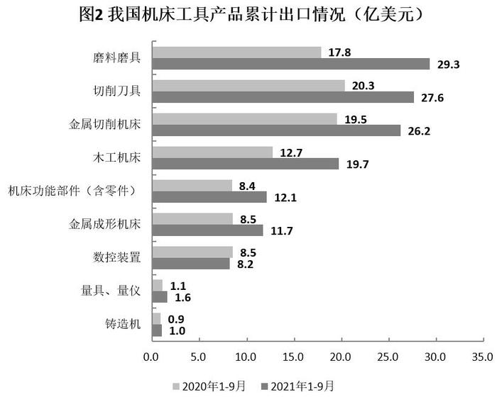

### 第 76 题

2020年1～9月，我国机床工具贸易状况为：

A. 顺差10亿美元以上

B. 顺差不到10亿美元

C. 逆差10亿美元以上

D. 逆差不到10亿美元

第 76 题 · 答案与解析

**参考答案（粉笔题库参考内容）**

A

**解析**

根据题干“2020年1～9月，我国机床工具贸易状况为”，结合材料时间为2021年1～9月，可判定本题为基期和差问题。定位文字材料第一段可得：2021年1～9月······机床工具商品进口105.2亿美元，同比增长23.7%；出口137.4亿美元，同比增长40.8%。根据公式：基期量= 现期量/(1+增长率)，则2020年1～9月我国机床工具贸易状况：出口额-进口额=137.4/(1+40.8%)-105.2/(1+23.7%)≈ 137.4/1.41 − 105.2/1.24 ≈97 - 85 = 12亿美元，即2020年1～9月的贸易状况为顺差10亿美元以上。

故正确答案为A。

**考点**：基期和差、综合资料

**来源**：2022年天津市公务员录用考试《行测》试题（网友回忆版）第76题

### 第 77 题

2021年1～9月，我国机床工具对美国出口额同比约增长多少亿美元？

A. 1.9

B. 2.3

C. 3.1

D. 3.8

第 77 题 · 答案与解析

**参考答案（粉笔题库参考内容）**

D

**解析**

根据题干“2021年1～9月，······同比约增长多少亿美元”，可判定本题为增长量计算问题。定位文字材料第三段可得：2021年1～9月，我国机床工具对美国出口额为17.5亿美元，同比增长27.4%。根据公式：增长量=现期量/(1+增长率)×增长率，则2021年1～9月，我国机床工具对美国出口额同比增长17.5/(1+27.4%)×27.4%≈ 17.5/(1+1/3.5) × 1/3.5=17.5/4.5≈3.9亿美元，与D项最接近。

故正确答案为D。

**考点**：增长量计算、综合资料

**来源**：2022年天津市公务员录用考试《行测》试题（网友回忆版）第77题

### 第 78 题

2020年1～9月，进口额占机床工具进口额比重超过10%的机床工具产品有几种？

A. 1

B. 2

C. 3

D. 4

第 78 题 · 答案与解析

**参考答案（粉笔题库参考内容）**

D

**解析**

方法一：根据题干“2020年1～9月······占······比重超过10%的机床工具产品有几种”，结合材料时间为2021年1～9月，可判定本题为基期比重问题。定位文字材料第一段可得：2021年1～9月，机床工具商品进口105.2亿美元，同比增长23.7%。根据公式：基期量= 现期量/(1+增长率)，则2020年1～9月机床工具商品进口额=105.2/(1+23.7%)≈105.2/1.24≈85亿美元。根据公式：比重=部分/整体，若比重超过10%，则部分＞整体×10%，即各类机床工具产品进口额＞85×10%=8.5亿美元。定位图1可得，2020年1～9月满足条件的机床工具产品有金属切削机床（36.7亿美元）、机床功能部件（含零件）（10.7亿美元）、切削刀具（10.7亿美元）、数控装置（10.6亿美元），共4种。

方法二：根据题干“2020年1～9月······占······比重超过10%的机床工具产品有几种”，结合材料给出2020年1-9月各类型机床工具进口额，可判定本题为基期比重问题。定位图1可知2020年1-9月各类型机床工具进口额，则2020年1-9月机床工具进口额为36.7+10.7+10.7+10.6+7.7+4.5+2.2+1.2+0.8=85.1亿美元。根据公式：比重=部分/整体，若比重超过10%，则部分＞整体×10%，即各类机床工具产品进口额＞85.1×10%=8.51亿美元，满足条件的有金属切削机床（36.7亿美元）、机床功能部件（含零件）（10.7亿美元）、切削刀具（10.7亿美元）、数控装置（10.6亿美元），共4种。

故正确答案为D。

**考点**：基期比重、综合资料

**来源**：2022年天津市公务员录用考试《行测》试题（网友回忆版）第78题

### 第 79 题

2021年1～9月，下列产品中我国对外贸易顺差最大的是：

A. 金属切削机床

B. 磨料磨具

C. 切削刀具

D. 机床功能部件（含零件）

第 79 题 · 答案与解析

**参考答案（粉笔题库参考内容）**

B

**解析**

定位统计图1可得，2021年1～9月，我国金属切削机床、磨料磨具、切削刀具以及机床功能部件（含零件）进口额分别为47.3亿美元、5.7亿美元、12.6亿美元、14.8亿美元；定位统计图2可得，2021年1～9月，我国金属切削机床、磨料磨具、切削刀具以及机床功能部件（含零件）出口额分别为26.2亿美元、29.3亿美元、27.6亿美元、12.1亿美元。则我国对外贸易实现顺差的有：磨料磨具，29.3-5.7=23.6亿美元；切削刀具，27.6-12.6=15亿美元。比较可知，2021年1～9月，我国对外贸易顺差最大的产品是磨料磨具（23.6亿美元）。

故正确答案为B。

**考点**：综合资料、简单加减计算

**来源**：2022年天津市公务员录用考试《行测》试题（网友回忆版）第79题

### 第 80 题

能够从上述资料中推出的是：

A. 2021年1～9月，我国机床工具自日本进口同比增量是德国增量的5倍多

B. 2021年1～9月，进口额同比增速最高的机床工具产品类型是金属切削机床

C. 2021年1～9月，进出口总额超过30亿美元的机床工具产品有3种

D. 2020年1～9月，我国机床工具对印度出口额不到5亿美元

第 80 题 · 答案与解析

**参考答案（粉笔题库参考内容）**

C

**解析**

A项：定位文字材料第二段，2021年1～9月，我国机床工具从日本进口额为34.5亿美元，同比增长37.8%；从德国进口额为22.2亿美元，同比增长11.0%。根据公式：增长量=现期量/(1+增长率)×增长率，可得从日本进口额同比增量= 34.5/(1+37.8%) × 37.8%≈ 34.5/(1 + 1/2.6) × 1/2.6= 34.5/3.6 = 10^-亿美元；从德国进口额同比增量= 22.2/(1+11.0%) × 11.0%= 20 × 11.0% = 2.2亿美元。故2021年1～9月，我国机床工具自日本进口同比增量是德国增量的10/2.2＜5倍，错误；

B项：定位图1可知2020年1-9月和2021年1-9月我国机床工具产品的累计进口额。根据公式：增长率= (现期量 - 基期量)/基期量，则金属切削机床同比增速=(47.3−36.7)/36.7=10.6/36.7=20%+；量具、量仪同比增速= (1.8 − 1.2)/1.2 = 0.6/1.2= 50% ＞ 20%。故2021年1～9月，进口额同比增速最高的机床工具产品类型不是金属切削机床，错误；

C项：定位图1和图2可知2021年1-9月我国机床工具产品的累计进口额和出口额。金属切削机床进出口总额＝47.3＋26.2>30亿美元；机床功能部件（含零件）进出口总额＝14.8＋12.1<30亿美元；切削刀具进出口总额＝12.6＋27.6>30亿美元；数控装置进出口总额＝10.4＋8.2<30亿美元；金属成形机床进出口总额＝9.3＋11.7<30亿美元；磨料磨具进出口总额＝5.7＋29.3>30亿美元；木工机床进出口总额＝2.5＋19.7＝<30亿美元；量具、量仪进出口总额＝1.8＋1.6<30亿美元；铸造机进出口总额＝0.8＋1.0<30亿美元。故2021年1～9月，进出口总额超过30亿美元的机床工具产品有金属切削机床、切削刀具、磨料磨具，共3种，正确；

D项：定位文字材料第三段，2021年1～9月，我国机床工具对印度出口额为8.8亿美元，同比增长67.8%。根据公式：基期量= 现期量/(1+增长率)，则2020年1～9月，我国机床工具对印度出口额=8.8/(1+67.8%)≈8.8/1.68=5^+亿美元＞5亿美元，错误。

故正确答案为C。

**考点**：综合分析、综合资料

**来源**：2022年天津市公务员录用考试《行测》试题（网友回忆版）第80题

## 材料 2

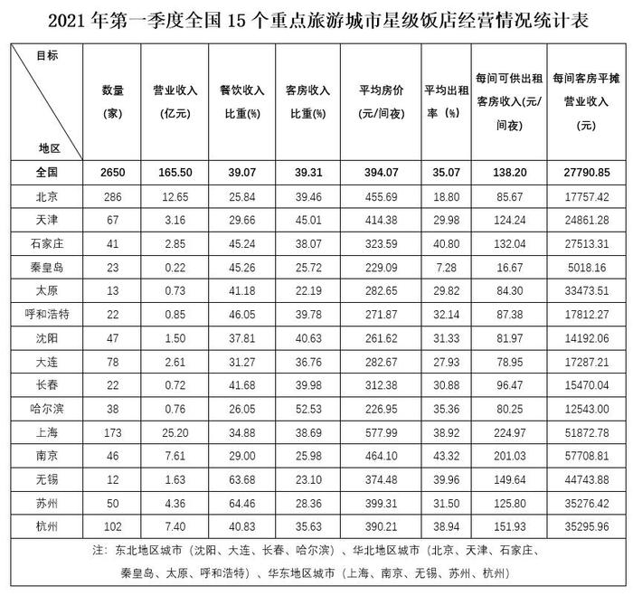

| 目标/地区 | 数量（家） | 营业收入（亿元） | 餐饮收入比重(%) | 客房收入比重(%) | 平均房价（元/间夜） | 平均出租率（%） | 每间可供出租客房收入(元/间夜) | 每间客房平摊营业收入（元） |
| --- | ---: | ---: | ---: | ---: | ---: | ---: | ---: | ---: |
| 全国 | 2650 | 165.50 | 39.07 | 39.31 | 394.07 | 35.07 | 138.20 | 27790.85 |
| 北京 | 286 | 12.65 | 25.84 | 39.46 | 455.69 | 18.80 | 85.67 | 17757.42 |
| 天津 | 67 | 3.16 | 29.66 | 45.01 | 414.38 | 29.98 | 124.24 | 24861.28 |
| 石家庄 | 41 | 2.85 | 45.24 | 38.07 | 323.59 | 40.80 | 132.04 | 27513.31 |
| 秦皇岛 | 23 | 0.22 | 45.26 | 25.72 | 229.09 | 7.28 | 16.67 | 5018.16 |
| 太原 | 13 | 0.73 | 41.18 | 22.19 | 282.65 | 29.82 | 84.30 | 33473.51 |
| 呼和浩特 | 22 | 0.85 | 46.05 | 39.78 | 271.87 | 32.14 | 87.38 | 17812.27 |
| 沈阳 | 47 | 1.50 | 37.81 | 40.63 | 261.62 | 31.33 | 81.97 | 14192.06 |
| 大连 | 78 | 2.61 | 31.27 | 36.76 | 282.67 | 27.93 | 78.95 | 17287.21 |
| 长春 | 22 | 0.72 | 41.68 | 39.98 | 312.38 | 30.88 | 96.47 | 15470.04 |
| 哈尔滨 | 38 | 0.76 | 26.05 | 52.53 | 226.95 | 35.36 | 80.25 | 12543.00 |
| 上海 | 173 | 25.20 | 34.88 | 38.69 | 577.99 | 38.92 | 224.97 | 51872.78 |
| 南京 | 46 | 7.61 | 29.00 | 25.98 | 464.10 | 43.32 | 201.03 | 57708.81 |
| 无锡 | 12 | 1.63 | 63.68 | 23.10 | 374.48 | 39.96 | 149.64 | 44743.88 |
| 苏州 | 50 | 4.36 | 64.46 | 28.36 | 399.31 | 31.50 | 125.80 | 35276.42 |
| 杭州 | 102 | 7.40 | 40.83 | 35.63 | 390.21 | 38.94 | 151.93 | 35295.96 |

### 第 81 题

2021年第一季度15个重点旅游城市中，星级饭店平均房价高于全国平均房价的有几个？

A. 3

B. 4

C. 5

D. 6

第 81 题 · 答案与解析

**参考答案（粉笔题库参考内容）**

C

**解析**

定位统计表，2021年第一季度全国星级饭店平均房价为394.07元/间夜，15个重点旅游城市星级饭店平均房价高于全国平均房价的有：北京（455.69元/间夜）、天津（414.38元/间夜）、上海（577.99元/间夜）、南京（464.1元/间夜）、苏州（399.31元/间夜），共5个。

故正确答案为C。

**考点**：统计表、直接找数

**来源**：2022年天津市公务员录用考试《行测》试题（网友回忆版）第81题

### 第 82 题

2021年第一季度15个重点旅游城市中，华北地区星级饭店平均营业收入最高的城市为：

A. 石家庄

B. 天津

C. 太原

D. 北京

第 82 题 · 答案与解析

**参考答案（粉笔题库参考内容）**

A

**解析**

根据题干“2021年第一季度······平均营业收入最高的城市为”，可判定本题为现期平均数比较问题。定位统计表可知，2021年第一季度15个重点旅游城市中，石家庄、天津、太原、北京的星级饭店的营业收入与数量。根据公式：饭店平均营业收入= 营业收入/数量，则这4个重点旅游城市的星级饭店平均营业收入如下：

石家庄：2.85/41≈0.07亿元/家；天津：3.16/67 ≈ 0.05亿元/家；太原：0.73/13≈0.06亿元/家；北京：12.65/286≈0.04亿元/家。则华北地区星级饭店平均营业收入最高的城市为石家庄。

故正确答案为A。

**考点**：现期平均数、统计表

**来源**：2022年天津市公务员录用考试《行测》试题（网友回忆版）第82题

### 第 83 题

2021年第一季度15个重点旅游城市中，高于全国平均出租率的城市的星级饭店平均数量约为多少家？

A. 60

B. 64

C. 69

D. 72

第 83 题 · 答案与解析

**参考答案（粉笔题库参考内容）**

C

**解析**

根据题干“2021年第一季度······平均数量约为多少家”，可判定本题为现期平均数问题。定位统计表可得：2021年第一季度全国平均出租率为35.07%，以及15个重点旅游城市星级饭店的平均出租率。其中高于35.07%的城市有：石家庄（40.8%）、哈尔滨（35.36%）、上海（38.92%）、南京（43.32%）、无锡（39.96%）、杭州（38.94%），共6个城市。相应的星级饭店数量分别为：41家、38家、173家、46家、12家、102家。星级饭店的平均数量=(41+38+173+46+12+102)/6= 412/6 ≈ 68.7家，与C项最接近。

故正确答案为C。

**考点**：现期平均数、统计表

**来源**：2022年天津市公务员录用考试《行测》试题（网友回忆版）第83题

### 第 84 题

2021年第一季度15个重点旅游城市中，华东地区星级饭店的餐饮收入比重约是东北地区的几倍？

A. 1.15

B. 1.28

C. 1.36

D. 1.51

第 84 题 · 答案与解析

**参考答案（粉笔题库参考内容）**

A

**解析**

根据题干“······约是······的几倍”，可判定本题为现期倍数问题。定位统计表可得：2021年第一季度华东地区星级饭店的营业收入及餐饮收入比重依次为上海25.20亿元、34.88%，南京7.61亿元、29.00%，无锡1.63亿元、63.68%，苏州4.36亿元、64.46%，杭州7.40亿元、40.83%；东北地区依次为沈阳1.50亿元、37.81%，大连2.61亿元、31.27%，长春0.72亿元、41.68%，哈尔滨0.76亿元、26.05%。根据公式：比重=部分/整体，则华东地区星级饭店的餐饮收入比重=(25.20×34.88%+7.61×29.00%+1.63×63.68%+4.36×64.46%+7.40×40.83%)/(25.20+7.61+1.63+4.36+7.40)≈ 17.87/46.2 ≈ 38.68%；东北地区星级饭店的餐饮收入比重= (1.50×37.81% + 2.61×31.27% + 0.72×41.68% + 0.76×26.05%)/(1.50 + 2.61 + 0.72 + 0.76)≈1.88/5.59≈33.63%，故华东地区约是东北地区的38.68%/33.63% ≈ 1.15倍。

故正确答案为A。

备注：由于正确算法计算量几乎无法笔算，考虑出题人可能按照比重的平均数计算此题：华东地区星级饭店餐饮收入比重= (34.88% + 29.00% + 63.68% + 64.46% + 40.83%)/5 = 46.57%，东北地区星级饭店的餐饮收入比重=(37.81%+31.27%+41.68%+26.05%)/4≈34.2%，如此计算华东地区约是东北地区的46.57% ÷ 34.2% ≈ 1.36倍，对应C项。但从数学角度，C项算法并非科学算法。

**考点**：现期倍数、统计表

**来源**：2022年天津市公务员录用考试《行测》试题（网友回忆版）第84题

### 第 85 题

2021年第一季度15个重点旅游城市中，下列哪座城市星级饭店的每间可供出租客房收入，既低于华东地区的平均水平又高于全国平均水平？

A. 上海

B. 南京

C. 苏州

D. 杭州

第 85 题 · 答案与解析

**参考答案（粉笔题库参考内容）**

D

**解析**

根据题干“2021年第一季度······每间可供出租客房收入，既低于华东地区的平均水平又高于全国平均水平”，结合材料时间为2021年第一季度，可判定本题为现期平均数问题。定位统计表可知，全国每间可供出租客房收入为138.2元/间夜；华东地区城市星级饭店的每间可供出租客房收入分别为：上海（224.97元/间夜）、南京（201.03元/间夜）、无锡（149.64元/间夜）、苏州（125.8元/间夜）、杭州（151.93元/间夜），则华东地区的平均值为：(224.97+201.03+149.64+125.8+151.93)/5≈ 853/5 = 170.8元/间夜。既低于华东地区的平均水平又高于全国平均水平，只有D项满足。

故正确答案为D。

**考点**：现期平均数、统计表

**来源**：2022年天津市公务员录用考试《行测》试题（网友回忆版）第85题

## 材料 3

2022年1月末，我国人民币贷款余额196.65万亿元，同比增长11.5%，增速分别比上月末和上年同期低0.1个和1.2个百分点。1月份我国人民币贷款增加3.98万亿元，同比多增3944亿元。分部门看，住户贷款增加8430亿元；企（事）业单位贷款增加3.36万亿元，其中，短期贷款增加1.01万亿元，中长期贷款增加2.1万亿元，票据融资增加1788亿元。2022年1月末，我国外币贷款余额9308亿美元，同比增长2%。1月份外币贷款增加181亿美元，同比少增269亿美元。

2022年1月末，我国人民币存款余额236.07万亿元，同比增长9.2%，增速分别比上月末和上年同期低0.1个和1.2个百分点，1月份人民币存款增加3.83万亿元，同比多增2627亿元，其中，住户存款增加5.41万亿元，非金融企业存款减少1.4万亿元，财政性存款增加5849亿元。1月末，外币存款余额1.02万亿美元，同比增长9%。1月份外币存款增加272亿美元，同比少增228亿美元。

2022年1月份，我国银行间人民币市场以拆借、现券和回购方式合计日均成交6.31万亿元，日均成交同比增长18%。其中，同业拆借日均成交同比增长9.3%，现券日均成交同比增长22.9%，质押式回购日均成交同比增长18.2%。

### 第 86 题

2021年1月末，我国人民币贷款余额约为多少万亿元？

A. 180

B. 176

C. 160

D. 156

第 86 题 · 答案与解析

**参考答案（粉笔题库参考内容）**

B

**解析**

根据题干“2021年1月末······约为多少万亿元”，结合材料时间为2022年1月末，可判定本题为基期计算问题。定位文字材料可知：2022年1月末，我国人民币贷款余额196.65万亿元，同比增长11.5%。根据公式：基期量= 现期量/(1+r)，则2021年1月末我国人民币贷款余额= 196.65/(1 + 11.5%)≈ 196.65/1.12 ≈ 176万亿元。

故正确答案为B。

**考点**：文字资料、基期计算

**来源**：2022年天津市公务员录用考试《行测》试题（网友回忆版）第86题

### 第 87 题

2022年1月份，我国企（事）业单位贷款增加额占人民币贷款增加额的比重比住户贷款所占比重高约多少个百分点？

A. 30

B. 40

C. 50

D. 60

第 87 题 · 答案与解析

**参考答案（粉笔题库参考内容）**

D

**解析**

根据题干“2022年1月份······占······的比重比······所占比重高约多少个百分点”，结合材料时间是2022年1月，可判定本题为现期比重问题。定位文字材料可得：2022年1月份，我国人民币贷款增加3.98万亿元；分部门看，住户贷款增加8430亿元；企（事）业单位贷款增加3.36万亿元。根据公式：比重=部分/整体，8430亿元=0.843万亿元，则所求比重差= (3.36-0.843)/3.98 ≈ 2.517/4.0 = 60%+，对应D项。

故正确答案为D。

**考点**：文字资料、现期比重

**来源**：2022年天津市公务员录用考试《行测》试题（网友回忆版）第87题

### 第 88 题

2022年1月末，我国本外币存款余额同比增速在以下哪个范围内？

A. 低于5%

B. 5%到10%之间

C. 10%～19%之间

D. 高于19%

第 88 题 · 答案与解析

**参考答案（粉笔题库参考内容）**

B

**解析**

根据题干“2022年1月末，我国本外币存款余额同比增速······”，结合材料给出2022年1月末我国人民币和外币存款余额的增长率，可判定本题为混合增长率问题。定位文字材料可知：2022年1月末，我国人民币存款余额同比增长9.2%；外币存款余额同比增长9%。由于本外币存款余额=人民币存款余额+外币存款余额，根据混合增长率口诀：混合居中但不正中，可知2022年1月末我国本外币存款余额同比增速在9%～9.2%范围内，符合B项的范围。

故正确答案为B。

**考点**：文字资料、混合增长率

**来源**：2022年天津市公务员录用考试《行测》试题（网友回忆版）第88题

### 第 89 题

2022年1月，我国银行间人民币市场同业拆借、现券、质押式回购日均成交量所占三者合计的比重高于上年同期的是：

A. 仅现券

B. 仅现券和质押式回购

C. 仅同业拆借和质押式回购

D. 同业拆借、现券、质押式回购

第 89 题 · 答案与解析

**参考答案（粉笔题库参考内容）**

B

**解析**

根据题干“2022年1月······比重高于上年同期的是”，可判定本题为两期比重问题。定位文字材料可得：2022年1月份，我国银行间人民币市场以拆借、现券和回购方式合计······日均成交同比增长18%（b）。其中，同业拆借日均成交同比增长9.3%（a_1），现券日均成交同比增长22.9%（a_2），质押式回购日均成交同比增长18.2%（a_3）。根据两期比重比较结论：当部分增长率a＞整体增长率b时，比重上升。其中满足a＞b的有：现券（22.9%）和质押式回购（18.2%）。

故正确答案为B。

**考点**：文字资料、两期比重

**来源**：2022年天津市公务员录用考试《行测》试题（网友回忆版）第89题

### 第 90 题

能够从上述资料中推出的是：

A. 2022年1月末，我国票据融资增加额占企（事）业贷款增加额的比重不足5%

B. 2022年1月，我国住户存款增加额是财政性存款增加额的10倍以上

C. 2021年1月末，我国外币贷款增加超过500亿美元

D. 2021年12月末，我国人民币存款余额的同比增速比2021年1月末我国人民币存款余额的同比增速低1.1个百分点

第 90 题 · 答案与解析

**参考答案（粉笔题库参考内容）**

D

**解析**

A项：定位文字资料可得：2022年1月末，我国企（事）业单位贷款增加3.36万亿元，票据融资增加1788亿元。根据公式：比重=部分/整体，则所求为1788/(3.36 × 10^4)＞1680/33600=5%，错误；

B项：定位文字资料可得：2022年1月末，我国住户存款增加5.41万亿元，财政性存款增加5849亿元。则所求倍数为5.41×10^4/5849＜10倍，错误；

C项：定位文字资料可得：2022年1月份，我国外币贷款增加181亿美元，同比少增269亿美元。则2021年1月份，我国外币贷款增加181+269<200+300=500亿美元，错误；

D项：定位文字资料可得：2022年1月末，我国人民币存款余额236.07万亿元，同比增长9.2%，增速分别比上月末和上年同期低0.1个和1.2个百分点。则所求为（9.2%+0.1%）-（9.2%+1.2%）=-1.1%，即低1.1个百分点，正确。

故正确答案为D。

**考点**：文字资料、综合分析

**来源**：2022年天津市公务员录用考试《行测》试题（网友回忆版）第90题

