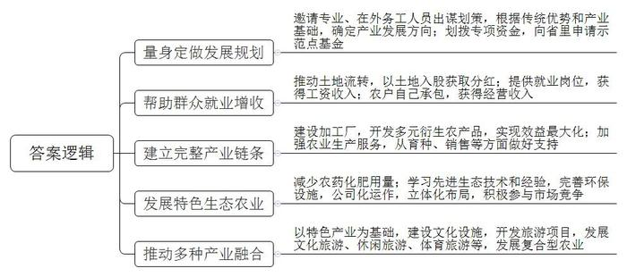
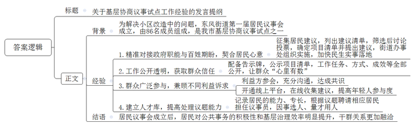
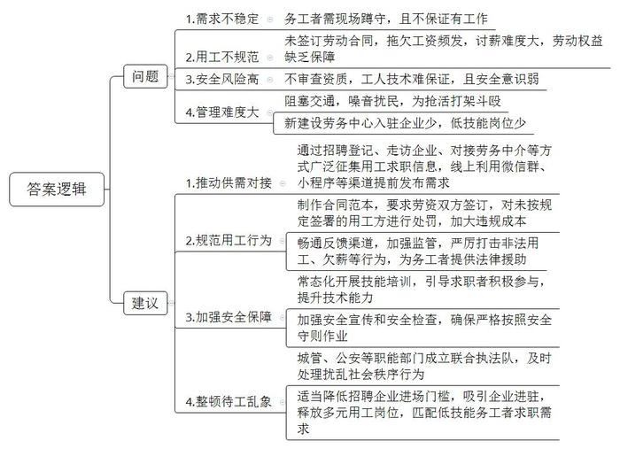
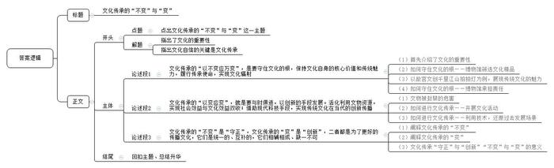

# 2023年公务员多省联考《申论》题（天津市区卷）

<!-- gwy:overview:start -->
> **天津 · 2023 · 申论 · 市区卷** ｜ 4 题 · 图片 4 处 · 答案随题折叠

导航：[题目](#题目) · [材料 1](#材料-1)
<!-- gwy:overview:end -->

> 候选采集稿。参考答案及解析来自粉笔页面，不代表官方答案或真实高分答卷；来源使用许可与原卷对应关系仍需人工核实。

## 给定材料

### 材料 1

群山环绕，万亩橘林。在一处农家屋前，人来人往。主人老黄迎上来，双手端着剥好的橘子说：“来尝尝，自家产的，好吃！”老黄在橘乡田园综合体承包的橘园今年大丰收，这让他心花怒放。依托全县35.96万亩柑橘产业，Z县打造的橘乡田园综合体正大步向前发展。Z县一度山多路难行，有柑橘却卖不出去。这么好的柑橘，凭啥不能致富？Z县人不服气，主动求变。“我们先后开了二十多场会，邀请专家学者、企业家一起来考察，为我们出谋划策，还趁着春节，邀请我们县在外工作的人举行座谈会，大家都来帮忙为我们县的乡村振兴出主意。”Z县方县长说，“最后县委县政府根据我县有种植柑橘的传统、产业基础较好的特点，决定兴办大型田园综合体，以此为契机大力发展柑橘产业，走特色农业之路。县政府划拨专门资金，还向省里申请到了乡村振兴示范点基金，这样启动资金就有了。”

老黄的家在一个普通的山村，以前也种柑橘，但因品种不佳、管理不善，盈利不多，老黄就把橘园交给父母打理，自己出去打工了。常年在外务工，家里年迈的父母和年幼的孩子是老黄最放心不下的牵挂。既能照顾家又能实现就业增收，是他多年以来的心愿。听说县里要在老家兴办田园综合体，正在流转土地，老黄赶紧把家里的土地作为股份流转进来。“现在我们这里大变样了，政府修建了四车道的水泥路，直通高速公路，还开通了5G网络。我们的土地流转到田园综合体后，利用率明显提高了，我们每年都能从田园综合体拿到土地分红。”老黄说，“政府还帮流转了土地的村民提供工作岗位，解决就业问题，为村民开展了多场种植技术培训。我们可以在田园综合体中当长期固定工人，每月领工资，也可以自己承包橘园。”老黄就从田园综合体中承包了一块橘园。今年，老黄的橘园进入盛产期，12亩产出了一万斤果子。以前，产量小，老黄还得操心销售，现在产量大了，老黄却一点都不担心：“工厂会来收购。”老黄说的工厂，是田园综合体内的柑橘加工厂。走进工厂车间，圆滚滚的新鲜柑橘，在智能化生产线上排列整齐。生产线的尽头，柑橘已变成橙汁。橙汁，只是柑橘加工产业链上的一个点。生产线上，柑橘变成20余种产品：果肉制成橙汁、果酒、橘蓉等，皮渣则提炼出抗癌药物原料——橘皮甙，连废渣都制成了有机肥和橘饲料。吃橘饲料长大的橘香猪，肉价是普通猪肉价的4倍。“有了完整的加工产业链，我们就能充分利用每一颗柑橘的价值，实现经济效益最大化，乡村振兴才有了最有力的保障。”田园综合体吴书记说。柑橘新品种培育中心、农产品检验检测中心、柑橘交易中心……从创新育种到服务果农，一个完整的柑橘产业链条正在不断成长。

郁郁葱葱的柑橘树下，三叶草、苕子正茂盛生长。“这是绿肥作物，可以抑制杂草生长，等叶子干枯了，还能作有机肥。”吴书记说。为了减少化肥农药用量，田园综合体里全部采用太阳能杀虫灯、生物有机肥，确保绿色环保。绿油油的脆李压弯了枝头，池塘里的荷花开满了水面，在金黄的稻田里鱼儿在水稻丛中嬉戏……好一幅生态优美的现代农业图。田园综合体兴建之初，Z县积极招商，吸引一家大型生态农业公司入股。“县政府对这家大型生态农业公司进行了深入的调查，的确是有资质、有经验、有技术，口碑比较好。”吴书记说，“在他们的帮助下，我们确立了生态农业的发展路径，对田园综合体进行公司化运作，以便更适应市场竞争。”田园综合体一开始就立体化布局柑橘、水稻、蔬菜、蜜蜂等种养业，还引进生态环境监测技术，完善垃圾污水处理等基础设施。如今，这里已建成特色生态农业基地1.82万亩，带动农民就业上万人，农民年人均可支配收入达到2.5万元以上，乡村振兴的凯歌已经奏响。

毗邻田园综合体办公区的花木丛中，坐落着一所典雅的庭院，这是刚开放的柑橘品种博览园。进入大门，400多个柑橘品种跃然眼前，形态各异：小如豌豆的“金豆”、大个的香橙……“田园综合体规划了面积为3平方公里的柑橘文化博览区，柑橘品种博览园只是其中的一部分。”吴书记说，“这是我们以柑橘产业为基础融合文化旅游的尝试。”田园综合体内已经建成了环湖湿地、香花槐大道、橘乡荷海、智慧橘园、桃李梦园、七彩田园等，成为当地的人气休闲旅游地。在游玩之余，游客还可在柑橘文化博览区里了解我国各朝代柑橘种植历史，观看现代柑橘种植技术展示，加深对柑橘文化的认识。“冬春摘橘，夏季赏荷，秋季观稻，我们这里四季有风景。”吴书记说，“未来我们还会开展马拉松、山地自行车等体育赛事。随着以柑橘产业为主导、多种产业融合的复合型农业不断壮大，我们的田园综合体一定会更加蒸蒸日上。”

从普通的山村到现代田园综合体，迈向幸福的故事每天都在这里上演。“我们正在书写新时代的《山乡巨变》。”方县长说，“未来我们还会不断改革创新，释放乡村振兴新动能，走出一条新型城镇化的成功之路，那时候的‘山乡巨变’将会更加壮观！”

### 材料 2

自从小区改造列入市民生实事项目，各小区微信群里就议论纷纷：这家要求先装灯，那户提出停车难，各小区诉求复杂多样，怎么让大家都满意？由86名成员组成的东风街道第一届居民议事会成立，解了难题。居民议事会成员向居民征集建议后，列出了包含25个诉求的建议清单，楼道灯安装、停车位改造等大家关心的事都包括在内。“街道党工委对建议清单进行筛选，形成候选清单，再提交居民议事会讨论和投票。居民议事会确定项目清单并提出处理建议后，由街道党工委交由街道办事处组织实施。”街道党工委孙书记说，“议事协商议的是民生话题，瞄准的是更好地解决民生问题。确定议题过程中，街道党工委要发挥主动作用，将政府职能与百姓期盼精准对接，才能让议事协商直击痛点，契合居民心意，有助于民生实事加快落地。”

东风街道居民议事会是市基层协商议事试点之一。走进居民议事会，10多套活动桌椅整齐地摆放着，可根据不同议事主题排列组合，同时还配套发言台和LED显示屏。一块大大的告示牌悬挂在墙壁上，上面正在公示居民议事会近期表决的项目清单，包含了项目名称、提出人、解决方案、办理主体、办理进度等等。通过这个清单，居民议事会为居民、为社区所做的事情一目了然。“议事会在做什么、怎么做、做得怎么样，一切都是公开透明的，这样大伙儿就心里有数，才会信任议事会。”议事员陈老伯笑言，“以前大家有问题，没有商量的地方，现在有了这个阵地，大家遇到问题都喜欢来聊一聊，你一言我一语，敞开心扉，把问题摊开，不知不觉聊着聊着就找到了解决办法。”陈老伯退休前是一名教师，熟悉思政工作，为人公道，热心社区事务，在居民中威望较高，被街道聘请来当议事员。“议事员是由居民推荐、街道遴选的，大多是党员，政治素质过硬。有的是像陈老伯这样的老住户，是大家都信任的；有的是有专长的行家，能为大家出谋划策。”孙书记说，“每个议事员都要联系一个片区，负责收集居民关心的问题。翻看议事会记录本就能发现，物业管理升级、推进垃圾分类等，老百姓关注的问题都得到了及时的跟进解决。”

“车乱停，有时堵楼门口，出行难。”停车乱，无车户难以忍受。“我们也想按车位停，可哪有车位？”停车难，有车户也感到无奈。东风街道的一次居民议事会上，由街道工作人员主持会议，社区居委会、物业、业委会、议事员、有车户代表、无车户代表畅所欲言。“没有车位的统一停小区外吧，不影响小区环境。”无车户提出。“还是停小区内好，安全可管理。”有车户有异议。意见不同，大家平心静气，一起来分析：停小区外可能妨碍交通，可行性差，还是要在小区内挖掘潜力，将废弃绿地、边角地划成车位。方案表决后公示，车位边一楼的无车户担忧噪声会影响休息。议事会再次启动，决定在车位与住房之间种植花草，同时对受影响住户进行补偿。现在，有车居民自觉泊车入位，一排排车辆整整齐齐。“议事会已经形成了一套行之有效的程序，街道工作人员主持，将参会人员分成不同小组进行讨论，再由各组的代表汇总上台发言，投票选出可行性高的解决方案。”孙书记说，“不少事项牵涉到不同的利益主体，议事会要尊重和照顾不同的利益诉求。虽然很多时候协商的过程很曲折，甚至有争吵，但充分沟通后达成共识，能兼顾不同的利益方，促进彼此理解，消除了矛盾和怨气。”前不久，东风街道居民议事会还开启了线上平台。“如今讲共建、共治、共享，最重要的就是老百姓肯参与进来！”孙书记说，“议事会开到线上以后，居民只需扫个二维码，就能在平台上提交自己的意见和建议，这让年轻人的参与度大大提高，这样议事会就能更广泛地听取群众的心声。”

议事协商有结果，更要落地，切实解决群众诉求，把民生实事办到群众心坎上，居民议事会才会受到群众信任。前不久，街道的新城中心改造通过验收，居民眼前一亮：小广场铺上了花岗岩，游乐场传来孩子们的欢笑声，休闲步道上多了散步的居民。“去年，大家还抱怨这小广场环境脏、蚊虫多，有和没有一个样呢。”高先生笑着说。高先生是市建筑设计研究院的工程师，受聘成为议事会特别议事员，负责新城中心改造的监督。高先生每天下班都要到工地上看看，周末更是经常一待就是半天。增设小广场，铺装场地、展示墙和儿童游乐场所等，就是他看完设计图纸后提出的建议。东风街道根据居民的议事能力、专业特长和工作经历，建立人才库。议题确定后，街道就会联系相应的居民，聘请他们担任临时议事员，让“适合”的人参加“合适”的会，从而提高议事会处理议题的能力。

“议而能决，商而能行，理顺群众的‘气’，很多事情都好办了，毕竟大家在根本利益上是一致的。”孙书记说，“在街道工作多年，我能真切感受到，有了居民议事会，居民们对公共事务变得越来越积极了，干群关系也变得更加融洽了，基层治理的效率明显提升。”

### 材料 3

清晨5时许，第一缕阳光还未露脸，占唐路却已人声鼎沸。这里是R市最大的零工市场，每天几千名务工人员聚集在此讨生活。他们并未选择背井离乡去务工，而是凌晨在占唐路揽工，夜晚归家陪伴妻子儿女。

占唐路处于瑶江区城乡结合部，很多进城务工的人员在此租赁廉价的房屋，工地上的小包工头也发现这里能找到工人，久而久之，人越聚越多，占唐路也成了“自由劳动力市场”的代名词。

今年52岁的老李家住瑶江区隆岗社区，因为自身文化程度较低，学过木工的他，多年来一直在占唐路打零工。“年轻的时候也在工地上待过，后来老婆孩子都来R市了，我就在这儿买了房子。”老李笑言，“我们打零工的收入总体还可以，大部分都是日结，干一天算一天，每天的工钱平均下来有两三百，但我们不是每天都有活干，有时在这里连续蹲几天也没有适合的工作，就算白蹲也必须守着。趁着还干得动，就多干点，存点钱养老、看病。”现在，妻子在家门口摆摊卖小吃，他在占唐路打零工，虽然生活并不富裕，但比老家的生活好多了，老李已经感到很知足了。

天公不作美，豆大的雨点突然打下来。“下雨了，下雨了……”不少人一边喊着，一边跑向周边的建筑下面去躲雨，但还有一半左右的人坚守原地，并没有离开，似乎已经习惯大雨的突袭。50岁的靳大姐就是在这样的雨天继续坚守的人，她拿出随身携带的雨衣套上，已经六天没找到活干，遇到下雨天更是心急，期盼着包工头的到来。突然，她转身走向马路对面，急匆匆地走到一辆红色三轮车旁边，大家以为她去抢工作，没想到是讨薪去了。或许是下着大雨的原因，靳大姐被拖欠了一个月的200元钱，今天讨回得格外顺利，她脸上终于露出了笑容。在占唐路，日结工资虽然听起来痛快，但被拖欠工资也是家常便饭，由于没签合同，更为日后讨薪埋下隐患。

来自月东县的小刘今年刚满18岁，第一次跟着老乡来到占唐路，想跟着去工地上学点电焊技术，养家糊口。“你会不会电焊呀？还是学徒？”一个包工头样子的人大声问他。“我会了会了，家里好几个人都干电焊呢！”小刘赶紧回答。“那你们几个跟我走吧！”小刘和老乡赶紧收拾东西跟上了车。“这里的技工等级相差很大，有干了十几年的老技工，也有这样初出茅庐、缺乏经验的新人，基本都是靠老人手把手带出来，没有参加过任何培训，且不说技术过不过关，这安全意识就不够，你看那小子，安全帽都没戴。”老李意味深长地说，“没发生事故就好，如果发生安全事故，他们这零工身份，没有签任何劳动合同，最后都是自己倒霉。”

几百号流动人员聚集在一个路口，虽然给揽活的务工人员和招人的包工头带来了便利，但却给城市管理造成了困扰。他们是城市的建设者，理应受到关照，但规模性地占马路等活，造成交通拥堵不说，凌晨噪音扰民也多次引来周边居民的投诉，甚至还发生过为了抢活打架斗殴的事。为了规范零工市场发展，去年瑶江区在占唐路两公里外设立了“瑶江区劳务中心”，本想取代现有的占唐路零工市场，但中心设立一年，入驻企业却寥寥无几，而占唐路零工市场却依然火热。经常去占唐路揽工的包工头老王说，由于劳务中心对进场招聘的企业有相关资质规定，没有企业资质的小包工头根本无法进驻。“我们招揽零工，主要都是一些工程赶工期，人手不够用，需要临时找一些人来干活，即使让我们进驻劳务中心，招人的程序也太复杂了。”老王说。实际上，劳务中心的座椅、空调、饮水机等舒适的环境对务工者并不是没有吸引力，而是因为他们大多是上了年纪的低技能务工者，在劳务中心找不到他们能够匹配的工作。

“零工市场作为就业‘蓄水池’，为就业者和企业之间搭建了一座供需桥梁。”瑶江区人社局张局长说，“要盘活零工市场的社会闲置资源，还需补齐各方短板，为务工者系好‘安全带’，真正让‘蓄水池’发挥作用。”

### 材料 4

“既有地方特色又挺别致，送朋友正合适。”游客刘先生早早来到市博物馆参观，参观结束，他来到文创区挑选礼物，一眼就看中了这款东汉鎏金铜朱雀图案的汉韵手挽包。汉韵手挽包、历代名窑品茗杯、创意文盏……每逢节假日，这家博物馆无论是一楼大厅右侧的文创超市，还是每层楼均有分布的文创摊位，琳琅满目的文创产品总会吸引很多人。“观众在参观之余，大都愿意把文创区当作博物馆最后一个‘展厅’。这个‘展厅’的特别之处在于，你可以把喜欢的‘藏品’带回家。文物是博物馆的核心资源，根据馆藏文物精心设计的文创产品实现了博物馆资源的活化利用。”市博物馆文创与合作部林主任说。作为该市的一张文化名片，市博物馆年均服务观众超300万人次。该馆的文创开发经历了从无到有、从少到多的过程。去年，该馆开发文创产品377种461款，产品年销售额达800万元。在林主任看来，这些成绩都得益于持续的创新：“首先是机制创新，我们摸索出一条‘博物馆+高校+企业’结合的路子，三方合力产生了‘1+1+1＞3’的效果；其次是产品创新，以历代名窑品茗杯的文创开发为例，我们通过产品迭代良性循环，文物得到更好活化，社会效益与经济效益双丰收，‘博物馆的力量’也得以彰显。”当初开发文创产品的时候，博物馆内有很多争议。对此，林主任是这样理解的：“博物馆的使命是传承文化，忘记这个使命，我们的创新就像是水上浮萍，很容易随波逐流，迷失方向。在不断变化的时代中，我们要以不变应万变，不断开发各类文创产品的目的是为了更好地履行传承文化的使命，实现博物馆的文化辐射。”如今，文创开发的重要意义已成为市文博界的共识。市博物馆牵头，十余家当地文博单位联合成立文化创意产业联盟，在文博创意研发、资源共享等方面加强合作，推动文化创意产业迅速发展，成为当地经济发展的一个新亮点。

推出“手说文物”，通过手语视频，让聋哑人也能感知到文物；联合养老院开展“画说重阳奉茶敬老”等活动；与市教育局合作，成立“中小学传统文化教育基地”；依托丰富的馆藏中国画资源，尝试推出成年人书画启蒙培训班；深入社区、乡镇送展览，开展相关文博教育活动……“让文物走进现代生活，是实现文物活化、文化传播的重要途径。我们博物馆一向重视文物推广，推广活动正在从过去的单次化、碎片化、讲解化过渡为现在的系统化、系列化、趣味化；从过去主要关注孩子到进一步关注全年龄段的群体。”市博物馆公众教育与服务部邱主任表示，“文物是以不变的形式记录着民族智慧的演变，比如这些不同时代的椅子，就体现了不同时代里人体科学的进步、生活方式的演变和审美风气的嬗变。以文物为媒介，我们能更直观地看到中华文明的丰富多彩，更深刻地汲取民族智慧，从而牢固树立我们的文化自信。”

博物馆保存着人类的文化记忆，只有经过普及性和广泛性的传播，才能让它有效地发挥作用。“现代科技的发展给文物活化带来了新的契机。”市石刻文化博物馆李馆长说。市石刻文化博物馆联合一家科技公司制作了百集石刻文化短视频，凝固的石刻变为一个个鲜活的人物或动植物，演绎出一幕幕石刻背后的故事，短视频一上线就引发关注，三天时间点击量即达到了十几万。文物资源数字化创新也在市农业遗产博物馆上演。走进这家博物馆，运用3D技术制作的神农形象迎面走来，把人们引入声画交织的农业发展史中，亲身体验古代农民的生产和生活。这是这家博物馆联手某游戏团队，共同发起的文物数字活化项目。该项目运用3D、元宇宙等数字技术，活灵活现地演绎出古代农业的各种场景，实现优秀传统文化在当代的创新传播。“现代让传统更亲切鲜活，传统让现代更丰富厚重。”市农业遗产博物馆程馆长认为，“时代在变，我们要以变应变，积极运用飞速发展的新技术，让文物以更便捷的方式进入现代生活，实现传统与现代的跨时空对话。”

## 题目

### 第 1 题

**根据“给定资料1”，请你概括Z县打造现代田园综合体的过程对推进乡村振兴工作有哪些值得借鉴的经验。（15分）**

关联材料：材料 1

作答要求：

要求：全面、准确、简明、有条理，字数不超过300字。

第 1 题 · 答案与解析

**参考答案（粉笔题库参考内容）**

1.量身定做发展规划。邀请专业、在外务工人员出谋划策，根据传统优势和产业基础，确定产业发展方向；划拨专项资金，向省里申请示范点基金。

2.帮助群众就业增收。推动土地流转，以土地入股获取分红；提供就业岗位，获得工资收入；农户自己承包，获得经营收入。

3.建立完整产业链条。建设加工厂，开发多元衍生农产品，实现效益最大化；加强农业生产服务，从育种、销售等方面做好支持。

4.发展特色生态农业。减少农药化肥用量；学习先进生态技术和经验，完善环保设施，公司化运作，立体化布局，积极参与市场竞争。

5.推动多种产业融合。以特色产业为基础，建设文化设施，开发旅游项目，发展文化旅游、休闲旅游、体育旅游等，发展复合型农业。

**解析**

**参考答案说明**：本参考答案从“量身定做发展规划”“帮助群众就业增收”“建立完整产业链条”“发展特色生态农业”“推动多种产业融合”五个方面展开，各条答案要点之间在内容上相互并列，没有交叉。

**考点**：经验启示类

**来源**：2023年公务员多省联考《申论》题（天津市区卷）

### 第 2 题

**假如孙书记要参加市里召开的基层协商议事试点工作经验交流会，请你根据“给定资料2”为他撰写一份发言提纲。（20分）**

关联材料：材料 2

作答要求：

要求：

（1）紧扣资料，要点完整；

（2）内容具体，条理清晰；

（3）字数不超过400字。

第 2 题 · 答案与解析

**参考答案（粉笔题库参考内容）**

关于基层协商议事试点工作经验的发言提纲

背景：为解决小区改造中的问题，东风街道第一届居民议事会成立，由86名成员组成，是我市基层协商议事试点之一。

经验：1.精准对接政府职能与百姓期盼，契合居民心意。征集居民建议，列出建议清单，筛选后讨论投票，确定项目清单并提出建议，街道办事处组织实施，加快民生实事落地。2.工作公开透明，获取群众信任。配备告示牌，公示项目清单，工作任务、方式、成效等全部公开，让群众“心里有数”。3.群众广泛参与，兼顾不同利益诉求。利益方参会，充分沟通，达成共识；开通线上平台，在线收集建议，提高年轻人参与度。4.建立人才库，提高处理议题能力。记录居民的能力、专长，根据议题聘请相应居民担任议事员，因事选人、量才用人。

结语：居民议事会成立后，居民对公共事务的积极性和基层治理效率明显提升，干群关系更加融洽。

**解析**

**参考答案说明：**（1）格式方面，本参考答案写到了“标题”“正文”两个部分。（2）正文部分，一方面从内容上来看，围绕“基层协商议事试点工作经验”这一主题，本参考答案的开头先简单介绍了背景；主体部分从“精准对接政府职能与百姓期盼，契合居民心意”“工作公开透明，获取群众信任”“群众广泛参与，兼顾不同利益诉求”“建立人才库，提高处理议题能力”四个方面介绍了具体经验；结尾进行了总结。另一方面，形式上，本参考答案做到了分段、分条撰写，整体上条理较为清晰。

**考点**：总结类

**来源**：2023年公务员多省联考《申论》题（天津市区卷）

### 第 3 题

**根据“给定资料3”，请你概括占唐路零工市场存在的问题，并提出解决建议。（25分）**

关联材料：材料 3

作答要求：

要求：

（1）问题梳理全面，准确、有条理；

（2）所提建议有针对性，具体明确、切实可行；

（3）字数不超过450字。

第 3 题 · 答案与解析

**参考答案（粉笔题库参考内容）**

问题：1.需求不稳定。务工者需现场蹲守，且不保证有工作。2.用工不规范。未签订劳动合同，拖欠工资频发，讨薪难度大，劳动权益缺乏保障。3.安全风险高。不审查资质，工人技术难保证，且安全意识弱。4.管理难度大。阻塞交通，噪音扰民，为抢活打架斗殴；新建设劳务中心入驻企业少，低技能岗位少。

建议：1.推动供需对接。通过招聘登记、走访企业、对接劳务中介等方式广泛征集用工求职信息，线上利用微信群、小程序等渠道提前发布需求。2.规范用工行为。制作合同范本，要求劳资双方签订，对未按规定签署的用工方进行处罚，加大违规成本；畅通反馈渠道，加强监管，严厉打击非法用工、欠薪等行为，为务工者提供法律援助。3.加强安全保障。常态化开展技能培训，引导求职者积极参与，提升技术能力；加强安全宣传和安全检查，确保严格按照安全守则作业。4.整顿待工乱象。城管、公安等职能部门成立联合执法队，及时处理扰乱社会秩序行为；适当降低招聘企业进场门槛，吸引企业进驻，释放多元用工岗位，匹配低技能务工者求职需求。

**解析**

**参考答案说明**：本参考答案包括“问题”和“建议”两个部分，其中，“问题”部分从“需求不稳定”“用工不规范”“安全风险高”“管理难度大”这四个方面展开，“建议”部分从“推动供需对接”“规范用工行为”“加强安全保障”“整顿待工乱象”这四个方面展开。本参考答案做到了分类分条撰写，各条答案要点之间在内容上相互并列，没有交叉。

**考点**：提出对策类

**来源**：2023年公务员多省联考《申论》题（天津市区卷）

### 第 4 题

**“给定资料4”中，林主任说“我们要以不变应万变”，程馆长说“我们要以变应变”，请深入思考这两句话，联系实际，自选角度，自拟题目，写一篇议论性文章。（40分）**

关联材料：材料 1、材料 2、材料 3、材料 4

作答要求：

要求：

（1）观点明确，见解深刻；

（2）参考“给定资料”，但不拘泥于“给定资料”；

（3）思路清晰，语言流畅；

（4）字数在1000字左右。

第 4 题 · 答案与解析

**参考答案（粉笔题库参考内容）**

参考答案一

**文化传承的“不变”与“变”**

习近平总书记曾在党的十九大报告中指出，没有高度的文化自信，没有文化的繁荣兴盛，就没有中华民族伟大复兴。而建立文化自信的关键是文化的传承。文化的传承既要变，又要不变。

**文化传承的“以不变应万变”，是要守住文化的根，保持文化自身的核心价值观和传统魅力，履行传承使命，实现文化辐射。**以文化人启智润心，以文育人培根铸魂，文化是一个民族的底蕴，是发展道路上的路基。只有守住文化的根，发展的力量才能源源不断，这就需要博物馆筛选文化精品，精心设计文创产品，这种文化精品的选择不仅仅是外形上的美观，更要内含文化价值，给人以力量。故宫文创千里江山拍拍灯，选取原画中山峦重叠的部分，印刷在不同材质的亚克力板上，灯光亮起，尤如清晨升起的明日，象征人生光明前景，既展现国画的艺术魅力，更温暖人心，给无数年轻人在黑夜前行力量。只有各地博物馆意识到、承担起自己的责任，文化之根才能留在人心。

**文化传承的“以变应变”，就是要与时俱进，以创新的手段发展。活化利用文物资源，实现社会效益与文化效益双收；借助现代科技手段，实现传统文化在当代的创新传播。**当文物束之高阁，文物是没有尊严的，同时文物所蕴含的文化内涵也被封禁，文化的传播传承更无从谈起。文化的传承要让文物走出高墙深闺，来到寻常百姓家。一方面可以开展多元的文化活动，如线上播放文化综艺、纪录片，在声与画的流动中感受文化的价值，还可以开展线下体验活动，寓教于乐，感受文化内核，唯有线上线下相结合，才能满足各个年龄段全体的文化需求。另一方面，还要紧跟时代脚步，利用好3D技术，还原过去的发展场景，置身其中，提供沉浸式体验让文物“复活”。时代在变，社会在变，方法和手段也要不断改变。

**文化传承的“不变”是“守正”，文化传承的“变”是“创新”，二者都是为了更好地传播文化，它们是统一的、互补的，它们相辅相成、缺一不可。**文化传承的“不变”，是文化自信的坚定彰显，是文化传承的责任担当，是让更多群众了解文化、欣赏文化的初心所在，更是让文化更具感染力的力量源泉。而“变”的，则是“创新”，是紧跟时代，是让本来“死”的文物，用现代的方式再“活”一次，让文化具有“生命力”。所以，文化的传承不仅要让群众了解珍贵文化资源、感受文化价值，更要以创新的手段，传播文化的内涵。唯有如此，才能让文化历久弥新、经久不衰。

“不变”与“变”，其实殊途同归，都是继承和发扬文化，建设共同的精神家园。只要我们不忘初心，就一定能让文化进入生活，让文化在新时代中焕发活力。

**文章分析**

**文化传承的“不变”与“变”**

【**标题的优点：**首先，范文的标题突出了“‘变’与‘不变’”这一主题。其次，形式上，文字简洁明快。】

习近平总书记曾在党的十九大报告中指出，没有高度的文化自信，没有文化的繁荣兴盛，就没有中华民族伟大复兴。而建立文化自信的关键是文化的传承。文化的传承既要变，又要不变。

【**开头的优点：**★内容方面：范文的开头是紧扣“‘变’与‘不变’”这一主题展开的。首先指出了文化的重要性；然后指出了文化自信的关键是文化传承；最后引出核心观点，文化的传承要变，又要不变。★文字表达方面：长短句配合使用，使语言表达有节奏感。】

**文化传承的“以不变应万变”，是要守住文化的根，保持文化自身的核心价值和传统魅力，履行传承使命，实现文化辐射**。（1）以<u>文化人</u>启智润心，以<u>文育人</u>培根铸魂，<u>文化是一个民族的底蕴</u>，<u>是发展道路上的路基</u>。（2）只有守住文化的根，发展的力量才能源源不断，这就需要博物馆<u>筛选文化精品</u>，精心设计<u>文创产品</u>，这种文化精品的选择不仅仅是外形上的美观，更要内含文化价值，给人以力量。（3）<u>故宫文创千里江山拍拍灯</u>，选取原画中山峦重叠的部分，印刷在不同材质的亚克力板上，灯光亮起，尤如清晨升起的明日，象征人生光明前景，<u>既展现国画的艺术魅力</u>，更<u>温暖人心</u>，<u>给无数年轻人在黑夜前行力量</u>。（4）只有各地<u>博物馆意识到</u>、<u>承担起自己的责任</u>，文化之根才能留在人心。

【**论述段1的优点：**★观点句：范文的观点句是紧扣“‘变’与‘不变’”这一文章主题提出的。形式上，它在段首处直接写出，位置突出，容易发现。内容上，关键词突出，内容要点明确，可以明显看出他是从“不变”出发，指出了文化传承要守住文化的根。★论述内容：（1）首先介绍了文化的重要性；（2）如何守住文化的根——博物馆筛选文化精品；（3）以故宫文创千里江山拍拍灯为例，展现传统文化的魅力；（4）如何守住文化的根——博物馆承担责任。注意：以上四个方面的内容都是紧扣“文化传承的‘以不变应万变’，是要守住文化的根，保持文化自身的核心价值观和传统魅力，履行传承使命，实现文化辐射”这个观点句论述的，论述的针对性强，内容层次丰富。在论述方法上采用了讲道理、举例子相结合，做到了丰富多样。】

**文化传承的“以变应变”，就是要与时俱进，以创新的手段发展。活化利用文物资源，实现社会效益与文化效益双收；借助现代科技手段，实现传统文化在当代的创新传播**。（1）当<u>文物束之高阁</u>，文物是没有尊严的，同时文物所蕴含的文化内涵也被封禁，<u>文化的传播传承更无从谈起</u>。文化的传承要让文物走出高墙深闺，来到寻常百姓家。（2）一方面可以<u>开展多元的文化活动</u>，如<u>线上播放文化综艺、纪录片</u>，在声与画的流动中感受文化的价值，还可以开展<u>线下体验活动</u>，寓教于乐，感受文化内核，唯有线上线下相结合，才能满足各个年龄段全体的文化需求。（3）另一方面，还要<u>紧跟时代脚步</u>，<u>利用好3D技术</u>，<u>还原过去的发展场景</u>，置身其中，提供沉浸式体验让文物“复活”。时代在变，社会在变，方法和手段也要不断改变。

【**论述段2的优点：**★观点句：范文的观点句是紧扣“‘变’与‘不变’”这一文章主题提出的。形式上，它在段首处直接写出，位置突出，容易发现。内容上，关键词突出，内容要点明确，可以明显看出他是从“变”出发，指出了文化传承要与时俱进。★论述内容：（1）文物被封禁的危害；（2）如何进行文化传承——开展文化活动；（3）如何进行文化传承——利用技术，还原过去发展场景。注意：以上三个方面的内容都是紧扣“文化传承的‘以变应变’，就是要与时俱进，以创新的手段发展。活化利用文物资源，实现社会效益与文化效益双收；借助现代科技手段，实现传统文化在当代的创新传播”这个观点句论述的，论述的针对性强，内容层次丰富。在论述方法上采用了讲道理、举例子相结合，做到了丰富多样。】

**文化传承的“不变”是“守正”，文化传承的“变”是“创新”，二者都是为了更好地传播文化，它们是统一的、互补的，它们相辅相成、缺一不可**。（1）文化传承的“不变”，是<u><u>文化自信的坚定彰显</u></u>，是<u><u>文化传承的责任担当</u></u>，是让更多<u><u>群众了解文化、欣赏文化的初心</u></u>所在，更是让<u><u>文化更具感染力</u></u>的力量源泉。（2）而“<u>变</u>”的，则是“<u>创新</u>”，是<u>紧跟时代</u>，是<u>让本来“死”的文物</u>，<u>用现代的方式再“活”一次</u>，<u>让文化具有“生命力</u>”。（3）所以，<u>文化的传承不仅要让群众了解珍贵文化资源</u>、<u>感受文化价值</u>，更要以创新的手段，传播文化的内涵。唯有如此，才能让文化历久弥新、经久不衰。

【**论述段3的优点：**★观点句：范文的观点句是紧扣“‘变’与‘不变’”这一文章主题提出的。形式上，它在段首处直接写出，位置突出，容易发现。内容上，关键词突出，内容要点明确，可以明显看出他是从“‘变’与‘不变’的关系”出发，指出了文化传承的“变”与“不变”相辅相成、缺一不可。★论述内容：（1）阐释文化传承的“不变”；（2）阐释文化传承的“变”；（3）文化传承“守正”与“创新”“不变”与“变”的意义。注意：以上三个方面的内容都是紧扣“文化传承的‘不变’是‘守正’，文化传承的‘变’是‘创新’，二者都是为了更好地传播文化，它们是统一的、互补的，它们相辅相成、缺一不可”这个观点句论述的，论述的针对性强，内容层次丰富。在论述方法上采用了讲道理、举例子相结合，做到了丰富多样。】

【**论述段之间的关系：**★内容的内在逻辑：论述段1先写了“文化传承要‘不变’”，论述段2接着写了“文化传承要‘变’”，论述段3最后写了“文化传承‘变’与‘不变’的关系”，各论述段之间逻辑清晰。】

“<u>不变”与“变</u>”，其实殊途同归，都是<u>继承和发扬文化</u>，建设共同的精神家园。只要我们不忘初心，就一定能让文化进入生活，让文化在新时代中焕发活力。

【**结尾的优点：**范文的结尾回扣了“‘变’与‘不变’”这个主题，并且进行了总结提升。】

参考答案二

**文化传承的“不变”与“变”**

新的起点，新的时代，文化传承既要不变应万变，也要以变应万变。文化传承的“不变”，是文化自信的“坚定”，是文化传承的“使命”，是让更多的群众了解文化、欣赏文化“初心”。而“变”则是“创新”，是紧跟时代，创新产品，变革体制，革新推广方式，让本来“死”的文物，用现代的方式再“活”一次。

文化传承的“变”与“不变”犹如文化繁荣的鸟之两翼、车之两轮，两者相互支撑、缺一不可，新时代文化繁荣需要二者共同推动。

**不变为变指明方向，变让不变放大光芒。**秉持文化传承的使命，能够让创新把握方向、有的放矢；反之，注重文化创新，能够让文化传承更好履行使命，扩大辐射范围。有使命而无创新，一成不变、墨守成规的文化必然滞后于人民和时代的需求，湮没于历史的长河；有创新而无使命，缺乏支撑的文化势必掏空根基，成为经不起时代检验的空中楼阁。只有妥善处理好“变”与“不变”之间的关系，在传承中不断发展，在发展中实现传承，做到守正而不守旧、尊古而不复古，如此才能真正建成文化强国，推动新时代文化繁荣。

**不变让变更有内涵，变让不变更接地气。**不变的是以文物为载体，直观展现中华文明的丰富多彩，汲取民族智慧，树立文化自信；变的是推广方式，让文物推广更有趣，更系统，更具针对性。线上线下举办形式多样的非遗展览，全方位打造“沉浸式”非遗文化体验；开设“非遗购物节”，促进非遗更好地融入现代生活；围绕“文化遗产保护利用”举办文物科技创新论坛，激发文物科技创新活力……时代在变，社会在变，方法和手段也要不断改变，唯有如此，才能让文化历久弥新、经久不衰。

**传统与现代相结合，利用现代技术，让文物以更便捷、更普及、更广泛的方式走进现代生活。**当文物束之高阁，文物是没有尊严的，同时文物所蕴含的文化内涵也被封禁，文化的传播传承更无从谈起。活化利用文物资源，实现社会效益与文化效益双收,借助现代科技手段，实现传统文化在当代的创新传播。一方面可以开展多元的文化活动，如线上播放文化综艺、纪录片，在声与画的流动中感受文化的价值，还可以开展线下体验活动，寓教于乐，感受文化内核，唯有线上线下相结合，才能满足各个年龄段的文化需求。另一方面，还要紧跟时代脚步，利用好3D技术，还原过去的发展场景，置身其中，提供沉浸式体验让文物“复活”。

“欲流之远者，必浚其泉源”，站在新时代新起点上，“变”与“不变”双管齐下，方能推动文化繁荣，传承和守护好中华优秀传统文化。

**解析状态：unknown（来源未提供）**

**考点**：文章写作题

**来源**：2023年公务员多省联考《申论》题（天津市区卷）

