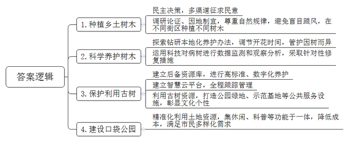
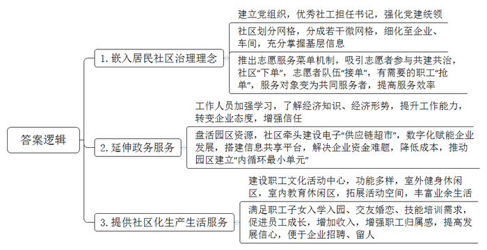
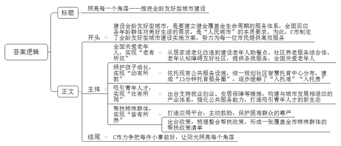

# 2024年公务员多省联考《申论》题（天津市区卷）

<!-- gwy:overview:start -->
> **天津 · 2024 · 申论 · 市区卷** ｜ 4 题 · 图片 4 处 · 答案随题折叠

导航：[题目](#题目) · [材料 1](#材料-1)
<!-- gwy:overview:end -->

> 候选采集稿。参考答案及解析来自粉笔页面，不代表官方答案或真实高分答卷；来源使用许可与原卷对应关系仍需人工核实。

## 给定材料

### 材料 1

F市近年大力开展城市绿化，充满魅力的广宁旅游区就是F市城市绿化工作结出的一颗硕果。走在F市的大路上，如同穿行在露天的树木博物馆中，绿树成荫，不同的树木不断变换。当初在选择绿化树时，有人提议效仿某些地方，跨区域引进一些时髦的花木。“绿化是大家的事，要听取大家的意见，实行民主决策。”F市城市管理委员会刘主任说。城市管理委员会通过多种渠道广泛征求民意，发现大部分人都主张种植乡土树木。“毕竟本乡本土的树木适应本地环境，容易成活，大家也有种植经验。”有网友留言说。城市管理委员会经过调研论证，因地制宜，在不同的街区种植不同的乡土树木。如今，F市的大道上，银杏、海棠、白蜡等交错成林。庭院、公园及绿地内杨树、泡桐等茁壮成长。“有些地方盲目跟风，不尊重自然规律，跨区域种植一些时髦的花木，结果成活率很低，后续的管护费用也居高不下。”刘主任说。

花木掩映的城市显得如此美丽动人。“我们的工作就是要让美丽永远伴随着这座城市。”市容园林服务中心工程师小张说。园林技术人员经过长期钻研已经形成一套适合本地的科学养护办法，可以做到通过修剪、保温等措施来调节开花时间。小张说：“壮年树采取刺激生长的方式，高龄树采取治病加养生的模式，管护要因树而异。”F市栽植了很多丝木棉树，但随着时间的推移，一些丝木棉出现了树势衰弱、针叶发黄等现象。对此，市容园林服务中心进行数据监测和观察分析，通过树体杀菌、树洞填补、浇灌根系复壮液等一系列针对性的修复措施对丝木棉开展复壮，目前95%以上的丝木棉长势明显好转。“时代在发展，科技在进步，绿化工作也要与时俱进。”小张信心满满地说道。

为更好地保护树木，F市建立古树后备资源库，树龄50年以上的树木全部纳入古树后备资源库，以古树的标准进行数字化养护。F市还建立古树名木智慧云平台，融合大数据、区块链等技术对每一株大树进行全程跟踪管理，不但可以随时调阅古树名木的档案资料、地理位置等信息，还可以对重点保护对象实时监测土壤养分、古树倾斜角度等，提升保护的科学性和精准性。“树木是一个城市的印记，特别是一些大树老树更是历史的见证者、讲述者，是不可再生的自然文化遗产。城市绿化是一项系统工程，不仅要把树木保护好，还要留住城市的文化记忆，彰显城市的文化个性。”刘主任说，F市正充分利用古树资源禀赋，打造一批“古树绿地”“古树公园”和森林康养示范基地，“把城市的绿化工作和经济、文化融为一体，相得益彰。”

F市护城河公园是一座口袋公园，自今年年初开放就吸引了众多市民游园。“河边凉爽，空气好，在这遛弯儿心情愉悦，每天傍晚到公园散步已经成了一种生活习惯。”一位按时到护城河公园赏景“打卡”的市民说。F市已经建设完成40多个这样的口袋公园，提升绿化面积80万平方米。这些公园集观赏、休闲、娱乐、科普等功能于一体，既是市民的会客厅，也是市民的运动场。口袋公园的建设破解了城市绿化用地不足、城市边角空地改造难触及、大规模建设资金不足等问题，实现了土地资源的精准化利用。“建设口袋公园是一种节俭高效的绿化措施。这些公园成本不高，功能全面，能满足人们的多样化需求。”刘主任说。

### 材料 2

H市，一个因工业而兴的城市。在这里，一个又一个的产业园区成为城市的引擎，创造财富与商机，催生了城市快速发展中数不清的奇迹。这些产业园区以它们独特的魅力，吸引了很多人前来追逐梦想。但是，早年间的产业园区重招商引资、轻管理服务，强产业、弱配套，导致产业园区虽产值占地区比重高但公共服务投入不高，虽人口聚集但人气难以集聚，虽归属城市但居民缺少归属感。这在“赚了钱就寄回家”的第一代进城务工人员那里“不是什么问题”，但在追求生活品质的新一代进城务工人员那里“都是问题”。为了解决产业园区遇到的这一难题，实现产业园区的持续发展，H市以南山工业园区为试点，推出了工业社区的治理模式，将居民社区治理理念嵌入产业园区，延伸政务服务内容和触角，为企业和员工提供社区化服务。

“情绪不能去控制，只能去管理，家长学会情绪管理能进一步促进亲子关系良性互动……”走进H市南山工业社区的周六托管班，心理老师正为亲子家庭分享有关情绪管理的方法，帮助家长们解决孩子成长中遇到的困惑。开办托管班的点子来源于社区网格员的日常走访。为解决园区企业双职工家庭周末的子女教育管理难题，社区统筹资源，搭建平台，邀请心理咨询专业教师团队，创新开启周六托管模式。南山工业社区只有6名社工，而各类企业有500多家、员工近8万名。“小社区也能完成大治理。”南山工业社区党委书记老柯说，“党建统领是‘定盘星’。”南山工业社区在成立之初就建立了党组织，书记主要推选优秀社工担任。社区划分成几个网格，每个网格再进一步分成若干个微网格，微网格细化到企业甚至车间，是社区掌握基层信息的触角，也是治理和服务的抓手。“大家的园区大家建，我们还推出了志愿服务菜单机制，吸引志愿者参与社区共建共治。”老柯说。交通引导、平安夜巡、家园美化……社区有服务需求“下单”，志愿者队伍“接单”，有落户、子女入学积分需要的职工“抢单”，服务对象摇身一变成为共同服务者，让社区服务更加及时高效。如今，志愿者已成了园区治理的重要参与力量。

“作为工业社区，我们的工作跟着经济形势走。”老柯原来在城市社区工作，刚到南山工业社区时，因不熟悉经济差点闹了笑话。后来老柯带领社区工作人员不断学习经济知识，了解经济形势。如今，他和企业负责人对话时，已经可以侃侃而谈，熟练地提到“资金链”“内循环”“供给侧”等词语。“工业社区已经从简单为职工衣食住行提供服务的配角，变成盘活园区资源、推动园区发展的主角之一。”某电子材料有限公司张经理说，“有了他们暖心的帮助，我们这些做企业的感到放心。”去年，南山工业社区还牵头建设电子平台“供应链超市”，承担起了供需信息播报、物流信息共享、降成本方案共通等功能。老柯最近就在忙两件事，一是协调银行，建立一个5亿元规模的贷款资金池，用于解决超市里因资金短缺“上架”的厂房、仓库多起来的问题，缓解园区内企业资金压力。同时，老柯的一位信息咨询从业者朋友表示：“如果有正规渠道，那我们社会资本就敢参与其中了。”二是联系园区的售电公司，把百余家中小企业组织起来，共商如何降低用电成本。“‘供应链超市’以数字化赋能企业发展，搭建了园区内企业的信息共享平台，推动园区内成百上千家企业建立起‘内循环最小单元’。”老柯说。

南山工业社区的职工文化活动中心不久前正式投入使用，宽敞的室外健身休闲区和多功能的室内教育休闲活动区解决了众多企业职工活动空间少的问题。每天晚上，篮球场、健身房、图书馆、咖啡吧里，都有职工前来享受丰富的夜间生活。“在这里，不管是职工子女入学入园，还是年轻人交友婚恋、技能培训，都有了充足的条件。”某公司的人事专员万女士感慨，社区化的生产生活环境，成了企业招聘、留人的一大亮点，“职工们都安心在这里发展。”南山工业社区每年都举办“工匠学堂”“社区技校”等技能培训。自从成为试点以来，南山工业社区的职工收入年均增速高于全市4.2个百分点。园区一家汽配有限公司的车间主任老何，参加技能培训取得模具工程师证书之后，从一名普通技术工人逐渐成长为企业中层，收入也大幅提升，这让他对未来越来越有信心。

按照H市委市政府的规划，H市将总结推广南山工业社区的试点经验，全市的产业园区都将升级为配套完善、绿色智慧的工业社区，成为融产业园区、邻里中心、创意中心为一体的城市新形态。“不能因为是产业园区就只关注生产管理方面，而忽视了生活服务，我们的发展就是要满足人民日益增长的美好生活需要。”老柯说。

### 材料 3

坐落于C市良峰社区的智惠食堂今年上半年正式运营，很快就吸引了大量“铁粉”。每天傍晚，食堂门口都排起了长队，有8岁的孩童，也有80岁的老人。类似这样的社区食堂，在C市已建成近1000家。这正是C市推进全龄友好型城市建设的一抹亮色。“建设全龄友好型城市，就是要建立健全覆盖全生命周期的服务体系，全面回应各年龄群体对美好生活的需求。”C市王市长说，这是“人民城市”的本质要求，在当今人口快速老龄化和生育政策逐步放开的背景下，将全龄友好的理念融入城市建设是未来的必然趋势。为此，C市制定了全龄友好型城市建设实施方案，围绕全生命周期努力为每一位市民提供高效服务。

在C市，像智惠食堂这样拥有大量“铁粉”的地方，并不在少数。河源社区养老服务综合体内，李大爷正在练习毛笔字，他使用的笔墨纸砚，正是由养老服务综合体免费提供的。目前，这样的社区养老服务综合体项目在C市已建成35个。“有了这个小小的按钮，只要按一下，就有人来帮助我，心里感到踏实、安全多了。”市民罗大爷口中的小小按钮，正是社区为他安装的一套家庭智能报警设备——门磁检测器、燃气报警器、SOS紧急呼叫器……一个个“智能管家”，为老人的生活增添了一份安心。“按照市政府的部署，全市将开展养老护老设施智能化工作，我们社区是先行试点之一。这套家庭智能报警设备有利于社区及时了解老人的健康状况和居家生活情况。”社区党委李书记说。从空巢老人居家适老化改造到建设老年人助餐点、社区养老服务综合体、老年认知障碍友好社区，在C市，对老年人的关爱正全面开花。

一块块积木堆叠，没多久便成了大厦，几个孩子合力，一座“城市”慢慢就有了雏形。C市欣荣社区的智慧托育中心里，孩子们正在保育师指导下发散着想象力。过去，每到暑假，孩子们的照护问题令许多家长感到心累——托育机构离家远、托位紧俏，好不容易找到，收费又超出预期。“民生的关键小事就是政府的头等大事，别看事儿小，意义却不小。”市教育局林局长说，“我们统一规划了社区智慧托育中心的分布，正在逐步铺开建设。”随着全市社区智慧托育中心不断建成，优质便捷的托育服务正被送到越来越多的市民家门口。社区智慧托育中心依托现有的公共服务设施建成，C市鼓励国有企业、示范性托育机构等投资建设，支持以公建民营、购买服务等方式引入专业机构规范化管理运营，“既降低成本，又能保证服务的质量，实现降本增效。”林局长说。目前，C市已建成社区智慧托育中心40余家，初步建成“15分钟托育服务圈”，“入托难”“入托贵”的问题正在逐步缓解。

民生的关注从不只是“一老一幼”，更是要让全龄人群获得幸福感。C市在青年就业创业、安居保障方面出台支持措施，为符合条件的青年创业者发放创业担保贷款及贴息，申请青年创业扶持基金。张先生是一家机器人公司的董事长，他说：“怀着试一试的心理，我们向政府申请了青年创业扶持基金。没想到，我们的申请材料递交上去，不到一周资金就到账了，解了我们的燃眉之急。别看这事儿不大，但做这么好也不容易！”在C市创新创业的这几年，张先生和他的伙伴们真真切切地看到了明亮的未来。“青年有发展，城市有未来。”王市长说，C市正铆足了劲打造吸引青年人才的新生态：一边加快构建与城市发展相适应的产业体系，营造良好的就业环境；一边强化公共服务能力，营造良好的生活环境。

日前，刘女士在手机短信上看到，一笔临时救助款到账了。这是C市通过打造低收入群体“幸福码”应用平台对困难群众实施主动救助的缩影。这笔救助款，缓解了刘女士的生活困难，也保护了她的尊严。这无声的援助，彰显城市治理的浓浓暖意。“建设全龄友好城市要一个都不能少，要让全体市民共享社会发展的成果。”王市长说。对于特殊群体的帮扶，C市织就了全面的保障网。今年印发的《进一步帮扶特殊群体推进共同富裕的若干政策意见》，围绕困难群众、残障人士、老年人、困境儿童等各类特殊群体，梳理整合基本生活保障、住房、教育、医疗、就业等综合帮扶政策，形成一张覆盖全市特殊群体的帮扶政策清单。

“我们就是要把每件小事都做好，让阳光照亮城市的每一个角落。”王市长说，“我们把高质量发展的理念落实到城市建设中，一件一件抓落实，一年一年接着干。”

### 材料 4

傍晚时分的B市，不少人沿着环城的菱河河堤缓缓而行，一旁的露天运动场上空也回荡着欢快的广场舞音乐，好不热闹……一种幸福的“松弛感”弥漫在这座城市的每个角落。B市的老百姓，正享受着这座城市高质量转型发展带来的美好。

早年间，B市形成了较为完备的传统工业体系。然而，随着时间推移和经济发展，生态环境承受的压力越来越大。“既要保护好青山绿水，又要搞好产业发展，这是奋力谱写中国式现代化建设新篇章的必由之路。我们要做到两全，很难。”B市发改委李主任说。为守护绿水青山蓝天、推进高质量发展，B市积极谋求产业转型。菱河沿岸，市化肥总厂各分厂相继关停。大山深处，不符合环保要求的矿厂悉数关闭。“市委市政府组织力量会同各区县有关部门，深入调研各地的具体情况，调整发展方向，找寻新突破点。”有的县侧重挖掘潜力，以煤炭产业为支柱产业的F县，煤炭资源储量超30亿吨，面对环保要求，该县建起生态矿区、绿色矿区，集煤炭清洁利用、现代能源化工、物流集散于一体，让能源工业循环起来；有的县侧重巧用资源，位于山区的C县，凭借自然资源优势，找到了林麝养殖这个新产业，拉动农民增收的同时，还推动C县进入全市“五强县”行列。

在B市郊区的主导产业表单上，食品加工业排在首位，其中果醋酿造更是拉动当地发展的重头戏。为满足当地果醋公司扩产能的需求，市国资委协调，将市化肥总厂的一个分厂关停后闲置的70多亩工业用地划转给果醋公司，300多名原化肥分厂职工到果醋公司再就业。去年，公司的酿造师老胡领了个稀奇差事——配合技术工程师，将传统酿造手艺转化成数据。计算机精准记录下胡师傅家几代相传的手艺，将其变成精密参数。如今，新建的智能化酿造车间里，工人只需轻点按钮，便可指挥一车间的智能设备忙起来。通过传统工艺的现代化转型，果醋公司的产能显著提升，实现了每年5000吨的产量。“包装材料园正在建设中。”果醋公司张董事长说，过去包材企业散落在外地，吸引来本地后，果醋产业链延长开来、产值不断增加，“我们的果醋是绿色健康饮品，符合当今消费潮流。我们有信心围绕果醋，打造出现代化的食品产业集群。”

汽车是B市经开区的主导产业。这里集聚了多家整车生产企业和200多户汽车零部件企业。走进经开区一家汽车公司的总装车间，自动化生产线一眼望不到头，平均每6分钟就有一辆整车下线。“据测算，汽车整车重量降低10%，燃油效率提高6%-8%。”公司张经理说，“我们公司使用的汽车板不仅质量更轻，而且比普通钢材密度大、强度高，在保证汽车安全性的同时实现节能减排。绿色、高科技是我们产业转型的方向。”在公司的展示区，一款外观新颖的轻型新能源卡车吸引了很多人。这款纯电动厢式运输车主打绿色低碳，适用于中短途运输。今年，这家汽车公司的新能源车型累计销量同比增加187.3%。“围绕一个产业做，可以发展得非常好，但也有风险。”市经开区管委会吴主任说，以传统汽车生产为主导的经开区，如今正着力“破茧”，在新能源、新材料等领域打开局面。“新能源汽车是新的增长点，下一步我们要培育竞争新优势，在新赛道上继续奋勇争先。创新是有风险的，但它又是规避风险的最好方式。”

“通过深挖再造，我们完成了各区县的产业突围。我们的下一个目标是持续发力、做大做精，实现地区发展各领风骚。”李主任说。

## 题目

### 第 1 题

**根据****“给定资料**1**”，请你谈谈F市大力开展城市绿化的经验。（15分）**

关联材料：材料 1

作答要求：

要求：全面、准确、简明、有条理，不超过250字。

第 1 题 · 答案与解析

**参考答案（粉笔题库参考内容）**

1.种植乡土树木。民主决策，多渠道征求民意；调研论证、因地制宜，尊重自然规律，避免盲目跟风，在不同街区种植不同树木。

2.科学养护树木。探索钻研本地化养护办法，调节开花时间，管护因树而异；运用科技对病树进行数据监测和观察分析，采取针对性修复措施。

3.保护利用古树。建立后备资源库，进行高标准、数字化养护；建立智慧云平台，全程跟踪管理；利用古树资源，打造公园绿地、示范基地等公共服务设施，彰显文化个性。

4.建设口袋公园。精准化利用土地资源，集休闲、科普等功能于一体，降低成本，满足市民多样化需求。

**参考答案说明：**本参考答案从“种植乡土树木”“科学养护树木”“保护利用古树”“建设口袋公园”四个方面展开，各条答案要点之间在内容上相互并列，没有交叉。

**解析**

**考点**：经验启示类

**来源**：2024年公务员多省联考《申论》题（天津市区卷）

> 粉笔申论页面对本题只提供「解析视频」入口，该入口是会员推广位，页面无视频地址与文字解析。

### 第 2 题

**根据****“给定资料**2**”，剖析南山工业社区的治理模式。（20分）**

关联材料：材料 2

作答要求：

要求：条理清晰，内容准确、全面，不超过400字。

第 2 题 · 答案与解析

**参考答案（粉笔题库参考内容）**

1.嵌入居民社区治理理念。建立党组织，优秀社工担任书记，强化党建统领；社区划分网格，分成若干微网格，细化至企业、车间，充分掌握基层信息；推出志愿服务菜单机制，吸引志愿者参与共建共治，社区“下单”，志愿者队伍“接单”，有需要的职工“抢单”，服务对象变为共同服务者，提高服务效率。

2.延伸政务服务。工作人员加强学习，了解经济知识、经济形势，提升工作能力，转变企业态度，增强信任；盘活园区资源，社区牵头建设电子“供应链超市”，数字化赋能企业发展，搭建信息共享平台，解决企业资金难题，降低成本，推动园区建立“内循环最小单元”。

3.提供社区化生产生活服务。建设职工文化活动中心，功能多样，室外健身休闲区，室内教育休闲区，拓展活动空间，丰富业余生活；满足职工子女入学入园、交友婚恋、技能培训需求，促进员工成长，增加收入，增强职工归属感，提高发展信心，便于企业招聘、留人。

**参考答案说明：**本题答案分别从“嵌入居民社区治理理念”“延伸政务服务”“提供社区化生产生活服务”三个方面介绍了南山工业社区的治理模式，各条答案要点之间在内容上相互并列，没有交叉。

**解析**

**考点**：概括措施类

**来源**：2024年公务员多省联考《申论》题（天津市区卷）

> 粉笔申论页面对本题只提供「解析视频」入口，该入口是会员推广位，页面无视频地址与文字解析。

### 第 3 题

**“给定资料**3**”是C市晚报报道当地推进全龄友好型城市建设的一篇文章，请你以《照亮每一个角落——推进全龄友好型城市建设》为题目，为这篇报道稿写一则短评。（25分）**

关联材料：材料 3

作答要求：

要求：

（1）观点明确，简明深刻；

（2）紧扣资料，重点突出；

（3）有逻辑性，语言流畅；

（4）不超过450字。

第 3 题 · 答案与解析

**参考答案（粉笔题库参考内容）**

照亮每一个角落——推进全龄友好型城市建设

建设全龄友好型城市，是要建立健全覆盖全生命周期的服务体系，全面回应各年龄群体对美好生活的需求，是“人民城市”的本质要求。为此，C市制定了全龄友好型城市建设实施方案，努力为每一位市民提供高效服务。

全面关爱老年人，实现“老有所依”。从居家适老化改造到建设老年人助餐点、社区养老服务综合体、老年认知障碍友好社区，提供各类服务，全面关爱老年人。

照护孩子成长，实现“幼有所教”。依托现有公共服务设施，统一规划社区智慧托育中心分布，建成“15分钟托育服务圈”，逐步缓解了“入托难”“入托贵”。

吸引青年人才，实现“壮有所用”。出台支持就业创业、安居保障等措施，构建与城市发展相适应的产业体系，强化公共服务能力，打造吸引青年人才的新生态。

帮扶特殊群体，实现“皆有所养”。打造应用平台，主动救助，保护困难群众的尊严。同时，出台政策，梳理整合帮扶政策，形成一张覆盖全市特殊群体的帮扶政策清单。

C市力争把每件小事做好，让阳光照亮每个角落。

**参考答案说明：**（1）格式方面，本参考答案写到了“标题”“正文”两个部分。（2）正文部分，一方面从内容上来看，围绕着“全龄友好型城市”这一主题，本参考答案的开头先介绍了全龄友好型城市建设的背景，并给出评价；主体部分从“全面关爱老年人，实现‘老有所依’”“照护孩子成长，实现‘幼有所教’”“吸引青年人才，实现‘壮有所用’”“帮扶特殊群体，实现‘皆有所养’”这四个方面介绍了全龄友好型城市建设的措施；结尾部分进行了总结。另一方面，形式上，本参考答案做到了分段、分条撰写，整体上条理较为清晰。

**解析**

**考点**：评论类

**来源**：2024年公务员多省联考《申论》题（天津市区卷）

> 粉笔申论页面对本题只提供「解析视频」入口，该入口是会员推广位，页面无视频地址与文字解析。

### 第 4 题

**“给定资料**4**”中划线部分提到“创新是有风险的，但它又是规避风险的最好方式”。请深入思考这句话，联系实际，自选角度，自拟题目，写一篇议论性文章。（40分）**

关联材料：材料 1、材料 2、材料 3、材料 4

作答要求：

要求：

（1）参考给定资料，但不拘泥于给定资料；

（2）观点明确，内容充实，结构完整；

（3）语言流畅，书写清晰；

（4）字数在1000字左右。

第 4 题 · 答案与解析

**参考答案（粉笔题库参考内容）**

**创新：风险与机遇并存**

“创新是有风险的，但它又是规避风险的最好方式。”这句话深刻揭示了创新在现代社会发展中的核心地位。创新不仅是推动社会进步的重要动力，也是企业和个人在激烈竞争中脱颖而出的关键。然而，创新并非坦途，它伴随着风险与挑战，但正是这种不确定性，促使我们不断探索、不断突破，最终实现更大的安全与发展。

**创新带来未知风险，但也能开辟新机遇。**创新的本质是对未知的探索和尝试，往往会面临技术尚未成熟、市场需求不确定等多重风险，但创新可以实现新的市场需求，创造新的价值，从而开辟出一片蓝海。一方面，产业创新必然伴随着大量资金、劳动力等资源要素的投入，一旦失败则会带来较大的经济损失，而新质生产力的出现也可能会对传统行业及人群产生较大冲击，造成“创造性毁灭”。另一方面，创新又是发展的第一动力，有助于摆脱传统的经济增长方式，克服发展瓶颈，寻求新的增长点，推动经济持续、健康发展，降低发展风险。

因此，发展中要尽力平衡好创新和风险的辩证关系，贯彻落实“坚持稳中求进、以进促稳、先立后破”的科学发展论。

**创新必须要立足实际，发挥自身优势，明确主攻方向，推动产业转型，从而降低创新风险。**各地优势资源禀赋不同，优势产业各异，要在稳住传统产业“基本盘”的基础上，用新技术改造提升传统产业，推动特色产业和主导产业的转型发展，推进现代化产业体系建设。同时，要持续打好技术攻坚战，进一步挖掘壮大新兴产业、培育未来产业，比如新能源、新材料、人工智能、大数据等领域，在新赛道上继续奋勇争先，实现科技创新和产业创新深度融合。

另外，**政府需要进行充分的市场调研，制定科学的创新策略，建立完善的创新支持体系，为创新提供有力的保障。**各地要充分调研研究，学习借鉴先进经验，以市场为导向推动创新，确保符合当今消费潮流，提高创新成功率。另外，政府应聚焦重点领域和关键环节，强化人才、资金、技术等政策支撑，推动资源要素集聚，加快完善知识产权保护、市场准入等相关制度机制，持续优化营商环境，打通堵点卡点，为产业创新发展保驾护航。

机遇与风险并存，困难与希望同在。创新是有风险的，但也是规避风险的最好方式，要平衡好创新和风险的关系，蹄疾步稳推动创新发展。

**文章分析**

**创新：风险与机遇并存**

【**标题的优点：**首先，范文的标题突出了“创新与风险”这一主题。其次，形式上，文字简洁明快，不拖沓。】

（1）“创新是有风险的，但它又是规避风险的最好方式。”这句话深刻揭示了创新在现代社会发展中的核心地位。创新不仅是推动社会进步的重要动力，也是企业和个人在激烈竞争中脱颖而出的关键。（2）然而，创新并非坦途，它伴随着风险与挑战，但正是这种不确定性，促使我们不断探索、不断突破，最终实现更大的安全与发展。

【**开头的优点：**★内容方面。范文的开头是紧扣“创新与风险”这一主题展开的。首先，开头点出主题，做到了主题明确。其次，对“创新与风险”这一主题进行了分析阐述：（1）强调了创新的重要性；（2）引出核心观点，阐明创新既伴随风险，又能助力实现更大的安全与发展。★文字表达方面。使用了“不仅是……也是……”等连接词，使语言表达更有气势。】

**创新带来未知风险，但也能开辟新机遇**。（1）创新的本质是对未知的探索和尝试，往往会面临技术尚未成熟、市场需求不确定等多重风险，但创新可以实现新的市场需求，创造新的价值，从而开辟出一片蓝海。（2）一方面，产业创新必然伴随着大量资金、劳动力等资源要素的投入，一旦失败则会带来较大的经济损失，而新质生产力的出现也可能会对传统行业及人群产生较大冲击，造成“创造性毁灭”。（2）另一方面，创新又是发展的第一动力，有助于摆脱传统的经济增长方式，克服发展瓶颈，寻求新的增长点，推动经济持续、健康发展，降低发展风险。

【**论述段****1的优点：**★观点句：范文的观点句是紧扣“创新与风险”这一文章主题提出的。形式上，它在段首处直接写出，位置突出，容易发现。内容上，关键词突出，内容要点明确，可以明显看出是从“创新和风险的辩证关系”的角度展开论述。★论述内容：（1）先介绍创新的本质决定其既面临风险，也能创造新价值；（2）接着介绍产业创新所面临的各种风险；（3）最后，指出创新为发展提供动力，推动经济持续、健康发展。注意：以上三个方面的内容都是紧扣“创新带来未知风险，但也能开辟新机遇”这个观点句进行分析论述的，论述的针对性强，内容层次丰富。在论述方法上主要采用了讲道理的方式，论述清晰透彻。】

因此，发展中要尽力平衡好创新和风险的辩证关系，贯彻落实“坚持稳中求进、以进促稳、先立后破”的科学发展论。

【**过渡段****的优点：**本段承上启下，既总结性指出要平衡创新和风险的关系，还引出下文对降低创新风险和保障持续创新的论述。】

**创新必须要立足实际，发挥自身优势，明确主攻方向，推动产业转型，从而降低创新风险**。（1）各地优势资源禀赋不同，优势产业各异，要在稳住传统产业“基本盘”的基础上，用新技术改造提升传统产业，推动特色产业和主导产业的转型发展，推进现代化产业体系建设。（2）同时，要持续打好技术攻坚战，进一步挖掘壮大新兴产业、培育未来产业，比如新能源、新材料、人工智能、大数据等领域，在新赛道上继续奋勇争先，实现科技创新和产业创新深度融合。

【**论述段****2的优点：**★观点句：范文的观点句是紧扣“创新与风险”这一文章主题提出的。形式上，它在段首处直接写出，位置突出，容易发现。内容上，关键词突出，内容要点明确，可以明显看出是从“降低创新风险”的角度展开论述。★论述内容：（1）先介绍各地要结合自身优势，利用新技术推动产业转型升级；（2）接着指出要持续创新技术，培育新产业，实现科技和产业创新融合。注意：以上两个方面的内容都是紧扣“创新必须要立足实际，发挥自身优势，明确主攻方向，推动产业转型，从而降低创新风险”这个观点句进行分析论述的，论述的针对性强，内容层次丰富。在论述方法上采用了举例子、讲道理相结合的方式，论证充实有力。】

另外，**政府需要进行充分的市场调研，制定科学的创新策略，建立完善的创新支持体系，为创新提供有力的保障**。（1）各地要充分调研研究，学习借鉴先进经验，以市场为导向推动创新，确保符合当今消费潮流，提高创新成功率。（2）另外，政府应聚焦重点领域和关键环节，强化人才、资金、技术等政策支撑，推动资源要素集聚，加快完善知识产权保护、市场准入等相关制度机制，持续优化营商环境，打通堵点卡点，为产业创新发展保驾护航。

【**论述段****3的优点：**★观点句：范文的观点句是紧扣“创新与风险”这一文章主题提出的。形式上，它在段首处直接写出，位置突出，容易发现。内容上，关键词突出，内容要点明确，可以明显看出是从“政府为创新提供保障”的角度展开论述。★论述内容：（1）先指出各地要充分调研，学习经验，提高创新成功率；（2）接着强调了政府要强化政策和制度支撑，为创新保驾护航。注意：以上两个方面的内容都是紧扣“政府需要进行充分的市场调研，制定科学的创新策略，建立完善的创新支持体系，为创新提供有力的保障”这个观点句进行分析论述的，论述的针对性强，内容层次丰富。在论述方法上主要采用了讲道理的方式，论述清晰有力。】

【**论述段之间的关系：**★内容的内在逻辑：范文的三个论述段整体上呈现递进的逻辑，论述段1先整体上阐明“创新和风险的辩证关系”；论述段2和论述段3接着论述了如何降低创新风险和如何保障持续创新。★段与段的外在衔接：论述段1后面的过渡句起到了承接论述段1，引出论述段2和论述段3的作用。】

机遇与风险并存，困难与希望同在。创新是有风险的，但也是规避风险的最好方式，要平衡好创新和风险的关系，蹄疾步稳推动创新发展。

【**结尾的优点：**范文的结尾回扣了“创新与风险”这个主题，并且进行了总结升华。】

**解析**

**考点**：文章写作题

**来源**：2024年公务员多省联考《申论》题（天津市区卷）

> 粉笔申论页面对本题只提供「解析视频」入口，该入口是会员推广位，页面无视频地址与文字解析。

