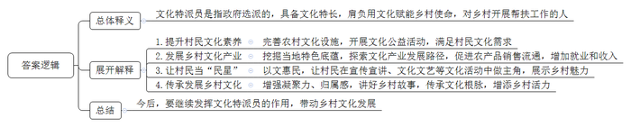
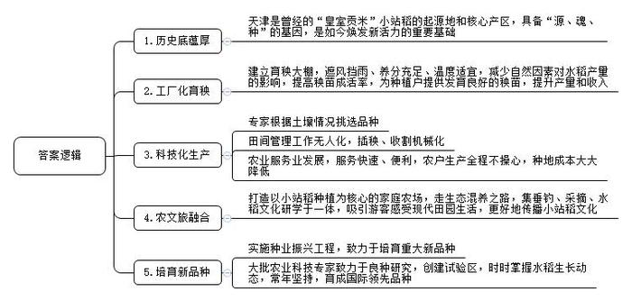
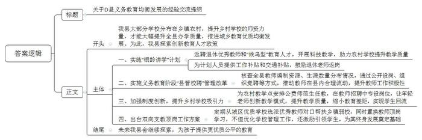
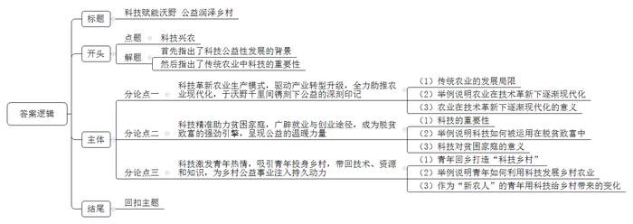

# 2025年天津市公考《申论》题（街镇卷）

> 候选采集稿。参考答案及解析来自粉笔页面，不代表官方答案或真实高分答卷；来源使用许可与原卷对应关系仍需人工核实。

## 给定材料

### 材料 1

2024年5月，Z省举行了首批文化特派员选派启动仪式，拉开了省、市、县三级文化特派员入驻各基层阵地的帷幕。何谓“文化特派员”？他们的作用是什么？这一新鲜称呼引发了公众的好奇。

Z省外国语学院中外阅读文化研究中心主任李莉就是与和昆镇溪口村结对的一位文化特派员。6年前，李莉受邀来到和昆镇溪口村文化礼堂，给村民们讲阅读与写作。“当时这里连个像样的图书室都找不到，但希望听故事的大人和孩子把礼堂围得水泄不通。在场的每个人都听得入迷，尤其当我介绍自己是写儿童文学故事的，孩子们的眼睛都亮了。”

村民的热情淳朴打动了李莉，她萌生了在此造一间书屋的想法。在和昆镇政府的免租政策支持下，李莉自己筹资，着手改造村里废弃的卫生院，2021年5月，溪口公益书屋正式开启。如今，这间书屋已开展各类阅读讲座活动600余场，吸引了国家级作家、艺术家、非遗传承人等50多位公益导师加入。

为了实现乡村“富脑袋”又“富口袋”，让乡村公益书屋“活”起来，李莉也探索着一条“图书馆+旅游”的文旅融合新路径。根据乡村当地特色，溪口公益书屋开展了一系列宋韵文化传承活动，摇身一变成了和昆“国风打卡点”。

如今，有了文化特派员这一“新身份”，李莉又开始思考还能为村里带来什么。翻着书屋里村民们写的打油诗，李莉有了一个想法。“村民就是最好的乡村宣讲员，我们可以用诗歌赋能乡村特色。”想法一确定，李莉就忙着开展溪口村村史村情调研，联合村民一起，创作起了《从和昆溪口说起》宣讲故事。宣讲故事编排好后，下一步就是要教会“乡村宣讲员”们讲故事，让每一位游客能直接从村民口中了解到溪口村的魅力。

文化赋能乡村的道路千千万，Z省N市首批文化特派员田勇借由自身文旅产业有限公司合伙人的视角，发掘出赵村“市集引流模式”的发展方向。

赵村历史悠久，自宋代以来就因交通便利、人口聚集，逐渐成为贸易之地，每逢二、四、六、九为交易日。搡年糕、打铁、弹棉花、修钟表、古法酿酒、剃头、编竹篾、手工乌馒头、剪纸……这些充满乡土气息的草根手艺至今依然在赵村老街上生生不息。

在与村镇干部进行充分的沟通交流后，田勇决定基于本村历史文化底蕴，打造“赵村特色市集”，包括规划咨询、乡村设计、文旅运营等不同方向人才的项目团队第一时间就组建了起来。

随后，村镇干部、田勇团队、设计事务所、规划设计研究院等各方进行了多次座谈交流。在听取了大家的意见后，田勇表达了对未来两年驻点支持赵村的展望：“我们不仅希望市集街能直接促进农产品销售流通，带动更多农民加入，增加农民收益，创造就业机会。而且，我们希望这一平台也能增进本地人与外来流动人口的凝聚力与归属感，讲好赵村的生动故事。”

Z省社科联规划处二级主任科员冯新阳同样也是首批文化特派员之一，在被问到文化特派员的“特”体现在哪里时，冯新阳表达了自己的看法：“在我理解，‘特’就是‘特殊使命’。我们文化特派员要做到以文惠民，让群众在宣传宣讲、文化文艺、展览展示等各类文化活动中做主角、当‘民星’。”

而对非遗传承人马一天来说，从非遗传承人转变为文化特派员，不仅仅是身份上的变化，同样是责任与使命的升级。“传承不守旧，乡村是传统文化的重要载体。作为一名非遗传承人，我希望能够用面塑讲好家乡故事，传承文化根脉，增添乡村活力，这是我未来两年要做的事。”

一村一品、一村一业、一村一韵……文化特派员在基层的故事，才刚刚开始。

### 材料 2

“一篙御河桃花汛，十里村爨玉粒香”。曾经的“皇室贡米”小站稻，始于宋、名于清，为起源地和核心产区的天津孕育下了“源、魂、种”的基因，在新时代焕发了新的活力。

清明时节，本该是为水稻育秧忙碌的日子，今年天津某区东棘坨镇不少种植户的田里却不见动静。原来，他们的水稻秧苗正在田振国经营的家庭农场里备受呵护。二十几天后，一车又一车发育良好的水稻秧苗发往该镇四处，为两万亩稻田提供秧苗。

“原本育秧都是在露天田地里，不说刮风下雨的影响，就温度这一项，就让育秧的结果难测。”原来，气温在摄氏10度以下，对水稻秧苗来说就是冻害，会导致秧苗成活率低，影响种植户一年的耕种和收入。

为此，田振国给秧苗建了所“保育院”——上有大棚遮风挡雨，下有营养基质提供生长所需养分，温度低了关闭通风口，高了再打开。

田振国开启工厂化育秧之路，与他的人生经历密不可分。

他的“第一桶金”就来自种水稻，那年他25岁。不过这“第一桶金”赚得挺惊险。“当年种田，开始就是自己一点一点摸索。第一年种，水稻秧苗开始还挺好，后来就不行了，也找不到原因，幸亏区里农技站的工作人员下到镇里来指导。技术人员说是水质不行，盐分高。我寻思检测过啊，水里含盐量符合标准。农技人员就给我讲，第一遍浇水是合格，但是随着浇灌次数增加，水里的含盐量也累加增高了，就超过正常值了。”

听了农技人员的话，田振国赶紧挖沟换水。“换水之后，秧苗的长势就正常了，第一年收益还不错。”

从此他坚信只有科学种田，才能丰产增收。他参加某区组织的农业科技培训活动，去外地参观学习，积极拥抱新技术，用无人机进行打药、施肥等田间管理工作，采用稻蟹混养立体种植，达到生物净化水质、提升效益的目的。都说农业是靠天吃饭，田振国想的就是通过科技减少气候等自然因素对水稻产量的影响。在大棚内育秧，提高秧苗成活率，自然而然成为他近年努力的方向。

与田振国一样，盛坤田园家庭农场的经营者齐兴华家里也有百亩稻田，对他来说，儿时的记忆就是土路两旁的水稻好高，大人们天天在地里从早忙到晚。

如今，齐兴华和自己的父母亲一样，守望着土路两旁的稻田。中午时分，齐兴华一边悠闲地往太阳能杀虫灯里放药，一边感慨：“都是种水稻，可我比父母辈幸福太多了，从种到收根本不用操心，而且成本也大大降低。”齐兴华介绍，自己种植的“金稻919”是专家根据土壤情况给精心挑选的，插秧、收割全部机械化，需要喷洒农药时只要打一个电话，合作的公司就派人和无人机过来了……近一段时间，齐兴华正尝试打造以小站稻种植为核心的家庭农场，“现在走的是生态混养的路子，垂钓、采摘、水稻文化研学可以集于一体。欢迎大家来这里感受现代田园生活，也希望能为传播家乡小站稻文化贡献自己的一份力量。”

让齐兴华等种植户十分省心的金稻919，稻种名字取自国产大飞机C919，一般亩产650千克左右，结实率93%，出米率71%以上，被推荐为第二批小站稻优质品种，获全国优良食味粳稻品评一等奖、第二十二届绿色食品博览会金奖。市农科院农作物研究所王所长说：“新种子可以像国产大飞机一样‘一飞冲天’，这是我们的梦啊！”

金稻919也只是一个缩影。为了让老百姓的饭碗端得更牢，“菜篮子”“米袋子”更丰富，在天津，有一大批农业科技专家致力于良种创新研究。

“小站稻产业高质量发展，需要种业更上一层楼。”天津市农业农村委李副主任介绍，作为我市正在实施的“十项行动”之一，天津市乡村振兴全面推进行动蹄疾步稳，“聚焦行动方案中提出的实施种业振兴工程，我们将培育小站稻等重大新品种（系）15个。”

在另一片稻田，57岁的市优质农产品开发示范中心于研究员三天两头到地里“数稻子”，“茎秆‘蹭蹭’长，一般水稻最后成穗的十五六株，它已分蘖了40多株，要能剩下21个穗，粮食就能打到1000千克。”

这里是以津原89为基础创建的吨粮田百亩试验区，不同区域插着竹竿，两个竹竿之间是检测点，每个点位10穴稻秧，稻田“管家”——技术员小刘天天过来记录水稻长势。见到于研究员时，他打着赤脚，刚从田里出来。

这批水稻从育苗到成熟预计178天，生长动态需要时时掌握。“研究水稻就和作画、制瓷一样。”于研究员打了个比方，“科研人员下的就是长期润色、打磨的功夫。”

“水稻产量由亩穗数、穗粒数、千粒重‘三要素’决定，任何一个要素提高都意味着产量提高。过去研究重点主要是提高穗数，穗粒数当然也研究，但粒重很难突破，一般水稻也有大粒的，但品质很次。”于研究员团队历经29年，育成优质、抗逆、超高产高水平统一的新品种津原89，千粒重30.8克，品质国优1级，成果国际领先。

不只在天津的农田里，近年来，凭借着卓越的品质和良好的口碑，于研究员团队培育的津原系列水稻品种推广至全国10多个省市，覆盖京津冀稻区的70%以上，累计推广面积超过5000万亩，为社会带来了高达60亿元的经济效益。

### 材料 3

盛夏炎炎，D县盛东镇中心小学教师李叶芬正认真备课，为即将到来的新学期做准备。这位有着37年教龄的老教师，如今已经57岁，但她依然选择回到校园，继续为教育事业贡献力量。像李老师这样返岗的退休教师，在当地并不少见。

“教育不能断层，我们返回学校任教，能给予年轻教师的只有经验，希望他们很快成长起来，带领孩子们打开知识的窗口。”李叶芬老师的话语中，透露着对教育事业的热爱和对年轻教师的期望。

近年来，D县积极探索创新教育人才政策，通过实施“银龄讲学”计划，返聘退休优秀教师和“候鸟型”教育人才，依托示范课、专题研讨等方式，开展科技教学，并助力农村学校提升教学质量。

来自北京的邓士杰老师，就是一位资深“候鸟”教师。2014年，业已退休的邓老师看中D县的养老环境，在当地买了房，每年冬春都来居住。2018年，他欣然接受D县教育局的邀请，兼任了两所农村学校的软件课老师。“从教多年，舍不得离开孩子们，能为当地培养一些科技人才，心里头十分高兴。”邓老师的科技公益公开课经常座无虚席，他这一干就没有离开。

“作为人口大县，D县大部分学校分布在乡镇和农村，要想实现全县办学质量大幅提升，首先要补齐农村学校的短板，推进城乡教育优质均衡发展。师资力量就是提高乡村学校教育教学质量的关键。”D县教育局局长秦宇介绍，为鼓励退休教师返岗，D县教育局为“银龄讲学”计划人员申请了工作补贴每人每月2000元，为“候鸟型”人才教师申请了交通补贴，以此表达对优秀教育工作者的认可及肯定。

为更好地从师资方面帮扶乡镇薄弱学校，2024年1月，D县全面启动实施全县义务教育阶段“县管校聘”管理改革工作，并于9月圆满完成。

改革过程中，县教育局组织专门人员对全县实际教师编制资源、生源数量分布情况进行核查，并通过公开设置岗位、制定竞聘方案、组织岗位竞聘等方式，推动教师资源在全县范围内的合理流动。

今年暑假，郝春梅通过跨校竞聘，成为了D县第三实验学校七年级的信息课老师，此前她在林川镇中心学校任教了6年。“学校有8个老师是和我一样通过跨校竞聘上岗进来的，大家不用再局限于当某一所学校的老师，同属于县里，流动能出能进，积极性都提高了。”郝春梅称赞道。

“为了让乡村学校吸引留住教师，除加大补助力度外，也需要各类制度创新。”从2020年起，D县每年在公费师范生定向培养计划中安排至少两名用于农村教学点，在教师招聘中，也专门设置了农村教学点教师岗位。同时，D县出台了《D县中心学校教师双向支教顶岗工作方案》，定期从城区优质学校选派若干名优秀教师对口帮扶乡镇薄弱学校，再从乡镇学校置换若干名教师到城区学校顶岗学习一年。

青年教师王野，是第一批通过公费定向师范生培养计划来到新基学校任教的老师之一。在此之前，由于师资力量薄弱、教师队伍不稳定、课程开不齐等因素，家长对新基学校的教学质量缺乏信任，生源逐年减少。现在，学校106名教师中，有25名是公费定向培养的师范生，其专业涵盖各个学科。

“这些年轻人都能够结合自己专业所长，创新教学模式。教学质量提高了，教育差距缩小了，家长对学校的信任度也提升了很多，这几年学生回流的情况也比较多。”新基学校校长曾云飞表示。

在D县北中镇，今年9月，王向阳从县一中到北中镇实盘中学支教，负责七年级科学课教学，她以轻松活泼的课堂风格和对学生的关心关爱，迅速与学生打成一片，学生们的成绩也稳步向好。王向阳对口支教的实盘中学现有学生436人，共有初中三个年级10个教学班，是一所山区寄宿制学校。支教老师的到来，为实盘中学的学生打开了科技的大门，在学校管理、教师管理、学生管理上提供了新思路，同时在思想教育、养成教育、理想教育等方面激励和引领学生，为学生们的终身发展奠定了基础。“衷心希望更多优秀教师加入到我们团队，让孩子们能够享受到更优质、公平的教育。”北中镇实盘中学教导主任郑泽雨期盼道。

### 材料 4

近年来，随着乡村振兴战略的深入实施，农业农村人才队伍建设成为国家发展的重要议题。2018年中央一号文件正式提出了“要把人力资本开发放在首要位置，畅通智力、技术、管理下乡通道，造就更多乡土人才，聚天下人才而用之”。

2021年11月，农业农村部印发《“十四五”农业农村人才队伍建设发展规划》，为农业农村人才队伍建设提供了指导。该规划强调，要加强农业农村人才队伍建设，全面推进乡村振兴，加快农业农村现代化。同时提出，到2025年，乡村人才振兴制度框架和政策体系应基本形成，各类人才支持服务乡村格局基本形成。

2024年7月，党的二十届三中全会中指出，教育、科技、人才是中国式现代化的基础性、战略性支撑，必须深入实施科教兴国战略、人才强国战略、创新驱动发展战略，统筹推进教育科技人才体制机制一体改革，健全新型举国体制，提升国家创新体系整体效能。

### 材料 5

今年，是“90后”新农人夏泽阳创办金丰公司的第十四个年头。

青年人自然有着与父辈们不一样的“奇思妙想”，夏泽阳对农业技术未来发展有自己的思考。“当时人工喷洒农药浪费多、时间长，还容易对人产生毒副作用。我就认为无人机打药就是未来的方向。”

一边思考，一边行动。在出现工业化无人机之前，由于没有定位系统，植保效果全靠无人机飞手的现场操作水平，夏泽阳就自己做飞手。“那个时候每次出药都会‘摔机’，甚至‘炸机’，头天出去5架，第二天差不多就会有3架送去维修。”夏泽阳说。

虽然遭遇了很多挫折，但机会也垂青有准备的人。2013年，S省植保总站有一个购买航化施药器械的项目招标。当时，专业的基层农业服务平台极为稀少，金丰公司凭借已有经验成功中标。

作为项目负责人，夏泽阳带着团队前往广东、山东、新疆等地考察学习，引入新设备，使无人机打药的整体效果有了明显提升。2015年，夏泽阳组建了S省首支专业化无人机病虫害防治队，一年后又组建了金丰农机专业合作社。而这也让他对自己的团队构成有了新的想法，“你说让年轻人下地背药箱撒药施肥，他们会面露难色；但你跟他们说，开飞机也能搞农业，他们大都愿意抢着干。我希望通过我的努力，让越来越多年轻人加入农业，热爱农业。”

2016年8月，L市暴发玉米黏虫灾害，大片农田面临绝收风险。“如果采用手动喷药的方式，基本没有效果，即便用上机械化农药喷洒设备，时间也来不及，这个时候，只能靠飞行器力挽狂澜。”当时，夏泽阳的合作社接到了防治任务，迅速出动植保直升机、植保无人机，最终有效遏制了虫害。金丰农机的无人机作业团队“一飞成名”。

2017年初，来自各乡镇贫困家庭的27名孩子以及残疾人，免费参加了合作社植保无人机操作培训学习，顺利拿到无人机操作证，其中四人还成为了合作社的飞手。“留下的孩子和残疾人挣了钱，他们的家庭人均年收入迅速突破2万元，当年即实现脱贫。”

2018年初以来，金丰农业推动农业服务模式“千乡万站”落地开花，支持贫困家庭年轻劳动力加盟创业，零门槛为贫困户创业者提供植保无人机设备，并免费教学考证，优先推荐分发作业订单，有效调动了贫困家庭脱贫致富的积极性。

“科技是这个时代最大的公益。”这是夏泽阳经常提及的一句话。2023年11月1日，作为中国农业领域的代表，夏泽阳出现在世界青年发展论坛上。“当我站在这里，可能大家看我外表不像个农民。没错，我是一名普通的青年‘新农人’……”这篇题为《科技是最大的公益》的发言，让世界看见了中国青年“新农人”的形象和理念。

## 题目

### 第 1 题

**根据****“给定资料**2**”，谈谈你对“文化特派员”的理解。（15分）**

关联材料：材料 1

作答要求：

要求：全面、准确、简明、有条理；不超过250字。

### 第 2 题

**请根据****“给定资料**3**”，总结天津水稻在新时代焕发新活力的原因。****（****20分）**

关联材料：材料 2

作答要求：

要求：理解准确，内容全面，逻辑清晰；不超过400字。

### 第 3 题

**为学习借鉴****D县义务教育优质均衡发展经验，****H****县教育局计划赴****D县开展学习考察活动。请根据“给定资料**4**”，为D县教育局拟定一份座谈会上的经验交流提纲。（25分）**

关联材料：材料 3

作答要求：

要求：

（1）紧扣资料，内容全面；

（2）语言流畅，逻辑清晰；

（3）不超过450字。

### 第 4 题

**请你对****“给定资料**5**”中提到的“科技是这个时代最大的公益”进行深入思考，联系实际，自拟题目，写一篇议论性文章。（40分）**

关联材料：材料 4、材料 1、材料 2、材料 3、材料 5

作答要求：

要求：

（1）参考“给定资料”，但不拘泥于“给定资料”；

（2）观点明确，内容充实，结构完整；

（3）语言流畅，书写清晰；

（4）字数在1000字左右。

## 答案与解析

第 1 题

**参考答案（粉笔题库参考内容）**

文化特派员是指政府选派的，具备文化特长，肩负用文化赋能乡村使命，对乡村开展帮扶工作的人。具体作用有：

1.提升村民文化素养。完善农村文化设施，开展文化公益活动，满足村民文化需求。

2.发展乡村文化产业。挖掘当地特色底蕴，探索文化产业发展路径，促进农产品销售流通，增加就业和收入。

3.让村民当“民星”。以文惠民，让村民在宣传宣讲、文化文艺等文化活动中做主角，展示乡村魅力。

4.传承发展乡村文化。增强凝聚力、归属感，讲好乡村故事，传承文化根脉，增添乡村活力。

今后，要继续发挥文化特派员的作用，带动乡村文化发展。

**参考答案说明：**思路方面，本参考答案按照词句理解题“总体释义+展开解释+总结”的一般答题思路展开。内容方面，本参考答案先对“文化特派员”的含义进行了解释；“展开解释”部分从“提升村民文化素养”“发展乡村文化产业”“让村民当‘民星’”“传承发展乡村文化”等四个方面介绍了文化特派员的作用；最后进行了总结。

**解析**

**考点**：词句解释类

**来源**：2025年天津市公考《申论》题（街镇卷）

> 粉笔申论页面对本题只提供「解析视频」入口，该入口是会员推广位，页面无视频地址与文字解析。

第 2 题

**参考答案（粉笔题库参考内容）**

1.历史底蕴厚。天津是曾经的“皇室贡米”小站稻的起源地和核心产区，具备“源、魂、种”的基因，是如今焕发新活力的重要基础。

2.工厂化育秧。建立育秧大棚，遮风挡雨、养分充足、温度适宜，减少自然因素对水稻产量的影响，提高秧苗成活率，为种植户提供发育良好的秧苗，提升产量和收入。

3.科技化生产。专家根据土壤情况挑选品种；田间管理工作无人化，插秧、收割机械化；农业服务业发展，服务快速、便利，农户生产全程不操心，种地成本大大降低。

4.农文旅融合。打造以小站稻种植为核心的家庭农场，走生态混养之路，集垂钓、采摘、水稻文化研学于一体，吸引游客感受现代田园生活，更好地传播小站稻文化。

5.培育新品种。实施种业振兴工程，致力于培育重大新品种；大批农业科技专家致力于良种研究，创建试验区，时时掌握水稻生长动态，常年坚持，育成国际领先品种。

**参考答案说明：**本参考答案从“历史底蕴厚”“工厂化育秧”“科技化生产”“农文旅融合”“培育新品种”五个方面展开，各条答案要点之间在内容上相互并列，没有交叉。

**解析**

**考点**：原因类

**来源**：2025年天津市公考《申论》题（街镇卷）

> 粉笔申论页面对本题只提供「解析视频」入口，该入口是会员推广位，页面无视频地址与文字解析。

第 3 题

**参考答案（粉笔题库参考内容）**

关于D县义务教育均衡发展的经验交流提纲

我县大部分学校分布在乡镇农村，提升乡村学校的师资力量，才能大幅提升全县办学质量，推进城乡教育优质均衡发展。为此，我县探索创新教育人才政策，经验有：

一、实施“银龄讲学”计划。返聘退休优秀教师和“候鸟型”教育人才，开展科技教学，助力农村学校提升教学质量；为计划人员提供工作补贴和交通补贴，鼓励退休老师返岗。二、实施义务教育阶段“县管校聘”管理改革。核查全县教师编制资源、生源数量分布情况，通过公开设岗、组织竞聘等方式，推动教师在县内合理流动，提升教师工作积极性。三、加强制度创新，提升乡村学校吸引力。为农村教学点安排公费师范生任教，在教师招聘中专设岗位，让年轻老师创新教学模式，提升教学质量，缩小教育差距，实现学生回流。四、出台双向支教顶岗工作方案。定期从城区优质学校选派优秀教师对口帮扶乡镇弱校，同时置换教师顶岗学习，不但优化学校管理工作，还激励引领学生，为其终身发展奠定基础。

未来我县会继续探索，为孩子提供更优质公平的教育。

**参考答案说明**：（1）格式方面，本参考答案写到了“标题”“正文”两个部分。（2）正文部分，一方面从内容上来看，围绕“义务教育优质均衡发展”这一主题，本参考答案的开头先写到了“D县的教育背景、宏观政策”；主体部分从“实施‘银龄讲学’计划”“实施义务教育阶段‘县管校聘’管理改革”“加强制度创新，提升乡村学校吸引力”“出台双向支教顶岗工作方案”这四个方面给出了经验；结尾部分添加了总结。另一方面，形式上，本参考答案做到了分段、分条撰写，整体上条理较为清晰。

**解析**

**考点**：总结类

**来源**：2025年天津市公考《申论》题（街镇卷）

> 粉笔申论页面对本题只提供「解析视频」入口，该入口是会员推广位，页面无视频地址与文字解析。

第 4 题

**参考答案（粉笔题库参考内容）**

**科技赋能沃野** **公益润泽乡村**

从智慧城市建设到远程医疗，从智能环保监测到线上教育普及，科技的公益性在时代浪潮中愈发夺目。而在传统农业领域，科技正以磅礴之力改写农业的发展轨迹，革新生产模式、帮扶贫困农户、点燃青年热情，释放出超乎想象的公益价值。

**科技革新农业生产模式，驱动产业转型升级，全力助推农业现代化，于沃野千里间镌刻下公益的深刻印记****。**传统农业受制于自然条件与人力局限，而现代科技正打破这些桎梏。卫星遥感技术如“天眼”俯瞰大地，实时监测作物长势与病虫害；智能灌溉系统似“血脉”精准输送养分，让每一滴水都物尽其用。荷兰精准农业通过传感器与机器人实现“按需施肥”，使土地利用率提升30%以上；中国智慧农田借助物联网技术，让小麦亩产增加15%。这些创新不仅让“足蒸暑土气”成为历史，更以科技之力守护“中国碗”里的“中国粮”，将公益价值镌刻在每一寸耕地上。

**科技精准助力贫困家庭，广辟就业与创业途径，成为脱贫致富的强劲引擎，呈现公益的温暖力量。**在脱贫攻坚的战场上，科技化作“新农具”，数据成为“新农资”。陕西柞水木耳通过电商直播走出大山，让“小木耳”长成“大产业”；贵州毕节青年用短视频推广刺梨汁，带动2000余户贫困户增收致富；科技企业开展的“云端培训”项目，让留守妇女通过数据标注实现居家就业。这些实践证明：科技不是冰冷的代码，而是有温度的扶贫之手，它让贫困家庭在数字时代找到脱贫密码，书写着“授人以渔”的公益真谛。

**科技激发青年热情，吸引青年投身乡村，****带回技术、资源和知识，****为****乡村****公益事业注入持久动力****。**当“90后”新农人操控无人机翱翔于麦田，当“数字游民”在乡村打造智慧农场，科技正重新定义“乡土情怀”。返乡青年小张用区块链技术建立农产品溯源系统，让土特产卖出“科技价”；农科博士团队研发的AI种植模型，使大棚蔬菜产量翻倍。这些“新农人”不仅带来技术革新，更以“科技+文化+生态”的融合发展模式，让乡村成为创业热土。他们的选择印证：科技赋能下的乡村，既是安放乡愁的故土，更是实现价值的舞台，吸引着青年才俊用智慧反哺桑梓。

为推动科技深度融入农业，持续放大科技在农业领域的公益效能，政府不仅要加大农业科技研发投入、完善推广体系、培育新型农民，还需鼓励企业、社会组织投身农业科技创新，凝聚合力，共促农业科技大步向前。

“洪范八政，食为政首。”当科技之翼托起农业腾飞，我们看到的不仅是麦浪滚滚的丰收图景，更是科技向善的公益之光。让我们以科技为犁，深耕希望田野；以公益为种，播撒振兴梦想，共同绘就乡村崭新画卷。

**文章分析**

**科技赋能沃野** **公益润泽乡村**

【**标题的优点：**首先，范文的标题突出了“科技兴农”这一主题。其次，形式上，文字简洁明快。】

（1）从智慧城市建设到远程医疗，从智能环保监测到线上教育普及，科技的公益性在时代浪潮中愈发夺目。（2）而在传统农业领域，科技正以磅礴之力改写农业的发展轨迹，革新生产模式、帮扶贫困农户、点燃青年热情，释放出超乎想象的公益价值。

【**开头的优点：**★内容方面：范文的开头是紧扣“科技兴农”这一主题展开的。首先指出了科技公益性发展的背景；然后指出了传统农业中科技的重要性。★文字表达方面：长短句配合使用，使语言表达有节奏感。】

**科技革新农业生产模式，驱动产业转型升级，全力助推农业现代化，于沃野千里间镌刻下公益的深刻印记。**（1）传统农业受制于自然条件与人力局限，而现代科技正打破这些桎梏。（2）卫星遥感技术如“天眼”俯瞰大地，实时监测作物长势与病虫害；智能灌溉系统似“血脉”精准输送养分，让每一滴水都物尽其用。荷兰精准农业通过传感器与机器人实现“按需施肥”，使土地利用率提升30%以上；中国智慧农田借助物联网技术，让小麦亩产增加15%。（3）这些创新不仅让“足蒸暑土气”成为历史，更以科技之力守护“中国碗”里的“中国粮”，将公益价值镌刻在每一寸耕地上。

【**论述段****1的优点：**★观点句：范文的观点句是紧扣“科技兴农”这一主题提出的。形式上，它在段首处直接写出，位置突出，容易发现。内容上，关键词突出，内容要点明确，可以明显看出它是围绕“科技革新农业生产模式”展开。★论述内容：（1）传统农业的发展局限；（2）举例说明农业在技术革新下逐渐现代化；（3）农业在技术革新下逐渐现代化的意义。注意：以上几个方面的内容都是紧扣“科技革新农业生产模式，驱动产业转型升级，全力助推农业现代化，于沃野千里间镌刻下公益的深刻印记”这个观点句论述的，论述的针对性强，内容层次丰富。在论述方法上采用了讲道理、举例子相结合，做到了丰富多样。】

**科技精准助力贫困家庭，广辟就业与创业途径，成为脱贫致富的强劲引擎，呈现公益的温暖力量。**（1）在脱贫攻坚的战场上，科技化作“新农具”，数据成为“新农资”。（2）陕西柞水木耳通过电商直播走出大山，让“小木耳”长成“大产业”；贵州毕节青年用短视频推广刺梨汁，带动2000余户贫困户增收致富；科技企业开展的“云端培训”项目，让留守妇女通过数据标注实现居家就业。（3）这些实践证明：科技不是冰冷的代码，而是有温度的扶贫之手，它让贫困家庭在数字时代找到脱贫密码，书写着“授人以渔”的公益真谛。

【**论述段****2****的优点：**★观点句：范文的观点句是紧扣“科技兴农”这一主题提出的。形式上，它在段首处直接写出，位置突出，容易发现。内容上，关键词突出，内容要点明确，可以明显看出它是围绕“科技精准助力贫困家庭”展开。★论述内容：（1）科技的重要性；（2）举例说明科技如何被运用在脱贫致富中；（3）科技对贫困家庭的意义。注意：以上几个方面的内容都是紧扣“科技精准助力贫困家庭，广辟就业与创业途径，成为脱贫致富的强劲引擎，呈现公益的温暖力量”这个观点句论述的，论述的针对性强，内容层次丰富。在论述方法上采用了讲道理、举例子相结合，做到了丰富多样。】

**科技激发青年热情，吸引青年投身乡村，带回技术、资源和知识，为乡村公益事业注入持久动力。**（1）当“90后”新农人操控无人机翱翔于麦田，当“数字游民”在乡村打造智慧农场，科技正重新定义“乡土情怀”。（2）返乡青年小张用区块链技术建立农产品溯源系统，让土特产卖出“科技价”；农科博士团队研发的AI种植模型，使大棚蔬菜产量翻倍。（3）这些“新农人”不仅带来技术革新，更以“科技+文化+生态”的融合发展模式，让乡村成为创业热土。他们的选择印证：科技赋能下的乡村，既是安放乡愁的故土，更是实现价值的舞台，吸引着青年才俊用智慧反哺桑梓。

【**论述段****3****的优点：**★观点句：范文的观点句是紧扣“科技兴农”这一主题提出的。形式上，它在段首处直接写出，位置突出，容易发现。内容上，关键词突出，内容要点明确，可以明显看出它是围绕“科技激发青年热情”展开。★论述内容：（1）青年回乡打造“科技乡村”；（2）举例说明青年如何利用科技发展乡村农业；（3）作为“新农人”的青年用科技给乡村带来的变化。注意：以上几个方面的内容都是紧扣“科技激发青年热情，吸引青年投身乡村，带回技术、资源和知识，为乡村公益事业注入持久动力”这个观点句论述的，论述的针对性强，内容层次丰富。在论述方法上采用了讲道理、举例子相结合，做到了丰富多样。】

为推动科技深度融入农业，持续放大科技在农业领域的公益效能，政府不仅要加大农业科技研发投入、完善推广体系、培育新型农民，还需鼓励企业、社会组织投身农业科技创新，凝聚合力，共促农业科技大步向前。

【**过渡段****的优点**：范文过渡段总结性地指出了为推动科技深度融入农业，政府、企业等的一系列做法。】

“洪范八政，食为政首。”当科技之翼托起农业腾飞，我们看到的不仅是麦浪滚滚的丰收图景，更是科技向善的公益之光。让我们以科技为犁，深耕希望田野；以公益为种，播撒振兴梦想，共同绘就乡村崭新画卷。

【**结尾的优点：**范文的结尾回扣了“科技兴农”这一主题，并且进行了总结提升。】

**解析**

**考点**：文章写作题

**来源**：2025年天津市公考《申论》题（街镇卷）

> 粉笔申论页面对本题只提供「解析视频」入口，该入口是会员推广位，页面无视频地址与文字解析。

