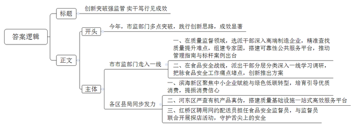
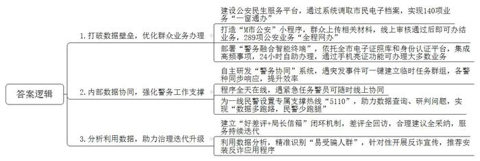
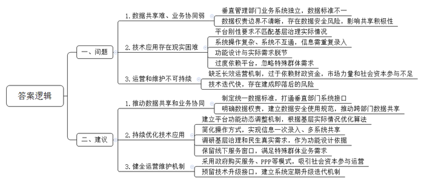
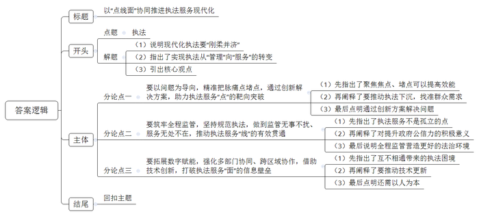

# 2026年天津市公考《申论》题（行政执法卷）

> 候选采集稿。参考答案及解析来自粉笔页面，不代表官方答案或真实高分答卷；来源使用许可与原卷对应关系仍需人工核实。

## 给定材料

### 材料 material-3f24914d0da0c2c9

在T市轨道车辆有限公司的组装车间内，市场监管委青年干部小冯戴着安全帽，正专注观察工人师傅的操作细节，并不时与技术人员交流工艺要点。连日来，他跟随班组全程参与车体组装工序，从激光切割到模块吊装，从电气布线到气密性检测，亲手记录每一个工艺参数。在调试车间，他目睹了车辆动态测试的全过程，深刻体会到毫米级精度对轨道交通安全运行的关键意义。“跟班学习不仅要学技术，更要学精益求精的工匠精神和高效协同的产业思维。”小冯感慨道。

2025年以来，T市市场监管委质量监督处选派3名干部深入16家高端制造企业，通过跟班学习、驻厂研究等方式，精准查找质量提升难点；组建80人专家团，搭建8个可靠性公共服务平台，推动出台全国首个产品质量可靠性管理指南和10个技术应用标杆案例。相关负责人表示：“只有脚踏实地走入生产一线，才能真正理解产业逻辑，未来推动政策落地时更能有的放矢。”

最近，T市市场监管委食品安全相关处室派出28名监管干部，以“问题导向+实践导向”形式，分层分类深入一线开展学习。在T市国顺肉类食品有限公司等重点食品企业建立跟班学习实践点，组织市场监管干部深入生产车间和仓储物流环节，参与原料采购验收、食品加工制作、成品检验检测、贮存保管全流程，掌握真实生产状况和管理痛点；对学校和校外供餐单位主体责任落实和关键环节开展深度调研排查；赴4家食品安全检验检测专业技术机构开展学习调研，深入学习食品检测操作、方法研制、标准起草等工作。通过调研，T市市场监管委精准把脉食品安全工作痛点堵点，创新推出一系列解决方案：出台冷藏食品生产卫生规范，强化关键环节管控；建立“桶餐到校+班内分餐”模式，保障校园食品安全；制定小作坊生产加工控制要求，填补行业规范空白；创新检管结合抽检模式，提升靶向监管效能。

T市滨海新区市场监管局聚焦中小企业赋能与绿色低碳转型，在持续加强装饰装修材料、小家电、电动自行车等关系民生产品强制性认证的同时，通过大力推动有机、绿色等高端品质认证，培育和引导优质消费，提振消费信心。近日，该局在华北陶瓷建材家居市场举办认证认可宣传活动，围绕群众关心的实施强制性认证的小家电、装修材料及绿色建材等内容进行介绍，深入解读绿色建材认证的标准、意义和价值，引导市场商户、消费者加深对认证认可作用的认识，助力市场向绿色、低碳、高质量发展转型。T市河东区市场监管局针对辖区大型生活超市销售的蔬菜、谷物、乳制品等有机产品开展专项检查，核验认证标志、有机码标注规范性，并利用“有机码查询”小程序逐一扫码核验，严审认证真伪，确保产品资质合法、来源可溯、质量可靠；组织召开质量基础设施“一站式”服务平台联动发展座谈会，聚焦平台协同效能提升，就深化“一站式”服务模式、联合开展共性技术攻关等议题与企业进行深入研讨，搭建信息互通、资源共享、优势互补的高效平台。

近日，T市红桥区外卖配送行业党委在丁字沽街道“骑享家”驿站组织召开2025年网约配送员群体党建工作要点部署会，同时举行网约配送员群体食品安全监督员聘用仪式。会上，红桥区外卖配送行业党委书记宣读《网约配送员群体食品安全监督员聘用方案》，明确监督员聘用范围、方式、工作职责和激励帮扶机制，并向9名网约配送员代表颁发食品安全监督员聘书，邀请其共同参与监管工作，营造食品安全社会共治良好氛围。红桥区市场监管局代表区外卖配送行业党委公示联络邮箱和联络电话，鼓励外卖小哥积极提出意见建议。下一步，红桥区市场监管局将充分发挥区外卖配送行业党委职能作用，引导网约配送员群体积极有序参与基层治理和行业治理，同时结合“红姐、桥哥、食弟、安妹”红桥食安探店IP，与食品安全监督员联合开展食安探店活动，共同守护群众“舌尖上的安全”。

2025年以来，T市市场监管部门正是通过各个工作点的突破，将创新思路付诸实践，取得了显著的成效。

### 材料 material-c38af58366728dac

2025年某个冬日的清晨，天刚蒙蒙亮，M市公安局南开分局学府街派出所的“大堂警官”王圆圆已经到岗。她整理好警服，佩戴上醒目的“大堂警官”红袖标，对着镜子微微一笑——这是她每天上岗前的仪式感。

“您好，请问办理什么业务？”早上八点半，第一位市民刚走进派出所，王圆圆已迎上前去。她的声音温和，笑容亲切。让人很难想象，这位“大堂警官”的背后，是一整套由大数据驱动的现代警务服务体系在支撑。

8：45，第一波早高峰

“我想换领身份证，但户口本是老版的，能办吗？”一位中年男士有些犹豫地问。“您放心，系统里可以直接调取电子户口信息，不用再跑一趟。”王圆圆一边引导他在自助机上操作，一边解释：“我们现在实现了‘一窗通办’，数据都是实时核验的。”她所说的“一窗通办”，是M市公安局自2023年起推动的一项重要改革——将交管、出入境、户政、治安等140项业务全部下沉至派出所窗口。而支撑这项改革的，正是打通各部门数据壁垒的“M市公安民生服务平台”。王圆圆轻点平板电脑，调出该市民的电子档案，确认信息无误后，直接引导他至身份证自助拍照区。“照片可以自选，拍满意为止。”她笑着说。

9：30，一个电话背后的“数据跑腿”

正在接待市民的王圆圆接到一通咨询电话：“我人在外地，孩子刚出生，能在M市落户吗？”“您登录‘M市公安’小程序，上传相关材料，我们线上审核通过后就可以落户了，您一次都不用跑。”王圆圆边说边在系统中输入该群众的基本信息，实时调取其婚姻、住房等数据，“只要材料齐全，最快当天就能办结。”挂断电话后，她向记者解释，“过去这类业务要跑好几趟，现在数据代步，群众‘零跑腿’已成常态。”据统计，目前M市已实现289项公安业务“全程网办”，覆盖12个警种，日均线上办件量超过1.5万。而像王圆圆这样的“大堂警官”，正是“数字警局”与群众之间的桥梁。

10：00，一警发起，全局响应

一位老人急匆匆进来，说孙子走失了。王圆圆一边安抚、一边迅速在“警务协同”系统中建立临时任务群组，发起协同指令。几乎同时，分局指挥中心、辖区巡逻警力、视频侦查岗民警“入群”。王圆圆上传走失儿童照片、衣着特征和最后出现地点，不到三分钟，视频侦查岗通过人脸识别系统锁定孩子在附近公园，巡逻民警立即前往确认。“以前这类警情要靠电话层层转接，现在一键建群，各警种同步响应，效率提升不止一倍。”王圆圆说。这个由M市公安局自主研发的“警务协同”系统，实现了“以一警牵动全局，以全局支撑一警”。日均支撑警情处置2100余起、案件侦办430余起，成为基层民警的“云端作战室”。

11：20，智能终端与“无感办事”

一位大学生前来办理居住证，王圆圆引导她使用派出所新配备的“警务融合智能终端”，从拍照、填表到提交材料，全程不超过五分钟。“我们在K大学、L大学也部署了这类终端，学生不出校门就能办业务。”王圆圆介绍。终端集成了身份证、居住证、出入境等高频事项，支持24小时自助办理，背后是全市统一的电子证照库和身份认证平台。“现在群众甚至不用带实体证件，通过手机里的‘亮证’功能就能办理大多数业务。”她说。

13：00，数据热线的另一头

午休时间，王圆圆没有休息，而是拨通了“5110”服务热线——这是M市公安局大数据实战中心为一线民警设置的专属支撑热线。“刚才有位群众咨询跨省户口迁移，涉及1998年的老档案，想请你们协助查询。”王圆圆在电话中说明情况，对方迅速响应，十分钟后，电子档案已推送至她的工作平台。“‘5110’就像我们民警的‘110'。”她进一步说，“任何时候遇到数据查询、研判分析的问题，一个电话就能得到专业支撑。”这条热线自2022年开通以来，日均服务基层民警1500余次，真正实现了“数据多跑路，民警少跑腿”。

15：00，从“好差评”到“再升级”

王圆圆打开“M市公安窗口服务公众端”后台，查看当日的群众评价。一条留言引起她的注意：“希望派出所能提供更多语言服务。”她立即将建议转发至市局政务服务总队。不久后，总队回复：已启动“多语种服务计划”，首批多语种服务终端将于下月试点投放。“群众的‘吐槽’就是改革的‘哨声’。”王圆圆说。M市公安局建立“好差评+局长信箱”闭环机制，差评100%回访，合理建议100%采纳，推动服务持续迭代。

16：30，反诈宣传的“数据精准投送”

一位阿姨来办理驾驶证换领，王圆圆在审核材料时发现她曾多次点击高风险投资链接，被系统标记为“易受骗人群”。办理完业务后，王圆圆没有例行发放反诈传单，而是针对性地向她讲解“理财类诈骗”的识别技巧，并推荐她安装“反诈卫士”应用程序。“我们现在通过数据分析，可以实现反诈宣传的‘精准投送’，不再是过去‘撒网式’的宣传了。”她解释道。

18：00，下班不下线

傍晚，派出所大厅渐渐安静下来。王圆圆完成当日工作日志，准备下班。但她手机上的“警务协同”应用程序仍保持在线——如有紧急任务，她可随时参与线上协同。“我每天走的步数可能不如巡逻民警，但在数据世界里，我‘跑’的路一点也不少。”王圆圆骄傲地说道。

### 材料 material-916136d438cb5af2

为深入贯彻落实党中央、国务院关于数字中国建设的决策部署，探索完善新型智慧城市长效运营机制，近日，X市举行“强化数字赋能，推进城市治理现代化”专题座谈会。会议由市发展改革委、市政务服务数据管理局共同组织，邀请各区相关部门负责人、基层工作者、专家学者及企业代表进行深入交流，以下为座谈发言记录：

市政务服务数据管理局副局长：

近年来，我市以“一网统管”“一网通办”为牵引，大力推动数据共享、业务协同和智慧应用落地。市级统一政务云平台初步建成，各区在城市运行管理、民生服务、应急指挥等领域进行了有益探索。但我们也要清醒地看到，实践中仍面临一些共性问题和挑战，例如，根据近期对全市16个区的调查显示，约65%的部门反映存在数据共享不畅问题，特别是在市场监管、城市管理、应急指挥等领域，跨部门数据调用平均需要3-5个工作日；超过70%的基层工作人员表示，目前使用的各类政务系统达5个以上，日均处理系统事务耗时约2.5小时。这些问题直接影响着城市治理效能，需要我们在实践中不断探索解决。

市城市运行管理中心某负责人：

我市在推进“一网统管”建设过程中，深切感受到数据共享难、业务协同弱是当前最大的制约因素。虽然市级层面建立了统一的数据共享交换平台，但在实际操作中，部分垂直管理部门的业务系统相对独立，数据标准不一，形成了“数据烟囱”。比如在处置跨部门事件时，往往需要协调多个部门的数据，但由于系统壁垒，有时仍需依靠传统方式线下沟通，严重影响了处置效率。此外，数据权责边界不够清晰，部分部门对数据安全存在顾虑，也在一定程度上影响了共享积极性。

某街道城市运行管理中心负责人：

智慧城管的引入，确实提升了问题发现的敏锐度和案件流转的规范性，但我们也感到，技术平台的刚性要求与基层治理的灵活性、复杂性之间不匹配。比如，平台要求所有事件都必须线上留痕、闭环处理，这本身是为了规范管理。但对于一些诸如清理小广告、劝导流动摊贩等可以快速处置的简单问题，严格的线上流程有时反而显得程序繁琐，占用了基层人员本可用于解决更复杂问题的时间和精力。此外，平台派单有时主要依据事件类型和地理位置，对于某些职责交叉或边界模糊的事件，可能出现派单不准、部门间需要反复沟通确认的情况，一定程度上影响了处置时效。我们期待平台算法能更“智能”，更能理解基层治理的实际情境。

某社区党委书记：

现在上级推广了很多政务小程序和数字系统，初衷是好的，是为了提高效率、方便群众。但在实际应用中，我们面临一些现实困难。一是系统操作有时较为复杂，而且不同条线部门要求使用的系统可能不互通，同样的信息需要重复录入，增加了我们的工作量。二是系统功能设计与居民的实际需求有时存在脱节。比如，一些系统更侧重于数据填报和流程记录，但在帮助我们精准掌握社情民意、高效调解邻里纠纷等需要人情味和灵活性的工作上，提供的支持还比较有限。三是社区里老年人多，他们很多人不熟悉智能手机操作，过度依赖线上平台可能会让这部分居民感觉不便，甚至被排除在便捷服务之外。如何在推进数字化的同时，兼顾特殊群体的需求，是我们需要认真考虑的问题。

某大学公共管理学院教授：

我在调研中发现，一些地方的技术应用确实出现了需要规范的现象。比如，某镇在早稻生产数字化管理中，由于系统强制要求填报种植面积，而算法无法识别抛荒耕地，基层干部不得不进行“虚拟流转”和“数据填充”来应对系统校验。还有就是某智慧社区项目在需求识别阶段，仅通过预设选项的问卷来征求居民意见，结果采集到的都是“条条框框”的需求，居民真正关心的生活场景需求反而被忽略了。这种技术主导的需求识别方式，实际上把复杂的社会治理简化为了数据填报，失去了治理应有的温度和精准度。

某数字科技公司副总裁：

智慧城市系统不是“一锤子买卖”，它需要根据城市发展、技术进步和用户反馈不断迭代优化。这涉及到持续的投入，包括资金、人才和技术支持。目前，我们参与的一些项目在规划阶段对长效运营机制的考虑可能不够充分，过于依赖财政资金，市场力量和社会资本参与的渠道和积极性有待进一步激发。因而在初期建设投入后，持续的运营和维护面临挑战。同时，技术迭代很快，如何确保已建系统能够兼容新技术、适应新需求，避免建成即落后，也是运营中需要面对的问题。

## 题目

### 第 1 题

**“给定资料**1**”是T市市场监管部门今年的一部分工作，请你为市场监管部门公众号写一篇宣传稿。（15分）**

关联材料：material-3f24914d0da0c2c9

作答要求：

要求：内容全面，条理清晰；不超过300字。

### 第 2 题

**王圆圆一天的工作，展示了****M市公安局以大数据推动警务现代化的生动实践。请根据“给定资料**2**”，说明M市公安局是如何成功用大数据赋能公共服务的。（20分）**

关联材料：material-c38af58366728dac

作答要求：

要求：理解准确，内容全面，逻辑清晰；不超过400字。

### 第 3 题

**座谈会结束后，****X市政务服务数据管理局拟写一份总结报告供后续工作参考。请根据“给定资料**3**”，撰写报告中“问题”与“建议”这两部分内容的提纲。（25分）**

关联材料：material-916136d438cb5af2

作答要求：

要求：

（1）问题梳理全面、准确；

（2）所提建议有针对性、切实可行；

（3）不超过450字。

### 第 4 题

**根据****“给定资料”，请以执法服务的“点、线、面”为主题，进行深入系统的思考，联系实际，自选角度，自拟题目，写一篇议论性文章。（40分）**

关联材料：material-3f24914d0da0c2c9

作答要求：

要求：

（1）参考“给定资料”，但不拘泥于“给定资料”；

（2）观点明确、内容充实，结构完整；

（3）语言流畅，书写清晰；

（4）字数在1000字左右。

## 答案与解析

第 1 题

**参考答案（粉笔题库参考内容）**

创新突破强监管 实干笃行见成效

今年，市监部门多点突破，践行创新思路，成效显著。

市市监部门走入一线。一、在质量监督领域，选派干部深入高端制造企业，精准查找质量提升难点，组建专家团，搭建可靠性公共服务平台，推动管理指南与标杆案例出台。二、在食品安全战线，派出干部分层分类深入一线学习调研，把脉食品安全工作痛点堵点，创新推出方案。

各区县局同步发力。一、滨海新区聚焦中小企业赋能与绿色低碳转型，培育引导优质消费，提振消费信心。二、河东区严查有机产品真伪，搭建质量基础设施一站式高效服务平台。三、红桥区聘用网约配送员担任食品安全监督员，与监督员联合开展探店活动，守护舌尖上的安全。

**解析**

**参考答案说明：**（1）格式方面，本参考答案写到了“标题”“正文”两个部分。（2）正文部分，一方面从内容来看，围绕着“T市市场监管部门”这一主题，本参考答案的开头先写到了T市市场监管部门的工作成效；接着主体从“市市监部门走入一线”“各区县局同步发力”这两个方面介绍了T市市场监管部门开展的具体工作。另一方面，形式上，本参考答案做到了分段、分条撰写，整体上条理较为清晰。

**考点**：考点宣传类

**来源**：来源2026年天津市公考《申论》题（行政执法卷）

粉笔申论页面对本题只提供「解析视频」入口，该入口是会员推广位，页面无视频地址与文字解析。

第 2 题

**参考答案（粉笔题库参考内容）**

1.打破数据壁垒，优化群众业务办理。建设公安民生服务平台，通过系统调取市民电子档案，实现140项业务“一窗通办”；打造“M市公安”小程序，群众上传相关材料，线上审核通过后即可办结业务，289项公安业务“全程网办”；部署“警务融合智能终端”，依托全市电子证照库和身份认证平台，集成高频事项，24小时自助办理，通过手机亮证功能可办理大多数业务。

2.内部数据协同，强化警务工作支撑。自主研发“警务协同”系统，遇突发事件可一键建立临时任务群组，各警种同步响应，提升效率；程序全天在线，遇紧急任务警员可随时线上协同；为一线民警设置专属支撑热线“5110”，助力数据查询、研判问题，实现“数据多跑路，民警少跑腿”。

3.分析利用数据，助力治理迭代升级。建立“好差评+局长信箱”闭环机制，差评全回访，合理建议全采纳，服务持续迭代；利用数据分析，精准识别“易受骗人群”，针对性开展反诈宣传，推荐安装反诈应用程序。

**解析**

**参考答案说明：**本参考答案从“打破数据壁垒，优化群众业务办理”“内部数据协同，强化警务工作支撑”“分析利用数据，助力治理迭代升级”这三个方面进行了分条撰写，各条答案要点之间在内容上相互并列，没有交叉。

**考点**：考点概括措施类

**来源**：来源2026年天津市公考《申论》题（行政执法卷）

粉笔申论页面对本题只提供「解析视频」入口，该入口是会员推广位，页面无视频地址与文字解析。

第 3 题

**参考答案（粉笔题库参考内容）**

一、问题：

1.数据共享难、业务协同弱。垂直管理部门业务系统独立，数据标准不一；数据权责边界不清晰，存在数据安全风险，影响共享积极性。

2.技术应用存在现实困难。平台刚性要求不匹配基层治理实际情况；系统操作复杂、系统不互通，信息需重复录入；功能设计与实际需求脱节；过度依赖平台，忽略特殊群体需求。

3.运营和维护不可持续。缺乏长效运营机制，过于依赖财政资金，市场力量和社会资本参与不足；技术迭代快，存在建成即落后的风险。

二、建议：

1.推动数据共享和业务协同。制定统一数据标准，打通垂直部门系统接口；明确数据权责，建立数据安全使用规范，推动跨部门数据共享。

2.持续优化技术应用。建立平台功能动态调整机制，根据基层实际情况优化算法；简化操作方式，实现信息一次录入、多系统共享；调研基层治理和民生真实需求，作为功能设计依据；保留线下服务窗口，满足特殊群体业务需求。

3.健全运营维护机制。采用政府购买服务、PPP等模式，吸引社会资本参与运营；预留技术升级接口，建立系统定期升级迭代机制。

**解析**

**参考答案说明**：本参考答案整体分为“问题”和“建议”两个部分，其中“问题”部分从“数据共享难、业务协同弱”“技术应用存在现实困难”“运营和维护不可持续”三个方面展开，“建议”部分从“推动数据共享和业务协同”“持续优化技术应用”“健全运营维护机制”三个方面展开，且所提建议与问题相对应。各条答案要点之间在内容上相互并列，没有交叉。

**考点**：考点提出对策类

**来源**：来源2026年天津市公考《申论》题（行政执法卷）

粉笔申论页面对本题只提供「解析视频」入口，该入口是会员推广位，页面无视频地址与文字解析。

第 4 题

**参考答案（粉笔题库参考内容）**

**以****“点线面”协同推进执法服务现代化**

现代化执法，既要保持法律的严肃性，坚守“刚”的底线，又要体现人文情怀，展现“柔”的关怀。唯有将“力度”与“温度”深度融合，方能实现执法从“管理”向“服务”的深层跃迁。面对复杂的社会治理环境，执法服务既要在“点”上精准发力，在“线”上全程贯通，还要在“面”上协同共享，推动执法理念与方式的深刻转变。

**要以问题为导向，精准把脉痛点堵点，通过创新解决方案，助力执法服务****“点”的靶向突破。**提升执法效能，要聚焦基层实践中具体的矛盾焦点与民生堵点，如企业面临的合规难题、群众反映的急难诉求等。必须摒弃“坐在办公室想问题”的作风，推动执法力量下沉，精准识别基层执法痛点和群众需求，找准服务的着力点。实现“点”的突破，关键还在于以“创新”驱动问题的解决。要超越“罚款了事”的单一模式，创造性运用合规激励、风险预警、信用修复等柔性机制，推动工作方式方法的创新。以解决问题为终点，将工作落实到每一个具体的“点”，真正疏通法治服务的“神经末梢”。

**要筑牢全程监管，坚持规范执法，做到监管无事不扰、服务无处不在，推动执法服务****“线”的有效贯通。**执法服务不应是孤立的节点，而应是一条贯穿事前、事中、事后的完整“脉络”。构建“事前预警、事中指导、事后回访”的全链条机制，并将规范执法贯穿始终，是提升执法公信力和满意度的关键。天津西青区推行“五段式”执法模式，推动行政执法从事后被动执法向事前积极作为转变；吉林四平探索构建“贴身式、嵌入式、联动式”全链条执法监督体系，推动监督从“事后补救”向“全程赋能”转型……全程监管致力于将服务的理念融入监管的每一个环节，为营造更优法治环境提供了坚实保障。

**要拓展数字赋能，强化多部门协同、跨区域协作，借助技术创新，打破执法服务****“面”的信息壁垒。**执法效能的系统性跃升，还依赖于“面”上资源的整合与协同。不同条线部门之间互不相通，导致重复执法、监管真空和效率低下等问题时有发生。数字技术为打破部门壁垒提供了可能，通过构建统一的信息化平台，实现跨部门、跨区域的即时协同。深化“一网统管”建设，需重点破解数据共享难、业务协同弱等深层梗阻，以技术创新驱动平台算法的迭代优化。同时，要坚持“以人为本”，立足居民生活实际，关注并保障特殊群体的需求，确保治理“温度”和“精度”的有机统一。

“正入万山圈子里，一山放过一山拦。”执法服务的现代化转型，是一个系统工程。唯有在“点、线、面”的立体维度中持续精进服务水平，方能以法治之力赋能高质量发展。

**解析**

**文章分析**

**以“点线面”协同推进执法服务现代化**

【**标题的优点：**标题中含有主题词，使文章主题更突出、清晰。】

（1）现代化执法，既要保持法律的严肃性，坚守“刚”的底线，又要体现人文情怀，展现“柔”的关怀。唯有将“力度”与“温度”深度融合，方能实现执法从“管理”向“服务”的深层跃迁。面对复杂的社会治理环境，（2）执法服务既要在“点”上精准发力，在“线”上全程贯通，还要在“面”上协同共享，推动执法理念与方式的深刻转变。

【**开头的优点：**★内容方面。范文的开头是紧扣题目给定的“执法服务的‘点、线、面’”这一主题展开的。首先，说明现代化执法要“刚柔并济”；其次，指出了实现执法从“管理”向“服务”的转变；最后，引出核心观点。★文字表达方面。使用了“既……又”“既要……还要”等连接词，使语言表达有逻辑性。】

**要以问题为导向，精准把脉痛点堵点，通过创新解决方案，助力执法服务****“点”的靶向突破。**（1）提升执法效能，要聚焦基层实践中具体的矛盾焦点与民生堵点，如企业面临的合规难题、群众反映的急难诉求等。（2）必须摒弃“坐在办公室想问题”的作风，推动执法力量下沉，精准识别基层执法痛点和群众需求，找准服务的着力点。实现“点”的突破，（3）关键还在于以“创新”驱动问题的解决。要超越“罚款了事”的单一模式，创造性运用合规激励、风险预警、信用修复等柔性机制，推动工作方式方法的创新。以解决问题为终点，将工作落实到每一个具体的“点”，真正疏通法治服务的“神经末梢”。

【**论述段****1的优点：**★观点句：范文的观点句是紧扣“执法服务的‘点、线、面’”这一文章主题提出的。形式上，它在段首处直接写出，位置突出，容易发现。内容上，关键词突出，内容要点明确，可以明显看出主要论述“执法服务的‘点’”。★论述内容：（1）先指出了聚焦焦点、堵点可以提高效能；（2）再阐释了要推动执法下沉，找准群众需求；（3）最后点明通过创新方案解决问题。注意：以上几个方面的内容都是紧扣“以问题为导向，精准把脉痛点堵点，通过创新解决方案级，助力执法服务‘点’的靶向突破”这个观点句进行分析论述的，论述的针对性强，内容层次丰富。在论述方法上主要采用了讲道理和举例子结合，论述清晰透彻。】

**要筑牢全程监管，坚持规范执法，做到监管无事不扰、服务无处不在，推动执法服务****“线”的有效贯通。**（1）执法服务不应是孤立的节点，而应是一条贯穿事前、事中、事后的完整“脉络”。构建“事前预警、事中指导、事后回访”的全链条机制，并将规范执法贯穿始终，（2）是提升执法公信力和满意度的关键。天津西青区推行“五段式”执法模式，推动行政执法从事后被动执法向事前积极作为转变；吉林四平探索构建“贴身式、嵌入式、联动式”全链条执法监督体系，推动监督从“事后补救”向“全程赋能”转型……（3）全程监管致力于将服务的理念融入监管的每一个环节，为营造更优法治环境提供了坚实保障。

【**论述段****2的优点：**★观点句：范文的观点句是紧扣“执法服务的‘点、线、面’”这一文章主题提出的。形式上，它在段首处直接写出，位置突出，容易发现。内容上，关键词突出，内容要点明确，可以明显看出主要论述“执法服务的‘线’”。★论述内容：（1）先指出了执法服务不是孤立的点；（2）再阐释了对提升政府公信力的积极意义；（3）最后说明全程监管营造更好的法治环境。注意：以上几个方面的内容都是紧扣“要筑牢全程监管，坚持规范执法，做到监管无事不扰、服务无处不在，推动执法服务‘线’的有效贯通”这个观点句进行分析论述的，论述的针对性强，内容层次丰富。在论述方法上主要采用了讲道理和举例子结合，论述能够结合实际。】

**要拓展数字赋能，强化多部门协同、跨区域协作，借助技术创新，打破执法服务****“面”的信息壁垒。**（1）执法效能的系统性跃升，还依赖于“面”上资源的整合与协同。不同条线部门之间互不相通，导致重复执法、监管真空和效率低下等问题时有发生。数字技术为打破部门壁垒提供了可能，通过构建统一的信息化平台，实现跨部门、跨区域的即时协同。（2）深化“一网统管”建设，需重点破解数据共享难、业务协同弱等深层梗阻，以技术创新驱动平台算法的迭代优化。同时，（3）要坚持“以人为本”，立足居民生活实际，关注并保障特殊群体的需求，确保治理“温度”和“精度”的有机统一。

【**论述段****3的优点：**★观点句：范文的观点句是紧扣“执法服务的‘点、线、面’”这一文章主题提出的。形式上，它在段首处直接写出，位置突出，容易发现。内容上，关键词突出，内容要点明确，可以明显看出主要论述“执法服务的‘面’”。★论述内容：（1）先指出了互不相通带来的执法困境；（2）再阐释了要推动技术更新；（3）最后点明还需以人为本。注意：以上几个方面的内容都是紧扣“以问题为导向，精准把脉痛点堵点，通过创新解决方案级，助力执法服务‘点’的靶向突破”这个观点句进行分析论述的，论述的针对性强，内容层次丰富。在论述方法上主要采用了讲道理的方式，论述清晰透彻。】

“正入万山圈子里，一山放过一山拦。”执法服务的现代化转型，是一个系统工程。唯有在“点、线、面”的立体维度中持续精进服务水平，方能以法治之力赋能高质量发展。

【**结尾的优点：**范文的结尾回扣了“执法服务的‘点、线、面’”这个主题，并且进行了总结提升。】

**考点**：考点文章写作题

**来源**：来源2026年天津市公考《申论》题（行政执法卷）

粉笔申论页面对本题只提供「解析视频」入口，该入口是会员推广位，页面无视频地址与文字解析。

