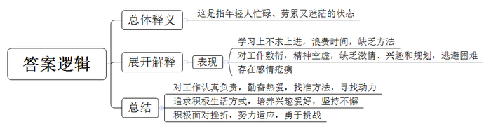
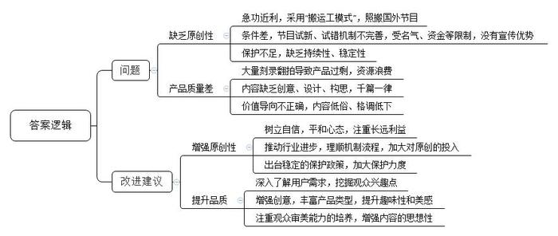

# 2017年公务员多省联考《申论》题（宁夏卷）

> 候选采集稿。参考答案及解析来自粉笔页面，不代表官方答案或真实高分答卷；来源使用许可与原卷对应关系仍需人工核实。

## 给定材料

### 材料 material-1b79da31bf0aff24

当你年迈，步履蹒跚，你会选择怎样的生活方式？浙江的一对老夫妻选择了“一直在路上”，退休后开始自驾游。3年，1辆小汽车，走遍31个省市区。老人还把自驾游经历写成一本35万字的书。其实老人没接受过写作训练，没搞过文字，但他从小就很喜欢历史、地理。每次游玩，他都会把小本子带在身边。他每天都坚持到图书馆写4000多字，两个月就完成了25万字的初稿，接着对初稿修改、补充，大约花了半年时间完成全书。书稿都是手写的，他就让女儿打印装订，怕有别字病句，他就抱着打印稿找文联帮忙作最后的修改。最后，书终于出版了。在后记中，他说：“我跟他们说我驾车出游是因为我和老伴年纪不小了，趁现在还走得动，赶快走一走。我们是越走越想走啊。”现在他以自驾游西藏为主要内容的书稿，也已经完成了5万多字。

若你曾折翼，是否依然选择飞翔？15年前，安德鲁在登山中因被暴风雪所困而不幸截肢，但他并没有因此而消沉。装上义肢后，他每天都努力康复，不但适应了新的生活，还参加了铁人三项比赛，并在友人的帮助下，靠着绳索攀登了阿尔卑斯山脉中海拔高达4478米的马特宏峰。现在，以他为原型的纪录片《截肢登山家》已在英国播出。

如果你在一开始落后，是奋起直追还是甘居下游？一个做同声传译的嘉宾在节目中大聊行业内幕：“忙、累、压力大！每20分钟就要休息一次，但收入确实丰厚。这行吃的不是青春饭，我有的同事都60岁了。”而对自己能胜任这份工作的秘诀，他也很直接地表示：“其实没什么秘诀，首先是热爱，其次是勤奋。坦白地说，我记忆力不好，语言天赋也不高，出生农村，直到初中才开始接触到外语。初中时每次期末考，英语都是倒数几名。关键是一步一步自己找方法，其实学习和生活一样，就是为了不那么辛苦而辛苦。”同时，他坦白自己也有觉得坚持不下去的时候，那怎么办呢？想想自己干这行的甜头呗：比如每年只需要工作一个月就能赚够这一年的钱，剩下的时间就可以当个懒汉，优哉游哉地充电学习、旅行、品美食、思考人生……

### 材料 material-e622a84e7f3130cb

对于经历了物质极度匮乏时期的人来说，不管是酯香浓郁的老酱油，还是质地厚重的雪花膏，各式各样的“中华老字号”都超越了本身功能性的意义，成为一个时代最温情的记忆。

新中国成立初期，我国大约拥有“中华老字号”16000家；1991年原国内贸易部的老牌企业全行业的认定中，有1600余家老牌企业被授牌；但到了2006年商务部重新认定时，第一批中华老字号的数量只剩434家。

由于以前保护意识不强，在城市市政建设中，部分老字号的原址被拆除，只能搬迁它地或仅能保留部分原址，经营空间不断萎缩。而对于老字号来说，这无疑是个大问题——老字号首先还得是那个老店啊！现在这年代不差好的商品、好的服务，经常光顾老店的顾客多是因为那份感情，在熟悉的地方逛一逛、坐一坐，要的是那份感觉。一旦搬迁，部分老字号就可能失去了原来空间中提供给自己生存发展必需的养分，从此一蹶不振。

同时，还有相当一部分的老字号因为遭受知识产权侵权和恶性商业竞争，逐渐退到了时代和市场的边缘，而经营良好的老字号更是深受其害。

“地价租金太贵，经营方式跟不上，还有不少其他历史包袱。我们是国企，启动改制之后老职工安置问题等等，都使得我们负担不起，无法迈开步子前进。要不就是我们真的太老了，老到思路打不开，脚步跟不上。我们不缺勤奋苦干，每天起早贪黑，两头见星星，可还是只能勉强保本。产品更新慢，老顾客留不住，年轻人不愿来。”一位老字号国企负责人无奈地表示，“我们也想过要改，可看到前段时间另外一个老字号就因为改制搞到管理权都没办法集中，没办法决策如何发展了，我们就怕了。这样改还不如老老实实守住自留地。”

随着保护老字号呼声的增多，各地政府也有所行动。在北京、上海、天津和江浙这些老字号聚集的地方，地方政府对老字号的补贴较多，也更加注重对传统老工艺的保护，还曾举办电子商务学习培训并组织老字号企业“走出去”，出境办展宣传。“老字号、老工艺是一个时代、一个国家的珍贵财富，不能因为我们的懈怠而消失。”一位工作人员说。

2017年1月，商务部、发改委等16个部门联合印发了《关于促进老字号改革创新发展的指导意见》，这对创新动力不足、业绩欠佳的部分老字号企业来说是一个重大利好。

在2016年，10余家老字号公司陆续登陆股市新三板。推进老字号核心优质资产证券化，支持符合条件的老字号上市首发股票或到全国中小企业股份转让系统挂牌，成为老字号利用多层次资本市场做大做强的契机。

“保护归保护，但关键还是要看自己。其实，老字号与普通企业一样，优胜劣汰。”一位企业家如是说。

扬州市某著名日化用品厂是最早在政府牵头下，与网络电商平台合作，发展官方旗舰店的老字号企业之一。面对自身电视传媒广告营销能力偏弱的实际，厂家充分利用电商平台巨大的客户流量，用细腻的文字、复古精致的网页装修，不仅唤起了老顾客对自己的记忆，也增加了年轻人对“祖母级”国货化妆品的了解和信任。简而不陋的包装，朴实温和的效果，亲民实惠的价格，带动了系列产品的热销，不仅使这家经历百年风雨的老字号重新焕发活力，更掀起了一股“国货热”。

而在某龙头饮料公司董事长看来，抓住机遇、求新求变将会带来更好的发展。是的，老字号不缺情怀，但不能一味消费情怀。在人们眼中，老字号是“品质”“怀旧”“工匠精神”等的代名词。在特定年代，老字号创造的商业辉煌，为发展工业、振兴经济、传承传统优秀文化、丰富人们物质精神生活、撑起民族复兴希望立下了汗马功劳。这些都是值得我们骄傲并永远铭记的。但再老的字号，也不是金字招牌，不能躺在历史的功劳簿上高枕无忧地睡大觉。身处这样一个“互联网+”时代，利用好它，你可以足不出户，不费周折地闻达于天下；脱离这个时代，哪怕就是皇帝的女儿也愁嫁。

### 材料 material-f9a6bd252c948a07

近年来，中国综艺节目一直处于“搬运工模式”，甚至出现了多家卫视为争夺同一个外国节目版权大打出手的情形，仿佛一个综艺节目没有点外国血统就没法在本土立足。一位电视节目制作人无奈地摇头：“为什么老用外国版权的节目呢？还不是被‘急功近利’这四个字给逼的。”的确，别人都在赚快钱、捞热钱，你还能有心思老老实实搞原创，坚持慢工出细活吗？现在引进的节目，它们的运作模式已经非常成熟了，不需要自己再砸破脑袋、抓掉头皮地去找亮点、摸门道，加入几个有争议、能聚焦的明星，很容易就吸引住了观众的眼球，拉上有实力的赞助商，就可以算作成功了。

也不是没有人愿意走心搞原创，但这些可爱的原创人往往原创不起。比起很多国家，我们的电视娱乐产业起步较晚，节目试新、试错机制建设相对于产业的井喷式的发展是滞后的。受名气、资金等限制，原创节目本来就没有宣传优势，甚至可以说占尽了后发劣势，这要是播出效果不理想，电视台遭受的损失，谁来负责？所以说，原创人根本原创不起。

“我希望对文化创意的保护不是过年送饺子式的间歇性的短暂关心，文化创意在萌芽阶段是十分脆弱的，需要强有力而稳定持久的呵护。”一位没有什么名气的综艺工作者道出自己的心声。

存在的即是合理的，“进口”“混血”的综艺节目当然有它存在的道理，这是市场选择的结果，但这并不意味着它有多么完美。一档节目，不管有多么光鲜靓丽的明星、闪亮炫目的舞台效果，如果不能从情感上与观众产生共鸣，就很难真正进入观众心里。现阶段，国内大量综艺节目有两个特点：“懒”和“急”。在创意、设计、构思方面，直接购买外国版权、搬来外国团队，原创欠奉，千人一面。而与这遥相呼应的就是制作和开播的“急”，一有节目就赶紧制作，根本不管是不是粗制滥造，不经打磨就开播，刷流量，拉收视。于是就有了这些场景：满屏选秀拼苦难讲励志、做菜谈孝顺秀恩爱，各个“明星天团”游遍世界把玩游戏渲染成西天取经般的九九八十一难，红男绿女组团相亲，各种套路各种摆拍……为迎合市场，甚至出现了一些内容低俗、格调低下、物化丑化女性的节目，给广大观众尤其是青少年儿童造成不良影响……而大量刻录翻拍、复制粘贴式的综艺节目造成了严重的产品过剩、资源浪费，直接导致观众审美疲劳，市场疲软。据统计，这样的节目，全国不下百个，而新的换汤不换药的节目还在被人们孜孜不倦地制作出来，这样只用力不用心的“勤奋”，发人深省。

而同时，一些话题清奇、审美健康的小成本网络综艺却开始在市场上崭露头角，一些取材于中国传统优秀文化、百姓现实生活的节目也引起相当一部分观众的兴趣。这些新兴的综艺并不相同，有的走的是“小而美”“新而奇”的路线，有的扬的却是“黄钟大吕”的风格，既有“琴棋诗画书酒花”，也不乏“柴米油盐酱醋茶”，它们以或深沉隽永，或灵动飘逸的独特气质吸引了观众，为嘈杂聒噪的综艺界注入了一股沉稳而坚定的泠泠清流。

多元时代，人们的兴趣爱好本就千差万别，一味强调纯粹的娱乐功能，反而会丧失亮点。大众不大，小众不小。为何不另辟蹊径发掘培育观众新的兴趣点呢？

耕耘多艰，需要勤恳、走心和颠扑不灭的自信，希望综艺节目兼具娱乐心情的“轻”和发人深思的“重”。

## 题目

### 第 1 题

**根据“给定资料**1**~**2**”，解释一下“给定资料**2**”中“忙然又茫然”的含义。（20分）**

关联材料：材料 material-1b79da31bf0aff24

作答要求：

要求：全面、准确、有条理。不超过150字。

### 第 2 题

**根据“给定资料**3**~**5**”，分析部分老字号发展面临的困境，并从政府角度提出有效帮扶措施。**

关联材料：材料 material-e622a84e7f3130cb

作答要求：

要求：针对性强，措施合理，可行。不超过300字。（40分）

### 第 3 题

**“给定资料**6**”描述了国内综艺节目领域存在的问题。请根据“给定资料**6**”，指出这些问题主要体现在哪些方面，并提出相应的改进建议。**

关联材料：材料 material-f9a6bd252c948a07

作答要求：

要求：针对性强，简明，建议合理，有条理。不超过300字。（40分）

### 第 4 题

**根据你对“给定资料**7**”中划线部分“但现在的时刻，我们的文化、我们的民族、我们的国家，需要我们忙碌起来，而不是一直在缅怀过去、一直在不经过大脑地轻松娱乐”的理解，自选角度，自拟题目，写一篇文章。**

关联材料：材料 material-1b79da31bf0aff24

作答要求：

要求：结合给定资料，但不拘泥于给定资料，联系实际；观点正确，内容充实，结构完整，思路清晰，语言流畅；字数不少于1000字。（80分）

## 答案与解析

第 1 题

**参考答案（粉笔题库参考内容）**

这是指年轻人忙碌、劳累又迷茫的状态。表现在：学习上不求上进，浪费时间，缺乏方法；对工作敷衍，精神空虚，缺乏激情、兴趣和规划，逃避困难；存在感情疮痍。

年轻人应该：1、对工作认真负责，勤奋热爱，找准方法，寻找动力；2、追求积极生活方式，培养兴趣爱好，坚持不懈；3、积极面对挫折，努力适应，勇于挑战。

**解析**

**参考答案说明：**思路方面，本参考答案按照词句解释题“总体释义+展开解释+总结”的一般答题思路展开。内容方面，本参考答案先对“忙然又茫然”的含义进行了解释；“展开解释”部分分析了“忙然又茫然”的表现；最后进行了总结。

**考点**：考点词句解释类

**来源**：来源2017年公务员多省联考《申论》题（宁夏卷）

粉笔申论页面对本题只提供「解析视频」入口，该入口是会员推广位，页面无视频地址与文字解析。

第 2 题

**参考答案（粉笔题库参考内容）**

困境：1.保护意识不强，原址被拆，经营空间萎缩。2.遭受知识产权侵权和恶性商业竞争，品牌受损。3.经营方式落后，地价租金贵，历史负担重，思想僵化，产品创新难。

措施：1.提升保护意识。出台规划保护原址，对传统工艺加强专利保护，依法保护老字号品牌。2.积极扶持。政府补贴，减轻负担；组织培训，提升经营水平。3.支持融资。资产证券化，发行股票，利用资本市场。4.政府牵头拓展销售渠道。与网络电商平台合作，办展宣传，拓展国际市场。5.引导企业产品创新，转型升级。深挖品牌价值，延伸产业链；提升品质，增强创意营销能力。

**解析**

**参考答案说明：**答案先分析了部分老字号发展面临的“困境”，接着从“提升保护意识”“积极扶持”“支持融资”“政府牵头拓展销售渠道”“引导企业产品创新，转型升级”五个不同的角度对措施进行了分条撰写。各条要点之间在内容上是并列的。

  

**考点**：考点提出对策类

**来源**：来源2017年公务员多省联考《申论》题（宁夏卷）

第 3 题

**参考答案（粉笔题库参考内容）**

问题：一、缺乏原创性：1.急功近利，采用“搬运工模式”，照搬国外节目；2.条件差，节目试新、试错机制不完善，受名气、资金等限制，没有宣传优势；3.保护不足，缺乏持续性、稳定性。二、产品质量差：1.大量刻录翻拍导致产品过剩，资源浪费；2.内容缺乏创意、设计、构思，千篇一律；3.价值导向不正确，内容低俗、格调低下。

改进建议：一、增强原创性：1.树立自信，平和心态，注重长远利益；2.推动行业进步，理顺机制流程，加大对原创的投入；3.出台稳定的保护政策，加大保护力度。二、提升品质：1.深入了解用户需求，挖掘观众兴趣点；2.增强创意，丰富产品类型，提升趣味性和美感；3.注重观众审美能力的培养，增强内容的思想性。

**解析**

**参考答案说明**：本参考答案从“问题”“改进建议”两方面进行分类撰写。“问题”部分从“缺乏原创性”“产品质量差”两方面分别进行分条撰写；“改进建议”部分从“增强原创性”“提升品质”两方面分别进行分条撰写。各条要点之间在内容上是并列的且没有交叉。

**考点**：考点提出对策类

**来源**：来源2017年公务员多省联考《申论》题（宁夏卷）

第 4 题

**参考答案（粉笔题库参考内容）**

**为国家复兴而忙碌起来**

中华文化有优雅音韵与深刻内涵，却被快餐文化、娱乐文化蚕食，失去了风韵与气度；我国经济正在转型升级，国家亟需创新发展……。在这本应忙碌起来加油干的时刻，我们很多年轻人却每天在“忙然又茫然”中虚度青春，直言人生“压力山大”，身心俱疲……

我们要忙碌起来！**思考上要勤奋、快速，要在坚守、继承、创新中梳理过去、辨明方向**；**但在行动上不能****“瞎忙”，要慢下来，把握节奏，分清主次、提高效率，着力解决必须解决的问题**。

**忙碌起来加快文化建设，需要我们在传承中创新、在引进中创造性内化、中国化**。我们伟大灿烂的古典文化不能在各种狭隘的宫斗剧，各种浮躁的搞笑段子、视频、娱乐中被曲解、被滥用，我们要耐心、细心挖掘传统文化之美、文明价值。而面对外来文化，我们要独立而自信。我们大量翻译和引进外国文献和文化产品的同时，要避免在盲从和模仿中丧失文化自信和创造力的风险。我们的民族正在复兴，文化的生命在于新陈代谢、有机更新，不断创造新文化。我们的文化要在传承古典精华、引进消化再创造中涅槃。

**文化传承之外是经济建设，而打造中国品牌，实现创新发展是当务之急**。民族复兴离不开经济支撑，离不开中国企业的创新，离不开中国民族品牌。当前，中国高铁、华为通讯、OPPO手机等一批新兴民族品牌以专精研发、工匠精神、有智慧的营销策略而闻名于世。但同时，一些传统老字号也面临保护不足、创新乏力、发展后劲不足的问题。这方面，毫无疑问，政府的保护和帮扶要到位。但更重要的还是企业自身要反思总结，扬长避短。要善用互联网，利用新技术，发展新经济，在产品开发、品牌打造、市场营销各方面适应新市场、提高经营能力和智慧。

**无论是文化发展还是经济创新，国家持续发展最终的依靠力量是中国人民，尤其需要中国青年撸起袖子加油干**。

然而，让人忧心的是，作为创新中坚力量的青年人、大学生，部分群体在精神上萎靡不振、不思进取；智力上懒惰成性、思考不足、抄袭复制；理想上迷茫、慌乱。他们无所事事又忙忙碌碌，身心疲惫又游戏人生。这无疑需要政府、社会、学校重视起来，加强教育和引导。先辈的努力、父母的辛苦，给我们这一代青年人提供了较好的物质基础、技术积累、社会环境。工作上，我们不能沉溺在过去，不能躺在先辈、父母的积累上偷懒、嗟嘘，我们应该饮水思源、继承传统、加倍努力。生活中，我们也绝不能做好逸恶劳、不爱思考瞎乐呵，被逼无奈才去思考的“巨婴”。怯懦、狭隘、封闭是没有希望的，我们不能在无脑娱乐中过一种肤浅人生。

为了不在大时代中沉沦，我们要忙碌起来，要积极努力、勤于思考、善于创新创造。这种忙碌是为了不那么辛苦而辛苦，为了越努力越幸运而奋斗。这种忙碌也是为了致敬先辈，他们曾经为了我们今日的闲暇历尽艰辛、万分努力。我日夜期盼的朋友们，你们在哪？快来吧！时间到了！该为国家复兴而忙碌了！

**解析**

**文章分析**

**为国家复兴而忙碌起来**

【**标题的优点：**首先，范文的标题“为国家复兴而忙碌起来”突出了“忙碌”这一主题。其次，形式上，文字简洁明快。】

中华文化有优雅音韵与深刻内涵，却被快餐文化、娱乐文化蚕食，失去了风韵与气度；我国经济正在转型升级，国家亟需创新发展……。（2）在这本应忙碌起来加油干的时刻，我们很多年轻人却每天在“忙然又茫然”中虚度青春，直言人生“压力山大”，身心俱疲……

【**开头的优点：**★内容方面。范文的开头是紧扣题目给定的“但现在的时刻，我们的文化、我们的民族、我们的国家，需要我们忙碌起来，而不是一直在缅怀过去、一直在不经过大脑地轻松娱乐”这句话展开的。首先，开头点出主题，做到了主题明确。其次，对“忙碌”这一主题进行了分析阐述，指出了（1）“忙碌”的背景。（2）“忙碌”中存在的问题。★文字表达方面：使用了“却”等关联词，使语言表达有逻辑性。】

我们要忙碌起来！**思考上要勤奋、快速，要在坚守、继承、创新中梳理过去、辨明方向**；**但在行动上不能****“瞎忙”，要慢下来，把握节奏，分清主次、提高效率，着力解决必须解决的问题**。

【**过渡段的优点：**范文过渡段分析了如何“忙碌”的对策这一方面的内容，用来引起下文。】

**忙碌起来加快文化建设，需要我们在传承中创新、在引进中创造性内化、中国化**。（1）我们伟大灿烂的古典文化不能在各种狭隘的宫斗剧，各种浮躁的搞笑段子、视频、娱乐中被曲解、被滥用，我们要耐心、细心挖掘传统文化之美、文明价值。（2）而面对外来文化，我们要独立而自信。我们大量翻译和引进外国文献和文化产品的同时，要避免在盲从和模仿中丧失文化自信和创造力的风险。我们的民族正在复兴，文化的生命在于新陈代谢、有机更新，不断创造新文化。我们的文化要在传承古典精华、引进消化再创造中涅槃。

【**论述段****1****的优点：**★观点句：范文的观点句是紧扣“忙碌”这一文章主题提出的。形式上，它在段首处直接写出，位置突出，容易发现。内容上，关键词突出，内容要点明确，可以明显看出它是从“加快文化建设”入手，指出了“如何忙碌”。★论述内容：（1）介绍了“我们要挖掘传统文化之美”；（2）介绍了“我们要独立而自信的面对外来文化”；注意：以上几个方面的内容都是紧扣“忙碌起来加快文化建设，需要我们在传承中创新、在引进中创造性内化、中国化”这个观点句进行分析论述的，论述的针对性强，内容层次丰富。最后，在论述方法和论据的选取上做到了讲道理与举例子相结合，做到了丰富多样。】

**文化传承之外是经济建设，而打造中国品牌，实现创新发展是当务之急**。（1）民族复兴离不开经济支撑，离不开中国企业的创新，离不开中国民族品牌。当前，中国高铁、华为通讯、OPPO手机等一批新兴民族品牌以专精研发、工匠精神、有智慧的营销策略而闻名于世。但同时，一些传统老字号也面临保护不足、创新乏力、发展后劲不足的问题。这方面，毫无疑问，政府的保护和帮扶要到位。但更重要的还是企业自身要反思总结，扬长避短。要善用互联网，利用新技术，发展新经济，在产品开发、品牌打造、市场营销各方面适应新市场、提高经营能力和智慧。

【**论述段****2****的优点：**★观点句：范文的观点句是紧扣“忙碌”这一文章主题提出的。形式上，它在段首处直接写出，位置突出，容易发现。内容上，关键词突出，内容要点明确，可以明显看出它是从“加快经济建设”入手，指出了“如何忙碌”。★论述内容：（1）介绍了“经济建设的重要性”；（2）介绍了“新兴民族品牌发展迅猛”；（3）介绍了“传统老字号发展存在的问题”；（4）介绍了“企业应该如何发展”注意：以上几个方面的内容都是紧扣“文化传承之外是经济建设，而打造中国品牌，实现创新发展是当务之急”这个观点句进行分析论述的，论述的针对性强，内容层次丰富。最后，在论述方法和论据的选取上做到了讲道理与举例子相结合，做到了丰富多样。】

**无论是文化发展还是经济创新，国家持续发展最终的依靠力量是中国人民，尤其需要中国青年撸起袖子加油干**。

然而，让人忧心的是，作为（1）创新中坚力量的青年人、大学生，部分群体在精神上萎靡不振、不思进取；智力上懒惰成性、思考不足、抄袭复制；理想上迷茫、慌乱。他们无所事事又忙忙碌碌，身心疲惫又游戏人生。这无疑需要（2）政府、社会、学校重视起来，加强教育和引导。先辈的努力、父母的辛苦，给我们这一代青年人提供了较好的物质基础、技术积累、社会环境。（3）工作上，我们不能沉溺在过去，不能躺在先辈、父母的积累上偷懒、嗟嘘，我们应该饮水思源、继承传统、加倍努力。（4）生活中，我们也绝不能做好逸恶劳、不爱思考瞎乐呵，被逼无奈才去思考的“巨婴”。怯懦、狭隘、封闭是没有希望的，我们不能在无脑娱乐中过一种肤浅人生。

【**论述段****3****的优点：**★观点句：范文的观点句是紧扣“忙碌”这一文章主题提出的。形式上，它位置突出，容易发现。内容上，关键词突出，内容要点明确，可以明显看出它是从“中国人民”入手，指出了“如何忙碌起来促进国家发展”。★论述内容：（1）介绍了“部分青年群体存在的问题”；（2）介绍了“政府、社会、学校要对青年群体加强教育”；（3）介绍了“青年人在工作上如何忙碌”；（4）介绍了“青年人在生活上如何忙碌”注意：以上几个方面的内容都是紧扣“无论是文化发展还是经济创新，国家持续发展最终的依靠力量是中国人民，尤其需要中国青年撸起袖子加油干”这个观点句进行分析论述的，论述的针对性强，内容层次丰富。最后，在论述方法和论据的选取上做到了讲道理与举例子相结合，做到了丰富多样。】

【**论述段之间的关系**：★内容的内在逻辑：范文的论述段之间是依照“如何忙碌起来促进国家复兴发展”的逻辑展开的。论述段1先写了“忙碌起来加快文化发展”，论述段2再写了“忙碌起来加快经济发展”，论述段3接着写了“中国人民尤其是中国青年人如何忙碌起来促进国家复兴发展” 。★段与段的外在衔接：论述段2的段首处的过渡句“文化传承之外是经济建设”，起到了承接论述段1、引出了论述段2的作用。论述段3的段首处的过渡句“无论是文化发展还是经济创新”，起到了承接论述段2、引出了论述段3的作用。】

为了不在大时代中沉沦，（1）我们要忙碌起来，要积极努力、勤于思考、善于创新创造。这种忙碌是为了不那么辛苦而辛苦，为了越努力越幸运而奋斗。这种忙碌也是为了致敬先辈，他们曾经为了我们今日的闲暇历尽艰辛、万分努力。（2）我日夜期盼的朋友们，你们在哪？快来吧！时间到了！该为国家复兴而忙碌了！

【**结尾的优点**：范文的结尾回扣了“忙碌”这一主题。（1）再次总结了“如何忙碌”；（2）发出了号召希望。】

**考点**：考点文章写作题

**来源**：来源2017年公务员多省联考《申论》题（宁夏卷）

