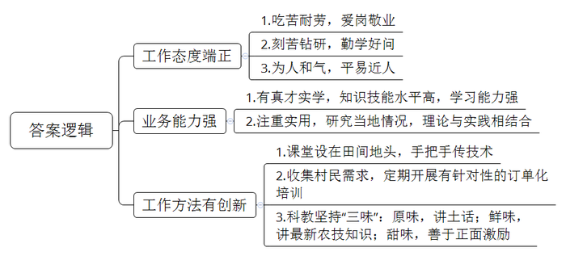
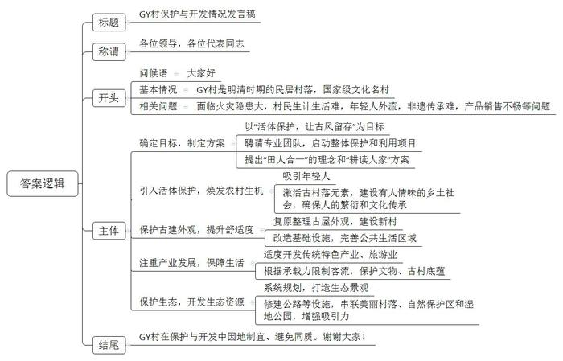
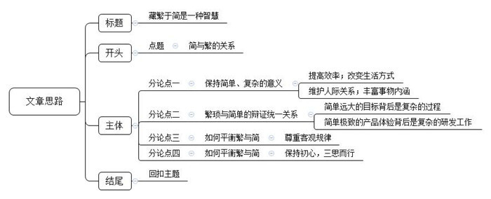

# 2018年公务员多省联考《申论》题（宁夏卷）

> 候选采集稿。参考答案及解析来自粉笔页面，不代表官方答案或真实高分答卷；来源使用许可与原卷对应关系仍需人工核实。

## 给定材料

### 材料 material-0ebe5ff25e3b74dd

在2017年T市的“全市十佳科技特派员”评选活动中，小童以压倒性的票数获得第一名。一个年仅25岁的年轻人，为何能从平均年龄在50岁以上的本市特派员中脱颖而出呢？

领导说，他所服务的S村地处偏僻，有一段路车根本开不进去，下雨天时他坐摩托车进村，常弄得一身泥，特别狼狈。可是他每个月去S村的次数和时间都远远超过了考核要求。同事们说，他要是有什么没弄懂的问题，肯定会睡不好觉，会缠着老特派员们搞清楚的。大学书本告诉了他“是什么”“为什么”，但他觉得还不够。从来到这儿，他就开始研究这儿的土壤、天气、乡情民俗，他一个北方人竟然在短短几个月时间里学会了这儿的方言。

老乡们说，他态度好，说话和气。大家都喜欢和他说话。他说的话大家听得懂，句子不长，用的也是田坎语言，好懂实用。而且他手把手地传技术，把课堂设在田间地头，教给大家的东西都记得住。“他讲的东西很接地气，富有土味儿。而且，他还会收集村民的需求，定期地开展‘订单化’培训。这样的特派员难找。”村支书也对小童赞不绝口。

而小童自己却说，自己能赢得大家的喜欢，在于自己会玩些“小花样”。“老乡们要的是技术，晦涩的理论讲得再高深，起到的作用也是有限的；老乡们学技术，最终还是要落脚到做上面去。科教本身有些乏味，必须要加点料才会有滋有味。我在做技术特派工作时，就坚持添加‘三味’：一是原味，坚持用原汁原味的田坎语言讲授，尽量讲短话，讲土话；二是鲜味，给乡亲们的一定是最新的农技知识，过时的、可能已经不适用的，坚决不讲；三是甜味，对乡亲们积极鼓励，尽量用积极的语言，谁都希望话好听啊，多给他们看看成功的案例，正面激励。如果你用的是本地语言，说的是农家事，讲的是致富经，他们不欢迎你都难啊。”

### 材料 material-639f1a8c4758c906

最近几年，很多二线城市的人才引进工作都开展得如火如荼。二线城市尚在努力，三四线城市自然也不甘落后：给钱、给房、给户口。然而，纵观很多三四线城市的“人才争夺战”，大多也只是出台买房打折、租房补贴、落户降标、项目资助、一次性奖励等引才政策。这固然有一定的吸引力。但作为本身经济实力和区位优势就不那么突出的三四线城市，给出和二线城市差不多的“彩礼”，能真正地“引凤求凰”吗？

“在人才工作中，一些地方的同质化倾向依旧明显。”一位从事人才引进工作多年的部门负责人说道，“现在，很多中小城市都要高学历、高效能、高层次、高大上、高精尖的人才；而给人才的往往就是‘老三样’——钱、房和户口。”

“很多地方把人才引进工作想得过于简单了。”一位评论家说道，“人才工作不是把人引进来就可以的，它其实更依赖人才生态的建设——如何利用、再培养、激励，如何留得住才是重中之重。然而，这往往是被很多中小城市忽视。花了大力气，引不到人才；人才来了待不久。消耗了那么多的财力物力，也还是为他人做嫁衣。”问题还不止于此，现在一些地方的人才引进工作，已经给当地的财政带来不小的压力和负担了。但收效却甚微。很多地方都重视引进外地人才，可外地人才引不来，厚彼薄此，重外轻里的人才政策更让本地人颇有意见，可以用“赔本也没赚到吆喝”来形容。

“计算机、生物科技、航空航天这些尖端领域的顶尖人才本来就非常稀缺，即使在北上广深这样的城市都是‘肉少狼多’。在这样的环境中，实力薄弱许多的三四线城市往往是耗费了大量的财力物力人力，最后却还是被‘剩下’。而且，就算引进了，往往也用不好，甚至用不上。”一位人力资源专家说道，“引进人才要靠优势，但中小城市能靠的优势往往不是物质吸引力，而是自己的特色。”

另一位评论家也给出了一个观点，“各个地方的人才引进工作，必须要‘错位’又‘对位’。我们的城市定位不应该也不可能是趋同的，要是采用同样的人才路线，是会‘撞车’的；毕竟错落有致，才既尊重城市发展规律，又符合建筑美学嘛。我国各个城市间的地理、经济等方面差距依旧巨大，对人才的吸引力、对人才的需求结构都是大不相同的。我们必须认清这个现实，找准自己的位置，才可能做好人才工作。因为你是你，你不是别的城市。你在全省，甚至是全国有你的角色定位，有你自己独特的优势。所以必须各就其位、各求所需。”

### 材料 material-bcd5c4142fe15b98

位于湘西的GY古村，因三面环山、一面临水的地势而得名。这个明清时期的古代民居建筑村落，被誉为“江南第一村”和“民俗博物馆”。在晨雾中，绿荫环抱的小山村，一片青瓦白墙，一条流过门前的清流小河，如此简单的画面让人心生向往。

GY古村在2006年被国务院公布为第六批全国重点文物保护单位；2007年被公布为国家级历史文化名村；现为国家3A级旅游景区。

这儿的建筑有一个特别之处：在侗式木屋的外面，还筑有徽式高墙。因为村子人口多，房屋十分密集，火灾是这儿的纯木质房屋极大的安全隐患。

几年前，村里的杨老犯了愁：村子里和他一起唱傩戏的人，已经没有几个了。作为省里的非遗，难道就真的逃脱不了失传的命运吗？当时，GY村和中国所有乡村面临的状况十分相似：年轻人大都外出打工，留守和空巢现象较为严重。杨老说，年轻人也不是不想回来，但是村里房屋太挤了；在家种地挣不了几个钱，养不活自己和家人；因为古村保护不能乱建新房，年轻人在外面打工挣钱了当然想住一个新房，但没地方让他们建，老屋洗澡、上厕所都不方便。在这生计生活问题都解决不了，更别说什么非遗传承问题了。

“我们村里啊，有很多土生土长的好东西，比如野生茶、黑米茶、有机生态米、手工艺品等等。”村支书老高说道，“但以前这里建筑规划不行，交通也没跟上，我们不会包装，好东西也卖不出去，可惜哟。”

“活体保护，让古风留存。”这是县委书记为GY古村拟好的目标。为了更好地保护这一弥足珍贵的传统村落，县政府于2015年全面启动了GY村整体保护与利用项目，并特邀了专业的乡村建筑设计团队来打造。面对GY村的山水和生态，团队提出了“田人合一”的理念和“耕读人家”的设计方案，从房、水、旅、种、村、治等几个方面分别着手修复和调整：只有乡愁乡建，才能留住乡愁；只有古村古建，才能留存古风。

“乡建的重点，是在‘乡’上下功夫，而不是在‘建’上做文章；乡愁不是‘愁’上做文章，而要在‘乡’中找情感。乡就是农田、民居、菜园、养猪，就是充满人情味的乡土社会。让年轻人回村，只要他们回家了，人就可以养房，村中就有生机。”团队这样的理念重新激活了古村落的元素，把农村建设得更像农村。

过去对传统村落的保护，可能更侧重于单纯的物质上的保护，而忽略了人的繁衍、文化的传承，没有太多考虑年轻人为什么不愿意回来。县委书记介绍道：GY村历史纵跨600多年，至今保存完好的一个很重要的因素，就是它有人活动，有侗汉苗民族老百姓在这里繁衍生息，所以我们必须引入活体保护的概念。

古村古建在外观上对GY村进行了保护和传承。同时也注意提高农民生活的舒适度，改造了古村的基础设施和公共生活区域，让老人和年轻人都住得舒服；对外观上已经过度改造的房子，进行了复原整理；此外，还在古村旁边建了一个新村。

“有了新村，年轻人可以回家盖房。古村也因为年轻人的回归而注入了新要素，传统特色产业的发展也有了更坚实的依托和更广阔的空间。”县委书记说道。他认为，他们必须要保持有老百姓在这里生产、生活、繁衍生息这么一种风貌，也必须把群众赖以生存的各种产业做好。在传统特色产业活了以后，GY村开始在旅游业方面大展拳脚。在这几年，GY村连续被评为“中国十大最美丽乡村”。古村的自然素净吸引了来自全国各地的人们前来一睹芳姿。但即使是面对这样的旅游热，GY村也保持了冷静的头脑：在发展旅游的同时，必须把古村的文物保护好，把文脉保护住，留住古村底蕴。产业发展也要适度，才可以避免失去特色；旅游限量接待游客，防止超过古村承载能力。只有这样，古村才有长久的魅力和旺盛的生命力。

但古村的保护发展工作还不止于此。“古村本身只是一个亮点，真正能将人留住的，是这里的青山绿水。这里非常宁静美好，就像一个世外桃源。虽然这里偏僻了一点，但现在已经改善了基础设施，比如修建沿河公路等等。现在县城到这儿，只要20分钟车程。”县委书记说，“附近还有一个国家级自然保护区和一个国家湿地公园，生态都非常好。这些都是我们当初就看到并且纳入规划的。”现在，公路已经把沿河的那些小小的美丽村落、自然保护区、湿地公园等都纳进来了。GY村就像是一串项链上最璀璨的明珠。

“如果当初大家照着别的古村例子来做，也有一定效果。但为了我们祖祖辈辈生活的家园，我们多想点办法，多动点脑筋，多流些汗也值。”GY村村支书说道。

## 题目

### 第 1 题

**根据给定资料**1**，概括小童能获得“全市十佳科技特派员”荣誉的原因。（15分）**

关联材料：材料 material-0ebe5ff25e3b74dd

作答要求：

要求：全面，准确，简明，有条理，字数不超过200字。

### 第 2 题

**根据给定资料**2**\-**3**，概括出部分城市人才工作存在的主要问题并提出相应的改进措施。（30分）**

关联材料：材料 material-639f1a8c4758c906

作答要求：

要求：分层合理，字数不超过450字。

### 第 3 题

**假设GY村所在的省份将开展一次关于古村落的保护与开发的经验交谈会，请你根据给定材料**4**，写一份介绍GY村保护和开发情况的发言稿。（35分）**

关联材料：材料 material-bcd5c4142fe15b98

作答要求：

要求：紧扣材料，内容全面。逻辑清晰，语言准确，字数不超过450字。

### 第 4 题

**给定资料**6**中划线部分“只有处理好‘简’与‘繁’的关系，我们才不会在当前畏手畏脚，而对三年后的世界又计划得好高骛远，对十年后的未来又得鼠目寸光”的理解，自选角度，自拟题目，写一篇文章。（70分）**

关联材料：材料 material-0ebe5ff25e3b74dd

作答要求：

要求：结合给定材料，不拘泥于给定材料，联系实际，观点正确，内容充实，结构完整，思路清晰，语言流畅，字数不少于1000字。

## 答案与解析

第 1 题

**参考答案（粉笔题库参考内容）**

一、工作态度端正。1.吃苦耐劳，爱岗敬业；2.刻苦钻研，勤学好问；3.为人和气，平易近人。

二、业务能力强。1.有真才实学，知识技能水平高，学习能力强；2.注重实用，研究当地情况，理论与实践相结合。

三、工作方法有创新。1.课堂设在田间地头，手把手传技术；2.收集村民需求，定期开展有针对性的订单化培训；3.科教坚持“三味”：原味，讲土话；鲜味，讲最新农技知识；甜味，善于正面激励。

**解析**

**参考答案说明：**本参考答案从“工作态度端正”“业务能力强”“工作方法有创新”这三方面展开，各条答案要点之间在内容上相互并列，没有交叉。

**考点**：考点原因类

**来源**：来源2018年公务员多省联考《申论》题（宁夏卷）

第 2 题

**参考答案（粉笔题库参考内容）**

1.针对人才引进的同质化、缺乏特色的问题。要因地制宜，按需引才。既“错位”又“对位”，立足自身实际，发挥自身优势与特色，将人才引进来。  

2.针对人才工作中厚彼薄此，重外轻里的问题。要加强对本地人才的挖掘与培养。营造公平的竞争环境，减少本地人才心理落差；以老带新，发现、培养和举荐本地人才。  

3.针对人才的使用管理机制不科学，分类标准过于草率的问题。要科学设计，系统规划，完善人才评判、分类分级机制及人才使用、培养、激励机制，加强人才生态建设，营造良好制度环境，将人才用好。  

4.针对人才结构不合理，“倒金字塔型”不稳定的问题。要优化人才引进的结构，加强基础型人才引进力度；普惠支持毕业生，把人才补贴门槛降低为大学生。  

5.针对城市定位不清，对人才的吸引力不够的问题。要有明确的城市定位，走个性化发展之路，体现城市特色、气质，符合发展潮流，增加吸引力。例如义乌、贵阳等城市的经验。

**解析**

**参考答案说明：**本参考答案从“人才引进”“人才工作”“人才制度”“人才结构”“城市定位”五个方面进行了分条撰写。各条要点之间在内容上相互并列，没有交叉。

**考点**：考点提出对策类

**来源**：来源2018年公务员多省联考《申论》题（宁夏卷）

第 3 题

**参考答案（粉笔题库参考内容）**

关于GY村保护与开发情况的发言稿

各位领导，各位代表同志：

大家好！根据会议安排，由我来介绍GY村的保护与开发情况。GY村是明清时期的民居村落，国家级文化名村。但面临火灾隐患大、村民生计生活难、年轻人外流、非遗传承难、产品销售不畅等问题。为此，采取了以下措施：

一、确定目标，制定方案。以“活体保护，让古风留存”为目标，聘请专业团队，启动整体保护和利用项目，提出“田人合一”的理念和“耕读人家”方案。二、引入活体保护，焕发农村生机。吸引年轻人；激活古村落元素，建设有人情味的乡土社会，确保人的繁衍和文化传承。三、保护古建外观，提升舒适度。复原整理古屋外观，建设新村；改造基础设施，完善公共生活区域。四、注重产业发展，保障生活。适度开发传统特色产业、旅游业；根据承载力限制客流，保护文物、古村底蕴。五、保护生态，开发生态资源。系统规划，打造生态景观；修建公路等设施，串联美丽村落、自然保护区和湿地公园，增强吸引力。

GY村在保护与开发中因地制宜、避免同质。谢谢大家！

**解析**

**参考答案说明：**（1）格式方面，本参考答案写到了“标题”“称谓”“正文”。（2）正文部分，一方面，从内容来看，围绕着“古村落的保护与开发”这一主题，本参考答案的开头写到了“GY村的背景和问题”；主体部分从“确定目标，制定方案”“活体保护、焕发生机”“保护外观，提升舒适度”“注重产业发展，保障生活”“保护生态，开发生态资源”等五个方面给出了具体的经验阐述；结尾发出呼吁，并表示感谢。另一方面，形式上，本参考答案做到了分段、分条撰写，整体上条理较为清晰。（3）本参考答案能够结合题目要求“逻辑清晰，语言准确”，在语言表达上做到了简洁、流畅、有条理。

**考点**：考点总结类

**来源**：来源2018年公务员多省联考《申论》题（宁夏卷）

第 4 题

**参考答案（粉笔题库参考内容）**

参考范文（一）

**藏繁于简是一种智慧**  

智能手机、共享汽车……科技产品填满我们的生活，让我们喜忧参半：喜的是，生活越来越简单、越来越便捷，忧的是少了人情味、少了生活的调味剂。如此看来，生活不应只有简单，也应该多些 “繁琐”，多些必要的仪式。**“简”与“繁”之间的关系应该是藏繁于简、简繁得当、于繁见简，只有处理好两者之间的关系，我们才能从容应对，轻装上阵，最后才能满载而归，这才是真正的智慧和艺术。**

**“简”带来便利，提高效率，省时省力，改变生活方式。同时，“繁”能够丰富事物的内容，增加人与人之间的牵绊与情谊。**互联网时代的到来彻底改变了人类的生活：过去车马劳顿，现在一日万里；过去飞鸽传书、书信往来，现在只需连接WIFI、微信互动；过去物质与精神双重贫瘠，现在商品、书籍琳琅满目。简单是科技发展的恩赐，反过来又促进了时代进步。然而，书信往来虽然繁琐，却多了亲友间的牵挂和期待；传统婚礼繁琐的过程，让新婚夫妇更加珍惜婚姻，努力生活......如此种种，繁琐同样丰富了生命的内涵。

不得不说，**简单与繁琐你中有我、我中有你，相互依存、辩证共生。**简单通常代表纯粹和本质，是为人处世追求的目标，毕竟，谁不想拥有“庖丁解牛”般地自信、“大道至简”般地淡然？然而，简单的背后离不开繁琐的过程：看似简单的真理经历过无数曲折探索的过程；看似简单的味道得益于厨师无数次的尝试；看似简单的产品离不开科学家匠人般的执着。可以说，没有繁琐便成就不了简单，没有简单繁琐也就没了意义，我们既要做好减法，又要做好加法；既要删繁就简、化繁为简，又要藏繁于简。

**藏繁于简要把握事物发展规律，尊重从简单到复杂，再从复杂到简单的过程。**前途光明、道路曲折，没有任何事物的发展一蹴而就、一帆风顺，繁琐不是成功路上的拦路虎，而是一种磨炼。王国维先生的诗词三境界“独上高楼望尽天涯路”、“衣带渐宽终不悔，为伊消得人憔悴”、“众里寻他千百度，蓦然回首，那人却在灯火阑珊处”便经历了看山是山、看山不是山、看山又是山的过程。人生的发展、社会的发展、万事万物的发展其实都是遵循这一否定之否定、螺旋式上升的规律。

**藏繁于简还要学会不忘本心、保持初心、秉持素心，同时三思后行、从容应对、轻装上阵。**无欲则刚，在复杂的社会唯有保持简单才能抵御外界的诱惑、化解路途中的风险。就如同科学家淡泊名利，沿着科学的道路攻克一个个难关，攀登一座座高峰；就如中国共产党在风风雨雨中，不忘初心、砥砺前行，不断取得经济、文化、民生等方面的成就。当我们洞悉简单与繁琐的关系，就会多一份谨慎小心，多一份深思熟虑——路漫漫其修远兮，吾将上下而求索！

大千世界，是复杂的，还是简单的？仁者见仁、智者见智，而在我看来，简单与繁琐在一定意义上是相对的，简单累积到一定程度就趋于繁琐，繁琐沉淀到一定程度就变成简单，唯有藏繁于简、于简见繁方是我们追求的境界！人生如画，惜墨或添笔，少少许应是朗清之月明星稀，多多许应是丰盛之花繁叶茂。

**解析**

**文章分析**

**藏繁于简是一种智慧**

〖**标题的优点：**首先，范文的标题“藏繁于简是一种智慧”突出了“简与繁”这一主题。其次，形式上，文字简洁明快。〗

智能手机、共享汽车……（1）科技产品填满我们的生活，（2）让我们喜忧参半：喜的是，生活越来越简单、越来越便捷，忧的是少了人情味、少了生活的调味剂。如此看来，（3）生活不应只有简单，也应该多些 “繁琐”，多些必要的仪式。（4）**“简”与“繁”之间的关系应该是****藏繁于简、简繁得当、于繁见简****，只有处理好两者之间的关系，我们才能从容应对，轻装上阵，最后才能满载而归，这才是真正的智慧和艺术。**

〖**开头的优点：****★**内容方面：范文的开头是紧扣“简与繁”这一主题展开的。首先，开头前三句话之内点出主题，做到了主题明确。其次，对“简与繁”这一主题进行了分析阐述：（1）先指出了“科技产品纷繁复杂，填满我们的生活”；（2）再指出了“科技产品复杂的积极影响与消极影响”；（3）接着指出了“生活中既要有‘简’，也要有‘繁’”；（4）最后指出了“‘简与繁’的具体关系”。文字表达方面：长短句配合使用，使语言表达有节奏感。〗

**“简”带来便利，提高效率，省时省力，改变生活方式。同时，“繁”能够丰富事物的内容，增加人与人之间的牵绊与情谊。**（1）互联网时代的到来彻底改变了人类的生活：过去车马劳顿，现在一日万里；过去飞鸽传书、书信往来，现在只需连接WIFI、微信互动；过去物质与精神双重贫瘠，现在商品、书籍琳琅满目。简单是科技发展的恩赐，反过来又促进了时代进步。然而，（2）书信往来虽然繁琐，却多了亲友间的牵挂和期待；传统婚礼繁琐的过程，让新婚夫妇更加珍惜婚姻，努力生活......如此种种，繁琐同样丰富了生命的内涵。

〖**论述段****1的优点：**★观点句：范文的观点句是紧扣“简与繁”这一文章主题提出的。形式上，它在段首处直接写出，位置突出，容易发现。内容上，关键词突出，内容要点明确，可以明显看出它是从“便利，提高效率，省时省力，改变生活方式、生产方式”等入手，指出了“简单的重要性”。★论述内容：（1）先介绍了“简”的意义；（2）再介绍了“繁”的意义。注意：以上两个方面的内容都是紧扣“‘简’带来便利，提高效率，省时省力，改变生活方式。同时，‘繁’能够丰富事物的内容，增加人与人之间的牵绊与情谊”这个观点句进行分析论述的，论述的针对性强，内容层次丰富。在论述方法上采用了例证、理证结合的方式进行展开的，做到了论述有力。〗

不得不说，**简单与****繁琐你中有我、我中有你，相互依存、辩证共生。**（1）简单通常代表纯粹和本质，是为人处世追求的目标，毕竟，谁不想拥有“庖丁解牛”般地自信、“大道至简”般地淡然？然而，（2）简单的背后离不开繁琐的过程：看似简单的真理经历过无数曲折探索的过程；看似简单的味道得益于厨师无数次的尝试；看似简单的产品离不开科学家匠人般的执着。

〖**论述段****2****的优点：**★观点句：范文的观点句是紧扣“简与繁”这一文章主题提出的。形式上，它在段首处直接写出，位置突出，容易发现。内容上，关键词突出，内容要点明确，可以明显看出它指出了“‘简’与‘繁’的关系”。★论述内容：（1）先介绍了“简单远大目标的背后是复杂的过程”；（2）再介绍了“简单的背后离不开繁琐的过程”。注意：以上两个方面的内容都是紧扣“简单与繁琐你中有我、我中有你，相互依存、辩证共生”这个观点句进行分析论述的，论述的针对性强，内容层次丰富。在论述方法上采用了例证、理证结合的方式进行展开的，做到了论述有力。〗

可以说，没有繁琐便成就不了简单，没有简单繁琐也就没了意义，我们既要做好减法，又要做好加法；既要删繁就简、化繁为简，又要藏繁于简。

**藏繁于简****要把握事物发展****规律****，****尊重从简单到复杂****，****再从复杂到简单的过程****。**（1）前途光明、道路曲折，没有任何事物的发展一蹴而就、一帆风顺，繁琐不是成功路上的拦路虎，而是一种磨炼。王国维先生的诗词三境界“独上高楼望尽天涯路”、“衣带渐宽终不悔，为伊消得人憔悴”、“众里寻他千百度，蓦然回首，那人却在灯火阑珊处”便经历了看山是山、看山不是山、看山又是山的过程。（2）人生的发展、社会的发展、万事万物的发展其实都是遵循这一否定之否定、螺旋式上升的规律。

〖**论述段****3****的优点：**★观点句：范文的观点句是紧扣“简与繁”这一文章主题提出的。形式上，它在段首处直接写出，位置突出，容易发现。内容上，关键词突出，内容要点明确，可以明显看出它从“把握事物发展规律”的角度，指出了如何正确处理“简与繁”的关系。★论述内容：（1）先介绍了“繁琐是一种磨炼”；（2）再介绍了“人生、社会的发展要遵循螺旋式上升的规律”。注意：以上两个方面的内容都是紧扣“藏繁于简要把握事物发展规律，尊重从简单到复杂，再从复杂到简单的过程”这个观点句进行分析论述的，论述的针对性强，内容层次丰富。在论述方法上采用了例证、理证结合的方式进行展开的，做到了论述有力。〗

**藏繁于简还要学会不忘本心****、****保持初心****、秉持素心，同时三思后行、从容应对、轻装上阵。**无欲则刚，（1）在复杂的社会唯有保持简单才能抵御外界的诱惑、化解路途中的风险。就如同科学家淡泊名利，沿着科学的道路攻克一个个难关，攀登一座座高峰；就如中国共产党在风风雨雨中，不忘初心、砥砺前行，不断取得经济、文化、民生等方面的成就。（2）当我们洞悉简单与繁琐的关系，就会多一份谨慎小心，多一份深思熟虑——路漫漫其修远兮，吾将上下而求索！

〖**论述段****4****的优点：**★观点句：范文的观点句是紧扣“简与繁”这一文章主题提出的。形式上，它在段首处直接写出，位置突出，容易发现。内容上，关键词突出，内容要点明确，可以明显看出它从“不忘初心”的角度，指出了如何正确处理“简与繁”的关系。★论述内容：（1）先介绍了“保持简单才能抵御诱惑、化解风险”；（2）再介绍了“面对‘简与繁’，应谨慎小心，深思熟虑”。注意：以上两个方面的内容都是紧扣“藏繁于简还要学会不忘本心、保持初心、秉持素心，同时三思后行、从容应对、轻装上阵”这个观点句进行分析论述的，论述的针对性强，内容层次丰富。在论述方法上采用了例证、理证结合的方式进行展开的，做到了论述有力。〗

大千世界，是复杂的，还是简单的？仁者见仁、智者见智，而在我看来，（1）简单与繁琐在一定意义上是相对的，简单累积到一定程度就趋于繁琐，繁琐沉淀到一定程度就变成简单，（2）唯有藏繁于简、于简见繁方是我们追求的境界！人生如画，惜墨或添笔，少少许应是朗清之月明星稀，多多许应是丰盛之花繁叶茂。

〖**结尾的优点**：范文的结尾回扣了“简与繁”这一主题。（1）提到了“简与繁”相互转化的关系；（2）阐述了“藏繁于简”的智慧。〗

参考范文（二）

**简繁之道**

简单与繁琐相互依存、辩证共生。简单代表便利，是我们在生活、工作、思维上追求的目标。但获得简单离不开曲折繁琐的探索过程，没有繁琐便成就不了简单。简单意味着效率；繁琐则给我们带来多样、丰富、深刻的经验；简繁得当，则能出效率、出成果。

正确处理简和繁的关系，是我们做好人生规划、工作发展应具备的智慧。我们的短期、中期和长期规划中，处理简和繁的辩证关系需要不同的智慧。

**对于当前规划，目标要少而简单，但须长期坚持。**设置太多目标会让我们无所适从；目标简单才能专心专注，才能忍耐过程的繁复辛苦。短期目标往往很多，很诱人，我们要做到抓住重点，由少到多，由简单到复杂，才不会畏首畏尾。一个人的成功，往往是从专注完成一个简单目标开始的。很多餐馆或企业经营也是先从简单的单品开始做起的。但一个再简单的目标，一件再简单事情，过程往往也是繁复的，专注和坚持会迸发创造力。比如追求信息共享简单便捷的长期努力催生了互联网，带来了社交软件、移动支付等，节约了社交、购物、出行、吃饭等时间。这使我们有更多的机会从事创造，从而带来更多产品，活跃了经济。

对于我们的中期规划，简与繁的矛盾关系又当如何处理呢？

**中期计划要切合实际，反复思考，从而得出简单可行的过程和步骤。**在思想认知层面，要从简单到复杂，由浅入深地认识目标；实践层面，反复推敲实施步骤，要有可操作性**。**看似简单的计划，其实包含了对人员、资源、条件、环境等主客观因素的复杂考虑。我们只有理解了其繁琐的推导过程，才能做到对目标了然于胸。比如建造一个住房小区，至少要综合考虑市民的居住、休闲、锻炼等中长期需要。在实践层面，要以极为繁琐的流程反复推演、试用和修改得出简单可行的方法。比如政府工作规划要简单，老百姓才能看到摸得着的希望。

那对于以十年计的长远未来，什么当繁，什么当简呢？我认为目标应该是宏大繁重的，但路径应该从简单开始。

**对于长远目标，要详尽了解，深思熟虑，做出长远、整体规划**。个人发展或社会整体发展都应当如此。对于长远规划，我们不能鼠目寸光，满足于“拿来主义”，比如通过贴牌生产、山寨生产等赚快钱。若以十年计，目标往往是大而复杂，同时又是基础的。比如国家科技建设的基础研究，企业的产品研发，农业科技体系，医药开发等。这些任务往往艰巨而繁杂，但我们不能因此退怯。但就达成目标的路径而言，我们要学会分解目标，化繁为简，从简单的目标开始，从易到难，逐步攀登。比如关乎国运的信息科技长期规划，我们国家就是从比较容易的硬件生产和应用开发入手，再继续努力攻克操作系统、芯片设计开发、人工智能等难题的。

无论是简单的，还是繁杂的，人生的所有经历都会在记忆中埋藏，孕育成长的根芽。我们可以追求简单朴素，但不能因此拒绝繁复，要去深入了解，于简见繁 ，当繁勿简，才能从繁到简。

**考点**：考点文章写作题

**来源**：来源2018年公务员多省联考《申论》题（宁夏卷）

