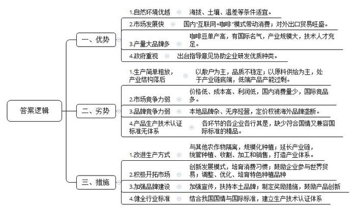
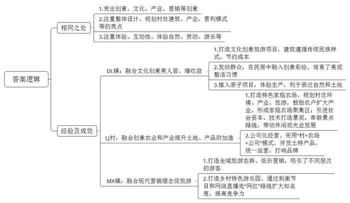

# 2019年公务员多省联考《申论》题（宁夏卷）

<!-- gwy:overview:start -->
> **宁夏 · 2019 · 申论 · 统考** ｜ 4 题 · 图片 4 处 · 答案随题折叠

导航：[题目](#题目)
<!-- gwy:overview:end -->

> 候选采集稿。参考答案及解析来自粉笔页面，不代表官方答案或真实高分答卷；来源使用许可与原卷对应关系仍需人工核实。

## 给定材料

### 材料 material-d4a35ac6cd482b32

2018年马拉松持续火爆，据统计，截至11月2日，800人以上越野跑赛事共1072场，参赛人次达530万，预计年底这个数字将达到600万。马拉松赛事多的背后，是马拉松爱好者群体的急速膨胀。当前，名称中带“国际”“半程”“全程”等字样的马拉松比赛已超过半数，这其实从侧面反映出同质化问题较为突出。

的确，马拉松比赛参与人数多、参与面广、参赛门槛低、赛事轻松活泼，又兼有一定的旅游观光的特点。很多地方都希望通过马拉松展示城市形象，吸引更多客流，带动旅游消费。然而一些新近举办的赛事虽然动辄标榜“国际”头衔，但实际报名率却很低。这不仅浪费办赛的人力物力等资源，还带来了交通问题和群众安全隐患。由于赛事等级评定对参赛人数、参赛标准甚至参赛成绩等都有严格要求，有些小赛事为了达到目标，不惜拉人头撑场面，甚至花钱请选手，让比赛变味。同时，一些具有品牌效应的马拉松赛事有一定的准入门槛和限制，往往“一号难求”。于是“号码黄牛”转让参赛号码布成为灰色产业链条，这扰乱了赛事组织秩序，给赛事带来了诸多潜在风险和管理难题。

马拉松比赛声势浩大，动辄几万人参加，有相当大的组织难度，非常考验城市管理者、主办方的管理智慧和专业能力。一位社评家甚至评价其为“城市综合治理能力的‘试金石’”。对于刚刚起步的中国马拉松运动来说，在“跑马乱象”面前树立规则大旗，强化规则意识，这需要参赛者、赛事组织者以专业管理运营来呵护它的成长。就现状来说，提高我们马拉松赛事的质量和水平，可能需要用百米冲刺的速度跑一场马拉松。

其实，马拉松赛事并不一定要追求声势和规模。它可以有很多细分区间，既有竞速比赛，也有越野赛、集体赛，还可以情怀、趣味等作为亮点。这需要举办地找准定位，利用有限的资源，办出特点，办出口碑。

任何新事物发展都会有“成长的烦恼”。近年来，马拉松赛事中替跑、转让号码布等问题屡禁不止，比赛补给不足、补给食品过期、参赛者半途迷路、关门时间未到路段解封等也时有报道，最近更是出现集体抄近路、骑单车“赛跑”、工作人员终点“搀扶”运动员等不良事件，引发大众吐槽。这些问题，既是参赛者的，也是主办方和运营方的。马拉松运动热催生了一批体育产业的运营商。它们在承办赛事时也往往显得急功近利，过分追求经济效益。“这说明我们在公共服务、公共管理方面还有不足。”某地体育主管部门负责人说道，“不得不承认，比起体育发达国家，我们在马拉松赛事的举办和管理上还有很多需要改进之处。一切迫在眉睫啊！”

一些跑者还没能真实领会到这项运动的内涵，单纯为了跑而跑、为了好玩而跑，他们并没有一个跑者的身体准备和心理准备。比赛中，一些参赛者伤病送医就是佐证。跑步，是一种锻炼享受。健康是出发点，更是落脚点。至于在比赛中的种种作弊和倒卖参赛资格的行为，更是失去了马拉松比赛的意义。前些时候，首都媒体发布了《首都媒体跑团2018年倡议书》，号召跑者们要自觉坚守底线，敬畏规则。体育运动的重要精神之一是“尊重规则”，所有参与者必须在统一规则下“游戏”，竞争才有意义，结果才有价值。对于赛事的主办方地方政府来说，马拉松比赛绝不只是招标营运方、划出赛事路线、配合做好封路及安保医疗工作就完事了。一个赛事举办的好坏、赛事期间各项服务的优劣，以及当地风俗人情、文化景观等，都能在赛后成为网络热门话题。

### 材料 material-1aaede5889a652fe

“Y省的咖啡豆是天赐的礼物。”这是一位外国友人对Y省咖啡豆的评价。据统计，Y省大部分咖啡豆种植区的海拔都在1000米以上，肥沃的土壤，充足的光照和降雨，明显的昼夜温差，让其所产的咖啡豆颗粒饱满、口味醇厚，堪称“天地厚养”。

“Y省的咖啡豆，可以是高品质的，但这看运气。”咖啡爱好者小李说：“我喝到过顶级口感的，也喝到过如炒糊的黄豆的，而它们都来自Y省同一产地。”的确，就拿Y省咖啡种植大市B市、P市来说，其仍然以散户种植为主。这些咖啡树的“邻居”可能是烟草、水果、玉米等等。施肥、除虫可能都没有。咖啡果本身是水果，风一吹，各种植物的花粉漫天，以这样简单粗暴的方式种植，咖啡豆的品质怎么可能稳定呢？

Y省某著名的咖啡烘焙师对记者说：“我们的咖啡产业，主要还是在做咖啡豆供给，这属于产业链底端。种植的搞种植，烘焙的搞烘焙，各自为政，还要相互挤压利润空间。”

Y省的咖啡豆在国际上确实有些名气，但这种名气并不属于当地品牌，它只是在Y省生长出来的产品属性。很多著名连锁咖啡店使用的咖啡豆就是产自Y省的，但大部分人并不认为自己在喝Y省的咖啡，而是在喝咖啡店的咖啡。

现阶段中国人均咖啡消费量远落后于世界的平均水平。不过，近几年“互联网+咖啡”模式进一步发展，一部分人有了喝现磨咖啡的习惯。同时，即饮咖啡市场也在兴起。较之速溶咖啡，现磨、即饮对口感要求高，更倾向于使用阿拉比卡豆（咖啡豆的一种），而Y省种植的主要就是阿拉比卡豆。

“我们不想种咖啡豆了。”Y省咖农老王对记者抱怨道，“我们的咖啡豆价格比巴西、印尼、越南低，但采摘成本却高很多。所以，我们不赚钱，有时还赔本。我在电视上看到，有的地方的农产品是一个村甚至几个村一起统一种植、统一收割、统一标准加工，再‘组团进城’销售。我们要是也能那样就好了。”

当然，也有好消息：2015年，两条中欧国际货运班列开通，这促进了Y省咖啡出口贸易井喷式增长。当年，Y省咖啡创汇逾4亿美元，比上年翻了将近一番。可不少咖农还是担心：“我们隔壁可是世界上速溶咖啡产量最大的国家啊，会不会它们顺着国际货运列车，来抢我们的生意？”

“我们咖啡单产高，这应是优势，而不是我们产能过剩的原因。但在很早之前，我们就已有低端产品产能过剩的问题。”Y省政策研究室的工作人员说，“我们并没有从‘中国咖啡市场高速增长’中得到多少利润。举个例子，我们供给某外国品牌咖啡店的咖啡豆价格是25元一公斤，而它们在中国卖一杯咖啡就要价30元。其实，我们已建成了国内最大的焙炒咖啡生产线，还有几十个咖啡品牌以及大量满怀热情的咖啡产业技术人才，这些都是我们咖啡业发展的条件。”

“我们有难得的适宜种植利润丰厚的‘微批次’精品咖啡豆的微环境、微气候。”某咖啡品牌主理人小雯感叹道，“可什么是精品，怎样才算‘微批次’？我们用的是国外的概念和标准，而从种植到加工生产经营企业，有执行国际咖啡组织认证标准的，有执行欧盟认证标准的，有执行美国、日本认证标准的，可谓五花八门，为什么我们不制定符合我们国情，又兼容于国际的标准呢？不行动起来，我们还是会一直被牵着鼻子走。”

标准多等于无标准，品牌杂导致无名牌。目前，因咖啡产品生产技术认证标准不成体系，Y省咖啡产业从农业生产到工业加工，各个企业处于“八仙过海，各显神通”的境地。“一些浑水摸鱼、以次充好的经营者忽悠了消费者，也伤害了我们这些老老实实做咖啡的人。”小雯不无痛心地说。

其实，对于咖啡产业，Y省政府是高度重视和支持的，不仅出台了发展指导意见，更协助一些咖啡种植庄园从全球主产区引进瑰夏等优质咖啡品种，建起了世界咖啡博览园和Y省咖啡种子基因库，专注改善Y省咖啡品种单一的现状。经过近五年的种植培育，Y省某庄园已经产出了对当地环境、气候更加适应、风味更佳的二代品种。“这些成功的行动说明我们的地理环境和技术是很棒的，说明中国有好咖啡，就在我们这儿。”一位当地的咖啡庄园主人说道。

小陈是Y省某咖啡品牌创始人，他所经营的咖啡网店的年营收已破千万元，是国内最著名、最成功的咖啡电商之一。“曾经有个记者朋友用‘三杯咖啡’形容我的咖啡电商创业历程。第一杯是苦后回甘，第二杯是保持原味本色，第三杯是着力花式调配。其实，在我心中就一个字——动。”自称“咖啡创业青年”的小陈轻松地笑着，“千百万次地想‘要让全国都喜欢我们Y省的咖啡’，不如勇敢地迈出第一步，再踏踏实实地走下去。我们有得天独厚的资源禀赋，也有诸多后发劣势……所以，一切的一切都需要行动起来。因为，之于世间事，‘静’会给予很多‘如果’的假想，可唯有‘动’能带来‘但是’的希望。”

### 材料 material-c3de3fd0912408c4

“阳光公社”是DL镇的一个文化创意旅游项目，由著名设计师主理，其包括：创意餐厅、创意民居、创意奶场、农产品创意超市等。所有建筑都遵循当地古城的规定做成了传统的民族样式，地面均由卵石铺砌，造价低廉，却易拆卸和重修。“这个文化创意项目不仅增加了我们村旅游景点的看头，也让居民的房屋变得美观整洁。”村民老李指着自家屋子的外墙，“那是T大学的大学生们给我们专门做的创意彩绘。有了它，我们的房子看上去更精神了，我们不打扫干净屋子都觉得对不起它。”“阳光公社”的另一个亮点是文化创意奶场。其奶牛生产基地中植入了亲子项目，亲子家庭可以在这里体验牛奶生产，同时亲近自然和土地。“阳光公社”对外营业后，DL镇的游客量较去年增加200%，旅游营收提高了260%。县政府更是对这种融合了文化创意的乡村旅游模式给予“美人居、添看点、促旅游、增收益”的高度评价。

LJ村有适合发展现代农业的低丘缓坡近万亩，有毛竹林8000亩，还有一些从事野猪、山羊养殖和茶叶、铁皮石斛种植的小型农场。2013年中央一号文件提出发展家庭农场，并且鼓励和引导工商资本投入农业农村。LJ村决定因地制宜建设18个家庭农场，形成家庭农场聚集区，以家庭农场为龙头带动休闲观光业发展。为此，村里请设计公司对整村进行村庄环境规划、产业规划和旅游规划，打造了18个各具特色的家庭农场，鼓励本村现有农户扩大产业。比如种植白茶、铁皮石斛，饲养野猪、野山羊等；同时引进社会资本，打造花海世界、百亩竹园等景观，以小火车作为观光载体，串联起各景点路线。LJ村采用“村+农场+公司”模式，成立乡土农业发展有限公司，开发土特产品，统一包装，统一定价，打响品牌，形成乡村农业、旅游收益互补。孤立的农业种植不会提升土地的附加值，发展创意农业，把田园变乐园，村庄变旅游景区，就能大幅提高土地的收益！孤立的加工生产也不会提升产品的附加值。要让生产劳动更具乐趣、让加工生产更具体验性，就会提升产品价值。现在，LJ村集体资产已达到1.2亿元，村民年人均收入增至3.3万元。

0.5元一个的馒头，0.8元一瓶的矿泉水，2元一碗的面条……MX镇乡村游乐园里商品的“亲民”价格，无疑是吸引游客的最大卖点。对此，不少人质疑：“一个馒头成本1元，你才卖0.5元。这么‘倒贴’，不傻么？”殊不知，这样的“倒贴”，正体现了游乐园营销的高明之处。“旅游从总量上来说，低消费倾向的客人通常占到80%-90%。如果人为地抬高消费门槛，不就等于自绝财路？”这就是“平民经济学”的要义：通过“倒贴”部分旅游产品来进行营销，给游客留下好印象，形成全域旅游的良好态势，让不同消费层次的游客都愿意来，让他们玩得起、玩得开心。“我从来不觉得‘营销’是个贬义词。我觉得我们的乡村旅游融合现代的营销理念很有必要。我们这里没有什么名山古刹，靠的就是这个自己呕心沥血打造出来的游乐园。要想营利，当然要靠‘流量’。承诺永不涨价的食品、别开生面的动物运动会、惊险刺激的网络直播，都为我们吸引着大家的注意力。大家能来最好，不能来的，至少也知道了我们这儿的名字。”MX乡村游乐园运营公司的经理Q先生说，“通过这样，我们走‘网红’路线，成功地在竞争激烈的乡村旅游市场中杀出了一条血路。”

## 题目

### 第 1 题

**根据“给定资料**1**”，分析部分城市马拉松赛事存在的主要问题并提出相应的改进措施。（20分）**

关联材料：材料 material-d4a35ac6cd482b32

作答要求：

要求：

（1）紧扣资料，符合实际；

（2）表达准确，条理清晰；

（3）字数不超过400字。

第 1 题 · 答案与解析

**参考答案（粉笔题库参考内容）**

主要问题有：1.赛事同质化。数量多，质量差，缺乏特色；标榜国际头衔，报名率低，浪费资源，带来交通和安全隐患。2.组织管理混乱。花钱请选手，比赛变味；替跑、倒卖号码、拽停运动员，出现灰色产业链，带来风险；急功近利，过分追求经济效益。3.服务缺位。补给不足、食品过期、没有指示牌、提前解封路段。4.参赛者自身问题。未理解比赛内涵，身心准备不足；作弊和倒卖参赛资格，集体抄近路、骑单车赛跑。

改进措施为：1.打造特色。减少数量，提升质量；细分区间，丰富比赛种类，以情怀趣味为亮点；找准定位，利用有限资源办出特点和口碑。2.提升组织能力。提升管理智慧和专业能力，强化规则意识；提高赛事审核标准，加强监管，打击黄牛，加大惩处力度。3.完善服务。招标营运方、合理规划路线、配合做好封路及安保医疗工作；增派人员，做好赛事补给和食品安全工作。4.加强宣传。宣传比赛内涵，让参赛者做好身心准备；倡导参赛者坚守底线，敬畏规则。

**解析**

**参考答案说明：**本参考答案写到了“主要问题”和“改进措施”两大部分。其中第一部分主要从“赛事同质化”“组织管理混乱”“服务缺位”“参赛者自身问题”这四个不同的方面对马拉松赛事存在的主要问题进行了分条撰写；第二部分主要从“打造特色”“提升组织能力”“完善服务”“加强宣传”这四个不同的方面对如何解决马拉松赛事存在的问题提出了相应的对策，同样进行了分条撰写，各条要点之间内容上没有交叉。

**考点**：考点提出对策类

**来源**：来源2019年公务员多省联考《申论》题（宁夏卷）

粉笔申论页面对本题只提供「解析视频」入口，该入口是会员推广位，页面无视频地址与文字解析。

### 第 2 题

**根据“给定资料**2**”，归纳概括Y省发展咖啡产业的优势和劣势，并给出可行性措施。（30分）**

关联材料：材料 material-1aaede5889a652fe

作答要求：

要求：全面、准确、简明，有条理；字数不超过450字。

第 2 题 · 答案与解析

**参考答案（粉笔题库参考内容）**

一、优势。1.自然环境优越：海拔、土壤、温差等条件适宜。2.市场发展快：国内“互联网+咖啡”模式带动消费；对外出口贸易旺盛。3.产量大品牌多：咖啡豆单产高，有国际名气，产业规模大，技术人才充足。4.政府重视：出台指导意见协助企业研发优质种类。

二、劣势。1.生产简单粗放，产业结构落后：以散户为主，品质不稳定；以原料供给为主，处于产业链底端，低端产品产能过剩。2.市场竞争力弱：价格低、成本高、利润低，国内消费量少，国际竞品多。3.品牌竞争力弱：本地品牌杂、无序经营，定价权被海外品牌垄断。4.产品生产技术认证标准无体系：各环节的各企业各行其是，缺少符合国情又兼容国际标准的精品。

三、措施。1.改进生产方式：与其他农作物隔离，规模化种植；延长产业链，统管种植、收割、加工和销售，打造产业体系。2.积极开拓市场：创新发展模式，培育消费习惯；鼓励企业参与世界贸易；调整、优化、培育特色种植品种。3.加强品牌建设：加强宣传，扶持本土品牌；制定奖励措施，鼓励产品创新。4.健全行业标准：结合我国国情与国际标准，建立生产技术认证体系。

**解析**

**参考答案说明**：本参考答案从“优势”“劣势”“措施”这三个方面展开书写，其中“优势”从“自然环境优越”“市场发展快”“产量大品牌多”“政府重视”这四个方面进行了分条撰写；“劣势”从“生产简单粗放，产业结构落后”“市场竞争力弱”“品牌竞争力弱”“产品生产技术认证标准无体系”这四个方面进行了分条撰写；“措施”从“改进生产方式”“积极开拓市场”“加强品牌建设”“健全行业标准”这四个方面进行了分条撰写。各条要点之间在内容上是并列关系，没有交叉。并且撰写每条要点时，都提炼出了概括性强的总括句并前置。

**考点**：考点多要素组合类

**来源**：来源2019年公务员多省联考《申论》题（宁夏卷）

粉笔申论页面对本题只提供「解析视频」入口，该入口是会员推广位，页面无视频地址与文字解析。

### 第 3 题

**根据****“给定资料**3**”，分析三个村镇旅游发展的相同之处，并概括其中的经验及成效。（30分）**

关联材料：材料 material-c3de3fd0912408c4

作答要求：

要求：紧扣材料，内容全面，条理清晰，层次分明，字数不超过400字。

第 3 题 · 答案与解析

**参考答案（粉笔题库参考内容）**

**参考答案一：**

相同之处：1.突出创意。文化、产业、营销等创意。2.注重整体设计。规划村社建筑、产业、营利模式等的亮点。3.注重体验、互动性。体验自然、劳动、游乐等。

经验及成效：

DL镇：融合文化创意美人居、增收益。1.打造文化创意旅游项目，建筑遵循传统民族样式，节约成本。2.发动群众，在民居中融入创意彩绘，培育了美观整洁习惯。3.植入亲子项目，体验生产，利于亲近自然和土地。

LJ村：融合创意农业和产业提升土地、产品附加值。1.打造特色家庭农场。规划村庄环境、产业、旅游，鼓励农户扩大产业，形成家庭农场聚集区；引进社会资本、技术打造景观，串联景点路线，带动休闲观光业发展。2.公司化经营。采用“村+农场+公司”模式，开发土特产品，统一运营，打响品牌。

MX镇：融合现代营销理念促旅游。1.打造全域旅游态势。低价营销，吸引了不同层次的游客。2.打造乡村特色游乐园。通过刺激节目和网络直播走“网红”路线扩大知名度，提高竞争力。

**解析**

**参考答案说明：**本参考答案从宏观上分为“相同之处”“经验及成效”两个部分。微观上，“相同之处”分别从“突出创意”“注重整体设计”“注重体验”三个方面展开；“经验及成效”针对“DL镇”“LJ村”“MX镇”三个村镇进行了分类、分条撰写。各条要点之间在内容上相互并列，没有交叉。

**参考答案二：**

相同之处：1.突出创意。文化、产业、营销等创意。2.注重整体设计。规划村社建筑、产业、营利模式等的亮点。3.注重体验、互动性。体验自然、劳动、游乐等。
经验及成效：

DL镇融合文化创意：1.打造文化创意旅游项目，建筑遵循传统民族样式。2.发动群众，在民居中融入创意彩绘。3.植入亲子项目，体验生产。成效：能美人居、增收益、节成本，育美观整洁习惯，近自然和土地的作用。
LJ村融合创意农业和产业：1.打造特色家庭农场。规划村庄环境、产业、旅游，鼓励农户扩大产业；引进社会资本、技术打造景观，串联景点路线。2.公司化经营。采用“村+农场+公司”模式，开发土特产品，统一运营。成效：使家庭农场聚集，带动观光业发展，打响品牌，提升土地、产品附加值。
MX镇融合现代营销理念：1.打造全域旅游态势。低价营销。2.打造乡村特色游乐园。通过刺激节目和网络直播走“网红”路线。成效：吸引不同层次的游客，扩大知名度，提高竞争，促进旅游。

**考点**：考点多要素组合类

**来源**：来源2019年公务员多省联考《申论》题（宁夏卷）

粉笔申论页面对本题只提供「解析视频」入口，该入口是会员推广位，页面无视频地址与文字解析。

### 第 4 题

**“给定资料**4**”中提到“我们与世界相交，与时代相通，才能让一切保值增值，更添赋流通的美。”请你根据对这句话的理解，自拟题目，写一篇文章。（70分）**

关联材料：材料 material-d4a35ac6cd482b32

作答要求：

要求：

（1）自选角度，立意明确；

（2）思路清晰，语言流畅；

（3）联系实际，不拘泥于“给定资料”；

（4）总字数1000～1200字。

第 4 题 · 答案与解析

**参考答案（粉笔题库参考内容）**

**以开放之态** **添赋流通之美**

如今是个开放的、变化的时代，万物之间的联系深刻而广泛，事物的变化快速且凶猛。有人说，我们与世界相交，与时代相通，才能让一切保值增值，更添赋流通的美。的确，在这样一个时代，**封闭孤立、不思进取会注定走向没落。无论是一人一集体，还是一国一社会，都需要对外****“交”“通”，**这样才能实现持续的发展。

所谓的“交”与“通”，本义指对外交往的渠道，以及与他人的沟通。实质指空间上保持开放的姿态，走出一人、一地、一国，与世界相连；时间上紧跟时代的发展、与时俱进、突破自我、革旧维新。

**作为生活在新时代的个体，要善于、勇于、乐于对外****“交通”，要鼓足承担风险的勇气，避免自我封闭；要积极与他人往来、与外界接触；要与时代同频共振，以开****放****的姿态，融入其中。**

**走出自我时间与空间，向未知和可能进军，让人拥有阅历、沉淀与气质，让人眼界开阔，境界提升，变的开明、包容。**任何人的认知都有局限，尤其是在这个变化的时代，新的知识、研究领域不断出现，封闭会让我们错过整个时代、整个世界。只有开拓眼界，才能**理解、适应、融入这个时代，破解乡村发展困局，才能用新思路解决旧问题。**比如说，在城镇化、工业化浪潮的裹挟下，很多村庄日渐“空心化”，衰退着、凋零着，隐有“垂暮之态”。此时，多地通过现代化改造，改善人居环境，发展乡村旅游业……在传承中创新、在保护中开发，乡村也可以有人气、有活力、有效益。**只有人人保持开放的姿态、学习的状态、进步的心态，才能与世界和谐共生，共建人类命运共同体。**

**“交通”不仅需要个人的努力，还需要倚仗现实的“工具”，即需要完善的基础设施与发达的科技保障。**道路运输工程能实现人员、物资的交流输送，通讯技术能实现信息的交互往来，这都是“交通”的必备利器。山头的基站、陆上的高铁、跨海的大桥、云上的飞机、太空中的卫星……这些道路运输工程和通信通讯技术，能跨越空间距离，快速勾连世界，提高“交通”效率；更能打通偏远断点，形成商品和信息的流通渠道，畅通经济血脉，让落后地区有发展机遇，让各地的资源优势转变为经济优势，还能重塑经济地理标志，形成国家经济发展的全新格局。

**“交通”亦需要培育民族性格，需要在对外开放中，不断铸造国家的“精气神”**。自信、谦逊、乐于分享的民族性格，是我们与世界同呼吸、共命运的“软实力”，是我国“交通”发展更为顺畅的“润滑剂”；敞开国门、对外开放的国家政策是适应全球化发展的“硬保障”，是应对闭关锁国、固步自封的“高压线”。“软硬兼施”能让斑斓文化、优质产品和细致服务走向世界，能让我们引入先进的发展模式、理念、技术，充分汲取其发展养分，为我所用。唯有此，才能让流动、个性的中国充满繁荣发展的活力，在世界舞台展现“中国性格”。

流通的美是奔涌向前、不断攀升的美，是生机勃勃、充满活力的美，是互联互通、相扶相助的美。下一个40年，我们将会在更加开放、融通中，走出独具特色的步伐。

**解析**

**文章分析**

**以开放之态** **添赋流通之美**

【**标题的优点：**首先，范文的标题“以开放之态 添附流通之美”突出了“相交相通”这一主题。其次，形式上，文字简洁明快。】

（1）如今是个开放的、变化的时代，万物之间的联系深刻而广泛，事物的变化快速且凶猛。有人说，我们与世界相交，与时代相通，（2）才能让一切保值增值，更添赋流通的美。的确，在这样一个时代，（3）**封闭孤立、不思进取会注定走向没落****。无论是一人一集体，还是一国一社会，都需要对外****“交”“通”，**这样才能实现持续的发展。

【**开头的优点：**★内容方面。范文的开头是紧扣题目给定的“相交相通”这一主题展开的。首先，开头开门见山点出主题，做到了主题明确。其次，对“相交相通”这一主题进行了分析阐述，指出了（1）介绍了当前的时代背景；（2）介绍了“相交相通”的意义；（3）介绍了事物封闭孤立的危害。★文字表达方面：长短句配合使用，使语言表达有节奏感；使用了“无论……，还是……”关联词，使语言表达有逻辑性。】

（1）所谓“交”与“通”，本义指对外交往的渠道，以及与他人的沟通。（2）实质指空间上保持开放的姿态，走出一人、一地、一国，与世界相连；时间上紧跟时代的发展、与时俱进、突破自我、革旧维新。

【**过渡段的优点：**范文过渡段分析了“交”与“通”的含义等方面的内容，分别阐释了（1）“交”与“通”的本义；（2）“交”与“通”的实质含义。】

**作为生活在新时代的个体，要善于、勇于、乐于对外****“交通”，要鼓足承担风险的勇气，避免自我封闭；要积极与他人往来、与外界接触；要与时代同频共振，以开放的姿态，融入其中**。

**（****1）****走出自我时间与空间，向未知和可能进军****，****让人拥有阅历、沉淀与气质****，****让人眼界开阔、境界提升****，****变的开明、包容****。**任何人的认知都有局限，尤其是在这个变化的时代，新的知识、研究领域不断出现，封闭会让我们错过整个时代、整个世界。**（2）****只有开拓眼界****，****才能理解、适应、融入这个时代****，****破解乡村发展困局****，****才能用新思维化解旧问题****。**比如说，在城镇化、工业化浪潮的裹挟下，很多村庄日渐“空心化”，衰退着、凋零着，隐有“垂暮之态”。此时，多地通过现代化改造，改善人居环境，发展乡村旅游业……在传承中创新、在保护中开发，乡村也可以有人气、有活力、有效益。**（3）****只有人人保持开放的姿态、学习的状态、进步的心态****，****才能与世界和谐共生****，****共建人类命运共同体**。

【**论述段****1的优点：**★观点句：范文的观点句是紧扣“相交相通”这一文章主题提出的。形式上，它在段首处直接写出，位置突出，容易发现。内容上，关键词突出，可以明显看出它是从“个人角度”入手，指出了“如何实现个人相交相通”的对策。★论述内容：（1）介绍了走出自我，探索未知能够拥有阅历、开阔眼界、提升境界；（2）介绍了开拓眼界，我们就能更好地理解、融入这个时代，才能用新思路解决问题；（3）介绍了人们保持开放对民族、国家的积极影响。注意：以上几个方面的内容都是紧扣“作为生活在新时代的个体，要善于、勇于、乐于对外‘交通’，要鼓足承担风险的勇气，避免自我封闭；要积极与他人往来、与外界接触；要与时代同频共振，以开放的姿态，融入其中”这个观点句进行分析论述的，论述的针对性强，内容层次丰富。最后，在论述方法和论据的选取上做到了讲道理、举例子相结合，做到了丰富多样。】

**“交通”不仅需要个人的努力，还需要倚仗现实的****“工具”，即需要完善的基础设施与发达的科技保障**。（1）道路运输工程能实现人员、物资的交流输送，通讯技术能实现信息的交互往来，这都是“交通”的必备利器。山头的基站、陆上的高铁、跨海的大桥、云上的飞机、太空中的卫星……这些道路运输工程和通信通讯技术，（2）能跨越空间距离，快速勾连世界，提高“交通”效率；更能打通偏远断点，形成商品和信息的流通渠道，畅通经济血脉，让落后地区有发展机遇，让各地的资源优势转变为经济优势；还能重塑经济地理标志，形成国家经济发展的全新格局。

【**论述段****2的优点：**★观点句：范文的观点句是紧扣“相交相通”这一文章主题提出的。形式上，它在段首处直接写出，位置突出，容易发现。内容上，关键词突出，可以明显看出它是从“倚仗现实‘工具’”入手，指出了“实现相交相通的对策”。★论述内容：（1）介绍了道路运输和通讯技术是“交通”的必备；（2）介绍了“交通”带来的意义。注意：以上几个方面的内容都是紧扣“‘交通’不仅需要个人的努力，还需要倚仗现实的“工具”，即需要完善的基础设施与发达的科技保障”这个观点句进行分析论述的，论述的针对性强，内容层次丰富。最后，在论述方法和论据的选取上做到了讲道理、举例子相结合，做到了丰富多样。】

**“交通”亦需要培育民族性格，需要在对外开放中，不断铸造国家的“精气神”。**（1）自信、谦逊、乐于分享的民族性格，是我们与世界同呼吸、共命运的“软实力”，是我国“交通”发展更为顺畅的“润滑剂”；（2）敞开国门、对外开放的国家政策是适应全球化发展的“硬保障”，是应对闭关锁国、固步自封的“高压线”。（3）“软硬兼施”能让斑斓文化、优质产品和细致服务走向世界，能让我们引入先进的发展模式、理念、技术，充分汲取其发展养分，为我所用。唯有此，才能让流动、个性的中国充满繁荣发展的活力，在世界舞台展现“中国性格”。

【**论述段****3的优点：**★观点句：范文的观点句是紧扣“相交相通”这一文章主题提出的。形式上，它在段首处直接写出，位置突出，容易发现。内容上，关键词突出，可以明显看出它是从“培育民族性格”入手，指出了“实现相交相通的对策”。★论述内容：（1）介绍了民族性格与“交通”的关系；（2）介绍了国家政策与“交通”的关系；（3）民族性格与国家政策双管齐下给“交通”带来的意义。注意：以上几个方面的内容都是紧扣“‘交通’亦需要培育民族性格，需要在对外开放中，不断铸造国家的‘精气神’”这个观点句进行分析论述的，论述的针对性强，内容层次丰富。最后，在论述方法和论据的选取上做到了讲道理、举例子相结合，做到了丰富多样。】

【**论述段之间的关系**：★内容的内在逻辑：范文的论述段之间是依照“并列”的逻辑展开的。论述段1先写了“作为生活在新时代的个体，要善于、勇于、乐于对外‘交通’，要鼓足承担风险的勇气，避免自我封闭；要积极与他人往来、与外界接触；要与时代同频共振，以开放的姿态，融入其中”，论述段2写了“‘交通’不仅需要个人的努力，还需要倚仗现实的“工具”，即需要完善的基础设施与发达的科技保障”论述段3写了“‘交通’亦需要培育民族性格，需要在对外开放中，不断铸造国家的‘精气神’”。】

（1）流通的美是奔涌向前、不断攀升的美，是生机勃勃、充满活力的美，是互联互通、相扶相助的美。下一个40年，（2）我们将会在更加开放、更加融通中，走出独具特色的步伐。

【**结尾的优点**：范文的结尾回扣了“相交相通”这一主题。（1）再次提到“相交相通”这一主题；（2）发出了展望。】

**考点**：考点文章写作题

**来源**：来源2019年公务员多省联考《申论》题（宁夏卷）

粉笔申论页面对本题只提供「解析视频」入口，该入口是会员推广位，页面无视频地址与文字解析。

