# 2020年宁夏公务员录用考试《行测》试题（网友回忆版）

<!-- gwy:overview:start -->
> **宁夏 · 2020 · 行测 · 统考** ｜ 120 题 · 图片 135 处 · 答案随题折叠

| 题型模块 | 题量 | 题号 |
| --- | ---: | ---: |
| 常识判断 | 15 | 1–15 |
| 言语理解与表达 | 40 | 16–55 |
| 数量关系 | 10 | 56–65 |
| 判断推理 | 35 | 66–100 |
| 资料分析 | 20 | 101–120 |
| **合计** | **120** | |

导航：[题型与作答说明](#题型与作答说明) · [题目](#题目) · [材料 1](#材料-1)
<!-- gwy:overview:end -->

> 候选采集稿。参考答案及解析来自粉笔页面，不代表官方答案或真实高分答卷；来源使用许可与原卷对应关系仍需人工核实。

## 题型与作答说明

常识判断

（15题）

第一部分 常识判断。 根据题目要求，在四个选项中选出一个最恰当的答案。

言语理解与表达

（40题）

第二部分 言语理解与表达。 本部分包括表达与理解两方面的内容。请根据题目要求，在四个选项中选出一个最恰当的答案。

数量关系

（10题）

第三部分 数量关系。 在这部分试题中，每道题呈现一段表述数字关系的文字，要求你迅速、准确地计算出答案。

判断推理

（35题）

第四部分 判断推理。 本部分包括图形推理、定义判断、类比推理与逻辑判断四种类型的试题，在四个选项中选出一个最恰当的答案。

资料分析

（20题）

第五部分 资料分析。 所给出的图、表、文字或综合性资料均有若干个问题要你回答。你应根据资料提供的信息进行分析、比较、计算和判断处理。

## 题目

### 第 1 题

下列关于光现象的物理解释正确的是：

A. 小孔成像——光的衍射现象

B. 天空呈现蓝色——光的散射现象

C. 早上和黄昏的太阳是红色的——光的反射现象

D. 衣服湿了颜色变深——布料沾水后反射到眼睛的光波频率发生变化

第 1 题 · 答案与解析

**参考答案（粉笔题库参考内容）**

B

**解析**

本题考查科技常识。

A项错误，当用一个带有小孔的板遮挡在屏幕与物之间，屏幕上就会形成物的倒像，我们把这样的现象叫小孔成像。这是利用了光的直线传播原理，即光在同种均匀介质中，不受引力作用干扰的情况下沿直线传播。

B项正确，在晴朗的天气里空气中会有许多微小的尘埃、水滴、冰晶等物质，当太阳光通过空气时，太阳光中波长较长的红光、橙光、黄光都能穿透大气层，直接射到地面，而波长较短的蓝、紫、靛等色光，很容易被悬浮在空气中的微粒阻挡，从而使光线散射向四方，使天空呈现出蔚蓝色。

C项错误，地球大气会使光线散射，短波光的散射比长波光要强得多，所以阳光中的短波光—紫色光被大气层中微小尘埃和空气分子散射要比长波光—红色光强10倍以上。由于日落日出的时候，阳光所穿透的大气层增厚，黄、红色光穿透能力最大，所以此时太阳看起来深黄、殷红。

D项错误，当光线照到干燥的衣服上面，因为有大量的光线被竖立着的衣服纤维漫反射出来，只有少部分的光线被衣服吸收。当衣服被水浸湿以后，有一些纤维绒毛因为水的缘故而倾倒，于是不能很好地、有效地反射光线。因此，被水浸湿的衣服比干燥时的衣服所反射的光少，所以颜色更深。

故正确答案为B。

### 第 2 题

香蕉水作为油性涂料、油漆等建筑材料的溶剂和稀释剂，常用于家庭和办公室装修。下列关于香蕉水的说法正确的是：

A. 香蕉水是无色透明易挥发的有机液体

B. 香蕉水的主要成分是乙醇，易燃无毒

C. 香蕉水是一种特殊水溶液，不易燃烧

D. 香蕉水是提取于香蕉的天然无毒液体

第 2 题 · 答案与解析

**参考答案（粉笔题库参考内容）**

A

**解析**

本题考查科技常识。

A项正确，香蕉水是由多种有机溶剂配制而成的无色透明易挥发的液体。

B项错误，香蕉水的主要成分是甲苯、醋酸丁酯、环己酮、醋酸异戊酯、乙二醇乙醚醋酸酯等，易燃有毒。

C项错误，香蕉水易燃烧，其蒸气与空气可形成爆炸性混合物，遇明火、高热能引起燃烧爆炸。

D项错误，香蕉水的得名是因为有乙酸戊酯或乙酸异戊酯的香蕉味，其对人体有一定的毒性。

故正确答案为A。

### 第 3 题

下列政府举措中，不能够直接促进城镇居民人均可支配收入增长的是：

A. 减税

B. 发行政府债券

C. 将学前教育纳入义务教育

D. 提高退休职工养老金发放标准

第 3 题 · 答案与解析

**参考答案（粉笔题库参考内容）**

B

**解析**

本题考查经济常识。

城镇居民人均可支配收入是指将家庭总收入扣除交纳的个人所得税和个人交纳的各项社会保障支出之后，按照居民家庭人口平均的收入水平。其中，家庭总收入是指该家庭中生活在一起的所有家庭人员从各种渠道得到的所有收入之和。城镇居民人均可支配收入标志着居民的购买力，是衡量城镇居民收入水平和生活水平的最重要和最常用的统计指标。

A项正确，减税可以降低居民所交纳的个人所得税等税费，少交的税费可以用于其他家庭支出，从而直接提高居民可支配收入。

B项错误，发行政府债券是国家对经济进行宏观调控的工具，可以通过国家对经济的宏观调控来间接影响个人收入。

C项正确，学前教育纳入义务教育后将不再交纳学费，省下的学费可用于其他家庭支出，故可以直接提高居民可支配收入。

D项正确，提高退休职工养老金发放标准可以直接增加居民的工资收入，从而直接提高了居民可支配收入。

本题为选非题，故正确答案为B。

### 第 4 题

下列关于法律基础知识的表述正确的是：

A. 司法机关在适用法律审理案件时，优先适用法律原则，再适用法律规则

B. 法的渊源通常指法的形式意义上的渊源，即法律规范的创制方式和外部表现形式

C. 法的公布与法的实施是两个不同的概念，但实践中法的公布日期即法的实施日期

D. 当同一机关制定的法律出现效力冲突时，一般解决原则是新法优于旧法，一般法优于特别法

第 4 题 · 答案与解析

**参考答案（粉笔题库参考内容）**

B

**解析**

本题考查法律常识。

A项错误，法律原则是指在一定法律体系中作为法律规则的指导思想、基础或本原的、综合的、稳定的原理和准则。法律规则是采取一定的结构形式具体规定人们的法律权利、法律义务以及相应的法律后果的行为规范。法律规则是法律要素里最主要的构成，也是具体案件适用的首选，在穷尽了规则后，法律规定也可以在具体案件中适用法律原则。

B项正确，法的渊源简称“法源”。通常指法的创立方式及表现为何种法律文件形式。分为直接渊源和间接渊源两种。前者为成文法，后者可以是判例、惯例甚至法理。

C项错误，法的实施日期也即法的生效日期，法律的生效时间主要有三种：1.自法律公布之日起生效；2.由该法律规定具体生效时间；3.规定法律公布后符合一定条件时生效。因此，法的公布日期和法的实施日期并非同一概念。

D项错误，当同一机关制定的法律出现效力冲突时，一般适用如下原则：根本法优于普通法、上位法优于下位法、新法优于旧法、特别法优于一般法等。

故正确答案为B。

### 第 5 题

下列诗词所反映的历史时期按时间先后顺序排列正确的是：

①风云突变，军阀重开战。洒向人间都是怨，一枕黄粱再现

②外侮需人御，将军赋采薇。师称机械化，勇夺虎罴威

③宜将剩勇追穷寇，不可沽名学霸王。天若有情天亦老，人间正道是沧桑

④山高路远坑深，大军纵横驰奔。谁敢横刀立马？唯我彭大将军

A. ①②③④

B. ①②④③

C. ①④②③

D. ②③①④

第 5 题 · 答案与解析

**参考答案（粉笔题库参考内容）**

C

**解析**

本题考查毛中特。

①“风云突变，军阀重开战。洒向人间都是怨，一枕黄粱再现”出自毛泽东的《清平乐·蒋桂战争》。该词反映的是一九二九年春发生于国民党南京军阀蒋介石和广西（简称“桂”）军阀李宗仁、白崇禧之间的战争，即蒋桂战争。

②“外侮需人御，将军赋采薇。师称机械化，勇夺虎罴威”出自毛泽东的《五律·挽戴安澜将军》。1942年，中国远征军第5军200师师长戴安澜率部赴缅甸援英抗日，历经血战，不幸殉国，年仅38岁。此诗为毛泽东主席为戴安澜将军写的挽诗。

③“宜将剩勇追穷寇，不可沽名学霸王。天若有情天亦老，人间正道是沧桑”出自毛泽东的《七律·人民解放军占领南京》。该诗写于1949年，诗人热情歌颂了人民解放军飞渡长江天堑，解放南京，改造黑暗旧社会的光辉史实，并以富有哲理意味的诗句，阐发了“追穷寇”的深刻军事哲理。

④“山高路远坑深，大军纵横驰奔。谁敢横刀立马？唯我彭大将军”出自毛泽东的《六言诗·给彭德怀同志》。1935年10月，彭德怀在吴起镇战斗中歼敌一个团，击溃三个团，毛主席立即挥毫赋诗一首，赞扬彭德怀杰出的军事指挥才能。

因此，按照时间先后顺序排列应为①④②③。

故正确答案为C。

### 第 6 题

为提升生态文明、建设美丽中国，党和政府做了一系列重要工作。下列有关生态文明建设的说法不正确的是：

A. 自2020年1月起，黄河流域的自然保护区将全面禁止生产性捕捞

B. 2019年8月，第一届国家公园论坛在青海省举行，与会代表形成了8条“西宁共识”

C. 2019年，第二轮中央生态环保督察启动，拟用三年时间完成例行督察，再用一年时间开展“回头看”

D. 2019年11月，住建部发布了新修订的《生活垃圾分类标志》标准，将生活垃圾类别调整为可回收物、有害垃圾、厨余垃圾和其他垃圾4个大类

第 6 题 · 答案与解析

**参考答案（粉笔题库参考内容）**

A

**解析**

本题考查政治常识。

A项错误，根据《农业农村部关于长江流域重点水域禁捕范围和时间的通告》，长江上游珍稀特有鱼类国家级自然保护区等332个自然保护区和水产种质资源保护区，自2020年1月1日0时起，全面禁止生产性捕捞。

B项正确，2019年8月19日至20日，由国家林业和草原局、青海省人民政府共同举办的第一届国家公园论坛在青海省西宁市成功举行。与会代表通过交流、讨论，形成8条“西宁共识”。

C项正确，2019年3月，生态环境部部长李干杰在生态环境保护督察专题培训班中指出，将全面启动第二轮例行督察。从2019年起，用三年左右时间完成第二轮中央生态环境保护例行督察，再用一年时间开展“回头看”。

D项正确，2019年11月15日，住建部发布了新修订的《生活垃圾分类标志》标准，将生活垃圾类别调整为可回收物、有害垃圾、厨余垃圾和其他垃圾4个大类、11个小类。

本题为选非题，故正确答案为A。

### 第 7 题

下列有关公共卫生的说法正确的是：

A. 突发公共卫生事件应急响应分为Ⅰ级、Ⅱ级、Ⅲ级三个等级

B. 按照我国现行标准，甲类传染病有鼠疫、霍乱、传染性非典型肺炎三种

C. 省、自治区、直辖市人民政府卫生行政主管部门有权向社会发布本行政区域内突发事件的消息

D. 医疗卫生机构发现可能发生传染病暴发、流行的，应当在2小时内向所在地县级人民政府卫生行政主管部门报告

第 7 题 · 答案与解析

**参考答案（粉笔题库参考内容）**

D

**解析**

本题考查法律常识。

A项错误，《国家突发公共卫生事件应急预案》总则第三条规定：“根据突发公共卫生事件性质、危害程度、涉及范围，突发公共卫生事件可分为特别重大（Ⅰ级）、重大（Ⅱ级）、较大（Ⅲ级）和一般（Ⅳ级）四级。”“突发公共卫生事件的应急反应和终止”部分第一条规定：“发生突发公共卫生事件时，事发地的县级、市（地）级、省级人民政府及其有关部门按照分级响应的原则，作出相应级别应急反应······”因此，应急响应为四个等级。

B项错误，根据《中华人民共和国传染病防治法》第三条第二款规定：“甲类传染病是指：鼠疫、霍乱。”

C项错误：《突发公共卫生事件应急条例》第二十五条规定：“国家建立突发事件的信息发布制度。国务院卫生行政主管部门负责向社会发布突发事件的信息。必要时，可以授权省、自治区、直辖市人民政府卫生行政主管部门向社会发布本行政区域内突发事件的信息。信息发布应当及时、准确、全面。”

D项正确，根据《突发公共卫生事件应急条例》第十九条第三款规定：“有下列情形之一的，省、自治区、直辖市人民政府应当在接到报告1小时内，向国务院卫生行政主管部门报告：（一）发生或者可能发生传染病暴发、流行的；（二）发生或者发现不明原因的群体性疾病的；（三）发生传染病菌种、毒种丢失的；（四）发生或者可能发生重大食物和职业中毒事件的。······”第二十条第一款规定：“突发事件监测机构、医疗卫生机构和有关单位发现有本条例第十九条规定情形之一的，应当在2小时内向所在地县级人民政府卫生行政主管部门报告；接到报告的卫生行政主管部门应当在2小时内向本级人民政府报告，并同时向上级人民政府卫生行政主管部门和国务院卫生行政主管部门报告。”

故正确答案为D。

### 第 8 题

“一带一路”倡议自提出以来，已逐步成为当今世界广泛参与的重要国际合作平台。下列有关2019年“一带一路”发展成果的说法正确的是：

A. 中欧班列全年开列8200多列，“一带一路”在欧洲稳步前行

B. 2019年4月，第二届“一带一路”国际合作高峰论坛在杭州举行

C. 中国人民银行和联合国开发计划署共同撰写研究报告，提出了“一带一路”投融资规划框架

D. 第六届丝绸之路国际电影节于2019年10月在泉州举办，推动“一带一路”国家间的文化交流

第 8 题 · 答案与解析

**参考答案（粉笔题库参考内容）**

A

**解析**

本题考查政治常识。

A项正确，2019年，中欧班列开行8225列，同比增长29%，“一带一路”在欧洲稳步前行。

B项错误，第二届“一带一路”国际合作高峰论坛于2019年4月25日至27日在北京举行。

C项错误，2019年11月，《融合投融资规则 促进“一带一路”可持续发展——“一带一路”经济发展报告（2019）》正式对外发布。该报告由中国国家开发银行和联合国开发计划署共同撰写，报告重点研究了“一带一路”投融资规则、促进包容性发展、助力可持续发展等问题。

D项错误，第六届丝绸之路国际电影节于2019年10月15至20日在福建省福州市举办。

故正确答案为A。

### 第 9 题

为应对新冠肺炎疫情，我国出台了一系列政策举措，帮助企业和个体工商户减负纾困，促进复工复产。下列哪一选项不属于我国在支持复工复产方面的优惠政策：

A. 阶段性减免增值税小规模纳税人增值税

B. 阶段性减免企业和个体工商户物业租金

C. 阶段性减征职工基本医疗保险单位缴费

D. 阶段性减免企业养老、失业、工伤保险单位缴费

第 9 题 · 答案与解析

**参考答案（粉笔题库参考内容）**

B

**解析**

本题考查政治常识。

2020年3月，国家税务总局发布新版《支持疫情防控和经济社会发展税费优惠政策指引》，在支持复工复产方面，对受疫情影响较大的困难行业企业2020年度发生的亏损最长结转年限延长至8年；阶段性减免增值税小规模纳税人增值税；阶段性减免企业养老、失业、工伤保险单位缴费；阶段性减免以单位方式参保的个体工商户职工养老、失业、工伤保险；阶段性减征职工基本医疗保险单位缴费；鼓励各地通过减免城镇土地使用税等方式支持出租方为个体工商户减免物业租金。

本题为选非题，故正确答案为B。

### 第 10 题

习近平总书记2020年3月6日在决战决胜脱贫攻坚座谈会上强调，这次会议的主要任务是，分析当前形势，克服新冠肺炎疫情影响，凝心聚力打赢脱贫攻坚战，做到“两个确保”。下列属于“两个确保”内容的是：

①如期完成脱贫攻坚目标任务 ②实现经济社会高质量发展

③打赢疫情防控阻击战 ④全面建成小康社会

A. ①②

B. ①③

C. ②④

D. ①④

第 10 题 · 答案与解析

**参考答案（粉笔题库参考内容）**

D

**解析**

本题考查政治常识。

习近平总书记2020年3月6日在决战决胜脱贫攻坚座谈会上强调，这次会议的主要任务是，分析当前形势，克服新冠肺炎疫情影响，凝心聚力打赢脱贫攻坚战，确保如期完成脱贫攻坚目标任务，确保全面建成小康社会。

故正确答案为D。

### 第 11 题

2020年1月8日，习近平总书记在“不忘初心、牢记使命”主题教育总结大会上的讲话中引用了一句古语：“君子之过也，如日月之食焉：过也，人皆见之；更也，人皆仰之。”下列选项最能体现这一古语精髓的是：

A. 敢于自我革命，勇于开拓创新

B. 敢于坚持真理，勇于担当作为

C. 敢于直面问题，勇于修正错误

D. 敢于坚持原则，勇于承担责任

第 11 题 · 答案与解析

**参考答案（粉笔题库参考内容）**

C

**解析**

本题考查政治常识。

2020年1月8日，在“不忘初心、牢记使命”主题教育总结大会上，在说到必须以正视问题的勇气和刀刃向内的自觉不断推进党的自我革命时，习近平总书记使用了古语“君子之过也，如日月之食焉：过也，人皆见之；更也，人皆仰之”。该古语出自《论语》，意思是君子的过错，如同日食月食：他犯了错误，人们都看得见；他改正了错误，人们都仰望他。

故正确答案为C。

### 第 12 题

下列食物经过人体口腔能够初步消化的是：

A. 牛肉和鱼

B. 鸡蛋和牛奶

C. 青菜和螃蟹

D. 米饭和馒头

第 12 题 · 答案与解析

**参考答案（粉笔题库参考内容）**

D

**解析**

本题考查科技常识。

A项错误，牛肉和鱼肉中含有大量蛋白质和少量脂肪，口腔中不含蛋白酶和脂肪酶，不能完成牛肉和鱼的初步消化。蛋白质的消化开始于胃，蛋白质进入胃以后，在胃液中胃蛋白酶的作用下进行初步消化后进入小肠，小肠里的胰液和肠液含有消化蛋白质的酶，在这些酶的作用下，蛋白质被彻底消化为氨基酸而被人体吸收利用；而脂肪的消化主要在小肠进行，先是胆汁（不包含任何消化酶）将脂肪颗粒乳化为脂肪微粒，再在肠液和胰液中脂肪酶的作用下，被彻底分解为甘油和脂肪酸。

B项错误，鸡蛋和牛奶的主要成分是蛋白质，在胃中完成初步消化。

C项错误，青菜中含有大量纤维素，但由于人体缺乏分解纤维素的酶，因此青菜的主要成分在人体不能被消化吸收；螃蟹肉主要成分是蛋白质和脂肪，蛋白质在胃中完成初步消化，脂肪在小肠中完成初步消化。

D项正确，米饭和馒头的主要成分是淀粉，口腔中含有唾液淀粉酶，能将淀粉初步分解为麦芽糖，因此米饭和馒头可以在口腔内初步消化。

故正确答案为D。

### 第 13 题

下列关于人体单纯性肥胖的说法错误的是：

A. 进食过多的糖类食物，会导致肥胖

B. 肥胖者会因动脉粥样硬化而产生心血管疾病

C. 不吃肥肉少放油，提倡低脂膳食就能避免肥胖

D. 脂肪虽供给人体能量，但摄入过多会沉积皮下引起肥胖

第 13 题 · 答案与解析

**参考答案（粉笔题库参考内容）**

C

**解析**

本题考查科技常识。

A项正确，当人摄入过量的糖分时，多余的糖分就会转化为肝肌糖元。如果还有剩余，就会大量转化成脂肪，使人长胖。

B项正确，身体太肥胖的话会改变血流动力，左心室异常肥大，使得心律失常，提高血栓生成风险，从而加快动脉粥样硬化生成。

C项错误，肥胖的成因是多方面的，有遗传、饮食、运动、年龄等因素，所以只是不吃肥肉少放油，提倡低脂膳食并不一定能够避免肥胖。

D项正确，人体能量摄入超过能量消耗，多余的能量就会转变成脂肪囤积在人体内，从而导致肥胖。

本题为选非题，故正确答案为C。

### 第 14 题

下列关于我国城市的表述错误的是：

A. 北京市、上海市、天津市和重庆市是直辖市

B. 昆山市、义乌市、江阴市、温岭市是县级市

C. 东莞市、三沙市、中山市和嘉峪关市是地级市

D. 成都市、西安市、杭州市和长沙市是副省级市

第 14 题 · 答案与解析

**参考答案（粉笔题库参考内容）**

D

**解析**

本题考查地理国情。

A项正确，直辖市的行政地位与省、自治区、特别行政区相同，是中华人民共和国省级行政区，是直接由中央人民政府所管辖的建制市。我国现有北京市、天津市、上海市、重庆市4个直辖市。

B项正确，昆山市是江苏省辖县级市，由苏州市代管；义乌市是浙江省金华市所辖县级市；江阴市是江苏省无锡市所辖县级市；温岭市是浙江省台州市所辖县级市。

C项正确，东莞市是广东省地级市；三沙市是海南省地级市；中山市是广东省地级市；嘉峪关市是甘肃省地级市。

D项错误，副省级市是中国行政架构为副省级建制的地级市，其行政级别正式施行于1994年2月25日，前身为计划单列市。最初共有16个副省级市，后来由于重庆市直辖，副省级市变为目前的15个，分别是：广州、武汉、哈尔滨、沈阳、成都、南京、西安、长春、济南、杭州、大连、青岛、深圳、厦门、宁波。长沙市不属于副省级市。

本题为选非题，故正确答案为D。

### 第 15 题

下列哪一选项是蚊子用于获取“猎物”信息的主要器官？

A. 复眼

B. 蚊翅

C. 蚊足

D. 触角

第 15 题 · 答案与解析

**参考答案（粉笔题库参考内容）**

D

**解析**

本题考查科技常识。

A项错误，蚊子复眼由多数小眼组成，作用是同时得到多角度视觉信息并快速作出反应，是其主要视觉器官，不是其获取“猎物”信息的主要器官。

B项错误，蚊翅长在蚊子中胸上，共1对，是其飞行的主要器官。

C项错误，蚊足细长，自前而后分别称前足、中足和后足，是其行走或着陆物体的主要器官。

D项正确，蚊子触角上有众多短毛，短毛上有众多感官器官，对空气中化学物质的变化有反应，对二氧化碳和湿度尤其敏感。当人呼出二氧化碳和散发出汗液等气味时，这些气味会在空气中扩散，而蚊子触角上的感觉器可以敏感地感受到这些气味，在雌蚊寻觅吸血对象时起重要作用，因此它是蚊子用于获取“猎物”信息的主要器官。

故正确答案为D。

### 第 16 题

近年来，人们的生活条件越来越好，对旅游        的要求也越来越高，从前到此一游、            的旅游方式已逐渐被深度体验、注重文化与互动的旅游方式所替代。正是在这种背景下，文化与旅游融合的发展方式            ，并成为热点。

依次填入划横线部分最恰当的一项是：

A. 质量 浮光掠影 脱颖而出

B. 环境 浅尝辄止 蔚然成风

C. 品质 走马观花 应运而生

D. 生态 蜻蜓点水 蔚为大观

第 16 题 · 答案与解析

**参考答案（粉笔题库参考内容）**

C

**解析**

本题可从第三空入手，根据“这种背景下”指代前文，前文指出近年来人们的旅游方式“已逐渐被深度体验、注重文化与互动的旅游方式所替代”，故横线处应体现在这样的背景下，“文化与旅游融合的发展方式”随着人们的需要开始兴起。C项“应运而生”指随着某种形势而产生，符合文意，保留。

A项“脱颖而出”本意指锥尖透过布袋显露出来，也指人的本领全部显露出来，体现不出“开始兴起”的含义，与文意不符，排除；

B项“蔚然成风”指事物盛极一时，成为风气，体现不出“开始兴起”的含义，与文意不符，排除；

D项“蔚为大观”指事物美好而繁多，多指文物、盛大的景象等，与“发展方式”搭配不当，排除。

第一空，代入验证，“旅游品质的要求”搭配恰当，保留。

第二空，代入验证，横线处与“到此一游”构成并列，“走马观花”指粗略地观察一下，与“到此一游”语义相近，当选。

故正确答案为C。

【文段出处】《在文旅融合中讲好民俗故事》

### 第 17 题

随着学校消失，村庄的文化高地不在，村庄文化脉络的            受到了影响；青少年长期“不在场”，对村庄的            感逐渐增强。特别是在以传统农业文明为指征的村庄文化正在大面积            ，农村文化呈现虚化、空洞化，无疑更进一步加剧了村庄文化的衰亡，对村庄的可持续发展造成不利的影响。

依次填入下划线部分最恰当的一项是：

A. 纲维 疏远 消失

B. 维系 疏离 式微

C. 轴心 隔阂 衰亡

D. 衔接 陌生 凋零

第 17 题 · 答案与解析

**参考答案（粉笔题库参考内容）**

B

**解析**

第一空，横线处所填词语搭配“文化脉络”，分析文意可知，重在强调由于学校消失，村庄文化的进一步发展受到了影响。A项“纲维”意为维系、护持，与B项“维系”均可以与“文化脉络”搭配，保留。C项“轴心”意为中心、关键，与“文化脉络”搭配不当，可以表述为“文化的轴心”，且文段并未体现“关键”之意，与文意不符，排除；D项“衔接”指事物首尾连接，置于此处与“文化脉络”搭配不当，排除。

第二空，横线处所填词语用以形容青少年与村庄之间的关系。A项“疏远”指关系、感情不亲近、冷淡，多用来形容人与人之间的关系，置于此处搭配不当，排除；B项“疏离”指一种很陌生、冷漠、和人很疏远的感觉，可以用来形容“村庄”与“人”之间的关系，锁定B项。

第三空，代入验证，横线处所填词语用以搭配“村庄文化”，B项“式微”表示衰落，且“文化的式微”为常见搭配，符合文意，当选。

故正确答案为B。

【文段出处】《学校消失给村庄带来的变化》

### 第 18 题

改革开放以来，伴随着一系列体制障碍的清除，物质资本和人力资本得到巨大的             和有效的重新            。中国终于把自己在几个世纪“大分流”中的落后地位，            为向发达经济体的“大趋同”，开始了中华民族复兴的宏伟征程，并以成为世界第二位经济体为象征，取得了世人瞩目的发展成就。

依次填入下划线部分最恰当的一项是

A. 累积 组合 扭转

B. 积聚 分配 转化

C. 积累 配置 逆转

D. 积攒 组织 转化

第 18 题 · 答案与解析

**参考答案（粉笔题库参考内容）**

C

**解析**

本题可从第二空入手，所填词语搭配“物质资本和人力资本”。A项“组合”、B项“分配”、C项“配置”放在此处搭配均可，保留。D项“组织”指安排分散的人或事物使具有一定的系统性或整体性，常搭配人员、活动等，与“资本”搭配不当，排除。

第三空，根据文意，从横线前的“大分流”中的落后地位到横线后的发达经济体的“大趋同”可知，所填词语体现出的是中国从落后到发达的转变，“大分流”、落后与“大趋同”、发达方向相反，C项“逆转”指向相反的方向转变，与文段对应恰当，符合文意。A项“扭转”指纠正或改变事物的发展方向或目前的状况，B项“转化”指转变、改变，均体现不出向相反的方向转变之意，排除。

第一空代入验证，C项“积累”与“物质资本和人力资本”搭配恰当，符合语境，当选。

故正确答案为C。

【文段出处】 《蔡昉：改革开放是中国经济由衰至盛的转折点》

### 第 19 题

目前，第五代移动通信（5G）已成为当前和未来全球业界的焦点，将        移动互联网进入新时代。美国高通公司指出，5G技术将成为同电力、互联网等发明一样的通用技术，        未来的转型变革，重新定义工作流程并        经济竞争优势规则。到2035年，5G将在全球创造12.3万亿美元的经济产出，同时创造2200万个工作岗位。

依次填入划横线部分最恰当的一项是：

A. 带领 催生 重造

B. 引领 催化 重塑

C. 引导 催发 制定

D. 带动 催促 制订

第 19 题 · 答案与解析

**参考答案（粉笔题库参考内容）**

B

**解析**

本题可从第三空入手，搭配“规则”，且由“并”可知，横线处所填词语与“重新”构成并列语义相近。B项“重塑”指重新塑造，与文意相符且搭配恰当，保留。A项“重造”指不把原先做基础，完全重新再造，与“规则”搭配不当，排除；C项“制定”指经过一定的程序定出（法律、规程、计划等），D项“制订”指草拟创制，二者均无法体现“重新”之意，排除。

第一空，代入验证，形容“5G”对“移动互联网”的作用，B项“引领”指引导、带领，符合文意且搭配恰当。

第二空，代入验证，搭配“转型变革”，B项“催化”指促使化学反应的速率发生改变，有使加快速度之意，可与“未来的转型变革”搭配，表达加快未来的转型变革，当选。

故正确答案为B。

【文段出处】《移动互联网》

### 第 20 题

两相比较，白话文在通俗易懂的同时，往往在韵律上缺少节奏感，篇幅冗长，而文言文能用            传达出深层或多层意思，其凝练之美、韵律之美和意境之美是白话文            的。

依次填入划横线部分最恰当的一项是：

A. 一语双关 略逊一筹

B. 只言片语 无与伦比

C. 三言两语 相形见绌

D. 寥寥数语 无可比拟

第 20 题 · 答案与解析

**参考答案（粉笔题库参考内容）**

D

**解析**

第一空，根据“两相比较”可知，文段把白话文与文言文作对比，所填成语与“篇幅冗长”构成反义对应，表示文章字数少的意思。B项“只言片语”指个别词句或片断的话，C项“三言两语”形容话很少，D项“寥寥数语”指非常简括地说，均能体现出文言文篇幅不冗长的含义，保留。A项“一语双关”指一句话包含两个意思，不强调文章的字数少，无法与“篇幅冗长”对应，排除。

第二空，根据文段“其凝练之美、韵律之美和意境之美”可知，白话文不具备以上特点，所填成语表示文言文的三种美是白话文无法相比的。D项“无可比拟”指没有可以相比的，符合语境，当选。B项“无与伦比”指事物非常完美，没有能够与它相比的同类的东西，用在此处程度过重，排除；C项“相形见绌”指和同类的事物相比较显出不足，文段强调的是文言文的三种美是白话文无法与之相比，并非强调白话文自身的缺陷和不足，排除。

故正确答案为D。

【文段出处】《冉启斌：文言文在意境、形式、音韵等方面有特殊美感》

### 第 21 题

长期以来，人们对于“阳春白雪”的传统文化，都是一种仰望的姿态，认为            ，于是常常过而不入。从这个意义上说，搞好文创，需要首先激发起人们对文化的浓厚兴趣，然后同样重要的，是想方设法保留住它。如此，人们才会在文化探索的旅程中              ，走得更深、更远。

依次填入划横线部分最恰当的一项是：

A. 海水不可斗量 登堂入室

B. 百思不得其解 斗折蛇行

C. 夏虫不可语冰 登高履危

D. 可望而不可即 拾级而上

第 21 题 · 答案与解析

**参考答案（粉笔题库参考内容）**

D

**解析**

第一空，根据文意可知，人们对于传统文化是仰望的姿态，故横线处应与此意相近，D项“可望而不可即”指可以望到但无法接近，与文段对应恰当，保留；A项“海水不可斗量”比喻不可根据某人的现状就低估他的未来，文段未谈论人的现状与未来，与文段语义无关，排除；B项“百思不得其解”的意思是对事情百般思索都不明白，文段谈论的是人们对传统文化的看法而非是否明白，与文段语义无关，排除；C项“夏虫不可语冰”比喻时间局限人的见识，也比喻人的见识短浅，不懂大道理，文段并未提及见识是否短浅，与文段语义无关，排除。

第二空，代入验证，D项“拾级而上”的意思是顺着阶梯一步一步地往上走，与后文“走得更深、更远”对应恰当，符合语境，当选。

故正确答案为D。

【文段出处】《文创产业功夫在诗外》

### 第 22 题

中国的格律诗，总体上在唐代            ，达到无法超越的地步。宋诗其实是唐诗的延续，宋代有一些优秀的诗人，他们的创作可与唐人媲美，譬如苏东坡、王安石、陆游等。宋诗中，写得情景交融、意境优美的作品，可以说             。

依次填入划横线部分最恰当的一项是：

A. 叹为观止 触目皆是

B. 登峰造极 俯拾皆是

C. 无出其右 汗牛充栋

D. 无与伦比 斗量车载

第 22 题 · 答案与解析

**参考答案（粉笔题库参考内容）**

B

**解析**

第一空，搭配“格律诗”，根据后文“达到无法超越的地步”可知，唐代的格律诗水平极高。B项“登峰造极”比喻学问、技能等达到最高的境界或成就，C项“无出其右”表示没有能超过它的，两项均符合文意，保留。A项“叹为观止”形容所见到的事物好到了极点，常用搭配为“令人叹为观止”“让人叹为观止”，排除；D项“无与伦比”指事物非常完美，没有能够与它相比的同类的东西，根据“宋代有一些优秀的诗人，他们的创作可与唐人媲美”可知，程度过重，排除。

第二空，搭配“作品”，B项“俯拾皆是”形容多而易得，填入横线处表达宋诗中“写得情景交融、意境优美的作品很多”，符合文意，当选。C项“汗牛充栋”多用于形容“藏书”较多，而文段说的是“诗歌作品”，排除。

故正确答案为B。

【文段出处】《莫说宋诗味如蜡》

### 第 23 题

研究结果显示，只要手机在视线范围或            的范围之内，就会导致人们的注意力下降。这并不是手机的推送或通知分散了人的注意力，而是人们下意识地不去“        ”手机，但发布这个指令的过程本身就会耗费有限的认知资源，造成脑力流失。

依次填入划横线部分最恰当的一项是：

A. 近在咫尺 牵挂

B. 唾手可得 惦念

C. 触手可及 惦记

D. 一步之遥 想念

第 23 题 · 答案与解析

**参考答案（粉笔题库参考内容）**

C

**解析**

第一空，根据横线前“手机在视线范围”可知，所填词语表达距离手机很近之意。A项“近在咫尺”形容离得特别近，C项“触手可及”指近在手边，一伸手就可以接触到，形容距离极近，D项“一步之遥”指一步的距离，比喻距离很近，三项均符合文意，保留。B项“唾手可得”形容非常容易得到，与文意不符，排除。

第二空，根据文意可知，下意识地不去“想”手机的过程本身就会耗费有限的认知资源，故所填词语应体现“总想着、记着”之意。C项“惦记”指对人或事物心里老想着，放不下，置于此处形容人心里一直想着手机，符合文意，当选。A项“牵挂”指挂念，因放心不下而想念，D项“想念”指对离别的人或环境不能忘怀，希望见到，两者均有主观上关心之意，形容“手机”不恰当，排除。

故正确答案为C。

【文段出处】《科普：手机在身边会影响大脑认知功能》

### 第 24 题

在西汉时期，一种青铜染炉非常流行，以至于在许多地方都有出土。这种染炉分为三个构造：主体为炭炉，下部是        炭灰的盘体，上面放置一具活动的杯。它曾让几代学者对它的用途             ，直到今天，考古界才确定它就是一种类似现代意义上的“小火锅”。

依次填入划横线部分最恰当的一项是：

A. 接收 孜孜以求

B. 承接 迷惑不解

C. 收纳 朝思暮想

D. 盛放 潜精研思

第 24 题 · 答案与解析

**参考答案（粉笔题库参考内容）**

B

**解析**

第一空，根据文段信息“主体为炭炉，下部是······炭灰的盘体”可知，染炉下部是用来接上面掉下来的炭灰的。B项“承接”意思是承前接后，体现出接住上面掉下的东西，与文段对应恰当，保留。A项“接收”指收取、收受，一般搭配“礼物、遗产、工程”等，与炭灰搭配不当，排除；C项“收纳”指收留容纳，D项“盛放”指安放，均体现要把东西收好、保存，炭灰是燃烧后的废物不需要完好保存，与文意不符，排除。

第二空，代入验证，根据后文“直到今天，考古界才确定它就是······”可知，以前几代学者并不知道染炉的用途。B项“迷惑不解”指对某事非常疑惑，很不理解，与文段对应恰当，当选。

故正确答案为B。

【文段出处】《考古证实：汉代吃火锅撸串儿喝酒很流行 》

### 第 25 题

壁虎吸附墙壁是靠它们脚上细微毛发与墙壁        的分子间吸附力，仿壁虎材料运用了相同原理，核心在于有方向的吸附力，也就是说这种材料在平时不粘，而当有        的时候就会牢牢吸住物体表面，整个过程几乎不需要进行按压。

依次填入划横线部分最恰当的一项是：

A. 粘连 向心力

B. 附着 零重力

C. 贴合 离心力

D. 接触 切向力

第 25 题 · 答案与解析

**参考答案（粉笔题库参考内容）**

D

**解析**

第一空，由“仿壁虎材料运用了相同原理”可知，壁虎吸附墙壁的原理与后文阐述的仿壁虎材料的原理是一致的。根据后文“这种材料在平时不粘”可知，壁虎脚上的细微毛发与墙壁之间也是不粘的，A项“粘连”与文意相悖，排除；B项“附着”指较小的物体黏着在较大的物体上，壁虎脚上细微毛发并非脱离壁虎本体而黏着在墙壁上面，不符合语境，排除；C项“贴合”指贴切吻合，表示两事物大小、形状等完全吻合，壁虎脚上的细微毛发与墙壁并非完全吻合，排除；D项“接触”指挨上、碰着，可以用于表示壁虎脚上的细微毛发与墙壁的位置关系，保留。

第二空，代入验证，D项“切向力”是物体作曲线运动时，在其轨道切线方向上所受到的力，与前文“有方向的吸附力”构成对应，符合文意，当选。

故正确答案为D。

【文段出处】《科学家研制仿壁虎抓手，你知道用来干嘛吗？》

### 第 26 题

在新型城镇化的过程中，凸显本地文化特色至关重要。文化是一座城市的灵魂，只有文化的 ，城市才能        其特色与气质。人是一种文化的存在，所以我们必须切实推进有文化记忆的城镇化。

依次填入划横线部分最恰当的一项是：

A. 传播 凸显

B. 继承 形成

C. 融入 定格

D. 浸润 彰显

第 26 题 · 答案与解析

**参考答案（粉笔题库参考内容）**

D

**解析**

本题从第二空入手，根据前文“凸显本地文化特色至关重要”可知，横线处表示城市显示出它的特色与气质。A项“凸显”表示清楚地显露，D项“彰显”表示鲜明地显示，均符合文意，保留。B项“形成”表示发展变化而成，C项“定格”表示固定在某一个画面上，均不符合文意，排除。

第一空，横线处搭配“文化”，根据前文“文化是一座城市的灵魂”可知，文化是深入骨髓的。A项“传播”搭配文化，强调文化传递、广泛散布，不能体现文化是灵魂这层含义，排除。D项“浸润”表示浸染、熏陶，文化经过熏陶可逐渐由表及里，体现文化是灵魂的含义，符合文意，当选。

故正确答案为D。

【文段出处】《推进有文化记忆的城镇化》

### 第 27 题

中华文化绵延5000年，有其独特的价值体系，已成为中华民族的基因。中华优秀传统文化是中华民族的突出优势，        着中华民族最深沉的精神追求，为中华民族生生不息、发展壮大提供了丰厚        ，潜移默化地影响着中国人的思想方式和行为方式，至今仍然具有鲜活的时代价值。

依次填入划横线部分最恰当的一项是：

A. 沉淀 润泽

B. 积淀 滋养

C. 积聚 滋润

D. 积蓄 滋补

第 27 题 · 答案与解析

**参考答案（粉笔题库参考内容）**

B

**解析**

第一空，所填词语搭配“精神追求”，根据前文“中华文化绵延5000年”、“中华优秀传统文化是中华民族的突出优势”可知，此处表达中华优秀传统文化中积累包含最深沉的精神追求的意思，A项“沉淀”表示凝聚积累、 B项“积淀”指积累沉淀，两项均可体现积累的意思，保留。C项“积聚”指逐渐聚集，常搭配物资、钱财，D项“积蓄”指积攒聚存，常搭配力量、钱财，均与“精神追求”搭配不当，排除。

第二空，所填词语搭配“提供”，需要填一个名词，B项“滋养”可做名词，表示养分、养料的意思，与“提供”搭配恰当，当选。A项“润泽”指的是滋润、使滋润的意思，一般不做名词使用，与“提供”“丰厚”均搭配不当，排除。

故正确答案为B。

【文段出处】《以高度的文化自信推动中华文化繁荣发展》

### 第 28 题

文化是“人化”，同时又要“化人”。城市中的人一方面是文化形象的        和代言人，人们的精神面貌、道德修养、行为举止诸方面都反映出城市的文化形象；另一方面其行为方式又受到城市文化形象的影响，良好的文化形象会对人产生引导、规范和        作用。

依次填入划横线部分最恰当的一项是：

A. 载体 激励

B. 体现 训诫

C. 内涵 塑造

D. 象征 制约

第 28 题 · 答案与解析

**参考答案（粉笔题库参考内容）**

A

**解析**

第一空，所填词语和“代言人”构成近义并列，且能对应后文“人们的精神面貌、道德修养、行为举止诸方面都反映出城市的文化形象”，A项“载体”指能够承载其他事物的事物；B项“体现”指某种性质或现象在某一事物上具体表现出来；D项“象征”指用来象征某种特别意义的具体事物，均符合文意，保留。C项“内涵”指一个概念所反映的事物的本质属性的总和，也就是概念的内容，文段并未体现此意，排除。

第二空，所填词语和“引导”“规范”构成近义并列，由前文“良好的文化形象”可知，所填词语应该是褒义词。A项“激励”指激发鼓励，为褒义词，符合文意，当选。B项“训诫”指教导和告诫，与文段“良好的文化形象”对应不当，排除；D项“制约”指限制约束，感情色彩中性，且常用于消极语境，与文段感情色彩不符，排除。

故正确答案为A。

【文段出处】《以城市文化形象助力城市发展》

### 第 29 题

苏区是一个坚实的实践样本，蕴含着整个中国近代历史的主题、主线，预示着中华民族的前途。苏区研究既属于历史主干研究，也属于历史支系研究。经过多年积累，目前的苏区研究，其广泛、细致的程度前所未有，堪称血肉丰满、            、支系发达。

填入划横线部分最恰当的一项是：

A. 枝繁叶茂

B. 繁花似锦

C. 春色满园

D. 生机盎然

第 29 题 · 答案与解析

**参考答案（粉笔题库参考内容）**

A

**解析**

单空成语题。横线所填成语搭配“苏区研究”，根据前文“苏区研究既属于历史主干研究，也属于历史支系研究”可知，文段将苏区研究比作有主干和支系的大树，再由后文“广泛、细致的程度前所未有”“血肉丰满”“支系发达”可知，苏区研究十分兴盛，故横线处应体现出苏区研究这棵“大树”发展很好之意。A项“枝繁叶茂”指树木的枝叶繁密茂盛，符合文意，当选。

B项“繁花似锦”指无数盛开的花朵像美丽多彩的锦缎，C项“春色满园”指欣欣向荣的景象，D项“生机盎然”比喻生命力旺盛的样子，虽然均能体现兴盛之意，但均无法体现主干、支系的关系，排除。

故正确答案为A。

【文段出处】《李红岩：从改革开放40年来历史学的整体发展看苏区研究的前景》

### 第 30 题

上海合作组织成立十多年来，创造性提出并始终        “上海精神”，主张互信、互利、平等、协商、尊重多样文明、谋求共同发展，为世界各国共同繁荣、区域合作发展壮大提供了有益        ，为推动各国        建设人类命运共同体作出了重大贡献。

依次填入划横线部分最恰当的一项是：

A. 实践 启发 并肩

B. 推行 借镜 昂首

C. 践行 借鉴 携手

D. 履行 启示 挽手

第 30 题 · 答案与解析

**参考答案（粉笔题库参考内容）**

C

**解析**

第一空，所填词语搭配“上海精神”。B项“推行”和C项“践行”搭配“上海精神”均恰当，保留。A项“实践”作谓语时，其后一般不接宾语，即其后不能搭配“上海精神”，排除；D项“履行”一般搭配职责、义务等，不能搭配“上海精神”，排除。

第二空，文段说的是上海合作组织的经验可以让世界各国学习、效仿。B项“借镜”取自成语“借镜观形”，“借镜观形”比喻参考和吸取别人的经验教训。B项“借镜”与C项“借鉴”意思相同，填入横线处均符合语境，保留。

第三空，B项“昂首”指仰着头，C项“携手”指手拉着手，表示共同做某事。由“各国”“人类命运共同体”可知，此处强调各国齐心协力共谋发展，所以C项“携手”更符合语境，当选。

故正确答案为C。

【文段出处】《为携手建设人类命运共同体作出更大贡献》

### 第 31 题

作为一种现象，城市垃圾问题早已凸显，异地倾倒、            ，不过是垃圾困境的一种不当突围方式而已。治理垃圾异地倾倒问题，必须依靠严厉执法和监督举报，但最终还是要回到城市垃圾处理上来。

填入划横线部分最恰当的一项是：

A. 投机取巧

B. 以邻为壑

C. 落井下石

D. 寡廉鲜耻

第 31 题 · 答案与解析

**参考答案（粉笔题库参考内容）**

B

**解析**

横线处用“、”和“异地倾倒”构成近义并列，所填成语应体现把自己城市的垃圾倾倒在别的城市的意思。B项“以邻为壑”指把本国的洪水排泄到邻国，比喻只图自己一方的利益，而把困难或灾祸转嫁给别人，与“异地倾倒”语义相近可以构成近义并列，当选。

A项“投机取巧”是指用不正当的手段谋取私利，C项“落井下石”比喻趁人危难时加以陷害，D项“寡廉鲜耻”指不廉洁，不知羞耻。A、C、D三项均未能体现把对自己有害的转嫁到别人的身上，不能与“异地倾倒”构成近义并列，均排除。

故正确答案为B。

【文段出处】《异地偷倒垃圾为何还在疯狂上演》

### 第 32 题

不少街坊所熟知的“冬病夏治”，就是根据祖国医学“春夏养阳，秋冬养阴”的理论，        四时特性的养生疗法。“冬病”指某些好发于冬季，或在冬季加重的病变，如支气管炎、慢性阻塞性肺疾病、过敏性鼻炎、失眠、骨关节痛、体质虚寒症等疾病。“夏治”指夏季这些病情有所缓解，趁其发作缓解季节，补气扶阳、辨证施治，以        冬季旧病复发，或减轻其症状。

依次填入划横线部分最恰当的一项是：

A. 服从 防止

B. 适应 免予

C. 顺应 预防

D. 符合 避免

第 32 题 · 答案与解析

**参考答案（粉笔题库参考内容）**

C

**解析**

第一空，搭配“四时特性”，且由前一分句的“根据”可知，横线处表示“冬病夏治”受到了“四时特性”的引导与影响。A项“服从”指遵照、听从，一般搭配命令、管理等，与“四时特性”搭配不当，排除；D项“符合”指数量、形状、情节等相合，虽然可与“四时特性”搭配，但体现不出受到了其影响之意，排除；B项“适应”指适合，C项“顺应”指顺从、适应，均可与“四时特性”搭配，且能体现出受到了其影响之意，保留。

第二空，根据文意，“夏治”的目的即提前做准备，防止冬季旧病复发，故横线处应体现时间角度的提前，做防备之意。C项“预防”指事先防备，符合文意，当选。B项“免予”指不给予或不施行，与文意不符，排除。

故正确答案为C。

【文段出处】《夏天晒太阳防病有讲究》

### 第 33 题

国学如果停留在浅层次的形式复古，无异于             ，甚至会把国学弄成与现代文明相对抗的姿态，凡事不问好坏对错，一切以东西古今划界。凡是古人的都是好的，哪怕骑驴；凡是现代的都是“非我族类”，都该保持距离。如此下去，国学非但不会被这些人发扬光大，相反可能会走入狭隘化、极端化、边缘化的境地，钻进狭小天地里            ，与文明发展割断脉络，把自己变成了一块“化石”。

依次填入划横线部分最恰当的一项是：

A. 缘木求鱼 蓬荜生辉

B. 掩耳盗铃 纤尘不染

C. 刻舟求剑 皮里阳秋

D. 买椟还珠 孤芳自赏

第 33 题 · 答案与解析

**参考答案（粉笔题库参考内容）**

D

**解析**

此题第一空不易判断，可先从第二空入手，由文段“凡是古人的都是好的······凡是现代的都是‘非我族类’”、“钻进狭小天地里”可知，所填词语应体现出贬义色彩，表达国学比较“自负”的意思。D项“孤芳自赏”指自命清高，自我欣赏，符合文意，保留。A项“蓬荜生辉”指有客来临或别人的恩德使居所等增添光辉，B项“纤尘不染”指一点灰尘也没有，形容非常的干净，这两项均不符合文意，且与文段感情不符，排除。C项“皮里阳秋”指表面上不作评论但内心有所褒贬，不符合文意，排除。

第一空，代入验证。由文段可知，国学停留在“浅层次”的形式复古、“凡事不问好坏对错，一切以东西古今划界”的做法是没有眼光，不恰当的。D项“买椟还珠”比喻没有眼光，取舍不当，符合文意，当选。

故正确答案为D。

【文段出处】《弘扬国学要对接现代文明》

### 第 34 题

在未来30年里，“气候变化技术”既包括        防洪设施、使用转基因技术使庄稼抵御干旱气候等短期防御科技，也包括使用碳隔离方式将温室气体从大气层抽离并存入地下，将二氧化铝离子植入大气层以此来减少太阳辐射对地球温度影响等长期防御科技        。

依次填入划横线部分最恰当的一项是：

A. 修建 计划

B. 兴建 打算

C. 建设 设想

D. 建造 构想

第 34 题 · 答案与解析

**参考答案（粉笔题库参考内容）**

D

**解析**

第一空，搭配“防洪设施”，D项“建造”指建筑或修建，A项“修建”指施工，B项“兴建”指开始建筑，三项均搭配恰当，保留；C项“建设”指建立、设置，通常指创立新事业，与“防洪设施”这一具体事物搭配不当，排除。

第二空，横线对应“使用碳隔离方式将温室气体从大气层抽离并存入地下，将二氧化铝植入大气层以此来减少太阳辐射对地球温度影响等”，根据现实可知此防御科技更多为一种想法，而非目前可以实施的工作。A项“计划”指工作或行动以前预先拟定的具体内容和步骤，不符合文意，排除；B项“打算”为口语化表述，用于文段中表述不恰当，排除；D项“构想”指构思，形成想法，符合文意，当选。

故正确答案为D。

【文段出处】《美国陆军部<2016-2045年新兴科技趋势>解读》

### 第 35 题

随着智能科技和产业的发展，数据和计算正在成为            经济增长和发展的关键            。作为第四次工业革命的引擎，智能科技和经济在中国的发展            于经济转型升级中所创造的智能化需求。

依次填入划横线部分最恰当的一项是：

A. 推动 因素 产生

B. 驱使 要点 内化

C. 触动 质素 生长

D. 驱动 要素 内生

第 35 题 · 答案与解析

**参考答案（粉笔题库参考内容）**

D

**解析**

第一空，此处需分别搭配“经济增长”和“发展”，A项“推动”指的是使事物推进，D项“驱动”指的是使动起来，均可与“经济增长”、“发展”构成搭配，保留A、D两项；B项“驱使”指的是强迫人按照自己的意志行动，一般搭配为“在……驱使下”“利益驱使”等，与“经济增长”、“发展”搭配不当，排除；C项“触动”指的是碰、撞，因某种刺激而引起（感情变化、回忆等），与“增长”、“发展”搭配不当，排除；

第二空，搭配“关键”，A项“因素”、D项“要素”均可构成搭配，保留；

第三空， 结合文段，此处需表达智能科技和经济能够在中国得以发展是由于有经济转型升级中所创造的智能化需求，即横线要表达智能科技和经济的发展与智能化需求之间存在因果关系。D项，“内生”指的是靠自身发展，智能这一领域的科技和经济之所以发展靠的是自身领域的需求——智能化的需求，在此能够体现同一领域的两者之间的因果关系，保留；A项“产生”指的是由已有的事物中生出新的事物，更多形容两个不同领域之间的因果关系，与文意不符，排除。

故正确答案为D。

【文段出处】《中国人工智能如何更好发展》

### 第 36 题

在移动阅读时代，自媒体的影响力不可小觑。由于拥有更广阔的传播途径和分发渠道，受公众关注度高，自媒体人掌握了一定话语权。有些自媒体人与传统媒体机构相比，确实不落下风，公信力给他们带来了收益。然而，公信力是把双刃剑，自媒体人既要看到流量背后的利益，也要认识到滥用自己的公信力会引发哪些负面效果。若以为可以仰仗传播力而“任性”，则实实在在打错了算盘。滥用话语权的后果，将直接影响自己辛苦树立起来的公信力，失去公众的支持与关注。

这段文字意在强调：

A. 自媒体具有强大的影响力

B. 自媒体人不应只关注收益

C. 自媒体人应争取公众支持

D. 自媒体的话语权不可滥用

第 36 题 · 答案与解析

**参考答案（粉笔题库参考内容）**

D

**解析**

文段开篇介绍自媒体影响力不可小觑的背景，并指出由于自媒体人掌握了一定话语权，可凭借公信力获得收益。之后通过“然而”转折引出重点，指出滥用公信力会引发负面效果的问题，尾句从反面提出对策。故文段强调自媒体不能仰仗传播力而“任性”，不能滥用话语权，对应D项。

A项，“影响力”对应文段转折前内容，非重点，排除；

B项，“不应只关注收益”对应尾句之前内容，非重点，排除；

C项，“争取公众支持”对应文段尾句滥用话语权的后果，非重点且表述片面，排除。

故正确答案为D。

【文段出处】《自媒体公信力不可滥用》

### 第 37 题

非遗曲艺周、非遗公开课、非遗影像展等3700多项活动在全国同步展开，400多项体验传承活动在20多个省区市推出······刚刚过去的“文化和自然遗产日”，一系列精彩的活动让人们走进“养在深闺人未识”的文化遗产，感知岁月积淀的文化魅力，也让人们意识到，                    。

填入划横线部分最恰当的一项是：

A. 文化遗产保护为先，还需要社会公众的高度参与

B. 文化遗产可以摆脱高冷的标签，飞入寻常百姓家

C. 如何让文化遗产“活”起来也是值得思考的话题

D. 我国能有如此丰富的文化遗产，得益于保护管理

第 37 题 · 答案与解析

**参考答案（粉笔题库参考内容）**

B

**解析**

横线出现在文段结尾，起到总结前文的作用。文段开篇以非遗的各种活动为例引出话题，随后通过介绍“文化和自然遗产日”的精彩活动，指出这一系列活动让人们走进文化遗产，感受文化魅力。横线前通过“也”表并列，故所填句子也应表达各种非遗的活动让平时“养在深闺”的文化遗产能与普通百姓接触的意思，对应B项。

A、D两项：文段未提及对文化遗产的“保护”，属无中生有，排除。

C项：选项中“让文化遗产‘活’起来”的表述不明确，文段强调的是让平时不常见的文化遗产走近普通百姓，排除。

故正确答案为B。

【文段出处】《让文化遗产“活”在寻常百姓家》

### 第 38 题

当传统媒体还在琢磨受众喜欢什么内容的时候，算法推荐已迅速赢得了大量用户，媒体技术的变革，重塑了新闻产品的生产与分发，也重构了新媒体的内容生态。面对全媒体时代，我们需要用主流价值纾解“算法焦虑”、用社会责任规范“内容生产”、用优质平台凝聚“众人之智”，以更多更好的正能量、主旋律内容供给，让舆论天空更清朗、舆论生态更健康。

最适合做这段文字标题的是：

A. 给以主流价值为底色的传统媒体内容产品插上算法分发的翅膀

B. 增强主流价值供给，纾解新媒体内容生产和传播中的技术问题

C. 面对算法焦虑和流量焦虑，主流媒体要保持主流价值内容定力

D. 用主流价值纾解“算法焦虑”：构建健康活跃的新媒体内容生态

第 38 题 · 答案与解析

**参考答案（粉笔题库参考内容）**

D

**解析**

文段开篇引出背景，与传统媒体不同，算法推荐赢得了大量用户，重构了新媒体的内容生态。而后通过对策词“需要”引出新媒体内容生态下的应有之策：用主流价值纾解“算法焦虑”、用社会责任规范“内容生产”、用优质平台凝聚“众人之智”。全文行文结构为“引出背景-提出对策”，对策为重点，即构建新媒体的内容生态的应有之策，对应D项，且D项中双引号的使用，也使得表述比较符合标题特点——吸引眼球。

A项，强调通过算法提高“传统媒体”的内容质量，而文段的对策是针对“新媒体”，故该项阐述为非重点，排除；

B项，文段中并没有提到新媒体存在技术问题，属于无中生有，排除；

C项，“主流媒体”表述错误，文段并未将媒体做主次之分，且文段重点讲的是“新媒体”，排除。

故正确答案为D。

【文段出处】《用主流价值纾解“算法焦虑”（人民观点）——构建健康活跃的新媒体内容生态》

### 第 39 题

①虽然农村留守儿童的生活状态令人担忧，所需的关爱力度更大

②长此以往，势必会加重城市留守儿童问题

③当前，留守儿童关爱措施主要是针对农村留守儿童

④但长期以来，城市留守儿童问题始终被边缘化

⑤从而给社会造成新的难题

⑥既无过多关注，也无相应关爱措施

将以上6个句子重新排列，语序正确的是：

A. ③①④⑥②⑤

B. ③①②⑥④⑤

C. ①③④②⑤⑥

D. ①④③②⑥⑤

第 39 题 · 答案与解析

**参考答案（粉笔题库参考内容）**

A

**解析**

观察选项，判断首句。对比①句和③句，①句对农村留守儿童的生活状态进行了论述，而③句通过背景引入，引出农村留守儿童的话题。按照常规写作思路，通常先引出话题，再展开具体论述，即③句比①句更适合做首句，排除C、D两项。

观察①句中出现了“虽然”转折关系的前半部分，后面应接转折词，剩下AB两项，①后接④或者②，④中出现“但”转折词，①④转折关联词配套捆绑，锁定A项。

故正确答案为A。

【文段出处】人民网《城市留守儿童问题也需重视》

### 第 40 题

①语言是符号体系，而每一种语言的符号体系都带着文化的烙印，都是这种语言的共同体集体认知的结果，都是文化的载体，这是语言的“体”

②语言和文化是一体两面的，没有谁能够把语言和文化彻底分开，这是由语言的属性决定的

③所以汉语国际教育不必把“文化传播”特意突出出来，因为学习一种语言不可能不涉及这种语言所负载的文化内容，这是不言而喻的

④语言中隐含着使用这种语言的人和社会群体的价值观念，而这种价值观念往往是习焉不察的

⑤语言也是思维工具和交际工具，我们在使用一种语言思维和交际的时候不可能不受这种语言的影响，这好似语言的“用”

将以上5个句子重新排列，语序正确的是：

A. ②①⑤④③

B. ④①⑤②③

C. ②⑤①③④

D. ④②①⑤③

第 40 题 · 答案与解析

**参考答案（粉笔题库参考内容）**

A

**解析**

从选项入手，判断首句，②的话题是“语言和文化”，④的话题是“语言和价值观念”，两句话没有明显的首句和非首句特征，不好判断，找其他线索。⑤出现关联词“也”，和前面一句话是并列关系。观察选项发现⑤前面有①和②，①提到“语言是符号体系”，和⑤构成并列，关联关系完整，排除C项。

观察剩下句子发现，③出现结论标志词“所以”，符合尾句特征，但剩余选项都是③充当尾句，因此找③的捆绑集团，对比选项发现③前面有②④⑤三句话， ④提到“这种价值观念往往是习焉不察的”，可以和③的“不必特意突出”构成因果关系，并且④和⑤都在论述语言的使用，话题一致，可捆绑。基本锁定A项。

继续验证可以发现，①⑤两句是对②句中语言的属性进行详细论述。

故正确答案为A。

### 第 41 题

近来，多家情商教育机构针对不同年龄段推出相应套餐，“情商班”火爆家长圈。情商是控制和驾驭情绪的能力，对人的生活和工作有重要的作用。可是，在很多人的心里，情商的内涵已经被异化，最早的情商概念和如今流行的情商观念大相径庭。许多人对情商的理解，是圆滑世故、阿谀奉承的另一种说法。实际上，情商的核心既是对自身情绪的认识和控制能力，也包括与人交往、融入集体的能力。这两种能力的培养，需要在日常生活中实践。孩子能否培养出良好的情绪控制能力和社交能力，很大程度上取决于家长，任何情商培训都无法取代日常生活中的情商培养。

接下来最可能讲述的是：

A. 情商补习应当引起家长高度关注

B. 家长在家庭教育中的身体力行

C. 家长要理性地看待情商培训班

D. 需要培养和提高家长的情商

第 41 题 · 答案与解析

**参考答案（粉笔题库参考内容）**

C

**解析**

根据提问方式可知，本题为接语选择题，应重点关注文段最后讨论的核心话题。文段开篇引出“情商教育”的话题并介绍情商的作用，而后通过转折词“可是”强调很多人对情商的认知存在偏差并进行具体说明，接着通过“实际上”论述了情商的核心，通过“需要”提出对策，指出情商应在日常生活中实践得到，尾句进一步论述，日常的情商培养中家长应起到重要作用，而不能过分依赖培训班。故接下来最有可能详细介绍家长面对情商培训班的态度，对应C项。

A项，与文意相悖，文段之前提到自身情绪的认识和控制能力需要在日常生活中实践，并非是靠补习，排除；

B项，“家庭教育”范围扩大，文中强调的是情商的培养，排除；

D项，“培养和提高家长的情商”与文段话题衔接不当，排除。

故正确答案为C。

【文段出处】《“情商班”火爆家长圈 不如家长先负起责任》

### 第 42 题

技术是一把“双刃剑”，应用得当可以造福社会、造福人民，应用不当会危害社会、危害人民。当前，从整个世界范围来看，网络安全威胁不断增加，信息安全问题日益突出。没有网络安全就没有国家安全，没有信息安全就谈不上让信息化更好造福人民。信息时代，人们享受着数字化生活带来的诸多便利，但网络黑客、互联网诈骗、侵犯个人隐私等又让很多人“中招”。可见，信息化应用越深入，就越要重视信息安全问题。

这段文字意在强调：

A. 必须完善法律法规，为数字化生活提供法治保障

B. 解决信息安全问题，提高数字化生活的安全系数

C. 降低信息化应用成本，增进人民福祉、造福社会

D. 提高数字化生活质量，就必须加强信息技术手段

第 42 题 · 答案与解析

**参考答案（粉笔题库参考内容）**

B

**解析**

文段先指出“技术是一把‘双刃剑’”，交代了当前的背景。随后重点描述目前网络信息安全问题十分突出，关乎国家和人民的切身利益。接下来通过正反论证分析问题，指出信息时代人们享受着数字化生活的便利，但又面临网络安全的威胁。最后，由结论词“可见”总结前文，并提出对策“要重视信息安全问题”。故文段为分总结构，意在指出当下需要重视信息安全问题，对应B项。

A项，“完善法律法规”无中生有，排除；

C项，“降低信息化应用成本”无中生有，排除；

D项，文段讨论的核心并非是提高数字化生活质量的问题，而是信息安全问题，且提出的对策是“重视信息安全”，而非“加强信息技术手段”，排除。

故正确答案为B。

【文段出处】《创造更好的数字化生活》

### 第 43 题

人之所以能看到物体，是因为物体阻挡了光波的通过。如想让某个小球隐形，可在该小球的四周覆盖一层以同心圆形状排列的超材料，这种材料能挡住传来的一切光波，并且不发生反射或吸收现象。被挡开的波在物体的另一边再次汇合后继续沿直线传播。在观察者看来，物体就似乎变得“不存在”了，也就实现了视觉隐身，简而言之，隐身衣使用的超材料，可以让雷达波、光线或者其他的波绕过物体而不会被反弹，进而达到不可视的效果。未来，隐身衣将被首先应用于军事领域，提高作战的隐蔽性和安全性。但如果任何人都可以实现隐形，也会引发一系列社会问题。

与这段文字意思相符的一项是：

A. 隐身衣能够让光线穿透自身

B. 物体阻挡光波使人能够视物

C. 隐身衣用于军事会引发战争

D. 使用超材料能够反弹雷达波

第 43 题 · 答案与解析

**参考答案（粉笔题库参考内容）**

B

**解析**

A项，根据“隐身衣使用的超材料，可以让雷达波、光线或者其他的波绕过物体而不会被反弹，进而达到不可视的效果”可知，隐身衣可以让光波绕过物体，而非穿透自身，故表述错误，排除；

B项，根据“人之所以能看到物体，是因为物体阻挡了光波的通过”可知，表述正确，当选；

C项，根据“未来，隐身衣将被首先应用于军事领域，提高作战的隐蔽性和安全性”可知，“会引发战争”强加因果，排除；

D项，根据“简而言之，隐身衣使用的超材料，可以让雷达波、光线或者其他的波绕过物体而不会被反弹，进而达到不可视的效果”可知，使用超材料不会反弹雷达波，故表述错误，排除。

故正确答案为B。

【文段出处】《隐形人能从传说走向现实吗》

### 第 44 题

蟑螂的生殖分为有性生殖和孤雌生殖两种方式。蟑螂雌性个体生活在完全由雌性组成的群体中时，会进行孤雌生殖，产卵的时间也会提前。研究者通过实验分别验证蟑螂性别和雌性激素对孤雌生殖的影响。首先，将一只雌性蟑螂和被阉割的雄性蟑螂放在一起饲养，发现这只雌性蟑螂产卵的时间没有发生变化；接着，又为雌性个体定期提供雌性激素，造成它们生活在雌性群体中的假象，但它们的产卵时间也没有提前。据此，研究者推测蟑螂需要雌性散发特有的化学信号才能完成孤雌生殖，并非因为性激素或者其他化学信号的参与。

根据上述文字，下列说法正确的是：

A. 雄性的出现影响了蟑螂的产卵时间

B. 纯雌性群体生活加快蟑螂繁殖速度

C. 定期提供雌性激素对蟑螂毫无作用

D. 孤雌生殖或依赖雌性特有化学信号

第 44 题 · 答案与解析

**参考答案（粉笔题库参考内容）**

D

**解析**

A项，根据“研究者通过实验分别验证蟑螂性别和雌性激素对孤雌生殖的影响。首先，将一只雌性蟑螂和被阉割的雄性蟑螂放在一起饲养，发现这只雌性蟑螂产卵的时间没有发生变化”可知，雄性的出现并不会影响蟑螂的产卵时间，表述不正确，排除；

B项，根据“蟑螂雌性个体生活在完全由雌性组成的群体中时，会进行孤雌生殖，产卵的时间也会提前”可知，纯雌性群体生活会使得蟑螂产卵的时间提前，文段中只提到“时间”，没有提到“繁殖速度”，无中生有，排除；

C项，根据“又为雌性个体定期提供雌性激素，造成它们生活在雌性群体中的假象，但它们的产卵时间也没有提前”可知，定期为蟑螂提供雌性激素对蟑螂产卵时间提前并无作用，故选项话题偷换，且表述过于绝对，排除；

D项，根据尾句“研究者推测蟑螂需要雌性散发特有的化学信号才能完成孤雌生殖，并非因为性激素或者其他化学信号的参与”可知，孤雌生殖或许需要依赖雌性散发的特有的化学信号，表述正确，当选。

故正确答案为D。

【文段出处】《除不尽的蟑螂：没有“男人”也能生生生》

### 第 45 题

全球数以百计的医疗机构声称可用干细胞疗法修复多发性硬化症患者受损的组织细胞。专家指出，这些机构直接向患者打广告称可治愈疾病，而实际上没有任何证据表明它们有效或不会造成伤害。在这种情况下，处理相关广告十分必要，某些类型的干细胞移植，例如使用血液或皮肤干细胞，经全面临床试验证实能治疗特定种类的癌症以及让烧伤病人完成植皮手术，因而得到监管机构批准。专家称，虽然干细胞疗法前景广阔，但许多潜在的干细胞疗法仍处于研发的最初阶段，尚未得到监管机构的批准，还需要通过严格的临床试验和监管手续来确定其是否安全有效。

这段文字意在说明:

A. 血液和皮肤干细胞已广泛用于治疗

B. 干细胞疗法目前仍然存在一定风险

C. 监管组织应引入有效广告管理措施

D. 研发细胞和组织疗法仍是巨大挑战

第 45 题 · 答案与解析

**参考答案（粉笔题库参考内容）**

B

**解析**

文段首先引出“干细胞疗法”这一话题，接着通过专家的观点，指出某些机构打广告称干细胞疗法可治愈疾病是没有证据的，进而说明，处理相关的广告十分必要，随后通过举例说明，有些干细胞移植是经过临床试验证实，因而得到监管机构批准的，由此可知，并非所有的干细胞疗法都是可行的。尾句依然通过专家的观点指出许多潜在的干细胞疗法还需要经过严格的临床试验确定是否安全有效。因此文段重在说明干细胞疗法依然有些问题存在，对应B项。

A项，“血液和皮肤干细胞”属于例子内容，非重点，排除；

C项，“监管组织应引入有效广告管理措施”，虽是对策表述，但偏离文段核心话题“干细胞疗法”，且文中处理相关广告只是为了说明有些干细胞疗法存在问题，非重点，排除；

D项，“研发细胞和组织疗法”主题词范围扩大，文段具体围绕“干细胞疗法”展开，排除。

故正确答案为B。

【文段出处】《干细胞疗法有风险 专家呼吁严管“干细胞医疗旅游”》

### 第 46 题

生命存在的首要条件是液态水，一颗行星是否宜居取决于表面温度能否维持液态水的存在。冰行星或冰卫星地表原本被冰雪覆盖，此前研究认为，随着恒星辐射增强，其地表冰雪最终会融化形成液态水，从而适宜生命生存。不过，最新研究证明，随着恒星辐射增强，冰行星或冰卫星将直接进入极端炎热的温室逃逸状态，表面温度将升至100摄氏度以上，液态水无法存在。一旦冰雪融化，行星地表反射能力的突然降低使其吸收恒星辐射的能力大大增强。此外，冰雪融化后，大量水汽进入大气，强温室效应也使地表温度进一步升高。

下列说法与原文相符的是：

A. 宜居行星在事实上并不存在

B. 冰行星或冰卫星其实不宜居

C. 冰行星或冰卫星其实没有冰

D. 温室逃逸状态阻止了冰融化

第 46 题 · 答案与解析

**参考答案（粉笔题库参考内容）**

B

**解析**

A项，根据“冰行星或冰卫星地表原本被冰雪覆盖……不过，最新研究证明……液态水无法存在”可知，冰行星或者冰卫星不宜居，而非所有行星均不宜居，故话题范围扩大，排除；

B项，根据“冰行星或冰卫星地表原本被冰雪覆盖……不过，最新研究证明……液态水无法存在”可知，选项表述正确，当选；

C项，根据“冰行星或冰卫星地表原本被冰雪覆盖”可知，冰行星或冰卫星是有冰的，故选项表述与文意相悖，排除；

D项，根据“冰行星或冰卫星将直接进入极端炎热的温室逃逸状态，表面温度将升至100摄氏度以上，液态水无法存在”可知，温室逃逸状态使液态水无法存在，而非是阻止了冰融化，排除。

故正确答案为B。

【文段出处】《新研究显示宜居行星可能少于此前估计》

### 第 47 题

有研究团队让22名17岁至42岁的志愿者在两周内每晚照常使用电子设备，但在睡前佩戴三小时防蓝光眼镜，发现其晚间褪黑激素水平整体上升了大约58%，上升幅度甚至超过服用褪黑激素补充剂带来的变化。志愿者感觉睡眠质量改善，入睡更快，整体睡眠时间延长。研究者说，最大的蓝光光源是日光，但大部分基于LED灯的设备也会发出蓝光，“人造蓝光”会激活对褪黑激素有抑制作用的内在光敏视网膜神经节细胞，从而干扰睡眠。该研究者建议睡前少用电子设备，或佩戴防蓝光眼镜。

从这段文字可以推出：

A. 电子设备的蓝光会减少褪黑激素的分泌而促进睡眠

B. 天然的日光并不会激活内在光敏视网膜神经节细胞

C. 睡前不佩戴防蓝光眼镜会使褪黑激素水平整体上升

D. 提升褪黑激素水平有助于入睡更快和睡眠质量改善

第 47 题 · 答案与解析

**参考答案（粉笔题库参考内容）**

D

**解析**

A项，根据“大部分基于LED灯的设备也会发出蓝光，‘人造蓝光’会激活对褪黑激素有抑制作用的内在光敏视网膜神经节细胞，从而干扰睡眠”可知，蓝光会减少褪黑激素的分泌，干扰睡眠，而非促进睡眠，与文意相悖，排除；

B项，文段只说“人造蓝光”会激活神经节细胞，对于天然日光并未提到，无中生有，排除；

C项，根据“在睡前佩戴三小时防蓝光眼镜，发现其晚间褪黑激素水平整体上升了大约58%”可知，佩戴防蓝光眼镜可以使褪黑激素水平整体上升，选项表述错误，排除；

D项，根据“在睡前佩戴三小时防蓝光眼镜，发现其晚间褪黑激素水平整体上升了大约58%”和“志愿者感觉睡眠质量改善，入睡更快，整体睡眠时间延长”可知，选项表述正确，当选。

故正确答案为D。

【文段出处】中国青年网《晚上用电子设备易失眠》

### 第 48 题

我国研究机构日前宣布，世界上第一个全超导托卡马克“东方超环”（EAST）实现了稳定的101.2秒稳态长脉冲高约束等离子体运行，创造了新的世界纪录。这标志着EAST成为世界上第一个实现稳态高约束模式运行持续时间达到百秒量级的托卡马克核聚变实验装置。EAST高11米、直径8米、重达400吨，是我国第四代核聚变实验装置，其科学目标是让海水中大量存在的氘和氚在高温条件下，像太阳一样发生核聚变，为人类提供源源不断的清洁能源，所以也被称为“人造太阳”。

这段文字主要说明了：

A. 大力发展清洁能源势在必行

B. 核聚变技术可创造清洁能源

C. 短期内难建成真正的“人造太阳”

D. “人造太阳”装置取得革命性突破

第 48 题 · 答案与解析

**参考答案（粉笔题库参考内容）**

D

**解析**

文段首先介绍世界上第一个全超导托卡马克EAST创造了新的世界纪录，新突破使EAST成为世界上第一个持续时间达到百秒量级的托卡马克核聚变实验装置，接着通过介绍EAST的特点、科学目标等来介绍其被称为“人造太阳”的原因，故文段重点介绍“人造太阳”即EAST取得的重大突破，对应D项。

A、B两项均围绕“清洁能源”展开，但文段主题词为EAST装置，即“人造太阳”，主题词偷换，排除；

C项，“短期内难建成”无中生有，排除。

故正确答案为D。

【文段出处】《“人造太阳”新突破，奠定核聚变基础 》

### 第 49 题

一次，苏格拉底与三个学生走过一块麦田，他要学生从这边走过，去摘一穗最大的麦穗。结果有一个学生空手而归，他总想最大的麦穗一定还在后面，不觉到了尽头，两手仍然空空；另一个则摘了一穗很小的麦穗，他一走进麦田便急忙摘了一穗，殊不知前面还有更大的；只有最后的学生摘了一穗很大的麦穗，虽然不一定是最大的，但他的结果是令人满意的。

这段文字意在说明：

A. 生活即思想，思想源于生活实际

B. 把握时机是人生快乐的最大诀窍

C. 优秀哲学家都以其毕生精力在孕育智慧的田地里耕耘

D. 苏格拉底一生注重实践，把哲学的注意力放在生活上

第 49 题 · 答案与解析

**参考答案（粉笔题库参考内容）**

B

**解析**

文段主要讲述了一则寓言故事，苏格拉底让三个学生在麦田中摘一穗最大的麦穗，三个学生的做法不尽相同：第一个学生抱希望于最后，即认为最好的时机是最后，结果最后两手空空；第二个学生担心错过眼前的，即认为最好的时机就是眼前，结果摘了很小的麦穗；第三个学生则抓住了时机摘下麦穗，尽管最终摘的不一定是最大的，但却是令人满意的。文段通过尾句转折关联词“但”强调重点，即最后这位学生的做法才是最合适的，只有准确把握机会才能令人满意，对应B项。

A项，文段重在强调把握时机给自己带来满意的结果，而非生活与思想的关系，表述无中生有，排除；

C项，文段重在通过寓言故事强调把握时机才能获得满意的结果，“在孕育智慧的田地里耕耘”为无中生有，排除；

D项，文段讲述的是苏格拉底三位学生的不同做法，而非“苏格拉底”，表述偏离文段中心，排除。

故正确答案为B。

【文段出处】《尊重哲学》

### 第 50 题

最新研究表明，火星表面可能包含着一种叫做高氯酸镁的有毒化合物，它在紫外线下能摧毁细菌。研究者将枯草杆菌放置在短波紫外线辐射下，其状况类似于火星表面，发现高氯酸镁具有强杀菌性。只要存在高氯酸镁，枯草杆菌几分钟内就失去生存能力。同时，研究人员发现火星表面其他两种物质——氧化铁和过氧化氢，与高氯酸镁结合后杀菌性能增强10倍。这项发现表明，火星表面对细胞非常危险。长远来看，可能对后续的火星探索产生影响，尤其是可能大大增加了人类开发火星的成本。

这段文字意在强调：

A. 高氯酸镁杀枯草杆菌有奇效

B. 已找到为火星表面消毒的方法

C. 火星自身具有杀菌自净的能力

D. 火星比预想更不适宜生命存活

第 50 题 · 答案与解析

**参考答案（粉笔题库参考内容）**

D

**解析**

文段开篇指出研究表明，火星表面有一种叫高氯酸镁的有毒化合物可以消灭细菌，紧接着用“同时”表并列指出，火星还存在氧化铁和过氧化氢，也存在杀菌的作用。随后，文段通过“这项发现表明”指代前文得出结论：火星表面对细胞非常危险，这大大增加了人类开发火星的成本。故文段重在强调火星表面不适宜细胞生存，对应D项。

A项“高氯酸镁”属于结论前的内容，非重点，且属于“同时”前的内容，表述片面，排除；

B项“已找到为火星表面消毒的方法”文段并未提及，属于无中生有，排除；

C项“火星自身具有杀菌自净的能力”属于结论前的内容，非重点，排除。

故正确答案为D。

【文段出处】《火星比预想更不适宜生命存活：有毒化学物质摧毁细菌》

### 第 51 题

水熊被认为是世界上最顽强的动物，其显著特征是能在各种极端环境中存活下来。科学家曾经将水熊冰冻在冰层之中，暴露在放射线之下，甚至将它们发送至太空，但令人惊奇的是，水熊仍能从假死状态中复活。最近，科学家揭示了水熊复活的秘密，其DNA兼具动物和细菌成分，使其成为“弗兰肯斯坦”混合体。此外，科学家们在研究水熊复活过程中哪些基因会被激活时，还发现了一组特殊蛋白质。这组蛋白质能够快速替换体内损耗的水分，并修复受损细胞，致使这种动物接近于不可毁灭状态。

这段文字旨在说明：

A. 水熊的显著特征是能在各种极端环境中存活

B. 水熊是一种能复活的“弗兰肯斯坦”混合体

C. 水熊拥有神秘DNA使它接近于不可毁灭

D. 水熊拥有的特殊蛋白质能修复受损的细胞

第 51 题 · 答案与解析

**参考答案（粉笔题库参考内容）**

C

**解析**

文段首先介绍水熊是世界上最顽强的动物，随后从将水熊“冰冻”、“暴露在放射线之下”、“发送至太空”，水熊依然能够复活等方面进行解释说明。后文通过介绍科学家的发现引出文段重点，介绍水熊复活的秘密究竟是什么，根据“此外”前后两部分的内容可知，因为特殊的DNA，使得水熊接近于不可毁灭的状态，对应C项。

A项，“能在各种极端环境中存活”为文段引出话题部分，非重点，排除；

B项，偏离文段核心话题，文段重点围绕“DNA”的作用展开，排除；

D项，“特殊蛋白质”偏离核心话题“DNA”，且未指出水熊生命力顽强这一观点，排除。

故正确答案为C。

【文段出处】《无水无食物仍存活30年，揭秘最顽强动物——水熊的神秘DNA！》

### 第 52 题

正因为中国法律史学除了单纯的理论研究，还要探究解决当代中国的法律问题，所以有必要坚持独立的中国立场。不论是单纯的理论研究，还是切近实际的应用研究，都需坚持独立思想立场，才能做出有价值的研究成果。这里的独立立场，其实就是中国自身的立场，而不是站在别国的立场之上。近代以来，西方国家一些学者对于中国法律不客观的负面评价，曾经影响到中国学者对待本国法律历史的态度。直到今天，这种影响仍没有完全消除，需要加以矫正。

这段文字旨在强调：

A. 中国法律史学研究需探究解决当代中国的法律问题

B. 中国法律史学研究受到西方学者不客观的负面评价

C. 中国法律史学研究必须坚持中国自身独立的立场

D. 中国法律史学研究曾受西方学者影响至今未消除

第 52 题 · 答案与解析

**参考答案（粉笔题库参考内容）**

C

**解析**

文段开篇通过结论词“所以”提出观点，强调中国法律史学研究需坚持独立的中国立场，后文分别从正反两个方面来论证前文观点，一方面“坚持独立思想立场才能做出有价值的研究成果”，即需要坚持中国立场，另一方面“西方国家一些学者对于中国法律不客观的负面评价······这种影响仍没有完全消除，需要加以矫正”，即通过反面的角度来强调需要坚持中国立场。故文段为总分结构，旨在强调中国法律史学研究必须坚持中国自身独立的立场，对应C项。

A项“当代中国的法律问题”对应开篇话题引入部分，结论之前的内容非重点，排除。

B项“西方学者不客观的负面评价”，D项“影响至今未消除”均对应解释说明部分的内容，非重点，排除。

故正确答案为C。

【文段出处】《构建具有中国风格的法律史学》

### 第 53 题

压缩空气储能属于一种物理方式的储能，即空气在整个过程中只存在温度、压强等状态的变化，而不会发生化学方面的变化。储存了众多电力的压缩空气需要放在一间封闭性极好的“屋子”里，而这间“屋子”的“主人”就是盐。食盐开采后会自然留下一个场所，学名叫做“盐穴”。“盐穴”是一种极其宝贵的不可再生资源，并且密封性能良好。然而，长期以来这种资源的利用系数很低。由于盐岩具有良好的蠕变特性、自愈合特性，渗透率极低，并且不会与空气中的氧气发生反应。因此，                    。

填入划横线部分最恰当的一项是：

A. 要依托盐穴资源的优势发展储能产业

B. “盐穴”是储存高压空气的理想场所

C. 应当利用盐穴储能改善发电与用电

D. 要大力开发盐岩提高能源利用效率

第 53 题 · 答案与解析

**参考答案（粉笔题库参考内容）**

B

**解析**

横线出现在文段结尾，且横线前出现“因此”，故需要结合前文内容进行分析。前文说压缩空气储能属于一种物理方式的储能，它需要放在一间封闭性极好的“屋子”里，即“盐穴”。后文接着分析“盐穴”密封性能良好、有良好蠕变特性、自愈合特性，渗透率极低，不会与空气中的氧气发生反应等优点。“因此”应该承接前文进行总结，所以横线上的内容应该围绕“盐穴”封闭性好，可以被用来存储高压空气展开，对应B项。

A项，“发展储能产业”在文段没有体现，无中生有，排除；

C项，“利用盐穴储能改善发电与用电”在文段没有体现，无中生有，排除；

D项，“大力开发盐岩”在文段没有体现，无中生有，排除。

故正确答案为B。

【文段出处】《平时储能用时取出 盐穴竟然是能量银行？》

### 第 54 题

①用小小的木制手织机，固定在房角一柱上，一面伸出憔悴的手来

②做母亲的全按照一个地方的风气，当街坐下，织男子们束腰用的板带过日子

③当白日照到这长街时，这一条街静静的像在午睡

④敏捷地把手中犬骨线板压着手织机的一端，退着粗粗的棉线，一面用一个棕叶刷子为孩子们拂着蚊蚋

⑤许多小小的屋里，湿而发霉的土地上，头发干枯脸儿瘦弱的孩子们，皆蹲在土地上或伏在母亲身边睡着了

⑥什么地方柳树桐树上有新蝉单纯而又倦人的声音

将以上6个句子重新排列，语序正确的是：

A. ③⑥⑤②①④

B. ⑤①②④③⑥

C. ⑥⑤①②④③

D. ⑤①⑥②④③

第 54 题 · 答案与解析

**参考答案（粉笔题库参考内容）**

A

**解析**

观察选项，③、⑤和⑥充当首句，③“这长街”“这一条街”出现指代词，但是结合文段以及选项可知，文段中没有出现“这一条街”的指代对象，故③不能直接通过首句排除。⑤和⑥具体介绍长街上的屋子、人和声音，故首句不好判断。

观察文段，①、④两句中有共同话题“手织机”，并且①句中出现“一面伸出憔悴的手来”，④中出现“一面用一个棕叶刷子为孩子们拂着蚊蚋”，共同信息以及成对出现关联词捆绑，故锁定A项。

验证A项，③引出长街这一话题，⑥介绍长街树上有倦人的蝉声，⑤承接⑥中“倦人”，说孩子睡在母亲身边，②继续围绕母亲展开，说明母亲在街上织腰带，①、④两句进一步展开母亲的动作，并围绕手织机这一共同话题。逻辑通顺，话题衔接紧密，当选。

故正确答案为A。

【出处】沈从文《街》

### 第 55 题

生长在非洲大草原上的灰犀牛，身躯庞大，给人一种行动迟缓、安全无害的错觉，从而时常忽略了危险的存在——当灰犀牛被触怒发起攻击时，却会体现出惊人的爆发力，阻止它的概率接近于零，最终引发破坏性极强的灾难。概率大、破坏力强是“灰犀牛”事件最重要的特征。很多危机事件，与其说是“黑天鹅”，不如说更像是“灰犀牛”。它们并非发端于不可预测的小概率事件（“黑天鹅”），而是大概率、高风险事件（“灰犀牛”）不断演化的结果，这些风险的存在早就广为人知，却由于体制或认识的局限，没有得到积极防范和应对，最终升级为全面的系统性危机。

根据上述文字，下列说法正确的是：

A. “黑天鹅”和“灰犀牛”事件都是严重的无法防范的危机事件

B. 与“灰犀牛”相对，“黑天鹅”是指破坏性不强的小概率事件

C. 许多“黑天鹅”事件背后都隐藏着“灰犀牛”危机

D. “灰犀牛”和“黑天鹅”事件没有明显区别，一定条件下可以互相转化

第 55 题 · 答案与解析

**参考答案（粉笔题库参考内容）**

C

**解析**

A、B两项存在共性错误，文中只强调“灰犀牛”事件“概率大、破坏力强”，但是对“黑天鹅”事件只定性为“不可预测的小概率事件”，但其破坏性是否严重文段未提及，A项将“黑天鹅”事件定性为严重的无法防范的事件、B项将其定性为破坏性不强的事件，均为无中生有，排除；

C项，根据“很多危机事件，与其说是‘黑天鹅’，不如说更像是‘灰犀牛’”可知，表面看似是“黑天鹅”事件，其实可能是“灰犀牛”，即“黑天鹅”背后隐藏着“灰犀牛”，表述正确，符合文意，当选；

D项，根据文段可知“黑天鹅”是小概率事件，“灰犀牛”是大概率、高风险事件，两者不同，“没有明显区别”表述错误，且“互相转化”文段未提及，无中生有，排除。

故正确答案为C。

【文段出处】《“灰犀牛”，究竟什么来头？》

### 第 56 题

在屋内墙角处堆放稻谷（如图，谷堆为一个圆锥的四分之一），谷堆底部的弧长为6米，高为2米，经过一夜发现谷堆在重力作用下底部的弧长变为8米，若谷堆的谷量不变，那么此时谷堆的高为：

A. 9/8米

B. 8/9米

C. 9/16米

D. 4/9米

第 56 题 · 答案与解析

**参考答案（粉笔题库参考内容）**

A

**解析**

根据图示，谷堆的体积恰好是四分之一圆锥，则圆锥的底面圆周长为米。根据周长公式，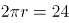，r=12/π米。经过一夜之后，底部弧长变为8米，则新的四分之一圆锥底部圆的半径为米。谷堆为四分之一圆锥，体积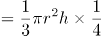。谷堆的谷量不变，有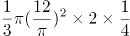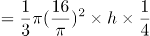，整理得h=9/8米。

故正确答案为A。

### 第 57 题

某电商平台每隔5千米有一座仓库，共有A、B、C、D四座仓库，图中数字表示各仓库库存货物的吨数。现需要把所有的货物集中存放在其中某一个仓库中，如果每吨货物运输1千米需要运费3元，要使运费最少，则需将货物集中到哪座仓库？

A. 仓库A

B. 仓库B

C. 仓库C

D. 仓库D

第 57 题 · 答案与解析

**参考答案（粉笔题库参考内容）**

C

**解析**

方法一：根据题意直接代入选项计算总运费。

若将货物集中到仓库A，则运费为y=3×(20×5+15×5×2+25×5×3)=3×5×125元;

若将货物集中到仓库B，则运费为y=3×(10×5+15×5+25×5×2)=3×5×75元；

若将货物集中到仓库C，则运费为y=3×(10×5×2+20×5+25×5)=3×5×65元；

若将货物集中到仓库D，则运费为y=3×(10×5×3+20×5×2+15×5)=3×5×85元；

则运费最少的是将货物集中到仓库C。

方法二：货物集中问题，只与各个仓库的存放量有关，与距离及运费无关。先考虑AB打包，CD打包，显然前者存放量（30吨）不如后者（40吨）多，因此AB的货物均需要向CD方向移动，先移到仓库C中。此时仓库C共有货物10+20+15=45吨，仓库D有25吨，则仓库D向仓库C移动，最后货物都集中到仓库C中。

故正确答案为C。

### 第 58 题

小明每天从家中出发骑自行车经过一段平路，再经过一道斜坡后到达学校上课。某天早上，小明从家中骑车出发，一到校门口就发现忘带课本，马上返回，从离家到赶回家中共用了1个小时，假设小明当天平路骑行速度为9千米/小时，上坡速度为6千米/小时，下坡速度为18千米/小时，那么小明的家距离学校多远？

A. 3.5千米

B. 4.5千米

C. 5.5千米

D. 6.5千米

第 58 题 · 答案与解析

**参考答案（粉笔题库参考内容）**

B

**解析**

设小明家到学校的距离为S，在往返的过程中，上坡和下坡的路程均为斜坡的长度即距离相等，根据等距离平均速度公式，上下坡的平均速度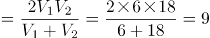千米/小时，与平路速度相等，故往返全程的平均速度均为9千米/小时，往返一次走了两个全程，2S=9千米/小时×1小时，得S=4.5千米。

故正确答案为B。

### 第 59 题

村民陶某承包一块长方形种植地，他将地分割成如图所示的4个小长方形，在A、B、C、D四块长方形土地上分别种植西瓜、花生、地瓜、水稻。其中长方形A、B、C的周长分别是20米、24米、28米，那么长方形D的最大面积是：

A. 42平方米

B. 49平方米

C. 64平方米

D. 81平方米

第 59 题 · 答案与解析

**参考答案（粉笔题库参考内容）**

C

**解析**

如下图所示，假设标注的四条边长分别为a、b、c、d，已知长方形A、B、C的周长分别是20米、24米、28米，根据长方形周长=2(长+宽)，可得2(a+b)+2(a+d)+2(b+c)=20+24+28=72，化简得2a+2b+c+d=36，即20+c+d=36，解得c+d=16。而c、d分别代表长方形D的长和宽，c+d和一定时，当且仅当c=d时面积最大，此时米，故长方形D的最大面积=8×8=64平方米。

故正确答案为C。

### 第 60 题

某学习平台的学习内容由观看视频、阅读文章、收藏分享、论坛交流、考试答题五个部分组成。某学员要先后学完这五个部分，若观看视频和阅读文章不能连续进行，该学员学习顺序的选择有：

A. 24种

B. 72种

C. 96种

D. 120种

第 60 题 · 答案与解析

**参考答案（粉笔题库参考内容）**

B

**解析**

根据题意，观看视频和阅读文章不连续，可用插空法，先安排其它三部分学习内容，顺序有A\_3^3=6种，这三部分学习内容共形成四个空，再插入不能连续进行的观看视频和阅读文章这两部分，有种，因此总的学习顺序的选择有6×12=72种。

故正确答案为B。

### 第 61 题

植树节期间，某单位购进一批树苗，在林场工人的指导下组织员工植树造林。假设植树的成活率为80%，那么，该单位职工小张种植3棵树苗，至少成活2棵的概率是：

A. 27/125

B. 48/125

C. 64/125

D. 112/125

第 61 题 · 答案与解析

**参考答案（粉笔题库参考内容）**

D

**解析**

植树成活的概率为80%，即4/5，则死亡的概率为1/5。小张种植了3棵树苗，至少成活2棵包含2种情况，分类讨论如下：

（1）成活2棵的概率为：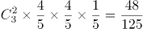；

（2）成活3棵的概率为：；

分类用加法，则至少成活2棵的概率为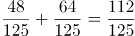。

故正确答案为D。

### 第 62 题

某企业员工组织周末自驾游。集合后发现，如果每辆小车坐5人，则空出4个座位；如果每辆小车少坐1人，则有8人没坐上车。那么，参加自驾游的小车有：

A. 9辆

B. 10辆

C. 11辆

D. 12辆

第 62 题 · 答案与解析

**参考答案（粉笔题库参考内容）**

D

**解析**

设一共有x辆车，根据总人数一定，列方程得：5x-4=4x+8。解得x=12，故参加自驾游的小车有12辆。

故正确答案为D。

### 第 63 题

野外生存需要用一个简易的圆锥型过滤器（如下图所示）装满溪水进行过滤。过滤器的底面直径为20cm，高为6cm。问全部过滤完毕后，在不考虑损耗的情况下，可使底面半径为5cm，高为15cm的圆柱型容器的水面高度达到：

A. 4cm

B. 6cm

C. 8cm

D. 12cm

第 63 题 · 答案与解析

**参考答案（粉笔题库参考内容）**

C

**解析**

根据圆锥体积公式可知，过滤溪水体积为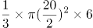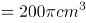。根据圆柱体积公式可得，圆柱型容器的水面高度达到cm。

故正确答案为C。

### 第 64 题

某城市一条道路上有4个十字路口，每个十字路口至少有1名交通协管员，现将8个协管员名额分配到这4个路口，则每个路口协管员名额的分配方案有：

A. 35种

B. 70种

C. 96种

D. 114种

第 64 题 · 答案与解析

**参考答案（粉笔题库参考内容）**

A

**解析**

所问为每个路口协管员名额的分配方案有多少种，则只需要考虑每个路口分配的人数是多少，不需要考虑到底分配哪个协管员。根据插板法：m个相同元素分成n组，每组至少1个，则分配情况有种，题干可以理解为8个相同的名额分成4组，每组至少1个名额，则所求为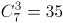种。

故正确答案为A。

### 第 65 题

某工厂先从边长为1米的正方形铁皮切割掉一个半径1米、圆心角为直角的扇形，再用剩余材料切割正方形。为充分利用原材料，希望所得正方形越大越好。若不考虑切割损耗，问所切最大的正方形边长约为多少厘米？

A. 22.6

B. 25.6

C. 27.6

D. 31.6

第 65 题 · 答案与解析

**参考答案（粉笔题库参考内容）**

C

**解析**

边长为1米的正方形铁皮切割掉一个半径为1米、圆心角为直角的扇形，要在剩余材料中切割出最大的正方形，则让正方形内的最长线段即对角线要在剩余材料内部，如图所示。

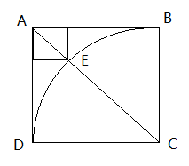

1米=100厘米，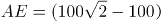厘米，所求正方形的边长为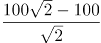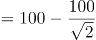，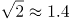，因此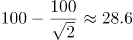厘米。切割的最大的正方形边长为28.6厘米。结合选项，最大的正方形边长可以为27.6厘米。

故正确答案为C。

### 第 66 题

如下图所示，左侧为大立方体，右侧为其部分立体截面，问哪个选项能够与其拼成完整的大立方体：

A. A

B. B

C. C

D. D

第 66 题 · 答案与解析

**参考答案（粉笔题库参考内容）**

C

**解析**

本题考查立体拼合，解题原则为凹凸一致。根据题干要求，可知正确选项和右侧图形拼合后应为左侧正方体。如下图所示，将选项C进行转动后，可与题干右侧图形拼合成左侧正方体。

故正确答案为C。

### 第 67 题

从所给的四个选项中，选择最合适的一个填入问号处，使之呈现一定的规律性：

A. A

B. B

C. C

D. D

第 67 题 · 答案与解析

**参考答案（粉笔题库参考内容）**

C

**解析**

元素组成相同，优先考虑位置规律。九宫格图形优先按横行来看，观察第一行图形，发现图1通过顺时针旋转90°得到图2，图2通过左右翻转得到图3。第二行验证，同样满足此规律。因此问号处的图形应该是第三行中的图2通过左右翻转得到，四个选项中只有C项符合。

故正确答案为C。

### 第 68 题

从所给的四个选项中，选择最适合的一个填入问号处，使之呈现一定的规律性：

A. A

B. B

C. C

D. D

第 68 题 · 答案与解析

**参考答案（粉笔题库参考内容）**

C

**解析**

元素组成不同，优先考虑属性规律。题干图形规整，考虑轴对称。观察对称轴，题干对称轴数量依次为2、1、2、1、3，无明显规律。属性无规律，考虑数量规律。再次观察图形发现，图1和图5出现“相交圆”，即笔画数的特征图，题干笔画数依次为1、1、2、2、1，无规律。题干图形线与线交叉明显，考虑交点数量。题干交点数依次为2、3、4、5、6、？，即“？”处应选择交点数为7的图形。选项交点数依次为18、8、7、8，C项符合。

故正确答案为C。

### 第 69 题

把下面六个图形分为两类，使每一类图形都有各自的共同特征或规律，分类正确的一项是：

A. ①⑤⑥，②③④

B. ①②⑤，③④⑥

C. ①②④，③⑤⑥

D. ①③⑤，②④⑥

第 69 题 · 答案与解析

**参考答案（粉笔题库参考内容）**

A

**解析**

元素组成不同，优先考虑属性规律。对称、曲直均无明显规律，考虑开闭性。图①⑤⑥均为带有封闭区域的图形，图②③④均为全开放的图形，即①⑤⑥为一组，②③④为一组。

故正确答案为A。

### 第 70 题

把下面六个图形分为两类，使每一类图形都有各自的共同特征或规律，分类正确的一项是：

A. ①②④，③⑤⑥

B. ①③④，②⑤⑥

C. ①③⑥，②④⑤

D. ①④⑤，②③⑥

第 70 题 · 答案与解析

**参考答案（粉笔题库参考内容）**

D

**解析**

本题为分组分类题目。每个正方体中均出现一个三角形阴影，观察发现，图①④⑤中的三角形均为等腰三角形，图②③⑥中的三角形均不是等腰三角形。即①④⑤一组，②③⑥一组。

故正确答案为D。

### 第 71 题

把下面的六个图形分为两类，使每一类图形都有各自的共同特征或规律，分类正确的一项是：

A. ①④⑥，②③⑤

B. ①③⑥，②④⑤

C. ①②⑥，③④⑤

D. ①②④，③⑤⑥

第 71 题 · 答案与解析

**参考答案（粉笔题库参考内容）**

D

**解析**

元素组成不同，优先考虑属性规律。观察发现，图①②④均是轴对称图形，图③⑤⑥均是中心对称图形，因此图①②④为一组，图③⑤⑥为一组。

故正确答案为D。

### 第 72 题

一圆锥台如下图所示，从正中心挖掉一个小圆锥体，然后从任意面剖开，下面哪一项不可能是该圆锥台的截面？

A. A

B. B

C. C

D. D

第 72 题 · 答案与解析

**参考答案（粉笔题库参考内容）**

D

**解析**

本题考查截面图，逐一分析选项。

A项：从图形腰部向下底面斜切即可得到，能切出，排除；

B项：沿图形水平方向切出即可得到，能切出，排除；

C项：从图形正中间竖直向下切即可得到，能切出，排除；

D项：图形中间有从上底面到下底面的空心圆锥，无法切出整圆，当选。

本题为选非题，故正确答案为D。

### 第 73 题

从所给的四个选项中，选择最合适的一个填入问号处，使之呈现一定的规律性：

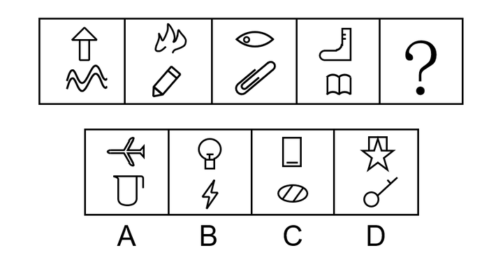

A. A

B. B

C. C

D. D

第 73 题 · 答案与解析

**参考答案（粉笔题库参考内容）**

D

**解析**

本题元素组成不相同也不相似，无明显属性规律，考虑数量规律。观察发现图一、图二和图三存在多端点图形，图四存在日字变形图，考虑笔画数。题干图形笔画数均为3。只有D项符合。

故正确答案为D。

注：本题不严谨，存在多个规律，如果考虑面数量是23232，选A；如果考虑部分数是32323，选C。通过对比择优，本题题干只有5幅图，周期规律不严谨，但笔画数都是3，数字恒等更加严谨，故本题粉笔更倾向于考虑笔画数，选D。

### 第 74 题

亲环境行为是指个体通过减少或消除自身活动对环境的负面影响以达到改善生态系统结构的行为。它的本质是通过有效减轻环境问题实现环境改善，核心任务是构造环境稳态友好型的社会。

根据上述定义，下列选项属于亲环境行为的是：

A. 植树造林

B. 低碳出行

C. 细水长流

D. 围海造田

第 74 题 · 答案与解析

**参考答案（粉笔题库参考内容）**

B

**解析**

第一步：找出定义关键词。

“个体通过减少或消除自身活动对环境的负面影响”、“改善生态系统结构”。

第二步：逐一分析选项。

A项：植树造林是新造或更新森林的生产活动，不符合“个体通过减少或消除自身活动对环境的负面影响”，不符合定义，排除；

B项：低碳出行是一种降低“碳”的出行方式，符合“个体通过减少或消除自身活动对环境的负面影响”，符合“改善生态系统结构”，符合定义，当选；

C项：细水长流是指节约使用财物，精细安排，长远打算，与生态环境无关，不符合“个体通过减少或消除自身活动对环境的负面影响”，也不符合“改善生态系统结构”，不符合定义，排除；

D项：围海造田是把海洋变成陆地、田地，有效利用海洋空间，不符合“个体通过减少或消除自身活动对环境的负面影响”，也不符合“改善生态系统结构”，不符合定义，排除。

故正确答案为B。

注——本题出处如下：

王玉珏的论文《亲环境行为研究综述》中提到：个体亲环境行为可分为四类，其中私人领域的环保行为就包括“使用环保的出行工具”，即本题B项的“低碳出行”。

### 第 75 题

错觉是完全不符合刺激本身特征的失真的或扭曲事实的知觉经验，生活中，凭知觉经验所作的解释显然是失真的，甚至是错误的。幻觉是在没有相应的外界客观事物直接作用下发生的不真实感知。幻觉具有与真实知觉类似的特点，但它是虚幻的。正常人在某些特殊的状态下，如强烈的情绪体验并伴有生动的想象、回忆，或期待的心情、紧张的情绪，或处于催眠状态，都可能会出现幻觉。在入眠或醒觉状态的过程中，也会发生幻觉。

根据上述定义，下列属于幻觉的是：

A. 杯弓有蛇影，草木疑皆兵

B. 相看两不厌，唯有敬亭山

C. 寝兴目存形，遗音犹在耳

D. 蝉噪林逾静，鸟鸣山更幽

第 75 题 · 答案与解析

**参考答案（粉笔题库参考内容）**

C

**解析**

第一步：找出定义关键词。

错觉：“不符合刺激本身特征”、“失真的或扭曲事实的”、“凭知觉经验所作的解释显然是失真的，甚至是错误的”；

幻觉：“没有相应的外界客观事物”、“不真实感知”。

第二步：逐一分析选项。

A项：杯弓有蛇影，出自东汉学者应劭的《风俗通义·怪神》，意思是将映在酒杯里的弓影误认为蛇；草木疑皆兵，出自《晋书·苻坚载记》，意思是把山上的草木都当做敌兵，符合“不符合刺激本身特征”、“失真的或扭曲事实的”，符合“错觉”定义，不符合“幻觉”定义，排除；

B项：相看两不厌，唯有敬亭山，出自唐代李白的《独坐敬亭山》，意思是敬亭山和我对视着，谁都看不够，看不厌，看来理解我的只有这敬亭山了，不符合“失真的或扭曲事实的”以及“没有相应的外界客观事物”，不符合任何一个定义，排除；

C项：寝兴目存形，遗音犹在耳，出自魏晋诗人潘安的《悼亡诗三首》，意思是睡下和起床的时候都还能看到你，你的声音仿佛还在我的耳边，表达了对亡妻深深的思念之情，符合“没有相应的外界客观事物”、“不真实感知”，也能对应题干“在入眠或醒觉状态的过程中”，符合“幻觉”定义，当选；

D项：蝉噪林逾静，鸟鸣山更幽，出自南朝王籍的《入若耶溪》，意思是蝉声高唱，树林却显得格外宁静，鸟鸣声声，深山里倒比往常更清幽，不符合“失真的或扭曲事实的”以及“没有相应的外界客观事物”，不符合任何一个定义，排除。

故正确答案为C。

### 第 76 题

外部性是指经济当事人的生产和消费行为对其他经济当事人的生产和消费行为施加的有益或者有害影响的效应。正外部性是指某个经济行为个体的活动使他人或社会受益，而受益者无需花费代价。负外部性是指某个经济行为个体的活动使他人或社会受损，而造成负外部性的人却没有为此承担成本。

根据上述定义，下列选项属于正外部性的是：

A. 经过农田的蒸汽机车，喷出火花飞到农民种植的麦穗上

B. 飞速行驶的火车尖锐的汽笛声吓跑在农田吃稻谷的小鸟

C. 某工厂在村庄建起了扶贫车间，为村民就近就业提供便利

D. 某工厂排出了大量废水和有害气体，给周围居民带来健康危害

第 76 题 · 答案与解析

**参考答案（粉笔题库参考内容）**

B

**解析**

第一步：找出定义关键词。

正外部性：“某个经济行为个体的活动使他人或社会受益”、“受益者无需花费代价”；

负外部性：“某个经济行为个体的活动使他人或社会受损”、“造成负外部性的人却没有为此承担成本”。

第二步：逐一分析选项。

A项：火花飞到农民种植的麦穗上，对植物造成损害，符合“某个经济行为个体的活动使他人或社会受损”，不符合“某个经济行为个体的活动使他人或社会受益”，符合“负外部性”定义，不符合“正外部性”定义，排除；

B项：尖锐的汽笛声吓跑在农田吃稻谷的小鸟，保护了稻谷，符合“某个经济行为个体的活动使他人或社会受益”，且“受益者无需花费代价”，符合“正外部性”定义，当选；

C项：某工厂在村庄建起了扶贫车间，为村民就近就业提供便利，符合“某个经济行为个体的活动使他人或社会受益”，但村民到车间工作也需要付出劳动力等成本，不符合“受益者无需花费代价”，不符合任何一个定义，排除；

D项：某工厂排出了大量废水和有害气体，给周围居民带来健康危害，不符合“某个经济行为个体的活动使他人或社会受益”，不符合“正外部性”定义，排除。

故正确答案为B。

注：原文如下：

### 第 77 题

社会计算的内涵包括两个层面：一是社会的计算化，二是计算的社会化。社会的计算化是指通过人们在互联网上留下的海量而且相互关联的数据足迹，对人们的社会活动进行追踪、检索、汇编、计量和运算。计算的社会化则是指互联网创造了一种环境、一个平台，使人们能够广泛地参与计算过程，从而在数据的挖掘、分析和应用等方面获得更高效率。

根据上述定义，下列现象符合计算的社会化的是（ ）。

A. 某购物平台根据用户购物经历，定期向用户推荐商品

B. 某手机导航软件能为用户自动生成一个月来的行踪图

C. 全班同学在暑假田野调查结束后合作制成精美的相册

D. 小陈在众筹平台匿名捐款后，受助者上门送来感谢信

第 77 题 · 答案与解析

**参考答案（粉笔题库参考内容）**

D

**解析**

第一步：找出定义关键词。

社会的计算化：“人们在互联网上留下的海量而且相互关联的数据足迹”、“对人们的社会活动进行追踪、检索、汇编、计量和运算”；

计算的社会化：“互联网创造了一种环境、一个平台”、“人们能够广泛地参与”、“获得更高效率”。

第二步：逐一分析选项。

A项：购物平台根据用户购物经历，符合“人们在互联网上留下的海量而且相互关联的数据足迹”，定期向用户推荐商品，符合“对人们的社会活动进行追踪、检索、汇编、计量和运算”，符合“社会的计算化”定义，不符合“计算的社会化”定义，排除；

B项：手机导航软件能为用户自动生成一个月来的行踪图，符合“人们在互联网上留下的海量而且相互关联的数据足迹”，符合“对人们的社会活动进行追踪、检索、汇编、计量和运算”，符合“社会的计算化”定义，不符合“计算的社会化”定义，排除；

C项：全班同学合作制成精美的相册，不符合“互联网创造了一种环境、一个平台”，也不符合“人们在互联网上留下的海量而且相互关联的数据足迹”，不符合任何一个定义，排除；

D项：小陈在众筹平台匿名捐款,其中众筹平台符合“互联网创造了一种环境、一个平台”、众筹这种方式符合“人们能够广泛地参与”、“获得更高效率”，符合“计算的社会化”定义，当选。

故正确答案为D。

### 第 78 题

社会收缩是指人类聚落中人口持续流失，由此引发相应地区经济社会环境和文化在空间上的衰退过程。根据收缩行为是否是聚落行为主体主动采取的规划策略或管理措施，可以分为主动社会收缩和被动社会收缩。

根据上述定义，下列选项属于主动社会收缩的是（ ）。

A. 某市因疏解核心区功能导致城区人口下降

B. 2019年我国春运人口迁移规模近30亿人次

C. 某产煤大县因资源枯竭导致就业吸纳能力下降

D. 某制造业基地因产业升级导致房屋空置率居高不下

第 78 题 · 答案与解析

**参考答案（粉笔题库参考内容）**

A

**解析**

第一步：找出定义关键词。

社会收缩：“人类聚落中人口持续流失，由此引发相应地区经济社会环境和文化在空间上的衰退过程”；

主动社会收缩：“收缩行为是聚落行为主体主动采取的规划策略或管理措施”；

被动社会收缩：“收缩行为不是聚落行为主体主动采取的规划策略或管理措施”。

第二步：逐一分析选项。

A项：某市疏解核心区功能是主动的行为，符合“收缩行为是聚落行为主体主动采取的规划策略或管理措施”，城区人口下降，符合“人类聚落中人口持续流失”，符合“主动社会收缩”定义，当选；

B项：春运人口大规模迁移，只是人口转移，不符合“人类聚落中人口持续流失”，不符合“社会收缩”定义，排除；

C项：某产煤大县资源枯竭不是主动的行为，不符合“收缩行为是聚落行为主体主动采取的规划策略或管理措施”，就业吸纳能力下降，不代表人口流失，不符合“人类聚落中人口持续流失”，不符合“主动社会收缩”定义，排除；

D项：某制造业基地产业升级导致房屋空置率居高不下，不代表人口流失，不符合“人类聚落中人口持续流失”，不符合“社会收缩”定义，排除。

故正确答案为A。

### 第 79 题

侵蚀作用指风力、流水、冰川、波浪等外力在运动状态下改变地面岩石及其风化物的过程。侵蚀作用可分为机械剥蚀作用和化学剥蚀作用。

根据上述定义，下列选项属于侵蚀作用的是：

A. 裸露的人造雕像在长期的风吹日晒雨淋下，会出现机械剥蚀，甚至会出现崩塌碎裂

B. 植物根部在岩缝中向岩石施加物理压力，并提供一个水及化学物的渗透渠道，造成岩石分解开裂

C. 可溶性石灰岩在流水中部分溶解形成天然溶液而随水流失，造成岩体缩小甚至消失，形成岩溶地貌

D. 在气温变化突出的地区，岩石中的水分冻融交替，冰冻时体积膨胀，像楔子插入岩体内，导致岩石崩碎

第 79 题 · 答案与解析

**参考答案（粉笔题库参考内容）**

C

**解析**

第一步：找出定义关键词。

“风力、流水、冰川、波浪等外力在运动状态下”、“改变地面岩石及其风化物”。

第二步：逐一分析选项。

A项：裸露的人造雕像，不符合“改变地面岩石及其风化物”，不符合定义，排除；

B项：植物根部在岩缝中向岩石施加物理压力最终导致岩石分解开裂，不符合“风力、流水、冰川、波浪等外力在运动状态下”，不符合定义，排除；

C项：可溶性石灰岩在流水中部分溶解形成天然溶液，符合“风力、流水、冰川、波浪等外力在运动状态下”、“改变地面岩石及其风化物”，符合定义，当选；

D项：岩石中的水分冻融交替，冰冻时体积膨胀，导致岩石崩碎，不符合“风力、流水、冰川、波浪等外力在运动状态下”，不符合定义，排除。

故正确答案为C。

### 第 80 题

热传导是介质内无宏观运动时的传热现象，其在固体、液体和气体中均可发生。但严格而言，只有在固体中才是纯粹的热传导，在流体（泛指液体和气体）中又是另外一种情况，流体即使处于静止状态，也会由于温度梯度所造成的密度差而产生自然对流，因此在流体中热对流与热传导可能会同时发生。

根据上述定义，下列选项不存在热传导现象的是：

A. 海洋上层高温水体和下层低温水体因温度差而交换

B. 铁棒的一端放入热水中，另一端温度升高

C. 太阳照射，导致地球表面温度升高

D. 在热水中加入冷水，热水变成温水

第 80 题 · 答案与解析

**参考答案（粉笔题库参考内容）**

C

**解析**

第一步：找出定义关键词。

“介质内无宏观运动”、“传热现象”、“流体中由于温度梯度所造成的密度差”。

第二步：逐一分析选项。

A项：海洋内部水体交换，符合“介质内无宏观运动”，海洋上层高温水体和下层低温水体因温度差而交换，符合“传热现象”、“流体中由于温度梯度所造成的密度差”，符合定义，排除；

B项：铁棒的一端放入热水中，符合“介质内无宏观运动”，热量沿着铁棒传递到另一端，使得温度升高，符合“传热现象”，符合定义，排除；

C项：太阳照射，使地球表面温度升高，太阳与地球表面之间是真空环境，没有介质，不符合“介质内无宏观运动”，不符合定义，当选；

D项：热水中加入冷水，符合“介质内无宏观运动”，冷水和热水因温度差而发生热传递，最终变成温水，符合“传热现象”、“流体中由于温度梯度所造成的密度差”，符合定义，排除。

本题为选非题，故正确答案为C。

### 第 81 题

印象管理是指人试图控制他人对自己形成的印象的过程。一个人留给他人的印象表明了他人对其的知觉、评价，甚至会使他人形成对其的特定应对方式。因而，为了给他人留下好的印象，得到他人好的评价与对待，人会用一种给他人造成特定印象的方式来自我表现。印象管理的运用，尤其要避免某些表演崩溃，包括无意动作、不合时宜的闯入、闹剧等。

根据上述定义，下列选项最能体现印象管理运用的是：

A. 沙子龙在夜静人稀时，关好门，舞出一套断魂枪，微微一笑说：“不传不传”

B. 许衡看到人们摘食路边的梨解渴，不为所动，说：“梨虽无主，而吾心有主”

C. 一向沉静温柔的小美在毕业之际，承受不住与同学离别的感伤，突然嚎啕大哭

D. 岳飞的母亲为了激励岳飞奋勇抗金，用针在其背上刺了四个字：“精忠报国”

第 81 题 · 答案与解析

**参考答案（粉笔题库参考内容）**

B

**解析**

第一步：找出定义关键词。

印象管理：“试图控制他人对自己形成的印象的过程”、“为了给他人留下好的印象······用一种给他人造成特定印象的方式来自我表现”、“避免某些表演崩溃，包括无意动作、不合时宜的闯入、闹剧等”。

第二步：逐一分析选项。

A项：沙子龙在夜静人稀时，关门武枪，此时只有他自己，并非是想在他人面前树立自己形象，不符合“试图控制他人对自己形成的印象的过程”，也不符合“为了给他人留下好的印象······用一种给他人造成特定印象的方式来自我表现”，不符合定义，排除；

B项：“梨虽无主,而吾心有主”的意思是梨虽然没有主人，但是我的心灵是有主见的，对比人们摘食路边的梨解渴的行为，体现了许衡“为了给他人留下好的印象······用一种给他人造成特定印象的方式来自我表现”，也符合“避免某些表演崩溃，包括无意动作”，符合定义，当选；

C项：一向沉静温柔的小美毕业之际嚎啕大哭，说明在毕业之际，小美的情绪崩溃了，不符合“避免某些表演崩溃”，不符合定义，排除；

D项：岳飞的母亲为了激励岳飞而刺字，并非是想在他人面前树立自己形象，不符合“试图控制他人对自己形成的印象的过程”，也不符合“为了给他人留下好的印象······用一种给他人造成特定印象的方式来自我表现”，不符合定义，排除。

故正确答案为B。

### 第 82 题

算法歧视是以算法为手段实施的歧视，主要指在大数据背景下，依靠机器计算的自动决策系统在对数据主体做出决策分析时，由于数据和算法本身不具有中立性或者隐含错误、被人为操控等原因，对数据主体进行差别对待，造成歧视性后果。

根据上述定义，下列属于算法歧视的是：

A. 某新生班主任根据学生的入学成绩高低来安排他们的学号

B. 某水果商家总是对长期参与团购的客户给予更低价格折扣

C. 某信用评估平台通过用户的网络使用行为来判定其信用值

D. 某招聘网站给男性推送高薪职位的广告次数是女性的6倍

第 82 题 · 答案与解析

**参考答案（粉笔题库参考内容）**

D

**解析**

第一步：找出定义关键词。

“大数据背景下”、“机器计算的自动决策系统在对数据主体做出决策分析时”、“不具有中立性或者隐含错误、被人为操控”、“对数据主体进行差别对待，造成歧视性后果”。

第二步：逐一分析选项。

A项：某新生班主任根据学生的入学成绩高低来安排他们的学号，不符合“大数据背景下”，也不符合“对数据主体进行差别对待，造成歧视性后果”，不符合定义，排除；

B项：某水果商家总是对长期参与团购的客户给予更低价格折扣，不符合“大数据背景下”，也不符合“对数据主体进行差别对待，造成歧视性后果”，不符合定义，排除；

C项：某信用评估平台通过用户的网络使用行为来判定其信用值，不符合“对数据主体进行差别对待，造成歧视性后果”，不符合定义，排除；

D项：某招聘网站给男性推送高薪职位的广告次数是女性的6倍，符合“大数据背景下”，且性别本身并不存在差别，但是网站的推送结果存在差别，符合“不具有中立性或者隐含错误、被人为操控”、“对数据主体进行差别对待，造成歧视性后果”，符合定义，当选。

故正确答案为D。

### 第 83 题

了如指掌 对于（ ）相当于（ ）对于 坚固

A. 知道；铁板一块

B. 明白；坚不可摧

C. 理解；铜墙铁壁

D. 了解；固若金汤

第 83 题 · 答案与解析

**参考答案（粉笔题库参考内容）**

D

**解析**

逐一代入选项。

A项：“了如指掌”是指对事物了解得非常清楚，“知道”是指有一定的了解和认识，二者为近义关系；“铁板一块”比喻结合紧密、不可分割的整体，“坚固”是指结实牢固，不容易破坏，二者无明显的关系，前后逻辑关系不一致，排除；

B项：“了如指掌”是指对事物了解得非常清楚，“明白”有知道、了解的意思，二者为近义关系；“坚不可摧”形容非常坚固，与“坚固”为近义关系，前后逻辑关系一致，保留；

C项：“了如指掌”是指对事物了解得非常清楚，“理解”是指懂、了解，二者为近义关系；“铜墙铁壁”是指防御十分坚固，与“坚固”为近义关系，前后逻辑关系一致，保留；

D项：“了如指掌”是指对事物了解得非常清楚，与“了解”为近义关系；“固若金汤”形容防守非常坚固，与“坚固”为近义关系，前后逻辑关系一致，保留。

对比B、C、D三项，题干的“了如指掌”和D项的“固若金汤”都含有比喻义，词语结构更加贴近，D项当选。

故正确答案为D。

### 第 84 题

花：牡丹：玫瑰

A. 茶：红茶：绿茶

B. 草：艾草：蓼草

C. 球：足球：绒球

D. 车：轿车：客车

第 84 题 · 答案与解析

**参考答案（粉笔题库参考内容）**

B

**解析**

第一步：判断题干词语间逻辑关系。

玫瑰和牡丹都是花，二者之间为并列关系，与花均为种属关系，且玫瑰和牡丹都是自然界的植物。

第二步：判断选项词语间逻辑关系。

A项：红茶和绿茶都是茶，二者之间为并列关系，与茶均为种属关系，但红茶和绿茶都是经过人们加工而制成的，与题干逻辑关系不一致，排除；

B项：艾草和蓼草都是草，二者之间为并列关系，与草均为种属关系，且艾草和蓼草都是自然界的植物，与题干逻辑关系一致，当选；

C项：绒球是用彩色毛线或绒线扎成的球形物体，与足球不是一类事物，二者之间不是并列关系，与题干逻辑关系不一致，排除；

D项：轿车和客车都是车，二者之间为并列关系，与车均为种属关系，但轿车和客车都是人类制造出来的产物，与题干逻辑关系不一致，排除。

故正确答案为B。

### 第 85 题

初伏：中伏：末伏

A. 火星：木星：土星

B. 大雨：小雨：谷雨

C. 上旬：中旬：下旬

D. 大暑：小暑：处暑

第 85 题 · 答案与解析

**参考答案（粉笔题库参考内容）**

C

**解析**

第一步：判断题干词语间逻辑关系。

初伏、中伏、末伏，三者之间是并列关系，并且三者按照三伏天的时间先后顺序排列，先初伏，再中伏，最后末伏。

第二步：判断选项词语间逻辑关系。

A项：火星、木星、土星是太阳系八大行星中的三个行星，三者之间是并列关系，但是没有时间先后顺序，与题干逻辑关系不一致，排除；

B项：大雨、小雨是两种不同的天气，谷雨是二十四节气之一，三者不构成并列关系，与题干逻辑关系不一致，排除；

C项：上旬、中旬、下旬，三者之间是并列关系，并且三者按照一个月份的不同时间段的时间先后顺序排列，先上旬，再中旬，最后下旬，与题干逻辑关系一致，当选；

D项：大暑、小暑、处暑是二十四节气中的三个节气，三者之间是并列关系，但是它们的时间先后顺序应该是先小暑，再大暑，最后处暑，与题干逻辑关系不一致，排除。

故正确答案为C。

### 第 86 题

空运：海运：运输

A. 平装：精装：装帧

B. 货轮：客轮：邮轮

C. 晚会：聚会：集会

D. 试飞：试航：航天

第 86 题 · 答案与解析

**参考答案（粉笔题库参考内容）**

A

**解析**

第一步：判断题干词语间逻辑关系。

空运和海运是两种不同的运输方式，前两词为并列关系，并与第三词构成种属关系。

第二步：判断选项词语间逻辑关系。

A项：平装和精装是两种不同的装帧方式，前两词为并列关系，并与第三词构成种属关系，与题干逻辑关系一致，当选；

B项：货轮和客轮分别是用来运载货物和乘客的船舶，二者为并列关系，邮轮指的是在海洋中航行的旅游客轮，所以邮轮是客轮的一种，与货轮不构成种属关系，与题干逻辑关系不一致，排除；

C项：晚会是指在晚上举行的集会，多以文娱活动为主，聚会是指人数较多，有明确主题的集体活动，二者不构成并列关系，与题干逻辑关系不一致，排除；

D项：试飞是指在飞机交付使用前进行的试验性飞行，试航是指飞机、船只等在正式航行前进行的试验性航行，二者和航天没有必然关系，与题干逻辑关系不一致，排除。

故正确答案为A。

### 第 87 题

鲜花：塑料花

A. 纸质书：电子书

B. 相片：画像

C. 原本：复印本

D. 钤章：印泥

第 87 题 · 答案与解析

**参考答案（粉笔题库参考内容）**

C

**解析**

第一步：判断题干词语间逻辑关系。

鲜花和塑料花是并列关系，且鲜花是真花，而塑料花是仿真花，是根据鲜花人工制作而成的。

第二步：判断选项词语间逻辑关系。

A项：纸质书和电子书是并列关系，但二者是书籍的两种载体形式，与题干逻辑关系不一致，排除；

B项：相片和画像是并列关系，但二者是记录人像的两种表现形式，相片是利用照相机拍摄出来的，而画像是利用画笔画出来的，与题干逻辑关系不一致，排除；

C项：原本和复印本是并列关系，且原本是正品，而复印本是根据原本复印而来的，与题干逻辑关系一致，当选；

D项：钤章是指旧时机关团体使用的图章，需要和印泥配套使用，二者是配套对应关系，与题干逻辑关系不一致，排除。

故正确答案为C。

### 第 88 题

鸳：鸯

A. 蚱蜢：蝗虫

B. 白猫：黑猫

C. 雄鸡：雌鸡

D. 红男：绿女

第 88 题 · 答案与解析

**参考答案（粉笔题库参考内容）**

C

**解析**

第一步：判断题干词语间逻辑关系。

鸳鸯是一种鸟类，鸳指雄鸟，鸯指雌鸟，二者为并列关系，且为并列关系中的矛盾关系。

第二步：判断选项词语间逻辑关系。

A项：蚱蜢和蝗虫的关系较有争议，多数资料显示二者为全同关系，与题干逻辑关系不一致，排除；

B项：白猫和黑猫是并列关系，但为并列关系中的反对关系，与题干逻辑关系不一致，排除；

C项：雄鸡和雌鸡是并列关系，且为并列关系中的矛盾关系，与题干逻辑关系一致，当选；

D项： 红男绿女，意思是指穿着各种漂亮服装的青年男女，二者为并列关系，但不是矛盾关系，与题干逻辑关系不一致，排除。

故正确答案为C。

### 第 89 题

牡丹：洛阳：郑州

A. 荷花：青岛：济南

B. 木芙蓉：成都：成都

C. 菊花：太原：石家庄

D. 凤凰花：厦门：福州

第 89 题 · 答案与解析

**参考答案（粉笔题库参考内容）**

D

**解析**

第一步：判断题干词语间逻辑关系。

牡丹是洛阳市花，郑州是河南省的省会城市，洛阳和郑州均为河南省的城市。

第二步：判断选项词语间逻辑关系。

A项：荷花是济南市花，青岛是山东省的城市，济南是山东省的省会城市，与题干逻辑关系不一致，排除；

B项：木芙蓉是成都市花，成都是四川省的省会城市，但成都和成都为同一个城市，与题干逻辑关系不一致，排除；

C项：菊花是太原市花，太原是山西省的省会城市，石家庄是河北省的省会城市，太原和石家庄是不同省份的城市，与题干逻辑关系不一致，排除；

D项：凤凰花又叫凤凰木，为厦门市树，厦门是福建省的城市，福州是福建省的省会城市，与题干逻辑关系一致，当选。

故正确答案为D。

### 第 90 题

（ ）对于 世味年来薄似纱 相当于 达观 对于（ ）

A. 忧郁；前度刘郎今又来

B. 感伤；莫道谗言如浪深

C. 讽刺；道是无晴却有晴

D. 斥责；金陵王气黯然收

第 90 题 · 答案与解析

**参考答案（粉笔题库参考内容）**

B

**解析**

逐一代入选项。

A项：“世味年来薄似纱”出自南宋陆游的《临安春雨初霁》，体现了诗人对世态炎凉的无奈和客籍京华的蹉跎，与“忧郁”无明显逻辑关系，“前度刘郎今又来”出自唐代刘禹锡的《再游玄都观》，描写的是曾经被排挤的人又回来了，暗寓自己不屈之志，与“达观”无明显逻辑关系，前后逻辑关系不一致，排除；

B项：“世味年来薄似纱”出自南宋陆游的《临安春雨初霁》，表达了诗人的“感伤”之情，“莫道谗言如浪深”出自唐代刘禹锡的《杂曲歌辞·浪淘沙》，描写的是不要说流言蜚语如同凶恶的浪涛一样令人恐惧，体现了诗人拼搏、乐观的心境，表达了“达观”之情，前后逻辑关系一致，当选；

C项：“世味年来薄似纱”与“讽刺”无明显逻辑关系，“道是无晴却有晴”出自唐代刘禹锡的《竹枝词二首·其一》，表面是说无晴但还有晴，实际上想表达说是没有感情但其实有情，是运用谐音双关的手法，把天“晴”和爱“情”这两件不相关的事物巧妙地联系起来，表现出初恋少女忐忑不安的微妙感情，与“达观”无明显逻辑关系，前后逻辑关系不一致，排除；

D项：“世味年来薄似纱”与“斥责”无明显逻辑关系，“金陵王气黯然收”出自唐代刘禹锡的《西塞山怀古》，描写的是东吴的王气黯然消逝，表明国家统一是人心所向，与“达观”无明显逻辑关系，前后逻辑关系不一致，排除。

故正确答案为B。

### 第 91 题

十年寒窗：悬梁刺股：囊萤映雪

A. 七月流火：以荻画地：临池学书

B. 三月肉味：蓝田种玉：程门立雪

C. 一寸光阴：凿壁偷光：闻鸡起舞

D. 一日三秋：卧薪尝胆：铁杆磨针

第 91 题 · 答案与解析

**参考答案（粉笔题库参考内容）**

C

**解析**

第一步：判断题干词语间逻辑关系。

十年寒窗、悬梁刺股和囊萤映雪都是形容刻苦攻读，勤学上进，三者为近义关系。

第二步：判断选项词语间逻辑关系。

A项：七月流火指夏去秋来，寒天将至；以荻画地是指用荻杆在地上写字画画；临池学书指刻苦练习书法；三者语义没有关系，与题干逻辑关系不一致，排除；

B项：三月肉味形容专心一意，全神贯注；蓝田种玉比喻男女获得了称心如意的美好姻缘；程门立雪指尊敬师长，重视自己的教育事业；三者语义没有关系，与题干逻辑关系不一致，排除；

C项：一寸光阴是指时间非常宝贵；凿壁偷光用来形容家贫而读书刻苦；闻鸡起舞是指听到鸡啼就起来舞剑，比喻有志报国的人及时奋起；三者均形容珍惜时间，勤学刻苦，为近义关系，与题干逻辑关系一致，当选；

D项：一日三秋比喻分别时间虽短，却觉得很长，形容思念殷切；卧薪尝胆比喻刻苦自励、发奋图强；铁杆磨针比喻只要有决心，肯下工夫，多么难的事情也能做成功；三者语义没有关系，与题干逻辑关系不一致，排除。

故正确答案为C。

### 第 92 题

地球距离火星最近约为5500万公里，最远则超过4亿公里，只有地球与火星夹角为70°时发射探测器才能如期抵达火星。2020年，我国发射了火星探测器，预计2021年登陆火星。一位航天专家对此评论道：“如果没抓住2020年这个机会，那么，下一次合适的发射时间至少要推迟到2022年之后。”

上述专家的评论若要成立，需要补充的前提是：

A. 火星探测器发射后，需要经过不少于7个月的飞行，才能抵达火星轨道

B. 我国于2020年发射了火星探测器，缩小了与西方航天大国的差距

C. 地球与火星的相对近点约每15年出现一次，二者距离近的年份是登陆火星的最佳时机

D. 发射火星探测器须等到地球和火星形成一定夹角，而这个机会每隔26个月才出现一次

第 92 题 · 答案与解析

**参考答案（粉笔题库参考内容）**

D

**解析**

第一步：找出论点和论据。

论点：如果没抓住2020年这个机会，那么，下一次合适的发射时间至少要推迟到2022年之后。

论据：地球距离火星最近约为5500万公里，最远则超过4亿公里，只有地球与火星夹角为70°时发射探测器才能如期抵达火星。

本题问题为“前提”，加强考虑搭桥和必要条件。论点说的是下一次合适的发射时间是2年后，而论据说的是只有地球与火星夹角为70°时发射探测器才能如期抵达火星，二者话题不一致，优先考虑搭桥，即在地球与火星夹角与下一次合适的发射时间是2年后之间建立联系。

第二步：逐一分析选项。

A项：指出火星探测器发射后需要经过不少于7个月的飞行，才能抵达火星轨道，与火星探测器下一次合适的发射时间无关，话题不一致，无法加强，排除；

B项：指出我国2020年发射了火星探测器，缩小了与西方航天大国的差距，与火星探测器下一次合适的发射时间无关，话题不一致，无法加强，排除；

C项：指出地球与火星距离近的年份是登陆火星的最佳时机，而论点说的是火星探测器下一次合适的发射时间，登陆与发射时间并不相同，且选项中说的是地球与火星的相对近点约每15年出现一次，而论点中说的是火星探测器下一次合适的发射时间是在2022年后，二者时间的长短差距较大，无法加强，排除；

D项：指出发射火星探测器须等到地球和火星形成一定夹角，而这个机会每隔26个月才出现一次，在地球与火星夹角与火星探测器下一次合适的发射时间是2年后之间建立联系，属于搭桥项，可以加强，当选。

故正确答案为D。

### 第 93 题

二氧化碳的排放量剧增导致全球气候变暖，使珠穆朗玛峰所在的喜马拉雅地区冰川面临急剧缩小的危险。研究显示，珠峰海拔在5000米到6000米的冰川集中区域出现快速融化的现象，这些地方将只在冬季而不是在温暖的季节时看到结冰。专家推论说，根据未来的气候变化趋势，喜马拉雅地区的冰川减少的速度还有可能加快，如果本世纪内气温如预计的一样继续升高，该地区的冰川最终将消失殆尽。

如果以下各项为真，最能削弱上述论证的是：

A. 喜马拉雅冰川每年缩小约0.1%到0.6%

B. 喜马拉雅其他地区冰川对温度不敏感

C. 过去50年珠峰周边冰川覆盖面积减少了33.3%

D. 珠穆朗玛峰7000米以上区域未出现冰川快速融化现象

第 93 题 · 答案与解析

**参考答案（粉笔题库参考内容）**

B

**解析**

第一步：找出论点和论据。

论点：根据未来的气候变化趋势，喜马拉雅地区的冰川减少的速度还有可能加快，如果本世纪内气温如预计的一样继续升高，该地区的冰川最终将消失殆尽。

论据：珠峰海拔在5000米到6000米的冰川集中区域出现快速融化的现象，这些地方将只在冬季而不是在温暖的季节时看到结冰。

论点说的是喜马拉雅地区的冰川将会消失殆尽，论据是珠峰海拔在5000米到6000米的冰川集中区域出现快速融化的现象，因此本题目的论证关系是通过珠穆朗玛峰5000米-6000米区域的变化，来预测喜马拉雅山未来整体的情况，论点和论据的话题不一致，要想否定论证，可以补充5000米-6000米之外的地方冰川不会消融来进行否定，即通过局部是推不出整体这种方式来进行否定。

第二步：逐一分析选项。

A项：选项说喜马拉雅冰川每年缩小约0.1%到0.6%，补充论据说明冰川在不断缩小，有加强力度，排除；

B项：选项说喜马拉雅其他地区冰川对温度不敏感，说明在珠穆朗玛峰5000米-6000米之外的其他地区冰川并不会受温度的影响，那么就说明从题干中的论据是推不出论点的，可以削弱，当选；

C项：过去50年珠峰周边冰川覆盖面积减少了33.3%，补充论据说明冰川在不断缩小，有加强力度，排除；

D项：珠穆朗玛峰7000米以上区域未出现冰川快速融化现象，通过举反例来证明冰川不会完全消失，但该项只是举出了7000米以上的地区，不如B项包含的范围广，可以削弱，但是力度比B项弱，排除。

故正确答案为B。

### 第 94 题

学界一直认为第一个到达澳大利亚的是欧洲人。但有研究指出，来自今天的坦桑尼亚的东非人率先到达了澳大利亚，考古学家在澳大利亚的埃尔科岛上发现了一枚来自非洲中部的贸易城市基卢瓦（今属坦桑尼亚）的硬币。因此，有人提出，东非人到达澳大利亚的时间可能要比第一批欧洲探险者早数百年。

以下各项如果为真，最能支持上述观点的是：

A. 该硬币的重量尺寸与常见的基卢瓦硬币存在差异

B. 基卢瓦岛从13世纪开始与印度一直存在贸易联系

C. 东非与大洋洲在11世纪到16世纪间商贸往来十分频繁

D. 葡萄牙人于1505年先后袭击了基卢瓦和埃尔科岛并留下了这枚硬币

第 94 题 · 答案与解析

**参考答案（粉笔题库参考内容）**

C

**解析**

第一步：找出论点和论据。

论点：东非人到达澳大利亚的时间可能要比第一批欧洲探险者早数百年。

论据：来自今天的坦桑尼亚的东非人率先到达了澳大利亚，考古学家在澳大利亚的埃尔科岛上发现了一枚来自非洲中部的贸易城市基卢瓦（今属坦桑尼亚）的硬币。

本题论点是东非人到达澳大利亚的时间可能要比第一批欧洲探险者要早，论据是通过在澳大利亚的埃尔科岛上发现的一枚来自非洲中部的贸易城市基卢瓦（今属坦桑尼亚）的硬币确定来自今天的坦桑尼亚的东非人率先到达了澳大利亚。二者话题一致，加强优先考虑补充论据。

第二步：逐一分析选项。

A项：选项说该硬币的重量尺寸与常见的基卢瓦硬币存在差异，硬币的尺寸存在差异，说明发现的硬币不一定是东非人带来的，具有削弱作用，无法加强，排除；

B项：选项说基卢瓦岛从13世纪开始与印度一直存在贸易联系，题干论点与论据均与印度的贸易联系无关，话题不一致，无法加强，排除；

C项：选项说东非与大洋洲在11世纪到16世纪间商贸往来十分频繁，澳大利亚是大洋洲的主要组成部分，证明东非与澳大利亚之间很有可能早在11世纪到16世纪间就存在频繁的商贸往来，有利于论点的成立，补充论据，当选；

D项：选项说葡萄牙人于1505年先后袭击了基卢瓦和埃尔科岛并留下了这枚硬币，说明是葡萄牙人留下的这枚硬币，而不是东非人，具有削弱作用，排除。

故正确答案为C。

注：由于题目中完全没有涉及到欧洲人到达澳大利亚的具体时间，也没有涉及到东非人到达澳大利亚的具体时间，因此选项中的时间无法准确判断早晚，因此C项虽然只是一种可能性的加强，但其他选项无任何加强作用，故答案确定为C。而根据原文（如下图中最后一句）可知，已知确定的率先到达澳大利亚的欧洲人时间在1606年（17世纪），而C项中东非与大洋洲的贸易时间在11世纪到16世纪，早于1606年，因此根据原文C项具有加强作用。

### 第 95 题

地球表面的大部分都被海洋覆盖，生命也诞生于海洋之中。然而，据估计，地球有80%的物种生活在陆地上，而海洋中仅为15%，剩下的5%生活在淡水中。研究者认为，陆地栖息地的物理布局相对海洋可能更加支离破碎，是导致陆地物种更加多样化的主要原因之一。

以下哪项如果为真，最能加强上述研究者的观点？

A. 地球表面可分成热带、南温带、北温带、南寒带、北寒带五个温度带，各温度带物种差异性大，种类丰富

B. 深海相对于有阳光照射的浅海岸地区而言，基本上像个冰箱，而且门已经关上很久，物种远不如浅海丰富

C. 根据某群岛记录显示，随着时间推移，自然选择甚至可以把两个岛屿上相同物种的不同族群变成截然不同的物种

D. 森林覆盖许多陆地，而树叶和枝干形成新的生态环境，海洋中的珊瑚也起同样作用，但覆盖海底的面积没那么大

第 95 题 · 答案与解析

**参考答案（粉笔题库参考内容）**

C

**解析**

第一步：找出论点和论据。

论点：陆地栖息地的物理布局相对海洋可能更加支离破碎，是导致陆地物种更加多样化的主要原因之一。

论据：无。

本题只有论点没有论据，优先考虑补充论据，补充能够证明陆地栖息地的物理布局比海洋更复杂和破碎，能影响陆地物种多样化的原因或例子。

第二步：逐一分析选项。

A项：该项说的是地球表面温度差异导致各温度带物种差异大，与论点讨论的陆地栖息地的物理布局更加支离破碎导致陆地物种更加多样化无关，话题不一致，无法加强，排除；

B项：该项说的是深海物种不如浅海丰富，与论点讨论的陆地栖息地的物理布局更加支离破碎导致陆地物种更加多样化无关，话题不一致，无法加强，排除；

C项：该项说的是自然选择可以让两个岛屿上的同一物种变得不同，即说明陆地栖息地的物理布局的破碎导致陆地物种更加多样化，通过举例的方式进行加强，当选；

D项：该项说的是森林中树叶和枝干能形成新的生态环境，而且比海洋中起同样作用的珊瑚覆盖的面积更广，只能说明陆地与海洋相比，相似的生态环境面积要广，但是否一定带来物种的多样性不明确，不能加强，排除。

故正确答案为C。

注：【原文链接】http://www.360doc.com/content/17/0724/10/5554415\_673699256.shtml

原文讨论的是陆地的物种多样性远超海洋的原因，根据文段结构，C项为“陆地栖息地的物理布局可能更加支离破碎，更加多样化”的例子，即本题论点的例子。而D项为解释海洋物理障碍少，陆地可以“建造出精品”的例子。

### 第 96 题

食品添加剂是现代食品工业的重要组成部分，按规定使用食品添加剂既对人体无害，而且能够改善食品品质，起到防腐、保鲜的作用。正是因为有了食品添加剂的发展，才有了大量的方便食品，给人们的生活带来极大的便利。如果不加入食品添加剂，大部分食品要么难看、难吃或者难以保鲜，要么就是价格昂贵。

下列说法能够支持上面论点的是（ ）。

A. 食品添加剂和人类文明史一样悠久，例如点豆腐用的卤水

B. 如果不使用添加剂，食品会因微生物作用而引起食物中毒

C. 宣称无食品添加剂往往是商家迎合消费者心理造成的噱头

D. 三聚氰胺也是一种添加剂，在水泥里能够作为高效减水剂

第 96 题 · 答案与解析

**参考答案（粉笔题库参考内容）**

B

**解析**

第一步：找出论点和论据。

论点：食品添加剂是现代食品工业的重要组成部分，按规定使用食品添加剂既对人体无害，而且能够改善食品品质，起到防腐、保鲜的作用。正是因为有了食品添加剂的发展，才有了大量的方便食品，给人们的生活带来极大的便利。如果不加入食品添加剂，大部分食品要么难看、难吃或者难以保鲜，要么就是价格昂贵。

论据：无

本题只有论点，没有论据，加强优先考虑补充论据，即解释为什么食品添加剂按规定添加既对人体无害，并且能够改善食品品质，防腐，保鲜，或举例证明某些食品添加剂对人体无害，并且能够改善食品品质，防腐，保鲜。

第二步：逐一分析选项。

A项：论点说的是食品添加剂按规定添加既对人体无害，并且能够改善食品品质，防腐，保鲜，该项说的是食品添加剂和人类文明一样历史悠久，话题不一致，无法加强，排除；

B项：若不使用食品添加剂，食品会因微生物作用而导致食物中毒，说明食品添加剂对于食品是有好处的，解释了为什么我们要在食品中添加食品添加剂，当选；

C项：论点说的是食品添加剂按规定添加既对人体无害，并且能够改善食品品质，防腐，保鲜，该项说的是商家会以什么样的噱头来吸引消费者，话题不一致，无法加强，排除；

D项：论点强调的是食品添加剂按规定添加既对人体无害，并且能够改善食品品质，防腐，保鲜，该项说的是三聚氰胺在不同的环境中所起到的作用，与题干话题不一致，排除。

故正确答案为B。

### 第 97 题

在市场竞争十分激烈的时候，一个企业要是不激流勇进，创造出富有竞争力的产品，也不适时撤退、主动割爱，放弃没有前景的市场，那么这个企业最后一定会陷入危机之中。

如果以上论断为真，下列说法正确的是（ ）。

A. 某企业未能创造出富有竞争力的产品，最后一定会惨遭淘汰

B. 某企业紧要关头急流勇退，转向其它市场，就可以避免危机

C. 某企业放弃已显颓势的产业，转向新产品的开发，它可能不会被淘汰

D. 某企业研发出了富有竞争力的产品，它最后一定不会陷入危机之中

第 97 题 · 答案与解析

**参考答案（粉笔题库参考内容）**

C

**解析**

第一步：翻译题干。

\-（激流勇进，创造出富有竞争力的产品）且-（适时撤退，主动割爱，放弃没有前景的市场）→陷入危机

第二步：逐一分析选项。

A项：翻译为-创造出有市场竞争力的产品→淘汰，“-创造出有市场竞争力的产品”是对题干翻译前件“且”关系一部分的肯定，据此无法判断整个“且”关系的真假，进而无法得出确定性结论，不能推出，排除；

B项：翻译为“急流勇退，转向其他市场→陷入危机”，“急流勇退，转向其他市场”即“适时撤退、主动割爱，放弃没有前景的市场”，是对题干翻译前件“且”关系的一部分的否定，否前不能得到确定性结论，不能推出，排除；

C项：翻译为放弃已显颓势的产业→可能不会被淘汰，放弃已显颓势的产业是否定题干翻译前件“且关系”的一部分，否前不能得到确定性结论，但是C选项后面说的是可能不会被淘汰，是一种可能性的表述，可以推出，当选；

D项：翻译为富有竞争力的产品→-陷入危机，是否定题干翻译前件“且关系”的一部分，否前不能得到确定性结论，不能推出，排除。

故正确答案为C。

### 第 98 题

近年来，“类脑计算”从理念走向实践，正走出一条制造类人智能的新途径。所谓“类脑计算”，是指仿真、模拟和借鉴大脑神经系统结构和信息处理过程的装置、模型和方法，其目标是制造类脑计算机。然而有人提出质疑：大脑奥秘尚未揭示，我们还不了解智能背后的基本原理，怎么能制造出具有“大脑智能”的类脑计算机呢？

以下哪项如果为真，最能反驳上述质疑？

A. 类脑计算机的器件速度是生物神经元和突触的百万倍，一旦产生智能，后果难以预料

B. 关于“类脑计算”的伦理制度和风险评估等必须与“类脑计算”的技术发明同步展开

C. 揭示大脑奥秘和发明类脑计算机是相互作用的复杂过程，不是“前者决定后者”的简单关系

D. 国内已经启动集合各高校、科研机构和企业优势研究力量的10多项“类脑计算”研究项目

第 98 题 · 答案与解析

**参考答案（粉笔题库参考内容）**

C

**解析**

第一步：找出论点和论据。

论点：大脑奥秘尚未揭示，我们还不了解智能背后的基本原理，怎么能制造出具有“大脑智能”的类脑计算机。

论据：无。

本题论点讨论揭示大脑奥秘，了解智能背后的基本原理和制造“大脑智能”的类脑计算机之间的关系，没有论据，优先考虑否定论点，即揭示大脑奥秘，了解智能背后的基本原理和制造“大脑智能”的类脑计算机之间没有必然联系。

第二步：逐一分析选项。

A项：选项讨论类脑计算机产生智能的后果，论点讨论的是能否制造出类脑计算机，话题不一致，无法削弱，排除；

B项：选项讨论的是“类脑计算”的伦理制度和风险评估，论点讨论的是能否制造出类脑计算机，话题不一致，无法削弱，排除；

C项：论点意为因为没有揭示大脑奥秘，不了解智能背后的基本原理，所以不能制造类脑计算机，选项指出了揭示大脑奥秘和发明类脑计算机不是简单的“前者决定后者”的关系，否定论点，可以削弱，当选；

D项：选项讨论的是国内已启动多项“类脑计算”研究项目，启动了项目不等于就能制造出类脑计算机，话题不一致，无法削弱，排除。

故正确答案为C。

### 第 99 题

越是身处浮华的地方，我们越是希望能遇到一块心灵栖息地。虽然我们生活在一个商业化社会，但书店仍然是灵魂的慰藉之地。大到城市，小到商场，若能有一家文化味浓郁的书店，一定能让人们感受到不一样的氛围。书店入驻商场，这不仅能给商场带来客流，也能提升商场的品位。以书店融合阅读、休闲和其他文化产品的类似“文化商场”模式，更是可以在商场内部构建一个特别的文化链。

如果以上论断为真，则下列说法正确的是：

A. 城市让人们感受到不一样的氛围，是因为拥有文化味浓郁的书店

B. 想要在商场内部构建一个特别的文化链，就不应忽视书店这一环

C. 因为书店提升了商场的品位，所以书店给商场带来了客流

D. 即便不是身处浮华的地方，我们也能遇到一块心灵栖息地

第 99 题 · 答案与解析

**参考答案（粉笔题库参考内容）**

B

**解析**

日常结论题，根据题干信息逐一分析选项。

A项：题干中指出文化味浓郁的书店可以推出让人们感受到不一样的氛围，选项中说是因为有文化味浓郁的书店所以让人们感受到不一样的氛围，推出关系不等于因果关系，无法推出，排除；

B项：根据题干最后一句话可知，书店可以在商场内部构建一个特别的文化链，选项中说想要在商场内部构建一个特别的文化链，不应该忽视书店这一环，是文段的同义替换，可以推出，当选；

C项：题干中指出书店既给商场带来客流也提升了商场的品位，选项中说是因为书店提升了商场的品位所以给商场带来了客流，无法推出，排除；

D项：题干说的是我们希望遇到心灵栖息地，选项说的是我们能否遇到心灵栖息地，属于偷换概念，无法推出，排除。

故正确答案为B。

### 第 100 题

一项最新研究发现，世界上的绿海龟越来越“雌性化”。专家估计，到2100年，约有93%的新生绿海龟为雌性。研究表明，决定绿海龟性别的主要因素是绿海龟孵化时周围沙子的温度。如果沙子的温度在28到30度之间，孵化出来的绿海龟雌雄比例差不多；如果温度高出这个范围，那孵化出来的绿海龟大多数是雌性，相反，则大多数为雄性。

以下哪项如果为真，最能支持上述论断？

A. 绿海龟终将无法正常繁殖最后在地球上灭绝

B. 绿海龟是一种由孵化时温度决定性别的动物

C. 温室效应将导致全球气候变暖问题日趋严重

D. 温度的持续升高使绿海龟孵化的死亡率增加

第 100 题 · 答案与解析

**参考答案（粉笔题库参考内容）**

C

**解析**

第一步：找出论点和论据。

论点：到2100年，约有93%的新生绿海龟为雌性。

论据：决定绿海龟性别的主要因素是海龟孵化时周围沙子的温度。如果沙子的温度在28到30度之间，孵化出来的绿海龟雌雄比例差不多；如果温度高出这个范围，那孵化出来的绿海龟大多数是雌性，相反，则大多数为雄性。

本题的论点讨论的是绿海龟到2100年新生绿海龟将有93%的为雌性，而论据讨论的是决定海龟性别的是温度，温度达到30°C以上孵化的绿海龟中雌性的比例较大，论点论据话题不一致，优先考虑搭桥，即建立起“2100年”与“温度达到30°C以上”的关系。

第二步：逐一分析选项。

A项：该项说的是绿海龟繁殖和灭绝之间的关系，论点论据讨论的是绿海龟性别和孵化温度的关系，话题不一致，无法加强，排除；

B项：该项只是指出了绿海龟孵化的性别与温度有关，没有明确说明雌性与温度的具体关系，也不明确未来温度是否会达到30度以上，属于不明确选项，无法加强，排除；

C项：该项讨论了温室效应将导致未来全球变暖更加严重，表明了未来温度将会升高，因此2100年的气温很有可能超过30°C，如果气温超过30°C孵化出的绿海龟大多数将为雌性海龟，搭桥项，可以加强，当选；

D项：论点说的是绿海龟性别和孵化温度的关系，该项讨论的是温度与绿海龟死亡率之间的关系，话题不一致，无法加强，排除。

故正确答案为C。

## 材料 1

截至2018年底，中国人工智能市场规模约为238.2亿元，同比增长率达到56.6%。从中国人工智能企业地域分布情况来看，北京企业数量最多，企业数量为368家；其次为广东，人工智能企业数量为185家；排名第三的是上海，数量为131家。

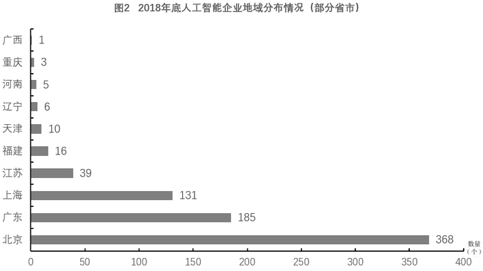

### 第 101 题

下列说法正确的是：

A. 截至2018年底，中国人工智能市场规模每年同比增长率都超过50%

B. 截至2018年底，中国人工智能企业地域分布情况中，广东企业数量最多

C. 截至2018年底，中国人工智能企业北京企业数量不超过上海企业数量的50%

D. 截至2018年底，福建人工智能企业的数量等于河南、天津、广西三省企业数量之和

第 101 题 · 答案与解析

**参考答案（粉笔题库参考内容）**

D

**解析**

A项：定位图1，2015年中国人工智能市场规模同比增长率为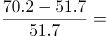，错误；

B项：定位文字材料，截至2018年底，中国人工智能企业地域分布中，北京企业数量最多，而非广东，错误；

C项：定位文字材料，截至2018年底，北京企业数量368家，上海企业数量131家，368＞131×50%，错误；

D项：定位图2，截至2018年底，福建人工智能企业数为16家，河南、天津和广西分别为5家、10家和1家，16=5+10+1，福建人工智能企业数量等于河南、天津、广西三省企业数量之和，正确。

故正确答案为D。

### 第 102 题

图2中排名第二的省（市），其人工智能企业数量的个数约是排名后四位的数量之和的多少倍？

A. 11.3

B. 12.3

C. 12.8

D. 13.3

第 102 题 · 答案与解析

**参考答案（粉笔题库参考内容）**

B

**解析**

根据题干“···约是···的多少倍”，可判定本题为现期倍数计算问题。定位图2可得：排名第二的省（市）是广东，其人工智能企业数量为185个，排名后四位的为广西、重庆、河南、辽宁，其人工智能企业数量依次为1个、3个、5个、6个。因此所求倍数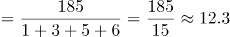。

故正确答案为B。

### 第 103 题

2015至2018年，中国人工智能市场规模同比增长率最高的年份是：

A. 2015年

B. 2016年

C. 2017年

D. 2018年

第 103 题 · 答案与解析

**参考答案（粉笔题库参考内容）**

D

**解析**

根据题干“····同比增长率最高···”，可判定本题为一般增长率的比较问题。定位材料图1可知每一年的现期量与基期量，代入增长率公式：

2015年：；

2016年：；

2017年：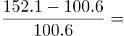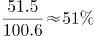；

2018年： 定位文字材料，截至2018年底，中国人工智能市场规模约为238.2亿元，同比增长率达到56.6%。

比较可知，2018年增长率最高。

故正确答案为D。

### 第 104 题

2017年中国人工智能市场规模同比增长率与2015年相比约：

A. 减少了13.3个百分点

B. 增加了13.3个百分点

C. 减少了15.4个百分点

D. 增加了15.4个百分点

第 104 题 · 答案与解析

**参考答案（粉笔题库参考内容）**

D

**解析**

根据题干“2017年······同比增长率与2015年相比”，可判定本题为一般增长率问题。定位柱形图1，2017年和2016年中国人工智能市场规模分别为152.1亿元和100.6亿元，则2017年中国人工智能市场规模同比增长率约为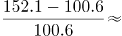，2015年和2014年中国人工智能市场规模分别为70.2亿元和51.7亿元，则2015年中国人工智能市场规模同比增长率约为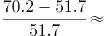，故2017年中国人工智能市场规模同比增长率与2015年相比约增加了51.5%-35.6%=15.9%，即增加了15.9个百分点，与D项最接近。

故正确答案为D。

### 第 105 题

若按照2018年同比增长率，到2019年底中国人工智能市场规模约为：

A. 363亿元

B. 371亿元

C. 373亿元

D. 383亿元

第 105 题 · 答案与解析

**参考答案（粉笔题库参考内容）**

C

**解析**

根据题干“按照2018年同比增长率，到2019年底···约为”，材料给出的是2018年的数据，可判定本题为现期计算问题。定位文字材料：截至2018年底，中国人工智能市场规模约为238.2亿元，同比增长率达到56.6%。根据公式：现期=基期×(1+r)，可得2019年底中国人工智能市场规模=238.2×(1+56.6%)≈238×1.57≈374亿元，与C项最为接近。

故正确答案为C。

## 材料 2

2019年6月，全国发行地方政府债券8996亿元，同比增长68.37%，环比增长195.63%。其中，发行一般债券3178亿元，同比减少28.33%，环比增长117.08%，发行专项债券5818亿元，同比增长540.04%，环比增长268.46%；按用途划分，发行新增债券7170亿元，同比增长127.11%，环比增长332.71%，发行置换债券和再融资债券1826亿元，同比减少16.47%，环比增长31.75%。

2019年6月，地方政府债券平均发行期限11.1年，其中新增债券10.4年，置换债券和再融资债券13.4年；地方政府债券平均发行利率3.55%，其中新增债券3.52%，置换债券和再融资债券3.65%。

2019年1至6月，全国发行地方政府债券28372亿元，同比增长101.09%。其中，发行一般债券12858亿元，同比增长23.21%，发行专项债券15514亿元，同比增长322.38%；按用途划分，发行新增债券21765亿元，同比增长553.80%，发行置换债券和再融资债券6607亿元，同比减少38.71%。

2019年1至6月，地方政府债券平均发行期限9.3年，其中一般债券11.2年，专项债券7.8年；地方政府债券平均发行利率3.47%，其中一般债券3.53%，专项债券3.43%。

2019年全国地方政府债务限额为240774.3亿元。其中，一般债务限额133089.22亿元，专项债务限额107685.08亿元。截至2019年6月末，全国地方政府债务余额205477亿元，其中，一般债务118397亿元，专项债务87080亿元。

### 第 106 题

不能从上述资料推出的是：

A. 截至2019年6月末，地方政府一般债务余额和专项债务余额都控制在限额之内

B. 2019年1至6月，地方政府一般债券的平均发行利率高于专项债券0.1个百分点

C. 2019年5月，地方政府新增债券的平均发行期限比置换债券和再融资债券短

D. 2019年地方一般债务限额比专项债务限额多25404.14亿元

第 106 题 · 答案与解析

**参考答案（粉笔题库参考内容）**

C

**解析**

A项：定位文字材料最后一段“2019年······一般债务限额133089.22亿元，专项债务限额107685.08亿元。截至2019年6月末······一般债务118397亿元，专项债务87080亿元”，由于118397亿元＜133089.22亿元、87080亿元＜107685.08亿元，说明都控制在限额之内，正确；

B项：定位文字材料第四段“2019年1至6月，······其中一般债券3.53%，专项债券3.43%”，则一般债券平均发行利率-专项债券平均发行利率=3.53%-3.43%=0.1个百分点，正确；

C项：定位文字材料第二段“2019年6月，······其中新增债券10.4年，置换债券和再融资债券13.4年”，只有2019年6月的年份数据，无法计算出2019年5月的数据，故无法推出，错误；

D项：定位文字材料最后一段“2019年······其中，一般债务限额133089.22亿元，专项债务限额107685.08亿元”，一般债务限额-专项债务限额=133089.22-107685.08=25404.14亿元，正确。

本题为选非题，故正确答案为C。

### 第 107 题

2018年1至6月，发行一般债券的占比较发行专项债券的占比约：

A. 低9.36%

B. 低52.81%

C. 高47.93%

D. 高53.43%

第 107 题 · 答案与解析

**参考答案（粉笔题库参考内容）**

C

**解析**

根据题干“2018年1至6月······占比约”，结合材料时间，可判定本题为基期比重问题。结合文字资料第三段“2019年1至6月，全国发行地方政府债券28372亿元，同比增长101.09%。其中，发行一般债券12858亿元，同比增长23.21%，发行专项债券15514亿元，同比增长322.38%”。代入公式：基期量和比重=部分/总体，可得所求比重，与C项最接近。

故正确答案为C。

### 第 108 题

2018年1至5月，全国发行地方政府债券约：

A. 23029亿元

B. 19376亿元

C. 14109亿元

D. 8766亿元

第 108 题 · 答案与解析

**参考答案（粉笔题库参考内容）**

D

**解析**

根据题干“2018年1至5月······约”，定位材料第一段“2019年6月，全国发行地方政府债券8996亿元，同比增长68.37%”，第三段“2019年1至6月，全国发行地方政府债券28372亿元，同比增长101.09%”，可判定本题为基期和差问题。根据公式：基期量，可知2018年1至5月，全国发行地方政府债券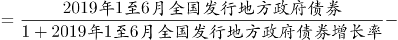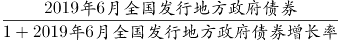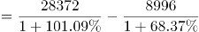亿元，与D项最接近。

故正确答案为D。

### 第 109 题

2019年1至6月，全国发行地方政府债券同比增量绝对值排序正确的是：

A. 新增债券>专项债券>置换债券和再融资债券>一般债券

B. 新增债券>置换债券和再融资债券>一般债券>专项债券

C. 专项债券>新增债券>置换债券和再融资债券>一般债券

D. 置换债券和再融资债券>专项债券>一般债券>新增债券

第 109 题 · 答案与解析

**参考答案（粉笔题库参考内容）**

A

**解析**

根据题干“······同比增量绝对值排序正确的是”，可判定本题为增长量的比较问题。定位文字材料第三段可得，2019年1至6月······发行一般债券12858亿元，同比增长23.21%，发行专项债券15514亿元，同比增长322.38%；······发行新增债券21765亿元，同比增长553.80%，发行置换债券和再融资债券6607亿元，同比减少38.71%。

根据增长量比较“大大则大”的原则，新增债券（21765亿元）＞专项债券（15514亿元）＞一般债券（12858亿元），新增债券的同比增速（553.80%）＞专项债券的同比增速（322.38%）＞一般债券的同比增速（23.21%），且由于三者都是同比增长，则同比增量绝对值的排序为：新增债券＞专项债券＞一般债券，只有A项符合。

故正确答案为A。

### 第 110 题

2019年6月，全国发行的地方政府债券比2018年6月多约：

A. 6151亿元

B. 5953亿元

C. 3653亿元

D. 3043亿元

第 110 题 · 答案与解析

**参考答案（粉笔题库参考内容）**

C

**解析**

根据题干“2019年6月，······比2018年6月多约”，判定本题为增长量计算问题。定位文字材料第一段“2019年6月，全国发行地方政府债券8996亿元，同比增长68.37%”。根据公式：增长量。代入数据，2019年6月，全国发行的地方政府债券的同比增长量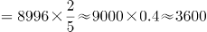亿元，与C项最接近。

故正确答案为C。

## 材料 3

### 第 111 题

能够从上述资料中推出的是：

A. 2016年A市气候调节价值年值超过700亿元

B. 2017年A市现代农业生态服务价值年值增长率、贴现值增长率最低的是同一个指标

C. 2017年A市生态与环境价值贴现值超过直接经济价值贴现值、间接经济价值贴现值之和的5倍

D. 2017年A市气候调节价值与水源涵养价值的年值之和超过生态与环境价值中其余指标的年值之和

第 111 题 · 答案与解析

**参考答案（粉笔题库参考内容）**

C

**解析**

A项：定位表格，2017年A市气候调节价值年值为732.34，比上年增长5.6%，则2016年A市气候调节价值年值为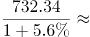亿元，没有超过700亿元，错误。

B项：定位表格，2017年A市现代农业生态服务价值年值增长率最低的是土壤保持价值，增长率为-12.6%，贴现值增长率最低的是水力发电价值，增长率为-10.1%，非同一个指标，错误。

C项：定位表格，2017年A市生态与环境价值贴现值为9182.61亿元，直接经济价值贴现值为372.60亿元、间接经济价值贴现值为1214.15亿元，则=8000，而，正确。

D项：定位表格，2017年A市气候调节价值年值为732.34，水源涵养价值年值为287.78，两个指标年值之和为：732.34+287.78=1020.12亿元；生态与环境价值年值为2048.71，生态与环境价值其余指标的年值之和为：2048.71-1020.12=1028.59亿元，1020.12亿元＜1028.59亿元，则2017年A市气候调节价值与水源涵养价值的年值之和小于生态与环境价值中其余指标的年值之和，错误。

故正确答案为C。

### 第 112 题

下列A市的指标中，2017年同比增量最多的是：

A. 气候调节价值年值

B. 水源涵养价值年值

C. 水源涵养价值贴现值

D. 生物多样性价值贴现值

第 112 题 · 答案与解析

**参考答案（粉笔题库参考内容）**

A

**解析**

根据题干“······2017年同比增量最多的是”，可判定本题为增长量比较问题。定位表格材料可得，气候调节价值年值为732.34亿元，增长率为，增长量，水源涵养价值年值为287.78，增长率为，增长量，水源涵养价值贴现值为402.98，增长率为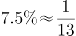，增长量，生物多样性价值贴现值为2898.67，增长率为，增长量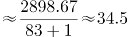，所以增长量最大为38.5，是气候调节价值年值。

故正确答案为A。

### 第 113 题

2017年A市生态与环境价值中，年值、贴现值较上年均有所上升的指标有：

A. 6个

B. 5个

C. 4个

D. 3个

第 113 题 · 答案与解析

**参考答案（粉笔题库参考内容）**

B

**解析**

根据题干“2017年······较上年均有所上升的······”，可知2017年A市生态与环境价值中“年值、贴现值”的增速都为正（即增长率大于0），即表明较上年均有所上升。定位表格可知：2017年A市生态与环境价值中，年值、贴现值同比增长率都为正的指标有：“气候调节价值（5.6%、2.7%）、水源涵养价值（10.2%、7.5%）、生物多样性价值（0.3%、1.2%）、防护与减灾价值（0.3%、1.2%）、土壤形成价值（1.6%、1.6%）”，共5个。

故正确答案为B。

### 第 114 题

2016年，A市直接经济价值年值占现代农业生态服务价值年值的比重为：

A. 8.24%

B. 11.23%

C. 13.59%

D. 15.46%

第 114 题 · 答案与解析

**参考答案（粉笔题库参考内容）**

B

**解析**

根据题干“2016年，······占······的比重为”，结合材料时间“2017年”，可判定本题为基期比重问题。定位表格材料可得：2017年直接经济价值年值为372.60亿元，比上年增长-6.0%，现代农业生态服务价值年值为3635.46亿元，比上年增长3.0%。故2016年A市直接经济价值年值占现代农业生态服务价值年值的比重，所求结果与B项最接近。

故正确答案为B。

### 第 115 题

能够正确描述2017年A市间接经济价值年值中三个指标占比的统计图是：

A. A

B. B

C. C

D. D

第 115 题 · 答案与解析

**参考答案（粉笔题库参考内容）**

A

**解析**

方法一：根据题干“······2017年······占比······”，结合材料时间“2017年”，可判定本题为现期比重问题。定位表格材料可得：2017年间接经济价值年值为1214.15亿元，旅游服务价值年值为804.78亿元，水力发电价值年值为8.68亿元，景观增值价值年值为400.70亿元。旅游服务价值年值占比为，即大于1/2、小于3/4，说明第一个扇形的圆心角大于180°、小于270°，结合选项排除B、C两项；景观增值价值年值占比为，说明最后一个扇形的圆心角大于90°，结合选项排除D项。

方法二：旅游服务价值年值与景观增值价值年值比例为，说明第一个扇形的面积约为第三个扇形面积的2倍，结合选项排除B、C、D三项。

故正确答案为A。

## 材料 4

2019年5月，全国12358价格监管平台受理价格举报、投诉、咨询共计37576件，同比下降40.70%，环比下降9.31%。其中，价格举报4192件，环比下降19.06%；价格投诉2059件，环比下降15.92%；价格咨询31325件，环比下降7.34%。平台受理量排名前十的省（市）依次是北京（5786件）、江苏（3528件）、上海（2499件）、重庆（2486件）、河南（2469件）、陕西（2440件）、浙江（2321件）、天津（1571件）、福建（1483件）、广西（1309件）。平台受理量行业分布如下表所示：

### 第 116 题

2019年5月，平台受理量排名第二的省（市）约是排名第九的省（市）的多少倍？

A. 1.4

B. 2.4

C. 3.7

D. 4.4

第 116 题 · 答案与解析

**参考答案（粉笔题库参考内容）**

B

**解析**

根据题干“2019年5月，······是······的多少倍”，结合材料时间为2019年5月，可判定本题为现期倍数问题。定位文字材料可得，2019年5月，平台受理量排名第二的省（市）为江苏（3528件），排名第九的省（市）为福建（1483件），则2019年5月，平台受理量排名第二的省（市）约是排名第九的省（市）的3528/1483≈3528/1500≈2.4倍。

故正确答案为B。

### 第 117 题

2019年4月，平台受理的价格咨询比价格举报约多：

A. 26146件

B. 27133件

C. 28627件

D. 29614件

第 117 题 · 答案与解析

**参考答案（粉笔题库参考内容）**

C

**解析**

根据题干“2019年4月······比······多”，结合材料时间为2019年5月，可判定本题为基期和差问题。定位文字材料可得，“2019年5月······价格举报4192件，环比下降19.06%······价格咨询31325件，环比下降7.34%”，则2019年4月，平台受理的价格咨询比价格举报多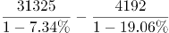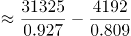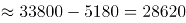件，与C项最接近。

故正确答案为C。

### 第 118 题

2019年5月，平台受理量排名前五的行业占受理总数的比重约为：

A. 61.4%

B. 56.3%

C. 51.8%

D. 46.5%

第 118 题 · 答案与解析

**参考答案（粉笔题库参考内容）**

B

**解析**

根据题干“2019年5月，······占······的比重约为”，结合材料时间为2019年5月，可判定本题为现期比重问题。定位文字材料，“2019年5月，全国12358价格监管平台受理价格举报、投诉、咨询共计37576件······”；定位表格材料，可得平台受理量排名前五的行业分别为停车收费（10043件），商品零售（3118件），交通运输（2730件），社会服务（2686件），物业管理（2587件），则2019年5月，平台受理量排名前五的行业占受理总数的比重为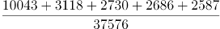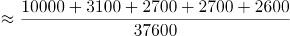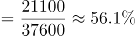，与B项最接近。

故正确答案为B。

### 第 119 题

能够从上述资料推出的是：

A. 2018年5月，平台受理价格举报数量多于价格投诉数量

B. 2019年5月，平台受理价格咨询数量环比下降幅度最大

C. 2019年5月，平台受理教育行业数量不超过旅游行业的2倍

D. 2019年5月，平台受理量排名前三的省（市）占总数的比重低于35%

第 119 题 · 答案与解析

**参考答案（粉笔题库参考内容）**

D

**解析**

A项：定位文字材料“2019年5月，······价格举报4192件，环比下降19.06%；价格投诉2059件，环比下降15.92%”，已知现期量、环比增长率，无法求同比基期量，A项无法推出，错误；

B项：定位文字材料“2019年5月，······价格举报4192件，环比下降19.06%；价格投诉2059件，环比下降15.92%；价格咨询31325件，环比下降7.34%”，平台受理数量环比下降幅度最大的为价格举报，并非价格咨询，错误；

C项：定位表格材料“2019年5月，平台受理教育行业数量为927件，受理旅游行业数量为459件”，927件>（459×2=918件），即平台受理教育行业数量超过旅游行业的2倍，错误；

D项：定位文字材料“2019年5月，全国12358价格监管平台受理价格举报、投诉、咨询共计37576件······平台受理量排名前十的省（市）依次是北京（5786件）、江苏（3528件）、上海（2499件）······”前三的省（市）为北京（5786件）、江苏（3528件）、上海（2499件），合计11813件，则2019年5月，平台受理量排名前三的省（市）占总数的比重为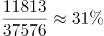，低于35%，正确。

故正确答案为D。

### 第 120 题

2018年5月，平台受理价格举报、投诉、咨询总数约为：

A. 26706件

B. 34376件

C. 41433件

D. 63366件

第 120 题 · 答案与解析

**参考答案（粉笔题库参考内容）**

D

**解析**

根据题干“2018年5月······总数约为”，结合材料时间为2019年5月，判定本题为基期计算问题。定位文字材料可得，2019年5月，平台受理价格举报、投诉、咨询总数共计37576件，同比下降40.70%。根据公式基期量可得，2018年5月平台受理价格举报、投诉、咨询总数约为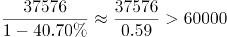件，只有D项满足。

故正确答案为D。

