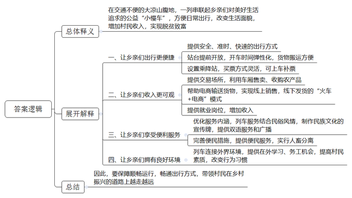
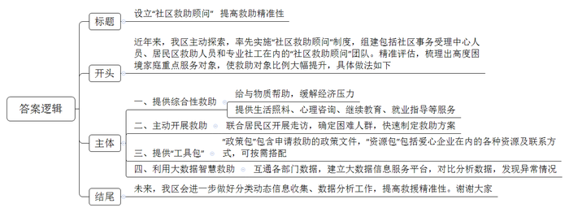

# 2021年公务员多省联考《申论》题（宁夏A卷）

> 候选采集稿。参考答案及解析来自粉笔页面，不代表官方答案或真实高分答卷；来源使用许可与原卷对应关系仍需人工核实。

## 给定材料

### 材料 material-7b83ad6335d12fb0

77岁的彝族老阿妈克迟莫，乘坐5619次列车从下普雄前往上普雄走访亲戚。阿妈很爱笑，也很健谈，因为牙齿几乎掉光，她笑着的时候总是害羞地抿着双唇。她说：“1968年，25岁从上普雄嫁到了下普雄，走了一天多的山路，才到夫家。两年后的1970年，‘小慢车’开了，40多分钟就可以回娘家。”尽管近几年山里的大多数村子都修了公路，但是大凉山区经常出现落石、滑坡和泥石流等地质灾害，阻断公路畅通，冬季也经常封路。对于大凉山深处的彝族老乡们来说，5633次列车还是最安全、时间最有保障的出行方式，很多时候也是唯一的出行方式。“即使某些区段因为各种原因无法通行，我们也会保障其他区段的运行。”乘务员阿呷说。

在过去的几十年间，这趟被称为“小慢车”的列车早已彻底进入当地人的日常生活。作为孩子们的校车、当地人的赶集车、公交车、婚车……这趟列车也在用“润物无声”的方式支持着大凉山区的脱贫攻坚。即使是普通话不流利的彝族老乡，也会在听到“小慢车”三个字时，第一时间吐出一个“好”字。

2020年是成昆铁路通车50周年，作为服务民族地区、助推地方经济、巩固国防建设的钢铁大动脉，成昆铁路串起了沿线群众的幸福生活。5619/20次和5633/34次两辆公益性“小慢车”与成昆线同龄，在悠长岁月里传承“铸道精神”，穿行于大凉山腹地，最长运行里程353公里，停靠26个车站，自1995年以来票价从未变过，最高25.5元，最低2元。5619次、5633次“小慢车”串联起彝族老乡们对美好生活的追求。一张张朴实无华的笑脸，让“小慢车”充满了阳光和温度。

3月开始，正是大凉山采收蕨菜、青岗藤、蒲公英、党参等土特产的季节。5633次尼波站开车后各车厢大件行李处都堆满了农产品。有的时候，这些土特产在“小慢车”上就完成了交易，老乡们在车厢里拿出秤杆子，当场称重交易，省时又省力，在到达终点前就已经把手上的土特产出售一空。阿莫的随身物品很简单，一个皮质挎包、一杆秤。他此次乘车的目的是收购蕨菜。他穿梭在车厢里，不断寻找心仪之物，终于在8号车厢的大件行李处找到了几大包新鲜水嫩的蕨菜，在与货主沟通后，阿莫拿出秤杆子，一袋一袋地称了起来，这一趟阿莫收购了300多斤蕨菜。现在，阿莫已经不再依靠坐火车运输货物赚钱了。他选择了“火车+电商”的新路，开办猪场，制作凉山猪腊肉，在电商平台销售，然后用大车把腊肉运到县城去发快递。今年春节，他的几千斤腊肉几乎销售一空，挣了几万块钱。

为了供阿树上学，父母通过“小慢车”销售家里种植的烤烟、土豆、玉米，他们最大的心愿就是阿树能找到一份稳定的工作。2017年，铁路部门履行扶贫承诺来到学校招工，阿树与另外5名彝族同学脱颖而出，成为“小慢车”的乘务员。得知儿子能够在“铁路部门”上班的消息，一家人都高兴坏了。妈妈说，“这下阿树既找到了稳定的工作，又缓解了家里的经济压力。”从乘客变为铁路人，“小慢车”一直温暖着这位青年的心。

近年来，“小慢车”列车党支部围绕精神文明建设和精准扶贫，积极促进民族团结进步，不断优化“彝乡情”服务内涵，完善便民利民措施。将民俗风情与列车服务举措结合，设计制作了带有彝族文化元素的揭示揭挂，列车方向牌和车内引导标识都标注了彝汉双语。同时，班组服务小分队坚持到车厢、到座位进行安全服务和文明乘车宣传，一并提供针线包、胶带、捆扎绳等便民服务，列车广播还增加了彝汉双语播报服务，车内乘务员“彝语”“汉语”双语上岗。为了方便日常彝族老乡运输家禽、牲口，“小慢车”贴心地在行李车厢增设了牲畜拴挂处，每趟车进行消毒，实现了牲畜与旅客分开，让车厢环境更卫生、整洁。

为了让彝族老乡能把所有东西搬上车，有的车站还会提前开放站台，让老乡先把货物堆在车门前，有时这趟列车的开车时间会推迟几分钟。“我们这种车时间弹性大，不像高铁，都是按秒计算的。”列车员称，“和多数人熟悉的先买票再上火车的流程略有不同，5633次列车一路停靠的大多数车站都只能被称为乘降站，也就是可以上下车但不具有售票资格的车站，乘客从乘降站上车后再在车上补票。”

在阿呷看来，教育是阻断贫困的最重要的途径。现在更多彝族年轻人通过“小慢车”能够走出大山到外面学习、务工，这些都是让当地更快发展的希望。教育进步带来的最直接的变化就是在列车上抽烟、乱扔果皮的人少了，即使有，列车员的劝告也会被听进去。“以前打扫车厢卫生都是用铁铲的，甘蔗上市的时候，地上全是甘蔗渣，黏脚。”阿呷说，“我已在5633次列车上工作了20多年，这些年来家乡的变化实在是太大了。我很自豪我的家乡正走在乡村振兴的大路上。我喜欢在车上的工作和生活，这是一辆开往春天的列车，为乡亲们带来了温暖和希望。”

### 材料 material-6f317f688e22f202

为加强全县基层农业专业技术人员队伍建设，D县成立专项调研组进行了走访调研。

“我们的工作，既缺钱，也缺人。”县农业农村局副局长说，“全县基层三农服务岗位有141个编制，目前仅有105人。”“这种情况不是个例。”县水技站站长说，“单位编制不断压缩，如今只剩下‘光杆司令’。”

某乡农服中心主任是农技推广好手，也是省级科技特派员，但近年工作起来愈发感觉“难为无米之炊”。他说，近几年种植的水稻品种效益低，农户种植新品种的意愿强烈，但农服中心却难以推广试种新品种，“原来的试验田已经被取消了，经费也减少了。”这位农服中心主任说，“现在要推广新品种新技术，只能自己去劝服农户，要是种失败了还得个人掏腰包。”

某渔政管理站站长说，为增加百姓收入，他们引导渔民种新品种紫菜，但部分渔民为了多赚一点钱，不按规定时间下苗，最终导致产量下跌40%左右反而责怪站里没有指导好。

“基层技术性岗位待遇低，青年人才不愿意来，来了没几年也要走。”某海岛农服中心主任已经干了26年，正为找不到接任的干部而苦恼。“站里人员断档严重，要么是刚工作的，要么就是我这样工作了二三十年的。”

调研组在基层走访时，常常听到类似的吐槽：“农服中心就剩2人，还都去做其他工作了”“现在负责水利方面工作的，专业是搞村建的”“原来专业搞水利的，被调到财务部门做出纳了……”。

一些基层专业干部被频频“挪作他用”，导致旧业务丢掉了，新业务也不熟悉。一位在水利系统工作了22年的水利干部突然被调到海洋渔业部门工作。这位干部说，虽然都和水有关，但工作内容差别较大。刚上任不久，他就接手了“整改违规养殖导致海洋环境污染”的工作，缺少经验的他只好“以文件贯彻文件”，最后被上级批评。

去年秋天，县里指导乡镇开设培训班，要求每户农民都要参加一个月的农技培训。“我们这里种的是茶叶和瓜果，培训内容是竹、菇、菜，培训内容和实际情况不相关。而培训时正是农忙季节，谁愿意脱产一个月来参加培训？培训有什么用？”某乡镇农技干部说。

“招不来学农的大学生，好不容易招到一个，还留不住。”在走访中，不少农服中心反映“招人难”问题突出。据不完全统计，全县干部队伍中，学农的大学生从事本专业工作的人数不到50%，仅有不足10%的毕业生愿意到乡镇农服中心就业。

有限的农业干部也常常是“身兼数职”，甚至还要承担防汛、防疫等工作。县农服中心主任说：“有个乡镇的农服中心主任还兼着其他几个站所的负责人，根本没有精力研究业务。”调研组在走访中了解到，少了农业人才的支持，无论是农业供给侧改革还是乡村振兴都受到了影响。去年，农民老杨种的辣椒大面积患病，但农技人员赶到现场一看，表示“不熟悉辣椒，无能为力”。最后病害没能控制住，老杨损失了近10万元。

### 材料 material-84176f8369d9f4e3

“把她的家粉刷一新，给独自生活的她更多支持”。

某公益平台上，为女孩儿小珊修缮房屋的公募计划得到不少爱心网友的参与。1元、10元、100元……不到一个月，爱心捐款就超过了修缮所需费用。

小珊的故事是C市社会救助综合改革的一个缩影。家住C市N区的小珊，唯一的亲人去世，自己又身患多种疾病，让她一度有轻生念头，是N区“社区救助顾问”团队把她从疾病与孤独中拉了出来。

“我们希望为她‘粉刷’的不仅是墙面，还有内心。”社区救助顾问小李说。为小珊修缮房屋正是为其定制的“救助组合拳”中的一步：修缮后的房屋腾出一间出租，能有效缓解其家庭债务。同时，提供专业心理咨询、继续教育、就业指导等服务，帮助她重拾生活信心。

近年来，尽管C市已建立较完备的现代社会救助体系，但因救助工作涉及部门较多、政策内容复杂，总有一些不愿主动求助、不知如何求助的“沉默”困难群众未得到应有的救助。2019年，N区组建了一支由社区事务受理中心人员、居民区救助人员和专业社工组成的300余人“社区救助顾问”团队。截至目前，N区已对7000多户居民进行了精准评估，梳理出高度困境家庭重点服务对象1300多户，其中不少属于“沉默”的困难人群。

“解决救助工作‘最后一公里’难题需要在思路上有转变。N区是全国社会救助综合改革试点区，我们想通过先试先行，为全市社会救助工作摸索出一条新路子来，所以，2019年9月，最先在N区实施了‘社区救助顾问’制度。”C市民政局负责人说。

新冠肺炎疫情下，那些本就脆弱的家庭会否面临更大的风险？N区红桥路街道救助顾问联合居民区开展主动走访。他们发现，来N区务工的苏先生所在公司因疫情无法开工，妻子无业在家，还有三胞胎女儿需要照顾，家庭基本生活难以维持。救助顾问以最快速度制定救助方案，除发放临时帮扶资金外，还主动对接外部资源，帮助苏先生的妻子找到了一份工作。

“我们给每名救助顾问一个‘政策包’和‘资源包’，‘政策包’里装着为困难群众申请救助的政策文件，‘资源包’里则有包括爱心企业、群团组织、基金会等在内的各种资源及联系方式。这就是救助顾问的‘工具包’，可以按需搭配。”N区民政局社会救助科科长说。

在N区华新路街道，近年来通过打通民政、人社、卫健、医保、残联等部门数据，形成了“可统计、可分析、可关联”的智慧救助大数据。街道办何主任举例说，救助顾问在比对居民医保与工会数据时，发现陈女士家庭医药费支出突然增大，上门走访后得知陈女士最近做了一场大手术，丈夫又生病在家，儿子也找不到工作。救助顾问随即为陈女士一家对接救助政策，不仅解决了大部分自费医药费，还帮助其儿子找到了临时工作，使这个家庭很快走出了困境。

“过去，我们只是物质救助，现在不仅是这些，还包括生活照料、精神慰藉、能力提升等综合性的。”N区民政局社会救助科科长说。

“精准救助首先要对象精准，确保‘应保尽保，不落一户’。我们区虽然初步建立了救助大数据信息服务平台，但是，做好低保家庭、低收入家庭、支出型贫困家庭和特殊困难家庭的分类动态信息收集、数据分析工作还有一段路要走。”N区民政局申局长说。

“社区救助顾问”制度在N区试点以来，越来越多的困难人群被救助顾问发现，并得到及时救助。数据显示，N区救助目标对象占全区户籍人口的比例已从1%升至约6%。

## 题目

### 第 1 题

**请你根据****“给定资料**1**”，谈谈对文中划线句子“这是一辆开往春天的列车，为乡亲们带来了温暖****和****希望****”的理解。（30分）**

关联材料：材料 material-7b83ad6335d12fb0

作答要求：

要求：全面，准确，有条理。不超过400字。

### 第 2 题

**假如你是****D县专项调研组成员，请根据“给定资料**2**”，梳理D县基层农业专业技术人员队伍存在的主要问题，****并****提出加强队伍建设的建议。（****30分）**

关联材料：材料 material-6f317f688e22f202

作答要求：

要求：全面准确，条理清晰，具体可行。不超过350字。

### 第 3 题

**C市准备召开社区救助工作经验交流座谈会，如果你代表N区在座谈会上发言，请根据“给定材料**3**”，拟写一份座谈会上的发言提纲。（20分）**

关联材料：材料 material-84176f8369d9f4e3

作答要求：

要求：内容全面，有逻辑性，语言流畅，不超过450字。

### 第 4 题

**根据****“给定资料**4**”中提到“复活容易，活好难”，请你深入思考这句话，联系实际展开联想，自选角度，自拟题目写一篇文章。（70分）**

关联材料：材料 material-7b83ad6335d12fb0

作答要求：

要求：

（1）观点正确，见解深刻；

（2）思路清晰，结构完整；

（3）语言流畅，书写工整；

（4）字数1000\-1200字。

## 答案与解析

第 1 题

**参考答案（粉笔题库参考内容）**

这句话的意思是在交通不便的大凉山腹地，一列串联起乡亲们对美好生活追求的公益“小慢车”，方便日常出行，改变生活面貌，增加村民收入，实现脱贫致富。表现为：

一、让乡亲们出行更便捷。提供安全、准时、快速的出行方式；站台提前开放，开车时间弹性化，货物搬运方便；设置乘降站，买票方式灵活，可上车补票。

二、让乡亲们收入更可观。提供交易场所，利用车厢售卖、收购农产品；帮助电商输送货物，实现线上销售，线下发货的“火车+电商”模式；提供就业岗位，增加收入。

三、让乡亲们享受便利服务。优化服务内涵，列车服务结合民俗风情，制作民族文化的宣传牌，提供双语服务和广播；完善便民措施，提供便民服务，实行人畜分离。

四、让乡亲们拥有良好环境。列车连接外界环境，提供在外学习、务工机会，提高村民素质，改变行为习惯。

因此，要保障顺畅运行，畅通出行方式，带领村民在乡村振兴的道路上越走越远。

**解析**

**参考答案说明：**思路方面，本参考答案按照词句解释题“总体释义+展开解释+总结”的一般答题思路展开。内容方面，本参考答案首先解释了“‘小慢车’是一辆开往春天的列车，为乡亲们带来了温暖和希望”这句话；接着给出了“温暖和希望”的具体体现；最后，给出了对策作为总结。词句表达方面，本参考答案加上了“表现为”“因此”等连接词来承接上下文。

**考点**：考点词句解释类

**来源**：来源2021年公务员多省联考《申论》题（宁夏A卷）

粉笔申论页面对本题只提供「解析视频」入口，该入口是会员推广位，页面无视频地址与文字解析。

第 2 题

**参考答案（粉笔题库参考内容）**

问题：1.缺少人才。编制压缩，待遇低，难吸引和留下青年人才，人才断档。2.资源不足。试验田取消，经费减少，新品种新技术推广缺乏支持，风险个人承担。3.工作安排混乱。专业干部被频繁调岗，业务不熟悉，工作成效差；身兼数职，时间精力不足。4.培训不合理。内容脱离现实需求，脱产培训且与农忙时间冲突，农民参与意愿低。

建议：1.扩充人才队伍。核增编制，提高薪资福利，吸引青年人才；建立“老带新”培养机制，缓解人才断档。2.强化资源支撑。恢复试验田，加大经费投入，设立政府主导的风险共担基金，分摊试验损失。3.优化工作分配。严禁随意抽调专业干部，明确岗位职责；合理统筹任务，减少非业务性工作，确保干部专注农技服务。4.精准开展培训。根据当地种植结构定制培训内容，采用“田间课堂”等灵活方式，避开农忙时段，提升农民参与度。

**解析**

**参考答案说明**：本参考答案整体上分为“问题”和“对策”两个部分。其中，在“问题”部分，从“缺少人才”“资源不足”“工作安排混”“培训不合理”四个方面进行了分条撰写；在“对策”部分，从“扩充人才队伍”“强化资源支撑”“优化工作分配”“精准开展培训”四个方面进行了分条撰写。各条答案要点之间在内容上相互并列，没有交叉。

**考点**：考点提出对策类

**来源**：来源2021年公务员多省联考《申论》题（宁夏A卷）

粉笔申论页面对本题只提供「解析视频」入口，该入口是会员推广位，页面无视频地址与文字解析。

第 3 题

**参考答案（粉笔题库参考内容）**

设立“社区救助顾问” 提高救助精准性

近年来，我区主动探索，率先实施“社区救助顾问”制度，组建包括社区事务受理中心人员、居民区救助人员和专业社工在内的“社区救助顾问”团队。精准评估，梳理出高度困境家庭重点服务对象，使救助对象比例大幅提升，具体做法如下：

一、提供综合性救助。给与物质帮助，缓解经济压力；提供生活照料、心理咨询、继续教育、就业指导等服务。

二、主动开展救助。联合居民区开展走访，确定困难人群，快速制定救助方案。

三、提供“工具包”。“政策包”包含申请救助的政策文件，“资源包”包括爱心企业在内的各种资源及联系方式，可按需搭配。

四、利用大数据智慧救助。互通各部门数据，建立大数据信息服务平台，对比分析数据，发现异常情况。

未来，我区会进一步做好分类动态信息收集、数据分析工作，提高救援精准性。谢谢大家！

**解析**

**参考答案说明：**本参考答案包括标题+正文，标题为保险起见加上。内容上，开头先整体介绍了N区社会救助的情况；主体部分从“提供综合性救助”“主动开展救助”“提供‘工具包’”“利用大数据智慧救助”四个方面介绍了具体做法；结尾表明了未来的发展方向。各条答案要点之间在内容上相互并列，没有交叉。

**考点**：考点总结类

**来源**：来源2021年公务员多省联考《申论》题（宁夏A卷）

粉笔申论页面对本题只提供「解析视频」入口，该入口是会员推广位，页面无视频地址与文字解析。

第 4 题

**参考答案（粉笔题库参考内容）**

**让传统技艺焕发生机活力**

习近平总书记指出，“要推动中华优秀传统文化创造性转化、创新性发展，以时代精神激活中华优秀传统文化的生命力。”传统技艺作为优秀文化的重要组成部分，也亟待振兴。但正所谓“复活容易，活好难”，我们不能沉湎于简单的传承，更要与时代接轨，让传统技艺焕发新的生命力。让传统技艺真正“活好”，我们要不断释放创造活力，创新技艺、丰富内涵，也要坚持对外推广，走出国门、走向世界，还要依靠商业化支持，走上市场化发展之路。

**让传统技艺****“活好”，要传承，更要对技艺、内涵丰富创新。技术上要持续改良，提升美感质感；内容题材上要融入新意，充分挖掘本土文化符号，彰显地域特色**。既传承历史，又善于创新，才能不断巩固竞争力。要在技术上不断学习探索，结合新形势下行业的发展成果，借鉴新鲜技术、成熟经验，有机融合扬长避短，对现有技术有效改良，大力提升美感质感。要在内容题材上融入更多新意，既体现新格局时代要求、新潮流审美观念，也要体现当地自然风光、人文观念、规律习俗等独有特色，唤发强大的生命力、发展力。

**让传统技艺****“活好”，要主动“走出去”，积极对外推广。要积极参加各类交流展示活动，提升知名度和影响力，让更多人体会传统技艺的魅力**。培育好生存土壤与空间，传统技艺才有存在的价值。要深度挖掘传统技艺的重要意义、丰富内涵，想方设法“走出去”，让其走得远、走得稳。要积极组织参加更大范围、更高层次的展示活动，通过电视、报刊、网络等方式开展宣传，利用各级商会、协会、研究会等提供的平台进行实物交流、技艺演示、推广宣传，吸引更多爱好者认可和关注，引起权威机构与专业人士重视，扩大知晓度、覆盖面、影响力，让更多的人体会传统技艺的魅力。

**传统技艺要历久弥新，需要商业化支持。不仅要持续开发商品，实现其经济价值，也需要专业化、公司化运营，实现良性循环，带动就业，实现社会效益**。商业化推广是让传统技艺历久弥新、永葆生机的重要途径。要加大投入，开发造纸、绘画纪念品等文化商品并扩大生产，加强专业化研究，把古老技艺变为现实需求，大力发展文化旅游，促进当地经济发展，释放经济价值。要实行专业化、公司化运营，通过市场化管理增强发展竞争力，持续营造浓厚文化氛围，提升传统文化价值，展现历史文化魅力，带动当地及周边劳动力就近就业，实现最大社会效益，实现良性循环，强化可持续发展。

时代呼唤创新，更呼唤像王陶然一样的创新型人才。坚持守正创新，保持开拓进取，必将不断激活优秀传统技艺的生命力，助推传统技艺绽放无比璀璨的光芒。

**解析**

**文章分析**

**让传统技艺焕发生机活力**

【**标题的优点：**标题中含有“传统技艺”这一主题，使文章主题更突出、清晰。】

习近平总书记指出，“要推动中华优秀传统文化创造性转化、创新性发展，以时代精神激活中华优秀传统文化的生命力。”（1）传统技艺作为优秀文化的重要组成部分，也亟待振兴。但正所谓“复活容易，活好难”，（2）我们不能沉湎于简单的传承，更要与时代接轨，让传统技艺焕发新的生命力。让传统技艺真正“活好”，我们要不断释放创造活力，创新技艺、丰富内涵，也要坚持对外推广，走出国门、走向世界，还要依靠商业化支持，走上市场化发展之路。

【**开头的优点：**★内容方面。范文的开头是紧扣题目中“传统技艺”这一主题展开的。首先，指出了传统技艺的重要性；其次通过分析当今时代的发展引出总观点。即指明让传统技艺“活好”要不断创新，要走出国门，要市场化发展等，为后文具体观点的论述做铺垫。★文字表达方面。使用了“然而”“更”等连接词，使语言表达有逻辑性。】

**让传统技艺****“活好”，要传承，更要对技艺、内涵丰富创新。技术上要持续改良，提升美感质感；内容题材上要融入新意，充分挖掘本土文化符号，彰显地域特色**。既传承历史，又善于创新，才能不断巩固竞争力。（1）要在技术上不断学习探索，结合新形势下行业的发展成果，借鉴新鲜技术、成熟经验，有机融合扬长避短，对现有技术有效改良，大力提升美感质感。（2）要在内容题材上融入更多新意，既体现新格局时代要求、新潮流审美观念，也要体现当地自然风光、人文观念、规律习俗等独有特色，唤发强大的生命力、发展力。

【**论述段****1的优点：**★观点句：范文的观点句是紧扣“传统技艺”这一文章主题提出的。形式上，它在段首处直接写出，位置突出，容易发现。内容上，关键词突出，内容要点明确，可以明显看出它从“丰富创新技艺、内涵”入手，让传统技艺“活好”。★论述内容：（1）介绍了技术上要持续改良；（2）介绍了要在内容题材上融入新意。注意：以上两个方面层次清晰，论述的针对性强。在论述方法上主要采用了讲道理的方式。】

**让传统技艺****“活好”，要主动“走出去”，积极对外推广。要积极参加各类交流展示活动，提升知名度和影响力，让更多人体会传统技艺的魅力。**培育好生存土壤与空间，传统技艺才有存在的价值。（1）要深度挖掘传统技艺的重要意义、丰富内涵，想方设法“走出去”，让其走得远、走得稳。（2）要积极组织参加更大范围、更高层次的展示活动，通过电视、报刊、网络等方式开展宣传，利用各级商会、协会、研究会等提供的平台进行实物交流、技艺演示、推广宣传，吸引更多爱好者认可和关注，引起权威机构与专业人士重视，扩大知晓度、覆盖面、影响力，让更多的人体会传统技艺的魅力。

【**论述段****2的优点：**★观点句：范文的观点句是紧扣“传统技艺”这一文章主题提出的。形式上，它在段首处直接写出，位置突出，容易发现。内容上，关键词突出，内容要点明确，可以明显看出它是从“主动‘走出去’”出发，让传统技艺“活好”。★论述内容：（1）从挖掘传统技艺的意义、内涵入手让传统技艺走出去；（2）通过参加各类活动，提升传统技艺魅力，让其走出去。注意：以上几个方面的内容都是紧扣观点句进行分析论述的，论述的针对性强，内容层次丰富。】

**传统技艺要历久弥新，需要商业化支持。不仅要持续开发商品，实现其经济价值，也需要专业化、公司化运营，实现良性循环，带动就业，实现社会效益。**（1）商业化推广是让传统技艺历久弥新、永葆生机的重要途径。（2）要加大投入，开发造纸、绘画纪念品等文化商品并扩大生产，加强专业化研究，把古老技艺变为现实需求，大力发展文化旅游，促进当地经济发展，释放经济价值。（3）要实行专业化、公司化运营，通过市场化管理增强发展竞争力，持续营造浓厚文化氛围，提升传统文化价值，展现历史文化魅力，带动当地及周边劳动力就近就业，实现最大社会效益，实现良性循环，强化可持续发展。

【**论述段****3的优点：**★观点句：范文的观点句是紧扣“传统技艺”这一文章主题提出的。形式上，它在段首处直接写出，位置突出，容易发现。内容上，关键词突出，内容要点明确，可以明显看出它是从“商业化支持”入手，让传统技艺历久弥新。★论述内容：（1）商业化推广对传统技艺历久弥新的重要性。（2）加大投入，促进传统技艺商业化。（3）专业化、公司化运行，实现传统技艺持续发展。注意：以上几个方面的内容都是紧扣观点句进行分析论述的，论述的针对性强，内容层次丰富。在论述方法上采用了讲道理、举例子相结合，做到了丰富多样。】

【**论述段之间的关系：**★内容的内在逻辑：论述段1从技术、内容上创新的层面让传统技艺“活好”，论述段2从主动“走出去”层面让传统技艺“活好”，论述段3从商业化支持层面让传统技艺“活好”。三个论述段相互并列，逻辑清晰。】

时代呼唤创新，更呼唤像王陶然一样的创新型人才。坚持守正创新，保持开拓进取，必将不断激活优秀传统技艺的生命力，助推传统技艺绽放无比璀璨的光芒。

【**结尾的优点**：范文的结尾回扣了“传统技艺”这一主题，语言精悍，不拖沓。】

**考点**：考点文章写作题

**来源**：来源2021年公务员多省联考《申论》题（宁夏A卷）

粉笔申论页面对本题只提供「解析视频」入口，该入口是会员推广位，页面无视频地址与文字解析。

