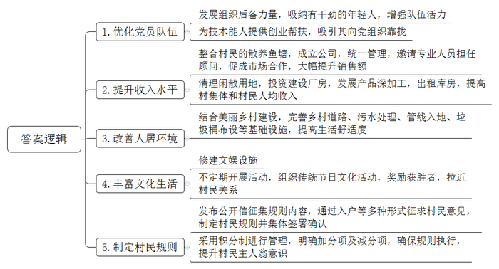
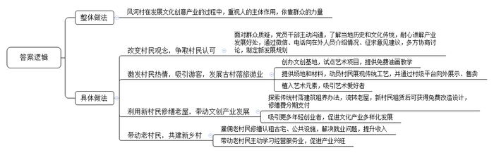
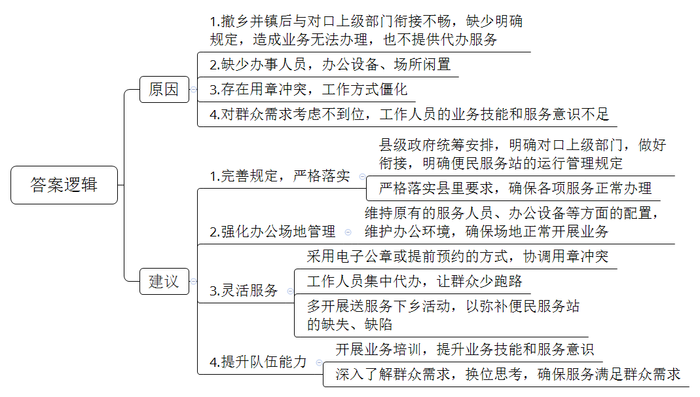
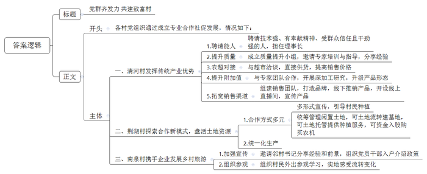

# 2021年公务员多省联考《申论》题（宁夏B卷）

<!-- gwy:overview:start -->
> **宁夏 · 2021 · 申论 · B类** ｜ 4 题 · 图片 4 处 · 答案随题折叠

导航：[题目](#题目) · [材料 1](#材料-1)
<!-- gwy:overview:end -->

> 候选采集稿。参考答案及解析来自粉笔页面，不代表官方答案或真实高分答卷；来源使用许可与原卷对应关系仍需人工核实。

## 给定材料

### 材料 1

2020年12月，团进村681户村民，陆续在一份“五和团进”村民规则确认书上，郑重地签下自己的名字。速度之快、人心之齐，让人很难想象这曾经是一个矛盾不断的后进村。

松山南部地区的团进村，2005年由团湖、望江、进守、津水4个村合并而成。与许多合并村一样，团进村曾经也存在“合村不合心”的问题。在村民周建华的记忆里，以前户与户之间都是各扫门前雪、不问村务事。“记得有一次，我们和4个村民一起，发起一场道路清扫义务活动，没想到不少村民当着面就说我们是作秀。”

这不是团进一个村遇到的窘境。在经济社会的快速发展变迁中，曾经是传统乡村连结根基的长辈权威等已逐渐弱化。如何建立一种新的联结，激发村民参与村庄治理的积极性？团进村一直在摸索。

新一届村党支部针对团湖、望江、进守、津水党员数量分布不均衡、结构不合理、先锋模范作用发挥不好等问题，积极发展后备力量，鼓励技术能人向党组织靠拢。“以前我们支部的平均年龄在60岁左右，经过几年的发展，我们吸纳了一批有干劲的年轻人，极大地增强了队伍的活力。”村党支部莫书记介绍。

韦长发是原津水村村民，多年来一直在外地从事水产养殖工作，考虑到望江水产基础好，适合发展名特优水产品，打算回乡发展。“刚回来的时候，村里在选场地、筹集资金、招募工人、办手续等方面给了我很大的帮助。”韦长发说。一年后，他的养殖基地开始盈利。2019年，韦长发被吸纳为党员。

在津水和望江有一些村民此前承包水塘养鱼，但由于技术有限，市场信息不对称，行情一直不太好。去年，村里规划将两地原有的散养鱼塘整合，成立了团进鱼跃公司，统一管理，并邀请韦长发担任顾问。韦长发凭借自己在外多年的门路，成功促成了团进鱼跃公司与外地饲料公司和一些大型生鲜市场的合作，鱼跃公司市场销售额比以前翻了几番。

去年底，村里把闲散的15.3亩建设用地清理出来，村集体投资建设了厂房，用于水产品深加工，并且将部分库房出租给经销商。“仅这一项，就让我们村集体收入比去年多出了60多万元。”村委会主任曾永平高兴地算着账，“去年村民人均纯收入增加了1.2万元，大家都很高兴。”

村里结合美丽乡村建设，加强乡村道路、污水处理、管线入地、垃圾桶布设等基础设施建设，“前几年，村里的部分路段经常泥泞不堪，出行不便，道路两旁杂草丛生，垃圾随处可见。现在，村里的道路拓宽了，环境得到改善了，我们的生活变得更加舒适了。”村民黄海老人笑着说。

村里还修建了民心广场，供村民休闲娱乐。不定期开展健身运动会、说书比赛等活动，还在传统节日的时候组织村民包粽子、猜灯谜、对对子，并且由村民评选出获胜者，给予一定奖励，“得到奖品是小事，关键是大家愿意聚拢了，比以往更亲近了！”村民李大红说。

去年12月，为了进一步规范村民行为，增强村庄凝聚力，团进村向全体村民发出了一封公开信，围绕“和善村民、和美家庭、和睦邻里、和煦村庄、和谐社会”，征集村民规则的具体内容，同时通过入户走访、座谈等多种形式征求意见，在此基础上形成了“五和团进”村民规则。为了使规则落到实处，村里采用积分制进行管理——不乱停车加1分，违法搭建扣5分，违反出租屋规定扣1分……整个村民规则包括30条加分项和30条减分项，大家称之为“团进60条”。

这份大家讨论出来的“家法”织牢了约束村民言行举止的规矩之网。据曾永平介绍，规则实行以来，村里乱丢垃圾、乱停车、乱搭建等行为大为减少。“在农村，村民们最看重的就是‘面子’，有了这样的激励，大家对积分格外上心，村民的主人翁意识也大大提高了！”

### 材料 2

北山县风河村沿溪而建，村史数百年，村尾的廊桥也已年过百岁。溪流两侧遗存的居民楼一字排开，多数为明清古建筑，都有百年以上的历史，虽然空置残破，但整体风貌保存完好。

近年来，风河的年轻人外出发展，迁居县城、省城，村里只剩下老人孩子。像风河这样的村子在北山有很多，“北山底子薄，发展只能立足于自身优势。”一位领导回忆起当年决策时说，北山的“优势”，就是传统村落及集群。

2015年，风河村在文创专家团队的指导下，打算以村里的古建筑和廊桥等为依托，发展村落文化创意产业。起初这一想法在村里并没有激起多大的波澜，有不少村民戏谑，“就咱这山脚旮旯，还能整出啥创意来？”“谁愿意到我们这穷乡僻壤来？”

为此，风河村的党员干部逐个上门跟村里的老人们沟通，向他们了解风河的历史和文化传统，跟他们耐心地讲解在风河开展文化创意产业的诸多好处。为让村里在外人员对古村落保护和文化创意有更多了解，村干部专门通过微信、电话等方式向他们介绍相关情况，征求意见建议。有人提出，“发展村落文创产业不是不行，但关键是谁来创这个业？”还有人担心，村里面的人群单一，“没有人进来，创业之后如何能够持续下去？”大家意识到，发展村落文化创意产业的关键是要把人引进来，尤其要引入“新村民”。在多方讨论协商之后，风河村最终以“文创新古村、引凤入风河”为主题，制定了新的发展规划。

以规划为指引，在文创团队的协助下，风河村创办了文创基地“广泰艺术城”，先后在两个村落试点“人人都是艺术家”项目，为村民、游客提供免费油画教学。村里还提供场地和材料，动员村民将剪纸、雕刻等传统手工艺展现出来，并通过村级平台向外界展示、售卖。这不但激发了村民的热情，还吸引了许多游客前来打卡。随着艺术元素的植入，古村旅游风生水起，“广泰艺术城”吸引了众多艺术爱好者纷至沓来，目前已陆续接待国内外驻学人员2万多人次。

村里空置老屋不少，但难就难在老屋早已不适合居住，要拆，业主们不肯；修缮，太费钱，工程还复杂繁琐。两难之下，风河村摸索出了“传统村落建筑租养”的办法。一是村委统一与产权人签订租赁合同，流转老屋的使用权和经营权。二是“新村民”作为老屋承租人同村委会签订租赁合同。三是老屋的现代化改造设计由专业团队免费提供，修缮费用由村里垫付，“新村民”分期支付。

2017年8月，冯皓成从南方老家辗转来到风河，成为风河村第一批“新村民”。他选定了两栋溪边老屋，一栋运营书屋，一栋运营咖啡屋。三年多来书屋兼营民宿、文创器物等，已获利超20万元；咖啡屋经营3年多已基本回本。

古村落、古民居的传统环境，以及第一批“新村民”取得的成果，吸引了不少年轻人到此从事互联网文创产业。如今的风河拥有书屋2家、咖啡吧5家、美术馆2个，艺术共享空间和工作室22家，国术馆1家。“新村民”在风河村所从事的文创产业已覆盖影视、传媒、音乐、美术等多个领域。文创产业的愈发兴旺带来的是乡村旅游的人气倍增。在这一过程中，风河变得更加有活力，对老村民的回馈也越来越多。

“从头到尾，老村民都是受益者。”村干部说，“在建设初期，村里的公共设施、‘新村民’认租的古宅都是由村委会雇佣老村民来修建、修缮的，这是他们不用外出打工，在家门口赚到的第一桶金。”游客越来越多，老村民又跟“新村民”学习，经营起餐馆、民宿、小卖部之类，干得风生水起。

“别人‘筑巢引凤’，而我们是‘引凤筑巢’。”有人这样评价。

### 材料 3

在传统乡镇布局中，部分乡镇面积小、人口少，但管理机构、干部职数、机构编制、财政投入均不少，行政运行成本较高。合理调整乡镇行政区划有助于统筹设置乡镇服务机构，统一配备服务人员，集中一站式服务，提升公共服务效能。2019年12月，祁河市8个（县）区完成了撤乡并镇行政区划调整，为了充分发挥便民职能，继续服务当地群众，推动乡镇机构职能由“管理型”向“服务型”转变，被撤乡并镇的便民服务站继续保留了下来。

近期，祁河市政府部门陆续收到基层民众反映“便民服务站一点都不便民”的问题，事实究竟怎样？对此，市电视台《阳光问政》节目进行了一次采访。

镜头一：S县赵湾镇罗湖便民服务站

服务站内，办公硬件设施设备齐全，4名工作人员在岗上班，但却无法办理任何业务，并且也不提供代办服务。

“之前我们有对口上级部门，各方面有明确的规定，自从原来的乡撤了之后，上面一直没有安排好，不知道如何衔接。”一名工作人员表示很无奈。

对此，该县乡镇行政区划调整改革领导小组副组长张轩伟说：“在乡镇行政区划调整改革之初，县委、县政府就明确要求，保留设立的乡镇便民服务站要确保服务不减。现在看来，我们的工作确实没有做到位。据了解，这个问题，不仅在赵湾镇罗湖便民服务站存在，在我县其他便民服务站也存在。”

镜头二：T区红河镇双星便民服务站

“这儿可以办准生证吗？”

“准生证办不了，要到镇上的便民服务中心去办。”

“为什么现在办不了？”

“我只给你们解释相关政策，跟你们说在哪里办。”问的人多了，这名工作人员显得有点不耐烦。

这里仅有一名工作人员在岗，但是只会办理医保、社保两项业务，其他业务需到红河镇便民服务中心才能办理。

村民抱怨：“原来办事很齐全，家门口办也很方便，现在服务质量明显不如以前了。”

镜头三：M县张集镇饶河便民服务站

一位村民说：“撤乡并镇之前，乡政府曾承诺，原来便民服务的地点和人员都会保留，但是现在却找不到人办事。”

M县张集镇党委委员李玲解释：“公章只有一枚，我们也不可能把公章放在那边，所以基本上老百姓都是自己到镇上来办理业务。”

“公章的问题，难道没有其他方式解决吗？比如采用电子公章或通过提前预约的方式来协调用章冲突？”记者问。

M县有关领导回应：“实际上这个问题是在服务群众的最后一公里上出现了偏差，也反映了我们为群众考虑不够，我们可以通过其他更灵活的方式来改进服务，比如由工作人员集中代办，尽量让群众少跑路，提高服务质量。”

镜头四：N县大林镇绿树便民服务站

办事窗口的电脑主机已被撤走，办公桌上布满了灰尘，绿植已经枯萎……这里已经停用很长一段时间了。

大林镇镇政府工作人员介绍：“镇上每天都会派干部到这里值守，为村民开展引导服务，告知他们办事要去山下的便民服务中心。”

大林镇党委副书记、镇长朱国伟就便民服务站变为“引导服务站”一事进行了剖析：“我们认为大林镇镇政府所在地是全镇进出的唯一一个口子。山上的群众下来就可以顺便办事，这样既方便了大家，也方便了我们，所以我们的工作安排就出现了偏差，把便民服务站变成了‘引导服务站’。下一步，我们将把便民服务站不便民的问题作为重点工作来改进，多提供‘送服务下乡’活动，以弥补便民服务站的缺失、缺陷，扎实做好乡镇行政区划调整改革的‘后半篇’文章。”

### 材料 4

村级党组织如何带领村民增收致富，有哪些实践探索？D市某部门深入基层进行调研。情况如下：

长桥镇清河村党支部书记聂玉斌谈到，去年4月，村里结合本村传统产业优势，成立了长鲜鱼腥草专业合作社。合作社筹建之初，村里就注意到了孙海新，聘请他担任理事长。“他爱学习肯钻研，种植技术好，亩产值明显高于其他人；他热心肠，为使其他农户受益主动掏钱打井；他性格开朗，在村里人缘好，大家有事都愿意找他说。”于是，聂书记找孙海新谈话，让他接管合作社，带领大家致富。“大家信任我，我就要做出点成绩来。”孙海新干劲十足地说。上任伊始，就成立了鱼腥草质量提升小组。请来县里的专家对农户进行鱼腥草种植技术培训，还下到田间地头进行实地指导，分享种植经验。在他的帮助下，村里的鱼腥草种植质量有了明显提高。他主动与县里的大型超市联系洽谈，成功实现了向超市直接供货，鱼腥草销售价格得到明显提高。为了充分利用好鱼腥草资源，提升鱼腥草附加值，孙海新与市科院专家团队合作开展鱼腥草深加工研究，推出了凉茶冲剂等系列产品。他组建专门销售市场团队，主打“鱼腥草之乡”的名片，与市内外的商超、医药公司进行联系，推销产品。同时还在线上开设直播间，大力宣传本村鱼腥草系列产品的质量和功效，进行网上直销。经过一段时间的努力，鱼腥草系列产品顺利打开了市场，获得了可观的收入。

“9年前我们成立了荆湖粮食专业合作社，探索‘党支部+合作社+农户+基地’的模式。您可以采取任意方式与我们合作。”柳林镇荆湖村党支部书记刘汉生介绍道，“我们村有200余户村民，地势平坦、土地资源丰富，是个传统的农业种植村，其他自然资源不丰富，主要靠天吃饭，很多村民都长期在外务工，造成了大量土地长期闲置，眼睁睁看着土地闲着，觉得很可惜。我们采取院坝会、走村入户、村直播等形式进行宣传，引导村民种植多种经济作物。对于闲置的土地交由村里统筹管理。现在村民们可以用土地流转、土地托管的方式，也可用资金入股合作社，流转的土地可以建基地。一体化发展多种作物优化产业结构，托管的土地按农户要求提供种植服务，让闲置产生效益，入股的资金购买农机提高生产效率。”

这些年合作社共吸纳社员198人，托管土地近5000亩，流转土地1500多亩。聚合了土地、农机、资金等资源，小田连片大田。去年合作社又出了新招，通过品种、肥料、种植、管理、收获“五统一”，实现了生产成本下降，机械化程度提升，亩产收入增加。合作社经营收入1000万元，合作社社员收入5万元，被评为市级示范合作社。

南泉花海，山花婀娜多姿。丛林探险基地、互动体验式游乐项目，应有尽有……谁曾想到这个每年揽客10万人次的乡村旅游项目险些“难产”。2015年南泉街道南泉村成立馨辉名苑旅游合作社。次年，与花谷生态旅游发展有限公司联合启动南泉花海项目。

“建设初期有一个很大的问题，那就是村民有顾虑不愿意流转土地。为了解决这个难题，村支两委一起想办法。首先我们邀请邻村的王书记过来向村民介绍他们村在土地流转中的具体做法、村民获得的实惠及今后的发展前景，同时我们还组织村支两委成员、共产党员、村级各干部、大学生村官分片分组入户进行宣传，讲明土地流转并不改变村民承包经营等政策。还组织村民走出去到处参观，到阳安长家岭，武陵区玉泉等地参观学习，实地感受土地流转带来的变化。百余村民也边走边看边学，看到了发展机遇。通过多方努力，村民们消除疑点，主动流转上百亩土地，为项目落地、产业发展打下了基础。当时要是没有解决好村民的思想问题，也不会有南泉的今天。”南泉村党总支书记、馨辉名苑乡村旅游专业合作社理事长汪瑞涵说。

## 题目

### 第 1 题

**根据****“给定资料**2**”，请你谈谈团进村是如何解决“合村不合心”问题的。（20分）**

关联材料：材料 1、材料 2、材料 3、材料 4

作答要求：

要求：准确、全面、有条理。不超过400字。

第 1 题 · 答案与解析

**参考答案（粉笔题库参考内容）**

1.优化党员队伍。发展组织后备力量，吸纳有干劲的年轻人，增强队伍活力；为技术能人提供创业帮扶，吸引其向党组织靠拢。

2.提升收入水平。整合村民的散养鱼塘，成立公司，统一管理，邀请专业人员担任顾问，促成市场合作，大幅提升销售额；清理闲散用地，投资建设厂房，发展产品深加工，出租库房，提高村集体和村民人均收入。

3.改善人居环境。结合美丽乡村建设，完善乡村道路、污水处理、管线入地、垃圾桶布设等基础设施，提高生活舒适度。

4.丰富文化生活。修建文娱设施；不定期开展活动，组织传统节日文化活动，奖励获胜者，拉近村民关系。

5.制定村民规则。发布公开信征集规则内容，通过入户等多种形式征求村民意见，制定村民规则并集体签署确认；采用积分制进行管理，明确加分项及减分项，确保规则执行，提升村民主人翁意识。

**解析**

**参考答案说明：**本参考答案从“优化党员队伍”“提升收入水平”“改善人居环境”“丰富文化生活”“制定村民规则”这五个方面进行了分条撰写。各条要点之间在内容上相互并列，没有交叉。

**考点**：概括措施类

**来源**：2021年公务员多省联考《申论》题（宁夏B卷）

粉笔申论页面对本题只提供「解析视频」入口，该入口是会员推广位，页面无视频地址与文字解析。

### 第 2 题

**根据“给定资料**1**”，谈谈北山县风河村是怎样引凤筑巢的。（30分）**

关联材料：材料 1、材料 2、材料 3、材料 4

作答要求：

要求：全面、准确、有条理。不超过400字。

第 2 题 · 答案与解析

**参考答案（粉笔题库参考内容）**

风河村在发展文化创意产业的过程中，重视人的主体作用，依靠群众的力量。具体有：

1.改变村民观念，争取村民认可。面对群众质疑，党员干部主动沟通，了解当地历史和文化传统，耐心讲解产业发展好处，通过微信、电话向在外人员介绍情况、征求意见建议，多方协商讨论，制定新发展规划。

2.激发村民热情，吸引游客，发展古村落旅游业。创办文创基地，试点艺术项目，提供免费油画教学；提供场地和材料，动员村民展现传统工艺，并通过村级平台向外展示、售卖；植入艺术元素，吸引艺术爱好者。

3.利用新村民修缮老屋，带动文创产业发展。探索传统村落建筑租养办法，流转老屋，新村民租赁后可获得免费改造设计，修缮费分期支付；吸引更多年轻创业者，促进文化产业多样化发展。

4.带动老村民，共建新乡村。雇佣老村民修缮认租古宅、公共设施，解决就业问题，提升收入；带动老村民主动学习经营服务业，促进产业兴旺。

**解析**

**参考答案说明：**本参考答案首先将整体做法前置，并利用文章内容对整体做法进行补充，从“改变村民观念，争取村民认可”“激发村民热情，吸引游客，发展古村落旅游业”“利用新村民修缮老屋，带动文创产业发展”“带动老村民，共建新乡村”四个方面分类概括要点，每条要点撰写时将总结性的信息前置，做到了题干要求的“有条理”。

**考点**：概括措施类

**来源**：2021年公务员多省联考《申论》题（宁夏B卷）

粉笔申论页面对本题只提供「解析视频」入口，该入口是会员推广位，页面无视频地址与文字解析。

### 第 3 题

**根据****“给定资料**3**”分析为什么村民抱怨便民服务****站****一点都不便民，并提出解决建议。****（30分****）**

关联材料：材料 1、材料 2、材料 3、材料 4

作答要求：

要求：内容全面，条理清晰，有针对性。不超过400字。

第 3 题 · 答案与解析

**参考答案（粉笔题库参考内容）**

原因：1.撤乡并镇后与对口上级部门衔接不畅，缺少明确规定，造成业务无法办理，也不提供代办服务。2.缺少办事人员，办公设备、场所闲置。3.存在用章冲突，工作方式僵化。4.对群众需求考虑不到位，工作人员的业务技能和服务意识不足。

建议：1.完善规定，严格落实。县级政府统筹安排，明确对口上级部门，做好衔接，明确便民服务站的运行管理规定；严格落实县里要求，确保各项服务正常办理。2.强化办公场地管理。维持原有的服务人员、办公设备等方面的配置，维护办公环境，确保场地正常开展业务。3.灵活服务。采用电子公章或提前预约的方式，协调用章冲突；工作人员集中代办，让群众少跑路；多开展送服务下乡活动，以弥补便民服务站的缺失、缺陷。4.提升队伍能力。开展业务培训，提升业务技能和服务意识；深入了解群众需求，换位思考，确保服务满足群众需求。

**解析**

**参考答案说明：**本参考答案围绕“便民服务站一点都不便民”的原因和解决建议这两个方面展开，原因部分主要从“规定落实”“队伍能力”“服务方式”“办公管理”这四个方面进行了介绍；解决建议部分从“完善规定，严格落实”“强化办公场地管理”“灵活服务”“提升队伍能力”这四个方面进行了分条撰写。答案做到了分段、分条撰写，整体上条理较为清晰。

**考点**：提出对策类

**来源**：2021年公务员多省联考《申论》题（宁夏B卷）

粉笔申论页面对本题只提供「解析视频」入口，该入口是会员推广位，页面无视频地址与文字解析。

### 第 4 题

**根据****“给定资料**4**”，拟写一则介绍村级党组织带领村民增收致富的工作信息。（70分）**

关联材料：材料 1、材料 2、材料 3、材料 4

作答要求：

要求：准确全面、条理清晰、语言流畅。不超过400字。

第 4 题 · 答案与解析

**参考答案（粉笔题库参考内容）**

党群齐发力 共建致富村

各村党组织通过成立专业合作社促发展，情况如下：

一、清河村发挥传统产业优势。1.聘请能人。聘请技术强、有奉献精神、受群众信任且干劲强的人，担任理事长；2.提升质量。成立质量提升小组，邀请专家培训与指导，分享经验；3.农超对接。与超市洽谈，直接供货，提高销售价格；4.提升附加值。与专家团队合作，开展深加工研究，升级产品形态；5.拓宽销售渠道。组建销售团队，打造品牌，线下推销产品，开设线上直播间，宣传产品。

二、荆湖村探索合作新模式，盘活土地资源。1.合作方式多元。多形式宣传，引导村民种植；统筹管理闲置土地，可土地流转建基地，可土地托管提供种植服务，可资金入股购买农机；2.统一化生产。

三、南泉村携手企业发展乡村旅游。1.加强宣传。邀请邻村书记分享经验和前景，组织党员干部入户介绍政策；2.组织参观。组织村民外出参观学习，实地感受流转变化。

**解析**

**参考答案说明：**本题要求写“工作信息”，可按照“标题+正文”的形式书写。正文部分，一方面从内容来看，围绕着“党组织带领村民增收致富”这一主题，本参考答案的开头写到了党组织带领村民增收致富的总体举措，主体部分围绕“清河村”“荆湖村”“南泉村”三个案例展开，并且每个案例有不同的做法，答案要点按照这三方面进行整合。另一方面，形式上，本参考答案做到了分段、分条撰写，整体上条理较为清晰。

**考点**：总结类

**来源**：2021年公务员多省联考《申论》题（宁夏B卷）

粉笔申论页面对本题只提供「解析视频」入口，该入口是会员推广位，页面无视频地址与文字解析。

