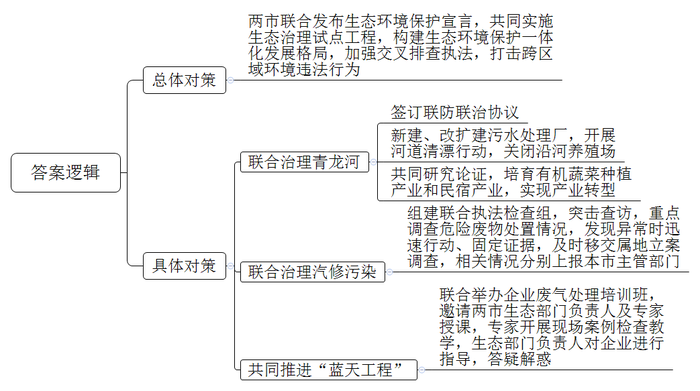
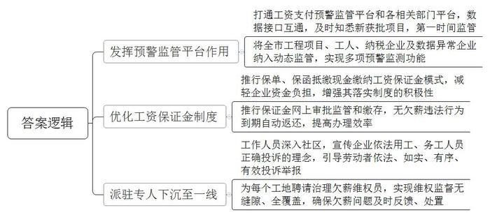
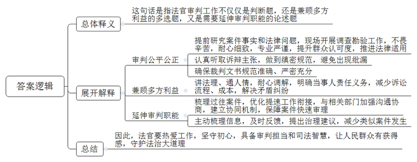
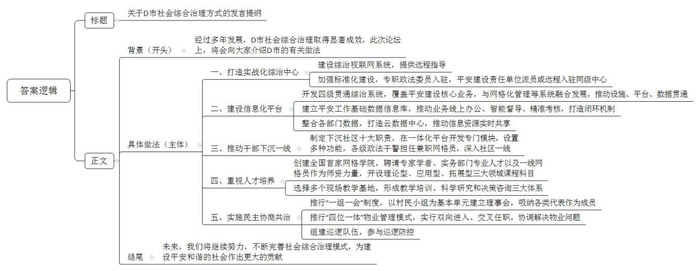

# 2022年公务员多省联考《申论》题（宁夏C卷）

<!-- gwy:overview:start -->
> **宁夏 · 2022 · 申论 · C类** ｜ 4 题 · 图片 4 处 · 答案随题折叠

导航：[题目](#题目) · [材料 1](#材料-1)
<!-- gwy:overview:end -->

> 候选采集稿。参考答案及解析来自粉笔页面，不代表官方答案或真实高分答卷；来源使用许可与原卷对应关系仍需人工核实。

## 给定材料

### 材料 1

蜿蜒的青龙河是M市和N市的界河，默默滋养着两市人民。前些年，由于两地缺乏有效沟通和管理，导致河流两岸常年垃圾堆积，污水横流。加之居民生活污水、沿河畜禽养殖污水直排，河道生活垃圾无人清理，青龙河一度成为一个巨大的污水池，当地人避之不及。青龙河谁来管、怎么管成了难题。

2021年1月5日，M、N两市联合发布《M市-N市生态环境保护联合宣言》，共同实施山水林田湖草生态保护修复治理试点工程，努力构建两地生态环境保护一体化发展新格局，守护这片共同生活的碧水、绿地、蓝天。受近年外省市联合治理环境问题成功经验的启发，两市在深入调研、充分协商的基础上，决定开展青龙河生态环境联合治理工作。2021年4月，两市生态环境部门签订《青龙河联防联治协议》，青龙河流域治理有了抓手。

为保证“水清岸绿”。两市累计投入1.2亿元在沿河两岸新建和改扩建污水处理厂，开展河道清漂行动，关闭沿河养殖场。养殖场被关闭后，养殖户们靠什么谋生？两市生态环境局牵头，会同发改、财政等部门以及青龙河两岸的县乡政府，进行了多轮研究论证，决定立足青龙河资源优势，着力培育打造有机蔬菜规模化种植产业和沿河精品露营民宿群。“以前搞养殖，市场波动大，污染也大。现在搞有机蔬菜种植和民宿，再也不用像以前那样天天闻河里飘来的臭味了。”N市K县关山镇双河村村民老李说，“现在青龙河又恢复了往日的清透，城里来游玩的客人越来越多，我们的收入也跟着增加了。”

M市G县和N市K县之间有一块很大的荒地，经常有越野车爱好者聚集在该处进行越野比赛，由于土地成本低，一些汽修公司便在附近扎根落地，做起越野车维修保养生意。但部分汽修企业环保意识薄弱，汽修废油随意倾倒，经常引发群众投诉。为此，G县和K县生态环境局决定组建生态环境保护联合执法检查组，对该区域汽修企业违法行为进行治理整顿。

2021年12月1日，检查组突击查访一家以汽车修理、保养为主的汽修店——安达汽修公司。“汽车进行保养、喷漆维修的过程中，会产生漆渣、废矿物油、废油漆桶、废机油滤芯等物质，而这些都属于危险废物，我们将检查重点落在了对危险废物处置情况的调查上。”组员小陈说。

检查组随即翻阅核对危险废物管理台账，发现仅有废矿物油进出库记录，其他危险废物无相关记录。此外，2020至2021年间，公司保养车辆时更换下来两吨多废矿物油，但公司提供的记录上却显示，只有1吨被转移至具有相应资质的单位进行处置，那剩下的去哪儿了？带着疑问，检查组立即前往公司危险废物贮存场所进行突击检查，发现仅存有废矿物油100公斤，离1吨相差甚远，且贮存场所存在一般固体废物与危险废物混存的情况。由于该公司属于M市G县管辖地界，检查组在固定证据后，及时移交G县生态环境局进行立案调查。同时，检查组还将相关情况分别上报本市生态环境主管部门。两市生态环境局对此高度重视，举一反三，随即在本市就企业危险废物管理问题开展了排查整治专项行动，并要求两市相邻区县加强联合执法检查，切实强化危险废物管理，消除环境污染风险隐患。

为共同推进“蓝天工程”，2022年2月，M市和N市生态环境局联合举办企业废气处理培训班，专门邀请两市生态环境局有关负责人、科研院所环保领域专家为两地相关企业负责人培训授课。培训期间，专家还与参训学员一起走进3家企业，开展现场案例检查教学。在生产车间，大家仔细查看企业挥发性有机物废气处理设施建设及运行情况，对发现的废气处理设施建设不规范、废气收集不全、设施运行记录台账不完善等问题，逐一提出整改意见。生态环境局有关负责人还在现场就污染防治、设施运行等对企业进行指导，针对各类问题答疑解惑，既帮助企业排查问题，又督促企业积极履行环境保护主体责任，提升管理水平。

“我们日常环保执法的最终目的是减少环境危害行为。如果情节较轻、企业整改积极，我们多以帮扶为主，并告知他们相关的法律知识和专业方法，提升企业环保意识。”N市生态环境局执法支队负责人说，“在严格执法的同时，也要考虑企业的发展。”

“生态环境保护亟需跨区域合作。”M市生态环境局杨局长说，如今，两地生态环境部门已经开展进一步紧密合作，加强对敏感区域、重点污染源的督查和突发环境风险隐患的交叉排查执法，重点打击各种跨区域环境违法行为，共同建设好两地“绿色经济圈”。

### 材料 2

“工地开工十一天了吧？进场工人有多少了？”近日，F市东泉区人力资源和社会保障局劳动监察执法大队的工作人员小王带队来到某在建工地，检查企业工资支付情况。“要在进出通道竖立维权告知牌，在明显位置张贴维权二维码，还要设置工资公示栏。”小王边走边说，指导项目施工单位尽快落实保障务工人员工资支付的有关要求，施工方的劳资专管员在旁将这些一一记录下来。与此同时，F市治理欠薪指挥中心的务工人员工资支付预警监管平台，正实时传输并记录整个检查过程。“工资专户、工资保证金、银行代发的三方协议问得非常细致。”工地负责人说，“我们这个工地前不久取得施工许可，目前刚开工，工作头绪多，很多事情还没有考虑到。没想到，劳动监察部门的效率这么高，今天就来帮助我们建立制度了。”

2021年9月，F市务工人员工资支付预警监管平台与市行政审批局工程建设项目审批监督管理系统实现联动，对新建工程项目进行实时监管，确保劳动监察部门第一时间督促项目各方建立完善保障务工人员工资支付的相关制度。

“以前，人社部门和行政审批部门各有各的平台，数据没有打通，信息连接不畅。”F市劳动监察局万局长介绍，“自平台数据接口互通以来，市行政审批局已向务工人员工资支付预警监管平台传输有效项目数据近百条，我们能够及时知道哪个新项目获得了审批，并在第一时间进行监管，确保治理欠薪工作做得更早、更快、更精准。”目前，F市务工人员工资支付预警监管平台已将全市1707个工程项目、26.8万名工人、26万户纳税企业以及1697家水（电、燃气）数据异常企业纳入动态监管，具备了网络舆情、保证金、实名制管理、用工信息、工资发放、工伤保险等11项预警监测功能，为更好地维护工人的劳动报酬权益提供了强力保障。

“资金流是公司运转非常重要的环节。用银行保函代替工资保证金，不仅可以缓解我们的资金困难，还分担了责任，对我们公司的帮助太大了。”F市某建工集团负责人李先生说道。

F市率先推行保单、保函抵缴现金缴纳工资保证金模式，减轻企业非经营性资金负担。“目前，全市已在4家金融机构和6家保险公司引入保单、保函业务，很好地满足了施工企业的业务需要。”万局长说，“根据2021年11月国家有关部门关于工程建设领域工人工资保证金的有关规定，工资保证金需按工程施工合同金额的1%-3%进行缴纳。对于施工企业来讲，这笔现金如果固定不动，还是有不小的负担。我们通过实践创新，改进了工资保证金缴纳方式，解除了企业对资金占用的顾虑，也增强了企业落实工资保证金制度的主动性和积极性。”截至目前，F市在建项目工资保证金覆盖率达到100%，全市以保单、保函的方式缴纳工资保证金13.5亿元，实现优化企业发展环境和保障工人工资权益双落地。同时，F市人社局充分发挥监管平台优势，推行工资保证金网上审批监管，企业只需在网上注册信息、上传资料，网上缴存即可完成。工程结束公示期满后，通过平台实时检测，对无欠薪违法行为的企业，无需申请即可返还，进一步为企业简化了办理手续，缩短了办理时间。

“您好！您了解保障工资支付条例吗？工资被拖欠了知道怎么办吗？这是普法宣传手册，这是拖欠工资的投诉二维码。”F市北桥区武江街道办的一名“红马甲”正在给前来办事的群众普及工资支付法律常识。为更好地保障劳动者合法权益，2021年以来，北桥区17个街道办事处组织便民服务大厅的服务窗口接待人员身着“红马甲”，轮流下沉至社区，宣传企业依法用工、务工人员正确投诉的理念，引导广大劳动者依法、如实、有序、有效投诉举报。

“自2021年6月开始，每个建筑工地需聘请两名‘治理欠薪维权员’，由所在地‘红马甲’和劳动者代表组成。”万局长说，“目前，全市已经聘请维权员近千名。发挥好他们的‘哨兵’作用，可以使劳动监察的触角延伸得更广泛、更深入，从而实现维权监督的无缝隙、全覆盖，确保欠薪问题随时反馈、及时处置。”

### 材料 3

“有遛狗绳没抓牢而绊倒了路人，对方要求赔偿的；有办了健身房会员卡却发现健身房跑路，要求退费的；有养殖场滥排污水导致下游池塘鱼虾死亡，承包户主张经济赔偿的。”

回想起这二十多年办理的各类案件，老章如数家珍。作为B市中级人民法院青河法庭的民事法官，老章主要负责审理各类人身和财产纠纷。这些看似“家长里短、鸡毛蒜皮”的小案子，都关乎老百姓的切身利益，甚至是生计问题，因而更考验法官的审判担当和司法智慧。

“章法官，我家西瓜地里的秧苗今年长得又慢又弱，这都是因为隔壁养鸭厂的鸭毛被吹到我家西瓜地，影响了秧苗生长，我要求养鸭厂赔偿损失。”“这大风把鸭毛吹到哪儿也不是我们能控制的啊，再说了，怎么证明你家西瓜秧苗没长好是因为这个原因？”

其实要证明这其中的因果关系并非难事，法官可要求当事人去申请司法鉴定，但这样会导致当事人诉讼成本增加，并且难以实质性解决矛盾纠纷。因此，老章选择组织双方到庭开展调解。“根据法律规定，厂里是有责任采取措施防止鸭毛到处乱飞的。”他向被告明确了养鸭厂对乱飞的鸭毛负有妥善处理义务，同时又向原告善意提醒了启动司法鉴定的相关流程和成本。“如果申请司法鉴定，不仅程序繁琐、耗时长，还要花很大一笔鉴定费。”“都是老街坊了，平时抬头不见低头见，如果闹得太僵，估计你们自己心里也不舒坦，还不如和和气气协商解决。”经过老章的反复调解，农户们的纠纷最终圆满化解。

“审判质量是法院工作的生命线，是评判法官工作的基本标准，也是维护社会公平正义、提升司法公信力的核心内容。”老章常说。基于这样的认识，老章对接手的每一个案子，都会认真审阅卷宗材料，提前研究案件事实和法律问题，做足、做好“预习”工作。在庭审中，认真听取双方当事人的诉辩主张，每个环节都做到缜密规范，避免出现纰漏。庭后撰写裁判文书时，确保格式规范、用语准确、逻辑严密、论理充分，力争经得起时间的考验。

许多邻里纠纷和拆迁合同纠纷中，双方当事人情绪都比较激动，案件基础事实多涉及土地边界和房屋现场状况。对于此类案件，为了明确案件事实、打下法律适用的良好基础，老章经常赴现场开展调查勘验工作。有一次，为了查清涉案土地边界和建筑物残留情况，老章冒着烈日酷暑走了四五公里路，围着地界细致查看，并就重点问题现场询问当事人。他耐心细致的工作态度、专业严谨的工作作风都被当事人看在眼里。虽然这位当事人的诉讼请求最终被依法驳回，但他在接到判决后，主动电话联系老章，“我不上诉了，您的判决我服。”

老章所在的青河法庭位于青河农场，作为B市的“飞地”，青河农场处在T市岭河区境内。青河法庭也因此远离B市，扎根青河地区，一部分职责就在于审理农场地区的民事案件。

在青河农场一起案件中，一辆自卸大货车行驶时车厢自行升起，将道路上空的通信电缆线剐断，B市青河电力电讯所为赔偿事项向法院提起诉讼。由于事故发生已过了一段时间，收集证据十分困难。青河法庭在交通安全行政管辖部门T市岭河区交警支队的帮助支持下，寻求调取了事故原始证据。在证据支撑下，虽然案件得到了公正的判决，但老章并未止步于此，由此思考了更多。

通过梳理此前发生在农场的道路交通案件，老章发现当事人向岭河区交警支队申请调取事故原始证据并非孤例。那么，在调取证据的工作衔接方面是否有优化提升的空间呢？在他的不懈努力下，青河法庭多次与B市公安局沟通协商，最终与岭河区交警支队建立了调取交通事故原始证据的协同机制，保障了道路交通案件的快速审理。老章还主动整理出当地易发生交通事故的路段和时间，及时向岭河区交警支队反馈，并提出相关治理建议。“现在在几个主要路段都专门安装了电子监控，并在事故易发路段显著设置了警示标识。”岭河区交警支队余支队长说。

不能就案论案，老章时常这样告诫助理，“法官的审判工作就像是面对着一张包括了多种题型的试卷，只有把每一道题都答好了，才能得高分。对于老百姓身边的这些案子，审判不仅仅是判断题那么简单，还可能既是兼顾多方利益的多选题，又是需要延伸审判职能的论述题。”

因为热爱，所以坚持。当事人的一个“服”字，邻里之间再次紧握的双手，社会治理细之又细的变化……这些都能让所有办案的劳累烟消云散。“办好每一个案件，让人民群众有更多的获得感，这是我的初心；在‘鸡毛蒜皮’中守护法治大道理，这是我不懈的追求。”老章坚定地说。

### 材料 4

“地界无法勘测的话，可以采用机械挖农村地桩的方法求证。”在D市安远县综治中心会议室，土地业务方面的专家通过综治视联网系统，为一起相邻土地权属纠纷提供远程指导。远在龙桥镇的双方当事人，则在网络的另一端聆听专家的释疑解惑。“实施‘远程诊疗’只是打造实战化综治中心的功能之一。”D市政法委综治办罗主任说，“加强各级综治中心标准化建设，推动专职政法委员全面入驻综治中心办公，公安、司法、民政等平安建设责任单位依托综治信息系统远程入驻或派员入驻同级综治中心办公，则是我们的另一工作重点。”目前，D市已开发出全省首家四级贯通的国际化综治“9+X”系统，覆盖平安建设九大核心业务，并与网格化管理、物联网工程等系统融合发展，搭建了一体化市域社会综合治理管控信息平台，通过设施联通、平台贯通、数据融通，提高了综治中心对风险隐患的动态感知、提前预警和精准预防能力。“依托综治‘9+X’信息平台，我们建立了‘平安家庭’等平安工作基础数据信息库，实现网格化服务管理、矛盾纠纷排查化解等平安建设业务线上办公、智能督导、精准考评，形成上下贯通的业务下派、督办、通报、考核闭环机制，实现了综治工作联动常态化、高效化。”罗主任介绍，“我们整合公安、人社、民政等50余家部门数据，高标准打造了全市云数据中心，目前信息资源种类多达1215类，通过信息资源实时共享，推动市域社会综合治理决策从依靠直觉向依靠大数据的科学转变。”2021年9月，D市所有综治中心均已实现标准化建设、实体化运转，并以高分通过国家综治标准化试点项目的终期验收。“好制度”不如“铁脚板”，社会综合治理最终要落实到每一个网格员、警务员、楼道长、志愿者每一天的工作中。2020年3月，D市发布建立健全市政法系统机关党员干部“下沉一线”长效机制的意见，以练就“铁脚板”为目标，发动全市各级政法机关干部、法官、检察官、警官等报名作为兼职网格员，打造“政法网格员”队伍。“为了让‘政法网格员’更好地深入一线，我们研究制定了下沉社区十大职责，并在‘社区治理一体化平台’上开发了‘政法网格员’专门模块，设置了工作纪实、对策建议、统计考核等功能。”罗主任说。

2020年5月，D市以网格员骨干、社区书记等人员为主要培训对象，依托政法学院，率先创建全国首家网格学院。学院聘请社会治理领域专家学者、实务部门专业人才以及一线网格员作为师资力量，开设了理论型、应用型、拓展型三大领域的40个课程科目。此外，在D市星湖街道和泰山街道选了10余个现场教学基地，初步形成教学培训、科学研究和决策咨询三大体系。2021年，网格学院共举办73期培训班，承接了多批次外地培训任务，全年培训学员6000余人。“大家都说说想法，要不要安装充电桩，在哪里安装充电桩？”在D市中博社区召开的居民议事会上，党员代表、居民代表等议事会成员与物业公司负责人就安装汽车充电柱问题各抒己见。会议结束后，社区、物业以及议事会成员一同实地考察周边环境，商讨安装充电桩的合适位置，让“口头商议”落实为“现场操作”。社区事务大家谈、社区治理大家议。近年，D市全面推行“一组一会”制度，通过以村民小组（住宅小区）为基本单元建立一个理事会（居民议事会），吸纳党员代表、村民代表、网格员等作为理事会成员，实现“一组一会”全覆盖。D市坚持将“一组一会”融入基层社会治理，推进基层协商民主建设，将问题化解于基层、消灭在萌芽。同时，依托“一组一会”，D市全面推行党组织领导下的居委会、业委会、物业公司“四位一体”物业管理模式，实行双向进入、交叉任职，协调解决物业问题4000余件。动员“一组一会”成员参与巡逻防控，组建巡逻队伍2472支，巡逻防控53.3万次，处置事件1567条。

## 题目

### 第 1 题

**根据****“给定资料**1**”，请你谈谈M市和N市在开展生态环境保护跨区域合作方面做了哪些努力。（30分）**

关联材料：材料 1、材料 2、材料 3、材料 4

作答要求：

要求：全面、准确、有条理。不超过300字。

第 1 题 · 答案与解析

**参考答案（粉笔题库参考内容）**

两市联合发布生态环境保护宣言，共同实施生态治理试点工程，构建生态环境保护一体化发展格局，加强交叉排查执法，打击跨区域环境违法行为。

1.联合治理青龙河。签订联防联治协议；新建、改扩建污水处理厂，开展河道清漂行动，关闭沿河养殖场；共同研究论证，培育有机蔬菜种植产业和民宿产业，实现产业转型。

2.联合治理汽修污染。组建联合执法检查组，突击查访，重点调查危险废物处置情况，发现异常时迅速行动、固定证据，及时移交属地立案调查，相关情况分别上报本市主管部门。

3.共同推进“蓝天工程”。联合举办企业废气处理培训班，邀请两市生态部门负责人及专家授课，专家开展现场案例检查教学，生态部门负责人对企业进行指导，答疑解惑。

**解析**

**参考答案说明：**本参考答案先介绍了两市开展生态环境保护的总体对策，接着具体对策从“联合治理青龙河”“联合治理汽修污染”“共同推进‘蓝天工程’”三个方面展开，各条答案要点之间在内容上相互并列，没有交叉。

**考点**：考点概括措施类

**来源**：来源2022年公务员多省联考《申论》题（宁夏C卷）

粉笔申论页面对本题只提供「解析视频」入口，该入口是会员推广位，页面无视频地址与文字解析。

### 第 2 题

**请根据****“给定资料**2**”，概括F市保障工资支付工作的主要举措。（30分）**

关联材料：材料 1、材料 2、材料 3、材料 4

作答要求：

要求：全面、准确，有条理。不超过300字。

第 2 题 · 答案与解析

**参考答案（粉笔题库参考内容）**

一、发挥预警监管平台作用。打通工资支付预警监管平台和各相关部门平台，数据接口互通，及时知悉新获批项目，第一时间监管；将全市工程项目、工人、纳税企业及数据异常企业纳入动态监管，实现多项预警监测功能。

二、优化工资保证金制度。推行保单、保函抵缴现金缴纳工资保证金模式，减轻企业资金负担，增强其落实制度的积极性；推行保证金网上审批监管和缴存，无欠薪违法行为到期自动返还，提高办理效率。

三、派驻专人下沉至一线。工作人员深入社区，宣传企业依法用工、务工人员正确投诉的理念，引导劳动者依法、如实、有序、有效投诉举报；为每个工地聘请治理欠薪维权员，实现维权监督无缝隙、全覆盖，确保欠薪问题及时反馈、处置。

**解析**

**参考答案说明：**本参考答案从“发挥预警监管平台作用”“优化工资保证金制度”“派驻专人下沉至一线”三个方面对F市保障工资支付工作的主要举措进行了分类分条撰写，各条答案要点之间在内容上相互并列，没有交叉。

**考点**：考点概括措施类

**来源**：来源2022年公务员多省联考《申论》题（宁夏C卷）

粉笔申论页面对本题只提供「解析视频」入口，该入口是会员推广位，页面无视频地址与文字解析。

### 第 3 题

**“给定资料**3**”提到：“法官的审判工作就像是面对着一张包括了多种题型的试卷，只有把每一道题都答好了，才能得高分。”请你谈谈对这句话的理解。（40分）**

关联材料：材料 1、材料 2、材料 3、材料 4

作答要求：

要求：全面、准确、有条理。不超过450字。

第 3 题 · 答案与解析

**参考答案（粉笔题库参考内容）**

这句话是指法官审判工作不仅仅是判断题，还是兼顾多方利益的多选题，又是需要延伸审判职能的论述题。

具体体现：1.审判公平公正。提前研究案件事实和法律问题，现场开展调查勘验工作，不畏辛苦，耐心细致，专业严谨，提升群众认可度，推进法律适用；认真听取诉辩主张，做到缜密规范，避免出现纰漏；确保裁判文书规范准确、严密充分。2.兼顾多方利益。讲法理、通人情，耐心调解，明确当事人责任义务，减少诉讼流程、成本，解决矛盾纠纷。3.延伸审判职能。梳理过往案件，优化提速工作衔接，与相关部门加强沟通协商，建立协同机制，保障案件快速审理；主动梳理信息，及时反馈，提出治理建议，减少类似案件发生。

因此，法官要热爱工作，坚守初心，具备审判担当和司法智慧，让人民群众有获得感，守护法治大道理。

**解析**

**参考答案说明**：（1）思路方面，本参考答案按照词句解释题“总体释义+展开解释+总结”的思路展开。（2）内容方面，本参考答案先解释了句子的总体含义，再分别从“审判公平公正”“兼顾多方利益”“延伸审判职能”三方面进行展开解释，最后在“总结”部分提出了对策。（3）词句表达方面，本参考答案加上了“因此”等连接词来承接上下文。

**考点**：考点词句解释类

**来源**：来源2022年公务员多省联考《申论》题（宁夏C卷）

粉笔申论页面对本题只提供「解析视频」入口，该入口是会员推广位，页面无视频地址与文字解析。

### 第 4 题

**省里准备举办****D市“市域社会综合治理现代化建设论坛”。假如你是D市综治办的一名工作人员，请根据“给定资料**4**”，拟写一份在论坛上的发言提纲，介绍D市社会综合治理的做法。（50分）**

关联材料：材料 1、材料 2、材料 3、材料 4

作答要求：

要求：

（1）紧扣资料，内容全面；

（2）准确简明，条理清晰；

（3）不超过600字。

第 4 题 · 答案与解析

**参考答案（粉笔题库参考内容）**

关于D市社会综合治理方式的发言提纲

背景：经过多年发展，D市社会综合治理取得显著成效，此次论坛上，将会向大家介绍D市的有关做法。

具体做法：一、打造实战化综治中心。建设综治视联网系统，提供远程指导；加强标准化建设，专职政法委员入驻，平安建设责任单位派员或远程入驻同级中心。二、建设信息化平台。开发四级贯通综治系统，覆盖平安建设核心业务，与网格化管理等系统融合发展，推动设施、平台、数据贯通；建立平安工作基础数据信息库，推动业务线上办公、智能督导、精准考核，打造闭环机制；整合各部门数据，打造云数据中心，推动信息资源实时共享。三、推动干部下沉一线。制定下沉社区十大职责，在一体化平台开发专门模块，设置多种功能，各级政法干警担任兼职网格员，深入社区一线。四、重视人才培养。创建全国首家网格学院，聘请专家学者、实务部门专业人才以及一线网格员作为师资力量，开设理论型、应用型、拓展型三大领域课程科目；选择多个现场教学基地，形成教学培训、科学研究和决策咨询三大体系。五、实施民主协商共治。推行“一组一会”制度，以村民小组为基本单元建立理事会，吸纳各类代表作为成员；推行“四位一体”物业管理模式，实行双向进入、交叉任职，协调解决物业问题；组建巡逻队伍，参与巡逻防控。

结尾：未来，我们将继续努力，不断完善社会综合治理模式，为建设平安和谐的社会作出更大的贡献。

**解析**

**参考答案说明：**（1）内容上，围绕“社会综合治理”这一主题，本参考答案的开头先写到了“D市创新社会综合治理取得成绩”；主体部分从“打造实战化综治中心”“建设信息化平台”“推动干部下沉一线”“重视人才培养”“实施民主协商共治”这五个方面展开；结尾进行了总结、展望。（2）形式上，本参考答案做到了分段、分条撰写，整体上条理较为清晰。

**考点**：考点总结类

**来源**：来源2022年公务员多省联考《申论》题（宁夏C卷）

粉笔申论页面对本题只提供「解析视频」入口，该入口是会员推广位，页面无视频地址与文字解析。

