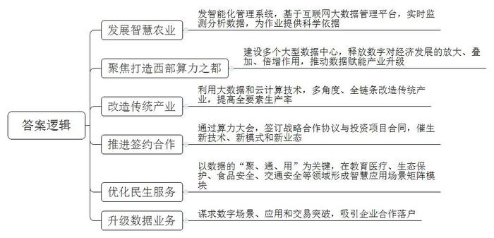
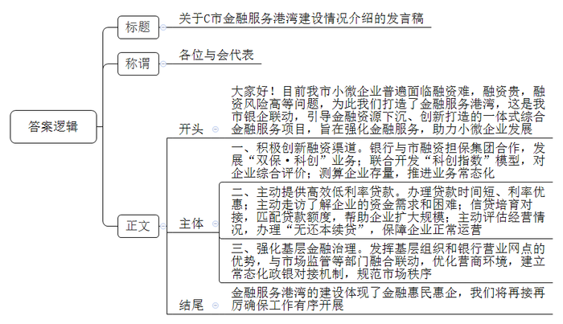
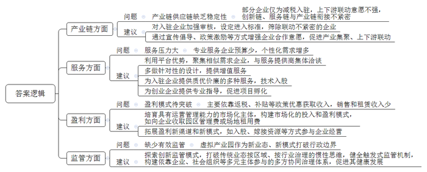
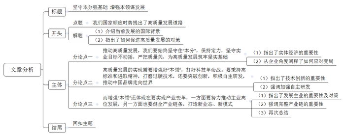

# 2023年公务员多省联考《申论》题（宁夏A卷）

> 候选采集稿。参考答案及解析来自粉笔页面，不代表官方答案或真实高分答卷；来源使用许可与原卷对应关系仍需人工核实。

## 给定材料

### 材料 material-c21adeccad660508

手机扫描二维码，进入“元宇宙”展馆，就可以通过虚拟“数字人”线上参会、观展，这是2023中国算力大会通过“5G+元宇宙3.0”数字技术带来的全新线上展会体验。而现实中，“算力”的神奇同样已渗透到生产生活和社会治理的方方面面。中国算力大会期间，记者走进会议举办地N省J市的城市社区、田间地头和企业车间，探访“算力”如何升级传统产业、改变百姓生活、赋能高质量发展。

“空气温度33.5℃，风速2.3M/S，土壤湿度15%……”N省西鸽酒庄种植技术总监张继丰坐在办公室，70公里外葡萄园的各项数据，就通过智慧农业控制系统实时传送到手机上。

西鸽酒庄拥有葡萄园3万余亩，用传统人工方式采集相关数据，费时费力。因此，酒庄和院校合作开发了智能化葡萄园管理系统。这一系统基于互联网大数据管理平台，可以对葡萄园的空气温度、风速、土壤湿度等实时监测和分析。“系统内的数据非常精准，为葡萄园田间作业提供了科学依据。”张继丰说。

N省区域位置独特，气候资源干冷，风光绿能充足，是发展大数据和云计算产业的优选之地。目前，N省已有18个大型数据中心落地。N省党委常委、副主席买彦州说，借“东数西算”的东风，N省聚焦打造西部算力之都，不断释放数字对经济发展的放大、叠加、倍增作用，持续推动数据赋能各行各业转型升级。

从“云种植”到“云养牛”，从“数字灌溉”到“智能车间”，N省利用大数据和云计算技术对传统产业进行多角度、全链条改造，显著提高了全要素生产率。某仪表有限责任公司是控制阀领域企业，近年来加速转型。机床联网、车间上云，该公司打造数字化“透明工厂”，使其运营成本降低14%，生产效率提高30%，研发周期缩短40%。

据买彦州介绍，本次算力大会，各方累计签约战略合作协议36个，金额1571亿元，签订投资项目合同45个，金额832亿元，将助力数据和算力产业更广泛深入到各个领域，持续催生新技术、新模式、新业态。

N省J市市民吴女士想去北京同仁医院看眼部疾病，偶然间，她听说J市有一个远程诊疗中心，她抱着试试看的想法来到这里。“J市国家级专家远程诊疗中心”很快就联系到了北京同仁医院青光眼科的副主任医师。

为吴女士“云端”请来北京专家的“J市国家级专家远程诊疗中心”是N省“互联网+医疗健康”示范区项目之一。该诊疗中心运行以来，已有超过900位国家级专家与J市本地专家团队合作治疗病患3200多例。

城市治理也可利用大数据。J市交警部门在治理城市道路拥堵时，依托大数据和强大算力支撑，研发出智能化信号灯配时优化模型。在J市主干道贺兰山路一段容易发生拥堵的路段，经过建模优化后行车通过时间减少了20.3%。

“以前我们计算配时都是民警开着车一趟趟地实地测，大数据建模实现了交通治堵向精细化、智能化转变。”J市公安局交警分局科技科民警桂晶说。

J市市长陶少华说，J市抢抓国家东数西算的战略机遇，以数据的“聚、通、用”为关键，在教育医疗、生态保护、食品安全、交通安全等领域形成了智慧应用场景矩阵模块。

行业的异军突起为N省J市、Y市等地提供了“换道超车”的绝佳契机。

在N省誉成云创数据投资有限公司的数据中心，外卖平台美团的4万多台服务器在这里安静运行。“像美团这样的外卖平台需要大量服务器来存储数据，我们数据中心的机柜租赁价格便宜，能帮助企业降低成本。”N省誉成云创数据投资有限公司业务部经理李志刚说。

虽然已经在数字经济上迈出一步，但像誉成云创这样的数据业务仍是比较低端的机柜租赁。从“东数西储”到“东数西算”，Y市去年开始不断谋求数字场景、数字应用和数字交易的突破。

在抖音平台上，“一禅小和尚”凭借可爱智慧的动画形象，拥有4000多万粉丝。这些动画形象的技术提供方——北京中科深智科技有限公司的数字人自动化建模、渲染等全链条业务，部分已经落户Y市的西云算力科技有限公司。

“去年我们寻找数字人渲染方案时，开始与西云算力合作，今年将合作范围扩大到人工智能训练、推理等多个领域。”北京中科深智科技有限公司首席技术官宋健说。

据统计，今年上半年，N省全区数字信息产业产值增速达26.2%，“数在云上算”正成为引领N省高质量发展的重要增长极。

### 材料 material-1b831b1e4a1c7180

作为一家从事大数据服务的科技型小微企业，轻资产、信用评价难度大一直是困扰C市韩钛科技有限公司融资的突出问题。在一次政策宣传中，韩钛科技有限公司齐总了解到他们公司可享受金融服务港湾一站式金融服务，便当即拿出手机输入了企业信息和融资需求，没想到一天后就有多家银行主动联系他。最终，秦民村镇银行利用针对科技型小微企业的专属信贷产品，为其提供了80万元信用贷款。如此高效便捷的金融服务和无抵押无担保的信贷产品，让齐总喜出望外：“我们这些小微企业能享受到金融服务港湾如此高质量的金融服务，发展壮大的底气更足了！”

金融服务港湾是C市通过政银企联动，引导金融资源有序下沉、创新打造的一体式综合金融服务项目，旨在积极推进金融服务小微企业“敢贷、愿贷、能贷、会贷”长效机制建设。如今在C市，众多中小微企业和个体工商户在星罗棋布的金融服务港湾里“靠岸”，实现了“小生意”福泽“大民生”。

“我没有抵押物，找人担保贷款额度小、成本高，‘双保·科创’真是帮我解决了一大难题！”某阀门科技有限公司刘总的一句话，道出了大部分小微企业的心声。该公司是一家专业从事阀门及配件、管件的研发、设计、生产、销售的高新科创企业，拥有7份资质证书、11项专利，发展前景较好。他们通过农行C市分行与市融资担保集团合作的“双保·科创”业务，获得了农行200万元贷款。新的融资渠道，着实让成长中的科技型企业有了底气。

由C市银保监分局、科技局等部门联合开发的“科创指数”模型，通过“五大能力维度”“八项评价科目”对科创型企业进行评价得分。在“科创指数”基础上，农行C市分行将存量科技型企业进行测算，同时引入“双保·科创”助力融资担保业务，推进常态化的“双保”助力融资机制，拓宽服务覆盖面，帮助企业稳定经营和创新发展，进一步解决小微科技型企业融资难、融资贵问题。

“没想到金融服务港湾主动上门帮我们办理贷款，时间短、利率优惠，这笔资金对我们来说真是‘及时雨’！”C市聚狮新材料科技公司杜总高兴地说道。该公司是一家民营中小企业，主要生产特种工程塑料PPS。2021年11月，该公司因受原材料涨价、销售回款慢及疫情的叠加影响，流动资金紧张。C市银行的“民营小微和个体工商户金融服务港湾”，在日常走访中了解到企业的资金需求和困难，一周时间便通过“支小再贷款帮扶贷”为其发放了1年期500万元的贷款，仅3天就到账了第一笔贷款，有效缓解了原材料采购资金紧张的问题。

老刘是某糖果品牌的一级经销商，产品聚焦C市，辐射周边多地。然而，疫情一度让经营受到冲击。“受到疫情影响，企业去年有4个月没有营收，仓库内滞销的糖果价值超1000万元。”老刘回忆，望着堆积如山的货物和日渐短缺的流动资金，他焦急万分。通过金融服务港湾的信贷培育对接，农行C市石马河支行为其匹配了额度850万元的“抵押+助业快e贷”产品，年利率仅3.5%。“这么低利率的贷款着实让我松了口气。”老刘说，今年他计划新招员工，继续扩大自己的生意规模。

“‘无还本续贷’救了我的洗衣店。”小徐感慨道。小徐的社区洗衣店生意和许多受疫情冲击的商户一样也一度遇到困难。今年上半年，C市农村商业银行在社区工商户走访对接中得知小徐存在还贷困难，在迅速对往年经营情况评估后，为其办理了“无还本续贷”，保障了洗衣店正常运营。如果没有“无还本续贷”，他需要一次性支付本金47万元用于还款，这样不仅生意受影响，正常生活也会受到波及。

“以前我们想融资，常有中介找上门，融资成本高不说，还有被套路的风险。”长期经营箱包生意的邓女士表示，因为不了解政策，自己曾盲目依赖贷款中介，面对高额利息和手续费，心中有苦难言。过去，类似邓女士这样因迫切需要融资而通过“找关系”“靠中介”寻求贷款渠道的商户不在少数。让“套路贷”“高利贷”、金融诈骗、非法集资等有机可趁，不仅阻碍小微市场主体健康发展，更是基层金融治理中的不稳定因素。为此，C市在推进金融服务港湾建设的过程中，将“基层金融治理功能”作为核心重点，积极发挥基层组织贴近市场主体的天然优势和银行营业网点金融服务的专业优势，并与市场监管、税务等部门融合联动，强化基层金融治理，优化提升营商环境。“我们区外来企业、务工人员较多，环境复杂，以前各种金融中介乱蹿，金融风险防范管理一度成为棘手难题。”C市某区金融办相关负责人表示，通过金融服务港湾，银政之间建立了常态化对接机制，有效规范了市场秩序，预防和化解了不少矛盾纠纷。

### 材料 material-4e7021e9979fa19c

“虽然我们的办公地点还在深圳，但我们可以享受到千里之外的D市‘云端’服务和税收等优惠政策。”启程科技王总经理高兴地对记者说。启程科技所享受的服务和优惠，源于D市积极布局打造跨越物理边界的虚拟产业园。近日，《D市日报》记者专门对虚拟产业园发展现状进行了一次调研走访。

据记者了解，加入D市虚拟产业园，已成为不少企业的新选择。相较于传统产业园区，企业只需把公司注册到虚拟产业园，不用入驻指定地理区域生产经营，可自由选择办公城市和地点，也就是说，虚拟产业园内的企业可以分布在全国各地。

前不久，布拉电商科技有限公司成为D市虚拟产业园的新成员。“我们在四川通过网络提交了相关材料，D市虚拟产业园的工作人员随即帮我们完成了工商注册，非常方便。”公司陈总经理说。

“截至目前，虚拟产业园招商入驻企业近100家，主要为互联网企业、电商企业、高科技企业等，初步促成了企业在线规模化集聚。”D市虚拟产业园负责人石主任向记者介绍。目前，D市虚拟产业园为入驻企业提供了合作需求发布、企业资源交换、信息共享、互动交流等多方面服务。“我们掌握着比较丰富的数据，利用这些信息流，可以有效促进上下游、产供销协同联动。最近，我们正在帮助园区内的一些电商企业与相关企业对接、合作，拓展渠道。”石主任说，“但是我们发现，部分企业入驻产业园的主要目的是减税，与平台产业链上下游进行联动的意愿不强，创新链、服务链与产业链之间的有机衔接没有达到预期，产业链供应链还缺乏稳定性。”

在D市工业经济研究所何研究员看来，目前选择入驻虚拟产业园的大多数为初创型企业，这些企业往往资金规模较小，除了基础的政务服务需求外，也希望能够以较低的成本获取法律、人力、财务、营销、金融、品牌等专业服务。部分企业因为行业特性还会衍生出不少个性化的需求，例如电商企业对客服、营销服务的需求，文创企业对设计、美工服务的需求。“虚拟产业园原本就有平台优势，可以把具有相似需求的企业聚集在一起，共同与服务提供商进行洽谈，从而节省成本，现在的关键问题是如何把这个优势发挥好。”

“虚拟产业园要发展，需在盈利模式上有所突破。与传统产业园区相比，虚拟产业园在房地产方面的销售和租赁收入很少，目前主要依靠税收返还、政府补贴等渠道获取收入，但这并非长久之计！”市经信委袁副主任说，以D市虚拟产业园为例，市里不仅为入驻企业和个人提供地方留存税收的80%作为奖励，还外加人才最高补贴600万元、企业上云补贴等奖励。“我觉得有必要加快培育一批具有运营管理能力的市场化主体，构建市场化的投入和盈利模式，比如向企业收取一定的园区管理费或场地租用费来增加园区收入。”

“作为新业态新模式的虚拟产业园打破行政边界后，如何实现有效监管对虚拟产业园发展至关重要。”D大学贺教授表示，要打破传统业态按区域、按行业治理的惯性思维，探索创新监管模式。“从企业的角度来看，我认为虚拟产业园还应该在推动产业集聚、上下游联动方面多做工作，同时要多一些有针对性的设计，在增值服务方面也还有进一步提升的空间。”君和咨询公司游经理向记者表示，D市虚拟产业园应该探索拓展盈利新渠道和新模式，如通过入股园区内企业、为企业嫁接资源等方式参与企业经营，既为入驻企业发展提供支撑，也能实现产业园自身的发展。

“虚拟产业园的监管是一个全新的课题。”何研究员说，“市经信委正委托我们开展专题研究，主要聚焦在健全触发式监管机制，构建依靠企业、社会组织等多元主体参与的多方协同治理体系，促进其健康发展。”

市经信委袁副主任不久前才去了沿海某城市，考察了当地的网商虚拟产业园建设。“他们为入驻企业提供了安全、稳定、快速和优惠的云服务，以及专属服务器运维服务。此外，产业园还以技术入股或低于市场价格的方式为入驻企业提供技术开发服务，如平台系统搭建、APP开发、网站开发、公众号开发等。”袁副主任感慨地说，“他们在产业园建设了产学研一体化、培训实训孵化一条龙的‘众创空间’，并邀请知名企业家、教授为创业团队提供专业意见和建议。产业园已成功孵化项目超过30个，我很受启发。”

## 题目

### 第 1 题

**请根据给定资料**1**，对N省推动数字经济高质量发展的做法进行归纳概括。****（****25分****）**

关联材料：材料 material-c21adeccad660508

作答要求：

要求：紧扣材料，内容全面，准确简明，条理清晰，不超过300字。

### 第 2 题

**省金融办近期准备召开助力小微企业发展经验交流会，假如你是****C市金融办工作人员小王，将代表C市在会上发言，请根据“给定资料**2**”，拟写一篇发言稿，介绍C市金融服务港湾建设情况。****（****3****5分****）**

关联材料：材料 material-1b831b1e4a1c7180

作答要求：

要求：

（1）紧扣材料，重点突出；

（2）逻辑清晰，语言流畅；

（3）不超过500字。

### 第 3 题

**请根据****“给定资料**3**”，对D市虚拟产业园存在的问题进行提炼和概括****，****并提出解决建议。****（****30分****）**

关联材料：材料 material-4e7021e9979fa19c

作答要求：

要求：

（1）概括全面，准确；

（2）提出的解决建议与问题相对应；

（3）不超过500字。

### 第 4 题

**“给定资料**5**”中提到“在大变局的喧嚣中始终坚守住‘本分’，切实增强好‘本领’，不断突破创新，推动高质量发展的步伐就能坚实稳健，我们就能走向广阔的未来。****”****请结合以上所有资料，自选角度，自拟题目，写一篇文章。****（****6****0分****）**

关联材料：材料 material-c21adeccad660508

作答要求：

要求：

（1）立意明确，内容充实；

（2）思路清晰，语言流畅；

（3）参考“给定资料”，但不拘泥于“给定资料”；

（4）字数1000-1200字。

## 答案与解析

第 1 题

**参考答案（粉笔题库参考内容）**

1.发展智慧农业。开发智能化管理系统，基于互联网大数据管理平台，实时监测分析数据，为作业提供科学依据。

2.聚焦打造西部算力之都。建设多个大型数据中心，释放数字对经济发展的放大、叠加、倍增作用，推动数据赋能产业升级。

3.改造传统产业。利用大数据和云计算技术，多角度、全链条改造传统产业，提高全要素生产率。

4.推进签约合作。通过算力大会，签订战略合作协议与投资项目合同，催生新技术、新模式和新业态。

5.优化民生服务。以数据的“聚、通、用”为关键，在教育医疗、生态保护、食品安全、交通安全等领域形成智慧应用场景矩阵模块。

6.升级数据业务。谋求数字场景、应用和交易突破，吸引企业合作落户。

**解析**

**参考答案说明**：本参考答案从“发展智慧农业”“聚焦打造西部算力之都”“改造传统产业”“推进签约合作”“优化民生服务”“升级数据业务”六个方面展开，各条答案要点之间在内容上相互并列，没有交叉。

**考点**：考点概括措施类

**来源**：来源2023年公务员多省联考《申论》题（宁夏A卷）

粉笔申论页面对本题只提供「解析视频」入口，该入口是会员推广位，页面无视频地址与文字解析。

第 2 题

**参考答案（粉笔题库参考内容）**

关于C市金融服务港湾建设情况介绍的发言稿

各位与会代表：

大家好！目前我市小微企业普遍面临融资难，融资贵，融资风险高等问题，为此我们打造了金融服务港湾，这是我市银企联动，引导金融资源下沉、创新打造的一体式综合金融服务项目，旨在强化金融服务，助力小微企业发展。

一、积极创新融资渠道。银行与市融资担保集团合作，发展“双保·科创”业务；联合开发“科创指数”模型，对企业综合评价；测算企业存量，推进业务常态化。

二、主动提供高效低利率贷款。办理贷款时间短、利率优惠；主动走访了解企业的资金需求和困难；信贷培育对接，匹配贷款额度，帮助企业扩大规模；主动评估经营情况，办理“无还本续贷”，保障企业正常运营。

三、强化基层金融治理。发挥基层组织和银行营业网点的优势，与市场监管等部门融合联动，优化营商环境，建立常态化政银对接机制，规范市场秩序。

金融服务港湾的建设体现了金融惠民惠企，我们将再接再厉确保工作有序开展。

**解析**

**参考答案说明****：**（1）格式方面，本参考答案写到了“标题”“称谓”“正文”三个部分｡（2）正文部分，一方面从内容上来看，答案的开头先提出了小微企业面临的问题；主体从“积极创新融资渠道”“主动提供高效低利率贷款”“强化基层金融治理”三个方面具体介绍了如何帮助小微企业发展;结尾进行了总结、展望｡另一方面，在形式上，本参考答案做到了分段、分层撰写，整体上条理较为清晰｡

**考点**：考点总结类

**来源**：来源2023年公务员多省联考《申论》题（宁夏A卷）

粉笔申论页面对本题只提供「解析视频」入口，该入口是会员推广位，页面无视频地址与文字解析。

第 3 题

**参考答案（粉笔题库参考内容）**

一、问题：产业链供应链缺乏稳定性。部分企业仅为减税入驻，上下游联动意愿不强，创新链、服务链与产业链衔接不紧密。建议：对入驻企业加强审核，设定进入标准，筛除联动不紧密的企业；通过宣传倡导、政策激励等方式增强企业合作意愿，促进产业集聚、上下游联动。

二、问题：服务压力大。专业服务企业预算少，个性化需求增多。建议：利用平台优势，聚集相似需求企业，与服务提供商集体洽谈；多做针对性的设计，提供增值服务；为入驻企业提供质优价廉的多种服务，技术入股；为创业企业提供专业指导，促进项目孵化。

三、问题：盈利模式待突破。主要依靠返税、补贴等政策优惠获取收入，销售和租赁收入少。建议：培育具有运营管理能力的市场化主体，构建市场化的投入和盈利模式，如向企业收取园区管理费或场地租用费；拓展盈利新渠道和新模式，如入股、嫁接资源等方式参与企业经营。

四、问题：缺少有效监管。虚拟产业园作为新业态、新模式打破行政边界。建议：探索创新监管模式，打破传统业态按区域、按行业治理的惯性思维，健全触发式监管机制，构建依靠企业、社会组织等多元主体参与的多方协同治理体系，促进其健康发展。

**解析**

**参考答案说明：**本参考答案从“产业链”“服务”“盈利”“监管”四个方面展开，每个方面内部先阐释问题，再给出相应的解决建议，做到了所提建议与问题相对应。各条答案要点之间在内容上相互并列，没有交叉。

**考点**：考点提出对策类

**来源**：来源2023年公务员多省联考《申论》题（宁夏A卷）

粉笔申论页面对本题只提供「解析视频」入口，该入口是会员推广位，页面无视频地址与文字解析。

第 4 题

**参考答案（粉笔题库参考内容）**

**坚守本分强基础 增强本领谋发展**

当今世界正处于百年未有之大变局，新一轮科技革命风起云涌，产业变革深入发展。如何于变局中开新局，中国智慧彰显出力量，我们国家顺应时势提出了高质量发展道路。前进的方向已经明确，前行的道路已经开拓，我们必须以坚守本分为原则，以增强本领为手段，以突破创新为核心动力，大力推动经济高质量发展，为全面建设社会主义现代化强国开好局起好步。

**推动高质量发展，我们要始终坚守住“本分”，保持定力，坚守实业目标不动摇，严把质量关，为高质量发展筑牢坚实基础。**实体经济是国民经济的基础和命脉，是国家强盛和民族复兴的重要支柱。而在实体经济的主战场上，质量是企业的立身之本。变局之下，大环境的不确定性、不稳定性增加，做实业考验着企业的定力。如何应对变局？格力给出了自己的答案。“好空调格力造”，这句脍炙人口的广告是格力三十年如一日坚持做实业、“锱铢必较”严把质量关的生动写照。因此，迎战变局，企业一方面需要拿出“咬定青山不放松”的定力，迎难而上、攻坚克难，聚焦目标、聚焦实业。另一方面要严把材料关、生产关、检验关，确保产品质量过硬，用高品质立身。

**高质量发展的实现需要增强好“本领”，打好科技革命战。要秉持高标准和进取精神，打磨过硬技术，还要突破创新，积极自主研发，推动中国品牌走向世界。**技术创新是推动企业发展的核心驱动力。通过不断提升技术水平，企业能够生产出更具竞争力的产品和提供更优质的服务，从而满足消费者需求。无论是对企业自身的提升，还是对整体经济的发展，打磨过硬技术都是不可或缺的。另一方面，在全球化竞争日益激烈的背景下，依靠模仿和跟随的发展模式已经无法适应市场需求。只有通过自主研发和创新，才能在国际竞争中脱颖而出。通过不断推陈出新，中国品牌能够树立起自身的技术和品牌优势，并逐步赢得全球市场的认可。

**而增强“本领”还体现在要实现产业变革，一方面要努力推动主业高位发展，另一方面也要健全产业链条，打造新业态、新模式。**主业是企业发展的核心竞争力，只有不断提升主业水平，才能在市场竞争中立于不败之地。通过加大科研投入、培养专业人才、提高技术创新能力，企业可以不断突破自身的局限，实现产业变革的目标。与此同时，一个完整的产业链条能够形成合理的分工和协同发展，提高资源利用效率和降低生产成本。通过与上下游企业的合作，可以实现资源共享、互利共赢，进而推动整个产业的升级变革。只有具备这些“本领”，企业才能在激烈的市场竞争中脱颖而出，向上发展。

君子务本，本立而道生。坚守物质技术基础，增强创新能力，我们就一定能于变局之中开新局，在危机之中育先机。不断推进高质量发展，把我国建设成为社会主义现代化强国。

**解析**

**文章分析**

**坚守本分强基础 增强本领谋发展**

【**标题的优点：**范文的标题突出了主题，文章主题、角度都很清晰。】

（1）当今世界正处于百年未有之大变局，新一轮科技革命风起云涌，产业变革深入发展。如何于变局中开新局，中国智慧彰显出力量，我们国家顺应时势提出了高质量发展道路。前进的方向已经明确，前行的道路已经开拓，（2）我们必须以坚守本分为原则，以增强本领为手段，以突破创新为核心动力，大力推动经济高质量发展，为全面建设社会主义现代化强国开好局起好步。

【**开头的优点：**★内容方面。范文的开头是紧扣“高质量发展”这一主题展开的。首先，开头点出主题，做到了主题明确。其次，对“高质量发展”这一主题进行了分析阐述，指出了（1）推动高质量发展的时代背景。（2）引出文章核心观点。★文字表达方面。使用了设问的修辞手法，使文字表达更加有力。】

**推动高质量发展，我们要始终坚守住****“本分”，保持定力，坚守实业目标不动摇，严把质量关，为高质量发展筑牢坚实基础。**（1）实体经济是国民经济的基础和命脉，是国家强盛和民族复兴的重要支柱。而在实体经济的主战场上，质量是企业的立身之本。变局之下，大环境的不确定性、不稳定性增加，做实业考验着企业的定力。（2）如何应对变局？格力给出了自己的答案。“好空调格力造”，这句脍炙人口的广告是格力三十年如一日坚持做实业、“锱铢必较”严把质量关的生动写照。因此，迎战变局，企业一方面需要拿出“咬定青山不放松”的定力，迎难而上、攻坚克难，聚焦目标、聚焦实业。另一方面要严把材料关、生产关、检验关，确保产品质量过硬，用高品质立身。

【**论述段****1的优点：**★观点句：范文的观点句是紧扣“高质量发展”这一文章主题提出的。形式上，它在段首处直接写出，位置突出，容易发现。内容上，关键词突出，内容要点明确，可以明显看出主要论述从“坚守住‘本分’”方面入手。★论述内容：（1）先指出了实体经济的重要性；（2）再从企业角度阐释了如何应对变局。注意：以上几个方面的内容都是紧扣“推动高质量发展，我们要始终坚守住‘本分’，保持定力，坚守实业目标不动摇，严把质量关，为高质量发展筑牢坚实基础”这个观点句进行分析论述的，论述的针对性强，内容层次丰富。在论述方法上主要采用了讲道理与举例子结合，论述清晰透彻。】

**高质量发展的实现需要增强好****“本领”，打好科技革命战。要秉持高标准和进取精神，打磨过硬技术，还要突破创新，积极自主研发，推动中国品牌走向世界。**（1）技术创新是推动企业发展的核心驱动力。通过不断提升技术水平，企业能够生产出更具竞争力的产品和提供更优质的服务，从而满足消费者需求。无论是对企业自身的提升，还是对整体经济的发展，打磨过硬技术都是不可或缺的。（2）另一方面，在全球化竞争日益激烈的背景下，依靠模仿和跟随的发展模式已经无法适应市场需求。只有通过自主研发和创新，才能在国际竞争中脱颖而出。通过不断推陈出新，中国品牌能够树立起自身的技术和品牌优势，并逐步赢得全球市场的认可。

【**论述段****2的优点：**★观点句：范文的观点句是紧扣“高质量发展”这一文章主题提出的。形式上，它在段首处直接写出，位置突出，容易发现。内容上，关键词突出，内容要点明确，可以明显看出主要论述从“增强本领，科技创新”方面入手。★论述内容：（1）先指出了技术创新的重要性；（2）强调加强自主研发。注意：以上几个方面的内容都是紧扣“高质量发展的实现需要增强好‘本领’，打好科技革命战。要秉持高标准和进取精神，打磨过硬技术，还要突破创新，积极自主研发，推动中国品牌走向世界”这个观点句进行分析论述的，论述的针对性强，内容层次丰富。在论述方法上主要采用了讲道理的方式，论述清晰透彻。】

**而增强****“本领”还体现在要实现产业变革，一方面要努力推动主业高位发展，另一方面也要健全产业链条，打造新业态、新模式。**（1）主业是企业发展的核心竞争力，只有不断提升主业水平，才能在市场竞争中立于不败之地。通过加大科研投入、培养专业人才、提高技术创新能力，企业可以不断突破自身的局限，实现产业变革的目标。与此同时，（2）一个完整的产业链条能够形成合理的分工和协同发展，提高资源利用效率和降低生产成本。通过与上下游企业的合作，可以实现资源共享、互利共赢，进而推动整个产业的升级变革。只有具备这些“本领”，企业才能在激烈的市场竞争中脱颖而出，向上发展。

【**论述段****3的优点：**★观点句：范文的观点句是紧扣“高质量发展”这一文章主题提出的。形式上，它在段首处直接写出，位置突出，容易发现。内容上，关键词突出，内容要点明确，可以明显看出主要论述从“增强本领，产业变革”方面入手。★论述内容：（1）先指出了发展主业的重要性及对策；（2）强调完整产业链的重要性；（3）再次总结。注意：以上几个方面的内容都是紧扣“而增强‘本领’，还体现在要实现产业变革，一方面要努力推动主业高位发展，另一方面也要健全产业链条，打造新业态、新模式”这个观点句进行分析论述的，论述的针对性强，内容层次丰富。在论述方法上主要采用了讲道理的方式，论述清晰透彻。】

君子务本，本立而道生。坚守物质技术基础，增强创新能力，我们就一定能于变局之中开新局，在危机之中育先机。不断推进高质量发展，把我国建设成为社会主义现代化强国。

【**结尾的优点：**范文的结尾回扣了“高质量发展”这个主题，语言精练不拖沓。】

**考点**：考点文章写作题

**来源**：来源2023年公务员多省联考《申论》题（宁夏A卷）

粉笔申论页面对本题只提供「解析视频」入口，该入口是会员推广位，页面无视频地址与文字解析。

