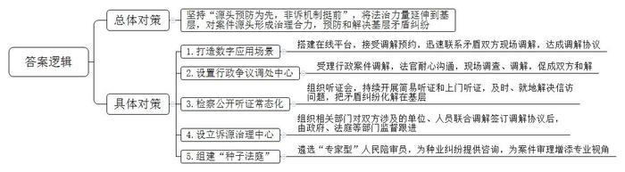
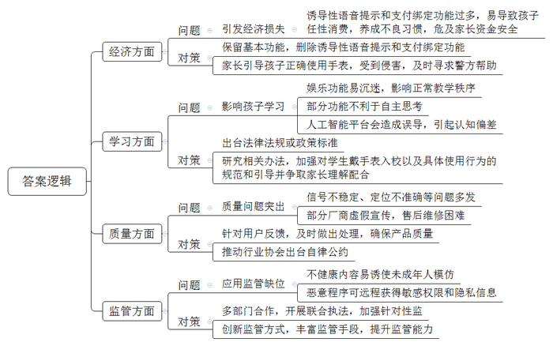
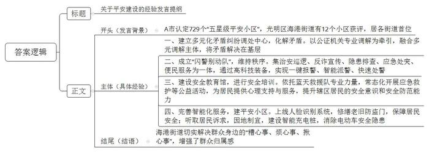
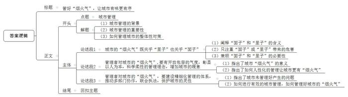

# 2023年公务员多省联考《申论》题（宁夏C卷）

<!-- gwy:overview:start -->
> **宁夏 · 2023 · 申论 · C类** ｜ 4 题 · 图片 4 处 · 答案随题折叠

导航：[题目](#题目) · [材料 1](#材料-1)
<!-- gwy:overview:end -->

> 候选采集稿。参考答案及解析来自粉笔页面，不代表官方答案或真实高分答卷；来源使用许可与原卷对应关系仍需人工核实。

## 给定材料

### 材料 1

外来务工人员小勇居住在J市东江街道鸣山社区，因工作原因经常昼伏夜出，而邻居陈阿姨每天早睡早起，双方生活习惯截然不同，多次发生纠纷。于是，小勇尝试向“娘家人”平台求助。接到调解预约后，平台工作人员马上联系到小勇和陈阿姨，并派人现场调解，最终双方达成调解协议。事件的圆满处置，得益于J市“外来务工人员服务管理”应用场景之一的“娘家人”。“‘外来务工人员服务管理’数字应用场景只是J市扎实推进诉源治理的一个缩影。”市委政法委林副书记说，诉源治理坚持“源头预防为先，非诉机制挺前”，将更多法治力量延伸到基层，对案件源头形成治理合力，有效预防和解决基层矛盾纠纷。

近日，J市N区人民法院行政争议调处中心成功调解一起行政强制案件，当事人梁某送来锦旗表达感谢。今年年初，N区茶恩镇政府责令梁某限期拆除未经许可搭建的冷库，然而梁某认为冷库是经村委会同意后才建的，主要用于储存果蔬等农产品，方便村民发展经济，遂向区法院提起行政诉讼，要求撤销镇政府责令限期拆除决定。调处中心受理此案后，经法官的耐心沟通、多次现场调查和调解，最终促成双方和解。参与调解的张法官说：“调处中心为群众和行政机关搭建了更为高效的沟通平台，行政案件协调和解率达30%以上，对于化解群众与行政机关之间的争议、完善诉源治理新格局发挥了重要作用。”

本着“事都捋一捋、理都摆一摆、法都讲一讲，讲着讲着心结就打开”的工作思路，J市检察机关近年来常态化推进检察公开听证，2022年，全市检察机关组织听证会600场，听证后矛盾化解率达90%。同时，J市检察机关还持续开展简易听证和上门听证，努力把信访问题在第一时间、第一地点解决到位，切实把矛盾纠纷化解在基层、解决在当地。

拉几条长凳、摆几张桌子，笔记本电脑、打印机往上一放，一场简易听证会在杨大爷家的院坝拉开了帷幕。2022年初，湛某潜入杨大爷家盗窃现金1万元，公安机关抓获湛某时，他已将所盗钱财挥霍一空，由于湛某没有固定收入来源，无力赔偿杨大爷的损失。法院依法判处湛某有期徒刑，但杨大爷却一直不认可，多次上访。为解开杨大爷的心结，J市人民检察院何检察官和听证员来到杨大爷家，面对面释法说理。其实案情并不复杂，关键是如何让杨大爷理解判决。

“湛某是否有前科”“到案后表现如何”“法院量刑的依据是什么”……听证员详细询问，并在全面了解案情的基础上，进行了充分评议，形成了听证评议意见。听证会罢，杨大爷表示愿意息诉。“考虑到杨大爷家庭困难，湛某也没有赔偿能力，我们准备帮助杨大爷申请司法救助金。”何检察官说。

2022年11月17日，建筑工人老程一行来到J市M县诉源治理中心，投诉电力公司拖欠他们13万元工资。青山镇政法委员老黄得知后，立即组织公安、司法、供电等部门对双方涉及的单位、人员进行联合调解。经调查了解，该项目存在转包现象，当时项目款确实还未到账，承包人吴某又因故无法及时返回青山镇。经调解，由电力公司先行垫付老程等人的工资13万元。双方签订调解协议，政府、法庭、司法、公安监督跟进。

“种子法庭”是J市H区人民法院2022年探索推行的服务种业的工作模式。在涉种纠纷化解中，H区人民法院组建了专门的合议庭审理涉种案件，在当地大专院校、种子管理部门、制种龙头企业中，遴选了十余名“专家型”人民陪审员，为种业纠纷提供咨询，给案件审理增添专业视角。自该模式推行以来，H区人民法院办理的涉种纠纷非诉解决比例和调解成功率均超过70%，涉种案件平均办理周期比过去缩短了一半以上。H区人民法院荣院长说，“种子法庭”让涉种纠纷化解驶入“快车道”，让种企、种农诉累减轻，今后全区涉种案件也将逐步向该法庭归并，推动实现涉种案件办理专业化、专门化。

### 材料 2

“碰碰手表，加个好友！”这句话成了当下不少儿童社交时打招呼的见面语。儿童智能手表市场蓬勃发展背后，也暴露出不少问题。为守护儿童“腕上安全”，L市市场监管局近日召开了一次专题座谈会，听取各方意见建议。以下是部分参会人员的发言摘录：

学生家长龚某：前几天，小孩突然要我在她手表上绑定我的手机钱包。我问她为什么？她说：“我们班上很多小朋友的手表都绑定了爸爸妈妈的手机钱包，这样我们可以想买什么就买什么。”有些智能手表一旦关联了家长的手机，就开通了免密支付，在家长不知情的情况下，孩子就可能会任性消费，比如购物、打赏、购买游戏皮肤等，我觉得这既容易导致小孩养成不健康的消费习惯，又可能危及家长的资金安全。

某学校教师盛某：客观而言，智能手表有助于学生、家长和学校之间的沟通联系，但学生之间语音聊天、打电话越来越频繁，有的还在手表里下载了游戏和短视频App，课上偷着玩，课下抢着玩，影响了正常教学秩序，特别不利于学生学习。

学生家长李某：给孩子买智能手表，主要是为了方便跟孩子联系，确保孩子安全。前阵子，孩子突然吵着要拿我的手机扫码听音乐，我才知道他的手表电话中居然自带了语音提示：“小朋友，请用爸爸妈妈的手机扫码，开通手表音乐VIP。”其实，我觉得儿童手表只要有基本功能就行，没必要设置那么多诱导性的语音提示和支付绑定功能。

市教委周副主任：现在儿童智能手表都具有上网、拍照以及智能语音功能，有的学生自律意识差，一遇到不会做的题，自己不动脑筋思考，而是用手表拍照在网上搜索答案，关键有时候答案还是错的。更严重的是，不少手表都与人工智能平台相连，学生喜欢向手表提出各种稀奇古怪的问题，而得到的回答时常会给学生造成误导，甚至引起认知偏差，非常不利于他们的身心健康。我们正在研究相关办法，加强对学生戴手表入校以及具体使用行为的规范和引导，当然这也需要家长们的理解和配合。

市消保委监督部黄主任：我们今年对儿童智能手表消费情况进行了调查，结果显示，近一半的消费者对儿童智能手表质量表示不满，主要是信号不稳定、定位不准确、屏幕显示质量差、材质不安全等问题，有的厂商涉嫌虚假宣传，产品售后维修困难。

市公安局周警官：我们遇到过不少因儿童手表免密支付引发的经济损失案件。我们发现，有恶意程序伪装成游戏App，当小孩在手表上下载安装后，恶意程序就轻松进驻到了手表中，手表就被远程控制，容易被不法分子采集到小孩位置信息、监听通话记录，甚至偷拍偷录视频，有时可能危及儿童人身安全。希望家长引导孩子正确使用手表，一旦人身和财产受到侵害，应及时寻求警方帮助。

市关工委刘副主任：由于各种应用平台缺乏筛选和监管，导致儿童智能手表下载到血腥暴力的游戏App和内容不健康的漫画App，极易诱使未成年人模仿。一些App在安装的时候，不用授权就可以直接获得定位、通讯录、麦克风、摄像头等多种敏感权限，轻易就能获取孩子的位置、人脸图像、录音等个人隐私信息，存在极大的信息安全漏洞。

市场监管局王副局长：前期，我们组织力量对儿童智能手表进行了专项执法检查，大家所反映的问题都不同程度存在，且问题所涉及面较广，给执法带来一定难度。我们后续将会同网信、公安、工信等部门，开展联合执法行动，加强针对性监管，切实提高产品质量和安全水平。我们将不断探索新的监管方式，丰富监管手段，提升监管专业能力。

某儿童手表公司曹经理：我们会千方百计确保产品质量，针对用户反馈的第三方软件问题，我们已在第一时间下架处理了问题应用程序。但守护儿童“腕上安全”仅靠我们一家公司是不够的，我们已向行业协会提出建议，出台相应的行业自律公约，共同为孩子们提供干净安全的手表。

某大学姚教授：儿童智能手表集多种功能于一体，但功能的多样性也带来了系列“负产品”。治理儿童智能手表乱象，根本在于要从更高层面出台相应的法律法规或政策标准，同时，社会各界也要共同担当作为，合力确保孩子“腕上安全”。

### 材料 3

2022年5月，A市认定729个“五星级平安小区”，光明区海港街道有12个小区获评“五星级平安小区”，居光明区各街道首位。人们纷纷打探海港街道的“平安密码”到底是什么。

近日，海港街道居民吴先生出差回家后发现，自己楼下的“爱车”竟然被“毁容”。邻居家装修时工人使用电焊未加装防护措施，导致火星坠落破坏了车漆面。吴先生找到施工队负责人沟通后，赔偿金额不能达成一致。街道多元化矛盾纠纷调处中心知悉后主动介入，经过调解，双方达成一致，纠纷成功化解。

多元化矛盾纠纷调处中心以公证机关专业调解为牵引，融合公证调解、人民调解、治安调解、司法调解等多元调解为主体，力争将矛盾解决在基层。2020年7月运行以来，中心成功化解183起纠纷，成功率达98.4%，接受当事人咨询631人次。

2021年3月26日晚，“超级花血月”现身A市。作为最佳观测点之一，位于海港辖区内的中兴大桥观景平台，迎来了众多专业的天文学爱好者及市民。在现场，一群身着高科技装备、驾驶平衡车维持秩序的民警们格外吸睛。海港街道联合派出所成立了“闪警别动队”，集治安巡逻、反诈宣传、隐患排查、应急处突、便民服务为一体，日常巡逻搭载北斗定位系统和360度高清摄像头，与派出所后台监控管理系统相连接，实时传输巡逻现场画面，实现一键报警、智能派警、快速处警。

5月20日，海港街道安全教育馆迎来一群活泼可爱的小朋友，A市光明区蓝天救援队队员为小朋友们讲授水上安全与自救、急救包扎的知识。在现场，同学们与授课队员积极互动，场面十分活跃。

自2020年海港街道安全教育馆运作以来，依托蓝天救援队的专业力量，常态化开展应急救护、安全演练、安全宣传、安全培训、心理危机干预等公益活动，为居民提供心理支持与服务，不断增强辖区居民的安全意识和安全防范能力。开馆以来，已为学生和居民举办40多场安全培训，累计接待居民、学生、各类团体4000余人次。

“刷脸”进出楼栋，这不是在高端小区。光明南路294号，三栋建于上世纪80年代的居民楼内，也实现了这一设想。8月中旬，随着崭新的人脸识别系统在单元楼上线，无物业老旧小区的居民们靠“刷脸”就能进出楼栋，在方便出行的同时，也更有安全保障。为保障居民安全，派出所还牵头修缮了一批老旧防盗门。

走进海成廊桥小区，映入眼帘的是三组电动车智能充电桩，满足居民电动车充电需求。海港街道坚持防范在前、疏堵结合，下大力气解决小区居民电动车停放、充电问题，消除“电动车进电梯”而引发的安全隐患。去年10月份开始，在了解到居民的“急难愁盼”问题之后，廊桥小区物业和业委会及时进行商量，充分听取居民的诉求，实地勘察小区环境，充分利用小区资源，在辖区内开展电动自行车充电设施建设。

海港街道切实解决群众身边的“糟心事、烦心事、揪心事”，海成廊桥小区居民李先生表示：“现在小区更安全，邻里更和睦，群众更满意，对这个小区的归属感也越来越强。”

### 材料 4

日前，S市十五届人大常委会第43次会议表决通过了新修订的《市容环境卫生管理条例》。其中对于设摊经营、占道经营等行为由以往的全面禁止变为了“重点区域禁止”，不再“一禁了之”，引发了网友热议。有网友认为，此举体现民意，但也有人担忧，放开之后，是否会增加管理成本？为此，记者进行了调研。

“星光里”夜市人流如织，老王的“地摊照相馆”人气很高。最开始，他的摊位只有一张桌子，后来他和集市上的朋友合作，以房车为载体，一边作为拍摄舱，一边售卖咖啡，挂满照片的房车自成一道独特的风景。老王说：“最初，我只是想过渡一下，没想到一直走到了现在。”

记者注意到，相比夜市的固定摊位，流动摊贩的自由度更大，成本更少，但风险也更大。这类摆摊并不被即将实施的法规所允许，但在人流量大的地铁口、交通路口，依然会有流动摊贩出没。晚上11点，在地铁口卖炸串的邹阿姨手机响了，接完电话后，她立刻招呼其他摊主收摊，大家心领神会——城管来了。邹阿姨和丈夫一人一个摊位，摆在两个相邻的路口，远处的儿子见机给父母通风报信。邹阿姨他们骑上车，藏进一家商铺的通道里。“我们也想过到政府划定的区域去摆摊，但是这些区域都不沿街，摊位费也高，对于我们这样的小摊贩并不合算。”邹阿姨对记者说。

都说“人间烟火气，当数夜市最浓”，针对这部法规的评论，网友们说的最多的一个词即“烟火气”。法规中对设摊经营不再“一禁了之”，让市民读到了一种开放与包容的城市治理气度。

“童年的回忆和烟火气一起回来了！”老马停好车，走进“九街夜市”后感慨道。天刚擦黑，“九街夜市”已是人声鼎沸。步行街两面是古色古香的殿宇楼阁，中间的小摊次第排开，水果生鲜、烧烤肉串、衣服饰品、美甲、套圈、气球、鲜花……应有尽有。老马家在长龙，这次专程带女儿小美来“赶集”。

像老马这样专程逛夜市的市民不在少数。不少市民说，缺少了摊贩，这座城市总觉得少了几分灵气和暖意，夜市就是一种载体，实现人与人之间更亲密的交流，使城市不再是钢筋水泥的森林。

夜市不仅是中老年人的乡愁，也是年轻人的乐园。在多个网络社交平台，夜市话题均为流量热帖。每个从夜市归来的“90后”“00后”，回家第一件事就是发朋友圈，有的甚至开启直播，而这些网上的流量又引来线下流量，为夜市积攒人气。但是，也有人坦言，<u>“烟火气”管不好，很可能就变成了“火气”</u><u>。</u>

“没有人不爱路边摊，除了周边的居民。”住在新牌坊的小孙此前是夜市的投诉者。“炒河粉的摊位就在我家楼下，一直闹到凌晨4点。夜市取缔后，一下子清静了。”不过，几年之后当小孙搬到菁口后，她又异常怀念当年的喧嚣，成了夜市的支持者。

市民需求关乎“里子”，市容管理关乎“面子”。在“岐山夜市”，清洁工大叔指着地上散乱的竹签、纸盒，向记者吐槽：“这怎么扫？扫了前面后面还有，永远也扫不干净。”他说，至于烧烤摊留下的油污，只能等夜市收摊后才能刷洗。

夜市星光灿烂，运营和管理成本却不低。一场夜市的背后，除了组织方的精心策划，还涉及多部门的联合行动。江北区商务委蔡主任说，如果在划定区域内开夜市，需要交通部门的支持；治安工作如何做，需要公安部门给予指导；食品摊贩的证照是否齐全，需要市场监管局的监督；摊贩的市容“善后”，需要街道、城管部门来管；一旦有流动摊贩进入夜市，还需要相关部门来执法。

摆摊不能“一禁了之”，但也绝非“一放了之”。此番对设摊经营的立法疏导，对管理者也提出了更高的要求。比如哪里可以设摊？与居民区的距离多少为好？公共市政设施是否完备？消费纠纷如何调处？辐射人群是否匹配？……这都需要更精细的管理体系作为支撑。

## 题目

### 第 1 题

**根据给定资料1，谈谈J市是如何推进诉源治理工作的。（25分）**

关联材料：材料 1

作答要求：

要求：全面、准确、有条理，不超过300字。

第 1 题 · 答案与解析

**参考答案（粉笔题库参考内容）**

坚持“源头预防为先，非诉机制挺前”，将法治力量延伸到基层，对案件源头形成治理合力，预防和解决基层矛盾纠纷。

1.打造数字应用场景。搭建在线平台，接受调解预约，迅速联系矛盾双方，现场调解，达成调解协议。

2.设置行政争议调处中心。受理行政案件调解，法官耐心沟通，现场调查、调解，促成双方和解。

3.检察公开听证常态化。组织听证会，持续开展简易听证和上门听证，及时、就地解决信访问题，把矛盾纠纷化解在基层。

4.设立诉源治理中心。组织相关部门对双方涉及的单位、人员联合调解，签订调解协议后，由政府、法庭等部门监督跟进。

5.组建“种子法庭”。遴选“专家型”人民陪审员，为种业纠纷提供咨询，为案件审理增添专业视角。

**解析**

**参考答案说明**：本参考答案宏观上分为“总体对策”和“具体对策”两个方面。在“具体对策”方面，又从“数字应用场景”“行政争议调处中心”“检察公开听证中心”“诉源治理中心”“种子法庭”五个角度展开，各条答案要点之间在内容上相互并列，没有交叉。

**考点**：概括措施类

**来源**：2023年公务员多省联考《申论》题（宁夏C卷）

粉笔申论页面对本题只提供「解析视频」入口，该入口是会员推广位，页面无视频地址与文字解析。

### 第 2 题

**根据给定资料2，梳理L市儿童智能手表市场中存在的问题，并提出建议。（30分）**

关联材料：材料 2

作答要求：

要求：

（1）问题概括全面，准确；

（2）所提建议有针对性，与问题相对应；

（3）不超过400字。

第 2 题 · 答案与解析

**参考答案（粉笔题库参考内容）**

一、问题：引发经济损失。诱导性语音提示和支付绑定功能过多，易导致孩子任性消费，养成不良习惯，危及家长资金安全。对策：保留基本功能，删除诱导性语音提示和支付绑定功能；家长引导孩子正确使用手表，受到侵害，及时寻求警方帮助。

二、问题：影响孩子学习。娱乐功能易沉迷，影响正常教学秩序；部分功能不利于自主思考；人工智能平台会造成误导，引起认知偏差。对策：出台法律法规或政策标准；研究相关办法，加强对学生戴手表入校以及具体使用行为的规范和引导并争取家长理解配合。

三、问题：质量问题突出。信号不稳定、定位不准确等问题多发；部分厂商虚假宣传，售后维修困难。对策：针对用户反馈，及时做出处理，确保产品质量；推动行业协会出台自律公约。

四、问题：应用监管缺位。不健康内容易诱使未成年人模仿；恶意程序可远程获得敏感权限和隐私信息。对策：多部门合作，开展联合执法，加强针对性监管；创新监管方式，丰富监管手段，提升监管能力。

**解析**

**参考答案说明：**本参考答案从“经济”“学习”“质量”“监管”四个方面介绍了儿童智能手表的问题及对策。本参考答案做到了分类分条撰写，各条答案要点之间在内容上相互并列，没有交叉。

**考点**：多要素组合类

**来源**：2023年公务员多省联考《申论》题（宁夏C卷）

粉笔申论页面对本题只提供「解析视频」入口，该入口是会员推广位，页面无视频地址与文字解析。

### 第 3 题

**你所在的社区要开展一次关于平安建设的经验交流会，请根据给定资料3，写一篇关于平安建设的发言提纲。（35分）**

关联材料：材料 3

作答要求：

要求：

（1）紧扣资料，要点全面、准确，条理清晰；

（2）不超过400字。

第 3 题 · 答案与解析

**参考答案（粉笔题库参考内容）**

关于平安建设的经验发言提纲

发言背景：A市认定729个“五星级平安小区”，光明区海港街道有12个小区获评，居各街道首位。

具体经验：一、建立多元化矛盾纠纷调处中心，化解矛盾。以公证机关专业调解为牵引，融合多元调解主体，将矛盾解决在基层。二、成立“闪警别动队”，维持秩序。集治安巡逻、反诈宣传、隐患排查、应急处突、便民服务为一体，通过高科技装备，实现一键报警、智能派警、快速处警。三、建设安全教育馆，进行安全培训。依托蓝天救援队专业力量，常态化开展应急救护等公益活动，为居民提供心理支持与服务，提升辖区居民的安全意识和安全防范能力。四、完善智能化服务，建平安小区。上线人脸识别系统，修缮老旧防盗门，保障居民安全；听取居民诉求，因地制宜，建设智能充电桩，消除电动车安全隐患。

结语：海港街道切实解决群众身边的“糟心事、烦心事、揪心事”，增强了群众归属感。

**解析**

**参考答案说明：**（1）格式方面，本参考答案写到了“标题”“正文”两个部分。（2）正文部分，一方面从内容上来看，本参考答案围绕“平安建设”这一主题，开头先简单介绍了背景，主体分别从“建立多元化矛盾纠纷调处中心，化解矛盾”“成立‘闪警别动队’，维持秩序”“建设安全教育馆，进行安全培训”和“完善智能化服务，建平安小区”四个方面介绍了平安建设的经验。另一方面，形式上，本参考答案做到了分段、分层撰写，整体上条理较为清晰。

**考点**：总结类

**来源**：2023年公务员多省联考《申论》题（宁夏C卷）

粉笔申论页面对本题只提供「解析视频」入口，该入口是会员推广位，页面无视频地址与文字解析。

### 第 4 题

**材料4中提到“‘烟火气’管不好，很可能就变成了‘火气’”，请你根据对这句话的理解，自选角度，自拟题目，写一篇议论文。（60分）**

关联材料：材料 1、材料 2、材料 3、材料 4

作答要求：

要求：

（1）观点明确，见解深刻；

（2）参考“给定资料”，但不拘泥于“给定资料”；

（3）思路清晰，语言流畅；

（4）800-1000字。

第 4 题 · 答案与解析

**参考答案（粉笔题库参考内容）**

**管好“烟火气”，让城市有味更有序**

一座城市的发展，承载着市民对美好生活的向往，向往的不仅仅是城市外在的美丽与繁华，更重要的是内在的温暖与归属。这就需要留住城市的人间烟火气，让民众感受到城市的灵气与暖意。而如何管好城市烟火气，兼顾民生需求和城市的文明有序，也考验着城市管理者的智慧。

**城市的“烟火气”既关乎“里子”也关乎“面子”。**“面子”是一座城市的名片，是外在环境，是市容市貌，关乎城市形象；“里子”是城市的气度、灵气、烟火气，关乎民生诉求与生活品质。一些城市为了追求表面的光鲜亮丽，对街头摊贩采取“一刀切”的管理方式，让城市变成没有灵魂的水泥森林，失去了最动人的生活气息，降低市民的幸福感和获得感；而放任不管则又让无序摆摊、游商占道等问题给群众添堵。因此，要二者兼顾，才能让城市的“烟火气”在文明与活力中绽放。

**管理者对城市的“烟火气”,要有开放包容的气度，彰显以人为本，科学柔性的管理理念，增加城市的暖意。**“人间烟火气，最抚世人心”，街头小贩、夜市小摊、游街小车，不仅为市民提供了就业机会，丰富了城市的商业生态，同时也是“烟火”照人间，提升了市民的生活质量。所以，管理者应关注市民的需求与感受，接纳这些看似杂乱无章却充满生机与活力的城市元素，避免一味追求整洁与秩序。如对于设摊经营、占道经营等行为不再“一禁了之”，而是“重点区域禁止”，既守住了城市“烟火气”，又维护了城市“高颜值”。

**管理者对城市的“烟火气”，要建设精细化管理的体系，推动多部门协作，联合执法，保护城市的灵性。**“烟火气”管不好，就会产生“火气”：流动摊贩的占道经营带来交通隐患，夜市噪音影响居民休息，摊贩留下的垃圾和油污带来环境污染……这都需要管理者提高管理水平，制定详细的地摊管理规范，合理规划设摊区域，改善地摊市场的形象。同时，还要注重多部门协作与联合执法，共同维护市场秩序和社会环境，确保夜市有序、卫生、安全。

生活需要“热辣滚烫”，城市也需要文明有序，只有把“面子”做靓，也把“里子”做实，才能真正提升城市质感，彰显城市温度，让民众在“光鲜亮丽”中感受城市的活力与美好。

**解析**

**文章分析**

**管好“烟火气”，让城市有味更有序**

【**标题的优点：**首先，范文的标题突出了“城市管理”这一主题。其次，形式上，文字简洁明快，不拖沓。】

（1）一座城市的发展，承载着市民对美好生活的向往，向往的不仅仅是城市外在的美丽与繁华，更重要的是内在的温暖与归属。（2）这就需要留住城市的人间烟火气，让民众感受到城市的灵气与暖意。（3）而如何管好城市烟火气，兼顾民生需求和城市的文明有序，也考验着城市管理者的智慧。

【**开头的优点：**★内容方面：范文的开头是紧扣“城市管理”这一主题展开的。首先，开头点出主题，做到了主题明确。其次，对“城市管理”这一主题进行了分析阐述，指出了（1）城市管理的背景；（2）城市管理的重要性；（3）如何管理城市的整体性对策。★文字表达方面：使用了“不仅仅是……更重要的是……”等关联词，使语言表达更有逻辑性。】

**城市的“烟火气”既关乎“里子”也关乎“面子”。**（1）“面子”是一座城市的名片，是外在环境，是市容市貌，关乎城市形象；“里子”是城市的气度、灵气、烟火气，关乎民生诉求与生活品质。（2）一些城市为了追求表面的光鲜亮丽，对街头摊贩采取“一刀切”的管理方式，让城市变成没有灵魂的水泥森林，失去了最动人的生活气息，降低市民的幸福感和获得感；而放任不管则又让无序摆摊、游商占道等问题给群众添堵。（3）因此，要二者兼顾，才能让城市的“烟火气”在文明与活力中绽放。

【**论述段1的优点：**★观点句：范文的观点句是紧扣“城市管理”这一文章主题提出的。形式上，它在段首处直接写出，位置突出，容易发现。内容上，要点明确，可以明显看出它是从“‘里子’和‘面子’”入手，指出了“如何让城市充满‘烟火气’”。★论述内容：（1）阐释“面子”和“里子”的含义；（2）只注重“面子”或“里子”带来的危害；（3）兼顾“面子”和“里子”的必要性。注意：以上两个方面的内容都是紧扣“城市的‘烟火气’既关乎‘里子’也关乎‘面子’”这个观点句进行分析论述的，论述的针对性强，内容层次丰富。论述方法以道理论证为主，论述清晰透彻。】

**管理者对城市的“烟火气”,要有开放包容的气度，彰显以人为本，科学柔性的管理理念，增加城市的暖意。**（1）“人间烟火气，最抚世人心”，街头小贩、夜市小摊、游街小车，不仅为市民提供了就业机会，丰富了城市的商业生态，同时也是“烟火”照人间，提升了市民的生活质量。（2）所以，管理者应关注市民的需求与感受，接纳这些看似杂乱无章却充满生机与活力的城市元素，避免一味追求整洁与秩序。如对于设摊经营、占道经营等行为不再“一禁了之”，而是“重点区域禁止”，既守住了城市“烟火气”，又维护了城市“高颜值”。

【**论述段2的优点：**★观点句：范文的观点句是紧扣“城市管理”这一文章主题提出的。形式上，它在段首处直接写出，位置突出，容易发现。内容上，要点明确，可以明显看出它是从“开放、包容”入手，指出了“如何让城市充满‘烟火气’”。★论述内容：（1）指出了城市“烟火气”的意义；（2）指出了如何人性化的管理让城市更有“烟火气”。注意：以上两个方面的内容都是紧扣“管理者对城市的‘烟火气’,要有开放包容的气度，彰显以人为本，科学柔性的管理理念，增加城市的暖意”这个观点句进行分析论述的，论述的针对性强，内容层次丰富。论述方法使用道理论证和事实论证相结合的方式，论述清晰透彻。】

**管理者对城市的“烟火气”，要建设精细化管理的体系，推动多部门协作，联合执法，保护城市的灵性。**（1）“烟火气”管不好，就会产生“火气”：流动摊贩的占道经营带来交通隐患，夜市噪音影响居民休息，摊贩留下的垃圾和油污带来环境污染……（2）这都需要管理者提高管理水平，制定详细的地摊管理规范，合理规划设摊区域，改善地摊市场的形象。同时，还要注重多部门协作与联合执法，共同维护市场秩序和社会环境，确保夜市有序、卫生、安全。

【**论述段3的优点：**★观点句：范文的观点句是紧扣“城市管理”这一文章主题提出的。形式上，它在段首处直接写出，位置突出，容易发现。内容上，要点明确，可以明显看出它是从“精细化管理”入手，指出了“如何让城市充满‘烟火气’”。★论述内容：（1）指出了城市未管理好产生的问题；（2）如何进行有效的城市管理，如何管理好城市的“烟火气”。注意：以上两个方面的内容都是紧扣“管理者对城市的“烟火气”，要建设精细化管理的体系，推动多部门协作，联合执法，保护城市的灵性”这个观点句进行分析论述的，论述的针对性强，内容层次丰富。论述方法使用道理论证和事实论证相结合的方式，论述清晰透彻。】

【**论述段之间的关系：**★内容的内在逻辑：论述段1先写了“城市‘烟火气’的重要性”，论述段2再写了“如何管理城市‘烟火气’——开放包容的态度”，论述段3最后写了“如何管理城市‘烟火气’——精细化管理”。】

生活需要“热辣滚烫”，城市也需要文明有序，只有把“面子”做靓，也把“里子”做实，才能真正提升城市质感，彰显城市温度，让民众在“光鲜亮丽”中感受城市的活力与美好。

【**结尾的优点：**范文的结尾回扣了“城市管理”这一主题，并且进行了总结、升华。】

**考点**：文章写作题

**来源**：2023年公务员多省联考《申论》题（宁夏C卷）

粉笔申论页面对本题只提供「解析视频」入口，该入口是会员推广位，页面无视频地址与文字解析。

