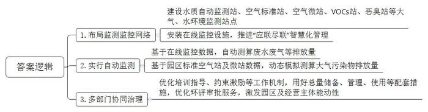
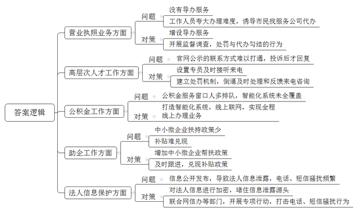
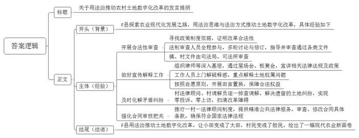
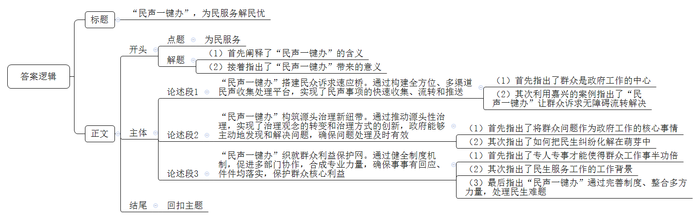

# 2024年公务员多省联考《申论》题（宁夏C卷）

<!-- gwy:overview:start -->
> **宁夏 · 2024 · 申论 · C类** ｜ 4 题 · 图片 4 处 · 答案随题折叠

导航：[题目](#题目) · [材料 1](#材料-1)
<!-- gwy:overview:end -->

> 候选采集稿。参考答案及解析来自粉笔页面，不代表官方答案或真实高分答卷；来源使用许可与原卷对应关系仍需人工核实。

## 给定材料

### 材料 1

园区经济占据J省经济的半壁江山，是J省经济的特色名片。工业园区既是全省经济发展的主要载体，又是治污攻坚的主战场。从污染物排放量上看，全省园区主要污染物排放量约占75%以上。

J省在全国率先推行了一项环保创新举措——工业园区（集中区）污染物排放限值限量管理。

所谓“限值”，就是根据区域生态环境质量状况，制定园区环境质量目标；所谓“限量”，就是根据园区环境质量目标和实际污染物排放情况，确认园区主要污染物总的允许排放量。过去由于监测监控能力不足，园区、企业在一定时间内到底排放多少污染物难以说清。

为摸清“家底”，M县11个园区先后建成了一批大气、水环境监测站点；园区内企业安装了在线监控设施，二者均实现“应联尽联”智慧化管理，园区监测监控网络初步形成。

“2021年，园区作为试点单位率先参与了限值限量管理。”园区生态环境科张科长介绍，园区并不算大，共有12家企业，大力发展高分子新材料和精细化工主导产业，其中9家企业为排污许可重点管理企业。在排污许可重点管理企业中，应建的8家企业废气自动监控检测设备均已和园区或省里联网，产生废水的5家企业也已完成省级联网工作。

该产业园环境监管工作起步较早，2017年园区已初步完成了VOCs摸底调查，并在市排污许可管理系统中完成申报，在2019年园区投资了2000多万元建设完成的智慧环保管理平台基础上，2022年又投资440万元对园区废气、废水监测监控体系进行填平补充。

截至目前，J省168个“限值限量”园区共建成水质自动监测站273个，空气标准站391个，空气微站7215个，VOCs站362个，恶臭站214个。J省开展了基于在线监控数据的企业废水量、废气排放量等自动测算；同时开展了基于园区标准空气站及微站自动监测数据的大气污染物排放量动态模拟测算。

“每个园区的减排空间都不太一样，具体还要看园区已开发情况。我们园区大概两平方公里，目前只开发了一平方公里，如何在保证限值限量、原有环境质量不恶化基础上，继续开发剩余的一平方公里，在现有政策下我们只能在原有9家排污许可重点管理企业上做文章。”张科长表示，由于园区面积小、企业数量少，减排的来源和空间都被压缩了，目前存在的问题主要是，以后园区新上项目的排放总量来源，需要在自己园区内来减排，解决难度较大。因此，探索在区域环境质量改善情况下，建设项目审批落地措施是很有必要的。

另一个难题是，在线监测数据准确性还需要提高。业内专家表示，目前的实际排放量核算主要依据在线数据，而在线数据并未覆盖全部企业，也未实现对企业全部排放口和无组织排放的全覆盖。

“目前在总量核算的准确性上需要进一步提升，方法不同导致核算出的总量差异较为明显。”张科长坦言，在线监测方法测算的总量趋于真实，但无法覆盖所有排放口。模型测算、产排污系数法等核算方法需要大量的基础数据作为支撑，还有，在线监测数据准确性也还需要提高。

限值限量管理是一项系统工程，涉及硬件建设、软件管理、质量控制、环境监管等方面，需要多部门协同发力。园区负责人表示，将进一步强化培训指导、约束激励等推进工作机制，形成工作合力，深入推进限值限量管理工作，用好总量储备、管理、使用等配套措施，优化环评审批服务，以限值限量管理有效激发工业园区和经营主体治污减排的能动性，协同推进园区经济高质量发展和生态环境高水平保护。

### 材料 2

全国工商联发布了《2022年度万家民营企业评营商环境》结论，H市位居第四，整体发展良好，但仍然存在诸多问题。近日，H市记者暗中访问，并将其中暗访视频片段进行公布，以下是相关内容：

①叶先生想注册公司，递交材料来回跑，相关流程不熟悉，也没有业务人员进行帮助，叶先生表示，想要递交材料得跑好几趟。记者暗访相关工作人员，其表示，如果想省事，可以找代跑人员，他们一直在这，知道怎么操作。

②“投诉以后才会给反馈”，张先生表示，官网公布的《高层次人才认定方法》，材料审核被驳回，官网电话无人接听，得不到回应。记者就其问题拨打官网电话，发现不是提示占线，就是无人接听。

③公积金服务窗口前排满了人，智能化系统没有全覆盖。其他地方是智能化线上联网，某辖区还要自己跑到窗口去办理。

④现有政策主要是针对大型企业，中小型企业就业创业没有相关政策补贴，孙先生问，什么时候才能针对小微企业出台相关政策。无独有偶，某市民购买了一台汽车，按H市汽车补贴政策来看，应补贴相关费用，但他一直没有收到任何补贴。

⑤“自从成为公司法人公示了个人信息以后，一天被人打了100多个电话。”熊先生表示，公示信息是为了监督管理，但是个人信息却遭到泄露。“自从注册了公司，接到了很多个贷款电话”一起随行的游先生表示。

### 材料 3

进入晚稻收割季，F县莲水镇莲花村稻田金黄、稻谷飘香，呈现出一派丰收景象。

种粮大户小林正驾驶着收割机，抢收今年刚成熟的晚稻。对于今年的收成，他充满了信心。2022年初，小林从F县农村产权交易中心交易了400多亩地，种植双季稻。“现在承租的农田都是成片成片的，无论是收割还是施肥都更好开展，成本也降低了不少，这多亏了镇上开展的农村土地数字化改革。”望向金黄色的稻田，小林心里美滋滋的。改革前，小林承包的200亩地年年亏损，手里的现代化农作机械因“越界”的问题，无法发挥到最大效益，作业时还会与邻居发生矛盾。

N省全国乡村振兴先行先试的示范镇——莲水镇，位于F县东南部，历史悠久，自然条件优越。随着时间的推移，土地碎片化、巴掌田、补丁田、人多地少等问题逐渐显露，农户种粮积极性不强，耕地抛荒撂荒隐患逐渐增多。

2021年，F县决定在莲水镇因地制宜，探索走农业现代化发展之路，进行农村土地数字化改革。采取“承包权不动，经营权连片”方式解决承包地细碎化问题，打破分散零碎，集中连片，小田变大田，通过流转土地经营权置换田块，将分散零碎的耕地集中到一起，实现一户一田或多户一田。推动农村集体土地所有权、承包权、经营权“三权”分置，农户以村集体土地经营权入股村集体（股份）经济合作社，并进行数字化登记。经县农村产权交易中心包装、挂网、租赁，所得收益交村集体（股份）经济合作社按入股份额分配，实现土地生产效益最大化。

“村里要回我的地了。”“村里不让我种地了。”“怎么实现土地数字化？岂不是把山林田土拱手让人？”《农村土地数字化改革工作方案》一经下发，就在村里炸开了锅，村民反应强烈，他们担心山林、田土等进行数字化登记改革后，田地不再属于自己。

“新事物，不理解正常，重点要做好宣传和解释工作。”F县司法局张局长说，“我们组织律师、法律服务工作者、普法志愿者，深入全区11个乡镇，通过屋场会、板凳会，对数字化土地改革开展专项法治宣传，重点宣讲我国《土地管理法》《农村土地承包法》等相关法律法规及政策。对于特别不理解的群众，工作人员逐一上门解疑释惑，尤其是对土地权属存在疑问的，告诉群众依靠信息技术和确权数据，可以回溯查询到以往承包土地的位置、面积，农民土地的承包权不会受到损害。对于不愿意参与土地流转的农户，按照自愿原则，通过田亩置换的方式，保障其合法权益，消除农户顾虑。”

F县政府如此重大的行政决策合不合法、程序合不合规定，在没有现成经验可参考的当时，考验着F县司法局。F县司法局张局长介绍，“重大行政决策合法性审查，是推进法治政府建设的关键环节，也是改革能否顺利进行的重要保障。”为从源头上遏制改革推进过程中可能存在的法律风险，县司法局协同县人大在《中华人民共和国民法典》和《关于完善农村土地所有权承包权经营权分置办法的意见》《农村土地经营权流转管理办法》，以及《N省关于进一步加快发展壮大农村集体经济的意见》中找到政策制度依据，有力地证明了该改革项目的合法性。

“仅有原则性政策指导，县司法局承担着巨大的压力。”小刘与其他两名法制审查工作人员，全过程参与意见征集与采纳修改、外地经验收集、上级政策与指导意见收集等工作，逐词逐句反复研究。小刘说，在长达半年时间里，经历多轮讨论与修订，最终指导并审查通过《农村土地数字化改革工作方案》《F县农村产权流转交易市场管理办法（试行）》《F县农村产权流转交易市场建设实施方案》《F县农村集体经济组织“三资”管理办法（试行）》《F县加快推进农村土地经营权流转实施方案》等文件，为改革工作的建章立制提供了关键性的法治保障。“在F县土地数字化改革工作的各类文件审查工作中，县司法局充分保障农民的知情权、参与权、表达权、监督权，确保土地的性质、用途不改变、农村集体资产不流失。”张局长表示，镇级层面发布的规范性文件，由县司法局进行合法性备案审查；镇级层面其他文件以及村规民约，由司法所进行合法性审查，司法局予以指导。

用法治思维与法治方式推动土地数字化改革，越来越多的村民签订《流转承诺书》。改革之初，莲花村3个月就召开了70余场屋场会。“对过往遗留的土地纠纷，县司法局和莲水镇公共法律服务站，组织村法律顾问、村调解员逐一排查调解，将矛盾纠纷及时化解在萌芽状态，实现重大改革项目零投诉、零上访，为土地数字化改革扫清障碍。”

荷塘村法律顾问小沈说：“承包人公司认为合同都是政府统一制定的，肯定没有问题。但其实因承包人或项目的不同，合同内的具体条款也会不同。”在一次审查土地流转合同时，她发现双方自行约定流转30年的经营期，已超过了原承包期限，且时间越长土地的经营风险越大。小沈向当事人指出合同中权利义务不对等、违约责任不明确等问题，对不符合国家法律法规的内容进行了修改，得到了承包人公司与村民的夸赞。“自改革之初，县司法局便推行了一村一法律顾问制度，为土地流转文书制作、合作社注册等提供精准公共法律服务，这一举措成效很大。”小沈说。

截至2023年初，F县农村产权交易中心共签订4685份流转合同，莲水镇2.4万亩水田由60个新型农业经营主体全部承租，小田变成了大田，村民变成了股民，一幅现代农业新画卷正在这里徐徐展开。李镇长深有感触地说：“改革能顺利推进，法治保障是关键。”

### 材料 4

键盘敲击声此起彼伏，一条条指令从指尖发出……走进南湖区社会治理综合指挥服务中心，宽敞明亮的大厅内，“民声一键办”专席上的工作人员正在井然有序地“派单”之中。

“我们将110报警平台接到的非警务类事项，12345政务服务便民热线接到的投诉类、求助类电话，基层网格员、社区干部等上报的疑难矛盾纠纷线索等都汇总在基层智治综合应用平台，并通过该平台向各镇、街道分发指令。”南湖区社会治理综合指挥服务中心工作人员小李介绍道。

基层治理很多时候存在部门职责交叉、边界模糊等问题，在一些具体事项上出现了“看得见的管不着、管得着的看不见”等现象，原本一件小事可能因处理不及时成为群众的烦心事，小问题演变成大矛盾。“民声一键办”畅通了民声事项收集、流转、推送渠道，推动源头性治理，将治理观念从“一元管理”向“多元治理”转变，治理方式从“被动兜底”向“靠前治理”转变，治理成效从“治表为主”向“标本兼治”转变。

6月7日，有群众称经开区某烧烤店声音太吵，影响参加高考的学生休息，接报后街道民声服务队赶到现场劝说，并跟老板沟通高考期间提醒食客尽量降低声音。第二天上午，队员结合夏季治安打击整治行动，对附近深夜营业的夜宵场所逐一开展走访宣防，提醒经营者和食客在此特殊时间段积极配合。

24小时在线，全天候服务。以前碰到这类事件，群众不知道找谁能尽快解决问题，“民声一键办”改革以来，以公安110接处警体系为样本，参照公安机关110指挥中心、派出所综合指挥室模式，对“市、县、镇（街道）”三级社会治理中心进行改造提升，健全7×24小时值班值守机制，全时全域全量接收、流转“民声”事项。

遇到疑难事项怎么办？根据事件紧急程度，各中心实行季度常态会商及应急随时会商制度，明确“民声”事项牵头部门、配合部门，做到相互补位、协作共赢。针对性质不明、边界模糊、职责不清等事项，建立首接责任制，由首接部门先期受理，事后分类推送、协同解决，确保事事有回应、件件均落实。

南湖区汇丰广场入驻了100多家民营企业。8月17日，一家新入驻准备装修的企业因租金问题与原房东合伙人发生争执，街道民声服务队接到派单到现场处置，发现这起纠纷涉及经营户较多，情况复杂，街道召集司法、市场监管等多部门会商，提出解决方案。在多方调解下，妥善解决该纠纷，新企业按时开工装修。

7月6日晚上，东湖市独山港民声服务队接到一条指令：“独山港镇三兴大酒店路口有很多人摆摊，影响群众出行。”民声服务队队员小陈前往处理，小陈是来自东湖市综合执法局独山港中队的队员，熟悉该类占道经营的情况及处理流程，抵达现场后，即刻处理完该事项，现场秩序得以恢复。

“专业力量的合成，可以让处置更快，效率更高，做到有的放矢。”东湖市独山港派出所所长说，在实际运行过程中，针对不同的诉求，安排“术业有专攻”的民声服务队队员开展现场处置，确实能有事半功倍的效果。“<u>‘民声一键办’接听的是民意，解决的是民生，体现的是民本，凝聚的是民心，提高的是我们服务人民的水平</u>。”

## 题目

### 第 1 题

**请根据****“给定资料**1**”，谈谈J省工业园区限值限量管理是如何推行的。（25分）**

关联材料：材料 1

作答要求：

要求：

（1）全面、准确，有条理；

（2）不超过200字。

第 1 题 · 答案与解析

**参考答案（粉笔题库参考内容）**

1.布局监测监控网络。建设水质自动监测站、空气标准站、空气微站、VOCs站、恶臭站等大气、水环境监测站点；安装在线监控设施，推进“应联尽联”智慧化管理。

2.实行自动监测。基于在线监控数据，自动测算废水废气等排放量；基于园区标准空气站及微站数据，动态模拟测算大气污染物排放量。

3.多部门协同治理。优化培训指导、约束激励等工作机制，用好总量储备、管理、使用等配套措施，优化环评审批服务，激发园区及经营主体能动性。

**解析**

**参考答案说明：**本参考答案分别从“布局监测监控网络”“实行自动监测”和“多部门协同治理”这三个方面进行了分条撰写，各条要点之间在内容上相互并列，没有交叉。

### 第 2 题

**请根据****“给定资料**2**”，梳理H市营商环境存在的问题，并提出解决建议。（30分）**

关联材料：材料 2

作答要求：

要求：

（1）问题梳理全面、准确；

（2）所提建议与问题相对应，具体明确、切实可行；

（3）不超过400字。

第 2 题 · 答案与解析

**参考答案（粉笔题库参考内容）**

1.营业执照业务方面：没有导办服务；工作人员夸大办理难度，诱导市民找服务公司代办。对策：增设导办服务；开展监督调查，处罚与代办勾结的行为。

2.高层次人才工作方面：官网公示的联系方式难以打通，投诉后才回复。对策：设置专员及时接听来电；建立处罚机制，倒逼及时处理和反馈来电咨询。

3.公积金工作方面：公积金服务窗口人多排队，智能化系统未全覆盖。对策：打造智能化系统，线上联网，实现全程线上办理业务。

4.助企工作方面：中小微企业扶持政策少；补贴难兑现。对策：增加中小微企业帮扶政策；及时跟进，兑现补贴政策。

5.法人信息保护方面：信息公开发布，导致法人信息泄露，电话、短信骚扰频繁。对策：对法人信息进行加密，堵住信息泄露源头；联合网信办等部门，开展专项行动，打击电话、短信骚扰行为。

**解析**

**参考答案说明：**本参考答案写为“问题+建议”的形式。从“营业执照业务”“高层次人才工作”“公积金工作”“助企工作”“法人信息保护”五个方面梳理了H市营商环境存在的问题，并提出解决建议。本参考答案做到了分类分条撰写，各条答案要点之间在内容上相互并列，没有交叉。

### 第 3 题

**F县司法局参加市里举办的“乡村振兴，法治同行”座谈会，请针对“给定资料**3**”，写一份发言提纲。（35分）**

关联材料：材料 3

作答要求：

要求：

（1）紧扣资料，内容全面；

（2）逻辑清晰，语言准确；

（3）不超过400字。

第 3 题 · 答案与解析

**参考答案（粉笔题库参考内容）**

关于用法治推动农村土地数字化改革的发言提纲

背景：F县探索农业现代化发展之路，用法治思维与法治方式推动土地数字化改革，具体经验如下：

经验：一、开展合法性审查。寻找政策制度依据，证明改革合法性；法制审查人员全程参与，多轮讨论与修订，指导并审查通过各类文件；镇、村文件由司法局、司法所审查。二、做好宣传解释工作。组织律师等深入基层，通过屋场会、板凳会，宣讲相关法律法规及政策；工作人员上门解疑释惑，重点解释土地权属问题；按照自愿原则，开展田亩置换，保障合法权益。三、及时化解矛盾纠纷。村法律顾问、村调解员逐一排查调解，解决遗留的土地纠纷，实现零投诉、零上访，扫清改革障碍。四、强化合同审核把关。推行一村一法律顾问制度，提供精准公共法律服务，审查、修改合同具体条款，确保符合国家法律法规。

结语：F县用法治推动土地数字化改革，让小田变成了大田，村民变成了股民，绘出了一幅现代农业新画卷。

**解析**

**参考答案说明：**（1）格式方面，本参考答案写到了“标题”“正文”两个部分。（2）正文部分：从内容来看开头部分先整体介绍了用法治思维推进土地数字化改革；主体部分分别从“开展合法性审查”“做好宣传解释工作”“及时化解矛盾纠纷”“强化合同审核把关”这四个方面对改革的具体做法进行了分条撰写；结尾部分对成果进行总结。从形式来看，本参考答案做到了分段、分条撰写，逻辑清晰。

### 第 4 题

**“给定资料**4**”提到“‘民声一键办’接听的是民意，解决的是民生，体现的是民本，凝聚的是民心，提高的是我们服务人民的水平。”请深入思考这句话，参考给定资料，自选角度，自拟题目，写一篇文章。（60分）**

关联材料：材料 1、材料 2、材料 3、材料 4

作答要求：

要求：

（1）观点明确，见解深刻；

（2）参考给定资料，但不拘泥于给定资料；

（3）思路清晰，语言流畅；

（4）800-1000字。

第 4 题 · 答案与解析

**参考答案（粉笔题库参考内容）**

**“民声一键办”，为民服务解民忧**

“民声一键办”是以人民为中心，将民众的需求和诉求放在首位，通过不断优化服务流程、提升服务质量等措施，确保民众诉求能够得到及时、有效地解决。该措施将各类民生事项处置在源头，推动了多部门协助，实现了专业化治理，提升了治理的现代化水平。

**“民声一键办”搭建民众诉求速应桥****。****通过****构****建全****方位****、****多渠道民声收集处理平台，实现了民声事项的快速收集、流转和推送。**“民之所盼，政之所向”。群众的呼声是第一信号，群众的需要是第一选择，群众的利益是第一原则，群众的满意是第一标准。嘉兴“民声一键办”整合12345政务服务便民热线、110报警服务台和基层智治综合应用平台，形成互联互通的“铁三角”架构。促使群众反映的问题，得到全面收集反馈、无障碍流转解决。

**“民声一键办”构筑源头治理新纽带****。****通过****推动源头性治理，实现了治理观念的转变和治理方式的创新，政府能够主动地发现和解决问题，确保问题处理及时有效。**心系群众，情系民生，就要将群众的烦心事、揪心事、操心事，当作“心尖事”，及时处理矛盾纠纷。本根不摇，则枝叶茂荣，民生问题的解决，要推动从“被动兜底”向“靠前治理”转变，实现由“治表为主”向“标本兼治”转变，解决过程中要追溯源头、提前介入、主动作为，将矛盾纠纷化解在萌芽状态，有效避免问题的扩大和升级。

**“民声一键办”织就群众利益保护网****。****通过健全制度机制，促进多部门协作，合成专业力量，确保事事有回应、件件均落实，保护群众核心利益。**正所谓“术业有专攻”，专业的人做专业的事，处置问题的效率会更高、针对性会更强。当前，社会发展日新月异，新知识、新思想、新问题不断涌现，且民生服务涵盖领域广、涉及事项多、处理难度大。“民声一键办”通过完善会商制度、首接责任制等制度，整合多部门力量，将不同专业、不同领域的工作人员纳入民声服务队，针对不同民生诉求，安排更熟悉情况的专人处理，使得事项处理事半功倍。

在基层治理工作中，应始终坚持以人民为中心，问需于民，创新治理方式，提升自身能力，才能更好地办实事、办好事，才能全面提升治理水平和效能，推进基层治理现代化。

**文章分析**

**“民声一键办”，为民服务解民忧**

【**标题的优点：**首先，范文的标题突出了“为民服务”这一主题。其次，形式上，文字简洁明快，不拖沓。】

（1）“民声一键办”<u>是以人民为中心</u>，<u>将民众的需求和诉求放在首位</u>，通过不断优化服务流程、提升服务质量等措施，<u>确保民众诉求能够得到及时、有效地解决</u>。（2）该措施将各类民生事项处置在源头，<u>推动了多部门协助</u>，<u>实现了专业化治理</u>，<u>提升了治理的现代化水平</u>。

【**开头的优点：**★内容方面：范文的开头是紧扣“为民服务”这一主题展开的。首先，开头点出主题，做到了主题明确。其次，对“民声一键办”这一主题进行了分析阐述：（1）首先阐释了“民声一键办”的含义；（2）接着指出了“民声一键办”带来的意义。★文字表达方面：长短句配合使用，使语言表达有节奏感。】

**“民声一键办”搭建民众诉求速应桥。通过构建全方位、多渠道民声收集处理平台，实现了民声事项的快速收集、流转和推送。**“民之所盼，政之所向”。（1）<u>群众的呼声</u>是第一信号，<u>群众的需要</u>是第一选择，<u>群众的利益</u>是第一原则，<u>群众的满意</u>是第一标准。（2）<u>嘉兴</u>“民声一键办”整合12345政务服务便民热线、110报警服务台和基层智治综合应用平台，形成互联互通的“铁三角”架构。促使群众反映的问题，得到全面收集反馈、无障碍流转解决。

【**论述段****1****的优点：**★观点句：范文的观点句是紧扣“为民服务”这一文章主题提出的。形式上，它在段首处直接写出，位置突出，容易发现。内容上，关键词突出，内容要点明确，可以明显看出它是从“搭建民众诉求”这个角度入手，指出了如何让“民声一键办”为民服务。★论述内容：（1）首先指出了群众是政府工作的中心；（2）其次利用嘉兴的案例指出了“民声一键办”让群众诉求无障碍流转解决。注意：以上两个方面的内容都是紧扣“‘民声一键办’搭建民众诉求速应桥。通过构建全方位、多渠道民声收集处理平台，实现了民声事项的快速收集、流转和推送”这个观点句进行分析论述的，论述的针对性强，内容层次丰富。最后，在论述方法上主要采用了讲道理的方式，论述深刻有力。】

**“民声一键办”构筑源头治理新纽带。通过推动源头性治理，实现了治理观念的转变和治理方式的创新，政府能够主动地发现和解决问题，确保问题处理及时有效**。（1）心系群众，情系民生，就要将<u>群众的烦心事、揪心事、操心事</u>，<u>当作“心尖事</u>”，及时处理矛盾纠纷。本根不摇，则枝叶茂荣，（2）<u>民生问题的解决</u>，要推动<u>从“被动兜底”向“靠前治理”转变</u>，<u>实现由“治表为主”向“标本兼治”转变</u>，解决过程中要<u>追溯源头</u>、<u>提前介入</u>、<u>主动作为</u>，将矛盾纠纷化解在萌芽状态，有效避免问题的扩大和升级。

【**论述段****2****的优点：**★观点句：范文的观点句是紧扣“为民服务”这一文章主题提出的。形式上，它在段首处直接写出，位置突出，容易发现。内容上，关键词突出，内容要点明确，可以明显看出它是从“源头治理”这个角度入手，指出了如何让“民声一键办”为民服务。★论述内容：（1）首先指出了将群众问题作为政府工作的核心事情；（2）其次指出了如何把民生纠纷化解在萌芽中。注意：以上两个方面的内容都是紧扣“‘民声一键办’构筑源头治理新纽带。通过推动源头性治理，实现了治理观念的转变和治理方式的创新，政府能够主动地发现和解决问题，确保问题处理及时有效送”这个观点句进行分析论述的，论述的针对性强，内容层次丰富。最后，在论述方法上主要采用了讲道理的方式，论述深刻有力。】

**“民声一键办”织就群众利益保护网。通过健全制度机制，促进多部门协作，合成专业力量，确保事事有回应、件件均落实，保护群众核心利益。**（1）正所谓“术业有专攻”，<u>专业的人做专业的事</u>，处置问题的效率会更高、针对性会更强。（2）当前，<u>社会发展日新月异</u>，新知识、新思想、新问题不断涌现，且民生服务涵盖领域广、涉及事项多、处理难度大。（3）“民声一键办”<u>通过完善会商制度、首接责任制等制度</u>，<u>整合多部门力量</u>，将不同专业、不同领域的工作人员纳入民声服务队，针对不同民生诉求，安排更熟悉情况的专人处理，使得事项处理事半功倍。

【**论述段****3****的优点：**★观点句：范文的观点句是紧扣“为民服务”这一文章主题提出的。形式上，它在段首处直接写出，位置突出，容易发现。内容上，关键词突出，内容要点明确，可以明显看出它是从“保护群众利益”这个角度入手，指出了如何让“民声一键办”为民服务。★论述内容：（1）首先指出了专人专事才能使得群众工作事半功倍；（2）其次指出了民生服务工作的工作背景；（3）最后指出“民声一键办”通过完善制度、整合多方力量，处理民生难题。注意：以上三个方面的内容都是紧扣“‘民声一键办’织就群众利益保护网。通过健全制度机制，促进多部门协作，合成专业力量，确保事事有回应、件件均落实，保护群众核心利益”这个观点句进行分析论述的，论述的针对性强，内容层次丰富。最后，在论述方法上主要采用了讲道理的方式，论述深刻有力。】

在基层治理工作中，应始终<u>坚持以人民为中心</u>，问需于民，创新治理方式，提升自身能力，才能更好地办实事、办好事，才能全面提升治理水平和效能，推进基层治理现代化。

【**结尾的优点：**范文的结尾回扣了“为民服务”这个主题，并且进行了总结展望。】

**解析状态：unknown（来源未提供）**

