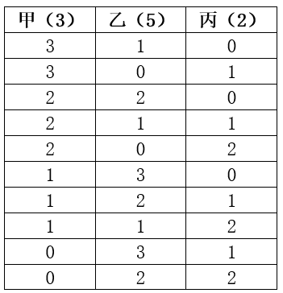
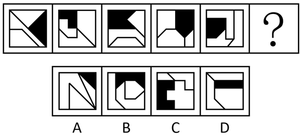
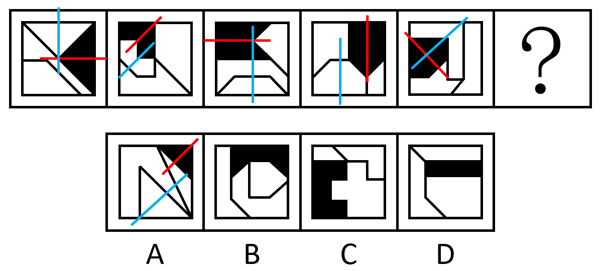
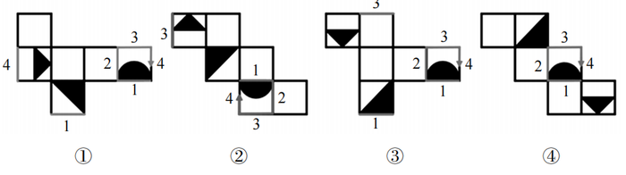
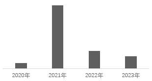
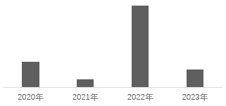
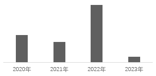
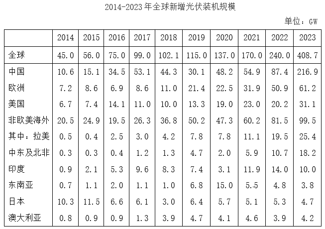
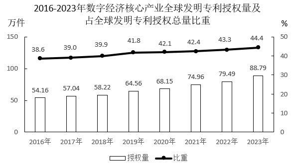

# 2025年宁夏公务员录用考试《行测》题（网友回忆版）

<!-- gwy:overview:start -->
> **宁夏 · 2025 · 行测 · 统考** ｜ 120 题 · 图片 202 处 · 答案随题折叠

| 题型模块 | 题量 | 题号 |
| --- | ---: | ---: |
| 政治理论 | 15 | 1–15 |
| 常识判断 | 16 | 16–31 |
| 言语理解与表达 | 25 | 32–56 |
| 数量关系 | 10 | 57–66 |
| 判断推理 | 34 | 67–100 |
| 资料分析 | 20 | 101–120 |
| **合计** | **120** | |

导航：[题型与作答说明](#题型与作答说明) · [题目](#题目) · [材料 1](#材料-1)
<!-- gwy:overview:end -->

> 候选采集稿。参考答案及解析来自粉笔页面，不代表官方答案或真实高分答卷；来源使用许可与原卷对应关系仍需人工核实。

## 题型与作答说明

政治理论

（15题）

根据题目要求，在四个选项中选出一个最恰当的答案。

常识判断

（16题）

根据题目要求，在四个选项中选出一个最恰当的答案。

言语理解与表达

（25题）

本部分包括表达与理解两方面的内容。请根据题目要求，在四个选项中选出一个最恰当的答案。

数量关系

（10题）

在这部分试题中，每道题呈现一段表述数字关系的文字，要求你迅速、准确地计算出答案。

判断推理

（34题）

本部分包括图形推理、定义判断、类比推理与逻辑判断四种类型的试题，在四个选项中选出一个最恰当的答案。

资料分析

（20题）

所给出的图、表、文字或综合性资料均有若干个问题要你回答。你应根据资料提供的信息进行分析、比较、计算和判断处理。

## 题目

### 第 1 题

2025年宁夏政府工作报告指出，更好统筹发展和安全，重点开展“稳增长促发展攻坚年”行动，突出打好“六个攻坚战”，全面实现“五个新突破”，下列关于五个新突破的说法正确的有几项：

①坚持以特色优势产业为支撑，在经济高质量发展上实现新突破

②坚持以乡村全面振兴为抓手，在推动城乡融合发展上实现新突破

③坚持以“一河三山”为基准线，在加强生态文明建设上实现新突破

④坚持以维护社会和谐稳定为基石，在高水平安全体系建设上实现新突破

⑤坚持以人民为中心的发展思想，在各族人民共同富裕上实现新突破

⑥坚持以传统文化为依托，在文化传承创新与融合发展上实现新突破

A. ①②③④⑤

B. ①③④⑤⑥

C. ②③④⑤⑥

D. ①②④⑤⑥

第 1 题 · 答案与解析

**参考答案（粉笔题库参考内容）**

A

**解析**

本题考查理论与政策。

①②③④⑤正确，《2025年宁夏自治区政府工作报告》中“二、2025年目标任务”部分指出：实现全年目标，必须重点抓好以下工作，（一）坚持以特色优势产业为支撑，在经济高质量发展上实现新突破；（二）坚持以乡村全面振兴为抓手，在推动城乡融合发展上实现新突破；（三）坚持以“一河三山”为基准线，在加强生态文明建设上实现新突破；（四）坚持以维护社会和谐稳定为基石，在高水平安全体系建设上实现新突破；（五）坚持以人民为中心的发展思想，在各族人民共同富裕上实现新突破。

⑥错误，《2025年宁夏自治区政府工作报告》中无此项内容。

故①②③④⑤表述正确。

故正确答案为A。

### 第 2 题

2024年6月，习近平在考察宁夏时指出，宁夏地理环境和资源禀赋独特，要走特色化、差异化的产业发展路子，构建体现宁夏优势、具有较强竞争力的现代化产业体系。宁夏的现代煤化工和新型材料产业，风电、光伏、氢能等清洁能源产业，葡萄酒、枸杞等特色产业要：

A. 精打细算、政策护航

B. 集群集约、优化升级

C. 精耕细作、持续发展

D. 科技赋能、创新发展

第 2 题 · 答案与解析

**参考答案（粉笔题库参考内容）**

C

**解析**

本题考查理论与政策。

C项正确，A、B、D三项错误。2024年6月19日至20日，中共中央总书记、国家主席、中央军委主席习近平在宁夏考察。习近平指出，宁夏地理环境和资源禀赋独特，要走特色化、差异化的产业发展路子，构建体现宁夏优势、具有较强竞争力的现代化产业体系。宁夏的现代煤化工和新型材料产业，风电、光伏、氢能等清洁能源产业，葡萄酒、枸杞等特色产业，要精耕细作、持续发展。

故正确答案为C。

### 第 3 题

粉笔暂未收录本题（来源缺题，题位保留）

第 3 题 · 答案与解析

**答案状态：unknown（来源未提供）**

**解析状态：unknown（来源未提供）**

### 第 4 题

关于科学社会主义，下列说法正确的有几项？

①科学社会主义的理论基础是唯物史观和剩余价值学说

②科学社会主义的思想来源是工人运动的兴起

③科学社会主义在21世纪的中国焕发出强大的生命力

④《共产党宣言》的发表标志着科学社会主义的诞生

⑤中国式现代化理论是科学社会主义的最新重大成果

A. 2

B. 3

C. 4

D. 5

第 4 题 · 答案与解析

**参考答案（粉笔题库参考内容）**

C

**解析**

本题考查马克思主义。

①正确，马克思和恩格斯创立的唯物史观和剩余价值学说，揭示了人类社会发展的一般规律和资本主义社会发展的特殊规律，为科学社会主义奠定了理论基础。正如恩格斯在《社会主义从空想到科学的发展》中指出，唯物史观和剩余价值学说“使社会主义从空想变为科学”。

②错误，科学社会主义的思想来源是空想社会主义，空想社会主义者对资本主义进行了批判，提出了一些关于未来社会的积极主张，为科学社会主义的创立提供了思想材料。而工人运动的兴起是科学社会主义产生的阶级基础，它为科学社会主义的创立提供了实践基础和阶级力量。

③正确，党的二十大报告指出：“科学社会主义在二十一世纪的中国焕发出新的蓬勃生机，中国式现代化为人类实现现代化提供了新的选择，中国共产党和中国人民为解决人类面临的共同问题提供更多更好的中国智慧、中国方案、中国力量，为人类和平与发展崇高事业作出新的更大的贡献！”

④正确，1848年《共产党宣言》的发表，第一次全面系统地阐述了科学社会主义理论，指出共产主义运动将成为不可抗拒的历史潮流，标志着科学社会主义的诞生。

⑤正确，习近平总书记在学习贯彻党的二十大精神研讨班上讲话时强调，概括提出并深入阐述中国式现代化理论，是党的二十大的一个重大理论创新，是科学社会主义的最新重大成果。

故①③④⑤说法正确，共4项。

故正确答案为C。

### 第 5 题

加强普惠性、基础性、兜底性民生建设，解决好人民群众最关心最直接最现实的利益问题，才能不断满足人民对美好生活的向往。关于加强普惠性、基础性、兜底性民生建设，下列表述正确的有几项？

①出台完善青年创新人才发现、选拔、培养机制

②加强低收入人口动态监测，做好分层分类社会救助工作

③出台政策鼓励收养病残孤儿，政府为收养家庭提供适度补贴

④发展集中管理运营的社区养老服务网络，提升农村互助养老设施建设水平

A. 4项

B. 3项

C. 2项

D. 1项

第 5 题 · 答案与解析

**参考答案（粉笔题库参考内容）**

B

**解析**

本题考查理论与政策。

2024年7月18日，中国共产党第二十届中央委员会第三次全体会议通过《中共中央关于进一步全面深化改革 推进中国式现代化的决定》（以下简称《决定》）。

①错误，《决定》在“四、构建支持全面创新体制机制”部分“（15）深化人才发展体制机制改革”中指出：“实施更加积极、更加开放、更加有效的人才政策······完善青年创新人才发现、选拔、培养机制，更好保障青年科技人员待遇。健全保障科研人员专心科研制度。”该举措不属于民生建设。

②正确，《关于加强低收入人口动态监测做好分层分类社会救助工作的意见》中指出：“社会救助是社会保障体系中兜底性、基础性的制度安排。为健全分层分类的社会救助体系，加大低收入人口救助帮扶力度，进一步织密扎牢民生兜底保障安全网，现就加强低收入人口动态监测、做好分层分类社会救助工作提出以下意见。”

③正确，《关于进一步促进残疾孤儿回归家庭的通知》中指出：“三、延续享受救助政策。残疾孤儿被收养后，可继续纳入‘孤儿医疗康复明天计划’项目资助范围。符合条件的，也可按规定享受社会救助或残疾人保障相关待遇，但应做好各项政策衔接，避免重复享受······六、加强政策宣传引导。各地要充分利用报纸、电台、网络等媒体，积极开展鼓励收养残疾孤儿政策宣传工作。”

④正确，《决定》在“十一、健全保障和改善民生制度体系”部分“（46）健全人口发展支持和服务体系”中指出：“积极应对人口老龄化······优化基本养老服务供给，培育社区养老服务机构，健全公办养老机构运营机制，鼓励和引导企业等社会力量积极参与，推进互助性养老服务，促进医养结合。”

故②③④表述正确，共3项。

故正确答案为B。

### 第 6 题

确保粮食安全，耕地是关键。党的十八大以来，以习近平同志为核心的党中央采取一系列硬措施，坚守耕地保护红线。关于加强耕地保护，下列说法正确的是：

A. 抓好盐碱地综合改造利用，全面推进盐碱地后备资源开发

B. 完善耕地质量建设保护制度，加快耕地质量保护立法

C. 建立健全国家、省、市三级耕地质量监测网络体系

D. 优先把云贵地区的梯田和山间谷地建成高标准农田

第 6 题 · 答案与解析

**参考答案（粉笔题库参考内容）**

B

**解析**

本题考查理论与政策。

2024年2月5日，国务院办公厅发布了《关于加强耕地保护提升耕地质量完善占补平衡的意见》（以下简称《意见》）。

A项错误，《意见》在“三、全力提升耕地质量”部分指出：“（八）抓好盐碱地综合改造利用。全面摸清盐碱地资源状况，建立盐碱耕地质量监测体系。实施盐碱耕地治理工程，分区分类开展盐碱耕地治理改良，加强耕地盐碱化防治。梯次推进盐碱地等耕地后备资源开发······”

B项正确，C项错误，《意见》在“三、全力提升耕地质量”部分指出：“（十）完善耕地质量建设保护制度。加快耕地质量保护立法。完善耕地质量调查评价制度，建立统一的耕地质量评价方法、标准、指标······建立健全国家、省、市、县四级耕地质量监测网络体系。完善耕地质量保护与建设投入机制，中央和地方财政要为提升耕地质量提供资金保障。”

D项错误，《意见》在“三、全力提升耕地质量”部分指出：“（四）加强高标准农田建设。出台全国逐步把永久基本农田建成高标准农田的实施方案······优先把东北黑土地区、平原地区、具备水利灌溉条件地区的耕地建成高标准农田······”

故正确答案为B。

### 第 7 题

2024年12月，中央农村工作会议在北京召开，会议对如何做好“三农”工作进行了具体部署，下列与之相关说法错误的是：

A. 加强新时代农村精神文明建设，积极开展移风易俗

B. 提高农村基本公共服务水平，持续改善农村人居环境

C. 推进农业科技力量协同攻关，因地制宜发展农业新质生产力

D. 完善农产品贸易与生产协调机制，推动粮食等农产品价格稳步提升

第 7 题 · 答案与解析

**参考答案（粉笔题库参考内容）**

D

**解析**

本题考查理论与政策。

D项错误，A、B、C三项正确，2024年中央农村工作会议强调，要聚焦学习运用“千万工程”经验、推进乡村全面振兴······推进农业科技力量协同攻关，加快科技成果大面积推广应用，因地制宜发展农业新质生产力······完善农产品贸易与生产协调机制，推动粮食等重要农产品价格保持在合理水平······推动基础设施向农村延伸，提高农村基本公共服务水平，持续改善农村人居环境，加强农村生态环境治理······实施文明乡风建设工程，加强新时代农村精神文明建设，积极开展移风易俗。

本题为选非题，故正确答案为D。

### 第 8 题

党的二十届三中全会提出，要推动建设生育友好型社会。关于推动建设生育友好型社会，下列举措不恰当的是：

A. 指导各地推动养育、教育产业市场化发展

B. 鼓励各地出台多孩子女同校就读具体实施办法

C. 指导各地将辅助生殖技术项目纳入医保报销范围

D. 指导有条件的地方将参加职工基本医疗保险的灵活就业人员纳入生育保险

第 8 题 · 答案与解析

**参考答案（粉笔题库参考内容）**

A

**解析**

本题考查理论与政策。

2024年10月19日，国务院办公厅印发《关于加快完善生育支持政策体系推动建设生育友好型社会的若干措施》（以下简称《措施》）。

A项错误，《措施》在“一、总体要求”部分指出：“以习近平新时代中国特色社会主义思想为指导······完善生育支持政策体系和激励机制，健全覆盖全人群、全生命周期的人口服务体系，有效降低生育、养育、教育成本，营造全社会尊重生育、支持生育的良好氛围，为推动实现适度生育水平、促进人口高质量发展提供有力支撑。”由此可见，推动养育、教育产业市场化发展说法错误。

B项正确，《措施》在“四、强化教育、住房、就业等支持措施”部分“（九）扩大优质教育资源供给”中指出：“优化区域教育资源配置······鼓励各地出台多孩子女同校就读具体实施办法，帮助解决家长接送不便问题。”

C项正确，《措施》在“二、强化生育服务支持”部分“（四）加强生殖健康服务”中指出：“深入实施母婴安全行动提升计划和出生缺陷防治能力提升计划······加强生育医疗费用保障，指导各地将适宜的分娩镇痛以及辅助生殖技术项目纳入医保报销范围。”

D项正确，《措施》在“二、强化生育服务支持”部分“（一）增强生育保险保障功能”中指出：“强化生育保险对参保女职工生育医疗费用、生育津贴待遇等保障作用。指导有条件的地方将参加职工基本医疗保险的灵活就业人员、农民工、新就业形态人员纳入生育保险。”

本题为选非题，故正确答案为A。

### 第 9 题

党的二十大报告指出，构建全国统一大市场，深化要素市场化改革，建设高标准市场体系。关于构建全国统一大市场，下列与之相关说法错误的是：

A. 推动市场基础制度规则统一

B. 加强公平竞争审查柔性约束

C. 规范地方招商引资法规制度

D. 深化地方标准管理制度改革

第 9 题 · 答案与解析

**参考答案（粉笔题库参考内容）**

B

**解析**

本题考查理论与政策。

B项错误，A、C、D三项正确，《中共中央关于进一步全面深化改革 推进中国式现代化的决定》在“二、构建高水平社会主义市场经济体制”部分“（6）构建全国统一大市场”中指出：“推动市场基础制度规则统一、市场监管公平统一、市场设施高标准联通。加强公平竞争审查刚性约束，强化反垄断和反不正当竞争，清理和废除妨碍全国统一市场和公平竞争的各种规定和做法。规范地方招商引资法规制度，严禁违法违规给予政策优惠行为。建立健全统一规范、信息共享的招标投标和政府、事业单位、国有企业采购等公共资源交易平台体系，实现项目全流程公开管理。提升市场综合监管能力和水平。健全国家标准体系，深化地方标准管理制度改革。”故B项中“柔性约束”说法错误。

本题为选非题，故正确答案为B。

### 第 10 题

党的二十届三中全会指出，法治是中国式现代化的重要保障。下列不属于完善中国特色社会主义法治体系举措的是：

A. 健全基层民主制度

B. 深入推进依法行政

C. 深化立法领域改革

D. 加强涉外法治建设

第 10 题 · 答案与解析

**参考答案（粉笔题库参考内容）**

A

**解析**

本题考查理论与政策。

A项错误，中国共产党第二十届中央委员会第三次全体会议提出，发展全过程人民民主是中国式现代化的本质要求。必须坚定不移走中国特色社会主义政治发展道路，坚持和完善我国根本政治制度、基本政治制度、重要政治制度，丰富各层级民主形式，把人民当家作主具体、现实体现到国家政治生活和社会生活各方面。要加强人民当家作主制度建设，健全协商民主机制，健全基层民主制度，完善大统战工作格局。

B、C、D三项正确，中国共产党第二十届中央委员会第三次全体会议提出，法治是中国式现代化的重要保障。必须全面贯彻实施宪法，维护宪法权威，协同推进立法、执法、司法、守法各环节改革，健全法律面前人人平等保障机制，弘扬社会主义法治精神，维护社会公平正义，全面推进国家各方面工作法治化。要深化立法领域改革，深入推进依法行政，健全公正执法司法体制机制，完善推进法治社会建设机制，加强涉外法治建设。

本题为选非题，故正确答案为A。

### 第 11 题

习近平总书记强调，铸牢中华民族共同体意识，推进新时代党的民族工作高质量发展。关于推进新时代党的民族工作高质量发展，下列说法正确的是：

①把改善民生、凝聚人心作为民族地区经济社会发展的出发点和落脚点

②构建块状集中式社会结构和社区环境，积极促进各民族交往交流交融

③中国共产党领导和社会主义制度是我国各民族共同发展进步的可靠保障

④铸牢中华民族共同体意识、推进新时代党的民族工作高质量发展，是全党全国各族人民的共同任务

A. ①③④

B. ①②④

C. ①②③

D. ②③④

第 11 题 · 答案与解析

**参考答案（粉笔题库参考内容）**

A

**解析**

本题考查理论与政策。

①正确，习近平总书记在中央第七次西藏工作座谈会上强调：“必须把改善民生、凝聚人心作为经济社会发展的出发点和落脚点。”党的民族工作始终强调以人民为中心的发展思想，改善民生、凝聚人心是民族地区经济社会发展的核心目标。通过提升民族地区的生活水平和社会福利，可以增强各族人民的幸福感和归属感，促进民族团结。

②错误，习近平总书记在全国民族团结进步表彰大会上强调：“构建互嵌式社会结构和社区环境，不断拓宽各民族全方位嵌入的实践路径，促进各民族像石榴籽一样紧紧抱在一起。”构建互嵌式社会结构和社区环境，是促进各民族广泛交往、全面交流、深度交融，铸牢中华民族共同体意识的重要途径。因此“块状集中式社会结构和社区环境”表述错误。

③正确，2024年2月《求是》杂志发表习近平的重要文章《铸牢中华民族共同体意识 推进新时代党的民族工作高质量发展》中指出：“创新涉民族宣传的传播方式，丰富传播内容，拓宽传播渠道，讲好中华民族共同体故事，讲清楚中国共产党领导和社会主义制度是我国各民族共同发展进步的可靠保障，讲清楚中华民族是具有强大认同度和凝聚力的命运共同体，讲清楚中国特色解决民族问题的正确道路所具有的明显优越性。”

④正确，习近平总书记在二十届中央政治局第九次集体学习时讲话指出：“铸牢中华民族共同体意识、推进新时代党的民族工作高质量发展，是全党全国各族人民的共同任务。各级党委和政府要坚持中国特色解决民族问题的正确道路，认真贯彻落实党的民族工作的各项方针政策，及时研究解决本地区本单位涉及民族工作的重大问题。”

故说法正确的是①③④。

故正确答案为A。

### 第 12 题

习近平总书记强调，要始终保持反腐败永远在路上的坚韧执着，保持战略定力和高压态势，一步不停歇、半步不退让，一体推进不敢腐、不能腐、不想腐，坚决打好这场攻坚战、持久战、总体战。关于对当前反腐败斗争的认识，下列说法正确的有几项？

①加强党的纪律建设是一项经常性工作，引导党员干部把他律转化为自律

②新时代以来，反腐败成效有目共睹，已铲除了腐败滋生的土壤和条件

③不正之风是滋生腐败的温床，腐败往往是“四风”从量变转为质变的结果

④深化对党的自我革命的规律性认识，必须以彻底的自我革命精神把反腐败斗争进行到底

⑤要持续推动全面从严治党向基层延伸，让人民群众切实感受到正风肃纪反腐就在身边

A. 2

B. 3

C. 4

D. 5

第 12 题 · 答案与解析

**参考答案（粉笔题库参考内容）**

C

**解析**

本题考查理论与政策。

2025年1月6日，中共中央总书记、国家主席、中央军委主席习近平在中国共产党第二十届中央纪律检查委员会第四次全体会议上发表重要讲话。

①正确，习近平总书记在讲话中强调，加强党的纪律建设是一项经常性工作，要引导党员、干部把他律转化为自律，内化为日用而不觉的言行准则。

②错误，习近平总书记在讲话中强调，新时代以来，推进全面从严治党和反腐败斗争力度之大前所未有，成效有目共睹。要始终保持反腐败永远在路上的坚韧执着，保持战略定力和高压态势，一步不停歇、半步不退让，一体推进不敢腐、不能腐、不想腐，坚决打好这场攻坚战、持久战、总体战。故“已铲除了腐败滋生的土壤和条件”说法有误。

③正确，2025年1月，新华社发布题为《着力推动正风反腐一体深化》的文章指出，不正之风是腐败滋生的温床，腐败往往是“四风”问题由量变到质变的结果。大量案件显示，党员干部的腐化堕落往往从作风问题肇始。

④正确，习近平总书记关于党的自我革命的重要思想坚持马克思主义世界观和方法论，从事物矛盾中把握规律、从复杂现象中透视本质，坚持讲两点论、找平衡点，不断深化对党的自我革命的规律性认识。2024年10月28日，中央政治局召开会议审议了《关于二十届中央第三轮巡视情况的综合报告》。会议强调，要清醒认识反腐败斗争形势，纵深推进全面从严治党，以彻底的自我革命精神把反腐败斗争进行到底。

⑤正确，习近平总书记在讲话中指出，要持续推动全面从严治党向基层延伸。各级党委特别是市县党委要把整治群众身边不正之风和腐败问题作为重要任务常态化地抓，让老百姓可感可及。新华社发布文章指出，2024年以来，全国纪检监察机关共查处群众身边不正之风和腐败问题59.6万个、处分46.2万人，移送检察机关1.5万人，以“铁拳头”惩治“微腐败”，让人民群众切实感受到正风反腐就在身边。

故正确的有①③④⑤，共4项。

故正确答案为C。

### 第 13 题

习近平总书记强调，中国将坚持推进高水平对外开放，以高质量发展全面推进中国式现代化，为各国开放合作提供新机遇。关于推进高水平对外开放，下列举措恰当的有几项？

①维护多元稳定的国际经济格局和经贸关系

②加强知识产权保护，营造良好的营商环境

③稳步扩大规则、规制、管理、标准等制度型开放

④减少对外资企业的准入限制，全面放开所有行业领域

⑤加快建设贸易强国，推动共建“一带一路”高质量发展

A. 2

B. 3

C. 4

D. 5

第 13 题 · 答案与解析

**参考答案（粉笔题库参考内容）**

C

**解析**

本题考查理论与政策。

①③⑤正确，④错误，党的二十大报告“四、加快构建新发展格局，着力推动高质量发展”部分指出：“（五）推进高水平对外开放。依托我国超大规模市场优势，以国内大循环吸引全球资源要素，增强国内国际两个市场两种资源联动效应，提升贸易投资合作质量和水平。稳步扩大规则、规制、管理、标准等制度型开放。推动货物贸易优化升级，创新服务贸易发展机制，发展数字贸易，加快建设贸易强国。合理缩减外资准入负面清单，依法保护外商投资权益，营造市场化、法治化、国际化一流营商环境。推动共建‘一带一路’高质量发展。优化区域开放布局，巩固东部沿海地区开放先导地位，提高中西部和东北地区开放水平。加快建设西部陆海新通道。加快建设海南自由贸易港，实施自由贸易试验区提升战略，扩大面向全球的高标准自由贸易区网络。有序推进人民币国际化。深度参与全球产业分工和合作，维护多元稳定的国际经济格局和经贸关系。”减少外资准入限制是推进对外开放的重要举措，但“全面放开所有行业领域”表述过于绝对，某些关键领域仍需保留一定的限制，以确保国家利益和安全。

②正确，习近平总书记在重要文章《全面加强知识产权保护工作 激发创新活力推动构建新发展格局》中指出：“创新是引领发展的第一动力，保护知识产权就是保护创新······知识产权保护工作关系国家对外开放大局，只有严格保护知识产权，才能优化营商环境、建设更高水平开放型经济新体制。知识产权保护工作关系国家安全，只有严格保护知识产权，才能有效保护我国自主研发的关键核心技术、防范化解重大风险。”

故①②③⑤表述正确，有4项。

故正确答案为C。

### 第 14 题

2024年习近平总书记在福建省东山县考察期间参观谷文昌纪念馆时指出，“先祭谷公、后拜祖宗”，这是老百姓发自内心的敬仰。人民心里有一本账，金杯银杯不如老百姓的口碑。这体现了：

①让群众满意是我们党做好一切工作的价值取向和根本标准

②人民是党的工作的最高裁决者和最终评判者

③中国共产党把为民办事、为民造福作为最重要的政绩

④全心全意为人民服务是党的根本宗旨

A. ①②

B. ①②③

C. ②③④

D. ①②③④

第 14 题 · 答案与解析

**参考答案（粉笔题库参考内容）**

D

**解析**

本题考查理论与政策。

“人民心里有一本账，金杯银杯不如老百姓的口碑”体现了“人民”是党带领人民取得非凡成就的逻辑起点，也是历史变革的价值旨归。

①正确，习近平总书记曾在党的群众路线教育实践活动总结大会上的讲话中指出：“让群众满意是我们党做好一切工作的价值取向和根本标准，群众意见是一把最好的尺子。”

②正确，2023年求是网发布的《党员干部要走好新时代党的群众路线》文章指出：习近平总书记强调，“人民是我们党的工作的最高裁决者和最终评判者”，“坚持群众路线，就要真正让人民来评判我们的工作”。衡量工作优劣要把人民群众的意见作为“标尺”，考核评价干部要把群众认不认可作为根本依据，始终把干部至于群众监督之下。

③正确，2020年全国两会召开前夕，习近平总书记视察山西时强调，中国共产党把为民办事、为民造福作为最重要的政绩，把为老百姓做了多少好事实事作为检验政绩的重要标准。

④正确，习近平总书记在庆祝改革开放40周年大会上的讲话中指出：“我们党来自人民、扎根人民、造福人民，全心全意为人民服务是党的根本宗旨，必须以最广大人民根本利益为我们一切工作的根本出发点和落脚点，坚持把人民拥护不拥护、赞成不赞成、高兴不高兴作为制定政策的依据，顺应民心、尊重民意、关注民情、致力民生。”

故正确的有①②③④。

故正确答案为D。

### 第 15 题

大农业观、大食物观是对中国粮食安全、食物安全内涵外延的不断深化和拓展，为推动农业现代化和提升食物供给韧性指明了方向。这最直接体现了马克思主义的哪一基本观点？

A. 普遍联系的观点

B. 运动变化的观点

C. 辩证否定的观点

D. 质量互变的观点

第 15 题 · 答案与解析

**参考答案（粉笔题库参考内容）**

C

**解析**

本题考查马克思主义。

A项错误，联系具有普遍性指事物或现象之间以及事物内部要素之间相互连结、相互依赖、相互影响、相互作用、相互转化等相互关系。但题干中并未涉及相应内容。

B项错误，运动是物质的固有属性和存在方式强调了物质是运动的物质、运动是物质的运动，物质和运动之间不可分割的关系。但题干中并未涉及相应内容。

C项正确，题干中“大农业观、大食物观是对中国粮食安全、食物安全内涵外延的不断深化和拓展”即对传统的“农业观”和“食物观”的辩证否定，强调了事物的发展，且“大农业观、大食物观······为推动农业现代化和提升食物供给韧性指明了方向”点出了事物发展的方向和道路即否定之否定规律。辩证的否定的实质为扬弃，即既克服又保留，对应事物的发展。辩证的否定观为否定之否定规律当中重要组成部分，符合题干要求。

D项错误，质量互变规律揭示了事物发展的形式和状态，题干中并未直观涉及该规律相应内容。

故正确答案为C。

### 第 16 题

根据《中华人民共和国民事诉讼法》，下列说法错误的是：

A. 调解维持收养关系的案件可以不制作调解书

B. 陪审员在执行陪审职务时，与审判员有同等的权利义务

C. 当事人王某对先予执行的裁定不服，可以申请复议一次

D. 采取对妨害民事诉讼的强制措施可以由司法行政部门决定

第 16 题 · 答案与解析

**参考答案（粉笔题库参考内容）**

D

**解析**

本题考查法律常识。

A项正确，根据《中华人民共和国民事诉讼法》第一百零一条第一款第二项规定：“下列案件调解达成协议，人民法院可以不制作调解书：（二）调解维持收养关系的案件；”

B项正确，根据《中华人民共和国民事诉讼法》第四十条第三款规定：“人民陪审员在参加审判活动时，除法律另有规定外，与审判员有同等的权利义务。”

C项正确，根据《中华人民共和国民事诉讼法》第一百一十一条规定：“当事人对保全或者先予执行的裁定不服的，可以申请复议一次。复议期间不停止裁定的执行。”

D项错误，根据《中华人民共和国民事诉讼法》第一百二十条规定：“采取对妨害民事诉讼的强制措施必须由人民法院决定。任何单位和个人采取非法拘禁他人或者非法私自扣押他人财产追索债务的，应当依法追究刑事责任，或者予以拘留、罚款。”因此，采取对妨害民事诉讼的强制措施必须由人民法院决定，不可以由司法行政部门决定。

本题为选非题，故正确答案为D。

### 第 17 题

关于生活中的化学知识，下列说法错误的是（ ）。

A. 含氟牙膏中的氟化物能够降低牙釉质溶解度，促进牙釉质再矿化

B. 进行有氧运动时，人体能将葡萄糖和氧气转化为乳酸、水和能量

C. 口香糖是供人们嚼咬的糖，其脱离口腔、温度降低后会变硬变脆

D. 氢燃料电池是利用氢气和氧气能发生电化学反应的原理产生电能

第 17 题 · 答案与解析

**参考答案（粉笔题库参考内容）**

B

**解析**

本题考查科技常识。

A项正确，含氟牙膏对脱矿釉质再矿化有促进作用。含氟牙膏中的氟化物可以与牙釉质中的羟基磷灰石发生反应，生成更难溶的氟磷灰石，从而降低牙釉质的溶解度，同时促进牙釉质的再矿化，增强牙齿的抗龋能力。

B项错误，有氧运动是指主要以有氧代谢提供运动中所需能量的运动方式。在有氧运动时，人体将葡萄糖和氧气转化为二氧化碳、水和能量，而不是乳酸。在无氧运动时，人体才会将葡萄糖转化为乳酸，并产生少量能量。

C项正确，口香糖是以天然树胶或甘油树脂为胶体的基础（胶基），加入糖浆、薄荷、甜味剂等调和压制而成的一种供人们放入口中嚼咬的糖。胶基具有特殊的物理性质，在口腔内，由于体温的作用以及唾液的浸润，胶基会变软，使得口香糖具有良好的弹性和柔韧性，方便人们咀嚼。当口香糖脱离口腔后，随着温度降低，胶基中的分子运动减缓，分子间的作用力增强，导致胶基变硬变脆。

D项正确，氢燃料电池的工作原理是利用氢气和氧气发生电化学反应来产生电能。在氢燃料电池中，氢气在负极催化剂的作用下被氧化，失去电子变成氢离子，电子通过外电路流向正极，形成电流；同时，氧气在正极催化剂的作用下与氢离子和电子结合生成水。这个过程中，化学能被转化为电能，实现了能量的转换，具有高效、环保等优点。

本题为选非题，故正确答案为B。

### 第 18 题

关于环境污染，下列说法正确的是：

A. 逆温天气时，大气层变动剧烈，加快了大气污染物的扩散

B. 淡水水体大量缺氧造成藻类死亡，容易引发“赤潮”现象

C. 大气中的二氧化硫和水蒸气可被氧化合成硫酸，进而形成硫酸雾

D. 石灰粉会与油脂发生化学反应使其溶于水，可用来处理海上石油泄漏

第 18 题 · 答案与解析

**参考答案（粉笔题库参考内容）**

C

**解析**

本题考查地理国情。

A项错误，逆温天气时，大气层出现温度随高度上升而增高的异常现象，导致空气垂直对流受阻，污染物无法扩散至高空，反而积聚在近地面，加剧污染（如雾霾）。因此，逆温天气会减缓污染物扩散，而非加快。

B项错误，水体富营养化指的是水体中N、P等营养盐含量过多而引起的水质污染现象。水体出现富营养化现象时，浮游藻类大量繁殖，在淡水中形成水华，这种现象在海洋中叫做赤潮或红潮。

C项正确，二氧化硫排放到大气中后，可被氧化为三氧化硫，再与水蒸气结合生成硫酸。硫酸与颗粒物结合形成硫酸雾（气溶胶），属于二次污染物，可导致酸雨。

D项错误，石灰粉是以碳酸钙为主要成分的白色粉末状物质。石灰粉与油脂一般不会发生化学反应使其溶于水。在处理海上石油泄漏时，通常以物理吸附或沉淀为主，如使用吸油材料、围油栏围控等，辅以生物降解或化学分散剂等。

故正确答案为C。

### 第 19 题

关于生活生产实践中的化学现象，下列说法错误的是（ ）。

A. 中药熬煮过程中，多糖类和蛋白质类成分会发生水解

B. 火药点燃时迅速释放出大量气体和热量的物质是硫化氢

C. 木炭通常由木材不完全燃烧或者在隔绝空气的条件下热解得到

D. 琉璃的多彩颜色源于铜、铁、锰等金属的氧化物在高温下的化学反应

第 19 题 · 答案与解析

**参考答案（粉笔题库参考内容）**

B

**解析**

本题考查科技常识。

A项正确，在中药熬煮过程中，多糖类和蛋白质类成分会发生水解：多糖是由多个单糖分子通过糖苷键连接而成的高分子化合物，熬煮时，高温和水的作用会使糖苷键部分断裂，多糖逐步发生有限水解，生成更易溶出的低聚糖和少量单糖；蛋白质是由多种氨基酸通过肽键连接而成的生物大分子，熬煮时高温先使蛋白质变性，且中药本身含有的天然有机酸、矿物质等成分会形成弱催化环境，促进肽键部分断裂，使蛋白质逐步水解为多肽（部分可进一步生成氨基酸）。熬煮通过上述过程助力中药有效成分溶出，更好地发挥药效。

B项错误，火药是一种燃烧剂，主要由硝酸钾、炭和硫磺组成。当火药被点燃时，其中的硝酸钾迅速分解产生氧气，同时炭和硫磺燃烧释放出热量。这些反应会产生大量的气体，同时释放出巨大的能量。火药点燃后发生的反应主要是：。从反应方程式可以看出，产物是硫化钾、氮气和二氧化碳，没有硫化氢气体产生。

C项正确，在木材不完全燃烧时，由于氧气供应不充足，木材中的有机物不能完全氧化成二氧化碳和水，会有部分碳元素保留下来形成木炭。在隔绝空气条件下对木材进行热解，这是一个干馏过程。在高温作用下，木材中的水分和其他挥发性物质（如一些有机小分子）会被去除，同时木材中的纤维素、半纤维素和木质素等成分会发生分解和缩聚等化学反应，最终形成以碳为主要成分的木炭，同时还会得到木焦油、木煤气等副产物。

D项正确，琉璃是以各种颜色的人造水晶为原料，在高温下烧制而成的。在制作琉璃的过程中，加入含有铜、铁、锰等金属的氧化物作为着色剂，这些金属氧化物在高温下会发生化学反应，从而使琉璃呈现出丰富多彩的颜色。例如，氧化铜可使琉璃呈现出绿色或蓝色，氧化铁能让琉璃呈现出红色、黄色或棕色，氧化锰则可使琉璃呈现出紫色或黑色等。不同的金属氧化物以及它们的不同含量和组合，能够使琉璃产生各种各样绚丽的色彩效果。

本题为选非题，故正确答案为B。

### 第 20 题

关于急救知识，下列说法正确的是：

A. 伤者出现呕吐时，应对其采取仰卧姿势放置，以防止窒息

B. 踝关节扭伤后，应及时采取热疗加上按摩的方式来促进血液循环

C. 冻伤后应使用温水复温，直至冻伤区域的皮肤恢复正常颜色和感觉

D. 心肺复苏需按照“胸外按压10次、人工呼吸2次”的流程循环操作

第 20 题 · 答案与解析

**参考答案（粉笔题库参考内容）**

C

**解析**

本题考查科技常识。

A项错误，伤者出现呕吐时，应将其头部偏向一侧，可以使呕吐物自然流出，保持呼吸道通畅。而不是采取仰卧姿势，仰卧姿势可能会导致呕吐物堵塞气道，引起窒息。

B项错误，踝关节扭伤后，应在初期采取冷敷，而不是热疗和按摩。冷敷可以使局部血管收缩，减轻肿胀和疼痛。在扭伤初期进行热疗和按摩会加重局部出血和肿胀，不利于恢复。一般在扭伤48小时后，根据恢复情况可适当进行热疗等促进血液循环的措施。

C项正确，冻伤后使用温水复温是正确的处理方法，一般用至的温水浸泡冻伤部位，直至冻伤区域的皮肤恢复至正常颜色和感觉。复温过程中应避免使用过热的水或火烤等方式，以免造成二次损伤。

D项错误，心肺复苏的正确流程是胸外按压30次、人工呼吸2次，按照这样的流程循环操作，而不是胸外按压10次、人工呼吸2次。

故正确答案为C。

### 第 21 题

关于秦始皇陵及兵马俑坑的开疆，下列场景最不可能出现的是：

A. 土坑内有项羽攻入关中地区后留下的焚烧痕迹

B. 坑内留下磐石、孔雀石等制作颜料的矿物

C. 兵俑中有骑兵的服饰为便于骑射的上襦下裤式

D. 兵俑上发现了工匠用来表示祖籍的“江宁”刻字

第 21 题 · 答案与解析

**参考答案（粉笔题库参考内容）**

D

**解析**

本题考查人文常识。

A项正确，据《史记》等文献记载，项羽率领军队进入关中，烧杀抢掠，对秦朝的宫殿、陵墓等建筑进行了大规模的破坏。在兵马俑坑的考古发掘中，确实发现了一些被焚烧的痕迹，包括陶俑、坑壁等部分有被火烧过的迹象，这与史料记载相呼应，说明项羽的破坏行为极有可能是导致这些焚烧痕迹出现的原因，所以该场景是有可能出现的。

B项正确，秦俑的色彩丰富多样，虽然历经千年，大部分色彩已经脱落，但通过现代科学技术的分析，发现秦俑原来的彩绘颜料中含有多种矿物成分。如朱砂作红色、孔雀石制绿色，‌磐石制作白色、灰白色等。这些矿物在当时是制作颜料的常见原料，所以坑内有制作颜料矿物是可能的。

C项正确，战国赵武灵王推行“胡服骑射”，骑兵服饰变为上襦下裤式，方便骑射。秦承战国军事传统，骑兵服饰延续此风格，兵马俑中骑兵着上襦下裤式服饰是可能的。

D项错误，“江宁”是南京的旧称，最早出现于西晋。在秦朝时期，南京被称为秣陵，而非“江宁”，所以兵马俑上不可能有工匠祖籍“江宁”的刻字，该场景最不可能出现。

本题为选非题，故正确答案为D。

### 第 22 题

关于下列宁夏各地区古今名称对应正确的有几个？

①原州—固原

②海城—海原

③灵州—灵武

④花马池—盐池

A. 1

B. 2

C. 3

D. 4

第 22 题 · 答案与解析

**参考答案（粉笔题库参考内容）**

D

**解析**

本题考查人文常识。

①正确，固原市，古称大原、高平、萧关、原州，是宁夏回族自治区下辖的一个地级市。它位于宁夏的南部，地理位置特殊，背靠六盘山，面对宁夏平原，是关中平原的屏障。

②正确，海原县，隶属宁夏回族自治区中卫市，位于宁夏回族自治区中南部。清朝同治十三年（1874年）厅设海城县，民国三年（1914年）改称海原县。

③正确，灵武市，宁夏回族自治区辖县级市，古称灵州。西汉，置灵洲县。清雍正三年（1725年），改灵州千户所为灵州直隶州，隶属宁夏府，下辖花马池分州（今盐池县）与36堡。

④正确，盐池县（旧称花马池），因县境内曾分布有众多盐湖而得名。明朝置花马池营，筑花马池城。1913年置盐池县，今属吴忠市。

故正确的有①②③④，共4项。

故正确答案为D。

### 第 23 题

下列与水资源有关说法错误的是：

A. 我国主要淡水资源是冰川和地下水

B. 通过蒸发海水可以提取到氯化钠晶体

C. 利用蒸馏法淡化海水的过程主要是物理变化

D. 我国西北绝大部分地区属于地下水补给贫乏区

第 23 题 · 答案与解析

**参考答案（粉笔题库参考内容）**

A

**解析**

本题考查地理国情。

A项错误，中国淡水资源总量为2.8万亿立方米，占全球水资源的6%，居世界第六位，但人均只有2200立方米，仅为世界平均水平的、美国的，是全球人均水资源贫乏的国家之一，属于缺水严重的国家。河流和湖泊是中国主要的淡水资源，河湖的分布、水量的大小，直接影响着各地人民的生活和生产。

B项正确，通过蒸发海水可以提取到氯化钠晶体，这种方法在工业上被广泛应用，称为海水晒盐。海水晒盐是利用了蒸发结晶的原理。氯化钠的溶解度随温度变化不大，通过阳光照射和风力等自然条件，使海水蒸发，溶剂减少，溶液达到饱和状态，继续蒸发，氯化钠就会以晶体的形式析出。

C项正确，蒸馏法淡化海水的原理是根据海水中各成分的沸点不同，通过加热海水使其汽化，然后将水蒸气冷却凝结成淡水。在这个过程中，只是水的状态发生了变化，从液态变为气态再变为液态，没有新物质生成，所以主要是物理变化。

D项正确，西北地区深居内陆，气候干旱少雨，降水量少，蒸发量大。地表径流缺乏，由于降水少，西北地区的河流数量少，且多为内流河，河流水量较小。一些河流在流经干旱地区时，还会因为蒸发、下渗等原因，水量逐渐减少甚至干涸。因此，河流对地下水的补给作用有限。

本题为选非题，故正确答案为A。

### 第 24 题

关于视力问题，下列说法错误的是：

A. 青光眼是不可逆的致盲性眼病

B. 白内障的主要治疗方法是药物治疗

C. 在视觉发育关键时期的幼儿容易发生弱视

D. 色盲与色弱最主要的区别是对颜色的辨别能力

第 24 题 · 答案与解析

**参考答案（粉笔题库参考内容）**

B

**解析**

本题考查科技常识。

A项正确，青光眼是一种由于眼压升高导致视神经受损的眼病，会引起视野缺损、视力下降等症状，严重情况下可导致失明。而且青光眼造成的视神经损伤是不可逆的，所以它是不可逆的致盲性眼病。

B项错误，白内障是由于晶状体混浊导致的视觉障碍性疾病。目前，药物治疗白内障的效果并不确切，主要的治疗方法是手术治疗，通过摘除混浊的晶状体并植入人工晶状体来恢复视力。

C项正确，弱视是在视觉发育关键期内，由于异常视觉经验引起的单眼或双眼最佳矫正视力下降，眼部检查无器质性病变。幼儿正处于视觉发育的关键时期，若存在斜视、屈光不正、屈光参差等问题，容易发生弱视。

D项正确，色盲是指完全不能辨别某些颜色，而色弱是对颜色的辨别能力比正常人稍差。所以色盲与色弱最主要的区别是对颜色的辨别能力。

本题为选非题，故正确答案为B。

### 第 25 题

关于文房四宝，下列说法错误的是：

A. 相较于生宣，熟宣更不易泅水

B. 端砚的材料取于江西省婺源县

C. 墨的主要原料是煤烟、松烟、胶等

D. 湖笔制作技艺入选了国家级非物质文化遗产名录

第 25 题 · 答案与解析

**参考答案（粉笔题库参考内容）**

B

**解析**

本题考查人文常识。

文房四宝之名，起源于南北朝时期，是中国独有的书法绘画工具，即笔、墨、纸、砚。

A项正确，宣纸，因产于古宣州（今安徽宣城）而得名，因质地细薄、绵韧、洁白、紧密而著称于世。生宣和熟宣是宣纸的两种主要类型，生宣未加明矾胶矾处理，纸张纤维疏松，吸水性极强，墨汁易晕染扩散，适用于写意画、书法创作；熟宣经明矾胶矾涂布处理，纸质较硬，吸水性弱，墨色不易渗透，适合工笔画、楷书等需精细控墨的场景。

B项错误，砚，古代又写作“研”，是调色研墨之器。端砚是中国四大名砚之一，与洮砚、歙砚、澄泥砚齐名，因产于古端州（今广东肇庆端溪）而得名，石质细腻，为四大名砚之首；而歙砚（龙尾砚）主要是用安徽歙县、江西婺源县所产石料制成。

C项正确，墨，文房四宝之一，在书写和绘画中起着重要作用。传统墨锭的制作，通常以松烟（松木燃烧烟灰）、油烟（桐油等植物油烟灰）和胶为主；现代工业墨则可能使用煤烟衍生物（如炭黑）作为原料。

D项正确，湖笔，因产于古湖州（今浙江湖州善琏镇）而得名，素有“笔中之冠”美誉，工艺以“尖、齐、圆、健”四德为质量标准。2006年，湖笔制作技艺入选首批国家级非物质文化遗产名录。

本题为选非题，故正确答案为B。

### 第 26 题

下列关于核电站及核能的说法正确的是：

A. 核电站的发电机能将机械能转化为电能

B. 核电站是利用核聚变产生的能量发电的

C. 核电站汽轮机中喷出的水雾体现了分子的扩散

D. 核电站产生的核废料可以同生活垃圾一起处理

第 26 题 · 答案与解析

**参考答案（粉笔题库参考内容）**

A

**解析**

本题考查科技常识。

A项正确，核电站以核反应堆来代替火电站的锅炉，以核燃料在核反应堆中发生特殊形式的“燃烧”产生热量，使核能转变成热能来加热水产生蒸汽。蒸汽压力推动汽轮机旋转，将热能转化为机械能，然后汽轮机带动发电机旋转，发电机将机械能转化为电能。

B项错误，目前商业运转中的核能发电厂都是利用核裂变反应发电，而不是核聚变。因为控制核聚变的技术障碍尚未完全突破，还无法实现商业化的核聚变发电。

C项错误，核电站汽轮机中喷出的水雾是水蒸气遇冷液化形成的小水滴，是一种液化的物态变化现象。而分子扩散是由于分子的无规则热运动而形成的物质传递现象。因此水雾的形成并未体现分子的扩散。

D项错误，核电站产生的核废料具有放射性，会对环境和人类健康造成严重危害，需要进行专门的处理和处置，不能同生活垃圾一起处理。核废料通常需要经过特殊的封装、运输和长期储存等环节，以确保其放射性不会泄漏到环境中。

故正确答案为A。

### 第 27 题

关于洗澡过程中的物理现象，下列说法错误的是：

A. 当浴室内水蒸气凝结成小水珠时，光线在小水珠上会发生散射现象

B. 水珠在皮肤上呈球形，是因为液体表面张力作用使其表面积最小化

C. 淋浴刚喷出水时更有力，是因为水流速度的增加会导致压强的增加

D. 人在浴缸中泡澡时会受到向上的浮力，其大小等于人排开水的重量

第 27 题 · 答案与解析

**参考答案（粉笔题库参考内容）**

C

**解析**

本题考查科技常识。

A项正确，散射是指由传播介质的不均匀性引起的光线向四周射去的现象。当浴室内水蒸气凝结成小水珠时，小水珠在浴室内的分布是不均匀的，因此光线照射在小水珠上会发生散射现象。

B项正确，液体表面张力使液体表面有收缩的趋势，会让水珠尽量收缩成表面积最小的球形，这样可以使其整体的能量最低，处于最稳定状态，因此水珠在皮肤上会呈现球形。

C项错误，根据伯努利原理，在流体中，流速越大的地方压强越小。淋浴喷头通过特殊设计，使水在喷出时流速增大，从而导致喷头出口处的压强减小，而不是压强增加。

D项正确，根据阿基米德原理，浸在液体中的物体受到向上的浮力，其大小等于物体所排开液体的重力。人在浴缸中泡澡时，身体浸入水中，会排开一部分水，受到的浮力大小就等于排开的水的重量。

本题为选非题，故正确答案为C。

### 第 28 题

下列诗句与其所描述的乐器对应正确的是：

A. 昆山玉碎凤凰叫，芙蓉泣露香兰笑——二胡

B. 锦瑟无端五十弦，一弦一柱思华年——古筝

C. 曲终收拨当心画，四弦一声如裂帛——箜篌

D. 几年调弄七条丝，元化分功十指知——古琴

第 28 题 · 答案与解析

**参考答案（粉笔题库参考内容）**

D

**解析**

本题考查人文常识。

A项错误，“昆山玉碎凤凰叫，芙蓉泣露香兰笑”出自唐代李贺的《李凭箜篌引》，意思是乐声清脆得就像昆仑山的美玉被击碎，凤凰在鸣叫；时而又像芙蓉在露水中饮泣，像兰花迎风开放笑语轻柔。通过“玉碎”“凤凰叫”等意象描述箜篌的清脆音色和奇幻音效，诗句所描述的乐器是箜篌，而非二胡。

B项错误，“锦瑟无端五十弦，一弦一柱思华年”出自唐代李商隐的《锦瑟》，意思是精美的瑟为什么有五十根弦，一弦一柱都叫我追忆青春年华。“瑟”是中国传统弹拨乐器，早期有五十弦，后演变为二十五弦，而古筝通常为二十一弦，两者形制不同。诗句明确指向瑟，而非古筝。

C项错误，“曲终收拨当心画，四弦一声如裂帛”出自唐代白居易的《琵琶行》，意思是一曲终了拨子从弦索中间划过四弦，一声轰鸣好像撕裂了布帛。“四弦”直接点明诗句所描述的乐器为琵琶，而非箜篌。

D项正确，“几年调弄七条丝，元化分功十指知”出自唐代方干的《听段处士弹琴》，意思是弹琴者花费了数年时间来调弄琴弦，深知通过十指的巧妙运用，能够将自然的变化和美妙融入到音乐之中。“七条丝”明确指出了所弹乐器为古琴，古琴以七弦为基本形制，且诗句强调“十指”拨弄的技法，符合古琴演奏特点。

故正确答案为D。

### 第 29 题

下列作品不属于同一作者的是（ ）。

A. 《原野》《雷雨》《北京人》

B. 《唐璜》《吝啬鬼》《伪君子》

C. 《四世同堂》《骆驼祥子》《日出》

D. 《威尼斯商人》《仲夏夜之梦》《麦克白》

第 29 题 · 答案与解析

**参考答案（粉笔题库参考内容）**

C

**解析**

本题考查人文常识。

A项正确，《原野》《雷雨》《北京人》均为曹禺的话剧代表作。曹禺，原名万家宝，中国现代杰出的戏剧家，这三部作品均以深刻的社会批判和人性剖析著称。

B项正确，《唐璜》《吝啬鬼》《伪君子》均为莫里哀的经典喜剧。莫里哀是法国17世纪古典主义喜剧大师，作品以讽刺宗教虚伪、拜金主义和社会陋习为核心。

C项错误，《四世同堂》《骆驼祥子》均是老舍的长篇小说。老舍，原名舒庆春，字舍予，是新中国第一位获得“人民艺术家”称号的作家。而《日出》是曹禺的话剧作品。

D项正确，《威尼斯商人》《仲夏夜之梦》《麦克白》均为莎士比亚的戏剧作品。莎士比亚是英国文艺复兴时期杰出的戏剧家、作家和诗人，被誉为“人类文学奥林匹斯山上的宙斯”。

本题为选非题，故正确答案为C。

### 第 30 题

下列关于汉字的表述错误的是：

A. 甲骨文的内容多为“卜辞”

B. “书同文”中的“文”指的是大篆

C. “钟鸣鼎食”中的两种器具均是金文的载体

D. 隶书是篆书的化繁为简，化圆为方，化弧为直

第 30 题 · 答案与解析

**参考答案（粉笔题库参考内容）**

B

**解析**

本题考查人文常识。

A项正确，甲骨文，主要流行于商周时期，又称“契文”、“甲骨卜辞”，是迄今为止中国发现的年代最早的成熟文字系统。因商朝的人大都迷信鬼神，大事小事都要卜问，故甲骨文的内容大部分是殷商王室占卜的记录，即“卜辞”。

B项错误，“书同文”是秦始皇统一六国后推行的政策，以秦国的小篆为标准，统一全国文字，这里的“文”指的是小篆，而不是大篆。

C项正确，“钟鸣鼎食”出自《史记·货殖列传》，钟：古代乐器；鼎：古代炊器，二者都是青铜器，而金文指的是铸造在殷商与周朝青铜器上的铭文，所以这两种器具均是金文的载体。

D项正确，隶书是由篆书演变而来的，它简化了篆书的结构，将篆书的圆转笔画改为方折，化繁为简，化圆为方，化弧为直。

本题为选非题，故正确答案为B。

### 第 31 题

粉笔暂未收录本题（来源缺题，题位保留）

第 31 题 · 答案与解析

**答案状态：unknown（来源未提供）**

**解析状态：unknown（来源未提供）**

### 第 32 题

很多短视频不会提供更多的、有助于消除不确定性的信息，标题几乎就是其内容的全部。在标题的暗示下，网友被误导从而更容易相信某个被放大的碎片就是完整真相，所以短视频时代的“标题党”可能带来的破坏力就更加          。

填入画横线部分最恰当的一项是：

A. 昭然若揭

B. 难以名状

C. 显而易见

D. 不容小觑

第 32 题 · 答案与解析

**参考答案（粉笔题库参考内容）**

D

**解析**

根据“网友被误导从而更容易相信某个被放大的碎片就是完整真相”可知，横线处所填成语需表达出短视频时代“标题党”可能带来的破坏力会很大、不能忽视之意。D项“不容小觑”指不能小看，不能轻视，符合文意，当选。

A项“昭然若揭”指含义非常明显或真相完全暴露，侧重坏事被揭露，与文意不符，排除；B项“难以名状”指难以形容、描述，侧重无法形容，文意明确指出破坏力不能忽视之意，与文意不符，排除；C项“显而易见”指事情或道理很明显，极容易看清，侧重事情本身较明显，文段侧重“标题党”所带来的消极影响很大，与文意不符，排除。

故正确答案为D。

【文段出处】《浙江宣传|别让“标题党”在短视频上蔓延》

### 第 33 题

食品数字标签，相当于电子“身份证”，通过二维码等形式展示食品的标签信息，消费者可以扫描食品标签上的二维码，通过页面放大、语音识读、视频讲解等多种功能，        地获取食品的相关信息。比如，食品的名称、配料表、生产日期和保质期、营养成分表等信息，消费者            。

依次填入画横线部分最恰当的一项是：

A. 持续 一览无遗

B. 实时 一清二楚

C. 详尽 一举两得

D. 便捷 一目了然

第 33 题 · 答案与解析

**参考答案（粉笔题库参考内容）**

D

**解析**

第一空，根据“消费者可以扫描食品标签上的二维码”“比如，食品的名称、配料表、生产日期和保质期、营养成分表等信息”可知，文段强调通过食品数字标签，消费者获取食品相关信息非常便利，且获取的信息全面，故横线处所填词语要体现便利、全面之意，C项“详尽”指详细全面，没有遗漏，D项“便捷”指方便快捷，均符合文意，保留。A项“持续”指连续不断，与“扫码”这一动作不匹配，排除；B项“实时”指在某事发生、发展的实际时间同步做某事，与文段“比如”之后列举的内容不符，排除。

第二空，根据“消费者可以扫描食品标签上的二维码······获取食品的相关信息”“比如，食品的名称、配料表、生产日期和保质期、营养成分表等信息”可知，文段强调消费者对于食品相关信息清楚了解，故横线处所填成语要体现清楚之意，D项“一目了然”形容事物、事情原委很清晰，一看就知道是怎么回事，符合文意，当选。C项“一举两得”指做一件事，同时收获两方面的好处，文段未提及两方面好处，排除。

故正确答案为D。

【文段出处】红网《食品数字标签保护“舌尖上的安全”》

### 第 34 题

山西的珍贵古建筑为现代艺术创作提供了无尽的        。《黑神话：悟空》游戏开发者们深入挖掘山西古建筑中的艺术瑰宝，巧妙地将27处极具代表性的古建筑融入游戏设计中。游戏场景中，“亢金龙”“虚日鼠”等藏于晋城玉皇庙里的二十八星宿塑像被复刻得            ，使越来越多的人体验到中国的古建之美和文化之韵。

依次填入画横线部分最恰当的一项是：

A. 巧思 跃然纸上

B. 灵感 栩栩如生

C. 参考 惟妙惟肖

D. 想象 绘声绘色

第 34 题 · 答案与解析

**参考答案（粉笔题库参考内容）**

B

**解析**

第一空，搭配“无尽”，根据“《黑神话：悟空》游戏开发者们深入挖掘山西古建筑中的艺术瑰宝，巧妙地将27处极具代表性的古建筑融入游戏设计中”可知，现代艺术创作者从古建筑中获取到了设计游戏的思路。A项“巧思”指灵巧的心思或巧妙的构思，B项“灵感”指在文学、艺术、科学、技术等活动中，突然产生的富有创造性的思路，均符合文意，保留。C项“参考”指在处理事物时借鉴、利用有关材料，与“无尽”搭配不当，排除；D项“想象”指人类在头脑中对已有的表象进行加工改造，创造出新形象的心理过程，而文段强调的是从真实存在的山西古建筑中获取创作元素，与文意相悖，排除。

第二空，搭配“二十八星宿塑像”，且根据“使越来越多的人体验到中国的古建之美和文化之韵”可知，横线处成语与后文构成因果关系，应体现复刻效果极具真实感之意。B项“栩栩如生”指艺术形象非常逼真，如同活的一样，符合文意且搭配恰当，当选。A项“跃然纸上”形容描写或刻画得十分生动逼真，多用于文学或绘画领域，“纸上”这一表述显然与“二十八星宿塑像”搭配不当，排除。

故正确答案为B。

【文段出处】光明日报《山西：数智助力 古建出圈》

### 第 35 题

发展新质生产力需要传统产业的支撑与贡献。发展好传统产业，可以稳住经济的基本盘，避免            ，为产业转型提供回旋空间，为新产业培育积累产业基础。因此，发展新质生产力不能不立先破、盲目放弃或忽视传统产业，也不能            ，盲目上马所谓的高新技术产业。

依次填入画横线部分最恰当的一项是:

A. 随波逐流 人云亦云

B. 大开大合 瞎子摸象

C. 无的放矢 朝秦暮楚

D. 大起大落 一哄而上

第 35 题 · 答案与解析

**参考答案（粉笔题库参考内容）**

D

**解析**

第一空，根据“发展好传统产业，可以稳住经济的基本盘，避免······”可知，横线处所填成语应与“稳住”意思相反，体现不稳定、波动大之意，D项“大起大落”指大幅度的起与落，形容变化大，可体现“不稳定”之意，符合文意，保留。A项“随波逐流”比喻自己没有立场和主见，只是随着潮流走，B项“大开大合”形容文思跌荡，放得开，收得拢，C项“无的放矢”比喻说话做事没有明确目的，或不切合实际，均与文意不符，排除。

第二空，代入验证。根据“盲目上马所谓的高新技术产业”可知，横线处所填成语应形容“盲目上马”这一行为，D项“一哄而上”比喻做事没有计划、没有组织，大家乱糟糟地开始上马，符合文意，当选。

故正确答案为D。

【文段出处】光明网-文摘报《全国统一大市场建设有助于处理好三对关系》

### 第 36 题

生活中，            的例子很多，但事与愿违的情况时有发生。譬如初涉职场的人总希望得到提拔重用，将注意力和心思用在讨好领导上；从事科研的人希望能找到捷径一举成名，等等。这些偏离航向的努力，即使偶有收获，也会            。希望是动力，没有什么不好，但必须走在正确的路径上。

依次填入画横线部分最恰当的一项是:

A. 急于求成 得不偿失

B. 循规蹈矩 贪小失大

C. 急功近利 事倍功半

D. 拔苗助长 一损俱损

第 36 题 · 答案与解析

**参考答案（粉笔题库参考内容）**

A

**解析**

第一空，根据“譬如初涉职场的人总希望得到提拔重用，将注意力和心思用在讨好领导上；从事科研的人希望能找到捷径一举成名”可知，这些例子体现出人们急切想要获得成功的心态，A项“急于求成”指急着要取得成功，C项“急功近利”指急于追求眼前的成效和利益，均符合文意，保留。B项“循规蹈矩”原指遵守规矩，不敢违反，现也指拘守旧准则，不敢稍做变动，无法体现出后文表达的急切心理，排除；D项“拔苗助长”比喻违反事物发展的客观规律，急于求成，反而坏事，横线处并无“反而坏事”的含义，排除。

第二空，前文提到“事与愿违的情况时有发生”以及“这些偏离航向的努力”，说明即使偶有收获，但是相比付出，收获也是很少的，A项“得不偿失”意思是所得的利益抵偿不了所受的损失，符合文意，当选。C项“事倍功半”形容做事的方法费力大，收效小，强调的是方法不对导致效率低，而文段强调的是收获与付出不成正比，排除。

故正确答案为A。

【文段出处】光明网-文摘报《追马与种草》

### 第 37 题

品牌建设是一项长期性、战略性任务，也是一项系统工程。要抓住机遇，直面挑战，用好物质基础雄厚、人力资源丰富、市场空间广阔等        ，坚决解决部分产品质量和性能欠佳的“硬伤”，做细做精做强，不断提升品牌的内在价值，让有竞争力的品牌            。

依次填入画横线部分最恰当的一项是：

A. 要素 崭露头角

B. 资本 声名鹊起

C. 优势 脱颖而出

D. 条件 百尺竿头

第 37 题 · 答案与解析

**参考答案（粉笔题库参考内容）**

C

**解析**

第一空，与“物质基础雄厚、人力资源丰富、市场空间广阔等”搭配，且根据文意可知，横线处所填词语应表达品牌建设需要利用好这些资源之意。A项“要素”指构成事物的必要因素，C项“优势”指能超过对方的有利形势，D项“条件”指影响事物发生、存在或发展的因素，均符合文意，保留。B项“资本”比喻牟取利益的凭借，与“市场空间广阔”搭配不当，排除。

第二空，根据横线前“品牌建设······要抓住机遇，直面挑战”以及“做细做精做强，不断提升品牌的内在价值”可知，横线处所填成语应体现让有竞争力的品牌得到充分发展的意思。C项“脱颖而出”比喻人的才能全部显示出来，多用于竞争的语境当中，与“有竞争力的品牌”搭配恰当，当选。A项“崭露头角”比喻突出地显露出才能和本领，多用于形容事物发展初期或起步阶段，与文意不符，排除；D项“百尺竿头”比喻学问、成绩等达到了很高的程度以后仍继续努力，与文意不符，排除。

故正确答案为C。

【文段出处】《以品牌建设助推高质量发展》

### 第 38 题

我们要看到，如果对诱骗直播打赏不加遏制，一些主播会生出效仿之心，加剧网络直播的乱象，影响行业的长远发展。而被害人巨额打赏背后往往伴随网贷，个人生活很可能陷入            。因此，对诱骗直播打赏，需要认真思索刑法介入的可能性。唯其如此，直播行业的发展才可能            。

依次填入画横线部分最恰当的一项是：

A. 万劫不复 行稳致远

B. 债台高筑 繁荣昌盛

C. 左支右绌 正本清源

D. 困境重重 拨乱反正

第 38 题 · 答案与解析

**参考答案（粉笔题库参考内容）**

A

**解析**

从第二空入手，搭配“发展”，根据“对诱骗直播打赏，需要认真思索刑法介入的可能性”可知，横线处所填成语应体现刑法介入后对直播行业发展所带来的意义、效果，A项“行稳致远”指稳中求进，能够走得长远，填入可以体现刑法介入后对直播行业的意义，符合文意且搭配恰当，保留。B项“繁荣昌盛”指国家兴旺发达，欣欣向荣，与“直播行业发展”搭配不当，排除；C项“正本清源”比喻从根源上加以整顿清理，D项“拨乱反正”指消除混乱局面，恢复正常秩序，两项均为提对策表述，无法体现对策的意义，且搭配对象通常为具有主观能动性的主体，与“发展”搭配不当，均排除。

第一空，代入验证，根据“被害人巨额打赏背后往往伴随网贷”可知，横线处应体现背负巨额债务的状态，A项“万劫不复”指永远不能恢复，受影响极大，符合文意，当选。

故正确答案为A。

【文段出处】《李怀胜：诱骗直播打赏构成诈骗罪吗》

### 第 39 题

未来，金融机构应该如何进一步做好科技金融服务？ 要根据高技术产业研发投入大、周期长、风险高等特点，            创新信贷服务模式，最大限度提高信贷服务的          ，通过规范发展“贷款+外部直投”、科技保险、科技领军企业供应链金融等专属金融服务，全方位畅通高新技术企业的贷款通道。

依次填入画横线部分最恰当的一项是：

A. 因势利导 适配性

B. 量身定制 特殊性

C. 兼收并蓄 积极性

D. 固本强基 重要性

第 39 题 · 答案与解析

**参考答案（粉笔题库参考内容）**

A

**解析**

第一空，根据“要根据高技术产业研发投入大、周期长、风险高等特点” 可知，横线处所填成语应体现根据高技术产业的特点去创新信贷服务模式之意。A项“因势利导”指顺着事情的发展趋势加以引导，B项“量身定制”指根据功能需要定制产品，均符合文意，保留。C项“兼收并蓄”指把不同内容、不同性质的东西收下来，侧重“包容性”，D项“固本强基”指加固本体、强化基础，均与文意无关，排除。

第二空，搭配“信贷服务”，结合后文“通过规范发展‘贷款+外部直投’、科技保险、科技领军企业供应链金融等专属金融服务，全方位畅通高新技术企业的贷款通道”可知，横线处所填词语应体现信贷服务要与高技术产业贷款需求相匹配。A项“适配性”指互相匹配，相互适应，符合文意，当选。B项“特殊性”强调不同于一般，“最大限度提升特殊性”表述程度过重，与文意不符，排除。

故正确答案为A。

【文段出处】经济日报 《精准做好科技金融服务》

### 第 40 题

大自然的雄性和小部分雌性动物在性竞争中会采取            的手段，比如“控制资源”“使用武器”，以及进化出更有          的形态或功能（表型）等。而推动雄性表型性进化的动力，是雌性作为选择者凭借其感官系统和大脑机制的结合在选择配偶的过程中表现出来的性审美。

依次填入画横线部分最恰当的一项是：

A. 匪夷所思 亲和力

B. 行之有效 攻击性

C. 独出心裁 独特性

D. 多种多样 吸引力

第 40 题 · 答案与解析

**参考答案（粉笔题库参考内容）**

D

**解析**

本题可从第二空入手，根据“是雌性作为选择者凭借其感官系统和大脑机制的结合在选择配偶的过程中表现出来的性审美”可知，雄性所进化出的形态或功能（表型）符合雌性审美，且能吸引雌性，故横线处所填词语需体现吸引之意，A项“亲和力”比喻使人感到融洽、亲切并愿意接近的力量，D项“吸引力”指能吸引别的事物、人或人的兴趣的性质或能力，均符合文意，保留。B项“攻击性”指具有对他人有意挑衅、侵犯或对事物有意损毁、破坏等心理倾向和行为的人格特征，C项“独特性”指某物或某人所具有的区别于其他同类事物的特性，均与文意不符，排除。

第一空，横线后通过“比如”对前文进行举例分析，根据“‘控制资源’‘使用武器’，以及进化出更有······的形态或功能（表型）等”可知，横线处所填成语应体现出大自然的雄性和小部分雌性动物在性竞争中会采取多种手段之意，D项“多种多样”指多方面的、五花八门，符合文意，当选。A项“匪夷所思”指事物怪异或人的言行离奇，不是一般人按照常理所能想象的，文段并无怪异、离奇之意，排除。

故正确答案为D。

【文段出处】中国科学报《它们的审美是异性进化的动力》

### 第 41 题

面对疑难杂症，临床医学上很多时候只能摸着石头过河。在这方面，AI可以发挥很大作用。它能        影像、病理、基因等多模态数据，提供多尺度综合分析，帮助我们构建更        的肿瘤画像。肿瘤是一个由复杂癌细胞组成的生态系统，对其画像勾勒得越        ，就越能发现以往忽视的肿瘤行为和潜在治疗靶点，为前端治疗提供新思路。

依次填入画横线部分最恰当的一项是：

A. 整合 完整 准确

B. 收集 稳定 详尽

C. 模拟 具象 立体

D. 回溯 精细 透彻

第 41 题 · 答案与解析

**参考答案（粉笔题库参考内容）**

A

**解析**

第一空，根据“提供多尺度综合分析”可知，此处体现AI能获取多种数据，对多种数据进行处理，从而提供多尺度综合分析之意，A项“整合”指把零散的东西彼此衔接，从而实现信息系统的资源共享和协同工作，形成有价值有效率的一个整体，B项“收集”指使聚集在一起，均可体现获取或处理多种数据之意，保留。C项“模拟”指对真实事物或者过程的虚拟，侧重于模仿虚拟，D项“回溯”指上溯，向上推导，向内推导，侧重于推导，回忆，均不符获取或处理多种数据之意，排除。

第二空，搭配“肿瘤画像”，结合“提供多尺度综合分析”可知，此处体现构建更为全面的肿瘤画像之意，A项“完整”指具有或保持着应有的部分，没有损坏或残缺，可与“肿瘤画像“搭配，且可体现较为全面的肿瘤画像之意，保留。B项“稳定”指稳恒固定；没有变动；使稳定，与“肿瘤画像”搭配不当，且意思为稳定不变，不符合文意，排除。

第三空，代入A项验证，“准确”指行动的结果完全符合实际或预期，可对应后文“就越能发现以往忽视的肿瘤行为和潜在治疗靶点”，可体现对画像勾勒的正确性，当选。

故正确答案为A。

【文段出处】《AI如何助力重塑肿瘤诊疗模式》

### 第 42 题

党员干部必须拧紧世界观、人生观、价值观这个“总开关”，既避免“月黑风高无人见”的            、提防“你知我知天知地知”的花言巧语，也杜绝“富贵险中求”的        心理、纠正“法不责众”的错误认识。

依次填入画横线部分最恰当的一项是：

A. 欲盖弥彰 犯罪

B. 别有用心 赌徒

C. 心怀叵测 激进

D. 自欺欺人 侥幸

第 42 题 · 答案与解析

**参考答案（粉笔题库参考内容）**

D

**解析**

本题可从第二空入手，搭配“心理”，且根据“富贵险中求”可知，横线处应体现为追求富贵而敢于冒险的心理，B项“赌徒”心理指个体在面临未知与风险时，表现出过度乐观与冒险行为的倾向，常伴随着对潜在损失的轻视以及对可能收益的过度乐观估计，D项“侥幸”心理指妄图通过偶然的原因去取得成功或避免灾害，均与“心理”搭配恰当且符合文意，保留。A项“犯罪”心理指行为人形成犯罪决意并支配犯罪行为实施的各种心理因素的总和，冒险并不意味着一定犯罪，与文意不符，排除；C项“激进”心理指一种倾向于采取极端或激进的行动和观点的心理状态，侧重于强调急切与超前，与文意不符，排除。

第一空，根据“党员干部必须拧紧世界观、人生观、价值观这个‘总开关’”和“避免‘月黑风高无人见’”可知，横线处应体现自以为自己的行为在黑夜里无人知晓的心理，D项“自欺欺人”指自己欺骗自己，也欺骗别人，符合文意，当选。B项“别有用心”指言论或行动另有不可告人的企图，与文意不符，排除。

故正确答案为D。

【文段出处】人民日报《让清风正气不断充盈》

### 第 43 题

雅文化是一种自觉的、表现为典籍形态的思想体系，流行于知识层次较高的阶层，对社会的影响深刻而狭窄。俗文化以世俗生活为中心，是民众自发的、无意识的文化心理，对社会的影响肤浅而广泛。二者之间只有形式上的自觉思想体系与民众直观体认，典籍形态与世俗传承的区别，实际上雅中有俗、俗中有雅，由俗到雅、由雅到俗。《论语》《孟子》中的语录不仅记载于典籍，也被世俗传诵。《诗经》原本是当时的民谣俚曲，后世竟成为儒家的经典。

这段文字意在强调雅文化与俗文化：

A. 彼此完全对立

B. 表现形式有别

C. 社会影响不同

D. 存在互动关系

第 43 题 · 答案与解析

**参考答案（粉笔题库参考内容）**

D

**解析**

文段首先引入了“雅文化”和“俗文化”的话题，并介绍了二者各自的特点，接着指出二者之间只有形式上的区别，后文通过“实际上”进行转折，强调雅中有俗、俗中有雅，由俗到雅、由雅到俗，最后通过《论语》《孟子》《诗经》进行举例论证，故文段重点在转折之后，强调雅中有俗、俗中有雅，由俗到雅、由雅到俗，D项“存在互动关系”是对文段中心的同义替换，当选。

A项，“彼此完全对立”文段并未涉及，无中生有，排除；

B项，“表现形式有别”对应文段转折之前的内容，非重点，排除；

C项，“社会影响不同”为文段开篇引入话题的部分，非重点，排除。

故正确答案为D。

【文段出处】光明网《社会风俗中的道德力量》

### 第 44 题

郑和大航海发生在中国军事科技实力遥遥领先的背景下，郑和率领两百余艘船、两万多名将士的大舰队，实力远超大航海时代两三艘船、百余人的小船队，军事实力更是远超途经的国家和地区，但郑和船队坚持“共享太平之福”“敦睦邦交”“强不凌弱”的原则，奉行“厚往薄来”的政策，从来没有以大欺小，倚强凌弱，没有掠夺一两黄金白银，没有发动一场军事侵略，也没有占领一寸海外殖民地。“郑和大航海”                    。

填入画横线部分最恰当的一项是：

A. 在中外交流交往中发挥了积极的作用

B. 为中国的发展创造了稳定的国际环境

C. 是中华民族一脉相承的和平基因的最好例证

D. 为推动构建海洋命运共同体提供了中国方案

第 44 题 · 答案与解析

**参考答案（粉笔题库参考内容）**

C

**解析**

横线位于文段结尾，需结合前文内容进行分析。文段开篇点明郑和大航海所处背景是中国军事科技实力遥遥领先的时候，郑和船队实力远超同时代其他船队。随后通过转折词“但”指出郑和船队始终秉持“共享太平之福”“敦睦邦交”“强不凌弱”的原则，奉行“厚往薄来”的政策，在航海过程中未进行掠夺、侵略和占领。这些行为充分彰显了和平友好的特质。故文段最后应进行总结，表明“郑和大航海”所展现的和平理念，对应C项。

A项，“在中外交流交往中发挥了积极的作用”偏离文段核心话题，文段重点强调的是郑和大航海过程中展现的和平理念，而非其在中外交流交往中的积极作用，排除；

B项，“为中国的发展创造了稳定的国际环境”无中生有，文段并没有表明中国因郑和大航海而获得了怎样稳定的国际环境，排除；

D项，“海洋命运共同体”是现代概念，文段围绕的是郑和大航海时期的和平行为，与文段时代背景不符，排除。

故正确答案为C。

【文段出处】光明网《向世界讲好“郑和大航海”故事》

### 第 45 题

近年来，野外旅行、徒步旅行和露营等活动日益丰富。在选择户外旅游项目时，要选择经过科学论证的户外活动和线路，在保护自然环境和野生动物的前提下进行，与野生动物保持一定的距离。野生动物与人的生活环境不同，可能携带很多病原体，如鼠疫杆菌、狂犬病病毒和流感病毒等。从生态环境的角度来说，野生动物是整个生态系统的一部分，不管是扰乱、捉走饲养还是捕食，都会破坏当地的生态平衡。

这段文字意在强调：

A. 野生动物有可能携带很多病原体

B. 户外旅行应与野生动物保持距离

C. 野生动物是整个生态系统的一部分

D. 户外旅行要选择经科学论证的路线

第 45 题 · 答案与解析

**参考答案（粉笔题库参考内容）**

B

**解析**

文段开篇交代背景，指出野外旅行、徒步旅行和露营等活动日益丰富，随后提出对策，即在选择户外旅游项目时，应科学选择活动与线路，与野生动物保持距离。后文从两个角度对“与野生动物保持距离”这一观点进行解释说明，一方面野生动物可能携带很多病原体，另一方面野生动物对于维护当地生态平衡至关重要。故整个文段强调在户外旅行时要与野生动物保持距离，对应B项。

A、C两项，分别对应后文解释说明的其中一部分内容，表述片面且非重点，排除；

D项，缺少文段核心话题“野生动物”，排除。

故正确答案为B。

【文段出处】中国青年报《户外旅行应当与野生动物保持怎样的距离》

### 第 46 题

绝大部分孤独症儿童会有心理问题，如认知、情绪和行为问题。研究发现，大约46%的孤独症儿童拥有平均值或平均值以上的智商，但也有研究显示，60%的孤独症儿童伴有不同水准的智力发育落后。孤独症儿童个体差异很大，小部分表现出“孤岛智慧”，在绘画、乐器、音乐、色彩、计算、机械记忆、方位辨别等方面有特别突出的表现，如果能加以合理引导与培养转化，将对其职业开发有积极意义。

关于孤独症，这段文字未提及的是：

A. 患者的临床表现

B. 患者的个体差异

C. 患者的心理问题

D. 患者的智力发育

第 46 题 · 答案与解析

**参考答案（粉笔题库参考内容）**

A

**解析**

A项，“患者的临床表现”文段未提及，无中生有，当选；

B项，根据“孤独症儿童个体差异很大，小部分表现出‘孤岛智慧’”可知，“患者的个体差异”文段有提及，排除；

C项，根据“绝大部分孤独症儿童会有心理问题，如认知、情绪和行为问题”可知，“患者的心理问题”文段有提及，排除；

D项，根据“研究发现，大约46%的孤独症儿童拥有平均值或平均值以上的智商，但也有研究显示，60%的孤独症儿童伴有不同水准的智力发育落后”可知，“患者的智力发育”文段有提及，排除。

本题为选非题，故正确答案为A。

【文段出处】文摘报《孤独症不是心理疾病》

### 第 47 题

免疫系统包含三大防线，皮肤、黏膜作为免疫系统的第一道防线，会阻止所有病毒或细菌的进入。当病毒或细菌已经侵入到人的身体时，巨噬细胞率先开始发挥作用。巨噬细胞能把外来异物如病毒或细菌吞入，靠内部的酶和各种活性物质杀死它们或者使其降解。当侵入人体的病毒或细菌数量过大时，巨噬细胞会释放化学信号，这时免疫系统的“保安”——白细胞能通过变形而穿过毛细血管壁，聚集到病菌入侵部位，将其包围、吞噬。

这段文字意在说明：

A. 巨噬细胞的工作机制

B. 免疫系统如何抵御病菌

C. 白细胞具有包围、吞噬病菌的作用

D. 皮肤、黏膜是免疫系统的第一道防线

第 47 题 · 答案与解析

**参考答案（粉笔题库参考内容）**

B

**解析**

文段开篇介绍免疫系统有三大防线，接着论述第一道防线会阻止所有病毒或细菌的进入，之后指出当病毒或细菌侵入人体后，巨噬细胞先开始发挥作用，最后论述当侵入人体的病毒或细菌数量过大时，白细胞会将病菌包围和吞噬，故文段为三方面的并列结构，详细介绍了免疫系统抵御病菌的三道防线，对应B项。

A项“巨噬细胞”、C项“白细胞”和D项“皮肤、黏膜”均为文段并列的一部分内容，表述片面，排除。

故正确答案为B。

【文段出处】光明日报《免疫系统是如何抵御病毒的》

### 第 48 题

在实践中，金融协同发力要敢于弃老路走新路，在规则上保持政策一致化，才有望打破金融区域职能界限，实现金融市场互联互通。现阶段由于各地发展程度不一，金融机构在支持区域一体化发展过程中依然面临诸多挑战。比如，不同地区市场主体的信用评级认定、信贷需求信息不对称等，无不制约着金融机构的跨区域发展。为此，有关部门在政策协同、市场准入、法治建设方面要逐步完善，有必要统一具体细则和执行标准。

这段文字意在说明：

A. 有关部门应完善金融制度强化风险管控

B. 金融机构区域一体化存在不少现实困境

C. 金融政策需保持一致化以实现市场互通

D. 金融协同需统一规则以促进区域一体化

第 48 题 · 答案与解析

**参考答案（粉笔题库参考内容）**

D

**解析**

文段首句强调金融协同发力要敢于创新，在规则上保持政策一致化，接下来指出现阶段金融机构在实现区域一体化中存在的问题，之后通过举例论证这一问题，尾句根据前文问题提出对策，指出区域间金融协同发力需要统一的具体细则和执行标准，故文段重点为尾句的对策，对应D项。

A项，“风险管控”文段并未提及，无中生有，排除；

B项，“现实困境”对应问题表述，非重点，排除；

C项，对比D项，未体现“金融协同”“区域一体化”这一整体目标，且“市场互通”表述不够精准，文段中强调的是“金融市场的互联互通”，因此整体表述不及D项更为准确，排除。

故正确答案为D。

【文段出处】中国经济网、经济日报《区域一体化需强化金融协同》

### 第 49 题

水墨作为民族文化的重要象征，是历代国人观察和表现世界的一种独特方式。有别于传统绘画，当代水墨更为贴近这个时代，有着对艺术更为深入的思考。当代水墨艺术家更注重反映当下人的生存状态和精神指向，他们既了悟中国传统文化的艺术灵蕴，又深谙西方先锋艺术语言，同时兼具人文关怀和独立品格，其作品往往能够从传统中汲取精华，又能在西方美学中吸收养分，进而创造出一种新的当代语言，形成自己特有的笔墨方式来表达艺术理想，具有鲜活的时代特征和生命力量。

这段文字主要介绍了：

A. 传统水墨与当代水墨之间的差异

B. 水墨作为民族文化象征的重要地位

C. 当代水墨艺术家及其作品的独特造诣

D. 水墨艺术折射出的人文关怀和文化精华

第 49 题 · 答案与解析

**参考答案（粉笔题库参考内容）**

C

**解析**

文段开篇引出“水墨”的话题，接着指出“当代水墨”更贴近时代且有更深入的艺术思考。随后阐述“当代水墨艺术家”更注重反映当下人的生存状态与精神指向，他们有其自身的优势，进而强调他们的作品能从传统和西方美学中汲取养分，创造新语言、形成独特笔墨方式来表达艺术理想，具有鲜活时代特征和生命力量。故文段主题词为“当代水墨艺术家”，重点讨论当代水墨艺术家及其作品的特点，对应C项。

A项，“传统水墨”为引出主题词“当代水墨艺术家”的铺垫，非重点，排除；

B项，“水墨的重要地位”为开篇引入部分，非重点，排除；

D项，“水墨艺术折射出的人文关怀和文化精华”为当代水墨艺术家及其作品的具体特点，未重点突出“当代水墨艺术家”，偏离文段重点，排除。

故正确答案为C。

【文段出处】雅昌新闻《贾廷峰：当代水墨是未来艺术投资的潜力股》

### 第 50 题

①与回收和利用废物相比，采矿对生态的破坏性更大

②它们代表着稀有金属和材料的丰富来源

③电子垃圾被丢弃的同时也造成了资源的浪费

④智能手机几乎含有元素周期表中的所有元素

⑤如果这些产品被扔掉，将需要开采新原料来满足需求

⑥例如电池通常含有钴、锂，所有电缆都含有铜

将以上6个句子重新排列，语序正确的一项是（ ）。

A. ④⑥③①②⑤

B. ④①②⑥③⑤

C. ③②④①⑤⑥

D. ③②⑥④⑤①

第 50 题 · 答案与解析

**参考答案（粉笔题库参考内容）**

D

**解析**

观察选项，对比首句。③句指出电子垃圾被丢弃会造成资源浪费，④句介绍智能手机含有元素周期表中的大部分元素，两者话题不一致，均可作为首句，不好排除。

继续观察发现，⑤句出现指代词“这些产品”，并说明如果这些产品被扔掉，将需要开采新原料来满足需求，⑤句前分别是①②③④句，①句介绍采矿对生态的破坏性更大，②句指出它们代表着稀有金属和材料的来源，③句说明电子垃圾被丢弃会造成资源浪费，三句中均未提及“产品”，无法与⑤句构成指代词捆绑，④句论述智能手机含有元素周期表中的大部分元素，故⑤句中的“这些产品”指代的就是④句中的“智能手机”，并且④句中“元素周期表中的元素”可以和⑤句中“开采新原料”构成对应，故④⑤两句构成指代词捆绑，锁定D项。

故正确答案为D。

【文段出处】科技日报《百亿美元价值被忽视，“隐形”电子垃圾成焦点》

### 第 51 题

①地球科学在寻找、开发和利用自然资源中起着巨大作用

②还可以帮助人类与自然环境和谐共处

③从应用性上来看，它为人类如何利用、保护自然提供了科学的方法论

④并通过掌握自然灾害的规律与其作斗争

⑤从理论性上来说，它承担着揭示自然界奥秘与规律的使命

⑥地球科学是一门理论性、应用性都很强的自然科学

将以上6个句子重新排列，语序正确的一项是：

A. ⑥⑤③①②④

B. ⑥③⑤①④②

C. ①②④⑥③⑤

D. ①④②⑥③⑤

第 51 题 · 答案与解析

**参考答案（粉笔题库参考内容）**

A

**解析**

对比选项，确定首句。⑥句通过下定义的方式引出“地球科学”的话题，①句介绍地球科学的巨大作用，根据行文逻辑，应先下定义引出话题再描述具体作用，因此⑥句更适合作首句，排除C、D两项。

对比A、B两项，⑥句后所接句子分别为⑤句和③句。③句从“应用性”的角度对地球科学进行解释，⑤句从“理论性”的角度对地球科学进行解释，根据⑥句中“地球科学是一门理论性、应用性都很强的自然科学”可知，应先说“理论性”，再介绍“应用性”，故⑤句应在③句之前，排除B项，锁定A项。

故正确答案为A。

### 第 52 题

大数据资源是来自于全社会的数据信息，在搜集数据信息的同时，社会的偏见也毫无意外地跟随着大数据。数据的偏见也造成了行政决策存在偏见。数据是算法运作的基础，人们通过大量的数据训练和计算得出行政决策的结论。可见，大数据的质量决定了行政决策的质量，如果采用不完全的天生有缺陷的大数据资源，比如带有歧视性的问答学习数据，那么算法产生偏见的概率将大大增加。

这段文字意在说明：

A. 算法偏见带来的决策偏见难以避免

B. 避免算法偏见的关键在于数据搜集

C. 数据的质量和行政决策的质量息息相关

D. 基于数据训练的行政决策需要进一步评估

第 52 题 · 答案与解析

**参考答案（粉笔题库参考内容）**

C

**解析**

文段开篇指出大数据资源来自全社会，社会偏见会跟随大数据，进而导致行政决策存在偏见。接着指出数据是算法运作的基础，人们依据数据训练和计算得出行政决策的结论。随后通过“可见”进行总结，强调大数据的质量决定了行政决策的质量，并表示如果采用有缺陷的大数据资源，算法产生偏见的概率会增加。故文段重在指出大数据的质量会影响行政决策的质量，对应C项。

A项，“难以避免”无中生有，且未提及文段主题词“行政决策”，排除；

B项，未提及文段主题词“行政决策”，排除；

D项，文段并未提及行政决策需要“进一步评估”，无中生有，且症结在于数据上，评估行政决策属于无关对策，排除。

故正确答案为C。

【文段出处】《行政决策中算法决策的风险识别与规制路径》

### 第 53 题

西北太平洋台风主要形成于菲律宾以东的西北太平洋海域。这片海域全年温暖湿润，尤其是在夏季和秋季，海水温度升高，空气湿度加大，为台风的生成提供了充足能量。因此，西北太平洋成为全球台风生成最为活跃的区域之一。通常情况下，西北太平洋台风生成后沿西北方向移动，逐步影响中国、菲律宾、日本等国家。相比之下，南海被众多岛屿和大陆环抱，为台风活动提供了一个独特的舞台。由于位于热带和副热带气候带之间，南海夏季海温同样较高，这为台风的生成提供了充足的能量。而季风活动对南海台风的生成和发展有重要影响，使其具有明显的季节性和区域性特点。

这段文字未提及的是：

A. 西北太平洋台风的影响范围

B. 南海台风与季风活动的关系

C. 南海台风的路径变化特点

D. 地形在台风形成中的作用

第 53 题 · 答案与解析

**参考答案（粉笔题库参考内容）**

C

**解析**

A项，根据“通常情况下，西北太平洋台风生成后沿西北方向移动，逐步影响中国、菲律宾、日本等国家”可知，“影响范围”有所提及，排除；

B项，根据“而季风活动对南海台风的生成和发展有重要影响，使其具有明显的季节性和区域性特点”可知，“南海台风与季风活动的关系”有所提及，排除；

C项，文段中并未提及南海台风的路径变化特点，无中生有，当选；

D项，根据“南海被众多岛屿和大陆环抱，为台风活动提供了一个独特的舞台”可知，“地形在台风形成中的作用”有所提及，排除。

本题为选非题，故正确答案为C。

【文段出处】中国气象报社《生于海上，几多风雨？——谈谈台风的认知误区》

### 第 54 题

我国农业中最富特色的资源，是基于特定区域生态与文化内涵的地理标志农产品。围绕地理标志专用标志、区域公用品牌创建与管理的理论研究成果数量日增，例如，以农业品牌、农产品区域公用品牌为关键词的论文数量不断增多，农业品牌建设的理论支撑体系不断构建。各高校相关团队的理论研究推动了我国农业品牌发展，特别是优质土特产的品牌化进程，也推动了相关支持政策的出台。

最适合做这段文字标题的是：

A. 理论研究助力农业品牌化发展

B. 农业品牌理论研究迈上新台阶

C. 高校研究驱动农业产业提档升级

D. 加强地理标志农产品建设与保护

第 54 题 · 答案与解析

**参考答案（粉笔题库参考内容）**

A

**解析**

文段开篇通过介绍我国农业中最富特色的资源，引出“地理标志农产品”这一话题，随后指出围绕地理标志专用标志、区域公用品牌创建与管理的理论研究成果数量日益增多，后文通过“例如”进行举例，展开论述这些研究成果对农业品牌建设提供了理论支撑。尾句进一步强调相关理论研究对农业品牌发展及相关政策出台的正向作用。故文段重点强调地理标志农产品相关的理论研究在农业品牌化中的关键作用，对应A项。

B项，“迈上新台阶”仅强调农业品牌理论研究自身的发展，未提及其对农业品牌化发展的推动作用，偏离文段重点，排除；

C项，“驱动农业产业提档升级”并未体现理论研究对农业品牌化发展的推动作用，偏离文段重点，排除；

D项，“地理标志农产品”仅为理论研究的对象，概念过窄，排除。

故正确答案为A。

【文段出处】经济日报《聚焦土特产打造区域发展金名片》

### 第 55 题

粉笔暂未收录本题（来源缺题，题位保留）

第 55 题 · 答案与解析

**答案状态：unknown（来源未提供）**

**解析状态：unknown（来源未提供）**

### 第 56 题

粉笔暂未收录本题（来源缺题，题位保留）

第 56 题 · 答案与解析

**答案状态：unknown（来源未提供）**

**解析状态：unknown（来源未提供）**

### 第 57 题

甲和乙两条生产线的效率比为1：x，现共同生产一批设备12天后正好完成一半。此时甲的效率提升为原来的2x倍，乙的效率提升为原来的y倍后，又用了6天正好完成生产任务。问x和y的关系为：

A. xy=1

B. xy=2

C. x=2y

D. x=3y

第 57 题 · 答案与解析

**参考答案（粉笔题库参考内容）**

B

**解析**

设甲和乙两条生产线的效率分别为1和x，根据“共同生产一批设备12天后正好完成一半”，可得：。根据“甲的效率提升为原来的2x倍，乙的效率提升为原来的y倍”，则甲生产线的效率变为2x，乙生产线的效率变为xy，根据“又用了6天正好完成生产任务”，可得：。联立①②，可得：（1+x）×12=（2x+xy）×6，化简得：xy=2。

故正确答案为B。

### 第 58 题

某购物平台推出每消费600元立减50元的活动，钟先生在该平台准备购买单价为500元的某款商品不超过10件，问他购买几件时平均每件的购买成本最低？

A. 5

B. 6

C. 8

D. 9

第 58 题 · 答案与解析

**参考答案（粉笔题库参考内容）**

B

**解析**

方法一：根据题意，由于“每消费600元立减50元”，故要想平均每件的购买成本最低，则应让购买总价刚好为600的倍数。因为购买商品单价为500元，因此购买总价也应为500的倍数。故购买总价既是600的倍数又是500的倍数，则其应为600和500最小公倍数（3000）的倍数。因为购买件数不超过10件，所以购买总价不超过500×10=5000元，则当购买总价为3000元时，即购买件商品时，此时平均每件成本最低。

方法二：根据每消费600元立减50元，代入选项进行分析：

代入A项：若购买5件，则总价为500×5=2500元，······100，故可享受优惠50×4=200元，平均每件商品享受优惠元；

代入B项：若购买6件，则总价为500×6=3000元，，故可享受优惠50×5=250元，平均每件商品享受优惠元；

代入C项：若购买8件，则总价为500×8=4000元，······400，故可享受优惠50×6=300元，平均每件商品享受优惠元；

代入D项：若购买9件，则总价为500×9=4500元，······300，故可享受优惠50×7=350元，平均每件商品享受优惠元。

综上，当购买6件时，平均每件商品享受优惠最大，此时平均每件的购买成本最低。

故正确答案为B。

### 第 59 题

某产品甲、乙两个经销商第一季度销售总额为200万元。第二季度，甲、乙的销售额比第一季度分别高20%、25%，且甲的销售额比乙高44万元。问上半年甲的销售额比乙高多少万元？

A. 72

B. 76

C. 80

D. 84

第 59 题 · 答案与解析

**参考答案（粉笔题库参考内容）**

D

**解析**

设甲第一季度销售额为a万元，则乙第一季度销售额为（200-a）万元，甲第二季度销售额为1.2a万元，乙第二季度销售额为1.25×（200-a）万元。根据题意可列式：1.2a-1.25×（200-a）=44，解得a=120，则甲第一季度销售额为120万元，乙第一季度销售额为200-120=80万元。故甲第一季度销售额比乙高120-80=40万元，根据题干甲第二季度销售额比乙高44万元，因此上半年甲的销售额比乙高40+44=84万元。

故正确答案为D。

### 第 60 题

五边形公园ABCDE的面积为4万平方米，其中ABCD为长方形，AB=0.75BC，且ADE为等腰直角三角形（为直角）。小张从D点出发在公园中慢跑，沿箭头所示方向先后经过B点、AE中点和DE中点后到达C点。问小张全程跑了多少米?

A. 

B. 

C. 

D. 

第 60 题 · 答案与解析

**参考答案（粉笔题库参考内容）**

C

**解析**

连接AD，设长方形长BC、AD为4x米，则宽AB、DC为3x米，则根据勾股定理可得长方形对角线BD米；根据为等腰直角三角形，三边比例关系为，可得米；则；解得x=50米，那么AB=CD=150米，AD=BC=200米，BD=250米。

由题意可得F、G分别为AE、DE中点，故米；过E点做AD垂线相交于H点，过G点做AD、BC垂线分别相交于I、J点，则EH=HD=100米，GI为的中位线，故米；那么在直角中，CJ=DI=50米，JG=IJ+GI=150+50=200米，根据勾股定理可得：米，同理可得：米；则所求距离米。

故正确答案为C。

### 第 61 题

小张和小赵分别从甲、乙两地同时出发前往对方的出发地。小张出发时的速度是小赵的一半，两人匀速行进1小时后迎面相遇。此后小张开始均匀加速，最终比小赵晚到达1小时。问小张到达时的速度是小赵到达时速度的多少倍？

A. 

B. 

C. 

D. 

第 61 题 · 答案与解析

**参考答案（粉笔题库参考内容）**

C

**解析**

根据题意，赋值小赵出发时每小时的速度为2，则小张出发时每小时的速度为1。两人同时从甲、乙两地出发，1小时后相遇，根据相遇公式：，可得。小赵从乙地到甲地全程用时为小时，则小张从甲地到乙地全程用时为1.5+1=2.5小时。小张从相遇后到达乙地用时为2.5-1=1.5小时，小张从相遇后到达乙地距离等于小赵1小时行进距离=2×1=2，则小张从相遇后到达乙地的平均速度为。根据公式：均匀加速运动的平均速度，可列式，解得小张达到乙地时的速度为，则小张到达时的速度是小赵到达时速度的倍。

故正确答案为C。

### 第 62 题

甲、乙、丙合作完成一项工程。如甲8天、乙6天、丙4天依次工作刚好可完工。现甲、乙合作6天后，剩下的工程丙恰好单独5天完工。已知甲的效率是乙的1.5倍，问丙单独完成需要多少天？

A. 10

B. 15

C. 20

D. 30

第 62 题 · 答案与解析

**参考答案（粉笔题库参考内容）**

A

**解析**

由“甲的效率是乙的1.5倍”，可赋值甲的效率为3，则乙的效率为2。设丙的效率为a，根据题意可列式：8×3+6×2+4a=6×（3+2）+5a，解得a=6，即丙的效率为6，这项工程总量为6×（3+2）+5×6=60，则丙单独完成这项工程需要60÷6=10天。

故正确答案为A。

### 第 63 题

甲、乙、丙3名研究生本学期已阅读了159篇本专业的学术论文。已知甲的阅读量比乙的一半多28篇，丙的阅读量比甲和乙的平均阅读量多18篇。问乙本学期至少还要再阅读多少篇，阅读量才能比丙多50%以上？

A. 42

B. 48

C. 54

D. 60

第 63 题 · 答案与解析

**参考答案（粉笔题库参考内容）**

C

**解析**

根据题意，设乙本学期已阅读2x篇，则甲本学期已阅读（x+28）篇，丙本学期已阅读篇。根据题意可列式：x+28+2x+1.5x+32=159，解得x=22，则乙本学期已阅读44篇，丙本学期已阅读65篇。设乙本学期还要阅读y篇即可比丙多50%以上，根据题意可列式：，解得y>53.5，y最少为54。

故正确答案为C。

### 第 64 题

某公司甲部门男性员工比女性多2人，乙部门女性员工比男性多3人。已知甲、乙两部门女性员工共6人，问从甲、乙两部门中随机选出4人，恰好选到2名男员工和2名女员工的概率是：

A. 

B. 

C. 

D. 

第 64 题 · 答案与解析

**参考答案（粉笔题库参考内容）**

B

**解析**

设甲部门女性员工为x人，则甲部门男性员工有（x+2）人；乙部门女性员工有（6-x）人；乙部门男性员工有（6-x）-3=（3-x）人；甲、乙两个部门共有男性员工（x+2）+（3-x）=5人。

根据公式：概率，分析如下：

甲、乙两个部门共有5+6=11名员工，从中随机选出4人，总情况数种。

要求选出的4名员工恰好为2名男员工和2名女员工：从5名男员工中随机选出2名，有种情况；从6名女员工中随机选出2名，有种情况。则满足要求的情况数为种。

综上，所求概率。

故正确答案为B。

### 第 65 题

甲、乙、丙三个科室分别有3名、5名和2名党员。现有4个去党校学习的名额，要求至少分配给2个科室。问有多少种不同的名额分配方式？

A. 9

B. 10

C. 11

D. 12

第 65 题 · 答案与解析

**参考答案（粉笔题库参考内容）**

B

**解析**

根据题意，只需将4个名额分给三个科室即可，可用枚举法列表如下：

共有10种分配方式。

故正确答案为B。

### 第 66 题

小王、小李参加某项知识竞赛答题，小王每题答对的概率相等，且均为小李的1.5倍。已知小王连续答对2题的概率比小李高0.2，问小王前2题全对且小李前2题全错的概率在以下哪个范围内？

A. 不到0.05

B. 0.05~0.08

C. 0.08~0.11

D. 0.11以上

第 66 题 · 答案与解析

**参考答案（粉笔题库参考内容）**

D

**解析**

设小李答对每道题的概率为p，小王答对每道题的概率为1.5p，则小李连续答对2道题的概率为，小王连续答对2道题的概率为。

根据题干“小王连续答对2题的概率比小李高0.2”，则，解得p=0.4。

小王答对每道题的概率为1.5×0.4=0.6，前2题全对的概率为0.6×0.6=0.36；小李答对每道题的概率为0.4，前2题全错的概率为（1-0.4）×（1-0.4）=0.36，因此小王前2题全对且小李前2题全错的概率为0.36×0.36=0.1296，在D项范围内。

故正确答案为D。

### 第 67 题

从所给的四个选项中，选择最合适的一个填入问号处，使之呈现一定规律性。

A. A

B. B

C. C

D. D

第 67 题 · 答案与解析

**参考答案（粉笔题库参考内容）**

A

**解析**

元素组成不同，优先考虑属性规律。观察发现，题干已知图形的黑块均为轴对称图形，且都只有一条对称轴，而D项的黑块有两条对称轴，排除；继续观察发现，题干已知图形中都只有一个轴对称的空白面，该空白面也只有一条对称轴，且该空白面的对称轴与所在图形中黑块的对称轴从左到右依次呈垂直、平行位置关系交替，故？处图形黑块的对称轴与轴对称空白面的对称轴应为平行关系，只有A项符合。

故正确答案为A。

### 第 68 题

从所给的四个选项中，选择最合适的一个填入问号处，使之呈现一定规律性：

A. A

B. B

C. C

D. D

第 68 题 · 答案与解析

**参考答案（粉笔题库参考内容）**

D

**解析**

解析一：元素组成不同，且无明显属性规律，考虑数量规律。观察发现，图形线条交叉明显，且每幅图均出现明显的弧线，考虑数曲直交点。曲直交点数均为1，排除B项；继续观察发现，题干图形曲直交点的特征依次为：曲线的端点与直线交叉、曲线的中段与直线“十字交叉”、曲线的端点与直线交叉、曲线的中段与直线“十字交叉”、曲线的端点与直线交叉，故？处图形的曲直交点应为曲线的中段与直线“十字交叉”，只有D项符合。

故正确答案为D。

解析二：

元素组成不同，且无明显属性规律，考虑数量规律。观察发现，图形线条交叉明显，且每幅图均出现明显的弧线，考虑曲直交点。曲直交点数均为1，排除B项；继续观察发现，题干图形曲直交点的特征为：曲线与直线（横线或竖线）相交、曲线与斜线相交、曲线与直线（横线或竖线）相交、曲线与斜线相交、曲线与直线（横线或竖线）相交，故？处图形的曲直交点应为曲线与斜线相交，只有A项符合。

故正确答案为A。

注：本题粉笔倾向于解析一。因为题干图形均只有一条曲线，曲线的端点或中段与直线相交的特征更明确；另外，解析二中图1为曲线与竖线相交，图3和图5为曲线与横线相交，其直线方向不完全一样。

### 第 69 题

把下面的六个图形分为两类，使每一类图形都有各自的共同特征或规律，分类正确的一项是：

A. ①③④，②⑤⑥

B. ①②④，③⑤⑥

C. ①②⑤，③④⑥

D. ①④⑥，②③⑤

第 69 题 · 答案与解析

**参考答案（粉笔题库参考内容）**

B

**解析**

本题为分组分类题目。元素组成不同，且无明显属性规律，考虑数量规律。观察发现，题干图形被分割，考虑面数量，但面数量无规律，且框内有明显一笔构成的线条，考虑笔画数。图①②④均为两笔画图形，图③⑤⑥均为一笔画图形，即图①②④为一组，图③⑤⑥为一组。

故正确答案为B。

### 第 70 题

把下面的六个图形分为两类，使每一类图形都有各自的共同特征或规律，分类正确的一项是：

A. ①③④，②⑤⑥

B. ①②④，③⑤⑥

C. ①⑤⑥，②③④

D. ①②⑥，③④⑤

第 70 题 · 答案与解析

**参考答案（粉笔题库参考内容）**

C

**解析**

本题为分组分类题目。元素组成相同，但无位置规律和属性规律，考虑数量规律。观察发现，题干图形黑球和白球分堆明显，考虑部分数。图①⑤⑥中黑球部分数均为1，白球部分数均为4，图②③④中黑球部分数均为2，白球部分数均为3，故图①⑤⑥为一组，图②③④为一组。

故正确答案为C。

### 第 71 题

下图为给定的多面体，将其沿a、b、c三个顶点所在的平面切开，其截面是（ ）。

A. A

B. B

C. C

D. D

第 71 题 · 答案与解析

**参考答案（粉笔题库参考内容）**

B

**解析**

本题考查截面图。根据平面公理“过不在一条直线上的三点，有且只有一个平面”可以得出，经过a、b、c三点可以确定唯一的平面，即所得截面为B项，如下图所示：

故正确答案为B。

### 第 72 题

左下图为15个白色和3个灰色正方体组合而成的多面体，其可以由以下4项中除哪项外的3个小多面体组合而成？

A. A

B. B

C. C

D. D

第 72 题 · 答案与解析

**参考答案（粉笔题库参考内容）**

D

**解析**

本题考查立体拼合。题干多面体可以由A、B、C中的小多面体（A、C 两项中的小多面体需要先旋转）拼合而成，具体拼合过程如下图所示。

本题为选非题，故正确答案为D。

### 第 73 题

从所给的四个选项中，选择最合适的一个填入问号处，使之呈现一定规律性：

A. A

B. B

C. C

D. D

第 73 题 · 答案与解析

**参考答案（粉笔题库参考内容）**

D

**解析**

元素组成不同，且无明显属性规律，考虑数量规律。观察发现，题干图形均由黑白球组成，第一组图形黑球每次增加1个，白球每次增加2个；第二组图形黑球每次增加2个，白球每次增加1个，故？处图形应该包含6个黑球、3个白球，排除A、B两项；再次观察发现，题干图形都是由不同颜色的球组成，且明显分为内外两圈，考虑分开看。第一组图中，内圈的黑球依次顺时针增加1个，外圈的白球依次逆时针增加2个；第二组图中，前两幅图内圈的白球依次顺时针增加1个，外圈的两部分黑球各依次逆时针增加1个，？处图形应用此规律，只有D项符合。

故正确答案为D。

### 第 74 题

左下图为两个正方体组合而成的长方体，这两个正方体的外表面展开图分别可能是：

A. ①和②

B. ③和④

C. ①和④

D. ②和③

第 74 题 · 答案与解析

**参考答案（粉笔题库参考内容）**

A

**解析**

将题干两个正方体的面标上字母序号，并在立体图形和外表面展开图的黑色半圆形面（面e和面g）中以黑色半圆形的直径所在的边为起始边，顺时针描边标号，如下图所示。

图①中，标出黑色半圆形面中对应的边1和边4后发现，二者与题干右侧正方体中面g的边1和边4对应一致，可能是题干右侧正方体的外表面展开图。

图②中，标出黑色半圆形面与小直角三角形面的公共边（即边3）后发现，边3与题干左侧正方体中面e和面f的公共边对应一致，可能是题干左侧正方体的外表面展开图。

图③中，标出黑色半圆形面中对应的边1和边3后发现，边1与题干右侧正方体中面g的边1不对应一致，不可能是题干右侧正方体的外表面展开图；边3与题干左侧正方体中面e的边3不对应一致，不可能是题干左侧正方体的外表面展开图。故图③不可能是组成长方体的任一正方体的外表面展开图。

图④中，黑色半圆形面中对应的边1与题干右侧正方体中面g的边1不对应一致，不可能是题干右侧正方体的外表面展开图；黑色半圆形面中对应的边3与题干左侧正方体中面e的边3不对应一致，不可能是题干左侧正方体的外表面展开图。故图④不可能是组成长方体的任一正方体的外表面展开图。

综上，两个正方体的外表面展开图可能是①和②，对应A项。

故正确答案为A。

### 第 75 题

情绪爆发策略是指在谈判过程中，当双方在某一个问题上相持不下，或者对方的态度、行为欠妥，要求不太合理时，通过情绪爆发、大发脾气等手段有意制造僵局逼迫对方，从而使对方被迫让步的谈判策略。

根据上述定义，下列符合情绪爆发策略的是：

A. 小强脾气很是暴躁，做事没有耐心，经常一遇到不顺心的事就生气发火，家里人都不敢和他亲近

B. 老王作为公司负责人经常出去谈判，有时遇到对方提出无理要求，他总会大发脾气直接离席，不再与对方谈判

C. 谈判时，双方在某原则性问题上讨论了两天毫无进展，老周率领代表团临时离席表达自己的不满，最终对方作出了让步

D. 多多与父母沟通，要求买新手机，但被父母拒绝了，多多以离家出走要挟父母必须给他买，父母坚决不同意并对他进行了批评教育

第 75 题 · 答案与解析

**参考答案（粉笔题库参考内容）**

C

**解析**

第一步：找出定义关键词。

“在谈判过程中”、“双方在某一个问题上相持不下，或者对方的态度、行为欠妥，要求不太合理”、“通过情绪爆发、大发脾气等手段有意制造僵局逼迫对方”、“使对方被迫让步”。

第二步：逐一分析选项。

A项：小强脾气很是暴躁，做事没有耐心，遇到不顺心的事就生气发火，是日常做事的态度和行为，不符合“在谈判过程中”，家里人都不敢和他亲近，不符合“使对方被迫让步”，不符合定义，排除；

B项：老王在谈判过程中，遇到对方提出无理要求，不再与对方谈判，直接终止谈判而不是在继续的谈判中迫使对方让步，不符合“使对方被迫让步”，不符合定义，排除；

C项：谈判时，双方在某原则性问题上讨论了两天毫无进展，符合“在谈判过程中”、“双方在某一个问题上相持不下”，老周率领代表团临时离席表达自己的不满，最终对方作出了让步，符合“通过情绪爆发、大发脾气等手段有意制造僵局逼迫对方”、“使对方被迫让步”，符合定义，当选；

D项：多多以离家出走要挟父母必须给他买手机，但父母坚决不同意并对他进行了批评教育，证明父母没有让步，不符合“使对方被迫让步”，不符合定义，排除。

故正确答案为C。

### 第 76 题

主动收入就是用时间来换取金钱，它最大的特点就是必须花费时间和精力去获得，它是一种临时性收入，做一次工作得到一次回报。被动收入是不需要花费多少时间和精力，也不需要照看，就可以自动获得的收入。

根据上述定义，下列各项收入中不属于被动收入的是：

A. 银行存款的收益

B. 授权专利的许可费

C. 每月固定的兼职工资

D. 退休后每月领到的退休金

第 76 题 · 答案与解析

**参考答案（粉笔题库参考内容）**

C

**解析**

第一步：找出定义关键词。

主动收入：“用时间来换取金钱”、“最大的特点就是必须花费时间和精力去获得”、“一种临时性收入，做一次工作得到一次回报”；

被动收入：“不需要花费多少时间和精力，也不需要照看，就可以自动获得的收入”。

第二步：逐一分析选项。

A项：银行存款的收益无需花费额外的时间和精力，就可自动获得利息，符合“不需要花费多少时间和精力，也不需要照看，就可以自动获得的收入”，符合“被动收入”定义，排除；

B项：授权专利的许可费无需花费额外的时间和精力，只要有人使用专利，就可获得许可费用，符合“不需要花费多少时间和精力，也不需要照看，就可以自动获得的收入”，符合“被动收入”定义，排除；

C项：每月固定的兼职工资是需要花费时间和精力的，也是做一次工作得到一次回报，符合“用时间来换取金钱”、“最大的特点就是必须花费时间和精力去获得”、“一种临时性收入，做一次工作得到一次回报”，符合“主动收入”定义，不符合“被动收入”定义，当选；

D项：退休后每月领到的退休金无需花费额外的时间和精力，是按照当前的相关制度，每月自动发放的，符合“不需要花费多少时间和精力，也不需要照看，就可以自动获得的收入”，符合“被动收入”定义，排除。

本题为选非题，故正确答案为C。

### 第 77 题

在经济学当中，运动防御是指企业不仅要坚守原有市场阵地，还要将业务范围扩展到新的有潜力的领域，以作为将来防御和进攻的中心。

根据上述定义，下列不属于运动防御的是：

A. 某石油公司转型为能源公司，市场范围扩展到煤炭、核能、水利和化学等多方面

B. 某饮料公司发现许多人都在控制糖类摄入，于是推出了不少低糖饮料，以此来稳固市场

C. 某手机公司除了钻研提升手机性能以外，近几年还推出了智能穿戴、新能源汽车等多类产品

D. 某白酒公司认识到年轻人对白酒的消费意愿不强，于是拓展进入了冷冻食品等其他行业，实行多元化经营

第 77 题 · 答案与解析

**参考答案（粉笔题库参考内容）**

B

**解析**

第一步：找出定义关键词。

“企业不仅要坚守原有市场阵地，还要将业务范围扩展到新的有潜力的领域”。

第二步：逐一分析选项。

A项：石油公司将业务扩展至煤炭、核能、水利和化学等新的领域，符合“企业不仅要坚守原有市场阵地，还要将业务范围扩展到新的有潜力的领域”，符合定义，排除；

B项：低糖饮料属于饮料行业的细分产品，饮料公司并未向新的领域扩展业务，不符合“企业不仅要坚守原有市场阵地，还要将业务范围扩展到新的有潜力的领域”，不符合定义，当选；

C项：手机公司将业务扩展至智能穿戴、新能源汽车等新的领域，符合“企业不仅要坚守原有市场阵地，还要将业务范围扩展到新的有潜力的领域”，符合定义，排除；

D项：白酒公司将业务扩展至冷冻食品等新的领域，符合“企业不仅要坚守原有市场阵地，还要将业务范围扩展到新的有潜力的领域”，符合定义，排除。

本题为选非题，故正确答案为B。

### 第 78 题

文化再生产是指文化模式、信仰、价值观、习俗、语言和其他社会行为在时间上的持续性和在不同社会成员之间的传递，通常通过教育系统、家庭、媒体、宗教机构和其他社会机构来实现。这些机构通过传授知识、规范和行为模式，帮助新一代成员学习并内化其文化。

根据上述定义，下列一定属于文化再生产的是：

A. 小王在单亲家庭长大，从小养成了独立的性格

B. 在公司聚会上，小李向同事介绍自己的女朋友

C. 某小学开设了具有当地特色的民俗课，深受学生喜爱

D. 电视上不断滚动播放着某品牌家用饮水设备的广告语

第 78 题 · 答案与解析

**参考答案（粉笔题库参考内容）**

C

**解析**

第一步：找出定义关键词。

“文化模式、信仰、价值观、习俗、语言和其他社会行为”、“时间上的持续性”、“不同社会成员之间的传递”。

第二步：逐一分析选项。

A项：单亲家庭中长大的小王，养成了独立的性格，性格是一个人对现实的相对稳定的态度，不符合“文化模式、信仰、价值观、习俗、语言和其他社会行为”，养成独立的性格也不符合“不同社会成员之间的传递”，不符合定义，排除；

B项：小李在公司聚会上向同事们介绍自己的女朋友，传递给同事的信息是关于女朋友的基本情况，不符合“文化模式、信仰、价值观、习俗、语言和其他社会行为”，不符合定义，排除；

C项：某小学开设了具有当地特色的民俗课，民俗课可以将当地特色的民间文化通过课程的形式传递给同学们，符合“文化模式、信仰、价值观、习俗、语言和其他社会行为”、“不同社会成员之间的传递”，课程深受学生喜爱，同学们通过学习逐渐了解并认同这些民俗，有利于把当地特色民俗传承下去，符合“时间上的持续性”，符合定义，当选；

D项：某品牌家用饮水设备的广告语不断在电视上滚动播放，电视广告传递的是饮水设备的产品信息，不符合“文化模式、信仰、价值观、习俗、语言和其他社会行为”，不符合定义，排除。

故正确答案为C。

### 第 79 题

组合是指把多项看似不相关的事物通过想象加以联接，从而使之变成新的整体。按照组合方式不同，组合可分为三种：同类组合是指若干相同事物的组合；异类组合是指两种或两种以上不同事物的组合；重组组合是指分解事物的原来组合，再按照新的目标重新组合。

根据上述定义，下列属于重组组合的是：

A. 在手机壳背后安一个钢圈，制成带支架的手机壳

B. 用100根雪糕棍制作成房子、坦克等手工艺制品

C. 在台灯底座安装紫外线灭蚊装置，设计出灭蚊灯

D. 将原来拼装成大风车的积木拆开，再拼装成飞机

第 79 题 · 答案与解析

**参考答案（粉笔题库参考内容）**

D

**解析**

第一步：找出定义关键词。

组合：“把多项看似不相关的事物”、“通过想象加以联接”；

同类组合：“若干相同事物的组合”；

异类组合：“两种或两种以上不同事物的组合”；

重组组合：“分解事物的原来组合，再按照新的目标重新组合”。

第二步：逐一分析选项。

A项：在手机壳背后安装一个钢圈，是在原有的基础上加上一个东西，并未分解事物的原来组合，不符合“分解事物的原来组合，再按照新的目标重新组合”，不符合“重组组合”定义，排除；

B项：用100根雪糕棍制作成房子等手工艺制品，是同一种事物的组合，符合“若干相同事物的组合”，符合“同类组合”定义，不符合“重组组合”定义，排除；

C项：在台灯底座安装紫外线灭蚊装置，是在台灯底座原有的基础上安装，并未分解事物的原来组合，不符合“分解事物的原来组合，再按照新的目标重新组合”，不符合“重组组合”定义，排除；

D项：将原来拼装成大风车的积木拆开，符合“分解事物的原来组合”，再拼装成飞机，符合“再按照新的目标重新组合”，符合“重组组合”定义，当选。

故正确答案为D。

### 第 80 题

非组织公众就是在公共关系对象中，处于无组织状态的个体的总和，非组织公众一般包括流散型公众、聚散型公众、周期型公众和固定型公众。①流散型公众：极为分散的最不稳定的公众；②聚散型公众：因某一临时事件、活动或某一共同问题临时聚集在一起的公众；③周期型公众：按一定的规律聚集在一起的公众；④固定型公众：由于兴趣、爱好、习惯的影响，比较集中地与某些组织、社团、商店、杂志社或某种商品生产厂家保持稳定联系的公众。

根据上述定义，下列对应正确的是：

A. 乘坐北京开往上海高铁的旅客——④

B. 定期来某学校上课的函授班学员——③

C. 经常来社区棋牌室打牌的退休人员——②

D. 奥运会期间来田径体育场观看比赛的观众——①

第 80 题 · 答案与解析

**参考答案（粉笔题库参考内容）**

B

**解析**

第一步：找出定义关键词。

①流散型公众：“极为分散”、“不稳定”；

②聚散型公众：“因某一临时事件、活动或某一共同问题”、“临时聚集”；

③周期型公众：“按一定的规律聚集在一起”；

④固定型公众：“由于兴趣、爱好、习惯的影响”、“与某些组织、社团、商店、杂志社或某种商品生产厂家保持稳定联系”。

第二步：逐一分析选项。

A项：乘坐北京开往上海高铁的旅客，“乘坐高铁”不符合“由于兴趣、爱好、习惯的影响”、“与某些组织、社团、商店、杂志社或某种商品生产厂家保持稳定联系”，不符合“固定型公众”定义，对应错误，排除；

B项：定期来某学校上课的函授班学员，“定期”符合“按一定的规律聚集在一起”，符合“周期型公众”定义，对应正确，当选；

C项：经常来社区棋牌室打牌的退休人员，“打牌”符合“由于兴趣、爱好、习惯的影响”，“经常来社区棋牌室”符合“与某些组织、社团、商店、杂志社或某种商品生产厂家保持稳定联系”，符合“固定型公众”定义，不符合“聚散型公众”定义，对应错误，排除；

D项：奥运会期间来田径体育场观看比赛的观众，“奥运会期间”“看比赛”符合“因某一临时事件、活动或某一共同问题”、“临时聚集”，符合“聚散型公众”定义，不符合“流散型公众”定义，对应错误，排除。

故正确答案为B。

### 第 81 题

通常把公开出版发行的文献称为白色文献，把涉及机密无法公开出版发行的文献称为黑色文献。灰色文献是指采用访问、会议、报告、通信等非正式科学交流方式传播的、尚未正式出版的文献。灰色文献介于白色和黑色文献之间，已经发行但不易通过一般销售渠道购得。

根据上述定义，下列不属于灰色文献的是：

A. 某行业协会印刷的提供给协会会员使用的技术规范

B. 某高校文学院为召开某次学术会议印刷的会议论文集

C. 某考古学杂志社每期印刷的受众极小的专业类学术期刊

D. 某企业印刷的在其内部流通的塑造企业文化的内部刊物

第 81 题 · 答案与解析

**参考答案（粉笔题库参考内容）**

C

**解析**

第一步：找出定义关键词。

白色文献：“公开出版发行的文献”；

黑色文献：“涉及机密无法公开出版发行的文献”；

灰色文献：“采用访问、会议、报告、通信等非正式科学交流方式传播的、尚未正式出版的文献”、“已经发行但不易通过一般销售渠道购得”。

第二步：逐一分析选项。

A项：行业协会印刷的提供给协会会员使用的技术规范，是在协会的内部传播，不易通过一般销售渠道购得，符合“采用访问、会议、报告、通信等非正式科学交流方式传播的、尚未正式出版的文献”、“已经发行但不易通过一般销售渠道购得”，符合灰色文献的定义，排除；

B项：高校文学院为学术会议印刷的会议论文集，只适用在学术会议这一特定场合，尚未正式出版，也不能通过一般销售渠道购得，符合“采用访问、会议、报告、通信等非正式科学交流方式传播的、尚未正式出版的文献”、“已经发行但不易通过一般销售渠道购得”，符合灰色文献的定义，排除；

C项：考古学杂志社每期印刷的受众极小的学术期刊，虽然受众小，但也属于正式出版发行的文献，符合“公开出版发行的文献”，不符合“采用访问、会议、报告、通信等非正式科学交流方式传播的、尚未正式出版的文献”，符合白色文献的定义，不符合灰色文献的定义，当选；

D项：企业印刷的内部刊物只在其内部流通，并未正式出版，也不能通过一般销售渠道购得，符合“采用访问、会议、报告、通信等非正式科学交流方式传播的、尚未正式出版的文献”、“已经发行但不易通过一般销售渠道购得”，符合灰色文献的定义，排除。

本题为选非题，故正确答案为C。

### 第 82 题

加大培训：稳定就业：扩充岗位

A. 预防流感：接种疫苗：增强体质

B. 增加营收：提高利润：降低成本

C. 建立信任：有效沟通：促成合作

D. 浸泡催芽：翻土播种：浇水追肥

第 82 题 · 答案与解析

**参考答案（粉笔题库参考内容）**

B

**解析**

第一步：判断题干词语间逻辑关系。

加大培训和扩充岗位都是为了稳定就业，第一词和第三词都与第二词构成方式目的对应关系。

第二步：判断选项词语间逻辑关系。

A项：接种疫苗和增强体质都是为了预防流感，第二词和第三词都与第一词构成方式目的对应关系，与题干逻辑关系不一致，排除；

B项：增加营收和降低成本都是为了提高利润，第一词和第三词都与第二词构成方式目的对应关系，与题干逻辑关系一致，当选；

C项：建立信任和有效沟通都是为了促成合作，第一词和第二词都与第三词构成方式目的对应关系，与题干逻辑关系不一致，排除；

D项：先浸泡催芽，然后翻土播种，最后浇水追肥，三者为动作先后的对应关系，与题干逻辑关系不一致，排除。

故正确答案为B。

### 第 83 题

（ ） 对于 泄洪 相当于 挂号 对于 （ ）

A. 水库；问诊

B. 开闸；看病

C. 防溃坝；查病历

D. 减水压；开药方

第 83 题 · 答案与解析

**参考答案（粉笔题库参考内容）**

B

**解析**

逐一代入选项。

A项：水库有泄洪的功能，二者为功能对应关系；先挂号，再问诊，二者为时间先后顺序对应关系，前后逻辑关系不一致，排除；

B项：开闸是为了泄洪，二者为方式目的对应关系；挂号是为了看病，二者为方式目的对应关系，前后逻辑关系一致，当选；

C项：泄洪是为了防溃坝，二者为方式目的对应关系；查病历与挂号无明显逻辑关系，前后逻辑关系不一致，排除；

D项：泄洪有减水压的作用，二者为功能对应关系；先挂号，再开药方，二者为时间先后顺序对应关系，前后逻辑关系不一致，排除。

故正确答案为B。

### 第 84 题

覆：盖：覆盖

A. 寒：酸：寒酸

B. 厚：重：厚重

C. 喉：舌：喉舌

D. 抚：摸：抚摸

第 84 题 · 答案与解析

**参考答案（粉笔题库参考内容）**

D

**解析**

第一步：判断题干词语间逻辑关系。

“覆”、“盖”、“覆盖”均指遮盖，三者是近义关系。

第二步：判断选项词语间逻辑关系。

A项：“寒”指冷、穷困，“酸”指像醋的气味或味道，二者不是近义关系，与题干逻辑关系不一致，排除；

B项：“厚”指扁平物体上下两个面的距离大，“重”指分量较大、程度深，二者不是近义关系，与题干逻辑关系不一致，排除；

C项：“喉”指介于咽和气管之间的部分，“舌”指舌头，二者不是近义关系，与题干逻辑关系不一致，排除；

D项：“抚”、“摸”、“抚摸”均指用手指轻轻触摸，三者是近义关系，与题干逻辑关系一致，当选。

故正确答案为D。

### 第 85 题

公文：公告：通告

A. 湿地：水松：水杉

B. 信息：图像：文字

C. 卷纸：卫生纸：餐巾纸

D. 运动器材：动感单车：引体向上

第 85 题 · 答案与解析

**参考答案（粉笔题库参考内容）**

B

**解析**

第一步：判断题干词语间逻辑关系。

公文是法定机关与组织在公务活动中，按照特定的体式、经过一定的处理程序形成和使用的书面材料；公告和通告都是公文的一种类型。公告和通告是并列关系，二者分别和公文构成种属关系。

第二步：判断选项词语间逻辑关系。

A项：湿地是一种生态系统，水松和水杉是湿地中的两种植物。水松和水杉是并列关系，二者分别和湿地是地点对应关系，与题干逻辑关系不一致，排除；

B项：图像和文字是两种不同的信息。图像和文字是并列关系，二者分别和信息构成种属关系，与题干逻辑关系一致，当选；

C项：卷纸通常指的是一种用于卫生、清洁等目的的长条形、可卷曲的纸张；卫生纸和餐巾纸是不同用途的两种生活用纸。卫生纸和餐巾纸是并列关系，二者分别和卷纸构成交叉关系，与题干逻辑关系不一致，排除；

D项：动感单车是一种运动器材，但引体向上是一种动作，与题干逻辑关系不一致，排除。

故正确答案为B。

### 第 86 题

灌木树：银杏树：观叶树

A. 风景画：工笔画：中国画

B. 国内法：诉讼法：程序法

C. 燕尾服：体操服：运动服

D. 学术会：咨询会：线上会

第 86 题 · 答案与解析

**参考答案（粉笔题库参考内容）**

C

**解析**

第一步：判断题干词语间逻辑关系。

灌木树是指没有明显的主干、呈丛生状态比较矮小的树木，银杏树是乔木树而不是灌木树，前两词是反向种属关系。观叶树是指叶形和叶色美丽的植物，银杏树树叶具有很高的观赏价值，是观叶树，后两词是种属关系。

第二步：判断选项词语间逻辑关系。

A项：风景画和工笔画是从不同的划分角度去命名的，二者为交叉关系，与题干逻辑关系不一致，排除；

B项：国内法和诉讼法是从不同的划分角度去命名的，二者为交叉关系，与题干逻辑关系不一致，排除；

C项：体操服不是燕尾服，前两词是反向种属关系，体操服是运动服，后两词是种属关系，与题干逻辑关系一致，当选；

D项：学术会和咨询会是从不同的划分角度去命名的，二者为交叉关系，与题干逻辑关系不一致，排除。

故正确答案为C。

### 第 87 题

发炎：发烧

A. 饥饿：烧烤

B. 学习：考试

C. 祭祀：缅怀

D. 缺铁：贫血

第 87 题 · 答案与解析

**参考答案（粉笔题库参考内容）**

D

**解析**

第一步：判断题干词语间逻辑关系。

发炎表现为红、肿、热、痛和功能障碍，所以发炎可以导致发烧，二者为因果对应关系。

第二步：判断选项词语间逻辑关系。

A项：饥饿会导致胃肠疾病或者低血糖等，不会导致烧烤，二者不是因果对应关系，与题干逻辑关系不一致，排除；

B项：学习是为了准备考试，二者为方式目的的对应关系，与题干逻辑关系不一致，排除；

C项：祭祀是一种缅怀的方式，二者为方式目的的对应关系，与题干逻辑关系不一致，排除；

D项：缺铁可以导致贫血，二者为因果对应关系，与题干逻辑关系一致，当选。

故正确答案为D。

### 第 88 题

刑罚：改造罪犯：处罚

A. 格言：指导言行：语句

B. 审计：收入分配：监督

C. 比喻：生动描写：借喻

D. 科研：本质规律：活动

第 88 题 · 答案与解析

**参考答案（粉笔题库参考内容）**

A

**解析**

第一步：判断题干词语间逻辑关系。

刑罚是指审判机关依据刑事法律对罪犯所施行的法律制裁。刑罚是处罚的一种，二者为种属关系；刑罚的功能是改造罪犯，二者为功能的对应关系。

第二步：判断选项词语间逻辑关系。

A项：格言是指含有劝诫和教育意义的话。格言是语句的一种，二者为种属关系；格言的功能是指导言行，二者为功能的对应关系，与题干逻辑关系一致，当选；

B项：审计是指由专设机关依照法律对国家各级政府及金融机构、企业事业组织的重大项目和财务收支进行事前和事后的监督、检查。审计是监督的一种具体形式，二者为种属关系；但审计的功能是监督和检查收入分配，收入分配是审计的对象，二者为作用对象的对应关系，与题干逻辑关系不一致，排除；

C项：借喻是比喻的一种，直接借比喻的事物来代替被比喻的事物，被比喻的事物和比喻词都不出现。借喻和比喻是种属关系，但词语顺序与题干相反；比喻的功能是生动描写，二者为功能的对应关系，与题干逻辑关系不一致，排除；

D项：科研是活动的一种，二者为种属关系；但科研的功能是探索本质规律，本质规律是科研的对象，二者为作用对象的对应关系，与题干逻辑关系不一致，排除。

故正确答案为A。

### 第 89 题

大天白日 对于 （ ） 相当于 （ ） 对于 月黑风高

A. 昼伏夜行；光天化日

B. 更深露重；日上三竿

C. 月明星稀；夜深人静

D. 白日当空；夙兴夜寐

第 89 题 · 答案与解析

**参考答案（粉笔题库参考内容）**

B

**解析**

逐一代入选项。

A项：“大天白日”指白天，“昼伏夜行”指白天隐藏起来，晚上出来赶路，为避免被敌人发现所采取的秘密活动，二者无明显逻辑关系；“光天化日”指大家看得很清楚的地方，“月黑风高”比喻没有月光风也很大的夜晚，二者无明显逻辑关系，前后逻辑关系不一致，排除；

B项：“大天白日”指白天，“更深露重”指夜深后，外面很冷，开始有露水，二者形容的时间相反；“日上三竿”形容太阳升得很高，天已大亮，“月黑风高”比喻没有月光风也很大的夜晚，二者形容的时间相反，前后逻辑关系一致，当选；

C项：“大天白日”指白天，“月明星稀”指月亮明亮时，星星就显得稀疏了，二者形容的时间相反；“夜深人静”指深夜没有人声，非常寂静，“月黑风高”比喻没有月光风也很大的夜晚，二者形容的时间相近，前后逻辑关系不一致，排除；

D项：“大天白日”指白天，“白日当空”指太阳高悬天空，二者形容的时间相近；“夙兴夜寐”指早起晚睡，形容勤劳，“月黑风高”比喻没有月光风也很大的夜晚，二者无明显逻辑关系，前后逻辑关系不一致，排除。

故正确答案为B。

### 第 90 题

粉笔暂未收录本题（来源缺题，题位保留）

第 90 题 · 答案与解析

**答案状态：unknown（来源未提供）**

**解析状态：unknown（来源未提供）**

### 第 91 题

汉朝建立后，在秦咸阳故都的基础上建立了长安城。经过西汉末年、东汉末年和魏晋南北朝期间的长期战乱，长安城日益凋敝。城门、宫殿、武库及城南的礼制建筑等都在战火中被毁，唐朝建立后，虽然汉都长安已破败不堪，但是唐长安城仍与其关联密切。有学者认为，汉长安城实际上成为了唐长安城的一部分。

以下哪项如果为真，最能支持上述学者的观点？

A. 汉长安城的渭南内城被划入了唐长安城西北角的禁苑，成为专供皇室游猎的场所

B. 唐朝政府设有专门的机构管理汉长安城的主要遗迹，还曾对汉未央宫进行过修葺扩建

C. 至唐朝时，汉长安城的城墙城门、部分宫殿、武库、官署和角楼等建筑及道路都还保留完好

D. 隋朝建立都城时，曾从汉长安城的宫室建筑拆取了一些大型建材，这些都为后世的唐朝所继承

第 91 题 · 答案与解析

**参考答案（粉笔题库参考内容）**

A

**解析**

第一步：找出论点和论据。

论点：汉长安城实际上成为了唐长安城的一部分。

论据：无。

本题只有论点，没有论据，加强优先考虑补充论据。

第二步：逐一分析选项。

A项：汉长安城的渭南内城被划入了唐长安城西北角的禁苑，说明汉长安城确实成为了唐长安城的一部分，补充论据，可以加强，当选；

B项：唐朝政府会管理汉长安城的主要遗迹并修葺扩建过汉未央宫，但汉长安城的主要遗迹和汉未央宫是否被纳入了唐长安城并不清楚，为不明确项，无法加强，排除；

C项：汉长安城的部分建筑及道路至唐朝时仍保留完好，但其是否被纳入了唐长安城并不清楚，为不明确项，无法加强，排除；

D项：唐朝部分建筑的“建材”来自汉长安城的宫室建筑，而论点讨论的是汉长安“城”实际上成为了唐长安城的一部分，建材无法代表城池，话题不一致，无法加强，排除。

故正确答案为A。

### 第 92 题

某公司举办年会，所有表演街舞的员工都表演了民族舞，所有表演民族舞的员工都表演了唱歌，有些表演吉他演奏的员工表演了诗朗诵，所有表演吉他演奏的员工都没有表演唱歌。

根据上述陈述，不能推出以下哪项？

A. 所有表演街舞的员工都表演了唱歌

B. 有些表演街舞的员工表演了吉他演奏

C. 有的表演诗朗诵的员工没有表演唱歌

D. 所有表演吉他演奏的员工都没有表演民族舞

第 92 题 · 答案与解析

**参考答案（粉笔题库参考内容）**

B

**解析**

第一步：翻译题干。

①表演街舞表演民族舞；

②表演民族舞表演唱歌；

③有的表演吉他演奏表演诗朗诵；

④表演吉他演奏表演唱歌；

条件③可换位为：⑤有的表演诗朗诵表演吉他演奏；

可将条件①②逆否后和条件④⑤串联推出：⑥有的表演诗朗诵表演吉他演奏表演唱歌表演民族舞表演街舞。

第二步：逐一分析选项。

A项：翻译为表演街舞表演唱歌，“表演街舞”是对条件⑥的否后，否后必否前，可以推出，排除；

B项：翻译为有的表演街舞表演吉他演奏，根据条件⑥可知，表演吉他演奏表演街舞，将其逆否后为，表演街舞表演吉他演奏，“所有A不是B”与“有的A是B”互为矛盾关系，无法推出，当选；

C项：翻译为有的表演诗朗诵表演唱歌，根据条件⑥可以推出，排除；

D项：翻译为表演吉他演奏表演民族舞，“表演吉他演奏”是对条件⑥的肯前，肯前必肯后，可以推出，排除。

本题为选非题，故正确答案为B。

### 第 93 题

紫外线照射会使黑色素过度积累，早前使用的一些抑制黑色素合成的化合物，如对苯二酚，对人类皮肤有毒性，已不再推荐作为美白剂使用，为此研究人员纷纷寻找应用在化妆品行业中更安全的美白剂。近日，研究人员从一种常见的寄居于人类皮肤上的细菌——结核硬脂酸棒状杆菌中，发现了酪氨酸酶抑制剂。实验证实，酪氨酸酶对人体细胞无毒，适合用于对抗色素沉着。研究人员认为，酪氨酸酶是一种安全有效的美白剂。

以下哪项如果为真，最能支持上述结论？

A. 除了酪氨酸酶，在天然细菌中暂时还没找到其他能替代对苯二酚的物质

B. 酪氨酸酶具有抗菌、抗癌等有益特性，进一步增强了其在各种治疗应用中的潜力

C. 结核硬脂酸棒状杆菌是寄居在皮肤上的细菌，通常会成为与人体共生的细菌，其衍生产物毒性低

D. 结核硬脂酸棒状杆菌是人类皮肤表面的正常菌群，在一般情况下并不致病，即使致病也可使用抗生素治疗

第 93 题 · 答案与解析

**参考答案（粉笔题库参考内容）**

C

**解析**

第一步：找出论点和论据。

论点：酪氨酸酶是一种安全有效的美白剂。

论据：研究人员从一种常见的寄居于人类皮肤上的细菌——结核硬脂酸棒状杆菌中，发现了酪氨酸酶抑制剂。实验证实，酪氨酸酶对人体细胞无毒，适合用于对抗色素沉着。

本题论据说的是“酪氨酸酶对人体细胞无毒，适合用于对抗色素沉着”，进而得出论点“酪氨酸酶是一种安全有效的美白剂”，二者话题一致，加强优先考虑补充论据。

第二步：逐一分析选项。

A项：指出在天然细菌中暂时还没找到其他能替代对苯二酚的物质，但论点讨论的是酪氨酸酶是否是安全有效的美白剂，话题不一致，无法加强，排除；

B项：指出酪氨酸酶具有抗菌、抗癌等有益特性，但论点讨论的是酪氨酸酶是否是安全有效的美白剂，抗菌、抗癌等特性与美白剂的安全性和有效性没有直接关联，无法加强，排除；

C项：指出结核硬脂酸棒状杆菌是寄居在皮肤上的细菌，通常会成为与人体共生的细菌，其衍生产物毒性低，而酪氨酸酶是从结核硬脂酸棒状杆菌中发现的，说明酪氨酸酶具有安全性，补充论据，可以加强，当选；

D项：指出结核硬脂酸棒状杆菌在一般情况下并不致病，即使致病也可使用抗生素治疗，但并没有提到结核硬脂酸棒状杆菌中的酪氨酸酶是否可以作为安全有效的美白剂，话题不一致，无法加强，排除。

故正确答案为C。

特别说明：

本题文段用词不够精准，混淆了“酪氨酸酶”和“酪氨酸酶抑制剂”，文段想表达的意思是“酪氨酸酶”会催化黑色素合成，而“酪氨酸酶抑制剂”可以抑制黑色素合成，从而美白。

所以最后论点讨论“酪氨酸酶抑制剂”美白是否安全有效。只有C项说结核硬脂酸棒状杆菌的“衍生产物”（即“酪氨酸酶抑制剂”）毒性低，即相对来说是安全的，择优选择C项。

### 第 94 题

某商场发生了一起电梯坠落事故，对于事故发生的原因，甲、乙二人展开了讨论。甲说：此次电梯坠落事故的责任在于电梯维保单位，事故电梯维保单位没有严格按照安全技术规范要求对电梯进行实质性维保。乙说：此次电梯坠落事故的发生与事故电梯维保单位没有关系，事故电梯向下运行过程中，对重反绳轮滚动轴承因疲劳剥落失效，出现了卡死现象，这才是导致事故发生的原因。

以下哪项如果为真，最能削弱乙的意见？

A. 事故电梯维保单位负责保养的其他电梯并没有出现类似事故，目前都在正常运行

B. 由于安全监管等相关部门的重视，对所有电梯元件的生产、安装、维保都有严格的规定，由此导致的事故数量呈现逐年下降趋势

C. 当前出现的电梯事故的主要原因是人的不安全行为，如超载、反复开关梯门、在电梯运行过程中蹦跳等，而非电梯本身的不安全状态

D. 事故电梯维保单位没有严格按照安全技术规范要求对电梯进行实质性维保，导致对重反绳轮滚动轴承老化，出现卡死现象

第 94 题 · 答案与解析

**参考答案（粉笔题库参考内容）**

D

**解析**

第一步：找出论点和论据。

论点：此次电梯坠落事故的发生与事故电梯维保单位没有关系，事故电梯向下运行过程中，对重反绳轮滚动轴承因疲劳剥落失效，出现了卡死现象，这才是导致事故发生的原因。

论据：无。

本题只有论点没有论据，削弱优先考虑削弱论点。

第二步：逐一分析选项。

A项：该项说的是事故电梯维保单位负责保养的“其他电梯”正常运行，但不能说明题干商场发生事故的电梯问题与维保单位无关，无法削弱，排除；

B项：该项说的是安全监管等相关部门对电梯元件的规定及事故数量下降趋势，与论点讨论的此次电梯坠落事故发生的原因无关，为无关项，无法削弱，排除；

C项：该项说的是电梯事故的主要原因是人的不安全行为，而非电梯本身的不安全状态，但不明确人的不安全行为与论点讨论的原因之间的关系，为不明确项，无法削弱，排除；

D项：该项说的是事故电梯维保单位没有严格按照要求对电梯进行实质性维保，导致对重反绳轮滚动轴承老化，出现卡死现象，说明从根本上来说，是电梯维保单位没有严格按照要求对电梯进行实质性维保导致了事故的发生，直接削弱了乙的观点，可以削弱，当选。

故正确答案为D。

### 第 95 题

金鹃是具有巢寄生习性的一种鸟类，它们不会自己筑巢孵卵，而是把蛋产在其他种类鸟类（寄主）的巢中，由寄主代孵和育雏，但金鹃雏鸟一旦孵出，会将寄主的蛋从巢中清除出去。在研究金鹃与其非巢寄生的近亲物种后发现，金鹃在基因上分化的速度更快，形成了更多的物种群类。可见，巢寄生有助于促进具有这一习性鸟类的多样性。

以下哪项如果为真，最能支持上述结论？

A. 与金鹃相比，金鹃的近亲鸟类物种大多进化缓慢，对环境的适应力较弱

B. 寄主的雏鸟比金鹃的雏鸟出壳晚，金鹃雏鸟破壳后便本能地将寄主的蛋拱出巢外

C. 在金鹃产蛋的过程中，某些寄主鸟类无法有效应对金鹃的巢寄生行为，数量出现锐减

D. 金鹃雏鸟影响寄主自身的繁殖，为此寄主要识别并排除金鹃，促使金鹃不断进化出与寄主雏鸟更接近的能力

第 95 题 · 答案与解析

**参考答案（粉笔题库参考内容）**

D

**解析**

第一步：找出论点和论据。

论点：巢寄生有助于促进具有这一习性鸟类的多样性。

论据：在研究金鹃与其非巢寄生的近亲物种后发现，金鹃在基因上分化的速度更快，形成了更多的物种群类。

本题论点和论据都在讨论“巢寄生有助于这一习性鸟类的多样性”，二者话题一致，加强优先考虑补充论据。

第二步：逐一分析选项。

A项：指出金鹃的近亲鸟类物种大多进化缓慢，但未提及这些鸟类是否为巢寄生，也未明确提及这些鸟类的基因分化速度，为不明确项，无法加强，排除；

B项：指出金鹃雏鸟会将寄主的蛋拱出巢外，但论点讨论的是“巢寄生有助于这一习性鸟类的多样性”，话题不一致，无法加强，排除；

C项：指出金鹃的某些寄主因无法有效应对金鹃的巢寄生行为而数量锐减，但论点讨论的是“巢寄生有助于这一习性鸟类的多样性”，话题不一致，无法加强，排除；

D项：指出寄主的识别促使金鹃不断进化出与寄主雏鸟更接近的能力，解释了为什么金鹃会在基因上分化的速度变快，补充论据，可以加强，当选。

故正确答案为D。

### 第 96 题

为研究雄性小鼠肠道微生物组对后代健康的影响，研究人员给雄性小鼠注射了6周抗生素，导致它们肠道微生物多样性和丰富度下降，结果发现这些小鼠的后代出生时体重较轻、生长严重受限以及过早死亡的概率更高，研究人员认为，这一效应与雄性生殖系统对微生物组失衡的反应有关，这种反应可能会增加胎盘功能不全的风险，因此，雄性小鼠肠道微生物组紊乱可能会影响后代健康。

以下哪项如果为真，最能支持上述结论？

A. 在雌性小鼠受孕前，若紊乱的雄性小鼠肠道微生物组得到恢复，则能降低后代不健康的风险

B. 研究中雄性小鼠生殖系统对微生物组失衡的反应包括激素信号受损和睾丸代谢物特征改变

C. 导致雄性小鼠肠道微生物组紊乱的环境因素会引发宿主的生理和疾病反应

D. 对哺乳动物而言，雄性的健康状况很有可能会遗传给后代

第 96 题 · 答案与解析

**参考答案（粉笔题库参考内容）**

A

**解析**

第一步：找出论点和论据。

论点：雄性小鼠肠道微生物组紊乱可能会影响后代健康。

论据：研究人员给雄性小鼠注射了6周抗生素，导致它们肠道微生物多样性和丰富度下降，结果发现这些小鼠的后代出生时体重较轻、生长严重受限以及过早死亡的概率更高，研究人员认为，这一效应与雄性生殖系统对微生物组失衡的反应有关，这种反应可能会增加胎盘功能不全的风险。

本题论点和论据均在讨论雄性小鼠肠道微生物对后代健康的影响，论点论据话题一致，加强优先考虑补充论据。

第二步：逐一分析选项。

A项：选项说在雌性小鼠受孕前，紊乱的雄性小鼠肠道微生物组如果恢复，则能降低后代不健康的风险，补充反面论据说明雄性小鼠肠道微生物组紊乱确实会影响后代健康，补充论据，可以加强，当选；

B项：选项说研究中雄性小鼠生殖系统对微生物组失衡的反应包括哪些特征改变，但论点讨论的是雄性小鼠肠道微生物组紊乱是否会影响后代健康，话题不一致，无法加强，排除；

C项：选项说导致雄性小鼠肠道微生物组紊乱的环境因素会引发宿主的生理和疾病反应，但论点讨论的是雄性小鼠肠道微生物组紊乱是否会影响后代健康，话题不一致，无法加强，排除；

D项：选项说哺乳动物雄性的健康状况很有可能会遗传给后代，但是不确定雄性小鼠肠道微生物组紊乱是否会影响后代健康，为不明确选项，无法加强，排除。

故正确答案为A。

### 第 97 题

研究人员调查了负面情绪（包括愤怒、焦虑和悲伤）是否会对人体产生不利影响。研究中，280名成年人被随机分配4项情绪任务之一，包括回忆让他们愤怒的个人经历；回忆令自己感到焦虑的事件；阅读一系列引发悲伤的令人沮丧的句子；或者反复从1数到100以诱发中性情绪状态。研究发现，从任务完成后的0分钟到40分钟，回忆愤怒经历会导致血管舒张能力受损。40分钟后，这种状况才消失，而相较于愤怒，焦虑和悲伤情绪并没有引发血管内壁功能的显著变化。研究人员据此认为，愤怒会增加患动脉粥样硬化的风险。

上述论证的成立需要补充以下哪项作为前提？

A. 血管舒张能力受损引发血管内壁功能的显著变化

B. 回忆愤怒的经历与心血管疾病之间存在显著关联

C. 血管舒张能力受损会增加患动脉粥样硬化的风险

D. 研究开始前，受试者都未检出血管舒张能力受损

第 97 题 · 答案与解析

**参考答案（粉笔题库参考内容）**

C

**解析**

第一步：找出论点和论据。

论点：愤怒会增加患动脉粥样硬化的风险。

论据：回忆愤怒经历会导致血管舒张能力受损，而焦虑和悲伤情绪并没有引发血管内壁功能的显著变化。

本题论点说的是“愤怒”与“患动脉粥样硬化的风险”之间的关系，论据说的是“愤怒”与“血管舒张能力受损”之间的关系，二者话题不一致，且提问方式为“前提”，加强优先考虑搭桥，即在“血管舒张能力受损”与“患动脉粥样硬化的风险”之间建立联系。

第二步：逐一分析选项。

A项：指出血管舒张能力受损引发血管内壁功能的显著变化，但不明确是否会增加患动脉粥样硬化的风险，不明确选项，无法加强，排除；

B项：指出回忆愤怒经历与心血管疾病之间存在关联，但不明确是否会增加患动脉粥样硬化的风险，不明确选项，无法加强，排除；

C项：指出血管舒张能力受损会增加患动脉粥样硬化的风险，在“血管舒张能力受损”与“患动脉粥样硬化的风险”之间建立了联系，搭桥选项，是论证成立的前提，当选；

D项：指出实验前受试者都未检出血管舒张能力受损，说明实验具有科学性，但论点讨论的是患动脉粥样硬化的风险，所以不是论证成立的前提，排除。

故正确答案为C。

### 第 98 题

一项有关办公模式的研究中，研究机构选择了全球最大在线旅行社之一的M公司员工进行了实验，该公司员工约有1600人，研究发现，与每天到办公室工作相比，每周居家办公两天的混合办公模式不仅没有影响员工的工作表现，还能有效降低人力成本。因此，研究机构认为：混合办公模式是公司运营的有效模式。

以下哪项如果为真，最能支持上述结论？

A. M公司推行混合办公模式后，员工辞职率下降了33%

B. M公司中，采用混合办公模式人员和非混合办公模式人员在晋升方面机会均等

C. 近几年来全球约1亿员工采用混合工作制，M公司所在国有很多企业都赞成该模式

D. 如果员工每周5天不在办公室工作，员工培训指导以及公司文化都会受到较大影响

第 98 题 · 答案与解析

**参考答案（粉笔题库参考内容）**

A

**解析**

第一步：找出论点和论据。

论点：混合办公模式是公司运营的有效模式。

论据：一项对M公司员工约1600人进行的实验发现，与每天到办公室工作相比，每周居家办公两天的混合办公模式不仅没有影响员工的工作表现，还能有效降低人力成本。

本题论据说的是混合办公模式的一些优势，论点说的是混合办公模式是公司运营的有效模式，二者话题一致，加强优先考虑补充论据。

第二步：逐一分析选项。

A项：该项说的是混合办公模式降低了M公司的辞职率，提升了员工的稳定性，有利于公司运营，补充论据，可以加强，当选；

B项：该项说的是混合办公模式对“人员晋升”的影响，不涉及公司运营，话题不一致，无法加强，排除；

C项：该项说的是混合办公模式的使用情况和其他企业的态度，不涉及公司运营，话题不一致，无法加强，排除；

D项：该项说的是混合办公模式产生的负面影响，不利于公司运营，具有削弱作用，排除。

故正确答案为A。

### 第 99 题

粉笔暂未收录本题（来源缺题，题位保留）

第 99 题 · 答案与解析

**答案状态：unknown（来源未提供）**

**解析状态：unknown（来源未提供）**

### 第 100 题

粉笔暂未收录本题（来源缺题，题位保留）

第 100 题 · 答案与解析

**答案状态：unknown（来源未提供）**

**解析状态：unknown（来源未提供）**

## 材料 1

截至2023年底，全国现有海水淡化工程156个，同比增加了6个。其中，万吨级及以上海水淡化工程55个，工程规模2300723吨/日，千吨及以上万吨级以下海水淡化工程51个，工程规模208266吨/日，千吨级以下海水淡化工程50个，全国海水淡化工程分布点10个省级行政区。

### 第 101 题

2020-2023年间，全国年底海水淡化工程规模同比增速最快的年份是：

A. 2020年

B. 2021年

C. 2022年

D. 2023年

第 101 题 · 答案与解析

**参考答案（粉笔题库参考内容）**

C

**解析**

根据题干“······同比增速最快的年份是”，可判定本题为一般增长率问题。定位统计图可知2019-2023年每年全国年底海水淡化工程规模。根据公式：增长率，可得2020-2023年间，全国年底海水淡化工程规模同比增速依次为：

2020年；

2021年；

2022年；

2023年。

比较可得，2022年同比增速最快。

故正确答案为C。

### 第 102 题

2022年底，我国平均每个海水淡化工程规模约在以下哪个范围内？

A. 不到1.5万吨/日

B. 1.5-1.6万吨/日之间

C. 1.6-1.7万吨/日之间

D. 超过1.7万吨/日

第 102 题 · 答案与解析

**参考答案（粉笔题库参考内容）**

B

**解析**

根据题干“2022年底······平均每个·····”，结合材料时间为2023年，可判定本题为基期平均数问题。定位文字材料可得，2023年底全国现有海水淡化工程156个，同比增加了6个；定位统计图可得，2022年底全国海水淡化工程规模为2357048吨/日。则所求平均数吨/日=1.57万吨/日，在B项范围内。

故正确答案为B。

### 第 103 题

以下饼图中，最能准确反应2023年底浙江（黑色），山东（灰色）和其他省级行政区（白色）海水淡化工程规模占全国比重的是：

A. 

B. 

C. 

D. 

第 103 题 · 答案与解析

**参考答案（粉笔题库参考内容）**

D

**解析**

根据题干“以下饼图中，最能准确反应2023年底······占全国比重的是”，结合材料时间为2023年底，可判定本题为现期比重问题。定位统计图可得：2023年底全国海水淡化工程规模2522956吨/日；定位统计表可得：2023年底浙江、山东海水淡化工程规模分别为801473吨/日、713209吨/日，则，即黑色区域约是灰色区域的1.1倍，排除A、B两项。根据公式：比重，则2023年浙江、山东海水淡化工程规模之和占全国比重，即黑色区域和灰色区域占比之和超过，排除C项。

故正确答案为D。

### 第 104 题

以下柱状图中，最能准确反映2020~2023年间，全国年底海水淡化工程规模同比增量变化趋势的是（横轴位置代表增量为0）：

A. 

B. 

C. 

D. 

第 104 题 · 答案与解析

**参考答案（粉笔题库参考内容）**

A

**解析**

根据题干“······最能准确反映······同比增量变化趋势的是”，可判定本题为增长量比较问题。定位统计图可知2019-2023年每年全国年底海水淡化工程规模。根据公式：增长量=现期量-基期量，可得2020-2023年间，全国年底海水淡化工程规模同比增量依次为：

2020年吨/日；

2021年吨/日；

2022年吨/日；

2023年吨/日。

比较可知，2020年同比增量最小，排除C、D两项；2022年同比增量最大，排除B项。只有A项符合。

故正确答案为A。

### 第 105 题

2023年底，我国平均每个千吨级以下海水淡化工程规模约为多少吨/日？

A. 279

B. 285

C. 296

D. 324

第 105 题 · 答案与解析

**参考答案（粉笔题库参考内容）**

A

**解析**

根据题干“2023年底······平均每个······”，结合材料时间为2023年底，可判定本题为现期平均数问题。定位文字材料可得：截至2023年底，全国万吨级及以上海水淡化工程规模为2300723吨每日，千吨及以上万吨级以下海水淡化工程规模为208266吨/日，千吨级以下海水淡化工程50个；定位统计图可得：2023年底全国海水淡化工程规模为2522956吨/日。2023年底，千吨级以下海水淡化工程规模=全国海水淡化工程规模-万吨级及以上海水淡化工程规模-千吨及以上万吨级以下海水淡化工程规模=2522956-2300723-208266=13967吨/日，则所求平均数吨/日。

故正确答案为A。

## 材料 2

### 第 106 题

2015-2023年，全球新增光伏装机规模同比增速超过20%的年份有几个？

A. 4

B. 5

C. 6

D. 7

第 106 题 · 答案与解析

**参考答案（粉笔题库参考内容）**

C

**解析**

根据题干“2015-2023年······同比增速······”，可判定本题为一般增长率问题。定位统计表可知2014-2023年全球新增光伏装机规模。根据公式：一般增长率，则2015-2023年全球新增光伏装机规模的同比增速分别为：

2015年，；

2016年，；

2017年，；

2018年，；

2019年，；

2020年，；

2021年，；

2022年，；

2023年，。

综上，同比增速超过20%的年份有2015年、2016年、2017年、2021年、2022年、2023年，共6个。

故正确答案为C。

### 第 107 题

2023年，中国新增光伏装机规模占全球的比重比2019年增加了：

A. 不到15个百分点

B. 15-20个百分点之间

C. 20-25个百分点之间

D. 25个百分点以上

第 107 题 · 答案与解析

**参考答案（粉笔题库参考内容）**

D

**解析**

根据题干“2023年······占······的比重比2019年增加了”，可判定本题为两期比重问题。定位统计表可得：2019年、2023年中国新增光伏装机规模分别为30.1GW、216.9GW，全球新增光伏装机规模分别为115.0GW、408.7GW。根据公式：比重，则所求为，即增加了25个百分点以上，在D项范围内。

故正确答案为D。

### 第 108 题

以下国家和地区中，2014-2023年新增光伏装机规模平均增速（以2014年为基准）最快的是：

A. 欧洲

B. 美国

C. 拉美

D. 中东及北非

第 108 题 · 答案与解析

**参考答案（粉笔题库参考内容）**

D

**解析**

根据题干“······2014-2023年······平均增速（以2014年为基准）最快的是”，可判定本题为年均增长率问题。定位统计表可得：2014年欧洲、美国、拉美、中东及北非新增光伏装机规模分别为7.2GW、6.7GW、0.5GW、0.3GW；2023年欧洲、美国、拉美、中东及北非新增光伏装机规模分别为61.2GW、31.1GW、25.4GW、18.2GW。根据年均增长率公式：，年份差n相同，比较年均增速只需比较的大小。欧洲：；美国：；拉美：；中东及北非：，比较可得2014-2023年新增光伏装机规模平均增速最快的是中东及北非。

故正确答案为D。

### 第 109 题

2014-2023年间东南亚新增光伏装机规模最高的一年，当年其新增光伏装机规模占全球的比重比欧洲低：

A. 不到7个百分点

B. 7-11个百分点之间

C. 11-15个百分点之间

D. 15个百分点以上

第 109 题 · 答案与解析

**参考答案（粉笔题库参考内容）**

A

**解析**

根据题干“2014-2023年间······占······的比重比······低”，结合材料时间为2014-2023年，可判定本题为现期比重问题。定位统计表可知2014-2023年间东南亚新增光伏装机规模，进而可得2014-2023年间，2020年东南亚新增光伏装机规模最高（15.0GW）。定位统计表可知：2020年，全球新增光伏装机规模为137.0GW，欧洲为22.5GW。根据公式：比重，则所求为，即约低5个百分点，则2020年东南亚新增光伏装机规模占全球的比重比欧洲低不到7个百分点。

故正确答案为A。

### 第 110 题

以下柱状图反映了哪一时间段内，中国新增光伏装机规模同比增量的变化趋势（横轴位置代表增量为0）？

A. 2015-2018年

B. 2017-2020年

C. 2018-2021年

D. 2019-2022年

第 110 题 · 答案与解析

**参考答案（粉笔题库参考内容）**

D

**解析**

根据题干“······同比增量的变化趋势······”，可判定本题为增长量比较问题。定位统计表可得2014-2022年中国新增光伏装机规模。根据公式：增长量=现期量-基期量，可得选项中各指标同比增量如下：

A项，2015年，15.1-10.6=4.5GW，同比增量＞0，而柱状图（横轴位置代表增量为0）中第一年的同比增量＜0，不符合柱状图变化趋势，排除；

B项，2017年，53.1-34.5=18.6GW，同比增量＞0，而柱状图（横轴位置代表增量为0）中第一年的同比增量＜0，不符合柱状图变化趋势，排除；

C项，2018年，44.3-53.1=-8.8 GW；2019年，30.1-44.3=-14.2GW，同比增量＜0，而柱状图（横轴位置代表增量为0）中第二年的同比增量＞0，不符合柱状图变化趋势，排除；

D项,2019年，30.1-44.3=-14.2GW；2020年，48.2-30.1=18.1GW；2021年，54.9-48.2=6.7GW；2022年，87.4-54.9=32.5GW。符合柱状图变化趋势，当选。

故正确答案为D。

## 材料 3

2024年1-6月，T市出口自行车占同期全国自行车出口比重为33.6%，位居全国首位。其中，民营企业出口414.9万辆，同比增加27.8%；国有企业出口351.8万辆，同比增加6.9%；其他企业出口11.6万辆。对东盟、日本分别出口213.4万辆、176.6万辆，同比分别增加4.9%、5.3%；对美国出口115.3万辆，同比增加10.1%。

### 第 111 题

2024年1-6月，我国自行车出口量在以下哪个范围内？

A. 不到0.18亿辆

B. 0.18-0.20亿辆

C. 0.20-0.22亿辆

D. 0.22亿辆以上

第 111 题 · 答案与解析

**参考答案（粉笔题库参考内容）**

D

**解析**

根据题干“2024年1-6月，我国自行车出口量在以下哪个范围内”，结合材料给出2024年1-6月T市自行车出口相关数据及占同期全国自行车出口比重，可判定本题为现期比重问题。定位文字材料可得：2024年1-6月，T市出口自行车占同期全国自行车出口比重为33.6%。定位统计表可得，2024年1-6月，T市自行车出口量778.3万辆。根据公式：整体，则2024年1-6月我国自行车出口量万辆亿辆，在D项范围内。

故正确答案为D。

### 第 112 题

2024年1-6月T市国有企业自行车出口增量约占同期T市自行车出口增量的：

A. 58%

B. 46%

C. 32%

D. 24%

第 112 题 · 答案与解析

**参考答案（粉笔题库参考内容）**

D

**解析**

根据题干“2024年1-6月······占······”，结合材料时间为2024年1-6月，可判定本题为现期比重问题。定位文字材料可得：2024年1-6月，T市国有企业自行车出口351.8万辆，同比增加6.9%。定位统计表可得：2024年1-6月，T市自行车出口778.3万辆，同比增长14.0%。根据公式：增长量，比重，可得2024年1-6月T市国有企业自行车出口增量为万辆；T市自行车出口增量为万辆。则所求为，与D项最接近。

故正确答案为D。

### 第 113 题

2024年1~6月T市民营企业自行车出口量占同期T市自行车出口总量比上年同期约：

A. 提升了5.8个百分点

B. 下降了5.8个百分点

C. 提升了9.6个百分点

D. 下降了9.6个百分点

第 113 题 · 答案与解析

**参考答案（粉笔题库参考内容）**

A

**解析**

根据题干“2024年1~6月······占······总量比上年同期约”，结合选项为提升了/下降了+百分点，可判定本题为两期比重问题。定位文字材料可得：2024年1-6月，T市民营企业自行车出口量为414.9万辆（A），同比增加27.8%（a）。定位表格材料可得：2024年1-6月，T市自行车出口总量为778.3万辆（B），同比增长14.0%（b）。根据公式：两期比重差，则所求比重差为，即提升了约5.74个百分点，与A项最接近。

故正确答案为A。

### 第 114 题

以下饼图中，最能准确反映2024年1-6月T市对东盟（白色）、日本（灰色）和其他国家（黑色）出口量比例关系的是：

A. 

B. 

C. 

D. 

第 114 题 · 答案与解析

**参考答案（粉笔题库参考内容）**

A

**解析**

根据题干“以下饼图中，最能准确反映2024年1-6月······比例关系的是”，结合材料时间为2024年1-6月，可判定本题为现期比重问题。定位文字材料可得：2024年1-6月，T市对东盟、日本分别出口自行车213.4万辆、176.6万辆。则对东盟出口量（213.4万辆）>对日本出口量（176.6万辆），排除C、D两项。定位统计表可得：2024年1-6月，T市自行车出口量为778.3万辆。可得T市对东盟和日本出口量之和所占的比重为，排除B项，A项当选。

故正确答案为A。

### 第 115 题

2024年1-6月，T市自行车出口均价同比下降的月份有几个？

A. 3

B. 4

C. 5

D. 6

第 115 题 · 答案与解析

**参考答案（粉笔题库参考内容）**

C

**解析**

根据题干“2024年1-6月······出口均价同比下降的月份有几个”，结合公式：出口均价，可判定本题为两期平均数比较问题。定位统计表可得2024年1-6月T市自行车出口金额、出口数量及同比增长率。根据两期平均数比较结论，当分子增长率（a）<分母增长率（b）时，平均数下降。观察表格，满足a<b的有：1月（24.9%<34.7%），3月（-5.5%<-0.4%），4月（3.1%<9.6%），5月（-5.0%<9.8%），6月（2.9%<9.5%），共5个月份。

故正确答案为C。

## 材料 4

### 第 116 题

2017-2023年间，数字经济核心产业全球发明专利授权量同比增速不到5%的年份有几个？

A. 0

B. 1

C. 2

D. 3

第 116 题 · 答案与解析

**参考答案（粉笔题库参考内容）**

B

**解析**

根据题干“2017-2023年······同比增速不到5%的年份有几个”，可判定本题为一般增长率问题。定位统计图可得2016-2023年每年数字经济核心产业全球发明专利授权量。根据公式：增长率，则2017-2023年，每年数字经济核心产业全球发明专利授权量的同比增速分别为：

2017年：，不符合；

2018年：，符合；

2019年：，不符合；

2020年：，不符合；

2021年：，不符合；

2022年：，不符合；

2023年：，不符合。

综上，2017-2023年间，数字经济核心产业全球发明专利授权量同比增速不到5%的年份有2018年，共1个。

故正确答案为B。

### 第 117 题

2023年数字产品制造业全球发明专利授权量占该年全球发明专利授权量的比重约为：

A. 51.2%

B. 44.4%

C. 31.6%

D. 22.7%

第 117 题 · 答案与解析

**参考答案（粉笔题库参考内容）**

D

**解析**

根据题干“2023年······占该年······的比重约为”，结合材料时间为2023年，可判定本题为现期比重问题。定位统计图可知：2023年数字经济核心产业全球发明专利授权量为88.79万件，占全球发明专利授权总量比重为44.4%；定位统计表可知：2023年数字产品制造业全球发明专利授权量为454221件。根据公式：比重，可得题干所求比重为，与D项最接近。

故正确答案为D。

### 第 118 题

2022年，数字要素驱动业全球发明专利授权量约比数字技术应用业全球发明专利授权量多多少万件？

A. 21.7

B. 19.5

C. 8.4

D. 6.1

第 118 题 · 答案与解析

**参考答案（粉笔题库参考内容）**

D

**解析**

根据题干“2022年······比······多多少万件”，结合材料时间为2023年，可判定本题为基期和差问题。定位表格材料可得：2023年数字要素驱动业全球发明专利授权量为258489件，同比增长21.5%；数字技术应用业全球发明专利授权量为174852件，同比增长15.1%。根据公式：基期量，则所求为万件，与D项最接近。

故正确答案为D。

### 第 119 题

以下折线图反映了哪一时间段内，数字经济核心产业全球发明专利授权量同比增速的变化趋势？

A. 2016-2018年

B. 2017-2019年

C. 2018-2020年

D. 2020-2022年

第 119 题 · 答案与解析

**参考答案（粉笔题库参考内容）**

B

**解析**

根据题干“······同比增速的变化趋势”，可判定本题为一般增长率问题。定位统计图可知2016-2022年数字经济核心产业全球发明专利授权量。由于材料未给出2015年相关数据，故2016年数字经济核心产业全球发明专利授权量同比增速无法计算，排除A项。根据公式：，则2017-2022年数字经济核心产业全球发明专利授权量同比增速分别为：

2017年：；

2018年：；

2019年：；

2020年：；

2021年：；

2022年：。

观察发现，折线图先下降再上升，且第3个点高于第1个点，只有2017-2019年满足该变化趋势。

故正确答案为B。

### 第 120 题

2023年全球发明专利授权量约为多少万件？

A. 200

B. 184

C. 39

D. 20

第 120 题 · 答案与解析

**参考答案（粉笔题库参考内容）**

A

**解析**

根据题干“2023年全球发明专利······多少万件”，结合材料给出2023年数字经济核心产业全球发明专利授权量及占全球发明专利授权总量比重，可判定本题为现期比重问题。定位统计图可得：2023年数字经济核心产业全球发明专利授权量为88.79万件，占全球发明专利授权总量比重为44.4%。 根据公式：整体，可得所求万件。

故正确答案为A。

## 未自动迁移的旧版答案

旧版完整内容保留在本地候选目录中的 legacy-original.md。因题目身份未唯一确认，这些答案没有按旧题号附加到新题目。
