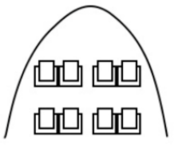
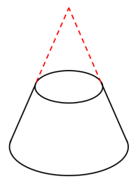
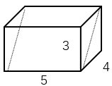
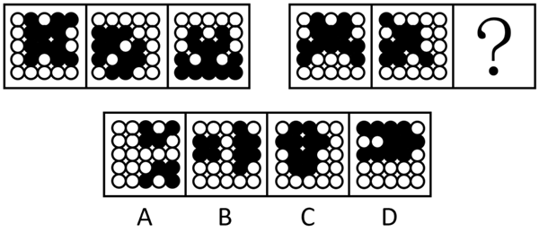
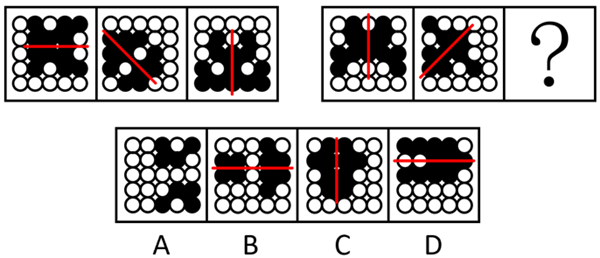
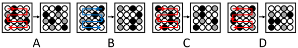
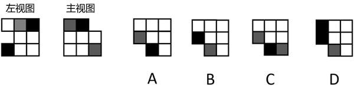
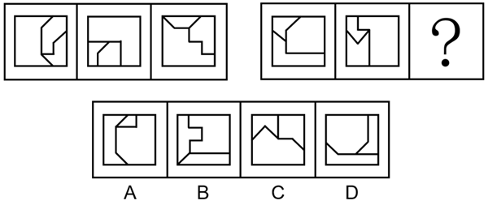
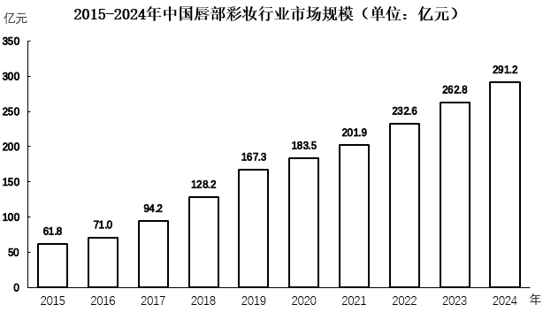

# 2026年宁夏公务员录用考试《行测》题（网友回忆版）

<!-- gwy:overview:start -->
> **宁夏 · 2026 · 行测 · 统考** ｜ 120 题 · 图片 156 处 · 答案随题折叠

| 题型模块 | 题量 | 题号 |
| --- | ---: | ---: |
| 政治理论 | 16 | 1–16 |
| 常识判断 | 17 | 17–33 |
| 言语理解与表达 | 22 | 34–55 |
| 数量关系 | 13 | 56–68 |
| 判断推理 | 32 | 69–100 |
| 资料分析 | 20 | 101–120 |
| **合计** | **120** | |

导航：[题型与作答说明](#题型与作答说明) · [题目](#题目) · [材料 1](#材料-1)
<!-- gwy:overview:end -->

> 候选采集稿。参考答案及解析来自粉笔页面，不代表官方答案或真实高分答卷；来源使用许可与原卷对应关系仍需人工核实。

## 题型与作答说明

政治理论

（16题）

根据题目要求，在四个选项中选出一个最恰当的答案。

常识判断

（17题）

根据题目要求，在四个选项中选出一个最恰当的答案。

言语理解与表达

（22题）

本部分包括表达与理解两方面的内容。请根据题目要求，在四个选项中选出一个最恰当的答案。

数量关系

（13题）

在这部分试题中，每道题呈现一段表述数字关系的文字，要求你迅速、准确地计算出答案。

判断推理

（32题）

本部分包括图形推理、定义判断、类比推理与逻辑判断四种类型的试题，在四个选项中选出一个最恰当的答案。

资料分析

（20题）

所给出的图、表、文字或综合性资料均有若干个问题要你回答。你应根据资料提供的信息进行分析、比较、计算和判断处理。

## 题目

### 第 1 题

习近平总书记强调，学习好贯彻好党的二十届四中全会精神，是当前和今后一个时期全党全国的一项重大政治任务。关于党的二十届四中全会精神，下列表述正确的是（ ）。

A. 把捍卫经济安全摆在首位，加强重点领域国家安全能力建设，突出保障事关国家长治久安、经济健康稳定、人民安居乐业的重大安全

B. 坚定不移推动高质量发展，构建以新兴产业和未来产业为骨干的现代化产业体系

C. 坚定不移扩大高水平对外开放，做强国内国际大循环，加快构建新发展格局

D. 加强普惠性、基础性、兜底性民生建设，稳步推进基本公共服务均等化

第 1 题 · 答案与解析

**参考答案（粉笔题库参考内容）**

D

**解析**

本题考查新思想。

2025年10月23日，党的二十届四中全会审议通过了《中共中央关于制定国民经济和社会发展第十五个五年规划的建议》（以下简称《建议》）。

A项错误，《建议》在：“十三、推进国家安全体系和能力现代化，建设更高水平平安中国”部分指出：“（50）加强重点领域国家安全能力建设。锻造实战实用的国家安全能力，突出保障事关国家长治久安、经济健康稳定、人民安居乐业的重大安全，把捍卫政治安全摆在首位······”故“把捍卫经济安全摆在首位”表述错误，应为“把捍卫政治安全摆在首位”。

B项错误，《建议》在“三、建设现代化产业体系，巩固壮大实体经济根基”部分指出：“······坚持把发展经济的着力点放在实体经济上，坚持智能化、绿色化、融合化方向，加快建设制造强国、质量强国、航天强国、交通强国、网络强国，保持制造业合理比重，构建以先进制造业为骨干的现代化产业体系。故“以新兴产业和未来产业为骨干”表述错误，应为“以先进制造业为骨干”。

C项错误，2026年1月1日出版的第1期《求是》杂志发表了习近平总书记的重要文章《学习好贯彻好党的二十届四中全会精神》。文章指出：“第二，加快构建新发展格局。做强国内大循环、畅通国内国际双循环，是我们把握发展主动权、塑造国际合作和竞争新优势的战略举措······坚定不移扩大高水平对外开放，维护多边贸易体制······”故“做强国内国际大循环”表述错误，应为“做强国内大循环”。

D项正确，《建议》在“十一、加大保障和改善民生力度，扎实推进全体人民共同富裕”部分指出：“实现人民对美好生活的向往是中国式现代化的出发点和落脚点。坚持尽力而为、量力而行，加强普惠性、基础性、兜底性民生建设······（44）稳步推进基本公共服务均等化。建立基本公共服务均等化评价标准，完善基本公共服务范围和内容，制定实现基本公共服务均等化的目标、路径、措施······”

故正确答案为D。

**考点**：经济建设、重要文件

**来源**：2026年贵州省公务员录用考试《行测》题（网友回忆版）第1题

### 第 2 题

总体国家安全观是建设更高水平平安中国的重要遵循，必须坚定不移贯彻。关于贯彻总体国家安全观，下列举措不恰当的是：

A. 进一步健全国家安全体系

B. 着力完善国家安全力量布局

C. 推动公共安全治理模式向着重事后整顿转型

D. 全面加强国家安全教育，筑牢国家安全人民防线

第 2 题 · 答案与解析

**参考答案（粉笔题库参考内容）**

C

**解析**

本题考查新思想。

2022年10月16日，习近平总书记在中国共产党第二十次全国代表大会上作了题为《高举中国特色社会主义伟大旗帜 为全面建设社会主义现代化国家而团结奋斗》的报告（以下简称二十大报告）。

A、B两项正确，二十大报告中的“十一、推进国家安全体系和能力现代化，坚决维护国家安全和社会稳定”部分指出：“（一）健全国家安全体系······完善国家安全力量布局，构建全域联动、立体高效的国家安全防护体系。”

C项错误，二十大报告中的“十一、推进国家安全体系和能力现代化，坚决维护国家安全和社会稳定”部分指出：“（三）提高公共安全治理水平。坚持安全第一、预防为主，建立大安全大应急框架，完善公共安全体系，推动公共安全治理模式向事前预防转型······”故“向着重事后整顿转型”表述错误，应为“向事前预防转型”。

D项正确，二十大报告中的“十一、推进国家安全体系和能力现代化，坚决维护国家安全和社会稳定”部分指出：“（二）增强维护国家安全能力······全面加强国家安全教育，提高各级领导干部统筹发展和安全能力，增强全民国家安全意识和素养，筑牢国家安全人民防线。”

本题为选非题，故正确答案为C。

**考点**：重要会议讲话、其他建设

**来源**：2026年广西区考公务员录用考试《行测》题（网友回忆版）第8题

### 第 3 题

网络生态治理是网络强国建设的重要任务，事关国家发展和安全，事关人民群众切身利益。关于健全网络生态治理长效机制，下列说法错误的是：

A. 坚持把普惠作为第一动力、把安全作为底线要求、把创新作为价值追求，高质量推进网络生态治理

B. 完善网上思想道德教育分众化、精准化实施机制，培育自尊自信、理性平和、积极向上的网络社会心态

C. 坚持以正面声音、主流价值、时代新风塑造网络空间，使互联网成为思想引领、道德培育、文化传承的重要阵地

D. 加强国际传播网络平台和能力建设，利用互联网传播中国声音、讲好中国故事，生动展现可信、可爱、可敬的中国形象

第 3 题 · 答案与解析

**参考答案（粉笔题库参考内容）**

A

**解析**

本题考查新思想。

A项错误，2024年11月20日，习近平总书记向2024年世界互联网大会乌镇峰会开幕视频致贺时指出：“我们应当把握数字化、网络化、智能化发展大势，把创新作为第一动力、把安全作为底线要求、把普惠作为价值追求，加快推动网络空间创新发展、安全发展、普惠发展，携手迈进更加美好的‘数字未来’。”故“把普惠作为第一动力”“把创新作为价值追求”表述错误，应为“把创新作为第一动力”“把普惠作为价值追求”。

B项正确，2025年11月28日下午，中共中央政治局就加强网络生态治理进行第二十三次集体学习，习近平总书记主持学习并发表重要讲话（以下简称讲话）指出：“网络生态治理是一项系统工程，要充分调动各方力量，综合运用教育、行政、法治等多种手段。要完善网上思想道德教育分众化、精准化实施机制，培育自尊自信、理性平和、积极向上的网络社会心态。”

C项正确，讲话指出：“源清则流清，要坚持以正面声音、主流价值、时代新风塑造网络空间，使互联网成为思想引领、道德培育、文化传承的重要阵地。要深化党的创新理论网上宣传，大力弘扬社会主义核心价值观，推出更多有内涵、有温度、有影响的网络作品。”

D项正确，讲话指出：“要积极参与国际规则制定，携手各国打击网络违法犯罪，推动构建网络空间命运共同体。要加强国际传播网络平台和能力建设，利用互联网传播中国声音、讲好中国故事，生动展现可信、可爱、可敬的中国形象。”

本题为选非题，故正确答案为A。

**考点**：重要会议讲话、社会建设

**来源**：2026年贵州省公务员录用考试《行测》题（网友回忆版）第3题

### 第 4 题

习近平总书记在纪念中国人民抗日战争暨世界反法西斯战争胜利80周年招待会上强调：“一时强弱在于力，千秋胜负在于理。正义、光明、进步必将战胜邪恶、黑暗、反动。”这一论述最能体现马克思主义的哪些基本观点？（ ）

①上层建筑和经济基础具有同一性

②事物的主要矛盾决定事物发展的方向

③事物的发展是前进性与曲折性的统一

④人的认识能够反映和改造世界

A. ①③

B. ②③

C. ①④

D. ③④

第 4 题 · 答案与解析

**参考答案（粉笔题库参考内容）**

B

**解析**

本题考查马克思主义。

①错误，马克思主义认为，经济基础决定上层建筑，上层建筑反作用于经济基础，二者是辩证统一的，并非简单的“具有同一性”。且题干围绕“一时强弱”与“千秋胜负”展开，强调正义、进步力量最终必胜，核心是历史发展趋势与规律问题，并未涉及社会结构中的经济基础与上层建筑的关系。

②正确，马克思主义认为，主要矛盾是指在复杂事物发展过程中处于支配地位、对事物发展起决定作用的矛盾。“一时强弱在于力”中的“力”即当下凸显的矛盾，造成一时强弱之分；而“千秋胜负在于理”中的“理”即符合历史发展规律的正义力量，是决定历史长期走向的核心因素，体现了主要矛盾对事物发展方向的决定作用。

③正确，马克思主义认为，事物发展的总趋势是前进的、上升的，但发展的道路是曲折的、迂回的，任何新事物的成长都要经历一个由弱到强的过程。题干中“一时强弱在于力”体现了事物发展的曲折性，即反动、落后势力可能在短期内凭借力量占据优势；“千秋胜负在于理”“正义、光明、进步必将战胜邪恶、黑暗、反动”则鲜明体现了历史发展的前进性和必然性。整句话既承认暂时的力量对比，又坚信长远的正义必胜，体现了事物的发展是前进性与曲折性的统一。

④错误，马克思主义认为，认识是实践基础上主体对客体的能动的反映，即认识能够反映世界，同时认识可以指导实践改造世界，但认识本身无法直接改造世界，故选项本身说法存在错误。

故②③表述正确。

故正确答案为B。

**考点**：唯物辩证法

**来源**：2026年广西区考公务员录用考试《行测》题（网友回忆版）第5题

### 第 5 题

习近平总书记指出，全面依法治国是国家治理的一场深刻革命，关系党执政兴国，关系人民幸福安康，关系党和国家长治久安。关于全面依法治国，下列说法正确的是（ ）。

①全面依法治国是中国特色社会主义的本质要求和重要保障

②全面依法治国要坚持依法治国、依法执政、依法行政共同推进

③全面依法治国要坚持法治国家、法治政府、法治社会一体建设

④全面依法治国要坚持依法治国和依规治党有机统一

A. ①②③

B. ①②④

C. ②③④

D. ①②③④

第 5 题 · 答案与解析

**参考答案（粉笔题库参考内容）**

D

**解析**

本题考查新思想。

①②③④正确，2017年10月18日，党的十九大报告在“三、新时代中国特色社会主义思想和基本方略”部分指出：“（六）坚持全面依法治国。全面依法治国是中国特色社会主义的本质要求和重要保障······坚持依法治国、依法执政、依法行政共同推进，坚持法治国家、法治政府、法治社会一体建设，坚持依法治国和以德治国相结合，依法治国和依规治党有机统一，深化司法体制改革，提高全民族法治素养和道德素质。”

故正确答案为D。

**考点**：其他建设

**来源**：2026年贵州省公务员录用考试《行测》题（网友回忆版）第6题

### 第 6 题

党的二十届四中全会提出，加快农业农村现代化，扎实推进乡村全面振兴。下列与之相关说法正确的是（ ）。

①坚持把解决好“三农”问题作为全党工作重中之重

②统筹发展科技农业、绿色农业、质量农业、品牌农业

③稳定土地承包关系，稳步推进三轮承包到期后再延长三十年试点

④因地制宜完善乡村建设实施机制，分类有序、一体化推进乡村振兴

⑤健全财政优先保障、金融重点倾斜、社会积极参与的多元投入格局，确保乡村振兴投入力度不断增强

A. ①②③

B. ①②⑤

C. ①②④⑤

D. ②③④⑤

第 6 题 · 答案与解析

**参考答案（粉笔题库参考内容）**

B

**解析**

本题考查新思想。

2025年10月23日，《中共中央关于制定国民经济和社会发展第十五个五年规划的建议》发布，以下简称《建议》。

①正确，《建议》在“八、加快农业农村现代化，扎实推进乡村全面振兴”部分指出：“坚持把解决好‘三农’问题作为全党工作重中之重，促进城乡融合发展，持续巩固拓展脱贫攻坚成果，推动农村基本具备现代生活条件，加快建设农业强国。”

②正确，③错误，《建议》在“八、加快农业农村现代化，扎实推进乡村全面振兴”部分指出：“（25）提升农业综合生产能力和质量效益。坚持产量产能、生产生态、增产增收一起抓，统筹发展科技农业、绿色农业、质量农业、品牌农业，把农业建成现代化大产业······稳定土地承包关系，稳步推进二轮承包到期后再延长三十年试点。”故③中“三轮承包”表述错误，应为“二轮承包”。

④错误，《建议》在“八、加快农业农村现代化，扎实推进乡村全面振兴”部分指出：“（26）推进宜居宜业和美乡村建设。学习运用‘千万工程’经验，因地制宜完善乡村建设实施机制，分类有序、片区化推进乡村振兴，逐步提高农村基础设施完备度、公共服务便利度、人居环境舒适度。”故“一体化”表述错误，应为“片区化”。

⑤正确，《建议》在“八、加快农业农村现代化，扎实推进乡村全面振兴”部分指出：“（27）提高强农惠农富农政策效能。健全财政优先保障、金融重点倾斜、社会积极参与的多元投入格局，确保乡村振兴投入力度不断增强。保护和调动农民务农种粮积极性，强化价格、补贴、保险等政策支持和协同。”

故①②⑤表述正确。

故正确答案为B。

**考点**：经济建设、重要文件

**来源**：2026年贵州省公务员录用考试《行测》题（网友回忆版）第2题

### 第 7 题

习近平总书记强调，“十五五”时期，必须把因地制宜发展新质生产力摆在更加突出的战略位置。下列与之相关表述正确的是（ ）。

①要统筹推进教育科技人才一体发展

②要完善国家创新体系，激发各类创新主体活力

③要在加强基础研究、提高原始创新能力上持续用力

④要全面推进传统产业转型升级、积极发展新兴产业、超前布局未来产业

A. ①②③

B. ①②④

C. ②③④

D. ①②③④

第 7 题 · 答案与解析

**参考答案（粉笔题库参考内容）**

D

**解析**

本题考查新思想。

①②③④正确，2025年4月30日，习近平总书记在上海主持召开部分省区市“十五五”时期经济社会发展座谈会并发表重要讲话强调，“十五五”时期，必须把因地制宜发展新质生产力摆在更加突出的战略位置，以科技创新为引领、以实体经济为根基，坚持全面推进传统产业转型升级、积极发展新兴产业、超前布局未来产业并举，加快建设现代化产业体系。要完善国家创新体系，激发各类创新主体活力，瞄准世界科技前沿，在加强基础研究、提高原始创新能力上持续用力，在突破关键核心技术、前沿技术上抓紧攻关。要统筹推进教育科技人才一体发展，筑牢新质生产力发展的基础性、战略性支撑。

故正确答案为D。

**考点**：经济建设、重要会议讲话

**来源**：2026年广西区考公务员录用考试《行测》题（网友回忆版）第4题

### 第 8 题

党的二十大以来，习近平总书记亲自决策部署和推动区域发展各项战略实施，擘画区域发展蓝图。下列省市与其发展方向对应不准确的是（ ）。

A. 山东——加快建设绿色低碳高质量发展先行区，打造高水平对外开放新高地

B. 湖北——要在长江经济带高质量发展中奋勇争先，加快建成中部地区崛起的重要战略支点

C. 重庆——主动服务和融入新发展格局，奋力打造新时代西部大开发重要战略支点、内陆开放综合枢纽

D. 河南——在打造国家重要先进制造业高地、具有核心竞争力的科技创新高地、内陆地区改革开放高地上持续用力

第 8 题 · 答案与解析

**参考答案（粉笔题库参考内容）**

D

**解析**

本题考查新思想。

A项正确，2024年5月22日至24日，习近平总书记在山东考察时强调，山东要在全国发展大局中定好位、挑大梁，完整准确全面贯彻新发展理念，以进一步全面深化改革为动力，继续在服务和融入新发展格局上走在前、在增强经济社会发展创新力上走在前、在推动黄河流域生态保护和高质量发展上走在前，加快建设绿色低碳高质量发展先行区，打造高水平对外开放新高地，奋力谱写中国式现代化山东篇章。

B项正确，2024年11月4日至6日，习近平总书记在湖北考察时强调，湖北要深入贯彻党的二十大和二十届三中全会精神，坚持稳中求进工作总基调，牢牢把握在构建新发展格局中的使命任务，充分发挥自身优势，鼓足干劲、奋发进取，久久为功、善作善成，在长江经济带高质量发展中奋勇争先，加快建成中部地区崛起的重要战略支点，奋力谱写中国式现代化湖北篇章。

C项正确，2024年4月22日至24日，习近平总书记在重庆考察时强调，重庆要对标新时代新征程党的中心任务和党中央赋予的使命，充分发挥比较优势、后发优势，进一步全面深化改革开放，主动服务和融入新发展格局，着力推动高质量发展，奋力打造新时代西部大开发重要战略支点、内陆开放综合枢纽，在发挥“三个作用”上展现更大作为，不断谱写中国式现代化重庆篇章。

D项错误，2024年3月18日至21日，习近平总书记在湖南考察时强调，湖南要牢牢把握自身在构建新发展格局中的战略定位，坚持稳中求进工作总基调，坚持高质量发展不动摇，坚持改革创新、求真务实，在打造国家重要先进制造业高地、具有核心竞争力的科技创新高地、内陆地区改革开放高地上持续用力，在推动中部地区崛起和长江经济带发展中奋勇争先，奋力谱写中国式现代化湖南篇章。2025年5月19日至20日，习近平总书记在河南考察时强调，河南要认真落实党中央关于中部地区加快崛起、黄河流域生态保护和高质量发展等战略部署，坚持稳中求进工作总基调，全面深化改革开放，着力建设现代化产业体系和农业强省，着力改善民生、加强社会治理，着力加强生态环境保护，着力推动文化繁荣兴盛，以高质量发展和高效能治理奋力谱写中原大地推进中国式现代化新篇章。故“在打造国家重要先进制造业高地、具有核心竞争力的科技创新高地、内陆地区改革开放高地上持续用力”对应的省份应为湖南，而非河南。

本题为选非题，故正确答案为D。

**考点**：经济建设、重要会议讲话

**来源**：2026年福建省公务员录用考试《行测》题（网友回忆版）第11题

### 第 9 题

2025年底，中共中央政治局召开民主生活会强调，锲而不舍落实中央八项规定精神，以优良作风凝心聚力真抓实干。关于作风问题，下列说法不准确的是（ ）。

A. 作风问题核心是党同人民群众的关系问题

B. 党强大的人格力量集中体现为党的优良作风

C. 透过党性看作风，在解决党性问题的基础上解决好作风问题

D. 抓作风建设，重点突出坚定理想信念、践行根本宗旨、加强道德修养

第 9 题 · 答案与解析

**参考答案（粉笔题库参考内容）**

C

**解析**

本题考查新思想。

2025年3月，中共中央党史和文献研究院编辑的《习近平关于加强党的作风建设论述摘编》出版发行，以下简称《论述摘编》。

A项正确，《论述摘编》中“三、作风问题核心是党同人民群众的关系问题”部分指出：“作风问题核心是党同人民群众的关系问题。马克思主义政党执政后特别是长期执政后的最大危险是脱离群众。”

B项正确，《论述摘编》中“一、党的作风关系人心向背，决定党和国家事业成败”部分指出：“我们党作为马克思主义执政党，不但要有强大的真理力量，而且要有强大的人格力量。真理力量集中体现为我们党的正确理论，人格力量集中体现为我们党的优良作风。”

C项错误，《论述摘编》中“二、作风问题本质上是党性问题”部分指出：“我们改进作风，不能简单就事论事，以为把眼前存在的作风问题从面上解决了就万事大吉了，而是要举一反三，透过作风看党性，在解决作风问题的基础上解决好党性问题。”故“透过党性看作风”说法错误，应为“透过作风看党性”。

D项正确，《论述摘编》中“二、作风问题本质上是党性问题”部分指出：“作风问题本质上是党性问题。抓作风建设，就要返璞归真、固本培元，重点突出坚定理想信念、践行根本宗旨、加强道德修养。”

本题为选非题，故正确答案为C。

**考点**：其他建设

**来源**：2026年贵州省公务员录用考试《行测》题（网友回忆版）第9题

### 第 10 题

高质量发展是全面建设社会主义现代化国家的首要任务。下列对高质量发展核心要求的理解，正确的有几项？

①高质量发展当然要做大蛋糕，但它同时要求分好蛋糕

②高质量发展意味着可以暂时容忍一定程度的环境污染以换取发展空间

③高质量发展不仅仅是对经济领域的要求，也包括社会、文化、生态等各个领域

④推动经济社会发展绿色化、低碳化是实现高质量发展的关键环节

A. 1项

B. 2项

C. 3项

D. 4项

第 10 题 · 答案与解析

**参考答案（粉笔题库参考内容）**

C

**解析**

本题考查新思想。

①正确，2022年1月17日，习近平总书记在2022年世界经济论坛视频会议上发表题为《坚定信心 勇毅前行 共创后疫情时代美好世界》的演讲中指出：“中国要实现共同富裕，但不是搞平均主义，而是要先把‘蛋糕’做大，然后通过合理的制度安排把‘蛋糕’分好，水涨船高、各得其所，让发展成果更多更公平惠及全体人民。”

②错误，2013年5月24日，中共中央政治局就大力推进生态文明建设进行第六次集体学习，习近平总书记强调：“要正确处理好经济发展同生态环境保护的关系，牢固树立保护生态环境就是保护生产力、改善生态环境就是发展生产力的理念，更加自觉地推动绿色发展、循环发展、低碳发展，决不以牺牲环境为代价去换取一时的经济增长。”故“可以暂时容忍一定程度的环境污染以换取发展空间”说法错误，应为“决不以牺牲环境为代价去换取一时的经济增长”。

③正确，2021年，习近平总书记参加十三届全国人大四次会议青海代表团审议时强调：“高质量发展不只是一个经济要求，而是对经济社会发展方方面面的总要求；不是只对经济发达地区的要求，而是所有地区发展都必须贯彻的要求；不是一时一事的要求，而是必须长期坚持的要求。”

④正确，党的二十大报告中“十、推动绿色发展，促进人与自然和谐共生”部分指出：“（一）加快发展方式绿色转型。推动经济社会发展绿色化、低碳化是实现高质量发展的关键环节。”

综上，①③④表述正确，共3项。

故正确答案为C。

**考点**：经济建设

**来源**：2026年广西区考公务员录用考试《行测》题（网友回忆版）第6题

### 第 11 题

发展全过程人民民主是中国式现代化的本质要求。关于发展全过程人民民主，下列说法不正确的有几项？（ ）

①人民政协要坚持新时代中国特色社会主义思想这个统揽政协工作的总纲

②党外人士要牢牢把握中国共产党领导这个中国新型政党制度的根本特征

③把不断巩固团结奋斗的共同思想政治基础作为新时代党的民族工作主线

④“三重一大”决策制度作为党的领导制度，必须在领导班子议事决策中全面贯彻

A. 1项

B. 2项

C. 3项

D. 4项

第 11 题 · 答案与解析

**参考答案（粉笔题库参考内容）**

A

**解析**

本题考查新思想。

①正确，2025年3月4日，《中国人民政治协商会议全国委员会常务委员会工作报告》中“一、2024年主要工作”部分指出：“（一）坚持用习近平新时代中国特色社会主义思想凝心铸魂，夯实团结奋斗的共同思想政治基础。我们把习近平新时代中国特色社会主义思想作为统揽政协工作的总纲······”

②正确，2025年1月20日，习近平总书记在人民大会堂同各民主党派中央、全国工商联负责人和无党派人士代表欢聚一堂，共迎佳节。习近平总书记指出：“一是提高政治站位，进一步画好同心圆。牢牢把握中国共产党领导这个中国新型政党制度的根本特征，深入学习新时代中国特色社会主义思想，多做强信心、聚民心、暖人心、筑同心的工作，切实把各方面积极因素转化为发展成效。”

③错误，2021年8月27日至28日，中央民族工作会议在北京召开，习近平总书记出席会议并发表重要讲话强调：“做好新时代党的民族工作，要把铸牢中华民族共同体意识作为党的民族工作的主线。铸牢中华民族共同体意识，就是要引导各族人民牢固树立休戚与共、荣辱与共、生死与共、命运与共的共同体理念。”故“不断巩固团结奋斗的共同思想政治基础”说法错误，应为“把铸牢中华民族共同体意识”。

④正确，“三重一大”最早源于1996年第十四届中央纪委第六次全会公报，对党员领导干部在政治纪律方面提出的四条要求的第二条纪律要求。具体表述如下：认真贯彻民主集中制原则，凡属重大决策、重要干部任免、重要项目安排和大额度资金的使用，必须经集体讨论作出决定。“三重一大”决策制度是民主集中制的重要体现，而民主集中制是党的根本组织原则和领导制度，故“三重一大”决策制度是党的领导制度，必须在领导班子议事决策中全面贯彻。

故③表述错误，共1项。

故正确答案为A。

**考点**：政治建设、重要文件

**来源**：2026年河南省公务员录用考试《行测》题（网友回忆版）第86题

### 第 12 题

粉笔暂未收录本题（来源缺题，题位保留）

第 12 题 · 答案与解析

**答案状态：unknown（来源未提供）**

**解析状态：unknown（来源未提供）**

### 第 13 题

下列关于宁夏“十五五”规划说法错误的是：

A. 建设普惠便捷的数字社会，推动公共服务、社会治理、应急管理等智能化升级

B. 全面实施“人工智能+”行动，以人工智能引领科研范式变革

C. 加强人工智能同产业发展、文化建设、民生保障、社会治理相结合

D. 高标准建设银川数据中心集群，提升园区综合配套和服务保障能级

第 13 题 · 答案与解析

**参考答案（粉笔题库参考内容）**

D

**解析**

本题考查时事政治。

2025年11月16日，中国共产党宁夏回族自治区第十三届委员会第十一次全体会议通过《中共宁夏回族自治区委员会关于制定国民经济和社会发展第十五个五年规划的建议》（以下简称《建议》）。

A项正确，《建议》指出：“22.全面提升数字治理效能。建设智慧高效的数字政府，打破信息壁垒，推进政务服务优化升级。建设普惠便捷的数字社会，推动公共服务、社会治理、应急管理等智能化升级。”

B、C两项正确，《建议》指出：“20.促进人工智能创新发展。落实数据要素基础制度，加强数据基础设施和高质量数据集建设，融入和服务全国一体化数据市场，强化算力、算法、数据等高效供给，夯实人工智能发展底座。全面实施‘人工智能+’行动，以人工智能引领科研范式变革，加强人工智能同产业发展、文化建设、民生保障、社会治理相结合。”

D项错误，《建议》指出：“19.提升数字产业化能级。高标准建设中卫数据中心集群，提升园区综合配套和服务保障能级。统筹以智能算力为重点的算力布局，推动绿色电力与算力协同发展。”故“银川”应为“中卫”。

本题为选非题，故正确答案为D。

**来源**：2026年宁夏公务员录用考试《行测》题（网友回忆版）第13题

### 第 14 题

关于宁夏政府工作报告中提出着力加强生态保护治理，在全面促进绿色低碳发展上开新局，下列说法错误的是：

A. 深入系统打好蓝天碧水净土保卫战

B. 持续加力打好黄河“几字弯”攻坚战

C. 积极稳妥打好碳达峰碳中和整体战

D. 缺失

第 14 题 · 答案与解析

**参考答案（粉笔题库参考内容）**

D

**解析**

本题考查时事政治。

2026年2月3日在宁夏回族自治区第十三届人民代表大会第四次会议上通过《2026年宁夏回族自治区政府工作报告》（以下简称《报告》）。

A项正确，《报告》指出：“一是深入系统打好蓝天碧水净土保卫战。实施新一轮空气质量持续改善行动，以减少重污染天气和解决大气环保突出问题为重点，加力推进‘四源同治’，全面提升大气环境治理能力和治理成效。”

B项正确，《报告》指出：“二是持续加力打好黄河‘几字弯’攻坚战。全面落实国家‘三北’工程总体规划赋予宁夏的各项任务，重点实施毛乌素沙化土地、宁夏南部生态保护修复与水土流失等综合治理工程，黄河‘几字弯’攻坚战完成规划任务85%以上。”

C项正确，《报告》指出：“三是积极稳妥打好碳达峰碳中和整体战。落实碳排放总量和强度双控制度，制定‘十五五’碳达峰实施方案，推动经济社会发展全面绿色转型。”

D项错误，略

本题为选非题，故正确答案为D。

**来源**：2026年宁夏公务员录用考试《行测》题（网友回忆版）第14题

### 第 15 题

习近平总书记强调，要站在推进强国建设、民族复兴伟业的战略高度，推动我国未来产业发展不断取得新突破。关于推动我国未来产业发展，下列举措不恰当的有几项？（ ）

①要综合考虑国家战略需求、技术成熟程度、要素支撑条件等因素，发挥优势、同步发展

②要发挥政府主体作用，推动各类创新资源向企业集聚

③要充分发挥新型举国体制优势，坚持“产业出题、科技答题”

④要统筹发展和安全，探索科学有效的监管方式，防范相关风险，确保既“放得活”又“管得好”

A. 1项

B. 2项

C. 3项

D. 4项

第 15 题 · 答案与解析

**参考答案（粉笔题库参考内容）**

B

**解析**

本题考查新思想。

2026年1月30日下午，中共中央政治局就前瞻布局和发展未来产业进行第二十四次集体学习。习近平总书记在听取讲解和讨论后发表重要讲话。

①错误，习近平总书记强调：“要聚焦‘十五五’时期我国未来产业发展的主攻方向，科学论证技术路线，提升前沿技术战略预判能力。要综合考虑国家战略需求、技术成熟程度、要素支撑条件等因素，因地制宜、错位发展。要强化产业协同，推动未来产业同新兴产业、传统产业相得益彰。”故“发挥优势、同步发展”表述错误，应为“因地制宜、错位发展”。

②错误，习近平总书记强调：“很多未来产业的兴起是靠企业一步步突破带动的。要发挥企业主体作用，推动各类创新资源向企业集聚，大力培育核心技术领先、创新能力强的科技领军企业和高新技术企业，引领带动产业向前沿和高端领域迈进。”故“要发挥政府主体作用”表述错误，应为“要发挥企业主体作用”。

③正确，习近平总书记指出：“科技突破的程度，很大程度上决定未来产业发展的速度、广度、深度。要充分发挥新型举国体制优势，坚持‘产业出题、科技答题’，加大重点领域关键核心技术攻关力度，加强基础研究战略性、前瞻性、体系化布局，加快科技成果转化应用。”

④正确，习近平总书记强调：“未来产业发展涉及面广，必须健全治理体系。要统筹发展和安全，探索科学有效的监管方式，防范相关风险，确保既‘放得活’又‘管得好’。要深化国际合作，积极推动各方标准共建、规则共商、产业共促。各级领导干部要加强科技前沿知识学习，努力做到知科技、懂产业、善决策。”

综上，①②表述错误，共2项。

故正确答案为B。

**考点**：经济建设、重要会议讲话

**来源**：2026年河南省公务员录用考试《行测》题（网友回忆版）第80题

### 第 16 题

习近平总书记指出，在长期实践中，中国和中亚国家探索形成了“互尊、互信、互利、互助，以高质量发展推进共同现代化”的“中国—中亚精神”。下列属于其独特精神内涵的是（ ）。

①坚持相互尊重、平等相待，国家不分大小一视同仁，有事大家商量着办，协商一致作决策

②坚持互利共赢、共同发展，互为优先伙伴，互予发展机遇，兼顾各方利益，实现多赢共生

③坚持普惠包容、和谐共生，中国将大力支持中亚国家能源绿色低碳发展，不再新建境外煤电项目

④坚持深化互信、同声相应，坚定支持彼此维护国家独立、主权、领土完整和民族尊严，不做任何损害彼此核心利益的事

⑤坚持守望相助、同舟共济，支持彼此走符合国情的发展道路，办好自己的事情，合力应对各类风险挑战，共同维护地区安全稳定

A. ①②④

B. ①②④⑤

C. ①③④⑤

D. ②③④⑤

第 16 题 · 答案与解析

**参考答案（粉笔题库参考内容）**

B

**解析**

本题考查新思想。

①②④⑤正确，③错误，当地时间2025年6月17日下午，第二届中国—中亚峰会在阿斯塔纳独立宫举行。中国国家主席习近平在发表主旨发言时表示，在长期实践中，我们探索形成了“互尊、互信、互利、互助，以高质量发展推进共同现代化”的“中国—中亚精神”：坚持相互尊重、平等相待，国家不分大小一视同仁，有事大家商量着办，协商一致作决策；坚持深化互信、同声相应，坚定支持彼此维护国家独立、主权、领土完整和民族尊严，不做任何损害彼此核心利益的事；坚持互利共赢、共同发展，互为优先伙伴，互予发展机遇，兼顾各方利益，实现多赢共生；坚持守望相助、同舟共济，支持彼此走符合国情的发展道路，办好自己的事情，合力应对各类风险挑战，共同维护地区安全稳定。

故正确答案为B。

**考点**：重要会议讲话、其他建设

**来源**：2026年贵州省公务员录用考试《行测》题（网友回忆版）第4题

### 第 17 题

下列诗句描述的现象与气象变化对应错误的是：

A. 雨中百草秋烂死，阶下决明颜色鲜——软雹

B. 白雪却嫌春色晚，故穿庭树作飞花——倒春寒

C. 风驱急雨洒高城，云压轻雷殷地声——雷阵雨

D. 北风卷地白草折，胡天八月即飞雪——冷锋过境

第 17 题 · 答案与解析

**参考答案（粉笔题库参考内容）**

A

**解析**

本题考查地理国情。

A项错误，“雨中百草秋烂死，阶下决明颜色鲜”出自唐代杜甫的《秋雨叹三首·其一》，意思是秋雨连绵百草烂死，台阶下的决明却颜色正鲜。诗句中秋雨现象主要由冷锋活动引起。当北方冷空气南下时，与较暖湿的空气相遇，冷空气迫使暖湿空气抬升，形成云系和降水。故诗句描写的气象变化是连绵秋雨，不是软雹。

B项正确，“白雪却嫌春色晚，故穿庭树作飞花”出自唐代韩愈的《春雪》，意思是白雪也嫌春色来得太晚了，所以有意化作花儿在庭院树间穿飞。诗句中描写的这种春季气温偏低、出现降雪或霜冻的天气，是典型的倒春寒。

C项正确，“风驱急雨洒高城，云压轻雷殷地声”出自明代刘基的《五月十九日大雨》，意思是疾风驱使着骤雨瞬间洒落高城，乌云密布，雷声滚滚，大地仿佛都在震动。故诗句描写的是夏季典型的雷阵雨天气。

D项正确，“北风卷地白草折，胡天八月即飞雪”出自唐代岑参的《白雪歌送武判官归京》，意思是北风席卷大地把白草吹折，胡地天气八月就纷扬落雪。北风带来寒冷空气，使气温骤降并出现降雪，这是冷锋过境的典型表现。

本题为选非题，故正确答案为A。

**考点**：自然地理

**来源**：2026年贵州省公务员录用考试《行测》题（网友回忆版）第11题

### 第 18 题

下列关于亚洲的地理知识说法错误的是（ ）。

A. 东亚地区没有内陆国家

B. 东南亚跨南、北两个半球

C. 中亚地区以大陆性气候为主

D. 古巴比伦文明产生在西亚地区

第 18 题 · 答案与解析

**参考答案（粉笔题库参考内容）**

A

**解析**

本题考查地理国情。

A项错误，东亚包括中国、日本、韩国、朝鲜、蒙古五个国家，其中蒙古是无出海口、完全被陆地包围的内陆国家（被中国与俄罗斯包围），同时蒙古国也是世界上第二大的内陆国。

B项正确，东南亚由中南半岛和马来群岛两大部分组成，赤道横穿马来群岛中部，因此东南亚地跨南、北两个半球，该区域同时还地跨太平洋与印度洋两大核心大洋，是亚洲海上交通的关键枢纽。

C项正确，中亚深居亚欧大陆内部，远离海洋，海洋湿润气流难以抵达，区域内以温带大陆性气候为主，核心气候特征为干旱少雨、气温年较差与日较差大，也造就了区域内以内流河、内流湖为主的水文特征。

D项正确，古巴比伦文明是世界四大古文明之一，发源于西亚的两河流域（幼发拉底河、底格里斯河）之间的冲积平原（美索不达米亚），该区域核心在今伊拉克境内，属于西亚核心地带。

本题为选非题，故正确答案为A。

**考点**：世界地理

**来源**：2026年广西区考公务员录用考试《行测》题（网友回忆版）第20题

### 第 19 题

下列与电有关说法正确的是（ ）。

A. 风力发电利用了电磁感应原理，水力发电没有

B. 电动机是能够把电能转换成机械能的一种装置

C. 微波炉加热食品是电流的热效应在生活中的应用

D. “摩擦生电”是因为在两个物体间产生了新的电荷

第 19 题 · 答案与解析

**参考答案（粉笔题库参考内容）**

B

**解析**

本题考查科技常识。

A项错误，风力发电是利用风机叶片转动带动发电机转子切割磁力线，从而产生感应电流，其基本原理是电磁感应；水力发电同样是利用水流推动水轮机转动，带动发电机转子切割磁力线产生感应电流，同样基于电磁感应原理。因此，风力发电和水力发电都利用了电磁感应原理。

B项正确，电动机是一种能够将电能转化为机械能的装置，其工作原理是通电导体在磁场中受到力的作用而运动，从而输出机械能。

C项错误，微波炉加热食品是利用微波（一种电磁波）使食物中的水分子和脂肪分子高速振动、相互摩擦而产生热量，这属于电磁能向热能的转化；电流的热效应是指电流通过导体时使导体发热的现象（如电炉、电热毯），微波炉不属于电流的热效应在生活中的应用。

D项错误，“摩擦生电”的本质是两种不同材料相互摩擦时，电子从一个物体转移到另一个物体，使一个物体带正电、另一个物体带负电，这是电荷的转移过程，而非“产生了新的电荷”。电荷既不能创造也不能消灭，只能从一个物体转移到另一个物体。

故正确答案为B。

**考点**：物理常识

**来源**：2026年贵州省公务员录用考试《行测》题（网友回忆版）第12题

### 第 20 题

诉讼时效是指权利人能行使权利而不行使，经过法律规定的时间，便丧失了请求法院强制义务人履行义务的权利的时效制度。下列请求权中，适用诉讼时效的是：

A. 公司请求未履行出资义务的股东缴纳其认缴的注册资本

B. 普通动产的所有权人要求无权占有人返还原物的请求权

C. 小区业主委员会请求业主补交欠交的住宅专项维修资金

D. 名誉权受到侵害，受害人请求行为人停止侵害、恢复名誉

第 20 题 · 答案与解析

**参考答案（粉笔题库参考内容）**

B

**解析**

本题考查法律常识。

A项错误，根据《最高人民法院关于适用<中华人民共和国公司法>若干问题的规定（三）》第十九条第一款规定：“公司股东未履行或者未全面履行出资义务或者抽逃出资，公司或者其他股东请求其向公司全面履行出资义务或者返还出资，被告股东以诉讼时效为由进行抗辩的，人民法院不予支持。”因此，公司请求未履行出资义务的股东缴纳其认缴的注册资本的请求权不适用诉讼时效。

B项正确，根据《中华人民共和国民法典》第一百九十六条第二项规定：“下列请求权不适用诉讼时效的规定：（二）不动产物权和登记的动产物权的权利人请求返还财产；”因此，只有登记的动产物权的权利人请求返还财产不适用诉讼时效，普通动产的所有权人要求无权占有人返还原物的请求权适用诉讼时效。

C项错误，根据《中华人民共和国民法典》第二百八十一条第一款规定：“建筑物及其附属设施的维修资金，属于业主共有。经业主共同决定，可以用于电梯、屋顶、外墙、无障碍设施等共有部分的维修、更新和改造。建筑物及其附属设施的维修资金的筹集、使用情况应当定期公布。”因此，维修资金属于业主共有财产，交纳维修资金是业主基于业主身份必须履行的法定义务，目的是维持“建筑物区分所有权”这一共同体的存续基础，若允许以诉讼时效抗辩，将导致“未交者长期受益、已交者受损”，违背了民法典的公平原则。因此，小区业主委员会请求业主补交欠交的住宅专项维修资金的请求权，因维修资金涉及公共利益和共有义务，不适用诉讼时效。

D项错误，根据《中华人民共和国民法典》第九百九十五条规定：“人格权受到侵害的，受害人有权依照本法和其他法律的规定请求行为人承担民事责任。受害人的停止侵害、排除妨碍、消除危险、消除影响、恢复名誉、赔礼道歉请求权，不适用诉讼时效的规定。”

故正确答案为B。

**考点**：民法典

**来源**：2026年广西区考公务员录用考试《行测》题（网友回忆版）第15题

### 第 21 题

下列李白所作诗句描述的名山与现在我国的地理分区对应错误的是（ ）。

A. 西上太白峰，夕阳穷登攀——西北地区

B. 我有万古宅，嵩阳玉女峰——华中地区

C. 日照香炉生紫烟，遥看瀑布挂前川——华东地区

D. 衡山苍苍入紫冥，下看南极老人星——华南地区

第 21 题 · 答案与解析

**参考答案（粉笔题库参考内容）**

D

**解析**

本题考查地理国情。

A项正确，“西上太白峰，夕阳穷登攀”出自唐代李白的《登太白峰》，意思是向西攀登太白峰，在日落时分才登上峰巅。诗句中的“太白峰”即太白山，又称太乙山、太一山，是秦岭山脉的主峰，位于陕西省宝鸡市眉县、太白县、周至县交界处，按照通用行政地理分区标准，陕西省属于西北五省之一（陕、甘、宁、青、新）。

B项正确，“我有万古宅，嵩阳玉女峰”出自唐代李白的《送杨山人归嵩山》，意思是我有万古不坏的仙宅，那就是嵩山之阳的玉女峰。诗句中“嵩阳”指嵩山之南；“玉女峰”为嵩山支脉太皇山二十四峰之一，因峰北有石如女而得此名。嵩山主体位于河南省登封市境内，按照通用分区标准，河南省属于华中三省之一（豫、鄂、湘）。

C项正确，“日照香炉生紫烟，遥看瀑布挂前川”出自唐代李白的《望庐山瀑布》，意思是太阳照耀香炉峰生出袅袅紫烟，远远望去瀑布像长河悬挂山前。诗句描述的主体是庐山，位于江西省九江市庐山市境内，按照通用分区标准，江西省属于华东七省一市之一（上海、江苏、浙江、安徽、福建、江西、山东与台湾）。

D项错误，“衡山苍苍入紫冥，下看南极老人星”出自唐代李白的《与诸公送陈郎将归衡阳》，意思是衡山在夜色的天空下愈发苍翠，从山上俯视着南方升起的老人星。诗句描述的主体是衡山，位于湖南省衡阳市南岳区境内，按照通用分区标准，湖南省属于华中三省之一（豫、鄂、湘）。

本题为选非题，故正确答案为D。

**考点**：中国地理

**来源**：2026年贵州省公务员录用考试《行测》题（网友回忆版）第13题

### 第 22 题

关于我国航空探月技术，下列说法错误的是（ ）。

A. 空间站的温控系统采用流体回路以使温度保持适宜

B. 嫦娥五号在月表展示的国旗采用有机刚性纤维制成

C. 嫦娥四号的“腿”所用“嫦娥钢”兼具至刚至柔特性

D. 鹊桥二号中继星采用前所未有的环月大椭圆冻结轨道

第 22 题 · 答案与解析

**参考答案（粉笔题库参考内容）**

B

**解析**

本题考查科技常识。

A项正确，中国空间站在太空运行时，会面临极端温差环境，向阳面温度极高、背阳面温度极低，为保证舱内设备与航天员适宜的工作生活温度，空间站采用了流体回路温控系统。该系统通过特殊导热流体在管路内循环流动，均匀收集、传递和散发热量，配合辐射散热、主动控温等技术，实现全舱段温度精准稳定调控，确保各类科学实验设备正常运转、航天员生命安全得到可靠保障，是空间站长期在轨运行的关键温控技术之一。

B项错误，2020年11月24日，长征五号遥五运载火箭搭载嫦娥五号探测器成功发射升空并将其送入预定轨道。嫦娥五号搭载并在月球表面成功展示的国旗，是我国首次在月表实现独立展示的国旗。这面国旗主要采用国产高性能芳纶纤维材料，该面料在极端紫外条件下展现出优良的耐日晒牢度，同时从根本上解决了极端条件下颜料热升华及热迁移牢度的问题。故“有机刚性纤维”表述错误，应为“高性能芳纶纤维”。

C项正确，嫦娥四号是中国探月工程二期发射的月球探测器，也是人类第一个着陆月球背面的探测器。嫦娥四号着陆器于2019年1月3日在月球背面预选区着陆，其着陆缓冲机构，也就是俗称的“腿”，采用了特制的“嫦娥钢”合金材料。这种特种钢材同时具备极高的结构强度与优异的韧性，即“至刚至柔”特性，“刚”可保证着陆支撑结构稳定可靠，“柔”能在着陆瞬间有效吸收巨大冲击能量，大幅降低着陆器与月面接触时的震动与损伤，为软着陆全过程提供关键安全保障。

D项正确，2024年3月20日8时31分，鹊桥二号中继卫星由长征八号遥三运载火箭在中国文昌航天发射场成功发射升空。鹊桥二号中继星采用环月大椭圆冻结轨道作为使命轨道，这是中国探月工程中首次使用该类型轨道。由于月球外形结构不规则，靠近月球飞行的航天器受到月球引力等因素作用，飞行轨道易产生偏差。环月大椭圆冻结轨道是处于稳定状态的环月轨道，航天器在该轨道飞行，能够使飞行轨道的偏差最小化。选择环月大椭圆冻结轨道作为使命轨道，不仅能提高鹊桥二号的通信速率，大幅提高对月球南极区域的通信覆盖能力，还可以节省卫星燃料，让鹊桥二号可以在该轨道上长期驻留。

本题为选非题，故正确答案为B。

**考点**：科技理论与成就

**来源**：2026年贵州省公务员录用考试《行测》题（网友回忆版）第15题

### 第 23 题

水是生命之源、生态之基、生产之要，更是文明之本，在中华民族的文明发展史上，水始终占据着特殊的地位。下列与水有关的说法错误的是：

A. 《尚书·禹贡》是与河流密切相关的著作

B. “兵无常势，水无常形”是孙武论兵的名言

C. “坎坎伐檀兮，置之河之干兮”出自《诗经》

D. 最早提出“水能载舟、亦能覆舟”的是唐太宗

第 23 题 · 答案与解析

**参考答案（粉笔题库参考内容）**

D

**解析**

本题考查人文常识。

A项正确，《尚书·禹贡》是中国古代地理学的重要文献，被认为是第一篇具有系统性地理观念的著作，《禹贡》以自然地理实体（山脉、河流等）为标志，将全国划分为9个区（即九州），并对每区（州）的疆域、山脉、河流、植被、土壤、物产、贡赋、少数民族、交通等自然和人文地理现象作了简要描述。此外，《禹贡》还分述了导山、导水、水功和以京都为中心的五服制度，其内容与河流密切相关。

B项正确，“兵无常势，水无常形”出自《孙子·虚实篇》，意思是用兵作战要根据敌情的变化来采取灵活机动的战略战术，不能墨守某种作战方法。

C项正确，“坎坎伐檀兮，置之河之干兮”出自《诗经·伐檀》，意思是砍伐檀树声坎坎啊，把砍到的檀树一棵棵堆放在河边。

D项错误，“水能载舟、亦能覆舟”最早出自于战国时期荀子及其弟子所著的《荀子·王制》，内容是：“《传》曰：‘君者，舟也；庶人者，水也。水则载舟，水则覆舟’。”后世据此典故引申出成语“水能载舟，亦能覆舟”。贞观六年，唐太宗与群臣论治国之道，提出：“天子者，有道则人推而为主，无道则人弃而不用，诚可畏也。”魏征接着说道：“臣又闻古语云：君，舟也；人，水也。水能载舟，亦能覆舟。陛下以为可畏，诚如圣旨。”

本题为选非题，故正确答案为D。

**考点**：文学常识

**来源**：2026年贵州省公务员录用考试《行测》题（网友回忆版）第14题

### 第 24 题

下列关于故宫牌匾记载不正确的是：

A. “皇建有极”出自《尚书·洪范》

B. “正大光明”悬挂于太和殿内

C. “无为”体现了道家思想

D. “中正仁和”是雍正皇帝所书

第 24 题 · 答案与解析

**参考答案（粉笔题库参考内容）**

B

**解析**

本题考查人文常识。

A项正确，“皇建有极”为保和殿匾额，系乾隆御笔，语出《尚书・周书・洪范》“皇建其有极”，意为天子当建立天下最高准则，施政须遵循中道、不偏不倚。外朝三大殿中，太和殿“建极绥猷”、中和殿“允执厥中”与保和殿“皇建有极”一脉相承，皆典出儒家经书。

B项错误，“正大光明”匾实际悬挂于内廷乾清宫而非外朝太和殿，系清入关首帝顺治帝御笔题写，自雍正朝起，秘密立储的“建储匣”便藏于匾后，是清代皇位继承制度的重要见证。而太和殿宝座上方所悬实为乾隆御笔“建极绥猷”匾。

C项正确，“无为”匾位于交泰殿，为康熙帝御题、乾隆帝御笔恭摹，其思想源于老子《道德经》“道常无为而无不为”之论，康熙题此匾意在告诫帝王顺应天道、体恤民情、与民休息，体现了道家“无为而治”的思想。

D项正确，“中正仁和”匾悬挂于养心殿，系雍正帝御笔亲书，四字意为帝王应中庸正直、仁爱和谐，是雍正以儒家中和之道自勉的座右铭。养心殿自雍正朝起成为皇帝日常起居、批阅奏章之所，此匾与殿宇的功能地位相符。

本题为选非题，故正确答案为B。

**考点**：文化常识

**来源**：2026年宁夏公务员录用考试《行测》题（网友回忆版）第24题

### 第 25 题

下列关于鸦片战争和第二次鸦片战争说法错误的是：

A. 鸦片战争是英、法两国联合发动的侵略战争

B. 电影《火烧圆明园》以第二次鸦片战争为背景

C. 第二次鸦片战争迫使清政府签订了《天津条约》

D. “三元里前声若雷，千众万众同时来”与鸦片战争有关

第 25 题 · 答案与解析

**参考答案（粉笔题库参考内容）**

A

**解析**

本题考查人文常识。

A项错误，1840年，英国为扭转对华贸易逆差，向中国走私鸦片，林则徐虎门销烟成为战争借口，英国发动鸦片战争；1856-1860年，英法等国为进一步打开中国市场、扩大侵略权益，以“修约”被拒为借口，发动第二次鸦片战争。故英、法两国联合发动鸦片战争表述错误，鸦片战争（第一次鸦片战争）是英国单独发动的。

B项正确，火烧圆明园发生在第二次鸦片战争期间，1860年，英法联军攻占北京，抢劫并焚毁圆明园。电影《火烧圆明园》正是以第二次鸦片战争为背景。

C项正确，第二次鸦片战争中，清政府被迫与英、法、俄、美四国签订《天津条约》；与英国、法国、俄国签订《北京条约》等。

D项正确，选项诗句出自清代爱国诗人张维屏的七言古诗《三元里》，写于1841年，歌颂三元里抗英斗争。诗句意思为：“三元里村前，民众呐喊声如雷鸣，成千上万的人从各处一同赶来，奋起反抗英国侵略者。”第一次鸦片战争期间，英军在广州三元里一带骚扰作恶，激起民众反抗，三元里人民自发组织起来围歼英军，是近代中国第一次大规模民间反侵略斗争。

本题为选非题，故正确答案为A。

**考点**：中国历史

**来源**：2026年贵州省公务员录用考试《行测》题（网友回忆版）第16题

### 第 26 题

下列关于我国古代绘画说法错误的是：

A. “妙手丹青”中包含两种矿物染料

B. 《清明上河图》是纸本水墨画

C. “胸有成竹”是苏轼对文同的评价

D. “点染”是一种古代绘画技法

第 26 题 · 答案与解析

**参考答案（粉笔题库参考内容）**

B

**解析**

本题考查人文常识。

A项正确，“妙手丹青”中的“丹青”确实指代两种矿物染料。“丹”指朱砂，是一种红色的矿物颜料；“青”指石青（如蓝铜矿）或曾青，是一种蓝色的矿物颜料。因此，该成语字面上包含了两种矿物染料，用来借代绘画艺术。

B项错误，《清明上河图》是由北宋画家张择端绘制的长卷，其绘制材质是“绢”（一种丝织品），而非纸张。同时，画作中运用了色彩渲染，属于“设色”作品，而非单纯的水墨画。因此《清明上河图》并非纸本水墨画，而是绢本设色风俗画。

C项正确，“胸有成竹”出自苏轼的《文与可画筼筜谷偃竹记》，是苏轼评价表兄文同（文与可）画竹时，心中先有完整意象，再下笔作画，因此是苏轼对文同的评价。

D项正确，“点染”是中国古代的一种绘画技法。根据记载，北齐颜之推在《颜氏家训·杂艺》中提到“武烈太子偏能写真，坐上宾客，随宜点染，即成数人”。在古代画论中，“点染无法”也被列为绘画十二忌之一，指设色时点染不得法，可见其作为一种技法的客观存在。

本题为选非题，故正确答案为B。

**考点**：文化常识

**来源**：2026年贵州省公务员录用考试《行测》题（网友回忆版）第18题

### 第 27 题

下列与肥料有关的说法错误的是（ ）。

A. 钾肥具有抗倒伏的功效

B. 尿素是一种常见的氮肥

C. “化作春泥”体现了腐殖化作用

D. 复合肥料可为农作物提供有机质

第 27 题 · 答案与解析

**参考答案（粉笔题库参考内容）**

D

**解析**

本题考查科技常识。

A项正确，钾肥能促进作物茎秆细胞壁木质素合成，主要作用是增强作物茎秆的机械强度和韧性，促进作物根系发达、茎秆健壮，从而显著提升作物的抗倒伏、抗病虫害等抗逆能力，因此钾肥具有抗倒伏的功效。

B项正确，尿素是人体蛋白质代谢的主要终产物，化学式为，含氮量为40%以上，是目前使用最广泛、含氮量最高的固体氮肥之一，适用于各类土壤和作物，肥效较高且相对温和。

C项正确，“化作春泥”描述的是植物残体、枯枝落叶等有机物质在土壤中经过微生物分解、转化，逐渐形成腐殖质的过程，这一过程体现了腐殖化作用，腐殖质能改善土壤结构、提升土壤肥力。

D项错误，复合肥料是指同时含有氮、磷、钾中两种或两种以上大量营养元素的化学肥料，其核心作用是为农作物提供氮、磷、钾等矿质养分，并不含有机质；有机质主要来源于农家肥、堆肥、绿肥、腐殖质等有机肥，因此复合肥料不能为农作物提供有机质。

本题为选非题，故正确答案为D。

**考点**：生物常识

**来源**：2026年广西区考公务员录用考试《行测》题（网友回忆版）第17题

### 第 28 题

根据《中华人民共和国村民委员会组织法》，下列说法错误的是（ ）。

A. 需由村民会议或者村民代表会议决定的重要事项，应当先经村党组织研究讨论

B. 村民委员会具有基层群众性自治组织法人资格，村民委员会主任为法定代表人

C. 村民委员会成员实行近亲属回避，根据具体情况吸纳妇女成员

D. 村民委员会应当设立村务公开栏，公布的期限不得少于十五日

第 28 题 · 答案与解析

**参考答案（粉笔题库参考内容）**

C

**解析**

本题考查法律常识。

A项正确，根据《中华人民共和国村民委员会组织法》第二十八第三款规定：“需由村民会议或者村民代表会议决定的重要事项，应当先经村党组织研究讨论。”

B项正确，根据《中华人民共和国村民委员会组织法》第十三条规定：“村民委员会具有基层群众性自治组织法人资格，村民委员会主任为法定代表人。村民委员会可以从事为履行职能所需要的民事活动，但是不得提供担保。”

C项错误，根据《中华人民共和国村民委员会组织法》第八条第二款规定：“村民委员会成员中，应当有妇女成员。村民委员会成员实行近亲属回避。”因此，村民委员会成员中应当有妇女成员，并非根据具体情况吸纳妇女成员。

D项正确，根据《中华人民共和国村民委员会组织法》第三十五条第四款规定：“村民委员会应当设立村务公开栏，可以采用现代信息技术进行村务公开。公布的期限不得少于十五日。村民委员会应当保证公布事项的真实性，并接受村民的查询。”

本题为选非题，故正确答案为C。

**考点**：其他法律法规

**来源**：2026年贵州省公务员录用考试《行测》题（网友回忆版）第19题

### 第 29 题

甲因琐事纠纷将乙打伤，经当地人民调解委员会调解，双方达成调解协议，约定甲向乙支付医疗费等共计5000元。事后甲拒绝履行该协议。对此，下列相关说法正确的是（ ）。

A. 乙可依据该调解协议直接向人民法院申请强制执行

B. 乙只能就原人身损害事实另行提起侵权损害赔偿诉讼

C. 乙有权依据该调解协议向人民法院提起诉讼，请求判令甲履行协议

D. 甲有权主张该调解协议内容显失公平，向人民法院申请撤销该协议

第 29 题 · 答案与解析

**参考答案（粉笔题库参考内容）**

C

**解析**

本题考查法律常识。

A项错误，根据《中华人民共和国人民调解法》第三十三条第一、二款规定：“经人民调解委员会调解达成调解协议后，双方当事人认为有必要的，可以自调解协议生效之日起三十日内共同向人民法院申请司法确认，人民法院应当及时对调解协议进行审查，依法确认调解协议的效力。人民法院依法确认调解协议有效，一方当事人拒绝履行或者未全部履行的，对方当事人可以向人民法院申请强制执行。”题中，该调解协议未经过司法确认，不具有强制执行力，乙不能直接申请强制执行。

B项错误，C项正确，根据《中华人民共和国人民调解法》第三十二条规定：“经人民调解委员会调解达成调解协议后，当事人之间就调解协议的履行或者调解协议的内容发生争议的，一方当事人可以向人民法院提起诉讼。”题中，乙既可以就原人身损害提起侵权损害赔偿诉讼，也可针对调解协议提起诉讼，请求判令甲履行协议。

D项错误，根据《中华人民共和国民法典》第一百五十一条规定：“一方利用对方处于危困状态、缺乏判断能力等情形，致使民事法律行为成立时显失公平的，受损害方有权请求人民法院或者仲裁机构予以撤销。”题中，案件涉及甲事后拒绝履行调解协议，未表明存在显失公平的情形，因此，甲无权主张撤销该协议。

故正确答案为C。

**考点**：其他法律法规

**来源**：2026年贵州省公务员录用考试《行测》题（网友回忆版）第20题

### 第 30 题

下列与常用电器有关的说法正确的有几项？

①LED灯通常会比卤素灯更加节能

②油烟机工作时电能转化成机械能

③空调的压缩机通常装在室外机中

④洗衣机运行过程中会产生向心力

A. 1项

B. 2项

C. 3项

D. 4项

第 30 题 · 答案与解析

**参考答案（粉笔题库参考内容）**

C

**解析**

本题考查科技常识。

①正确，LED灯是半导体电子跃迁直接发光（冷光源），它可以直接把电能转化为光能。卤素灯靠钨丝高温发光（热光源），大量电能转化为热能。因此LED灯比卤素灯更加节能，是公认更高效的照明方案。

②正确，油烟机核心是电机驱动风轮旋转：电能→电机内部电磁作用→产生旋转力矩→带动风轮高速转动→形成机械能（动能）。风轮的机械能再转化为气流的动能与风压，实现吸排油烟。因此油烟机工作时，电能主要转化为机械能。

③正确，家用最常见的分体式空调（挂机/柜机），压缩机、冷凝器、散热风扇都装在室外机中；室内机只有蒸发器、风机与电控。压缩机工作产生大量热，室外机直接向室外散热，效率更高。

④错误，洗衣机运行（尤其脱水）时，桶壁对衣物的弹力提供向心力，让衣物做圆周运动，方向指向圆心。但是衣服上的水珠因衣物纤维的拉力不足以提供所需向心力，沿切线飞出，因此实现了脱水。需要注意的是，向心力是由弹力提供的，不是一种独立产生的力。

综上，①②③表述正确，共3项。

故正确答案为C。

**考点**：物理常识

**来源**：2026年福建省公务员录用考试《行测》题（网友回忆版）第35题

### 第 31 题

下列关于物态变化的说法，错误的是（ ）。

A. 夏天往饮料中加冰是因其熔化吸热

B. 东北雾凇的形成是由于发生了凝华

C. 冬天凝结在车窗上的雾气是液态的

D. 沸腾和蒸发涉及的物态变化不一样

第 31 题 · 答案与解析

**参考答案（粉笔题库参考内容）**

D

**解析**

本题考查科技常识。

A项正确，熔化是物质从固态变为液态的过程，根据物态变化规律，熔化过程需要吸收热量。冰块从周围环境（包括饮料）吸收热量，使饮料温度降低，符合熔化的物理规律。

B项正确，凝华是指物质从气态直接变成固态的过程。雾凇俗称树挂，是指过冷却雾滴直接冻结在物体迎风面上，或空气中的饱和水汽直接凝华而形成的乳白色不透明的冰晶物，属于凝华现象。

‌C项正确，冬天车窗上的“雾气”，是因为车内温暖潮湿的水蒸气遇到冰冷的车窗玻璃后，放热液化成雾状小水珠附着在玻璃上，这些呈雾状的小水珠是液态的。

D项错误，蒸发和沸腾是汽化的两种不同方式。蒸发是在液体表面发生的汽化过程，沸腾则是在液体内部和表面上同时发生的剧烈的汽化现象。二者都是物质由液态变为气态，本质都属于汽化这一物态变化，只是发生条件、剧烈程度不同。

本题为选非题，故正确答案为D。

**考点**：物理常识

**来源**：2026年广西区考公务员录用考试《行测》题（网友回忆版）第14题

### 第 32 题

在我国，驾驶证、社会保障卡、居民身份证和护照等属于依法可以证明身份的证件。下列与之相关说法正确的是（ ）。

A. B1驾驶证的准驾车型不包括家用小型汽车

B. 社会保障卡具备办理工伤和失业事务的功能

C. 居民身份证号码的最后一位数字用来表示性别

D. 中华人民共和国普通护照的签发机关为外交部

第 32 题 · 答案与解析

**参考答案（粉笔题库参考内容）**

B

**解析**

本题考查科技常识。

A项错误，B1驾驶证，是《机动车驾驶证申领和使用规定》中规定的一种驾驶证类别，它是准驾中型载客汽车（核载10-19人）的法定证照，并可驾驶C1、C2、C3、C4及M类车型。家用小型汽车属于C1准驾范围，故B1驾驶证的准驾车型包括家用小型汽车。

B项正确，社会保障卡是劳动者在劳动保障领域办事的电子凭证。持卡人可以凭卡就医，进行医疗保险个人账户结算；可以凭卡办理养老保险事务；可以凭卡到相关部门办理求职登记和失业登记手续，申领失业保险金，申请参加就业培训；可以凭卡申请劳动能力鉴定和申领享受工伤保险待遇等。

C项错误，公民身份号码由18位数字构成，前6位为根据《行政区划代码管理办法》确定的行政区划代码，第7至14位为出生日期码，第15至17位为顺序码（第17位兼具性别标识功能，奇数代表男性，偶数代表女性），第18位（最后一位）为校验码（按ISO 7064：1983标准生成，数值10用罗马数字X表示）。

D项错误，因私普通护照是中华人民共和国国家移民管理局签发给因定居、探亲、学习、就业、旅行、商务活动等非公务原因出国的中国公民的旅行证件，持照人可凭该护照证明国籍和身份。中华人民共和国国家移民管理局受中华人民共和国公安部管理，而非受外交部管理。

故正确答案为B。

**考点**：生活常识

**来源**：2026年贵州省公务员录用考试《行测》题（网友回忆版）第17题

### 第 33 题

根据《中华人民共和国广告法》，下列属于违法行为的有几项？

①在广告中使用国旗、国歌

②在广告中使用国家机关工作人员的名义或者形象

③电视台以介绍健康、养生知识等形式变相发布医疗、药品、医疗器械、保健食品广告

④对升学、通过考试、获得学位学历或者合格证书，或者对教育、培训的效果作出保证性承诺

⑤教育、培训广告中利用科研单位、学术机构、专业人士的名义或者形象作推荐、证明

A. 2项

B. 3项

C. 4项

D. 5项

第 33 题 · 答案与解析

**参考答案（粉笔题库参考内容）**

D

**解析**

本题考查法律常识。

①错误，根据《中华人民共和国广告法》第九条第一项规定：“广告不得有下列情形：（一）使用或者变相使用中华人民共和国的国旗、国歌、国徽，军旗、军歌、军徽；”因此，无论商业目的如何，在广告中使用国旗、国歌均属于违法行为。

②错误，根据《中华人民共和国广告法》第九条第二项规定：“广告不得有下列情形：（二）使用或者变相使用国家机关、国家机关工作人员的名义或者形象；”因此，国家机关及其工作人员的形象代表公权力，将其在广告中使用属于违法行为。

③错误，根据《中华人民共和国广告法》第十九条规定：“广播电台、电视台、报刊音像出版单位、互联网信息服务提供者不得以介绍健康、养生知识等形式变相发布医疗、药品、医疗器械、保健食品广告。”选项中，电视台以健康、养生知识为幌子，实则发布医疗、药品等禁止类广告，属于典型的变相发布，因此，属于违法行为。

④错误，根据《中华人民共和国广告法》第二十四条第一项规定：“教育、培训广告不得含有下列内容：（一）对升学、通过考试、获得学位学历或者合格证书，或者对教育、培训的效果作出明示或者暗示的保证性承诺。”因此，教育、培训广告中对升学、通过考试、获得学位学历或者合格证书，或者对教育、培训的效果作出保证性承诺，属于违法行为。

⑤错误，根据《中华人民共和国广告法》第二十四条第三项规定：“教育、培训广告不得含有下列内容：（三）利用科研单位、学术机构、教育机构、行业协会、专业人士、受益者的名义或者形象作推荐、证明。”因此，教育、培训广告中利用科研单位、学术机构、专业人士的名义或者形象作推荐、证明属于违法行为。

综上，①②③④⑤均属于违法行为。

故正确答案为D。

**考点**：其他法律法规

**来源**：2026年湖北省公务员录用考试《行测》题（网友回忆版）第18题

### 第 34 题

中国人对地域文化的执着，或许从对“籍贯”的强调中            。每个人一出生，就要标记出“籍贯”，从此它成为伴随人一生的身份信息。籍贯，不仅是简单的地理坐标，更是家族历史、文化基因的        。陌生人初次见面，“你是哪里人”的询问，本质上是对地域文化背后情感联结与身份认同的        。

依次填入画横线部分最恰当的一项是：

A. 见微知著 传承 探讨

B. 可见一斑 承载 探寻

C. 略知一二 延续 追究

D. 以偏概全 印记 追寻

第 34 题 · 答案与解析

**参考答案（粉笔题库参考内容）**

B

**解析**

第一空，根据“中国人对地域文化的执着，或许从对‘籍贯’的强调中······”可知，横线处应表达通过“籍贯”这一具体表现，能了解到中国人对地域文化的执着之意。B项“可见一斑”比喻见到事物的一小部分就能推知整体，C项“略知一二”指稍微知道一些，均符合文意，保留。A项“见微知著”指见到事物的一点苗头就能知晓其发展趋势或问题的实质，文段并非强调知晓发展趋势或问题的实质，与文意不符，排除；D项“以偏概全”指用片面的观点看待整体问题，感情色彩偏消极，与文段感情色彩不符，排除。

第二空，形容籍贯对家族历史、文化基因的作用。B项“承载”指托着物体，承受它的重量，C项“延续”指照原来的样子持续下去，均可形容籍贯对家族历史、文化基因的作用，保留。

第三空，搭配“情感联结与身份认同”，且根据“陌生人初次见面，‘你是哪里人’的询问”可知，横线处应表达对情感联结与身份认同的探求之意。B项“探寻”指探求、寻找，与“情感联结与身份认同”搭配恰当，且符合文意，当选。C项“追究”指追问根由，追查原因、责任等，与“情感联结与身份认同”搭配不当，排除。

故正确答案为B。

【文段出处】光明网《“苏超”文化梗：超越胜负的地域文化叙事》

**考点**：词的辨析-搭配对象、词的辨析-感情色彩、对应关系-前后呼应、混搭填空

**来源**：2026年贵州省公务员录用考试《行测》题（网友回忆版）第32题

### 第 35 题

为适应不同地域和气候条件，昆虫需要        的季节性适应策略以及合理的年度生活史，以应对低温、短光照、食物匮乏等不利环境。滞育是昆虫在特定时期或特定季节性信号（如光变化、温度等）的        下发生的发育停滞行为，可以帮助昆虫应对不利环境并显著延长昆虫的世代周期，因此也是造成昆虫不同年度生活史的生理基础。

依次填入画横线部分最恰当的一项是：

A. 有效 诱导

B. 灵活 推动

C. 复杂 调控

D. 适宜 影响

第 35 题 · 答案与解析

**参考答案（粉笔题库参考内容）**

A

**解析**

第一空，根据前文“为适应不同地域和气候条件”可知，横线处应体现昆虫的策略能适配多样的环境。A项“有效”指有成效，有效果，符合文意，保留。B项“灵活”指不拘泥于固有模式，善于变通，呼应前文“适应不同地域和气候条件”，符合文意，保留。C项“复杂”指事物的种类、头绪等多而杂，感情色彩偏消极，排除；D项“适宜”指合适、相宜，与“适应”表意重复，排除。

第二空，根据“滞育是昆虫在特定时期······发生的发育停滞行为”可知，横线处应体现“特定时期或特定季节性信号”引发滞育行为之意。A项“诱导”指劝诱，引导，常用于生物行为由外部信号引发的语境，符合文意，当选。B项“推动”指使事物前进，适用于积极主动的语境，而文段昆虫滞育是一种由外部信号触发内部生理程序的被动适应策略，语意不符，排除。

故正确答案为A。

【文段出处】中国科学院《昆虫滞育研究取得重要进展》

**考点**：词的辨析-感情色彩、实词填空、对应关系-前后呼应

**来源**：2026年贵州省公务员录用考试《行测》题（网友回忆版）第23题

### 第 36 题

岭南盆景注重自然美与人工美的和谐统一，通过修剪、蟠扎、嫁接等多种技法，将树木、山石、水景等自然元素巧妙地融入盆中，创造出“            ”的艺术效果。

填入画横线部分最恰当的一项是：

A. 一叶知秋

B. 管中窥豹

C. 一日千里

D. 咫尺千里

第 36 题 · 答案与解析

**参考答案（粉笔题库参考内容）**

D

**解析**

横线处形容“艺术效果”，根据“岭南盆景注重自然美与人工美的和谐统一······将树木、山石、水景等自然元素巧妙地融入盆中”可知，横线处所填成语意在指出盆景可将自然界的树木、山水等景色浓缩于方寸之中，达到“以小见大、缩景于盆”的艺术效果。D项“咫尺千里”指距离虽近，却像远在千里之外，在艺术创作中常用来形容在狭小的空间内展现出辽阔深远的意境，符合文意，当选。

A项“一叶知秋”比喻通过个别的细微的迹象，可以看到整个形势的发展趋向，侧重于推理和预见，与文意不符，排除；

B项“管中窥豹”指从竹管的小孔里看豹，只看到豹身上的一块斑纹，比喻所见不全面，只看到事物的一部分，与盆景追求的“小中见大”之意不符，并且“从小孔里看”的方式与“盆景”这一主题词无法对应，排除；

C项“一日千里”原形容马跑得很快，后比喻进展极快，侧重于速度，与盆景的艺术效果无关，与文意不符，排除。

故正确答案为D。

【文段出处】广州日报《一盆一景一世界 广州市文化馆“岭南盆景艺术传承推广季”启动》

**考点**：对应关系-前后呼应、成语填空、对应关系-主题词

**来源**：2026年河南省公务员录用考试《行测》题（网友回忆版）第2题

### 第 37 题

大杜鹃（俗称布谷鸟）不筑巢，而是将卵产在其他鸟类的巢中，幼鸟出生后会将宿主的蛋或幼鸟挤出巢外，        宿主的喂养，其繁殖方式十分独特。2024年，有两只大杜鹃在云南新平县金山丫口鸟类监测环志站被标上环志，先是飞往非洲过冬，后又在俄罗斯的堪察加半岛度夏，        展现出跨越洲际的强大迁徙能力。

依次填入画横线部分最恰当的一项是：

A. 攫取 客观

B. 独占 清晰

C. 骗取 直观

D. 独享 完整

第 37 题 · 答案与解析

**参考答案（粉笔题库参考内容）**

B

**解析**

第一空，搭配“宿主的喂养”，结合前文“幼鸟出生后会将宿主的蛋或幼鸟挤出巢外”可知，大杜鹃幼鸟将宿主的后代清除后，会独自获得宿主的喂养。B项“独占”指独自占有，D项“独享”指独自享受，均符合文意，保留。A项“攫取”指强行夺取，文段中宿主为主动喂养，并非喂养资源被强行夺取，不符合文意，排除；C项“骗取”指用欺骗的手段取得，文段侧重幼鸟排挤宿主后代后独自占有喂养资源，而非强调“欺骗”，不符合文意，排除。

第二空，搭配“迁徙能力”，横线处需体现通过环志监测信息，明确大杜鹃迁徙轨迹，让这种能力得到充分印证。B项“清晰”指清楚、明确，借助具体轨迹让抽象的能力一目了然，符合文意，当选。D项“完整”侧重没有残缺、全面齐全，文段仅提及非洲和堪察加半岛两个迁徙节点，并未呈现迁徙路线的全貌，排除。

故正确答案为B。

【文段出处】央视网《候鸟“打卡”哀牢山迁徙通道 鸟类环志工作启动》

**考点**：词的辨析-搭配对象、实词填空、对应关系-前后呼应

**来源**：2026年贵州省公务员录用考试《行测》题（网友回忆版）第24题

### 第 38 题

火灾救援本就应该            ，耽误时间损失的不仅是财产，也可能会是生命。因此，道路交通安全法对包括消防车在内的特种车辆，赋予其执行紧急任务时的优先通行权，其他车辆和行人应当让行。对一般公众而言，区分是不是紧急任务，最        的方式就是听警报器是否发出警报，看标志灯具是否亮起。

依次填入画横线部分最恰当的一项是：

A. 刻不容缓 理想

B. 迫在眉睫 便捷

C. 争分夺秒 简单

D. 急不可待 常规

第 38 题 · 答案与解析

**参考答案（粉笔题库参考内容）**

C

**解析**

第一空，根据“火灾救援”及“耽误时间损失的不仅是财产，也可能会是生命”可知，横线处成语应体现抓紧时间，不耽误之意，A项“刻不容缓”形容形势紧迫，一刻也不允许拖延，C项“争分夺秒”指不放过一分一秒，形容对时间抓得很紧，充分利用时间，均符合文意，保留。B项“迫在眉睫”形容事情已到眼前，情势十分紧迫，侧重事情马上要发生，与救援行动抢时间、不耽误的语境不符，排除；D项“急不可待”指急得不能等待，形容心怀急切或形势紧迫，常用于形容人的心情，与“火灾救援”搭配不当，排除。

第二空，根据“对一般公众而言”以及“听警报器是否发出警报，看标志灯具是否亮起”可知，横线处应体现方式是最直接的、无需技术含量之意，C项“简单”形容事物不复杂，符合文意，当选。A项“理想”指符合希望的，使人满意的，与文意不符，排除。

故正确答案为C。

【文段出处】新京报快评《大货车蛇形走位阻挡消防车，如此嚣张该罚》

**考点**：词的辨析-搭配对象、对应关系-前后呼应、混搭填空

**来源**：2026年广西区考公务员录用考试《行测》题（网友回忆版）第29题

### 第 39 题

草原生态脆弱，游客却漫天抛撒纸屑，无论是纸片可降解，抑或是其他“无害声明”，都不该成为“放肆”的理由。户外运动中有“无痕山林七原则”，其中之一是“勿留下任何人类的影响”。这是一种对自然的        。人们既然无法完全预知自身行为对环境的影响，那么还是“少做为妙”，        将相关风险降到最低。

依次填入画横线部分最恰当的一项是（ ）。

A. 信仰 力争

B. 敬畏 主动

C. 尊重 率先

D. 庇护 自觉

第 39 题 · 答案与解析

**参考答案（粉笔题库参考内容）**

B

**解析**

第一空，根据“户外运动中有······‘勿留下任何人类的影响’”“人们既然无法完全预知自身行为对环境的影响，那么还是‘少做为妙’”可知，横线处所填词语应体现人类对自然重视、崇敬的态度。B项“敬畏”指又敬重又畏惧，C项“尊重”指重视并严肃对待，均符合文意，且与“自然”搭配恰当，保留。A项“信仰”指相信并奉为准则或指南的某种主张、主义、宗教等，强调内心的信念，与文意不符，排除；D项“庇护”指袒护、保护，文段并非强调自然是需要人类庇护的弱者，而是要降低对自然环境的影响，排除。

第二空，根据“人们既然无法完全预知自身行为对环境的影响，那么还是‘少做为妙’”可知，横线处所填词语应体现人类积极采取措施，将风险降到最低之意，B项“主动”指自觉、自发去做，符合文意，当选。C项“率先”指带头、首先，文段并未体现与他人对比，带头做某事的语境，排除。

故正确答案为B。

【文段出处】新京报《在呼伦贝尔大草原狂撒纸片，生态保护不容“放肆”|新京报快评》

**考点**：词的辨析-搭配对象、实词填空、对应关系-前后呼应

**来源**：2026年广西区考公务员录用考试《行测》题（网友回忆版）第24题

### 第 40 题

鲁迅十八岁考入矿务铁路学堂，到日本留学后，依然对矿物            ，记录了大量笔记，手抄、临摹过许多海外矿业的专著。鲁迅读书的时代，地质学仍被称为“地学”，矿物学则被称为“金石学”。            的人或许会以为，这两门功课探讨的仍是舆地和钟鼎碑版这些古老的学问。

依次填入画横线部分最恰当的一项是：

A. 情有独钟 不明就里

B. 爱不释手 张冠李戴

C. 乐此不疲 抱残守缺

D. 念念不忘 浅尝辄止

第 40 题 · 答案与解析

**参考答案（粉笔题库参考内容）**

A

**解析**

第一空，搭配“矿物”，且根据“记录了大量笔记，手抄、临摹过许多海外矿业的专著”可知，横线处应体现出鲁迅对矿物的喜爱。A项“情有独钟”指对某一事物特别喜爱、专注，符合文意，保留。B项“爱不释手”指喜爱，舍不得放下，侧重“拿在手里舍不得放”的动作和状态，而此处“矿物”指的是与矿物相关的学科领域，并非矿物实物，与“矿物”搭配不当，排除；C项“乐此不疲”形容对某事特别爱好，沉浸其中，强调做事的状态，与“矿物”搭配不当，排除；D项“念念不忘”侧重思念、记挂在心里不忘记，与文段想要表达的喜爱之情不符，排除。

第二空，代入验证。根据“或许会以为，这两门功课探讨的仍是舆地和钟鼎碑版这些古老的学问”可知，横线处应表达一些人对“地学”“金石学”的研究内容不清楚、不明确之意。A项“不明就里”指不明白内情、不了解真实情况，符合文意，当选。

故正确答案为A。

【文段出处】《荒野上的大师：中国考古百年纪》

**考点**：词的辨析-词义侧重、词的辨析-搭配对象、对应关系-前后呼应、成语填空

**来源**：2026年贵州省公务员录用考试《行测》题（网友回忆版）第28题

### 第 41 题

奶皮子与糖葫芦的组合，精准        了年轻人“怀旧+猎奇”的双重心理，因此迅速风靡各地。对这些消费者而言，在快节奏的现代生活中，排队3小时的等待不再是        ，而是为热爱付出的仪式感；为此花费数十元也不再是        的消费支出，而是犒劳自己的“小确幸”。

依次填入画横线部分最恰当的一项是：

A. 契合 负累 轻率

B. 击中 煎熬 单纯

C. 捕捉 浪费 纯粹

D. 匹配 虚耗 奢侈

第 41 题 · 答案与解析

**参考答案（粉笔题库参考内容）**

B

**解析**

本题从第二空入手，根据“不再是······而是······”可知，横线处与“为热爱付出的仪式感”语义相反，应体现等待是消极的、令人不快的体验。A项“负累”指负担，B项“煎熬”比喻折磨，D项“虚耗”指白白地消耗，均符合文意，保留。C项“浪费”指不充分利用，不合理，不珍惜，不必要地废弃，与文意无关，排除。

第三空，搭配“消费支出”，且根据“不再是······而是······”可知，横线处与“犒劳自己的‘小确幸’”语义相反，“小确幸”指日常生活中微小而确实的幸福与满足，故横线处应体现消费支出仅仅是花钱，无法带来其他的附属价值。B项“单纯”指单一，符合文意，保留。A项“轻率”指随随便便，不慎重，与“消费支出”搭配不当，排除；D项“奢侈”指挥霍浪费钱财，过分追求享受，与文段“花费数十元”的语境不符，排除。

第一空，代入验证，搭配“双重心理”，且根据后文“迅速风靡各地”可知，奶皮子与糖葫芦的组合与年轻人的心理相符合，B项“击中”比喻触及，切中，符合文意，当选。

故正确答案为B。

【文段出处】新京报快评《98元一串糖葫芦，何以被年轻人捧成“顶流”》

**考点**：词的辨析-搭配对象、实词填空、关联关系-并列关系

**来源**：2026年贵州省公务员录用考试《行测》题（网友回忆版）第31题

### 第 42 题

人脑中的IPN神经元接受来自MHb和前脑、中脑各区的信息，再通过内部微环路将信息进一步整合，最终传递给其下游NI。IPN-NI环路不仅可以放大恐惧反应，增强回避行为，还参与药物戒断相关的厌恶反应。与杏仁核这个情绪生产者不同，IPN-NI环路并不直接产生厌恶情绪，而是作为厌恶反应的放大器，能够灵活而精确地对外部刺激做出适应性调节，为治疗精神疾病以及药物戒断提供了新的潜在治疗靶点。

根据这段文字，下列说法错误的是：

A. 杏仁核与人的情感情绪反应相关

B. 恐惧情绪会让人类对某些事物产生回避

C. IPN-NI环路能参与药物戒断相关的厌恶反应

D. 可利用IPN-NI环路研制缓解恐惧情绪的药物

第 42 题 · 答案与解析

**参考答案（粉笔题库参考内容）**

D

**解析**

A项，根据“与杏仁核这个情绪生产者不同······”可知，表述正确，排除；

B项，根据“IPN-NI环路不仅可以放大恐惧反应，增强回避行为······”可知，表述正确，排除；

C项，根据“IPN-NI环路不仅可以······还参与药物戒断相关的厌恶反应”可知，表述正确，排除；

D项，根据“IPN-NI环路并不直接产生厌恶情绪，而是作为厌恶反应的放大器······为治疗精神疾病以及药物戒断提供了新的潜在治疗靶点”可知，IPN-NI环路是厌恶反应的放大器，而非缓解恐惧情绪，且文段只说它是潜在治疗靶点，不等于能直接用来研制缓解恐惧的药物，表述与文段不符，当选。

本题为选非题，故正确答案为D。

【文段出处】生命科学联合中心《生命中心罗敏敏团队首次发现大脑中放大厌恶反应的神经环路和调控机制》

**考点**：细节判断题

**来源**：2026年贵州省公务员录用考试《行测》题（网友回忆版）第41题

### 第 43 题

在文旅热的当下，依托名人资源、打造驰名IP、凸显地方特色，是在日益激烈的竞争中            的捷径。但同样不可否认的是，争夺名人故里是企图以“四两拨千斤”的“巧劲”回避文化建设的漫长与艰苦。我们必须警惕争夺名人故里背后所体现出的急功近利的浮躁心态。这种浮躁心态与文化建设规律            ，不利于文旅事业高质量发展。

依次填入画横线部分最恰当的一项是：

A. 出类拔萃 南辕北辙

B. 一鸣惊人 适得其所

C. 脱颖而出 背道而驰

D. 崭露头角 分道扬镳

第 43 题 · 答案与解析

**参考答案（粉笔题库参考内容）**

C

**解析**

第一空，搭配“捷径”，且根据“依托名人资源、打造驰名IP、凸显地方特色”可知，所填成语应体现在文旅行业竞争中成功胜出、显现出来之意。A项“出类拔萃”形容超出同类，C项“脱颖而出”比喻有才能者的才能终能显露出来，D项“崭露头角”比喻突出地显露出才能和本领，均符合文意，保留。B项“一鸣惊人”比喻平时没有什么特殊的表现而突然做出惊人的举动或成就，文段并未体现“突然”之意，排除。

第二空，根据“必须警惕争夺名人故里背后所体现出的急功近利的浮躁心态”以及“不利于文旅事业高质量发展”可知，所填成语应体现这种浮躁心态与文化建设规律是相背离的，C项“背道而驰”比喻背离正确的目标，方向与目标完全相反，符合文意，当选。A项“南辕北辙”比喻行动跟目的相反，通常形容同一主体，不用于形容两个事物的对比，且“浮躁心态”并非“行动”，排除；D项“分道扬镳”比喻目标不同，各走各的路或各干各的事，多用于形容人与人的志向不同，不用于形容“心态与规律”的关系，不如“背道而驰”恰当，排除。

故正确答案为C。

【文段出处】人民日报《争夺名人故里为哪般？（人文茶座）》

**考点**：词的辨析-搭配对象、对应关系-前后呼应、成语填空

**来源**：2026年贵州省公务员录用考试《行测》题（网友回忆版）第29题

### 第 44 题

今天，人们出游已不再满足于            、拍照留念，而是希望体验风土人情、感受人文精神。            的“城市伴手礼”，能满足游客“带走一座城记忆”的情感需求，更能提供独特的审美体验和精神享受，创造新的消费场景、业态和模式。

依次填入画横线部分最恰当的一项是：

A. 蜻蜓点水 花样翻新

B. 走马观花 别具一格

C. 囫囵吞枣 独出心裁

D. 浅尝辄止 特立独行

第 44 题 · 答案与解析

**参考答案（粉笔题库参考内容）**

B

**解析**

第一空，根据“不再······而是······”可知，横线处成语应与“体验风土人情、感受人文精神”的含义相反，表达不再满足不深入、走过场式的旅游。A项“蜻蜓点水”意为做事肤浅不深入，B项“走马观花”比喻匆忙地不深入细致地观察事物，均符合文意，保留。C项“囫囵吞枣”指读书等不加分析地笼统接受，通常用于学习或理解事物，D项“浅尝辄止”指做事不深入钻研或学习不求甚解，多用于读书、研究学习的语境，均不适合描述出游观光，排除。

第二空，搭配“城市伴手礼”，根据“能满足游客‘带走一座城记忆’的情感需求，更能提供独特的审美体验和精神享受”可知，横线处成语应表达独特、有当地特色之意。B项“别具一格”意为具有独特的风格，与“城市伴手礼”搭配恰当，且符合文意，当选。A项“花样翻新”意为通过改变形式或手法实现创新，侧重形式、样式不断更新，不强调独特、特色，与文意不符，排除。

故正确答案为B。

【文段出处】人民网《“城市伴手礼”中的人文经济学》

**考点**：对应关系-前后呼应、成语填空、关联关系-并列关系

**来源**：2026年广西区考公务员录用考试《行测》题（网友回忆版）第30题

### 第 45 题

眼睛是十分        的人体器官，对它“动刀”需要万分谨慎，因为任何一个环节的        都可能造成严重后果。互联网时代，千万不能通过网上的            ，就选择一家医院去做近视手术。

依次填入画横线部分最恰当的一项是:

A. 复杂 松懈 流言蜚语

B. 关键 差池 一面之词

C. 精密 疏漏 只言片语

D. 独特 失误 不经之谈

第 45 题 · 答案与解析

**参考答案（粉笔题库参考内容）**

C

**解析**

第一空，描述眼睛作为人体器官的特点，根据后文“对它‘动刀’需要万分谨慎” “任何一个环节······都可能造成严重后果”可知，横线处所填词语应突出眼睛结构精细、重要的特性， A项“复杂”指事物的种类、头绪等多而杂，B项“关键”指事物最紧要的部分，C项“精密”指精确细密，均符合文意，保留。D项“独特”指特有的，特别的，独一无二、与众不同的，文段并未将眼睛与其他器官对比，且与后文无法对应，排除。

第二空，与“环节”搭配，且根据“造成严重后果”可知，横线处应体现手术过程中任何一个环节出现的小问题都可能造成严重后果。B项“差池”指差错、意外的事，C项“疏漏”指疏忽遗漏，强调因疏忽而造成的错漏缺失，均符合文意，且与“环节”搭配恰当，保留。A项“松懈”指放松懈怠，多指态度、纪律松散，与“环节”搭配不当，排除。

第三空，形容“网上的”信息，根据“千万不能通过网上的······，就选择一家医院去做近视手术”可知，横线处应体现网络信息的特性。C项“只言片语”指个别的词句或片段的话，契合互联网时代信息碎片化的特征，符合语境，当选。B项“一面之词”指争执中一方的话，通常用于纠纷场景，与语境不符，排除。

故正确答案为C。

【文段出处】读者——《第一批做近视手术的人，现在后悔了吗？》

**考点**：词的辨析-搭配对象、对应关系-前后呼应、混搭填空、对应关系-解释说明

**来源**：2026年贵州省公务员录用考试《行测》题（网友回忆版）第33题

### 第 46 题

人工智能的算法主要关注在训练数据中频繁出现的信息，而不够普遍或统计上不够强大的数据往往会被忽视和排除，从而无法得到算法的充分理解和适当响应。依赖于统计频率的算法设计构成了一种特定的“认知盲从”，进而导致部分群体的声音被系统性边缘化。这种设计上的缺陷不仅限制了算法的认知能力，也加剧了社会中的不平等和认知压迫，破坏了认知正义。

根据这段文字，“认知盲从”会导致认知正义被破坏的原因不包括（ ）。

A. 算法的设计加剧了社会中的不平等现象

B. 算法过于关注训练数据中频繁出现的信息

C. 算法依赖统计频率而忽视了部分群体的声音

D. 算法不能充分理解和适当响应非频繁信息数据

第 46 题 · 答案与解析

**参考答案（粉笔题库参考内容）**

A

**解析**

根据“人工智能的算法主要关注在训练数据中频繁出现的信息，而不够普遍或统计上不够强大的数据往往会被忽视和排除，从而无法得到算法的充分理解和适当响应。依赖于统计频率的算法设计构成了一种特定的‘认知盲从’，进而导致······破坏了认知正义”可知，文段前三个分句即为“‘认知盲从’会导致认知正义被破坏”的原因，故B、C、D三项均属于原因，排除；

A项，根据“依赖于统计频率的算法设计构成了一种特定的‘认知盲从’，进而导致······也加剧了社会中的不平等和认知压迫，破坏了认知正义”可知，“加剧了社会中的不平等现象”是结果，而非原因，当选。

本题为选非题，故正确答案为A。

【文段出处】光明日报《如何让人工智能实现认知正义》

**考点**：细节判断题

**来源**：2026年贵州省公务员录用考试《行测》题（网友回忆版）第34题

### 第 47 题

微波辅助催化技术是一项实现填埋场混杂废塑料高值利用的新技术，特制的Zn/b-ZnO催化剂和微波的独特作用，是该技术为塑料垃圾带来“重生”的关键。Zn/b-ZnO催化剂由两个功能单元组成：b-ZnO能吸收微波能量并转化为局部热量，就像给塑料垃圾搭建了一个烹饪炉，使其更易发生反应；原位生成的Zn团簇则像菜刀，专门负责切断塑料分子中顽固的C-C键。微波则像厨师，通过选择性加热对塑料垃圾进行处理。相比于传统加热方式，微波能精准找到催化剂，只对其加热，反应速度更快，还能大大减少能量浪费。

最适合做这段文字标题的是：

A. 从塑料到资源：原子簇-氧化物的协同效应

B. 告别能量浪费：神奇的微波选择性加热技术

C. 塑料垃圾处理新技术：微波与催化剂的烹饪二重奏

D. 塑料垃圾的蜕变：微波助力塑料垃圾实现高值利用

第 47 题 · 答案与解析

**参考答案（粉笔题库参考内容）**

C

**解析**

文段开篇指出微波辅助催化技术是实现废塑料资源化利用的新技术，接着强调特制Zn/b-ZnO催化剂与微波两者在其中发挥关键作用，随后分别围绕Zn/b-ZnO催化剂和微波两方面展开论述，介绍两者在其中发挥的具体作用。故文段围绕微波辅助催化技术处理塑料垃圾展开，介绍了微波与催化剂两者的协同作用，对应C项。

A项，缺少文段主题词“微波”和“塑料垃圾处理”，且“原子簇-氧化物的协同效应”表述不准确，文段强调的是Zn/b-ZnO催化剂和微波共同作用处理塑料垃圾，排除；

B项，缺少文段主题词“塑料垃圾处理”，且“神奇的微波选择性加热技术”仅强调微波作用，未体现催化剂的关键作用，表述片面，排除；

D项，仅强调微波助力塑料垃圾实现高值利用，未突出特制Zn/b-ZnO催化剂的重要作用，表述片面，排除。

故正确答案为C。

【文段出处】中国科学院《微波催化有望让塑料垃圾变废为宝》

**考点**：标题填入题

**来源**：2026年贵州省公务员录用考试《行测》题（网友回忆版）第39题

### 第 48 题

电池充放电全靠锂离子在正负极间“往返跑”，锂离子就像电池中的“快递员”，负责把电子从电池正极送到负极，固态电解质就是它们“送快递”的“高速公路”。常用的硫化物固体电解质硬度高、脆如陶瓷，而金属锂电极却软得像橡皮泥。这两种材料贴合时，就像把橡皮泥粘在陶瓷板上，界面处坑坑洼洼，这样难走的路会影响电池充放电效率。近来，我国多个科研团队纷纷出手，三大关键技术的突破让“陶瓷板”和“橡皮泥”实现严丝合缝，有望打通固态电池的续航瓶颈，实现固态电池性能的跨越式升级。

关于固态电池，这段文字未提及（ ）。

A. 技术突破将带来性能提升

B. 电极新材料的创新之处

C. 界面接触问题的形成原因

D. 电解质材料的物理特性

第 48 题 · 答案与解析

**参考答案（粉笔题库参考内容）**

B

**解析**

A项，根据“三大关键技术的突破让‘陶瓷板’和‘橡皮泥’实现严丝合缝，有望打通固态电池的续航瓶颈，实现固态电池性能的跨越式升级”可知，“技术突破将带来性能提升”文段已提及，排除；

B项，文段并未提及“电极新材料的创新之处”，无中生有，当选；

C项，根据“常用的硫化物固体电解质硬度高、脆如陶瓷，金属锂电极却软得像橡皮泥。这两种材料贴合时，就像把橡皮泥粘在陶瓷板上，界面处坑坑洼洼，这样难走的路，会影响电池充放电效率”可知，“界面接触问题的形成原因”文段已提及，排除；

D项，根据“常用的硫化物固体电解质硬度高、脆如陶瓷”可知，“电解质材料的物理特性”文段已提及，排除。

本题为选非题，故正确答案为B。

【文段出处】央视网《新进展、新突破、新标准 这些科技“硬核”技术彰显中国力量》

**考点**：细节判断题

**来源**：2026年贵州省公务员录用考试《行测》题（网友回忆版）第36题

### 第 49 题

①所以，经典的意义不仅仅在于为我们提供某种现实的启示

②不仅仅是对文章的解读，更有观念上的激荡

③我们对于经典的关注，并不是为了获取某种特定的知识

④在阅读经典的过程中，我们一方面领略了以往思想家的心路历程，另一方面又可以和历史上的思想家展开某种独特的对话，形成一种思想上的互动

⑤在与以往思想家的沟通、互动中，我们可以不断深入社会，并由此推动对世界和人本身的理解

⑥更多的是要回溯前人所经历的思想智慧的历程

将以上6个句子重新排列，语序正确的一项是：

A. ③②①④⑥⑤

B. ⑤④②③⑥①

C. ③⑥①④②⑤

D. ⑤④③⑥②①

第 49 题 · 答案与解析

**参考答案（粉笔题库参考内容）**

C

**解析**

本题可从尾句入手。⑤句“我们可以······，并由此推动对世界和人本身的理解”是对前文经典意义的总结，属于结论性尾句；①句指出“所以，经典的意义不仅仅在于······”未完整点明经典的意义何在，不适合做尾句，因此排除B、D两项，保留A、C两项。

对比A、C两项，③句后所接句子分别为②句和⑥句。⑥句“更多的是”作为肯定表述，可与③句的“并不是······”构成反义并列，两句衔接恰当，C项当选。②句“不仅仅······”无法与③句的“并不是······”对应，两句逻辑上无法衔接，排除A项。

故正确答案为C。

【文段出处】搜狐《宣讲家文稿：历史中的经典及其意义》

**考点**：确定尾句、确定捆绑

**来源**：2026年贵州省公务员录用考试《行测》题（网友回忆版）第46题

### 第 50 题

地球大气和海洋中的氧气，从几乎为零逐步增长至接近现代水平，是地球宜居环境形成和生命演化的重要基础。如何准确重建地质历史时期海洋与大气的氧气含量，是地球科学前沿课题之一。钼作为一种对氧化还原条件敏感的元素，其同位素组成被广泛用于追溯古海洋的氧化还原历史。然而，要准确解读这一“地球化学密码”，必须首先厘清现代海洋中钼的来源、去向及其同位素平衡机制。

这段文字未提及（ ）。

A. 氧气增长对宜居环境形成的作用

B. 钼同位素在古海洋研究中的价值

C. 古海洋时期钼与其同位素的关系

D. 厘清现代海洋中钼来源的必要性

第 50 题 · 答案与解析

**参考答案（粉笔题库参考内容）**

C

**解析**

A项，根据“地球大气和海洋中的氧气，从几乎为零逐步增长至接近现代水平，是地球宜居环境形成和生命演化的重要基础”可知，文段有提及，排除；

B项，根据“钼作为一种对氧化还原条件敏感的元素，其同位素组成被广泛用于追溯古海洋的氧化还原历史”可知，文段有提及，排除；

C项，“古海洋时期钼与其同位素的关系”文段并未提及，无中生有，当选；

D项，根据“要准确解读这一‘地球化学密码’，必须首先厘清现代海洋中钼的来源、去向及其同位素平衡机制”可知，文段有提及，排除。

本题为选非题，故正确答案为C。

【文段出处】中国能源报《解读“地球化学密码”，我国科研人员有了新发现！》

**考点**：细节判断题

**来源**：2026年广西区考公务员录用考试《行测》题（网友回忆版）第37题

### 第 51 题

明代中国，传统经济向市场经济转型，在需求供给经济规律指引下，本土内生原发型变革推动了中国走向海外。中国是当时世界上最大的经济体，也是最大的白银需求国，白银在世界贸易中是国际通用结算方式。这种国际交换关系，一端联系中国商品，另一端联系海外白银。围绕中国的三条海上主干线，跨越三大洲，构建全球贸易网络，形成了市场网络的全球性链接。

根据这段文字，明代中国走向海外的主要驱动力是（ ）。

A. 中国需要大量的白银以供消费

B. 跨越三大洲的全球贸易网络的形成

C. 中国作为当时世界最大经济体的影响力

D. 需求供给经济规律指引下的市场经济转型

第 51 题 · 答案与解析

**参考答案（粉笔题库参考内容）**

D

**解析**

由提问方式可知，本题重点是寻找明代中国走向海外的主要驱动力，因此阅读文段时需重点锁定“推动中国走向海外的核心因素”，排除背景、条件、结果等无关信息。

文段开篇指出明代中国传统经济向市场经济转型，在需求供给经济规律指引下，本土内生原发型变革推动中国走向海外，直接对应题干要求寻找的“主要驱动力”。随后具体阐述中国在当时国际贸易中的地位以及白银在贸易中的作用，是对核心驱动力的补充说明，解释了中国能够走向海外、参与国际贸易的客观条件和物质基础。接着阐述这种围绕中国的国际交换关系，最终形成了市场网络的全球性链接，即介绍中国走向海外后产生的具体成果。故明代中国走向海外的主要驱动力应为在需求供给经济规律指引下，本土内生原发型变革，对应D项。

A项，根据“中国是当时世界上最大的经济体，也是最大的白银需求国，白银在世界贸易中是国际通用结算方式”可知，“中国需要大量的白银以供消费”是中国走向海外的具体背景与表现，并非主要驱动力，排除；

B项，根据“围绕中国的三条海上主干线，跨越三大洲，构建全球贸易网络，形成了市场网络的全球性链接”可知，“全球贸易网络的形成”是中国走向海外后产生的结果，而非主要驱动力，排除；

C项，根据“中国是当时世界上最大的经济体”可知，其经济地位是客观背景，是后文补充的参与国际贸易的条件，文段未提及该地位的“影响力”是走向海外的主要驱动力，排除。

故正确答案为D。

【文段出处】中国社会科学网《何以全球化：明代中国与世界》

**考点**：特殊问法

**来源**：2026年广西区考公务员录用考试《行测》题（网友回忆版）第38题

### 第 52 题

只有交通大发展，主产粮区和经济中心分开才成为可能。古代最大规模的粮食转移，就是大运河漕运。北京北枕燕山，西倚太行，南领平原，东望渤海，处于内蒙古高原、华北平原和东北平原联结带。明清时大运河一头连到北京，另一头是钱粮税赋的来源地江南。正是运河上往来如梭的船只，保障了京师朝廷的正常运转，也让北京成为东北亚的十字路口。相比于大运河的南粮北运，今天的北粮南运，其实与中国一千年来的整体经验相反。但是如果纵观中国历史，就会发现粮食转移的变化远不止这一次。

这段文字摘自某篇文章，该文章的主题最可能是（ ）。

A. 大运河对中国历史的影响

B. 中国粮食生产的时空格局

C. 首都北京的自然地理特征

D. 古代内陆交通的发展历程

第 52 题 · 答案与解析

**参考答案（粉笔题库参考内容）**

B

**解析**

文段开篇说明交通大发展可以将主产粮区的粮食运往经济中心。随后列举古代粮食转移的案例进行论证，古代通过大运河将产粮区江南的粮食运往北京，并说明这一举措对北京的意义。接着文段强调今天的“北粮南运”与历史上大运河的“南粮北运”是相反的，由此可知历史上粮食的主产地是南方地区，而今天粮食的主产地是北方地区，粮食产地的变化引发了粮食转运路线的改变。文段末尾通过转折词“但是”强调在中国历史上，粮食转移的变化较多。故文段围绕核心话题“粮食”展开，并强调从古至今粮食产地发生多次变化，对应B项。

A项“对中国历史的影响”、D项“古代内陆交通的发展历程”文段均未提及，无中生有，且缺少主题词“粮食”，排除；

C项，“首都北京的自然地理特征”为举例内容，非重点，且缺少主题词“粮食”，排除。

故正确答案为B。

【文段出处】北粮南运时代，中国北方在供养南方？

**考点**：主题词、关联词-转折

**来源**：2026年河南省公务员录用考试《行测》题（网友回忆版）第23题

### 第 53 题

我们常说的“视听盛宴”是一种联觉反应，它是视觉和听觉的感官联合。我们在观看表演时，看到了宏伟的场面，听到了振奋人心的音乐，就会产生震撼感；如果我们看到的是舞者翩翩起舞，听到的是优美的音乐，就会觉得心旷神怡。                    。如《梁山伯与祝英台》“十八相送”中的双人舞，非常轻曼、凄美，可如果伴奏音乐是美国西部牛仔音乐，就会使人产生很不舒服的撕裂感。

填入画横线部分最恰当的一项是（ ）。

A. 如果表演和音乐搭配不当，就会让产生的感觉大打折扣

B. 人们看到冲击性较大的图片时，会引发听觉区域的兴奋

C. 当视觉与听觉配合失衡时，舞蹈的美感会严重受损

D. 我们在观看电影时，需要视觉和听觉的共同作用

第 53 题 · 答案与解析

**参考答案（粉笔题库参考内容）**

A

**解析**

横线位于文段中间，需结合前后文进行分析。横线前指出“视听盛宴”是视觉和听觉的感官联合，接着指出当看到的表演和听到的音乐相契合时，会给人带来很好的感受。横线后又通过举例说明，当看到的表演和听到的音乐配合不当时，会给人带来很不舒服的撕裂感。故横线处所填内容应承上启下，体现表演和音乐搭配不当会产生不良感觉之意，对应A项。

B项，“图片”无中生有，与后文“如”中的例子无法衔接，排除；

C项，“舞蹈”虽与后文例子衔接得当，但前文长句为并列结构，“舞蹈”仅对应分号之后，因此有概念范围缩小之嫌，不及A项更为准确，排除；

D项，“电影”无中生有，且“需要共同作用”表述不当，文段表达的是表演和音乐需搭配得当，而非只是共同作用，无法与前后文衔接，排除。

故正确答案为A。

【文段出处】大科技微信公众号《你能听到GIF的声音吗？》

**考点**：横线在中间

**来源**：2026年广西区考公务员录用考试《行测》题（网友回忆版）第49题

### 第 54 题

我国《宪法》明确了劳动权是公民的基本权利之一，                    。按照《就业促进法》的规定，用人单位、人力资源服务机构不得基于法律禁止的归类因素对劳动者实施差别对待，这些法律禁止的归类因素通常都是个人通过主观努力而无法改变的因素，包括民族、种族、性别等。如果在招录时无正当理由对劳动者差别对待，就构成违法的就业歧视行为。

填入画横线部分最恰当的一项是（ ）。

A. 这就要求用人单位秉持公平原则

B. 而平等就业是劳动权的重要内容

C. 但在现实中，就业歧视普遍存在

D. 任何单位均需在用工环节遵守《宪法》

第 54 题 · 答案与解析

**参考答案（粉笔题库参考内容）**

B

**解析**

横线出现在文段首句，且为首句中的分句，需结合前后文内容进行分析。横线前提出“劳动权”的话题，指出劳动权是公民的基本权利之一，横线后指出用人单位、人力资源服务机构不得基于法律禁止的归类因素对劳动者实施差别对待，否则就构成就业歧视，强调应注重平等就业，故横线处既要承接前文“劳动权”的话题，又要引出后文“平等就业”的话题，对应B项。

A项，“秉持公平原则”表述较为笼统，后文重点强调“平等就业”，且“用人单位”表述片面，后文还提及了“人力资源服务机构”，与后文衔接不当，排除；

C项，“就业歧视普遍存在”文段并未提及，无中生有，排除；

D项，未提及“劳动权”“平等就业”，与前后文衔接不当，排除。

故正确答案为B。

【文段出处】经济观察网《携带地贫基因被解聘，体检“国标”该修了》

**考点**：横线在开头

**来源**：2026年贵州省公务员录用考试《行测》题（网友回忆版）第45题

### 第 55 题

①这个舒适圈可从两个方面来理解，一方面是来源于用户对它的使用依赖，另一方面则是已然形成的信息茧房

②算法舒适圈中的用户在对生成式人工智能的过度依赖中被算法规训，不断丧失独立性和多元化意识

③生成式人工智能生成的观点对受众传输，算法推荐机制运行让其在心理、认知等方面产生舒适圈

④个人看似在选择性地接受和拒绝，实则自由意志受到技术的严重侵蚀

⑤生成式人工智能输出的内容是基于筛选过的数据和信息生成，是算法选择呈现的结果

⑥平台和网络供应商通过算法技术提供个性化体验的同时，也可能成为形成个人本位困境、群体极化和碎片化的原因

将以上6个句子重新排列，语序正确的一项是（ ）。

A. ⑤④⑥③①②

B. ③①⑤⑥④②

C. ⑤④②③①⑥

D. ③①④②⑤⑥

第 55 题 · 答案与解析

**参考答案（粉笔题库参考内容）**

B

**解析**

对比选项，确定首句。③句通过生成式人工智能的运作机制引出“算法舒适圈”的话题，⑤句介绍生成式人工智能输出的内容是如何产生的，首句不易判断，寻找其他线索解题。

观察选项可知，四个选项③①均相连，③①引出话题“算法舒适圈”，并从两个方面进行解释说明，观察可知，②句也提及话题“算法舒适圈”，指出算法舒适圈会让用户丧失独立性和多元意识，按行文逻辑，应先引出话题“算法舒适圈”，再介绍其所带来的危害，③①在②句之前，排除C项。

对比A、B、D三项，⑤句之后接④或⑥句，⑤句对生成式人工智能输出的内容进行介绍，⑥句指出人工智能为用户带来个性化体验的同时也会带来负面影响，④句介绍用户表面是“自由选择”人工智能输出的观点，实则个人意识已受技术侵蚀，分析可知，④句在对⑥句论述的负面影响作进一步解释说明，故⑥句应在④句之前，答案锁定B项。

验证选项，③①引出话题“算法舒适圈”并进行解释，⑤⑥④三句指出生成式人工智能借助算法进行内容输出，为用户带来个性化体验（即形成算法舒适圈）的同时也可能带来一定的负面影响，②句对整个过程进行总结，呼应了③①中提到的舒适圈“使用依赖”和“信息茧房”导致的最终结果，逻辑合理恰当，并且④句中“个人的自由意志受到技术的严重侵蚀”与②句中“被算法规训，不断丧失独立性和多元化意识”衔接顺畅，B项当选。

故正确答案为B。

**考点**：确定顺序

**来源**：2026年河南省公务员录用考试《行测》题（网友回忆版）第28题

### 第 56 题

某AI训练任务需完成X亿次浮点运算。若使用云服务器单独计算，A型需12小时，B型需15小时。实际先由A型工作3小时后，加入B型共同工作。但因任务负载变化，共同工作时效率均下降20%。问完成全部任务需多少小时？

A. 6.25

B. 7.5

C. 9.25

D. 10.5

第 56 题 · 答案与解析

**参考答案（粉笔题库参考内容）**

C

**解析**

赋值工作总量为60，则A型云服务器的效率为，B型云服务器的效率为。根据“共同工作时效率均下降20%”，可知效率下降后A型的效率变为5×（1-20%）=4，B型的效率变为4×（1-20%）=3.2。设B型云服务器加入后又工作了x小时，根据题意可列式：3×5+(4+3.2)×x=60，解得x=6.25。故完成全部任务需6.25+3=9.25小时。

故正确答案为C。

**考点**：给完工时间型

**来源**：2026年贵州省公务员录用考试《行测》题（网友回忆版）第49题

### 第 57 题

一架飞机有如下图所示的8个公务舱座位，本次航程共售出5张公务舱机票（包括一对夫妻）。如每名公务舱旅客都随机选座，且夫妻选择坐在相邻的2个座位上（夫妻先选座且隔过道不算相邻），则只有1人坐在第2排的概率为：

A. 1/10

B. 1/20

C. 1/30

D. 1/40

第 57 题 · 答案与解析

**参考答案（粉笔题库参考内容）**

A

**解析**

根据题意，共售出5张公务舱机票，且夫妻选择坐在相邻的2个座位，则可从两排座位中选取最左边或最右边的两个座位给这对夫妻，有C_4^1种情况，夫妻两人入座时有A_2^2种情况，剩余3人安排在其余座位，有A_6^3种情况。分步用乘法，则总情况数有种。

根据题意，若只有1人坐在第2排，则有4人坐在第1排。夫妻只能坐在第1排，从第1排选取最左边或最右边的两个座位给这对夫妻，有C_2^1种情况，夫妻两人入座时有A_2^2种情况，从第2排选一个座位，有C_4^1=4种情况，剩余3人安排在第1排剩余2个座位与第2排选出的座位上，有A_3^3种情况。分步用乘法，则满足条件的情况数有种。

根据公式：概率，则题干所求为。

故正确答案为A。

**考点**：相邻问题、给情况求概率

**来源**：2026年贵州省公务员录用考试《行测》题（网友回忆版）第53题

### 第 58 题

一条输电线沿着A地的东北方向（45°）布设，B地、C地均在A地正东方向，距离A地分别为4公里、6公里，D地在C地正北方向2公里处。现从输电线的某处P点分别搭建两条电缆至B、D两地，则这两条电缆长度之和最小为多少公里？

A. 4√2

B. 4√3

C. 3√6

D. 2√10

第 58 题 · 答案与解析

**参考答案（粉笔题库参考内容）**

D

**解析**

根据几何最短路径问题的结论，选择点B作输电线的镜像对称点B_1，连接点B_1和点D，并与输电线交于点P。则点P为搭建两条电缆长度之和最小的位置。

根据题意可得：，且，则为等腰直角三角形。因为AB=4公里，故。因此。又因为BC=CD=2公里，且，则为等腰直角三角形。故公里。且，则，根据勾股定理公里。

故正确答案为D。

**考点**：几何结论类-几何小题型

**来源**：2026年贵州省公务员录用考试《行测》题（网友回忆版）第59题

### 第 59 题

某容器下部分是一个圆柱，上部分是一个圆台，圆台底面刚好与圆柱重合。已知圆台上面半径的2倍等于圆台底面半径，圆台的高和圆柱相等。现匀速向容器内注水，3秒装满了圆柱部分的一半，那么还需要多长时间才能装满整个容器（容器壁厚忽略不计）？

A. 6秒

B. 6.5秒

C. 7秒

D. 7.5秒

第 59 题 · 答案与解析

**参考答案（粉笔题库参考内容）**

B

**解析**

设圆台上面半径为r，高为h，则圆台下面半径与圆柱半径均为2r，圆柱的高度为h。

方法一：下方圆柱体积为，将上方圆台母线延长相交于一点（如图所示），所求圆台体积可看做一个大圆锥体积与上方小圆锥体积之差。大圆锥底面为圆台下底面，半径为2r；小圆锥底面为圆台上底面，半径为r，大圆锥与小圆锥相似，底面半径之比为2r：r=2：1，即相似比为2：1，大圆锥与小圆锥高度之比也为2：1，圆台高为h，则大圆锥高为2h，小圆锥高为h。故小圆锥体积，大圆锥体积，圆台体积=大圆锥体积-小圆锥体积。该容器总体积。目前容器内注水体积为下方圆柱部分的一半，即注水体积，注水时间为3秒，注水速度不变，则注水体积与注水时间成正比，设还需注水时间为t秒，则，解得t=6.5秒。

方法二：下方圆柱体积为，上方圆台体积，该容器总体积。目前容器内注水体积为下方圆柱部分的一半，即注水体积，注水时间为3秒，注水速度不变，则注水体积与注水时间成正比，设还需注水时间为t秒，则，解得t=6.5秒。

故正确答案为B。

粉笔备注：圆台体积公式

R—圆台底面半径

r—圆台顶面半径

h—圆台高度

**考点**：几何公式类-立体图形

**来源**：2026年贵州省公务员录用考试《行测》题（网友回忆版）第57题

### 第 60 题

某科技企业用a台智能机器人组装产品，原定20天完成。工作5天后，企业又增加了效率翻倍的b台新型机器人，最终提前4天完成。则a：b的范围是：

A. 不足3

B. 3~5

C. 5~7

D. 超过7

第 60 题 · 答案与解析

**参考答案（粉笔题库参考内容）**

C

**解析**

赋值每台智能机器人工作效率为1，则每台新型机器人工作效率为1×2=2。根据题意可列式：1×a×20=1×a×5+（1×a+2×b）×（20-5-4），整理得4a=22b，则，在C项范围内。

故正确答案为C。

**考点**：给效率比例型

**来源**：2026年贵州省公务员录用考试《行测》题（网友回忆版）第51题

### 第 61 题

某市低空经济示范区要为8个无人机起降点设计航线网络。若任意两个起降点之间最多1条航线，且每个起降点至少连接3条航线，问最少需要设计多少条航线？

A. 12

B. 22

C. 28

D. 56

第 61 题 · 答案与解析

**参考答案（粉笔题库参考内容）**

A

**解析**

把题干中提到的8个无人机起降点理解为平面几何图形的8个顶点，航线为点与点之间的连线，即为该几何图形的边。题目要求“每个起降点至少连接3条航线，且要使航线数最少”，可以判断出每个起降点只需连接三条航线可使总航线数最少，即构成的图形中每个顶点的度数为3（一个顶点的度数指的是与该顶点相连的边的数量）。由此这个题目可以理解为：有8个顶点的平面几何图形（无重复边），每个顶点的度数为3，求图形的边数。这类题型可以根据“握手定理”解决：所有顶点度数之和=边数×2。该题目共8个顶点，每个顶点的度数为3，8个顶点度数之和=8×3=24，根据“握手定理”的公式可以求得：边数，因此该图形最少的边数为12条，即最少需要设计12条航线。

故正确答案为A。

备注：关于“握手定理”的理解，可以把每个顶点都想象成一个参加会议的人，他们之间相互握手，每一次握手构成一条“边”，每个人握手的次数就是顶点的度数。每一次握手都会涉及两个人，所以一次握手事件会分别被双方记录一次，次数计入到自己的握手次数中，算成自己的度数。所以可得：总握手次数（总度数）=2×握手事件发生的次数（边的数量）。

**考点**：几何公式类-平面图形

**来源**：2026年贵州省公务员录用考试《行测》题（网友回忆版）第48题

### 第 62 题

某企业去年获得碳配额100万吨，实际排放115万吨，实际排放量和获得配额之间的缺口需购买配额弥补。已知缺口的10%以内可以用30元/吨的价格购买，其余部分需以50元/吨的市价购买。问共需要多少万元？

A. 450

B. 620

C. 720

D. 750

第 62 题 · 答案与解析

**参考答案（粉笔题库参考内容）**

C

**解析**

根据题意，该企业实际排放量和获得配额之间的缺口为115-100=15万吨，其中15×10%=1.5万吨可以用30元/吨的价格购买，需要1.5×30=45万元，其余15-1.5=13.5万吨需以50元/吨的市价购买，需要13.5×50=675万元，则共需要45+675=720万元。

故正确答案为C。

**考点**：和差倍比问题

**来源**：2026年贵州省公务员录用考试《行测》题（网友回忆版）第47题

### 第 63 题

一个长方体金属块的长、宽、高之比为5：4：3，现要用一个平面将这个金属块切为2个完全相同的部分，截面可能的最大面积是最小面积的：

A. 不到1.6倍

B. 1.6～1.8倍

C. 1.8～2倍

D. 2倍以上

第 63 题 · 答案与解析

**参考答案（粉笔题库参考内容）**

D

**解析**

赋值长方体金属块的长、宽、高分别为5、4、3。要把长方体切为两个完全相同的部分，切面必经过长方体中心。切面尽量大时，应该为沿长方体的长边切割的斜面，如下图所示，切面面积为；

切面尽量小时，应该为垂直于长方体最小面进行切割，如下图所示，切面面积为3×4=12。

综上，截面最大面积是最小面积的倍。

故正确答案为D。

**考点**：几何公式类-立体图形

**来源**：2026年贵州省公务员录用考试《行测》题（网友回忆版）第54题

### 第 64 题

甲和乙从全长n米的环形跑道上某一点同时匀速出发，如两人同向跑步，则甲第一次追上乙的用时是两人反向跑步第一次相遇用时的8倍。如两人反向跑步，那么第一次相遇时乙跑了多少米？

A. n/8

B. n/16

C. 3n/8

D. 7n/16

第 64 题 · 答案与解析

**参考答案（粉笔题库参考内容）**

D

**解析**

根据题意，设两人反向跑步第一次相遇时所用时间为t，甲的速度为V_1，乙的速度为V_2，根据环形相遇公式，可得······①；则两人同向追及时间为8t，根据环形追及公式，······②；将①-②可得，故两人反向跑步，第一次相遇时乙跑了米。

故正确答案为D。

**考点**：相遇追及

**来源**：2026年贵州省公务员录用考试《行测》题（网友回忆版）第55题

### 第 65 题

某企业每周从下属8个门店中随机选择6个进行巡查。问下周巡查的门店正好有5个与本周相同的概率为：

A. 1/4

B. 2/5

C. 3/7

D. 3/8

第 65 题 · 答案与解析

**参考答案（粉笔题库参考内容）**

C

**解析**

根据题意，下周巡查门店的情况为从8个门店中随机选择6个进行巡查，总情况数种；满足条件的情况为“下周巡查的门店正好有5个与本周相同”，先从本周巡查的6个门店中选择5个与下周相同，情况数为种；再从本周没选的2个门店里选1个，情况数为C_2^1=2种，则满足条件的情况数=6×2=12种。根据公式：概率，则题干所求概率。

故正确答案为C。

**考点**：给情况求概率

**来源**：2026年贵州省公务员录用考试《行测》题（网友回忆版）第56题

### 第 66 题

某新能源汽车充电站有快充桩和慢充桩，比例为3：1，快充桩每车充电不超过30分钟，慢充桩每车充电不超过120分钟。若某日共服务车辆312辆，且每个充电桩均满负荷运行，则该充电站的充电桩个数最多有多少个？

A. 8

B. 16

C. 20

D. 24

第 66 题 · 答案与解析

**参考答案（粉笔题库参考内容）**

A

**解析**

设该充电站的慢充桩有x个，则快充桩有3x个。根据题意，快充桩每车充电不超过30分钟即0.5小时，则当天（24小时）快充桩服务车辆共辆，慢充桩每车充电不超过120分钟即2小时，则当天慢充桩服务车辆共辆。根据题意，可列式：，解得x=2，则该充电站的充电桩个数最多有2+3×2=8个。

故正确答案为A。

**考点**：和差倍比问题

**来源**：2026年河南省公务员录用考试《行测》题（网友回忆版）第33题

### 第 67 题

某农学院在一块正方形试验田中划出4块尽可能大、且彼此相切的等大圆形土地，并计划在灰色、黑色区域分别种植小麦和玉米（如下图所示）。问小麦和玉米的种植面积之比为：

A. 4:π

B. 2：1

C. 

D. π:√2

第 67 题 · 答案与解析

**参考答案（粉笔题库参考内容）**

A

**解析**

赋值每个圆的半径为1，则正方形边长为4。过AB、AD中点分别作平行于边长的直线EF、GH，相交于O点。因为4个圆大小相等，则把中间灰色区域分成4个面积大小相等的部分MON，那么小麦的种植面积=一个圆的面积+4个MON的面积=正方形AEOG的面积。根据圆的面积公式：，可得玉米的种植面积为。则小麦和玉米的种植面积之比为4:π。

故正确答案为A。

**考点**：几何公式类-平面图形

**来源**：2026年贵州省公务员录用考试《行测》题（网友回忆版）第58题

### 第 68 题

某光伏电站使用正方形太阳能板构成一正方形阵列，总面积为576平方米。若将板间距再扩大1米，总阵列面积变为784平方米。则正方形太阳能板的边长可能是：

A. 4.6米

B. 5.1米

C. 5.6米

D. 6.1米

第 68 题 · 答案与解析

**参考答案（粉笔题库参考内容）**

A

**解析**

设正方形阵列每边有N块太阳能板，则每边中间有（N-1）个间隔，设每段间隔长y米，每块太阳能板边长为x米。根据正方形面积等于边长的平方，，，可知正方形阵列的边长增加了28-24=4米。正方形阵列的边长扩大是由于板间距扩大，可得：，解得N=5。根据题意，原正方形阵列边长=太阳能板总长+间隔总长，即24=5x+4y，由于间隔长y≥0，则，即米，只有A项满足。

故正确答案为A。

**考点**：植树问题、几何公式类-平面图形

**来源**：2026年贵州省公务员录用考试《行测》题（网友回忆版）第50题

### 第 69 题

从所给的四个选项中，选择最合适的一个填入问号处，使之呈现一定规律性：

A. A

B. B

C. C

D. D

第 69 题 · 答案与解析

**参考答案（粉笔题库参考内容）**

B

**解析**

元素组成相同，但无明显位置规律，也无明显属性规律，考虑数量规律。观察发现，题干图形均存在大面积黑块，且黑块有明显分堆，优先考虑黑白块的部分数。第一组图形中，黑块部分数依次为1、2、3，第二组前两幅图形的黑块部分数依次为1、2，故“？”处图形的黑块部分数应为3，只有B项符合。

故正确答案为B。

**考点**：黑白块类、数量规律-素

**来源**：2026年贵州省公务员录用考试《行测》题（网友回忆版）第61题

### 第 70 题

从所给的四个选项中，选择最合适的一个填入问号处，使之呈现一定规律性：

A. A

B. B

C. C

D. D

第 70 题 · 答案与解析

**参考答案（粉笔题库参考内容）**

C

**解析**

元素组成不同，且无明显属性规律，考虑数量规律。观察发现，题干图形封闭面明显，优先考虑面数量。题干图形的面数量均为7，因此“？”处图形的面数量应为7，D项图形的面数量为8，排除。继续观察发现，题干图形内部均由直线和曲线构成，其中全直线面数量依次为5、4、3、2、1，呈递减规律，故“？”处图形的全直线面数量应为0，只有C项符合。

故正确答案为C。

**考点**：数量规律-面

**来源**：2026年广西区考公务员录用考试《行测》题（网友回忆版）第62题

### 第 71 题

从所给的四个选项中，选择最合适的一个填入问号处，使之呈现一定规律性：

A. A

B. B

C. C

D. D

第 71 题 · 答案与解析

**参考答案（粉笔题库参考内容）**

D

**解析**

元素组成不同，优先考虑属性规律。观察发现，题干图形中黑球整体较为规整，优先考虑黑球的对称性。第一组图形中，黑球有且只有一条对称轴，且对称轴依次顺时针旋转45°，第二组前两幅图形遵循此规律，故？处应选择一个黑球对称轴为水平方向的图形，排除A、C两项。再次观察发现，第一组图形中黑球均为一部分，第二组前两幅图形中黑球也均为一部分，故？处图形中黑球应为一部分，只有D项符合。

故正确答案为D。

**考点**：黑白块类、数量规律-素、属性规律-对称性

**来源**：2026年广西区考公务员录用考试《行测》题（网友回忆版）第67题

### 第 72 题

以下四个选项中，哪一个是由8个白色、4个黑色正方体组合而成的长方体的外表面展开图？

A. A

B. B

C. C

D. D

第 72 题 · 答案与解析

**参考答案（粉笔题库参考内容）**

A

**解析**

本题为空间重构题，可以通过公共边进行判断，由构成直角的两条边为公共边可知，公共边两侧对应的黑白块颜色应相同，逐一分析选项。

A项：所有公共边两侧黑白块颜色均相同；

B项：公共边两侧黑白块颜色不同；

C项：公共边两侧黑白块颜色不同；

D项：公共边两侧黑白块颜色不同。

因此只有A项是由8个白色、4个黑色正方体组合而成的长方体的外表面展开图。

故正确答案为A。

**考点**：空间类-空间重构-六面体

**来源**：2026年河南省公务员录用考试《行测》题（网友回忆版）第47题

### 第 73 题

以下四组图形中，哪一组与另外三组呈现不同的变化规律？

A. A

B. B

C. C

D. D

第 73 题 · 答案与解析

**参考答案（粉笔题库参考内容）**

B

**解析**

元素组成相同，优先考虑位置规律。观察发现，A、C、D三项中图1的黑色和灰色小球均以相同的S轨迹（如下图所示）平移1格得到图2，B项中图1的黑色和灰色小球以与其他三项相反的S轨迹（如下图所示）平移1格得到图2，故B项呈现出不同的变化规律。

故正确答案为B。

**考点**：位置规律-平移

**来源**：2026年河南省公务员录用考试《行测》题（网友回忆版）第48题

### 第 74 题

左下图为14个白色、2个灰色和2个黑色正方体组成的多面体的左视图和主视图，问哪一项可能是其正确的俯视图？

A. A

B. B

C. C

D. D

第 74 题 · 答案与解析

**参考答案（粉笔题库参考内容）**

A

**解析**

本题考查三视图。左视图第一行中间方块为灰色，说明与之对应的俯视图第二行中应出现灰色方块，排除B、D两项。根据左视图和主视图结合选项，可以确定立体图形，逐一分析A、C两项。

A项：结合题干两个视图和A项，确定立体图形如下图所示，立体图形有14个白块、2个灰块和2个黑块，符合题干要求，当选；

C项：结合题干两个视图和C项，确定立体图形如下图所示，立体图形有13个白块、2个灰块和2个黑块，不符合题干要求，排除。

故正确答案为A。

**考点**：空间类-三视图

**来源**：2026年宁夏公务员录用考试《行测》题（网友回忆版）第74题

### 第 75 题

从所给的四个选项中，选择最合适的一个填入问号处，使之呈现一定的规律性：

A. A

B. B

C. C

D. D

第 75 题 · 答案与解析

**参考答案（粉笔题库参考内容）**

C

**解析**

解析一：元素组成不同，且无明显属性规律，考虑数量规律。观察发现，题干图形分割明显，考虑面数量，但没规律；继续观察发现，题干图形均由多个面拼接而成，考虑图形间关系。第一组图中，面①将其中1个面与另外3个面完全分隔开，且同侧的3个面相交；第二组图形中，面②将与之相交的4个面两两分隔开，且同侧的2个面相交，只有C项符合。

解析二：元素组成不同，且无明显属性规律，考虑数量规律。观察发现，题干图形分割明显，考虑面数量，但没规律；继续观察发现，只考虑内部线条的情况下，第一组图内部的线条为两部分，且两部分的笔画数分别为1和3；第二组图内部的线条为两部分，且两部分的笔画数分别为2和2，只有C项符合。

故正确答案为C。

**考点**：特殊规律-图形间关系

**来源**：2026年贵州省公务员录用考试《行测》题（网友回忆版）第62题

### 第 76 题

从所给的四个选项中，选择最合适的一个填入问号处，使之呈现一定规律性：

A. A

B. B

C. C

D. D

第 76 题 · 答案与解析

**参考答案（粉笔题库参考内容）**

C

**解析**

元素组成不同，且无明显属性规律，优先考虑数量规律。观察发现，题干图形封闭区域明显，考虑面数量。题干图形的面数量均为3，无法得出答案，继续观察发现，题干图形中面的大小差异明显，均可分为最大面、中间面和最小面，且出现等腰元素，考虑对称性。第一组图形中，图1的最大面为轴对称图形，图2的中间面为轴对称图形，图3的最小面为轴对称图形，第二组图形中，图1的最大面为轴对称图形，图2的中间面为轴对称图形，故？处图形的最小面应为轴对称图形，只有C项符合。

故正确答案为C。

**考点**：数量规律-面

**来源**：2026年河南省公务员录用考试《行测》题（网友回忆版）第49题

### 第 77 题

以下哪两个图形交换位置之后，整个图形序列将呈现一定的规律性？

A. ②和③

B. ③和④

C. ④和⑤

D. ⑤和⑥

第 77 题 · 答案与解析

**参考答案（粉笔题库参考内容）**

D

**解析**

解析一：元素组成不同，且无明显属性规律，考虑数量规律。观察发现，题干每幅图形的内部线条均与外框相交，且内部线条与外框的交点数均为3。继续观察发现，图①到图④的3个框上交点每次沿顺时针方向移动一个边，交换图⑤和图⑥后，六个图形交点移动规律连贯，对应D项。

解析二：元素组成不同，且无明显属性规律，考虑数量规律。观察发现，题干每幅图都是一个六边形被内部线条分割成3个面，其中有且只有一个面与外边框有3条边重合，观察这3条重合边，图①到图④的3条重合边每次沿顺时针方向移动一个边，交换图⑤和图⑥后，六个图形的3条重合边移动规律连贯，对应D项。

故正确答案为D。

**考点**：位置规律-平移、数量规律-面、数量规律-点

**来源**：2026年贵州省公务员录用考试《行测》题（网友回忆版）第65题

### 第 78 题

粉笔暂未收录本题（来源缺题，题位保留）

第 78 题 · 答案与解析

**答案状态：unknown（来源未提供）**

**解析状态：unknown（来源未提供）**

### 第 79 题

环境福利绩效是衡量经济活动主体在实现经济目标过程中，对生态环境带来积极影响程度的综合指标。它涵盖资源利用效率、污染减排成效、生态系统保护成果等多个维度，评估在获取经济收益的同时，为生态环境创造的福利增值，旨在全面反映经济活动对环境改善的贡献，以推动可持续发展模式的构建。

根据上述定义，下列不属于环境福利绩效的是（ ）。

A. 某大型企业在塌陷区铺设光伏板，年发电4.8亿度，与此同时还雇佣了300名失业矿工担任运维人员

B. 某企业车队将车辆全部更换为纯电动车，虽然因购车支出挤占培训经费3亿元，但同时可降低碳排放15%

C. 某市划拨经费改造透水路面等生态设施，大大降低了内涝发生率，同时减少排水管网维修支出1.2亿元/年

D. 某钢铁厂将余热接入市政供暖，替代燃煤锅炉，减少PM2.5排放41%，覆盖区域冬季呼吸道疾病就诊量下降29%

第 79 题 · 答案与解析

**参考答案（粉笔题库参考内容）**

C

**解析**

第一步：找出定义关键词。

“在实现经济目标过程中”、“对生态环境带来积极影响”。

第二步：逐一分析选项。

A项：某大型企业在塌陷区铺设光伏板以此发电，符合“在实现经济目标过程中”，光伏是清洁能源，减少了化石能源的使用，同时塌陷区得到开发利用，符合“对生态环境带来积极影响”，符合定义，排除；

B项：某企业车队将车辆全部更换为纯电动车，符合“在实现经济目标过程中”，降低碳排放15%，符合“对生态环境带来积极影响”，符合定义，排除；

C项：某市划拨经费改造透水路面等生态设施，属于城市公共基础设施与生态治理工程，并非经济活动主体追求经济目标的行为，不符合“在实现经济目标过程中”，不符合定义，当选；

D项：某钢铁厂将余热接入市政供暖，符合“在实现经济目标过程中”，减少PM2.5排放41%，符合“对生态环境带来积极影响”，符合定义，排除。

本题为选非题，故正确答案为C。

**考点**：大前提

**来源**：2026年贵州省公务员录用考试《行测》题（网友回忆版）第68题

### 第 80 题

推理句是基于已知信息、知识或前提，通过逻辑推导得出结论的语句，属于逻辑思维在语言中的体现，它凭借合理的推理规则，从给定条件推导出可能性或必然性的结果，其结论的成立依赖于前提的真实性及逻辑有效性，核心功能在于论证观点或预测可能性，因果句是指通过显性逻辑连接词或隐性语义关联，明确表达一个事件导致另一个事件的发生，前后分句间存在客观的事理关联，其核心功能在于解释现象成因或行为动机。

根据上述定义，下列属于因果句的有几项？

①因为合同明确约定违约条款，所以甲方就应承担赔偿责任

②因为玉米价格持续下跌，所以农民明年可能改种大豆

③因为服务器散热系统故障，所以网站瘫痪3小时

④因为听到外面雨声很大，所以地面肯定湿了

A. 1

B. 2

C. 3

D. 4

第 80 题 · 答案与解析

**参考答案（粉笔题库参考内容）**

A

**解析**

第一步：找出定义关键词。

推理句：“基于已知信息、知识或前提”、“通过逻辑推导得出结论的语句”、“它凭借合理的推理规则，从给定条件推导出可能性或必然性的结果”、“其结论的成立依赖于前提的真实性及逻辑有效性，核心功能在于论证观点或预测可能性”；

因果句：“通过显性逻辑连接词或隐性语义关联，明确表达一个事件导致另一个事件的发生”、“前后分句间存在客观的事理关联”、“其核心功能在于解释现象成因或行为动机”。

第二步：逐一进行分析。

①因为合同明确约定违约条款，所以甲方就应承担赔偿责任，“就应”表示“应该”出现某个结果，符合“它凭借合理的推理规则，从给定条件推导出可能性或必然性的结果”，属于推理句，不符合“明确表达一个事件导致另一个事件的发生”，也不符合“前后分句间存在客观的事理关联”，符合推理句定义，不符合因果句定义；

②因为玉米价格持续下跌，所以农民明年可能改种大豆，是基于经验的预测，符合“它凭借合理的推理规则，从给定条件推导出可能性或必然性的结果”、“其结论的成立依赖于前提的真实性及逻辑有效性，核心功能在于论证观点或预测可能性”，符合推理句定义，不符合因果句定义；

③因为服务器散热系统故障，所以网站瘫痪3小时，“服务器散热系统故障”直接导致“网站瘫痪3小时”的发生，符合“通过显性逻辑连接词或隐性语义关联，明确表达一个事件导致另一个事件的发生”、“前后分句间存在客观的事理关联”、“其核心功能在于解释现象成因或行为动机”，符合因果句定义；

④因为听到外面雨声很大，所以地面肯定湿了，是基于经验的预测，符合“它凭借合理的推理规则，从给定条件推导出可能性或必然性的结果”、“其结论的成立依赖于前提的真实性及逻辑有效性，核心功能在于论证观点或预测可能性”，符合推理句定义，不符合因果句定义。

综上，属于因果句的只有③，共1项。

故正确答案为A。

**考点**：常规问法

**来源**：2026年贵州省公务员录用考试《行测》题（网友回忆版）第73题

### 第 81 题

种间互作是一种以跨物种直接或间接影响为核心特征的生态学现象，不同物种通过竞争、捕食、互利共生等关系，在资源利用、空间分配或生理功能上产生动态关联，驱动群落结构演化、物种适应性分化及生态系统功能维持，其作用机制可表现为促进、抑制或协同进化。

根据上述定义，下列属于种间互作的是（ ）。

A. 一西伯利亚狼群中的两只公狼因争夺头狼地位发生争斗，导致群体内部等级重构

B. 酸雨导致土壤pH值下降，间接影响蚯蚓与植物根系之间通过养分循环的共生关系

C. 旱季来临，持续的干旱导致塞伦盖蒂草原的羚羊与斑马同时向植物茂盛的水源地迁徙

D. 兔子感染某类寄生虫后行动迟缓更易被郊狼捕食，郊狼继而成为了寄生虫的新宿主，该类寄生虫由此提高了传播效率

第 81 题 · 答案与解析

**参考答案（粉笔题库参考内容）**

D

**解析**

第一步：找出定义关键词。

“跨物种直接或间接影响”、“不同物种”、“竞争、捕食、互利共生等关系”、“资源利用、空间分配或生理功能上产生动态关联”、“驱动群落结构演化、物种适应性分化及生态系统功能维持”。

第二步：逐一分析选项。

A项：西伯利亚狼群中的两只公狼属于同一物种，不符合“不同物种”，不符合定义，排除；

B项：酸雨导致土壤pH值下降，间接影响蚯蚓与植物的共生关系，是外在环境因素对这两个物种的关系产生了影响，并非物种之间的直接或间接相互作用，不符合“跨物种直接或间接影响”、“资源利用、空间分配或生理功能上产生动态关联”、“驱动群落结构演化、物种适应性分化及生态系统功能维持”，不符合定义，排除；

C项：羚羊与斑马同时向植物茂盛的水源地迁徙，是受干旱环境影响的被动行为，并非物种之间的直接或间接相互作用，不符合“跨物种直接或间接影响”、“资源利用、空间分配或生理功能上产生动态关联”、“驱动群落结构演化、物种适应性分化及生态系统功能维持”，不符合定义，排除；

D项：兔子、寄生虫、郊狼，符合“不同物种”，寄生虫感染兔子使得兔子更易被郊狼捕食，郊狼捕食兔子后成为寄生虫新宿主提升了寄生虫的传播效率，符合“跨物种直接或间接影响”、“竞争、捕食、互利共生等关系”、“资源利用、空间分配或生理功能上产生动态关联”、“驱动群落结构演化、物种适应性分化及生态系统功能维持”，符合定义，当选。

故正确答案为D。

**考点**：方式目的

**来源**：2026年广西区考公务员录用考试《行测》题（网友回忆版）第69题

### 第 82 题

差错导向是指个体对错误本身以及应对错误方式的主观看法，差错掩盖导向指个体出于自我形象或短期利益的维护而产生对负面评价或惩罚的恐惧，倾向于通过否认、隐藏或推卸责任等方式掩盖错误，避免他人察觉。差错学习导向指个体以开放的心态将错误视为改进机会，主动反思错误原因、总结经验并积极调整行为以实现自我提升。

根据上述定义，下列属于差错学习导向的是（ ）。

A. 某餐厅食材变质导致多名顾客食物中毒，餐厅经理把原因归结为“厨师与采购沟通不足，导致食材新鲜度不达标”

B. 某三甲医院建立“无惩罚差错上报系统”，医护人员可匿名分享失误案例以供全院学习

C. 小赵在考试失利后大量刷题，但拒绝分析错题原因导致相同知识点反复出错

D. 某企业宣称“已从用户数据泄露事件中汲取教训”，但并未升级安全系统

第 82 题 · 答案与解析

**参考答案（粉笔题库参考内容）**

B

**解析**

第一步：找出定义关键词。

差错导向：“个体对错误本身以及应对错误方式”、“主观看法”；

差错掩盖导向：“个体出于自我形象或短期利益的维护”、“对负面评价或惩罚的恐惧”、“通过否认、隐藏或推卸责任等方式掩盖错误”、“避免他人察觉”；

差错学习导向：“个体以开放的心态将错误视为改进机会”、“主动反思并积极调整行为”、“以实现自我提升”。

第二步：逐一分析选项。

A项：餐厅经理将中毒事件简单归咎于沟通不足，未主动反思问题根源、未总结经验、未采取改进措施，不符合“主动反思并积极调整行为”、“以实现自我提升”，不符合“差错学习导向”定义，排除；

B项：医院建立无惩罚差错上报系统，医护人员可匿名分享失误案例以供学习，符合“个体以开放的心态将错误视为改进机会”、“主动反思并积极调整行为”、“以实现自我提升”，符合“差错学习导向”定义，当选；

C项：小赵拒绝分析错题原因，不符合“主动反思并积极调整行为”，不符合“差错学习导向”定义，排除；

D项：企业未升级安全系统，不符合“主动反思并积极调整行为”，不符合“差错学习导向”定义，排除。

故正确答案为B。

**考点**：常规问法

**来源**：2026年贵州省公务员录用考试《行测》题（网友回忆版）第69题

### 第 83 题

反向形成是指个体在面对内心难以接受、令人不安或具有威胁性的欲望、情感（如恐惧、厌恶、贪婪、嫉妒等）时，通过表现出与这些真实情感完全相反的行为或态度，以此抵御因意识到这些情感而产生的焦虑。

根据上述定义，下列体现反向形成的是:

A. 妈妈嘴上说不喜欢淘气的孩子，但是内心仍然十分疼爱自己的孩子

B. 2岁的孩子喜欢吸吮手指，但害怕受到家长的责骂，因此经常在家长出现时把手放在身后，并反复强调自己没有吸吮手指

C. 小张内心极度渴望得到晋升机会，但在同事面前却表现得对升职毫不在意，甚至主动推荐其他同事

D. 小李听说自己非常喜欢的一位大学老师因病去世时，内心难以接受，他反复确认这一消息的真伪、

第 83 题 · 答案与解析

**参考答案（粉笔题库参考内容）**

C

**解析**

第一步：找出定义关键词。

“通过表现出与真实情感完全相反的行为或态度”、“以此抵御因意识到这些情感而产生的焦虑”。

第二步：逐一分析选项。

A项：嘴上说不喜欢孩子淘气和内心疼爱只能证明妈妈有些心口不一，不喜欢孩子淘气和疼爱孩子并不矛盾，不符合“通过表现出与真实情感完全相反的行为或态度”，且妈妈的行为也不是为了“以此抵御因意识到这些情感而产生的焦虑”，不符合定义，排除；

B项：孩子喜欢吸吮手指，但在经常在家长出现时把手放在身后，并反复强调自己没有吸吮手指，孩子只是隐藏和否认这一行为，并没有表现出“厌恶吸手指”这一相反态度，不符合“通过表现出与真实情感完全相反的行为或态度”，不符合定义，排除；

C项：小张内心极度渴望晋升，却在同事面前表现得毫不在意、主动推荐他人，用相反的态度掩盖其真实的、可能引发焦虑的欲望，符合“通过表现出与真实情感完全相反的行为或态度”和“以此抵御因意识到这些情感而产生的焦虑”，符合定义，当选；

D项：小李反复确认老师去世消息的真伪，没有表现出“与真实情感完全相反的行为或态度”，不符合定义，排除。

故正确答案为C。

**考点**：方式目的

**来源**：2026年黑龙江公务员录用考试《行测》题（网友回忆版）第84题

### 第 84 题

或然性推理是指尽管在推理形式符合要求的情况下，前提为真时，结论未必就为真；即便结论不真，也不意味着就否定了其前提为真的推理。这种推理的前提，只是为它的结论提供了一定程度的支持强度。

下列不属于或然性推理的是：

A. 教研室里的张老师是教授，李老师和赵老师是副教授，教研室只有3位老师，所以该教研室的老师都拥有高级职称

B. 自18世纪末至今，人类遭受过12次遍及全球的流感袭击，其中11次都出现在太阳黑子活动的高峰年份，所以太阳黑子活动的高峰年份都是流感猖獗的年份

C. 医生在给病人做手术时可看X光片，律师在为被告人辩护时查看辩护书，建筑师在盖房子时可以对照设计图，所以学生考试时也可以看教科书

D. 某村种植的多种农作物相继枯萎，这些农作物的品种、种植地点、病虫害防治方法等都不相同，但都用同一条河水灌溉，所以水源是这些农作物枯萎的原因

第 84 题 · 答案与解析

**参考答案（粉笔题库参考内容）**

A

**解析**

第一步：找出定义关键词。

“前提为真时，结论未必就为真”、“即便结论不真，也不意味着就否定了其前提为真的推理” 。

第二步：逐一分析选项。

A项：由教研室仅有3位教授或副教授推出该教研室的老师都拥有高级职称，这是能够确定推出的必然结论，不符合“前提为真时，结论未必就为真”，不符合定义，当选；

B项：由18世纪末至今12次全球流感中有11次出现在太阳黑子活动的高峰年份，只能得出全球流感爆发年份与太阳黑子活动的高峰年份有重合，但无法确定得出“太阳黑子活动的高峰年份都是流感猖獗的年份”这一结论，符合“前提为真时，结论未必就为真”，符合定义，排除；

C项：分别由医生做手术时看X光片、律师辩护时看辩护书、建筑师盖房时看设计图推出学生考试时也可以看教科书，本质是通过不同职业工作时可以参考工具来类比学生考试时也可以参考工具，无法得出确定性结论，符合“前提为真时，结论未必就为真”，符合定义，排除；

D项：由某村多种农作物枯萎，并且农作物的品种、种植地点、病虫害防治方法等都不同，但都用同一条河水灌溉，从而推出水源是这些农作物枯萎的原因，忽略了还有其他共有因素的影响，如气温、光照等，因此无法确定农作物枯萎一定与水源有关，符合“前提为真时，结论未必就为真”，符合定义，排除。

本题为选非题，故正确答案为A。

**考点**：单定义-其他句式、拆词

**来源**：2026年黑龙江公务员录用考试《行测》题（网友回忆版）第88题

### 第 85 题

暴雨：洪水预警：加高堤坝

A. 地震：余震监测：稳固房屋

B. 旱灾：人工降雨：水库蓄水

C. 台风：航线取消：航班延误

D. 寒潮：供暖启动：道路结冰

第 85 题 · 答案与解析

**参考答案（粉笔题库参考内容）**

A

**解析**

第一步：判断题干词语间逻辑关系。

洪水预警是暴雨发生以后的监控手段，加高堤坝是防灾措施。

第二步：判断选项词语间逻辑关系。

A项：余震监测是地震发生以后的监控手段，稳固房屋是防灾措施，与题干逻辑关系一致，当选；

B项：人工降雨不是旱灾发生以后的监控手段，与题干逻辑关系不一致，排除；

C项：航线取消不是台风发生以后的监控手段，与题干逻辑关系不一致，排除；

D项：供暖启动不是寒潮发生以后的监控手段，与题干逻辑关系不一致，排除。

故正确答案为A。

**考点**：逻辑关系-对应关系

**来源**：2026年贵州省公务员录用考试《行测》题（网友回忆版）第77题

### 第 86 题

探空火箭：探索太空

A. 基因编辑：筛选胚胎

B. 人工智能：提升效率

C. 法律规范：经济调控

D. 疫苗接种：公共卫生

第 86 题 · 答案与解析

**参考答案（粉笔题库参考内容）**

B

**解析**

第一步：判断题干词语间逻辑关系。

探空火箭可以用来探索太空，二者是功能对应关系。

第二步：判断选项词语间逻辑关系。

A项：基因编辑是指通过基因编辑技术对生物体基因组特定目标进行修饰的过程，其主要功能是修复或纠正基因，筛选胚胎是指通过对体外培养的胚胎进行基因检测，筛选出正常胚胎以降低遗传病风险，二者不是功能对应关系，与题干逻辑关系不一致，排除；

B项：人工智能可以用来提升效率，二者是功能对应关系，与题干逻辑关系一致，当选；

C项：法律规范不是用来经济调控的，二者不是功能对应关系，与题干逻辑关系不一致，排除；

D项：疫苗接种是公共卫生领域的一方面，二者不是功能对应关系，与题干逻辑关系不一致，排除。

故正确答案为B。

**考点**：逻辑关系-对应关系

**来源**：2026年贵州省公务员录用考试《行测》题（网友回忆版）第76题

### 第 87 题

鸟蛋：鸟巢：树木

A. 书签：书本：书架

B. 月亮：地球：太阳

C. 信件：信封：邮寄

D. 细胞：器官：动物

第 87 题 · 答案与解析

**参考答案（粉笔题库参考内容）**

A

**解析**

第一步：判断题干词语间逻辑关系。

鸟巢是鸟用来孵化鸟蛋的地方，树木则是搭建鸟巢的地方，第一词和第二词、第二词和第三词均是地点对应。

第二步：判断选项词语间逻辑关系。

A项：书签放置在书本中，书本放置在书架上，第一词和第二词、第二词和第三词均是地点对应，与题干逻辑关系一致，当选；

B项：月亮、地球、太阳是三个不同的星体，三者是并列关系，与题干逻辑关系不一致，排除；

C项：信件放置在信封中，但邮寄信封是动宾短语，与题干逻辑关系不一致，排除；

D项：细胞是器官的组成部分，器官是动物的组成部分，第一词和第二词、第二词和第三词均是组成关系，与题干逻辑关系不一致，排除。

故正确答案为A。

**考点**：逻辑关系-对应关系

**来源**：2026年贵州省公务员录用考试《行测》题（网友回忆版）第79题

### 第 88 题

江山：画卷

A. 琴弦：心声

B. 节气：农事

C. 火药：军事

D. 春雨：甘露

第 88 题 · 答案与解析

**参考答案（粉笔题库参考内容）**

D

**解析**

第一步：判断题干词语间逻辑关系。

江山可以被比喻为画卷，二者为比喻象征义。

第二步：判断选项词语间逻辑关系。

A项：琴弦是传递心声的工具，二者不是比喻象征义，与题干逻辑关系不一致，排除；

B项：农事活动依据节气，二者为依据对应关系，与题干逻辑关系不一致，排除；

C项：火药可用于军事领域，二者为应用领域对应关系，与题干逻辑关系不一致，排除；

D项：春雨可以被比喻为甘露，二者为比喻象征义，与题干逻辑关系一致，当选。

故正确答案为D。

**考点**：语义关系-比喻象征义

**来源**：2026年贵州省公务员录用考试《行测》题（网友回忆版）第75题

### 第 89 题

输液泵：病房：精准给药

A. 雷达站：机场：情报传输

B. 变压器：电网：电压调节

C. 消防栓：街道：应急供水

D. 服务器：硬盘：数据存储

第 89 题 · 答案与解析

**参考答案（粉笔题库参考内容）**

C

**解析**

第一步：判断题干词语间逻辑关系。

输液泵是作用于输液导管以控制输液速度、严格控制输液量和药量的机械或电子装置，输液泵可在病房内使用，具有精准给药的功能，前两词是事物与地点的对应关系，第一词与第三词是功能的对应关系。

第二步：判断选项词语间逻辑关系。

A项：雷达站可放置在机场内，但其作用是通过探测来保障飞行安全和进行空中交通管制，并非传输情报，第一词与第三词并非功能的对应关系，与题干逻辑关系不一致，排除；

B项：变压器是电网中不可或缺的核心设备，前两词是组成关系，与题干逻辑关系不一致，排除；

C项：消防栓可放在街道中，且消防栓在特定条件下，具有应急供水的功能，前两词是事物与地点的对应关系，第一词与第三词是功能的对应关系，与题干逻辑关系一致，当选；

D项：服务器是在网络环境中提供计算能力并运行软件应用程序的特定IT设备，硬盘是服务器的重要组成部分，前两词是组成关系，与题干逻辑关系不一致，排除。

故正确答案为C。

**考点**：逻辑关系-对应关系

**来源**：2026年贵州省公务员录用考试《行测》题（网友回忆版）第78题

### 第 90 题

蝴蝶兰：鸢尾花

A. 佛手瓜：珍珠吊兰

B. 迎春花：向阳花

C. 紫罗兰：金银花

D. 绣球花：白鹭花

第 90 题 · 答案与解析

**参考答案（粉笔题库参考内容）**

D

**解析**

第一步：判断题干词语间逻辑关系。

蝴蝶兰和鸢尾花均为花卉，二者为并列关系，且均根据外形命名。

第二步：判断选项词语间逻辑关系。

A项：佛手瓜是瓜果，珍珠吊兰是花卉，二者不是并列关系，与题干逻辑关系不一致，排除；

B项：迎春花和向阳花均为花卉，二者为并列关系，但迎春花根据季节命名，向阳花根据习性命名，与题干逻辑关系不一致，排除；

C项：紫罗兰和金银花均为花卉，二者为并列关系，但均根据颜色命名，与题干逻辑关系不一致，排除；

D项：绣球花和白鹭花均为花卉，二者为并列关系，且均根据外形命名，与题干逻辑关系一致，当选。

故正确答案为D。

**考点**：逻辑关系-并列关系

**来源**：2026年广西区考公务员录用考试《行测》题（网友回忆版）第79题

### 第 91 题

移动支付 对于 （ ） 相当于 （ ） 对于 资源优化

A. 手机操作；平台运营

B. 远程购物；通讯网络

C. 便捷交易；共享单车

D. 电子支付；汽车租赁

第 91 题 · 答案与解析

**参考答案（粉笔题库参考内容）**

C

**解析**

逐一代入选项。

A项：移动支付需要通过手机操作实现，二者为条件对应关系；平台运营实现了资源优化，二者为方式与结果对应关系，前后逻辑关系不一致，排除；

B项：远程购物需要通过移动支付实现，二者为条件对应关系；通讯网络与资源优化没有必然关联，前后逻辑关系不一致，排除；

C项：移动支付实现了便捷交易，共享单车实现了资源优化，二者均为方式与结果对应关系，前后逻辑关系一致，当选；

D项：移动支付是电子支付的一种，二者为种属关系；汽车租赁实现了资源优化，二者为方式与结果对应关系，前后逻辑关系不一致，排除。

故正确答案为C。

**考点**：逻辑关系-对应关系

**来源**：2026年贵州省公务员录用考试《行测》题（网友回忆版）第81题

### 第 92 题

（ ） 对于 翰墨丹青 相当于 （ ） 对于 霓裳羽衣

A. 画家；绣娘

B. 画室；舞台

C. 绘画；服饰

D. 笔墨；布料

第 92 题 · 答案与解析

**参考答案（粉笔题库参考内容）**

A

**解析**

逐一代入选项。

A项：画家可以画出翰墨丹青，二者为职业与创作内容的对应关系；绣娘可以做出霓裳羽衣，二者为职业与创作内容的对应关系，前后逻辑关系一致，当选；

B项：画室是创作翰墨丹青的场所，二者为创作场所与创作内容的对应关系；舞台是展示霓裳羽衣的场所，二者为展示场所与展示内容的对应关系，前后逻辑关系不一致，排除；

C项：翰墨丹青是绘画的雅称；霓裳羽衣是服饰的一种，二者为种属关系，前后逻辑关系不一致，排除；

D项：笔墨是创作翰墨丹青的工具，二者为工具对应关系；布料是制作霓裳羽衣的原料，二者为原材料与成品的对应关系，前后逻辑关系不一致，排除。

故正确答案为A。

**考点**：逻辑关系-对应关系

**来源**：2026年贵州省公务员录用考试《行测》题（网友回忆版）第80题

### 第 93 题

某大学研发的B系列首颗卫星B-1正常在轨运行时间达到了其设计寿命。但是，第二批3颗B系列卫星（B-2/3/4）仅运行2个月便坠入大气层，远低于其设计寿命。对于B系列卫星在轨寿命短的原因，有研究人员认为B-1发射于2021年，整体处于太阳活动周的上升初期，空间天气水平相对较低；而B-2/3/4发射于2024年，其运行期间处于太阳活动高年，空间天气急剧增强，导致B系列卫星寿命缩短。但也有科学家认为，低轨大气密度大幅增加引发了B-2/3/4卫星的加速陨落。

以下哪项如果为真，最能质疑上述科学家的观点？

A. 空间天气的急剧增强会导致低轨大气密度大幅度增加

B. 低轨大气密度增加会对卫星产生阻力，使卫星轨道高度衰减

C. 太阳活动在上升期、峰值期和下降期的太阳辐射指数不同

D. 低轨大气密度受到地磁活动和地球自转、公转等因素影响

第 93 题 · 答案与解析

**参考答案（粉笔题库参考内容）**

A

**解析**

第一步：找出论点和论据。

论点：低轨大气密度大幅增加引发了B-2/3/4卫星的加速陨落。

论据：无。

本题只有论点没有论据，削弱优先考虑削弱论点，即说明卫星的加速陨落并非由低轨大气密度大幅增加导致的。

第二步：逐一分析选项。

A项：该项说的是空间天气的急剧增强会导致低轨大气密度大幅度增加，即导致B-2/3/4卫星加速陨落的根本原因是空间天气的急剧增强，而非低轨大气密度大幅增加，削弱论点，可以削弱，当选；

B项：该项说的是低轨大气密度增加会对卫星产生阻力，使卫星轨道高度衰减，解释了低轨大气密度增加如何导致卫星加速陨落，为加强项，无法削弱，排除；

C项：该项说的是太阳活动在不同时期的太阳辐射指数不同，与论点讨论的低轨大气密度大幅增加是否会导致卫星加速陨落无关，为无关项，无法削弱，排除；

D项：该项说的是低轨大气密度受到地磁活动和地球自转、公转等因素影响，讨论的是影响低轨大气密度的原因，与论点讨论的低轨大气密度大幅增加是否会导致卫星加速陨落无关，为无关项，无法削弱，排除。

故正确答案为A。

**考点**：削弱论点

**来源**：2026年广西区考公务员录用考试《行测》题（网友回忆版）第92题

### 第 94 题

当下许多人工智能大模型产品如雨后春笋般涌现，人们的阅读场景正经历着颠覆性变革。现在只需将要阅读的作品上传至人工智能大模型产品，就能快速得到大纲目录、核心摘要等内容，还可以根据读者不同的指令对作品进行各种视角的“解读式阅读”。因此，对于平时没时间做深度阅读的人而言，借助人工智能工具能替代“阅读”。

以下哪项如果为真，最能质疑上述观点？

A. 阅读是人类文化传承和发展最重要的方式，其文化力量更是无可替代的

B. 用人工智能技术辅助阅读时可以高效整合大量相关内容，既省时又全面

C. 单纯依赖人工智能快速提供答案，很容易让人忽略系统性学习的重要性

D. 当下人工智能产品所生成的内容中有些概念、知识其实是拼凑、虚构的

第 94 题 · 答案与解析

**参考答案（粉笔题库参考内容）**

A

**解析**

第一步：找出论点和论据。

论点：对于平时没时间做深度阅读的人而言，借助人工智能工具能替代“阅读”。

论据：现在只需将要阅读的作品上传至人工智能大模型产品，就能快速得到大纲目录、核心摘要等内容，还可以根据读者不同的指令对作品进行各种视角的“解读式阅读”。

本题论点和论据都在讨论人工智能工具能否替代“阅读”，二者话题一致，削弱优先考虑否定论点。

第二步：逐一分析选项。

A项：指出阅读是人类文化传承和发展最重要的方式，其文化力量更是无可替代的，说明无法借助人工智能工具替代“阅读”，削弱论点，可以削弱，保留；

B项：指出人工智能技术辅助阅读的好处，解释了借助人工智能工具能替代“阅读”的原因，为加强项，无法削弱，排除；

C项：指出单纯依赖人工智能快速提供答案的坏处，但论点讨论的是借助人工智能工具能替代“阅读”，话题不一致，无法削弱，排除；

D项：指出当下人工智能产品所生成的内容中有些概念、知识其实是拼凑、虚构的，说明人工智能生成的有些内容可能不可靠，无法借助人工智能工具替代“阅读”，削弱论点，可以削弱，保留。
对比A、D两项，题干论点强调的是“替代”，A项指出了阅读的无可替代性，即使人工智能工具总结的都是正确的，也替代不了“阅读”，因为“阅读”是一个重要的思维发展的过程和方式，所以A项的削弱力度更强。

故正确答案为A。

**考点**：削弱论点

**来源**：2026年贵州省公务员录用考试《行测》题（网友回忆版）第87题

### 第 95 题

继黄金、白银价格大幅拉涨后，近日期货市场上铂金价格也出现了上涨。作为有色金属，铂、钯等铂族金属可吸收氢气，是汽车尾气催化剂以及氢能等新兴应用场景的关键原材料。有专家认为，此轮铂金行情看涨并非短期情绪驱动，铂金价格将持续走高。

以下除哪一项外，均能支持上述专家的观点？

A. 由于国际市场的需要，未来燃油汽车产业和清洁能源行业对铂金的需求会持续扩大

B. 在美元信用走弱的趋势下，交易市场基于稳定预期，会将投资目光转向黄金、白银、铂金等贵金属

C. 铂金具有化学稳定性、催化活性和生物相容性，一直以来被广泛应用于航空航天、生物医药等现代高科技产业

D. N国拥有全球70%以上铂金产量，但该国近期面临电力短缺、矿体老化和运营成本上升等情况，导致全球铂金供应不足进一步加剧

第 95 题 · 答案与解析

**参考答案（粉笔题库参考内容）**

C

**解析**

第一步：找出论点和论据。

论点：此轮铂金行情看涨并非短期情绪驱动，铂金价格将持续走高。

论据：近日期货市场上铂金价格也出现了上涨。作为有色金属，铂、钯等铂族金属可吸收氢气，是汽车尾气催化剂以及氢能等新兴应用场景的关键原材料。

本题论点与论据都在说铂族金属是新兴应用场景的关键原材料，所以后续价格会持续走高，论点和论据话题一致，加强优先考虑补充论据，即解释原因或举例子，且本题为选非题，将可以加强的选项排除即可。

第二步：逐一分析选项。

A项：该项讨论的是燃油汽车产业和清洁能源行业对铂金的需求会持续扩大，而需求扩大会带来铂金价格的持续走高，补充论据，可以加强，排除；

B项：该项讨论的是美元信用走弱，使得资金流向黄金、白银、铂金等贵金属，资金流入铂族金属时会增加铂族金属的需求，而需求增加会带来铂金价格的持续走高，补充论据，可以加强，排除；

C项：该项讨论的是铂金因化学稳定性、催化活性等，一直被广泛应用于航空航天、生物医药等高科技产业，只能表明其用途广泛，并未提到其未来需求增加或供给减少，不能证明其价格是否会持续走高，为不明确项，无法加强，当选；

D项：该项讨论的是N国铂金产量占全球70%以上，但其面临电力短缺、矿体老化、运营成本上升等情况导致全球铂金供应不足加剧，说明铂金供给减少，而供给减少会带来铂金价格的持续走高，补充论据，可以加强，排除。

本题为选非题，故正确答案为C。

**考点**：加强选非题

**来源**：2026年贵州省公务员录用考试《行测》题（网友回忆版）第85题

### 第 96 题

冻雨是冬季常见的灾害性天气之一，它落地凝结成冰，给生产生活带来不小威胁。Z地区冻雨分布呈现“西部多、东部少，中部多、南北少”的鲜明特点。对于该地区冻雨分布的特点，有气象学家认为，这与当地地形有关。Z地区的西部、中部分布着大片高海拔的山区，而东部、南北部则分布着低海拔的河谷和平缓地带。高海拔的山区气温更低，为冻雨形成提供了充分的温度条件；而在低海拔的河谷和平缓地带冻雨出现概率低、范围小。因此有气象学家认为，Z地区冻雨分布特点是由当地的地形决定的。

以下哪项如果为真，最能削弱上述论证？

A. 受大气环流及地形等影响，Z地区气候多样且不稳定，灾害性天气种类较多，干旱、凌冻、冰雹等频度大

B. 除了地势西高东低外，Z地区还有大面积的丘陵地带，通过地形抬升作用促进了水汽的积聚和冷却，从而增加了冻雨发生的可能性

C. 气温低和降水是形成冻雨的条件，雨滴在下降过程中以过冷水滴的形式存在，这样当它们到达地面时，就出现了冻结的情况，即冻雨

D. 冬季，来自北方的冷气团与来自东南的暖湿气流在Z地区交汇，形成难以消散的准静止锋，它与地形共同作用形成了当地冻雨分布的特点

第 96 题 · 答案与解析

**参考答案（粉笔题库参考内容）**

D

**解析**

第一步：找出论点和论据。

论点：Z地区冻雨分布特点是由当地的地形决定的。

论据：Z地区冻雨分布呈现“西部多、东部少，中部多、南北少”的鲜明特点。Z地区的西部、中部分布着大片高海拔的山区，而东部、南北部则分布着低海拔的河谷和平缓地带。高海拔的山区气温更低，为冻雨形成提供了充分的温度条件；而在低海拔的河谷和平缓地带冻雨出现概率低、范围小。

本题论点和论据均围绕Z地区冻雨分布特点与地形的关系展开，话题一致，削弱优先考虑削弱论点。

第二步：逐一分析选项。

A项：该项指出Z地区受大气环流及地形等影响，气候多样且不稳定，灾害性天气种类较多，但没有涉及这些因素对冻雨分布特点的具体影响，与论点讨论的冻雨分布特点是否由地形决定无关，为无关项，无法削弱，排除；

B项：该项指出Z地区的丘陵地带通过地形抬升作用增加了冻雨发生的可能性，强调了地形对冻雨分布的促进作用，可以加强，无法削弱，排除；

C项：该项指出气温低与冻雨的形成有关，肯定了论据“高海拔的山区气温更低，为冻雨形成提供了充分的温度条件”，可以加强，无法削弱，排除；

D项：该项指出冬季来自北方的冷气团与来自东南的暖湿气流在Z地区交汇形成难以消散的准静止锋，是准静止锋与地形共同作用形成了当地冻雨分布的特点，说明Z地区冻雨分布特点并非仅由地形决定，直接削弱了论点，可以削弱，当选。

故正确答案为D。

**考点**：削弱论点

**来源**：2026年贵州省公务员录用考试《行测》题（网友回忆版）第86题

### 第 97 题

近年来，不少高校在课程论文、毕业论文中明确列出AI工具的“可用清单”与“禁用边界”，要求学生声明是否使用AI。国际主流学术期刊与出版机构也相继更新投稿须知，强调AI不得署名为作者，要求披露AI使用情况，并重申作者对论文内容的最终责任。面对AI的迅猛发展，这些规范回应迅速，态度审慎，体现了学术共同体对伦理风险的高度重视。因此，这些AI使用规范的出台，有利于防止学术不端的出现。

以下哪项如果为真，最能削弱上述论证？

A. 无论是教学科研，还是论文写作与数据处理，在当前的学术界，AI的使用已经成为常态

B. 除了作者自我披露，目前不存在可靠的AI检测工具来检测是否使用以及在多大程度上使用了AI

C. 在学术实践中，AI不只被用于代写等极端场景，还参与到梳理论证结构、优化逻辑衔接、润色语言表达等各个环节

D. 上述规则只是在形式上作了更新，但其核心依然延续了传统学术不端治理的路径，即划定允许与禁止的边界并加以惩戒

第 97 题 · 答案与解析

**参考答案（粉笔题库参考内容）**

B

**解析**

第一步：找出论点和论据。

论点：这些AI使用规范的出台，有利于防止学术不端的出现。

论据：不少高校在课程论文、毕业论文中明确列出AI工具的“可用清单”与“禁用边界”，要求学生声明是否使用AI。国际主流学术期刊与出版机构也相继更新投稿须知，强调AI不得署名为作者，要求披露AI使用情况，并重申作者对论文内容的最终责任。面对AI的迅猛发展，这些规范回应迅速，态度审慎，体现了学术共同体对伦理风险的高度重视。

本题论点与论据均在讨论AI使用规范与防止学术不端的关系，二者话题一致，削弱可以优先考虑削弱论点。

第二步：逐一分析选项。

A项：指出学术界AI使用已成为常态，只能说明用的多，无法说明AI使用规范能否防止学术不端，无关选项，无法削弱，排除；

B项：指出除了作者自我披露，目前不存在可靠的AI检测工具来检测是否使用以及在多大程度上使用了AI，说明是否使用AI只能靠作者的自我披露，并没有有效的监测方式，那么想学术不端的人可以用了AI却不声明，AI使用规范就失去了作用，进而无法防止学术不端行为，削弱论点，可以削弱，当选；

C项：指出AI用途广泛，无法说明AI使用规范能否防止学术不端，无关选项，无法削弱，排除；

D项：指出AI使用规范只在形式上作了更新，其核心依然延续了传统学术不端治理的路径，只能说明AI使用规范与传统方式一致，但这无法说明AI使用规范能否防止学术不端，无法削弱，排除。

故正确答案为B。

**考点**：削弱论点

**来源**：2026年贵州省公务员录用考试《行测》题（网友回忆版）第89题

### 第 98 题

S岛位于太平洋，考古证据表明，S岛上的P族人在政治上并没有统一，因此学界对于岛上数百座石像是否由一个首领协调建造观点不一。岛上只有一个提供石像所用火山岩的采石场，近期研究人员使用无人机和高科技测绘设备，创建了采石场的首张三维地图，其中包含大量未完成的石像。研究人员发现，采石场被划分为30个工作区，每个区域似乎都是独立的。研究人员据此认为，S岛上的石像是由许多不同的部落制作的。

以下哪项如果为真，最能支持上述结论?

A. 研究中发现，未完成的石像在采石场的各个工作区中均有分布，且石像的完成进度不同

B. 在与P族人同时代其他地区的部落中，也有很多部落没有统一的首领，处在去中心化的阶段

C. 据史料记载，S岛上曾经出现过多个部落共存的局面，各部落之间还会爆发不同规模的领地冲突

D. 研究人员在S岛上找到了426个代表不同完成阶段的石像，发现它们采用了不同的雕刻技术，特征也不一样

第 98 题 · 答案与解析

**参考答案（粉笔题库参考内容）**

D

**解析**

第一步：找出论点和论据。

论点：S岛上的石像是由许多不同的部落制作的。

论据：岛上只有一个提供石像所用火山岩的采石场，近期研究人员使用无人机和高科技测绘设备，创建了采石场的首张三维地图，其中包含大量未完成的石像。研究人员发现，采石场被划分为30个工作区，每个区域似乎都是独立的。

本题论点在讨论“石像”和“不同部落”，论据在讨论“石像”和“独立区域”，其中“不同部落”和“独立区域”关系密切，所以论点和论据二者话题一致，加强考虑补充论据。

第二步：逐一分析选项。

A项：选项说的是未完成的石像在采石场的各个工作区中均有分布，论点讨论的是S岛上的石像是由谁制作的，二者话题不一致，不能加强，排除；

B项：选项说的是与P族人同时代其他地区的部落首领的情况，论点讨论的是S岛上的石像是由谁制作的，二者话题不一致，不能加强，排除；

C项：选项说的是S岛多个部落共存的情况，论点讨论的是S岛上的石像是由谁制作的，二者话题不一致，不能加强，排除；

D项：选项说的是426个石像采用了不同的雕刻技术，特征也不一样，补充论据，说明S岛上的石像的确是由许多不同的部落制作的，可以加强，当选。

故正确答案为D。

**考点**：补充论据

**来源**：2026年贵州省公务员录用考试《行测》题（网友回忆版）第90题

### 第 99 题

近期的一项研究发现，氢排放会间接加剧全球变暖，1990年至2020年累积的氢排放为工业化后的全球平均气温上升“贡献”了0.02摄氏度。氢气间接加剧全球变暖的主要原因是它会消耗大气中能够分解温室气体甲烷的天然净化物质，大气中的氢气越多，这类天然净化物质就越少，从而延长甲烷在大气中的留存时间，加剧升温。此外，另有研究发现，近三十年人类活动在整体规模、强度与对全球影响范围上显著增强。由此可见，人类活动加剧了全球变暖。

上述论证的成立，必须基于以下哪一前提？

A. 人类活动排放的大量二氧化碳是推动全球变暖的元凶

B. 1990年至2020年间，全球氢气排放量的增加主要由于人类活动

C. 氢气与这类天然净化物质的反应会生成臭氧、水蒸气等温室气体

D. 氢气排放会对人类的工业、农业等活动产生直接或间接不利影响

第 99 题 · 答案与解析

**参考答案（粉笔题库参考内容）**

B

**解析**

第一步：找出论点和论据。

论点：人类活动加剧了全球变暖。

论据：氢排放会间接加剧全球变暖，1990年至2020年累积的氢排放为工业化后的全球平均气温上升“贡献”了0.02摄氏度。氢气间接加剧全球变暖的主要原因是它会消耗大气中能够分解温室气体甲烷的天然净化物质，大气中的氢气越多，这类天然净化物质就越少，从而延长甲烷在大气中的留存时间，加剧升温。此外，另有研究发现，近三十年人类活动在整体规模、强度与对全球影响范围上显著增强。

本题论点讨论的是人类活动加剧了全球变暖，论据讨论的是氢排放加剧全球变暖，且近三十年人类活动增强。论点和论据有话题不一致的地方，加强可考虑搭桥，即建立“人类活动”与“氢排放”之间的联系。

第二步：逐一分析选项。

A项：该项说人类活动排放的大量二氧化碳是推动全球变暖的元凶，补充论据说明人类活动加剧了全球变暖，可以加强，保留；

B项：该项说1990年至2020年间（即近三十年），全球氢气排放量的增加主要由于人类活动，建立了“人类活动”与“氢排放”之间的联系，搭桥项，可以加强，保留；

C项：该项说氢气会通过反应生成温室气体，但没有提及人类活动，无法说明是否是人类活动加剧了全球变暖，话题不一致，无法加强，排除；

D项：该项说氢气排放会对人类活动产生影响，没有提及全球变暖，与论点讨论的人类活动加剧全球变暖话题不一致，无法加强，排除。

对比A、B两项，B项搭桥的加强力度大于A项补充论据，当选。

故正确答案为B。

**考点**：搭桥

**来源**：2026年贵州省公务员录用考试《行测》题（网友回忆版）第88题

### 第 100 题

一项随机对照研究以某地区90余名36~66岁的肥胖人群作为研究对象，实验组每天早餐前喝220克酸奶，对照组喝相同量的牛奶。该实验持续24周，结果发现，与对照组相比，实验组受试者的身体脂肪平均减少了2.26公斤。研究者认为，喝酸奶可以降低体脂率。

以下哪项如果为真，最能削弱题干中研究者的结论？

A. 市场上的许多酸奶产品添加了糖分以提升口感，但也增加了热量摄入

B. 实验期间除规律饮食外，实验组有人每天保持了一定强度的有氧锻炼

C. 酸奶富含钙质及蛋白质等营养成分，餐前半小时喝酸奶可减轻饥饿感

D. 酸奶中的益生菌对于改善消化功能有显著效果，有助于身体新陈代谢

第 100 题 · 答案与解析

**参考答案（粉笔题库参考内容）**

B

**解析**

第一步：找出论点和论据。

论点：喝酸奶可以降低体脂率。

论据：一项随机对照研究以某地区90余名36~66岁的肥胖人群作为研究对象，实验组每天早餐前喝220克酸奶，对照组喝相同量的牛奶。该实验持续24周，结果发现，与对照组相比，实验组受试者的身体脂肪平均减少了2.26公斤。

本题论点说的是“喝酸奶”可以“降低体脂率”，论据通过实验证明“喝酸奶”可以“减少身体脂肪”，二者话题一致，削弱可以考虑削弱论点，且论点中存在因果关系，削弱还可以考虑他因削弱和因果倒置。

第二步：逐一分析选项。

A项：选项指出市场上的许多酸奶因添加糖分会增加热量摄入，但不清楚实验中所选酸奶的糖分情况，且并未直接削弱实验组喝酸奶可以降低体脂率的结论，无法削弱，排除；

B项：选项指出实验组除规律饮食外，部分人每天还保持了一定强度的有氧锻炼，说明实验组的这部分人也可能是通过有氧锻炼而降低了体脂率，他因削弱，可以削弱，当选；

C项：选项指出在餐前喝酸奶可以减轻饥饿感，解释了为什么喝酸奶可以降低体脂率，为加强项，无法削弱，排除；

D项：选项指出酸奶有助于改善消化功能和身体的新陈代谢，解释了为什么喝酸奶可以降低体脂率，为加强项，无法削弱，排除。

故正确答案为B。

**考点**：他因削弱

**来源**：2026年贵州省公务员录用考试《行测》题（网友回忆版）第84题

## 材料 1

### 第 101 题

2025年，我国服装整体市场规模比2020~2024年间的平均值高：

A. 不到1000亿元

B. 1000~1300亿元

C. 1300~1600亿元

D. 1600亿元以上

第 101 题 · 答案与解析

**参考答案（粉笔题库参考内容）**

B

**解析**

根据题干“2025年······比2020~2024年间的平均值高”，可判定本题为现期平均数问题。定位统计表可得：2020~2025年我国服装整体市场规模分别为19600.7亿元、21938.2亿元、19950.5亿元、21619.5亿元、21698.2亿元、22049.5亿元。则所求亿元，在B项范围内。

故正确答案为B。

**考点**：现期平均数、统计表

**来源**：2026年贵州省公务员录用考试《行测》题（网友回忆版）第96题

### 第 102 题

2025年，我国运动鞋类市场规模占鞋类市场规模的比重比运动服装占服装市场规模的比重高约多少个百分点？

A. 37

B. 41

C. 45

D. 49

第 102 题 · 答案与解析

**参考答案（粉笔题库参考内容）**

B

**解析**

根据题干“2025年······比重高约多少个百分点”，可判定本题为现期比重问题。定位表格材料可得：2025年我国鞋类市场规模4787.7亿元，其中运动鞋类市场规模2393.7亿元；我国服装市场规模22049.5亿元，其中运动服装市场规模1982.8亿元。根据公式：比重，则题干所求，即高约41个百分点。

故正确答案为B。

**考点**：现期比重、统计表

**来源**：2026年贵州省公务员录用考试《行测》题（网友回忆版）第97题

### 第 103 题

如保持2025年同比增量不变，我国运动服装市场规模将在哪一年首次超过运动鞋类市场规模？

A. 2034年

B. 2035年

C. 2036年

D. 2037年

第 103 题 · 答案与解析

**参考答案（粉笔题库参考内容）**

A

**解析**

根据题干“如保持2025年同比增量不变······将在哪一年首次超过······”，可判定本题为现期计算问题。定位统计表可得：2024年我国运动服装市场规模为1831.1亿元，运动鞋类市场规模为2292.6亿元；2025年我国运动服装市场规模为1982.8亿元，运动鞋类市场规模为2393.7亿元。根据公式：增长量=现期量-基期量，可得2025年我国运动服装市场规模同比增量=1982.8-1831.1=151.7亿元，我国运动鞋类市场规模同比增量=2393.7-2292.6=101.1亿元。根据公式：现期量=基期量+增长量×n，可列式：1982.8+151.7×n>2393.7+101.1×n，解得n>8.1，则n取整最小为9，即如保持2025年同比增量不变，我国运动服装市场规模将在2025+9=2034年首次超过运动鞋类市场规模。

故正确答案为A。

**考点**：现期计算、统计表

**来源**：2026年贵州省公务员录用考试《行测》题（网友回忆版）第98题

### 第 104 题

以下柱状图反映了2022~2025年间，哪一类商品市场规模同比增量的变化趋势（横轴位置代表增量为0）？

A. 户外服装

B. 时尚服装

C. 功能鞋类

D. 时尚鞋类

第 104 题 · 答案与解析

**参考答案（粉笔题库参考内容）**

C

**解析**

根据题干“以下柱状图反映了2022~2025年间······同比增量的变化趋势（横轴位置代表增量为0）”，可判定本题为增长量比较问题。定位统计表可得2021~2025年我国户外服装、时尚服装、功能鞋类、时尚鞋类各年份市场规模。根据公式：增长量=现期量-基期量，结合柱形图变化趋势分析如下：

A项，户外服装，2022年同比增长量=260.7-221.9>0，而柱状图中2022年同比增长量为负，不符合柱状图变化趋势，排除；

B项，时尚服装，2022年同比增长量=673.1−771.9=−98.8亿元，2023年同比增长量=753.4−673.1=80.3亿元，2022年同比增长量的绝对值（98.8亿元）>2023年同比增长量的绝对值（80.3亿元），不符合柱状图变化趋势，排除；

C项，功能鞋类，2022年同比增长量=735.6−749.1=-13.5亿元，2023年同比增长量=857.0−735.6=121.4亿元，2024年同比增长量=915.2−857.0=58.2亿元，2025年同比增长量=973.6−915.2=58.4亿元，符合柱状图变化趋势，当选；

D项，时尚鞋类，2022年同比增长量=1094.3−1176.7=−82.4亿元，2023年同比增长量=1185.7−1094.3=91.4亿元，2023年同比增长量的绝对值（91.4亿元）是2022年同比增长量绝对值（82.4亿元）的1倍多，而柱状图中前者是后者的好几倍，不符合柱状图变化趋势，排除。

故正确答案为C。

**考点**：增长量比较、统计表

**来源**：2026年贵州省公务员录用考试《行测》题（网友回忆版）第99题

### 第 105 题

不能从上述资料中推出的是：

A. 2023~2025年，我国非运动服装市场规模不到6万亿元

B. 2023~2025年，我国功能服装市场规模同比增速逐年加快

C. 2021~2025年，我国非运动鞋类市场规模比运动鞋类高不到1万亿元

D. 2025年，我国功能鞋类市场规模同比增量占运动鞋类市场规模同比增量的一半以上

第 105 题 · 答案与解析

**参考答案（粉笔题库参考内容）**

B

**解析**

A项：定位统计表可得，2023~2025年各年份我国非运动服装市场规模分别为19946.3亿元、19867.1亿元、20066.7亿元。则2023~2025年，我国非运动服装市场规模为19946.3+19867.1+20066.7=59880.1亿元<6万亿元，正确；

B项：定位统计表可得，2022~2025年各年份我国功能服装市场规模分别为495.9亿元、580.6亿元、612.5亿元、643.1亿元。根据公式：增长率，则2023年我国功能服装市场规模同比增速，2024年我国功能服装市场规模同比增速，2023年同比增速>2024年同比增速，同比增速并非逐年加快，错误；

C项：定位统计表可得，2021~2025年各年份我国非运动鞋类和运动鞋类市场规模。则所求=2641.2+2286.9+2455.9+2414.3+2394.0-（2029.3+1947.5+2186.3+2292.6+2393.7）≈2600＋2300+2500+2400+2400-（2000+1900+2200+2300+2400）=12200-10800=1400亿元<1万亿元，正确；

D项：定位统计表可得，2024年、2025年我国功能鞋类市场规模分别为915.2亿元、973.6亿元，运动鞋类市场规模分别为2292.6亿元、2393.7亿元。根据公式：增长量=现期量-基期量、比重，则所求，正确。

本题为选非题，故正确答案为B。

**考点**：综合分析、统计表

**来源**：2026年贵州省公务员录用考试《行测》题（网友回忆版）第100题

## 材料 2

2025年1-9月，甲、乙平台唇部彩妆销售额分别为63.1亿元和75.3亿元。

### 第 106 题

如2025年和2026年中国唇部彩妆行业市场规模同比增量与2024年相同，则2022-2026年中国唇部彩妆行业市场总规模将在以下哪个范围？

A. 不到1460亿元

B. 1460亿~1480亿元

C. 1480亿~1500亿元

D. 超过1500亿元

第 106 题 · 答案与解析

**参考答案（粉笔题库参考内容）**

A

**解析**

根据题干“如2025年和2026年······同比增量与2024年相同，则2022-2026年······总规模将在以下哪个范围”，可判定本题为现期计算问题。定位统计图可得：2022-2024年中国唇部彩妆行业市场规模分别为232.6亿元、262.8亿元、291.2亿元。根据公式：增长量=现期量-基期量，则2024年中国唇部彩妆行业市场规模同比增量=291.2-262.8=28.4亿元；根据公式：现期量=基期量+增长量，则2025年中国唇部彩妆行业市场规模=291.2+28.4=319.6亿元，2026年市场规模=319.6+28.4=348亿元。故2022-2026年中国唇部彩妆行业市场总规模=232.6+262.8+291.2+319.6+348≈233+263+291+320+348=1455亿元，在A项范围内。

故正确答案为A。

计算提示：2025年市场规模=2024年市场规模+2024年同比增量；2026年市场规模=2024年市场规模+2024年同比增量×2，则本题可列式为232.6+262.8+291.2×3+28.4×3≈233+263+（291.2+28.4）×3≈496+960=1456亿元，在A项范围内。

**考点**：现期计算、综合资料

**来源**：2026年贵州省公务员录用考试《行测》题（网友回忆版）第101题

### 第 107 题

2016-2024年间，中国唇部彩妆行业市场规模同比增速超过20%的年份有几个？

A. 1

B. 2

C. 3

D. 4

第 107 题 · 答案与解析

**参考答案（粉笔题库参考内容）**

C

**解析**

根据题干“2016-2024年间······同比增速超过20%的年份有几个”，可判定本题为一般增长率问题。定位统计图可得2015-2024年中国唇部彩妆行业市场规模。根据公式：增长率，可得2016-2024年中国唇部彩妆行业市场规模同比增速分别为：

2016年；

2017年；

2018年；

2019年；

2020年；

2021年；

2022年；

2023年；

2024年。

综上，同比增速超过20%的年份有2017年、2018年、2019年，共3个。

故正确答案为C。

计算提示：同比增速超过20%，即基期量+20%×基期量<现期量。分析可知，2017年：71.0+71.0×20%<94.2，满足；2018年：94.2+94.2×20%<128.2，满足；2019年：128.2+128.2×20%<167.3，满足。其余年份均不满足，故同比增速超过20%的年份有2017年、2018年、2019年，共3个。

**考点**：一般增长率、综合资料

**来源**：2026年贵州省公务员录用考试《行测》题（网友回忆版）第102题

### 第 108 题

2025年1-9月，表中在甲、乙两个平台总计销售额最高的中国唇部彩妆品牌是（ ）。

A. A品牌

B. F品牌

C. J品牌

D. K品牌

第 108 题 · 答案与解析

**参考答案（粉笔题库参考内容）**

B

**解析**

定位统计表可知：A品牌属地为外国，不符合题干中 “中国品牌”的要求，排除A项。F品牌在甲、乙两个平台的销售额分别为2.08亿元、3.09亿元，则F品牌在两个平台的总计销售额为2.08+3.09=5.17亿元；J品牌在甲、乙两个平台的销售额分别为1.72亿元、2.48亿元，则J品牌在两个平台的总计销售额为1.72+2.48=4.2亿元；K品牌在乙平台的销售额为3.85亿元，由于5.17>3.85，故表中在甲、乙两个平台总计销售额最高的中国唇部彩妆品牌是F品牌。

故正确答案为B。

备注：由于K品牌在甲平台的销售额未给，只能推出<1.72亿元，则K品牌在两个平台总计销售额应<1.72+3.85=5.57亿元，此时无法判断F品牌和K品牌总计销售额的大小关系，导致本题无唯一答案。结合题干“表中”的表述，推测不考虑表外数据，故本题选B。

**考点**：综合资料、简单加减计算

**来源**：2026年广西区考公务员录用考试《行测》题（网友回忆版）第107题

### 第 109 题

2025年1-9月，K、L两个品牌在乙平台的总体销售额同比增长了约（ ）。

A. 19%

B. 25%

C. 31%

D. 37%

第 109 题 · 答案与解析

**参考答案（粉笔题库参考内容）**

A

**解析**

根据题干“2025年1-9月······同比增长了约”，结合选项为百分数，且材料给出2025年1-9月K、L两个品牌在乙平台的销售额及其同比增速，可判定本题为混合增长率问题。定位统计表可得：2025年1-9月K、L两个品牌在乙平台的销售额分别为3.85亿元、3.70亿元，同比增速分别为-0.7%、49.0%。根据公式：基期量，可得2024年1-9月K、L两个品牌在乙平台的销售额分别为亿元、亿元。根据混合增长率口诀：“混合居中不正中，偏向基期量大的”可知，2025年1-9月K、L两个品牌在乙平台的总体销售额同比增速在-0.7%~49.0%之间；因，则混合后的同比增速更接近K品牌在乙平台销售额的同比增速，，则K、L两个品牌在乙平台的总体销售额同比增速在-0.7%~24.15%之间，对应A项。

故正确答案为A。

**考点**：混合增长率、综合资料

**来源**：2026年贵州省公务员录用考试《行测》题（网友回忆版）第103题

### 第 110 题

品牌集中度指标CR5代表销售额前5位品牌的销售额占总销售额的比重。2025年1-9月，甲平台唇部彩妆的CR5指标比乙平台（ ）。

A. 低不到5个百分点

B. 低5个百分点以上

C. 高不到5个百分点

D. 高5个百分点以上

第 110 题 · 答案与解析

**参考答案（粉笔题库参考内容）**

D

**解析**

根据题干“品牌集中度指标CR5代表······占······的比重。2025年1-9月······”，，结合材料时间为2025年1-9月，可判定本题为现期比重问题。定位文字材料可得：2025年1-9月，甲、乙两大电商平台唇部彩妆销售额分别为63.1亿元和75.3亿元；定位统计表可知2025年1-9月甲、乙两大电商平台唇部彩妆销售额前5位品牌的销售额。则甲平台唇部彩妆销售额前5位品牌的销售额之和=6.52+4.70+4.57+2.33+2.17=20.29亿元，乙平台唇部彩妆销售额前5位品牌的销售额之和=3.85+3.70+3.13+3.09+2.97=16.74亿元。根据公式：比重，则甲平台唇部彩妆的CR5指标-乙平台唇部彩妆的CR5指标，即高5个百分点以上。

故正确答案为D。

**考点**：现期比重、综合资料

**来源**：2026年贵州省公务员录用考试《行测》题（网友回忆版）第104题

## 材料 3

### 第 111 题

2024年，全国R&D经费同比增量比上年：

A. 低不到200亿元

B. 低200亿元以上

C. 高不到200亿元

D. 高200亿元以上

第 111 题 · 答案与解析

**参考答案（粉笔题库参考内容）**

D

**解析**

根据题干“2024年······同比增量比上年”，可判定本题为增长量计算问题。定位统计表可得，2022-2024年全国R&D经费分别为30782.9亿元、33357.1亿元、36326.8亿元。根据公式：增长量=现期量-基期量，则2024年全国R&D经费同比增量比上年相差：（36326.8-33357.1）-（33357.1-30782.9）=2969.7-2574.2=395.5亿元，即高395.5亿元，对应D项。

故正确答案为D。

**考点**：增长量计算、统计表

**来源**：2026年贵州省公务员录用考试《行测》题（网友回忆版）第91题

### 第 112 题

表中2024年R&D经费投入金额最高的4个省市，当年R&D经费约占全国的：

A. 40%

B. 44%

C. 48%

D. 52%

第 112 题 · 答案与解析

**参考答案（粉笔题库参考内容）**

B

**解析**

根据题干“······2024年······占······”，结合材料时间为2024年，可判定本题为现期比重问题。定位统计表可得：2024年全国及部分省市R&D经费投入金额。比较可知，2024年R&D经费投入金额最高的4个省市分别为广东（5099.6亿元）、江苏（4597.5亿元）、北京（3278.4亿元）、浙江（2901.4亿元）。2024年全国R&D经费投入金额为36326.8亿元。根据公式：，则所求。

故正确答案为B。

**考点**：现期比重、统计表

**来源**：2026年贵州省公务员录用考试《行测》题（网友回忆版）第92题

### 第 113 题

2024年，川渝地区（四川和重庆）整体R&D经费投入强度比2021年上升了：

A. 不到0.1个百分点

B. 0.1～0.2个百分点

C. 0.2～0.3个百分点

D. 0.3个百分点以上

第 113 题 · 答案与解析

**参考答案（粉笔题库参考内容）**

B

**解析**

根据题干“2024年，川渝地区（四川和重庆）整体R&D经费投入强度比2021年上升了”，结合材料给出了2021年、2024年四川、重庆的R&D经费投入强度，且R&D经费投入强度，可判定本题为混合比重问题。定位统计表可得：2021年四川和重庆的R&D经费分别为1214.5亿元、603.8亿元，投入强度分别为2.26%、2.16%；2024年四川和重庆的R&D经费分别为1498.8亿元、797.3亿元，投入强度分别为2.32%、2.48%。根据线段法“距离（投入强度差）与量（全省（市）生产总值）成反比”，设2021年川渝地区（四川和重庆）整体R&D经费投入强度为x，2024年为y，可列式：，，解得，。则题干所求为2.37%-2.23%=0.14%，即上升了0.14个百分点，在B项范围内。

故正确答案为B。

**考点**：混合比重、统计表

**来源**：2026年贵州省公务员录用考试《行测》题（网友回忆版）第93题

### 第 114 题

以下柱状图反映了哪个省市2022～2024年R&D经费同比增量的变化趋势（横轴位置代表增量为0）？

A. 安徽

B. 江西

C. 湖北

D. 湖南

第 114 题 · 答案与解析

**参考答案（粉笔题库参考内容）**

C

**解析**

根据题干“······反映了哪个省市2022-2024年······同比增量的变化趋势”，可判定本题为增长量比较问题。定位统计表可知2021-2024年安徽、江西、湖北、湖南四个省份各年的R&D经费。根据公式：增长量=现期量-基期量，可得选项中各指标同比增量如下：

A项，安徽：2022年，1152.5-1006.1=146.4亿元；2023年，1264.7-1152.5=112.2亿元。2022年同比增量＞2023年同比增量，不符合柱状图变化趋势，排除；

B项，江西：2022年，558.2-502.2=56亿元；2023年，604.1-558.2=45.9亿元。2022年同比增量＞2023年同比增量，不符合柱状图变化趋势，排除；

C项，湖北：2022年，1254.7-1160.2=94.5亿元；2023年，1408.2-1254.7=153.5亿元；2024年，1538.1-1408.2=129.9亿元。2023年同比增量＞2024年同比增量＞2022年同比增量，符合柱状图变化趋势，当选；

D项，湖南：2022年，1175.3-1028.9=146.4亿元；2023年，1283.9-1175.3=108.6亿元。2022年同比增量＞2023年同比增量，不符合柱状图变化趋势，排除。

故正确答案为C。

**考点**：增长量比较、统计表

**来源**：2026年贵州省公务员录用考试《行测》题（网友回忆版）第94题

### 第 115 题

能够从上述资料中推出的是：

A. 2021～2024年，北京年均R&D经费超过3000亿元

B. 2022～2024年，河南R&D经费投入强度的3年同比增量持续递增

C. 2021～2024年，上海、重庆R&D经费投入强度最高的年份是同一个

D. 2024年，江苏、浙江和安徽R&D经费都比2021年增长了30%以上

第 115 题 · 答案与解析

**参考答案（粉笔题库参考内容）**

D

**解析**

A项：定位统计表，2021~2024年各年份北京R&D经费分别为2629.3亿元、2843.3亿元、2947.1亿元、3278.4亿元。根据公式：平均数，则2021~2024年，北京年均R&D经费为亿元＜3000亿元，错误；

B项：定位统计表，2021~2024年各年份河南R&D经费投入强度分别为1.73%、1.86%、2.00%、2.01%。根据公式：增长量=现期量-基期量，可得2022～2024年各年份河南R&D经费投入强度同比增量分别为：2022年，1.86%-1.73%=0.13%；2023年，2.00%-1.86%=0.14%；2024年，2.01%-2.00%=0.01%。2024年同比增量＜2023年同比增量，非持续递增，错误；

C项：定位统计表，2021~2024年各年份上海R&D经费投入强度分别为4.21%、4.44%、3.99%、4.35%；重庆R&D经费投入强度分别为2.16%、2.36%、2.44%、2.48%。则2021～2024年，上海R&D经费投入强度最高的年份是2022年（4.44%），重庆R&D经费投入强度最高的年份是2024年（2.48%），非同一个年份，错误；

D项：定位统计表，2024年江苏、浙江和安徽R&D经费分别为4597.5亿元、2901.4亿元、1396.2亿元；2021年江苏、浙江和安徽R&D经费分别为3438.6亿元、2157.7亿元、1006.1亿元。根据公式：，可得2024年，江苏、浙江和安徽R&D经费比2021年的增长率分别为：江苏，；浙江，；安徽，。都增长了30%以上，正确。
故正确答案为D。

**考点**：综合分析、统计表

**来源**：2026年贵州省公务员录用考试《行测》题（网友回忆版）第95题

## 材料 4

2025年12月，我国新能源汽车产销量分别为171.8万辆和171万辆，同比分别增长12.3%和7.2%，环比分别下降8.6%和6.2%。其中，纯电动车销量110.8万辆，同比增长13.8%，环比下降5.3%；插电式混动销量59.9万辆，同比下降3.7%，环比下降8.1%。2025年新能源汽车产销量分别为1662.6万辆和1649万辆，同比分别增长29%和28.2%。其中，纯电动车销量1062.2万辆，同比增长37.6%；插电式混动销量586.1万辆，同比增长14%。2025年新能源汽车渗透率（新能源汽车销量占汽车销量比重）47.9%，同比上升7个百分点；12月新能源汽车渗透率52.3%，环比下降0.9个百分点。2025年新能源汽车出口261.5万辆，同比增长1倍；12月新能源汽车出口30万辆，同比增长1.2倍，环比下降0.1%。

2025年12月，我国动力和储能电池产量201.7GWh（1GWh=100万千瓦时），环比增长14.4%，同比增长62.1%；销量199.3GWh，环比增长11.1%，同比增长57.5%。其中，动力电池销量143.8GWh，环比增长7.3%，同比增长49.2%。出口方面：12月我国动力和储能电池出口32.6GWh。其中，动力电池出口量19GWh，环比减少10.4%，同比增长47.1%，储能电池出口量13.6GWh，环比增长23.9%，同比增长52.2%。装车量方面：12月国内动力电池装车量（生产的新能源汽车上安装的所有动力电池的总能量）98.1GWh，环比增长4.9%，同比增长35.1%。

### 第 116 题

2025年12月，我国除纯电动和插电式混动之外的新能源汽车销量占汽车总销量的：

A. 不到0.1%

B. 0.1%~0.3%

C. 0.3%~0.6%

D. 0.6%以上

第 116 题 · 答案与解析

**参考答案（粉笔题库参考内容）**

A

**解析**

根据题干“2025年12月······占······”，结合材料时间为2025年12月，可判定本题为现期比重问题。定位文字材料第一段可知：2025年12月，我国新能源汽车销量为171万辆，纯电动车销量110.8万辆，插电式混动销量59.9万辆，新能源汽车渗透率（新能源汽车销量占汽车销量比重）52.3%。根据公式：比重，则题干所求为，在A项范围内。

故正确答案为A。

**考点**：文字资料、现期比重

**来源**：2026年河南省公务员录用考试《行测》题（网友回忆版）第119题

### 第 117 题

2024年12月，我国新能源汽车出口量比2024年月均出口量：

A. 低不到1万辆

B. 低1万辆以上

C. 高不到1万辆

D. 高1万辆以上

第 117 题 · 答案与解析

**参考答案（粉笔题库参考内容）**

D

**解析**

根据题干“2024年12月······比2024年月均······”，结合材料时间为2025年，可判定本题为基期和差问题。定位文字材料第一段可知：2025年新能源汽车出口261.5万辆，同比增长1倍；12月新能源汽车出口30万辆，同比增长1.2倍。根据公式：基期量、平均数，可得2024年12月我国新能源汽车出口量万辆；2024年我国新能源汽车月均出口量万辆，则所求差值=13.6−10.9>1万辆，即高1万辆以上。

故正确答案为D。

**考点**：文字资料、基期和差

**来源**：2026年福建省公务员录用考试《行测》题（网友回忆版）第117题

### 第 118 题

2025年11月，我国动力电池出口量约是储能电池出口量的多少倍？

A. 1.3

B. 1.6

C. 1.9

D. 2.2

第 118 题 · 答案与解析

**参考答案（粉笔题库参考内容）**

C

**解析**

根据题干“2025年11月······约是······的多少倍”，结合材料时间为2025年12月，可判定本题为基期倍数问题。定位文字材料第二段可得：2025年12月，我国动力电池出口量19GWh（A），环比减少10.4%（a）；储能电池出口量13.6GWh（B），环比增长23.9%（b）。根据公式：基期倍数，则所求为，与C项最接近。

故正确答案为C。

**考点**：基期倍数、文字资料

**来源**：2026年河南省公务员录用考试《行测》题（网友回忆版）第116题

### 第 119 题

2025年12月国内平均每生产1辆新能源汽车安装的动力电池能量比上月：

A. 低不到10千瓦时

B. 低10千瓦时以上

C. 高不到10千瓦时

D. 高10千瓦时以上

第 119 题 · 答案与解析

**参考答案（粉笔题库参考内容）**

C

**解析**

根据题干“2025年12月······平均每······比上月”，结合选项高/低+具体单位，可判定本题为平均数的增长量问题。定位文字材料第一段可得：2025年12月，我国新能源汽车产量为171.8万辆（B），环比下降8.6%（b）；定位文字材料第二段可得：2025年12月，国内动力电池装车量（生产的新能源汽车上安装的所有动力电池的总能量）98.1GWh（A），环比增长4.9%（a）。根据公式：平均数的增长量，可得所求为千瓦时/辆，即高不到10千瓦时/辆。

故正确答案为C。

**考点**：文字资料、平均数的增长量

**来源**：2026年河南省公务员录用考试《行测》题（网友回忆版）第117题

### 第 120 题

在上述资料信息中以下哪项可以推出？

①2024年12月新能源汽车出口量占汽车出口量比重

②2025年12月储能电池销量同比增长速度

A. 仅①能从上述资料推出

B. 仅②能从上述资料推出

C. 两者都能从上述资料推出

D. 都不能

第 120 题 · 答案与解析

**参考答案（粉笔题库参考内容）**

B

**解析**

①定位文字材料第一段可得：2025年12月新能源汽车出口30万辆，同比增长1.2倍。材料并未给出汽车出口量相关数据，故无法计算2024年12月新能源汽车出口量占汽车出口量比重，则无法推出；

②定位文字材料第二段可得：2025年12月，我国动力和储能电池销量199.3GWh，同比增长57.5%。其中，动力电池销量143.8GWh，同比增长49.2%。则2025年12月我国储能电池销量为199.3-143.8=55.5GWh。设2025年12月储能电池销量同比增速为r，根据线段法：距离（增长率之差）与量（基期量）成反比，可列式：，则可以推出。

综上可知，仅②能从上述资料推出。

故正确答案为B。

**考点**：文字资料、综合分析

**来源**：2026年河南省公务员录用考试《行测》题（网友回忆版）第120题

