# 2008年安徽省公务员录用考试《行测》题

<!-- gwy:overview:start -->
> **安徽 · 2008 · 行测 · 统考** ｜ 140 题 · 图片 66 处 · 答案随题折叠

| 题型模块 | 题量 | 题号 |
| --- | ---: | ---: |
| 数量关系 | 15 | 1–15 |
| 言语理解与表达 | 35 | 16–50 |
| 判断推理 | 35 | 51–85 |
| 常识判断 | 40 | 86–125 |
| 资料分析 | 15 | 126–140 |
| **合计** | **140** | |

导航：[题型与作答说明](#题型与作答说明) · [题目](#题目) · [材料 1](#材料-1)
<!-- gwy:overview:end -->

> 候选采集稿。参考答案及解析来自粉笔页面，不代表官方答案或真实高分答卷；来源使用许可与原卷对应关系仍需人工核实。

## 题型与作答说明

数量关系

（15题）

本部分包括数字推理与数学运算两种类型的试题。

言语理解与表达

（35题）

本部分包括语句表达与阅读理解两种类型的试题。

判断推理

（35题）

本部分包括图形推理、类比推理、定义判断与演绎推理四种类型的试题。

常识判断

（40题）

要求你依据常识做出判断。请注意，似乎合理的答案可能有多种，你应选择最为合理的一个。

资料分析

（15题）

针对下列图、表或文字回答问题。你应根据资料提供的信息进行分析、比较、计算、处理。

## 题目

### 第 1 题

2，3，5，7，。

A. 8

B. 9

C. 11

D. 12

第 1 题 · 答案与解析

**参考答案（粉笔题库参考内容）**

C

**解析**

题目原数列本身为质数数列。A、B、D为合数，排除，只有C项为质数，当选。

故正确答案为C。

**来源**：2008年安徽省公务员录用考试《行测》题第1题

### 第 2 题

12，14，20，38，（    ）

A. 46

B. 38

C. 64

D. 92

第 2 题 · 答案与解析

**参考答案（粉笔题库参考内容）**

D

**解析**

观察数列变化趋势不大，考虑作差。后一项减前一项得到新数列2，6，18，是公比为3的等比数列，故新数列的下一项为18×3＝54。（    ）－38＝54，（    ）＝92。

故正确答案为D。

**来源**：2008年安徽省公务员录用考试《行测》题第2题

### 第 3 题

6，7，8，13，15，21，，36。

A. 27

B. 28

C. 31

D. 35

第 3 题 · 答案与解析

**参考答案（粉笔题库参考内容）**

B

**解析**

根据题意为和数列。

第1项+第2项=第4项；

第2项+第3项=第5项。

以此类推，故括号中的数字(即第7项)=第4项+第5项=13+15=28。

故正确答案为B。

**来源**：2008年安徽省公务员录用考试《行测》题第3题

### 第 4 题

74，38，18，10，4，。

A. 2

B. 1

C. 4

D. 3

第 4 题 · 答案与解析

**参考答案（粉笔题库参考内容）**

D

**解析**

原数列为递推数列。

；

；

；

；

则。

故正确答案为D。

**来源**：2008年安徽省公务员录用考试《行测》题第4题

### 第 5 题

11，12，12，18，13，28，，42，15，。

A. 15，55

B. 14，60

C. 14，55

D. 15，60

第 5 题 · 答案与解析

**参考答案（粉笔题库参考内容）**

B

**解析**

奇数项：11、12、13、、15为自然数列。

偶数项：12、18、28、42、（    ）为二级等差数列。

故正确答案为B。

**来源**：2008年安徽省公务员录用考试《行测》题第5题

### 第 6 题

有a、b、c三个数，已知，，。求a+b+c=

A. 23

B. 21

C. 19

D. 17

第 6 题 · 答案与解析

**参考答案（粉笔题库参考内容）**

C

**解析**

解析1：

由前两个式子可得，代入第三个式子可得c=9或者-9，当c=9时，a=4，b=6；c=-9时，a=-4，b=-6。所以a+b+c=19或者a+b+c=-19。

解析2：

ab乘ac再除以bc，就是，所以；ab=24，ac=36，bc=54，得出，。a+b+c=19或-19。

故正确答案为C。

注释：a+b+c=19或-19，答案只给出了一种。

**来源**：2008年安徽省公务员录用考试《行测》题第6题

### 第 7 题

一个袋子里放着各种颜色的小球，其中红球占1/4，后来又往袋子里放了10个红球，这时红球占总数的，问原来袋子里有多少个球：

A. 8

B. 12

C. 16

D. 20

第 7 题 · 答案与解析

**参考答案（粉笔题库参考内容）**

A

**解析**

设原来有小球a个，则有：，解得a=8。

故正确答案为A。

**考点**：和差倍比问题

**来源**：2008年安徽省公务员录用考试《行测》题第7题

### 第 8 题

某单位职工24人中，有女性11人，已婚的有16人。在已婚的16人中有女性6人。问这个单位的未婚男性有多少人：

A. 1

B. 3

C. 9

D. 12

第 8 题 · 答案与解析

**参考答案（粉笔题库参考内容）**

B

**解析**

由题意：

未婚共有：24-16=8人，其中未婚女性有：11-6=5人，故未婚男性有：8-5=3人。

故正确答案为B。

**考点**：两集合

**来源**：2008年安徽省公务员录用考试《行测》题第8题

### 第 9 题

某旅游景点商场销售可乐，每买3瓶可凭空瓶获赠1瓶可口可乐，某旅游团购买19瓶，结果每人都喝到了一瓶可乐，该旅游团有多少人：

A. 19

B. 24

C. 27

D. 28

第 9 题 · 答案与解析

**参考答案（粉笔题库参考内容）**

D

**解析**

根据题意，因为＝9.5，所以19个空瓶换最多能喝9瓶可乐。也即该团有19＋9＝28人。

故正确答案为D。

**来源**：2008年安徽省公务员录用考试《行测》题第9题

### 第 10 题

从装满1000克浓度为50%的酒精瓶中倒出200克酒精，再倒入蒸馏水将瓶加满。这样反复三次后，瓶中的酒精浓度是多少：

A. 22.5%

B. 24.4%

C. 25.6%

D. 27.5%

第 10 题 · 答案与解析

**参考答案（粉笔题库参考内容）**

C

**解析**

由题意可知，每次操作后，酒精浓度变为原来的，故反复三次后浓度变为。

故正确答案为C。

**来源**：2008年安徽省公务员录用考试《行测》题第10题

### 第 11 题

三位采购员定期去某市场采购，小王每隔9天去一次，大刘每隔6天去一次，老杨每隔7天去一次，三人星期二第一次在这里，下次相会将在星期几：

A. 星期一

B. 星期五

C. 星期二

D. 星期四

第 11 题 · 答案与解析

**参考答案（粉笔题库参考内容）**

C

**解析**

此题乍看上去是求9、6、7的最小公倍数的问题，但这里有一个关键词，即“每隔”，“每隔9天”即“每10天”，所以此题实际上是求10、7、8的最小公倍数。10、7、8的最小公倍数是。，所以下次相遇肯定还是星期二。

故正确答案为C。

【秒杀1】：

既然该公倍数是7的倍数，那么肯定下次相遇也是星期二。

【秒杀2】：

大刘每隔6天去一次，也即每7天去一次，因此大刘始终在星期二去，故下次相遇还会是星期二。

故正确答案为C。

**考点**：周期相遇问题

**来源**：2008年安徽省公务员录用考试《行测》题第11题

### 第 12 题

某日小李发现日历有好几天没有翻，就一次翻了6张，这6天的日期加来起数字是141，他翻的第一页是几号：

A. 18

B. 21

C. 23

D. 24

第 12 题 · 答案与解析

**参考答案（粉笔题库参考内容）**

B

**解析**

6个连续自然数的和为141，则中间值为23.5，即第三项为23，则第一页为21日。

故正确答案为B。

**考点**：数列问题、星期日期问题

**来源**：2008年安徽省公务员录用考试《行测》题第12题

### 第 13 题

足球比赛的记分规则为：胜一场得3分；平一场得1分；负一场得0分。一个队打了14场，负5场，共得19分，那么这个队胜了几场：

A. 3

B. 4

C. 5

D. 6

第 13 题 · 答案与解析

**参考答案（粉笔题库参考内容）**

C

**解析**

由题意：设这个队胜了a场，平了b场，则3a+b=19，a+b=14-5=9，解得a=5，所以这个队胜了5场。

故正确答案为C。

**来源**：2008年安徽省公务员录用考试《行测》题第13题

### 第 14 题

用两根同样长度的铁丝分别圈成圆形和正方形，圆形面积大约是正方形面积的几倍：

A. 

B. 

C. 

D. 

第 14 题 · 答案与解析

**参考答案（粉笔题库参考内容）**

B

**解析**

设圆的半径为r，则正方形的面积为，圆形的面积为。

故正确答案为B。

**考点**：几何公式类-平面图形

**来源**：2008年安徽省公务员录用考试《行测》题第14题

### 第 15 题

某企业有甲、乙、丙三个仓库，且都在一条直线上，之间分别相距1千米、3千米，三个仓库里面分别存放货物5吨、4吨、2吨。如果把所有的货物集中到一个仓库，每吨货物每千米运费是90元，请问把货物放在哪个仓库最省钱：

A. 甲

B. 乙

C. 丙

D. 甲或乙

第 15 题 · 答案与解析

**参考答案（粉笔题库参考内容）**

B

**解析**

方法一：若都运到甲仓库，共需运费为90×(4×1+2×4)=1080元；若运到乙仓库，则需运费90×(5×1+2×3)=990元；若运到丙仓库，则需运费90×(5×4+4×3)=2880元。比较可知货物运到乙仓库最省钱。

方法二：要使运费尽量少，就尽量运输货物少的仓库到货物多的仓库，因此首先将丙仓库中的2吨运到乙仓库，此时乙仓库有货物6吨，比甲仓库货物多，因此把甲仓库的货物运到乙仓库运费更低，可知把货物放在乙仓库最省钱。

故正确答案为B。

**考点**：统筹规划问题

**来源**：2008年安徽省公务员录用考试《行测》题第15题

### 第 16 题

现在有的人，遇到问题，就相互＿＿＿＿＿，谁也不肯主动承担责任：

A. 责备

B. 推托

C. 推诿

D. 谦让

第 16 题 · 答案与解析

**参考答案（粉笔题库参考内容）**

C

**解析**

本题考查实词词义侧重的辨析和语境搭配。

A项“责备”指批评指责；B项“推托”指借故拒绝；C项“推诿”指把责任推给别人；D项“谦让”指谦虚地不肯担任，不肯接受或不肯占先。根据上下文意思，遇到问题，谁也不承担责任，可知“推诿”符合语境。

故正确答案为C。

**考点**：实词填空、对应关系-前后呼应、词的辨析-词义侧重

**来源**：2008年安徽省公务员录用考试《行测》题第16题

### 第 17 题

讲诚信，就应说到做到，对作出的承诺决不能＿＿＿＿：

A. 食言

B. 失言

C. 逃避

D. 扯谎

第 17 题 · 答案与解析

**参考答案（粉笔题库参考内容）**

A

**解析**

本题考查实词语境最佳选择。

A项“食言”指违背诺言，失信；B项“失言”指无意中说出不该说的话；C项“逃避”指躲开不愿意或不敢接触的事物；D项“扯谎”指说谎。根据题意可知，空格内填入“食言”最为恰当。

故正确答案为A。

**考点**：实词填空、词的辨析-词义侧重

**来源**：2008年安徽省公务员录用考试《行测》题第17题

### 第 18 题

下面缺少宾语的一句是：

A. 该机飞行速度为800公里，航程可达3000公里

B. 后卫助攻到前场，在前锋的策应下射门

C. 我们必须正视竞争对手大幅降价

D. 不久，爱因斯坦的相对论在天文学领域里得到了应用

第 18 题 · 答案与解析

**参考答案（粉笔题库参考内容）**

C

**解析**

此题考查病句辨析的能力。

C选项中，“我们”正视的不应是“竞争对手大幅降价”，而是“竞争对手大幅降价的举措”，本句缺少宾语“举措”或“措施”。

故正确答案为C。

**来源**：2008年安徽省公务员录用考试《行测》题第18题

### 第 19 题

下面有多余成分的一句是：

A. 如何才能先富起来呢？关键在于知识起决定性作用

B. 在追求共同富裕的过程中，允许一部分人先富起来，这是切合实际的

C. 贫穷不是社会主义，共同富裕才是社会主义

D. 在知识经济时代，没有知识，光靠勤劳就一定能致富吗

第 19 题 · 答案与解析

**参考答案（粉笔题库参考内容）**

A

**解析**

此题考查辨析病句的能力。

A项句式杂糅，“关键在于”、“起决定性作用”两个同义句式杂糅在一起，也就造成了成分的多余。A句可改为：“如何才能先富起来呢？关键在于知识。”或者“如何才能先富起来呢？知识起决定性作用。”

故正确答案为A。

**来源**：2008年安徽省公务员录用考试《行测》题第19题

### 第 20 题

下列有歧义的句子是：

A. 群众有意见是正常，没意见倒是不正常的了

B. 那时他已经戒烟，如果再没了酒，生活就没味道了

C. 整容有一定的风险，比如感染、瘀血、不完全对称等

D. 小王和小李这两个人，我对小王比较了解，小李就不大了解

第 20 题 · 答案与解析

**参考答案（粉笔题库参考内容）**

D

**解析**

此题考查歧义辨析的能力。

D项中，“小李”的指代不明，容易引起歧义。可以理解为“我对小王了解，但对小李不大了解”，也可以理解为“我了解小王，而小李就不大了解小王”。

故正确答案为D。

**来源**：2008年安徽省公务员录用考试《行测》题第20题

### 第 21 题

下列没有歧义的一句是：

A. 这个发言稿是新来的市长的秘书写的

B. 他在树上爬上爬下，轻捷的像只猴子

C. 小张下班后一到家就朝着妻子嚷嚷：“我现在就要热饭”

D. 他已经走了半个多小时了

第 21 题 · 答案与解析

**参考答案（粉笔题库参考内容）**

B

**解析**

此题考查歧义辨析的能力。

A项“新来的”修饰的对象不明确，可以修饰“市长”也可以修饰“秘书”，排除；

C项属于词性不同引起的歧义，“热”可作动词也可作形容词，排除；

D项属于词语的多重含义引起的歧义，“走”可以理解为“离开”，也可以理解为“走路”，排除。

故正确答案为B。

**来源**：2008年安徽省公务员录用考试《行测》题第21题

### 第 22 题

下面句子中没有语病的是：

A. 建立社会主义市场经济体制的前提下，公平竞争是很重要的

B. 传统集贸市场的贸易量正处于停滞

C. 大会闭幕时，运动员们迟迟不肯离开会场

D. 他把教室打扫得干干净净、整整齐齐

第 22 题 · 答案与解析

**参考答案（粉笔题库参考内容）**

B

**解析**

此题考查病句辨析的能力。

A选项结构混乱，建立社会主义市场经济体制的前提下，“社会主义市场经济体制”如何了呢？作者没有再说下去，却用“公平竞争”另起一句，可在“建立”前加上“在”，把这句话变为状语；

C选项的副词运用错误，“时”应改为“后”；

D选项的中心语与补语搭配不当，打扫得“干干净净”可以，不能“整整齐齐”。

故正确答案为B。

**来源**：2008年安徽省公务员录用考试《行测》题第22题

### 第 23 题

下面缺少一个必不可少的“的”的一句是（  ）。

A. 各公园门票必须严格执行国家统一收费标准

B. 如果超过规定收费标准，则属乱收费

C. 消费者有权向当地物价部门领导举报

D. 市物价局正在对群众反映较大问题进行检查

第 23 题 · 答案与解析

**参考答案（粉笔题库参考内容）**

D

**解析**

D项，“群众反映”后缺少一个必要的“的”字，“群众反映的”作“较大问题”的定语，缺少“的”，句子就会产生歧义，变为“市物价局对群众反映问题”，而不是“对问题进行检查”。

A、B、C项，语句结构完整，不缺少成分。

故正确答案为D。

**来源**：2008年安徽省公务员录用考试《行测》题第23题

### 第 24 题

下列有语病的一句是：

A. 创业是一个同竞争对手较量的过程，更是一个同自己较量的过程

B. 创业既是一个同竞争对手较量的过程，也是一个同自己较量的过程

C. 创业是一个同竞争对手较量的过程，也即是一个同自己较量的过程

D. 创业不仅是一个同竞争对手较量的过程，同时也是一个同自己较量的过程

第 24 题 · 答案与解析

**参考答案（粉笔题库参考内容）**

C

**解析**

此题考查辨析病句的能力。

C选项中“也”和“即”重复使用，故C选项存在语病。

故正确答案为C。

**来源**：2008年安徽省公务员录用考试《行测》题第24题

### 第 25 题

下列有语病的一句是：

A. 歙砚是安徽知名的文房四宝，珍藏馈赠都很有价值

B. 校庆期间，学校将举行多种形式的纪念活动

C. 小张的作品在展会上受到专家的关注和好评

D. 以友情助功业则功业成，为功业找友情则友情亡

第 25 题 · 答案与解析

**参考答案（粉笔题库参考内容）**

A

**解析**

A项，主宾搭配不当，“歙砚”不能是“文房四宝”，只能是“文房四宝之一”。

B、C、D项均无语病。

故正确答案为A。

**来源**：2008年安徽省公务员录用考试《行测》题第25题

### 第 26 题

一位哲人这样解释乐观与悲观：譬如面对着桌子上的半杯水，乐观主义者说这个杯子的一半是满的，悲观主义者说这个杯子的一半是空的。显然，\_\_\_\_\_\_\_\_，使我们在任何时候、任何条件下都不会失去信心和追求。一旦遇到困难，我们黯淡的心情也能够很快豁然开朗，从种种苦恼中自我解脱。填入划线处最恰当的是（ ）。

A. 观察事物时善于选择生活中积极的一面

B. 人与人的观察角度和思维方式是不同的

C. 乐观主义比悲观主义更有利于人类进步

D. 这两种理解有其合理性也有一些片面性

第 26 题 · 答案与解析

**参考答案（粉笔题库参考内容）**

A

**解析**

横线之前文段列举了乐观的人和悲观的人看待半杯水的不同角度和见解，横线之后提到“不会失去信心和追求”，只有乐观的心态才会有这样的效果，可见，横线上所填的内容应该是与乐观的，积极的心态有关。经过比较，A项符合，当选。

B项，提到了两种观点的不同，但没有体现“乐观思想”这个话题，无法与后文衔接，排除；

C项，“有利于人类进步”无法从文段中得到体现，排除；

D项，把二者相提并论，话题与后面的句子衔接不上，排除。

故正确答案为A。

**考点**：横线在中间

**来源**：2008年安徽省公务员录用考试《行测》题第26题

### 第 27 题

据一份资料统计，日本每年约有5000名老人自杀，占自杀人数的，称得上世界“老人自杀大国”。而其中离婚男性的自杀率为有配偶者的8倍，离婚女性自杀率为有配偶者的4倍。

这段话直接支持的观点是：

A. 日本老人经济负担重，生活压力很大

B. 自杀者多半患有老年性精神病

C. 鳏寡孤独是日本老人自杀的一个重要原因

D. 在日本，老年离婚的现象较普遍

第 27 题 · 答案与解析

**参考答案（粉笔题库参考内容）**

C

**解析**

根据提问方式可知本题是中心理解题。

注意本题的问法“直接”支持的观点，也就是说本段文字可以作为以下哪个观点的论据。“离婚男性的自杀率为有配偶者的8倍，离婚女性自杀率为有配偶者的4倍”，可见“鳏寡孤独是造成日本老人自杀的一个重要原因”。

因此，结合选项应该选择C。

A、B、D选项均需要由材料进一步推导，不能直接、充分地支持其观点。

故正确答案为C。

**考点**：主题词

**来源**：2008年安徽省公务员录用考试《行测》题第27题

### 第 28 题

尼龙的强度，比棉花高两三倍，比羊毛高四五倍。一般直径为1毫米的尼龙丝，可以吊起100公斤的东西，一根手指粗细的尼龙绳，可以吊起一辆满载的卡车！

这段话主要讲的是：

A. 尼龙的强度

B. 尼龙的用途

C. 尼龙的神奇

D. 尼龙、棉花和羊毛的比较

第 28 题 · 答案与解析

**参考答案（粉笔题库参考内容）**

A

**解析**

据提问“主要讲的是”可知此题为中心理解题。

材料第一句说“尼龙的强度，比棉花高两三倍，比羊毛高四五倍”，然后具体举例阐述尼龙的强度，属于总分结构，主旨句为“总”的部分，即第一句。所以材料主要讲的是尼龙的强度，A项当选。

B、C、D三项都不是材料主要讲述的内容，排除。

故正确答案为A。

**考点**：分述句特征-其他

**来源**：2008年吉林省公务员录用考试《行测》题（甲级）第35题

### 第 29 题

随着石油的不断涨价，一些国家利用微生物将甘蔗、甜菜、木薯发酵成酒精，替代石油。这种酒精具有燃烧完全、效率高、无污染等特点，用其稀释汽油可得到“乙醇汽油”。比如，巴西已经将几十辆汽车改装为使用“乙醇汽油”或酒精作为燃料，大大减轻了大气污染。

根据本文，理解正确的是：

A. 燃油涨价影响汽车业

B. 酒精完全可替代汽油

C. 可以将植物制成酒精

D. 巴西的污染非常严重

第 29 题 · 答案与解析

**参考答案（粉笔题库参考内容）**

A

**解析**

根据提问方式可知本题为细节判断题。

本段文字是说石油不断涨价，一些国家正在试图把“汽油车”改为“乙醇汽油车”，所以A项的理解正确；

B具有很强的干扰性，酒精在汽车燃油方面可替代汽油，但是是否能“完全替代”从本文推断不出，故不选；

C选项的错误是以偏概全，并非所有植物都能制成酒精；

D属于无中生有，文中未提及巴西的污染情况。

故正确答案为A。

**考点**：细节判断题

**来源**：2008年安徽省公务员录用考试《行测》题第29题

### 第 30 题

电子游戏为我们展现了一个不同于现实生活的新世界，人们在游戏里取得的成功是可以清晰定义的而且是可以实现的。玩家可以在游戏中控制整个世界，从而摆脱现实生活的焦虑感，使自己的行为在虚拟世界中变得举足轻重，成为一名英雄，游戏结束，他并没有真的输掉或赢得什么东西。

这段话直接支持这样一种观点，即：

A. 电子游戏完全是虚拟的东西，所以没有必要去浪费时间

B. 人们可以通过电子游戏在真实世界和欲望世界中寻求心理平衡

C. 人们在电子游戏中的成功是实在的，而且可以用来赚钱

D. 游戏让人们不付出代价，轻松地满足成就感

第 30 题 · 答案与解析

**参考答案（粉笔题库参考内容）**

D

**解析**

据提问可知此题属于中心理解题。

本段文字说“玩家可以在游戏中控制整个世界······成为一名英雄”，最后说“他并没有真的输掉或赢得什么东西”，说明这段文字是对“游戏让人们不付出代价，轻松地满足成就感”这一观点的论证，D项当选。

题干说“人们在游戏里取得的成功是可以清晰定义的而且是可以实现的”，A项与原文内容相悖，排除；B项原文未提及，排除；根据题意，游戏结束后，玩家没有真的输掉或赢得什么东西，C项说法错误，排除。

故正确答案为D。

**考点**：分述句特征-引入铺垫

**来源**：2008年吉林省公务员录用考试《行测》题（甲级）第28题

### 第 31 题

在社会生活中，人的角色支配了我们的感知，我们的注意力常常被人们日常的活动所吸引，往往缺乏对角色之外人的内心深处的了解，因而在一些看似深刻的关于人的认识中不免存在着基于表面化或主观化的观点。

这段话直接支持的观点是：

A. 在社会生活中，人们都要充当各式各样的角色

B. 我们在社会中的认识是建立在对各种角色的理解之上的

C. 缺乏对角色之外人的了解，就会产生主观化或表面化认识

D. 避免角色的影响，才能对社会中的人有更客观深刻的了解

第 31 题 · 答案与解析

**参考答案（粉笔题库参考内容）**

C

**解析**

根据提问可知此题是中心理解题。

本段文字论述的是“在一些看似深刻的关于人的认识中不免存在着基于表面化或主观化的观点”的原因。

因此，结合选项应该选择C项。

A、B两项显然不是本段文字主要论证的观点；

D项具有很强的干扰性，文中说“角色的影响”会“产生主观化或表面化认识”，说明“角色的影响”是“产生主观化或表面化认识”的充分条件，“避免角色的影响”是否“对社会中的人有更客观深刻的了解”存在不确定性，D项错误。

故正确答案为C。

**考点**：关联词-因果

**来源**：2012年黑龙江省公务员录用考试《行测》题第38题

### 第 32 题

瑞士汽车的普及率很高，平均两人就有一辆，对富有的瑞士人来说，买辆豪华的“奔驰”或“林肯”轿车根本不在话下。然而，瑞士公路上行驶的大多数是“本田”、“大众”等普及型轿车，以及一些叫不出名的甲壳虫车。瑞士是“手表王国”，所产的“劳力士”、“雷达”和“欧米茄”等品牌手表名扬世界。以瑞士人的收入，花几千元买块“劳力士”只是很小的开支，但瑞士人大都戴普通手表，有的年轻人戴的甚至是塑胶电子表。

最适合做本段文字标题的是：

A. 手表王国

B. 汽车乐园

C. 富裕的瑞士人

D. 瑞士人的时尚

第 32 题 · 答案与解析

**参考答案（粉笔题库参考内容）**

C

**解析**

文段首先指出“富有的瑞士人”能够轻松购买豪车，之后通过转折关联词“然而”强调“富有的瑞士人”购买的都是普通车，之后文段指出“瑞士人”买名牌手表只是“很小的开支”，但他们大多却购买普通手表，故文段为并列结构，分别通过“富有的瑞士人”购买普通汽车及普通手表来论述“瑞士人”的消费观念，对应C项。

A项“手表”及B项“汽车”均对应文段一部分内容，表述片面，故排除A、B两项；

D项，文段重在论述“瑞士人”虽然富有，但是多购买普通物品，是一种普遍的消费观念，并非“时尚”，偏离文段核心话题，排除。

故正确答案为C。

**考点**：标题填入题

**来源**：2008年吉林省公务员录用考试《行测》题（甲级）第29题

### 第 33 题

森林与水血脉相依，森林作为陆地生态系统的主体和自然界功能最完善的资源库，具有调节气候、涵养水源、保持水土、防风固沙、改良土壤、减少污染等多种功能，对保护人类生态环境起着决定性和不可替代的作用。森林可以涵养水源。据专家研究，森林对降雨有着重新分配的作用，25%的降雨量可为植被蓄存吸收。一般认为，5万亩的林木就相当于一座100万立方米的水库。

这段话主要谈论的是：

A. 保护森林的重要性

B. 保护水源的重要性

C. 人类生存的生态环境

D. 水与森林的依存关系

第 33 题 · 答案与解析

**参考答案（粉笔题库参考内容）**

A

**解析**

据提问方式可知本题属于中心理解题。

文段先论述了森林具有的多种功能，“对保护人类生态环境起着决定性和不可替代的作用”，接着引用专家的研究结果来说明保护森林的重要性，“决定性和不可替代”就是说我们要保护森林，对应A项。

B项，文段谈论的主要对象是森林而非水源，排除；

C项，文段讨论的主体——森林，只是生态环境的一部分，并非全部生态环境，该项过度拓展，排除；

D项，文段中只提到了森林可以“调节气候、涵养水源、保持水土”，只讲了森林对水的重要性，没有讲到水对森林重要性，不能说是水和森林的依存关系，排除。

故正确答案为A。

**来源**：2008年吉林省公务员录用考试《行测》题（甲级）第22题

### 第 34 题

肤色是人体美的重要特征。面部皮肤是最吸引人注目的地方，健美的面部皮肤可以增添人的姿色，反映人的健康状况和精神面貌。中国人大多是黄肤色人种，光洁柔润、白里透红的颜面，往往被人们称道和羡慕。

依据这段话，下列说法正确的是：

A. 中国人肤色最美丽

B. 世界各地的人们都喜欢中国人

C. 面部皮肤是肤色美的集中体现

D. 观察面部肤色就可以透视人的内心

第 34 题 · 答案与解析

**参考答案（粉笔题库参考内容）**

C

**解析**

根据提问标志词“正确”可知考查细节判断。

由文中第一句话“肤色是人体美的重要特征。面部皮肤是最吸引人注目的地方”可知C是正确的；

A、B很容易排除；

D混淆概念，文中说“健美的面部皮肤可以增添人的姿色，反映人的健康状况和精神面貌”但不等于“透视人的内心”，因此排除。

故正确答案为C。

**考点**：细节判断题

**来源**：2008年安徽省公务员录用考试《行测》题第34题

### 第 35 题

即使笔试成绩优秀的考生，对于面试也有心理压力，毕竟面试形式多样，考官提问出其不意，所以，面试对考生是有挑战性的。虽然，绝对不可能有万无一失的应试方法，但是，下面的一些建议可以帮助你提高应试能力，增加成功可能性。

由此可推知下面的内容是关于：

A. 考官提问的各式问题

B. 各色各样的面试形式

C. 面试失败的主要原因

D. 应试回答的注意要点

第 35 题 · 答案与解析

**参考答案（粉笔题库参考内容）**

D

**解析**

根据提问方式可知本题考查接语选择。

本段文字最后一句话“但是，下面的一些建议可以帮助你提高应试能力，增加成功可能性。”作用是承上启下，所以下面的内容一定是一些关于“应试方法”的建议。

因此，结合选项应该选择D，因为D项表述属于“应试方法”。

文段已经提到面试对考生而言是有压力的，为了帮助考生取得成功，就不可能单独谈论面试的形式、失败的原因和各种问题，所以A、B、C选项不准确，排除。

故正确答案为D。

**考点**：接语选择题

**来源**：2008年安徽省公务员录用考试《行测》题第35题

### 第 36 题

环境问题一旦发生，再来治理，非但费事劳神，而且难以转变，甚至不可逆转。因而，“先发展，后治理”的观点不仅是片面的，而且是非常危险的。

这段话主要支持了这样的观点，即：

A. 环境问题是一个复杂的问题

B. 对环境问题必须防治结合，以防为主

C. 对重大工程必须先进行环境综合评价

D. 治理环境问题费事劳神

第 36 题 · 答案与解析

**参考答案（粉笔题库参考内容）**

B

**解析**

据提问“主要支持”可知此题为中心理解题。

本段文字主要论述对于环境问题“先发展，后治理”的观点是片面的、危险的，主张“防治结合，以防为主”，所以这段话主要支持了B项的观点。

A、C、D三项都偏离了主题，排除。

故正确答案为B。

**考点**：关联词-因果

**来源**：2008年吉林省公务员录用考试《行测》题（甲级）第30题

### 第 37 题

纠风工作要按照“为民、务实、清廉”的要求抓好抓实，要坚持“谁主管谁负责”、“管行业必须管行风”的原则，着力构建长效机制，建立和完善齐抓共管的责任机制、纠建并举的预防机制、群众广泛参与的监督机制、着眼治本的创新机制，不断铲除源头上滋生不正之风的土壤和条件。

最能准确复述这段话的是：

A. 纠风工作要多管齐下、标本兼治

B. 纠风工作要建立和完善齐抓共管的责任机制

C. 纠风工作要依靠广大群众参与监督

D. 纠风工作要从源头治理，做到长治久安

第 37 题 · 答案与解析

**参考答案（粉笔题库参考内容）**

A

**解析**

据提问可知此题为中心理解题。

材料先说纠风工作要抓好抓实，然后再具体介绍如何对纠风工作抓好抓实。A项精炼全面地概括了此内容。“构建各种机制”对应“多管齐下”，“铲除源头上滋生不正之风的土壤和条件”对应“标本兼治”，所以A项正确。

B、C、D三项都属于如何抓好纠风工作的一部分，并不能涵盖材料讲述的所有内容，所以不选。

故正确答案为A。

**考点**：关联词-并列、特殊问法

**来源**：2008年吉林省公务员录用考试《行测》题（甲级）第23题

### 第 38 题

多年以来，医生和家属对待癌症患者大多采用这样的态度：即向患者隐瞒已得癌症的实情，这种做法在医学上叫做“保护性医疗”，其目的在于减少患者的心理负担。但是，某肿瘤医院新设立的康复科的张主任却主张实行“公开性治疗”。由此可推知下文将要论述的是：

A. 医生和家属在实行“公开性治疗”过程中如何具体分配

B. “保护性医疗”的弊端

C. “公开性治疗”将使病情得到控制和好转

D. “公开性治疗”的含义和形式

第 38 题 · 答案与解析

**参考答案（粉笔题库参考内容）**

D

**解析**

文段的前半部分主要讲述的是保护性医疗，然后话锋突转“某肿瘤医院新设立的康复科的张主任却主张实行‘公开性治疗’”，可见前面只是在做铺垫，换句话说就是在造势，真正要进行论述的是“公开性治疗”。既然有人主张公开性治疗，根据语句连贯性原则，原文先解释了什么是“保护性医疗”，所以下文也要解释一下什么是“公开性医疗”，然后再证明公开性治疗的好处和优势，最后再谈一谈怎么实施。因此，接下来最可能出现的就是D项。

A项，是公开性治疗如何做，但是公开性治疗是什么，好处在哪里还没有讲，就谈怎么去做，跨越度太大，排除；

B项，文段的话题是“公开性治疗”，“保护性医疗”是铺垫，排除；

C项，含义和形式先还未解释清楚，直接谈优势，会让读者一头雾水，逻辑性也会出现混乱，排除。

故正确答案为D。

**考点**：接语选择题

**来源**：2008年吉林省公务员录用考试《行测》题（甲级）第32题

### 第 39 题

大多数传译人员都认为，最不好办的就是讲话人用难以翻译的文字游戏开玩笑。人们讲话时最注意的恐怕莫过于自己说的笑话所引起的反应了。如果讲话人由于自己的幽默而忍俊不禁，听众却一个个莫名其妙，那么谁都不会感到舒服了。

关于这段话，下列说法正确的是：

A. 大多数传译人员对翻译讲话人用文字游戏开的玩笑多少力不从心

B. 对外国人说话不应该搞文字游戏

C. 讲话人喜欢用文字游戏讲笑话

D. 即使听众听了莫名其妙，讲话人讲笑话也会忍俊不禁

第 39 题 · 答案与解析

**参考答案（粉笔题库参考内容）**

A

**解析**

据提问可知此题是细节判断题。

选项A是对文段首句的原文替换，当选；B、C项文段未提及，排除；D项表述片面，排除。

故正确答案为A。

**考点**：细节判断题

**来源**：2008年安徽省公务员录用考试《行测》题第39题

### 第 40 题

中国的专利申请平均每年以48%的速度增长。中国的专利实施只占专利总量的，与国外达80%的实施率相比，专利差距很大。在中国专利申报总量中只有15%来自于企业，而发达国家的专利申请80%来自于企业。

这段话支持了这样一种观点，即：

A. 中国科技创新进步势头迅猛

B. 中国的科技创新不仅要注重开发研究，更要加强推广和实施科技成果

C. 中国科技创新水平与国外相比差距很大

D. 中国企业不像科研院所和高校那样重视科技创新活动

第 40 题 · 答案与解析

**参考答案（粉笔题库参考内容）**

B

**解析**

文段首句介绍专利申请增长速度，第二句以数据说明中国的专利实施率与国外相比差距很大，第三句比较中外企业申报专利比重的不同，佐证第二句的数据观点，盖因企业是推广和实施创新成果的主要主体。B项中“加强推广和实施科技成果”是提高实施率的对策，而“注重开发研究”则可由专利申请的增长速度佐证。

因此，结合选项应该选择B。

A项“进步势头迅猛”并无绝对参照标准，文段支持不足，且文段重点是指出中国创新推广不足这一问题，A项没有抓住重点，排除；

C项文段中只说明中国专利实施率与国外相比差距很大，并没有对“科技创新水平”进行全面比较，C项所述“科技创新水平”“差距很大”过度拓展，排除；

D项中的“科研院所”“高校”文段未提及，也没有与企业比较，排除。

故正确答案为B。

**考点**：关联词-对策

**来源**：2008年安徽省公务员录用考试《行测》题第40题

### 第 41 题

目前，研究人员尚不能确定，是先有抑郁症，还是先有沉溺网络，但有一点是肯定的，即两者之间是一种恶性循环。抑郁症可以使青少年更加沉溺于网络，有抑郁症状的青少年基本没有生活目标，网络游戏中获得的虚拟奖励对他们来讲很有吸引力，虽然网络世界四通八达，但沉溺其中的青少年内心却异常孤独。

这段话支持了这样一种观点，即：

A. 抑郁症和沉溺网络两者之间存在一种恶性循环，对青少年的负面影响极大

B. 网络世界四通八达，但沉溺其中的青少年内心却是异常的孤独

C. 抑郁症可以使青少年更加沉溺于网络世界

D. 有抑郁症状的青少年基本没有生活目标，网络游戏中获得的虚拟奖励对他们来讲很有吸收力

第 41 题 · 答案与解析

**参考答案（粉笔题库参考内容）**

A

**解析**

根据提问可知此题是中心理解题。

文段构成总—分结构，首句中用一个“但”字引导出材料主旨，即抑郁症和沉溺网络之间是一种恶性循环，之后具体分析两者之间的关系。

因此，结合选项应该选择A。

B项仅体现“沉溺于网络”这一点，不全面，排除；C项强调的是“抑郁症”这一点，不全面，排除；D项仅是客观事实，并没有体现文段重点强调的抑郁症和沉溺网络间的恶性循环关系，予以排除。

故正确答案为A。

**考点**：关联词-转折

**来源**：2008年安徽省公务员录用考试《行测》题第41题

### 第 42 题

人们谈到要培养儿童成才，首先考虑的是如何提高他们的智力、如何提高他们的学习成绩。似乎成绩好的孩子将来就有出息。其实，这种看法是不全面的。不少研究资料表明，世界上有名的科学家、企业家、社会活动家，其成功的因素中，智力因素才占了三分之二。

这段话主要支持的观点是：

A. 考虑如何提高孩子的智力是错误的

B. 应当关注儿童成才培养过程中智力和非智力的全面发展

C. 科学家的成功归根结底取决于非智力因素

D. 只有提高儿童智力，才能提高他们的学习成绩

第 42 题 · 答案与解析

**参考答案（粉笔题库参考内容）**

B

**解析**

文段首先提出一种观点，即儿童成才要发展智力，但是下文立即否定了此观点，并举出例子来证明观点的片面性。由此我们可以推出儿童培养过程中智力和其他（非智力）因素应该得到全面发展。

因此，结合选项应该选择B。

A、C项都不是作者的观点，而且过于绝对，排除；D项表述明显和原文内容相悖，排除。

故正确答案为B。

**考点**：关联词-转折

**来源**：2008年安徽省公务员录用考试《行测》题第42题

### 第 43 题

森林是人类文明的摇篮，是最直接影响人类能否生存下去的生态因子。森林吸收二氧化碳，释放氧气，以此平衡着大气二氧化碳的比例，据估计，世界上的森林和植物每年产4000亿氧气。森林是造雨者，不但影响降水量，且减缓山坡上的土壤侵蚀。

这段话主要支持了这样一种论点，即森林：

A. 是造雨者

B. 是“天然氧吧”

C. 是人类文明的摇篮

D. 是人类生存环境的重要组成部分

第 43 题 · 答案与解析

**参考答案（粉笔题库参考内容）**

D

**解析**

根据提问方式可知本题属于中心理解题。

A、B、C项表述片面，都只讲到了森林的一个方面，排除；

D项表述是对文段的综合，并且包含其他三项的内容，当选。

故正确答案为D。

**考点**：关联词-并列

**来源**：2008年安徽省公务员录用考试《行测》题第43题

### 第 44 题

中国资源价格主要存在两大方面的问题，一是资源价格基本上是政府定价或政府指导价，只反映了资源开发成本，没有全面覆盖环境破坏成本和安全生产成本，资源税也很低，更重要的是没能真实反映市场供求关系资源稀缺程度，致使资源价格偏低；二是资源性产品之间比价关系不合理。

最能准确复述这段话的主要意思的是：

A. 中国资源价格没有真实反映市场供求关系和资源稀缺程度

B. 中国资源性产品之间比价关系不合理

C. 中国资源价格基本上是政府定价或政府指导价

D. 中国资源价格存在着盲目定价和比价关系不合理的问题

第 44 题 · 答案与解析

**参考答案（粉笔题库参考内容）**

D

**解析**

根据提问标志词“主要意思”可知本题属于中心理解题。

文段中，中国资源价格存在两大问题。

选项A、C说的是前一个方面的问题，排除；

选项B说的是后一个方面的问题，排除；

选项D是对两个方面问题表述的同义替换，当选。

故正确答案为D。

**考点**：关联词-并列、特殊问法

**来源**：2008年安徽省公务员录用考试《行测》题第44题

### 第 45 题

《中国青年报》载文指出，数十名经济学家认为我国城市贫困问题明显加重。专家们认为，这样一个庞大的贫困群体可能来自于：国有企业改革和调整导致失业群体，资源枯竭型城市里大量具有正常劳动能力的城市居民，退休较早、仅依靠退休金的老年人，流入城市、成为城市新贫困阶层的大量农村人口。同时，社会保险、教育培训、医疗保障等制度上的缺位与失效，也在随时随地制造和产生着新的城市贫困人群。

关于这段话，下列说法正确的是：

A. 我国城市贫困群体由多种原因形成

B. 流入城市的大量农村人口不能算作城市新贫困阶层

C. 资源枯竭型城市里具有劳动能力的市民不会贫困

D. 退休较早、仅依靠退休金的老年人生活有保障不会贫困

第 45 题 · 答案与解析

**参考答案（粉笔题库参考内容）**

A

**解析**

据提问可知此题是细节推断题。

文段说“贫困群体可能来自于……资源枯竭型城市里大量具有正常劳动能力的城市居民，退休较早、仅依靠退休金的老年人，流入城市、成为城市新贫困阶层的大量农村人口”，A项符合，当选。选项B、C、D的表述与此不相符，予以排除。

故正确答案为A。

**考点**：细节判断题

**来源**：2008年安徽省公务员录用考试《行测》题第45题

## 材料 1

根据下文完成以下各题。

        1988年，一位爱好飞蛾的美国医生，发表了一篇科学论文，论述了夜晚的灯光是如何影响飞蛾的。这是一篇很普通的文章，但在当时，这却是一篇最明确地指出人造光会对动物产生危害的文章。一些针对人造光与动物关系的研究由此产生了。

        在美国的佛罗里达海岸。城市的灯光曾造成刚破壳而出的小海龟迷路，使一些小海龟忽然爬向错误的方向，引导小海龟踏上了死亡之途。在很多场合下，即使动物们不直接暴露于灯光之下，它们也难以摆脱光污染的伤害。城区里的灯光会通过云层反射下来，使夜空处在非自然的光亮下，科学家们称这种情形为天空赤热。

        最早指出天空赤热危害的是天文学家，因为这种光现象极大阻碍了他们对星空的观测。佛罗里达的科学家迈克尔·萨曼认为，钠灯也许可以成为城市的新光源。钠灯释放一种特殊的黄色波长，天文观测时，这种光波对观测的影响相对较小，而且对海龟和飞蛾之类的动物也不会造成伤害。萨曼说，海龟也许根本看不见钠灯，即使看见了，这种频率的光波也不会对它们的方向判断造成混乱。

        然而，钠灯并不是万用良方。对于有些动物而言，钠灯的黄色光波和其他灯光的光波并无差异，有时甚至比传统的灯光显得更糟。突然暴露于灯光中的青蛙会延缓它们的进食和生殖行为。在黄光和红光下，火蜥蜴甚至无法从一个地方移动到另一个地方。灯光的照射使水生无脊椎动物在夜间的活动量减少，其后果就是减少了这些无脊椎动物对藻类的消耗，造成藻类的恶性繁殖，水质下降。灯光还可能对鸟类的磁场定位系统造成扰乱，使这些鸟儿时常迷失在电视塔的附近。灯光可以削弱飞蛾的防御反应，使飞蛾在遇到危险时失去逃跑能力。

        ＿＿＿＿是那些有能力适应人造光的动物，它们在进化的过程中也不得不付出生物学的代价：某些异常的品质受到奖赏，＿＿＿＿在正常的自然状态下，它们＿＿＿＿变得不适应了。从逻辑上说，这样的进化选择将导致动物渐渐适应永恒的光照环境，并进化一些新的品质，它明显不同于在黑暗环境中生存的野生动物。假若让正常状态下和<u>非正常状态下的这种动物</u>交配繁衍，那将给这种动物带来灭绝的危险。

        也许，我们的确到了找回那片失落星空的时候了。

### 第 46 题

下列对“天空赤热”的解释，最准确的一项是：

A. 天空赤热是能够伤害到不直接暴露于灯光之下的动物的一种污染现象

B. 天空赤热是人造光通过云层反射下来，使夜空处在非自然的光亮下，进而对动物和星空等产生危害的一种光污染情形

C. 天空赤热是一种由天文学家最早指出的极大地妨碍星空观测的光现象

D. 天空赤热是一种连暂时能适应人造光的动物都难逃其害的光污染情形

第 46 题 · 答案与解析

**参考答案（粉笔题库参考内容）**

B

**解析**

本题属于细节判断题。

由“城区里的灯光会通过云层反射下来，使夜空处在非自然的光亮下”和“这种光现象极大阻碍了他们对星空的观测”可知B项解释准确全面。

因此，结合选项应该选择B。

由“在很多场合下，即使动物们不直接暴露于灯光之下，它们也难以摆脱光污染的伤害”可知A项错误；

最早指出天空赤热现象的是美国医生，天文学家是指出其危害，所以C项错误；

由“这样的进化选择将导致动物渐渐适应永恒的光照环境，并进化一些新的品质”可知D项描述并不准确。

故正确答案为B。

**来源**：2008年安徽省公务员录用考试《行测》题第46题

### 第 47 题

不属于迈克尔·萨曼将钠灯视为城市新光源理由的一项是：

A. 传统的灯光会对动物和天文观测带来极为不利的影响

B. 钠灯释放的特殊的黄色光波对天文观测的影响相对较小

C. 钠灯释放一种特殊的黄色波长，不会对海龟和飞蛾之类的动物造成伤害

D. 钠灯的光波不会对海龟的方向判断造成混乱

第 47 题 · 答案与解析

**参考答案（粉笔题库参考内容）**

A

**解析**

此题属于细节判断。

由原文“钠灯释放一种特殊的黄色波长，天文观测时，这种光波对观测的影响相对较小，而且对海龟和飞蛾之类的动物也不会造成伤害。”可知，B、C项属于萨曼的理由；

从原文“······海龟也许根本看不见钠灯······这种频率的光波也不会对它们的方向判断造成混乱。”可知，D项也属于萨曼的理由。

本题为选非题，故正确答案为A。

**来源**：2008年安徽省公务员录用考试《行测》题第47题

### 第 48 题

对文中划线的“非正常状态下的这种动物”理解不正确的一项是：

A. 由于某些异常的品质受到奖赏，对正常的自然状态反而不适应的动物

B. 主要指在非正常的自然状态下，即黑暗环境中生存的野生动物

C. 在进化中选择了那些能够适应人造光的异常品质。从而与在黑暗环境中生存的野生动物有明显不同的动物

D. 进化出一些新品质，渐渐适应了永恒的光照环境的动物

第 48 题 · 答案与解析

**参考答案（粉笔题库参考内容）**

B

**解析**

此题考查词句理解。

对应原文第五自然段可知，“非正常状态”指的是应该是永恒的光照环境，由此可以推出“非正常状态下的这种动物”不可能是黑暗环境中生存的野生动物。B选项理解不正确。

本题为选非题，故正确答案为B。

**来源**：2008年安徽省公务员录用考试《行测》题第48题

### 第 49 题

下列有关光污染的表述，说法正确的一项是：

A. 人类对光污染的研究是从1988年开始的

B. 人造光既减少水生无脊椎动物的活动量，又造成水藻的恶性繁殖，水质下降

C. 鸟类时常迷失在电视塔附近，可能是因为灯光扰乱了它们的磁场定位系统

D. 灯光可以使飞蛾丧失防御能力，在遇到危险时不知道逃跑

第 49 题 · 答案与解析

**参考答案（粉笔题库参考内容）**

C

**解析**

此题考查细节判断。

A项错误，1988年美国医生发表的科学论文最明确地指出人造光会对动物产生危害的文章，但并不表示人类对光污染的研究是从1988年才开始；

B项错误，人造光减少水生无脊椎动物在夜间活动量，使它们对藻类的消耗减少，这才使水藻恶性繁殖，水质下降；

D项错误，灯光只是削弱飞蛾的防御反应，而不是使飞蛾丧失防御能力。

故正确答案为C。

**来源**：2008年安徽省公务员录用考试《行测》题第49题

### 第 50 题

根据文意，第5自然段中横线上的连词，依次是：

A. 虽然，至于，也

B. 除非，或许，仍然

C. 尽管，不过，反而

D. 即使，而，却

第 50 题 · 答案与解析

**参考答案（粉笔题库参考内容）**

D

**解析**

本题是考查关联词语的使用。

根据句意可知第一个分句是假设关系，故选择D“即使”。A项“虽然”和C项“尽管”表转折，B项“除非”表条件。

第二个分句表转折选择“而”，和“却”连用。

故正确答案为D。

**来源**：2008年安徽省公务员录用考试《行测》题第50题

### 第 51 题

从所给四个选项中，选择最合适的一个填入问号处，使之呈现一定的规律性：

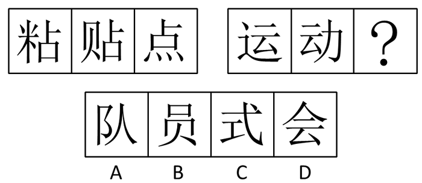

A. A

B. B

C. C

D. D

第 51 题 · 答案与解析

**参考答案（粉笔题库参考内容）**

D

**解析**

第一组图都含有元素“占”，第二组图都含有元素“云”，D项符合。

故正确答案为D。

**考点**：数量规律-素、文字/字母/数字类、样式规律-遍历

**来源**：2008年安徽省公务员录用考试《行测》题第51题

### 第 52 题

从所给四个选项中，选择最合适的一个填入问号处，使之呈现一定的规律性：

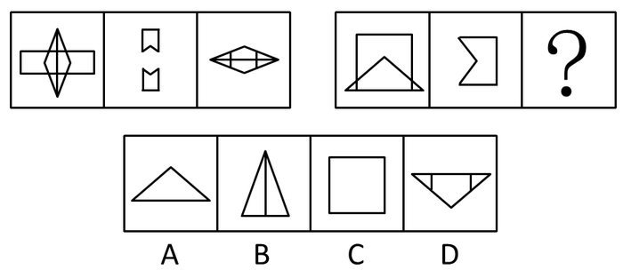

A. A

B. B

C. C

D. D

第 52 题 · 答案与解析

**参考答案（粉笔题库参考内容）**

D

**解析**

元素组成相似，且相同线条重复出现，优先考虑样式规律中的加减同异。每组图中第2、3个图形先进行逆时针旋转，然后再相加可以得到第1个图形。

故正确答案为D。

**考点**：样式规律-加减同异

**来源**：2008年安徽省公务员录用考试《行测》题第52题

### 第 53 题

从所给四个选项中，选择最合适的一个填入问号处，使之呈现一定的规律性：

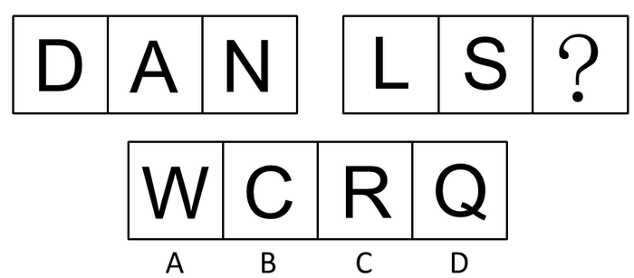

A. A

B. B

C. C

D. D

第 53 题 · 答案与解析

**参考答案（粉笔题库参考内容）**

A

**解析**

第一组图形开口数分别是0、1、2，第二组图形开口数应该是1、2、3。

故正确答案为A。

**考点**：文字/字母/数字类

**来源**：2008年安徽省公务员录用考试《行测》题第53题

### 第 54 题

从所给四个选项中，选择最合适的一个填入问号处，使之呈现一定的规律性：

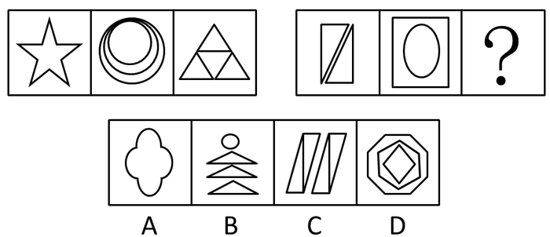

A. A

B. B

C. C

D. D

第 54 题 · 答案与解析

**参考答案（粉笔题库参考内容）**

C

**解析**

元素组成凌乱，通过数图形笔画来判断。第一组图中各图形由一笔画成，第二组图中各图形由两笔画成。选项中最少笔画数依次是1、3、2、3。

故正确答案为C。

**考点**：数量规律-线

**来源**：2008年安徽省公务员录用考试《行测》题第54题

### 第 55 题

从所给四个选项中，选择最合适的一个填入问号处，使之呈现一定的规律性：

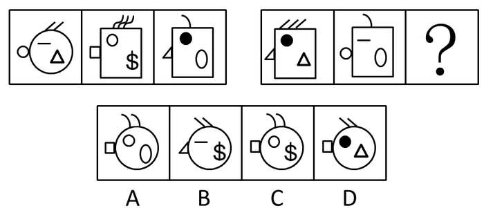

A. A

B. B

C. C

D. D

第 55 题 · 答案与解析

**参考答案（粉笔题库参考内容）**

C

**解析**

元素周遍。第一组图形中各个接壤部分分别有小圆、小四边形、小三角形。排除B选项。每组图形内部共有六种不同元素，所以第二组图形未知图形内部应该有小圆和美元符号。

故正确答案为C。

**考点**：样式规律-遍历

**来源**：2008年安徽省公务员录用考试《行测》题第55题

### 第 56 题

从所给四个选项中，选择最合适的一个填入问号处，使之呈现一定的规律性：

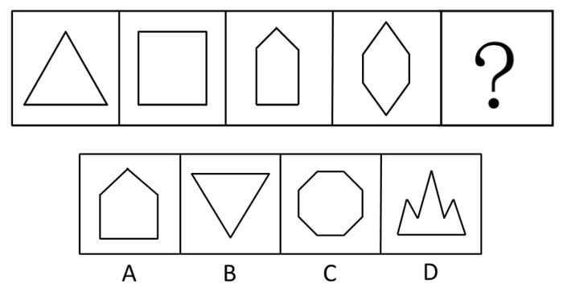

A. A

B. B

C. C

D. D

第 56 题 · 答案与解析

**参考答案（粉笔题库参考内容）**

D

**解析**

数线条数目，各图形分别由3、4、5、6、7条线段组成。选项中线段数量为5、3、8、7。

故正确答案为D。

**考点**：数量规律-线

**来源**：2008年安徽省公务员录用考试《行测》题第56题

### 第 57 题

从所给四个选项中，选择最合适的一个填入问号处，使之呈现一定的规律性：

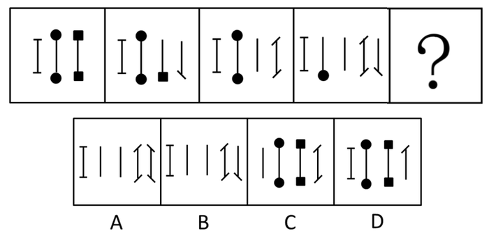

A. A

B. B

C. C

D. D

第 57 题 · 答案与解析

**参考答案（粉笔题库参考内容）**

A

**解析**

图形规律是少了个小方形黑点或者少了个小圆黑点，右侧就多了个竖条或这竖条增加一撇。

故正确答案为A。

**考点**：图形推理

**来源**：2008年安徽省公务员录用考试《行测》题第57题

### 第 58 题

从所给四个选项中，选择最合适的一个填入问号处，使之呈现一定的规律性：

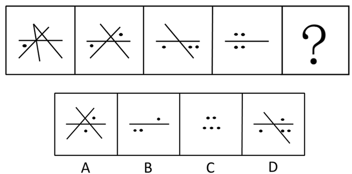

A. A

B. B

C. C

D. D

第 58 题 · 答案与解析

**参考答案（粉笔题库参考内容）**

C

**解析**

元素组成凌乱，考查数数。点和线，分开数，点的规律为1234，线的规律为4321，各图形中线段依次减少，黑点依次增加。那么答案应该为5个点，0条线。

故正确答案为C。

**考点**：数量规律-复合

**来源**：2008年安徽省公务员录用考试《行测》题第58题

### 第 59 题

从所给四个选项中，选择最合适的一个填入问号处，使之呈现一定的规律性：

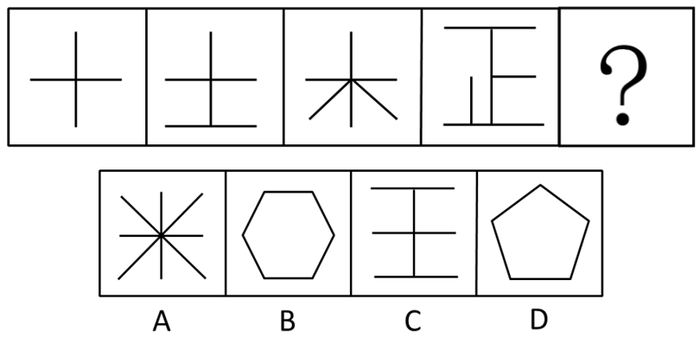

A. A

B. B

C. C

D. D

第 59 题 · 答案与解析

**参考答案（粉笔题库参考内容）**

B

**解析**

数线条数目，各图形分别由2、3、4、5、6条线段组成。选项中线段数量为4，6，4，5。

故正确答案为B。

**考点**：数量规律-线

**来源**：2008年安徽省公务员录用考试《行测》题第59题

### 第 60 题

从所给四个选项中，选择最合适的一个填入问号处，使之呈现一定的规律性：

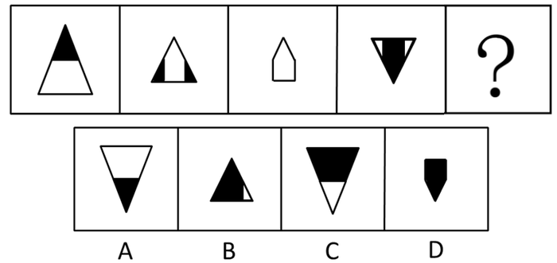

A. A

B. B

C. C

D. D

第 60 题 · 答案与解析

**参考答案（粉笔题库参考内容）**

C

**解析**

整体观察，以第三个的图形为对称轴，两边的图形分别倒置并且染色区域互补，共同构成整个图形。

故正确答案为C。

**考点**：图形推理

**来源**：2008年安徽省公务员录用考试《行测》题第60题

### 第 61 题

犯规：罚球

A. 抄袭：警告

B. 加油：开车

C. 感冒：吃药

D. 受伤：包扎

第 61 题 · 答案与解析

**参考答案（粉笔题库参考内容）**

A

**解析**

第一步：判断词语之间的逻辑关系。

因为“犯规”，所以要“罚球”，二者属于因果对应关系，且“罚球”是对“犯规”的惩罚。

第二步：判断选项之间的逻辑关系。

A项：因为“抄袭”，所以“警告”，二者属于因果对应关系，且“警告”是对“抄袭”的惩罚，与题干逻辑关系一致，当选；

B项：“开车”前可能需要“加油”，二者属于条件对应关系，与题干逻辑关系不一致，排除；

C项：因为“感冒”，所以“吃药”，但“吃药”是对“感冒”的治疗，并不是惩罚，与题干逻辑关系不一致，排除；

D项：因为“受伤”，所以“包扎”，但“包扎”是对“受伤”的治疗，并不是惩罚，与题干逻辑关系不一致，排除。

故正确答案为A。

**考点**：逻辑关系-对应关系

**来源**：2008年安徽省公务员录用考试《行测》题第61题

### 第 62 题

起跑：冲线

A. 点火：添煤

B. 剪彩：典礼

C. 航行：抛锚

D. 构思：定稿

第 62 题 · 答案与解析

**参考答案（粉笔题库参考内容）**

D

**解析**

第一步：判断词语之间的逻辑关系。

题干两词语存在对应关系。“起跑”是开始，“冲线”是结束，这是一个过程的起点和终点。

第二步：判断选项之间的逻辑关系。

A项、B项没有开始结束这种对应关系，排除；

C项中“航行”改为“启航”就对了，故排除；

D项“构思”是文学创作这一过程的起点，“定稿”是终点，当选。

故正确答案为D。

**考点**：逻辑关系-对应关系

**来源**：2008年安徽省公务员录用考试《行测》题第62题

### 第 63 题

掌舵：划桨（    ）。

A. 伙伴：搭档

B. 领导：顾问

C. 向导：跟班

D. 指挥：演奏

第 63 题 · 答案与解析

**参考答案（粉笔题库参考内容）**

D

**解析**

第一步：判断题干词语间逻辑关系。

题干中的前后两项属于对应关系，掌舵和划桨致力于船的运行这一总体事务，且掌舵为划桨指明方向。

第二步：判断选项词语间逻辑关系。

A项，伙伴和搭档不是对应关系，不符合题意，排除；

B项，领导和顾问这二者没有致力于明显的总体事务，且领导不一定为顾问指明方向，不符合题意，排除；

C项，向导和跟班这二者没有致力于明显的总体事务，且向导不一定为跟班指明方向，不符合题意，排除；

D项，指挥和演奏是对应关系，二者致力于乐队演奏这一总体事务，同时，指挥为演奏指明方向，符合题意，当选。

故正确答案为D。

**考点**：逻辑关系-对应关系

**来源**：2008年安徽省公务员录用考试《行测》题第63题

### 第 64 题

节拍：旋律

A. 线条：色彩

B. 小品：相声

C. 木刻：雕塑

D. 造型：艺术

第 64 题 · 答案与解析

**参考答案（粉笔题库参考内容）**

C

**解析**

第一步：判断词语之间的逻辑关系。

题干两词语存在包容关系。是包容关系中的种属关系，前项是后项的元素。

第二步：判断选项之间的逻辑关系。

A项“线条”和“色彩”，B项“小品”和“相声”属于并列关系，构不成包容关系，排除；

D项“造型”和“艺术”无明显逻辑关系，排除。

故正确答案为C。

**考点**：逻辑关系-包容关系

**来源**：2008年安徽省公务员录用考试《行测》题第64题

### 第 65 题

报警：警报

A. 来回：回来

B. 书写：写书

C. 给付：付给

D. 开水：水开

第 65 题 · 答案与解析

**参考答案（粉笔题库参考内容）**

D

**解析**

第一步：判断词语之间的逻辑关系。

题干的逻辑关系是全同关系。词义相近，但是词性不同。一个是动词，一个名词。

第二步：判断选项之间的逻辑关系。

A、B项词义显然不同，C项均是动词，排除。

D项“开水”是名词，“水开”是动词。

故正确答案为D。

**考点**：逻辑关系-全同关系

**来源**：2008年安徽省公务员录用考试《行测》题第65题

### 第 66 题

开拔：出发（  ）。

A. 歇会∶小憩

B. 宴请∶饭局

C. 打扰∶抱歉

D. 珍藏∶收藏

第 66 题 · 答案与解析

**参考答案（粉笔题库参考内容）**

A

**解析**

第一步：判断题干词语间逻辑关系。

开拔指军队由驻地或休息处出发，与出发为近义关系。

第二步：判断选项词语间逻辑关系。

A项：小憩是短时间的休息，与歇会为近义关系，与题干逻辑关系一致，保留；

B项：宴请是动词，是设宴招待的意思，饭局是名词，是聚餐的意思，二者无明显逻辑关系，与题干逻辑关系不一致，排除；

C项：打扰指扰乱人心或注意力，抱歉指心有愧疚不安，对不住别人，二者无明显逻辑关系，与题干逻辑关系不一致，排除；

D项：珍藏指认为有价值而妥善地收藏，与收藏为近义关系，与题干逻辑关系一致，保留。

对比A、D两项，题干两词只是意思相近，没有程度的递进，A项也只是意思相近，没有程度的递进，但D项珍藏比收藏的程度更深，故A项与题干逻辑关系更为一致，当选。

故正确答案为A。

**考点**：语义关系-近义关系

**来源**：2008年安徽省公务员录用考试《行测》题第66题

### 第 67 题

丹顶鹤∶白头翁

A. 花面狐∶长颈鹿

B. 北极熊∶唐老鸭

C. 金钱豹∶草珊瑚

D. 响尾蛇∶坐山雕

第 67 题 · 答案与解析

**参考答案（粉笔题库参考内容）**

A

**解析**

第一步：判断词语之间的逻辑关系。

题干两词语存在对应关系。丹顶鹤和白头翁都属于禽类。

第二步：判断选项之间的逻辑关系。

A项都属于哺乳类。

B、C、D项都不属于同一类，排除。

故正确答案为A。

**考点**：逻辑关系-并列关系

**来源**：2008年安徽省公务员录用考试《行测》题第67题

### 第 68 题

武术∶太极拳

A. 游泳∶跳水

B. 田径∶跨栏

C. 击剑∶射击

D. 举重∶柔道

第 68 题 · 答案与解析

**参考答案（粉笔题库参考内容）**

B

**解析**

第一步：判断题干词语间逻辑关系。

太极拳是武术的一种，二者为包容关系中的种属关系。

第二步：判断选项词语间逻辑关系。

A项：游泳和跳水是两种不同的运动项目，二者为并列关系，与题干逻辑关系不一致，排除；

B项：跨栏是田径的一种，二者为种属关系，与题干逻辑关系一致，当选；

C项：击剑和射击是两种不同的运动项目，二者为并列关系，与题干逻辑关系不一致，排除；

D项：举重和柔道是两种不同的运动项目，二者为并列关系，与题干逻辑关系不一致，排除。

故正确答案为B。

**考点**：逻辑关系-包容关系

**来源**：2008年安徽省公务员录用考试《行测》题第68题

### 第 69 题

男人∶女人

A. 黑∶白

B. 左∶右

C. 高∶矮

D. 生∶死

第 69 题 · 答案与解析

**参考答案（粉笔题库参考内容）**

D

**解析**

第一步：判断词语之间的逻辑关系。

题干两词语存在并列关系，且是并列关系中的矛盾关系。男人与女人之外，不存在第三种情况。

第二步：判断选项词语之间的逻辑关系。

A、B、C项都是反对关系，“黑白”之外尚有红、蓝等颜色；“左右”之外尚有上下方位；“高矮”之外尚有不高不矮一类人，排除。

D项符合矛盾关系，生与死之外不存在第三种情况，当选。

故正确答案为D。

**考点**：逻辑关系-并列关系

**来源**：2008年安徽省公务员录用考试《行测》题第69题

### 第 70 题

书籍：装帧

A. 策划：设计

B. 粉刷：油漆

C. 服装：熨烫

D. 理发：美容

第 70 题 · 答案与解析

**参考答案（粉笔题库参考内容）**

C

**解析**

第一步：判断题干词语间逻辑关系。

题干两词语存在语法关系。前一个为名词，后一个为动词，构成动宾结构。前者需要后者才能成型，书靠装帧成型。

第二步：判断选项词语间逻辑关系。

A、B、D三项都构不成动宾结构，排除。

C项服装需要熨烫方能平整，构成动宾结构，当选。

故正确答案为C。

**考点**：语法关系

**来源**：2008年安徽省公务员录用考试《行测》题第70题

### 第 71 题

佣金：通过自己的独立劳动，为他人提供中介服务所获得的社会物质报酬。

下面属于佣金的是：

A. 小李创办猎头公司，为用人单位引进人才，按照所引进的人才年薪30％的比例，向用人单位收取服务费用

B. 王丰是上市公司的董事长，去年年薪达到200万元

C. 李阿姨用多年的积蓄，买了一套沿街门面房租给他人经营，每月租金5000元

D. 经查实，销售部经理的工作很受客户好评，上月公司客户刘老板亲自送来红包1万元

第 71 题 · 答案与解析

**参考答案（粉笔题库参考内容）**

A

**解析**

第一步：抓住定义中关键词。

定义的关键词有“自己的独立劳动”、“为他人提供中介服务”。

第二步：逐一判断选项。

A项“按照所引进的人才年薪30％的比例，向用人单位收取服务费用”属于按比例收取的佣金，符合定义要求；

B项“年薪达到200万元”属于薪金，未体现“为他人提供中介服务”；

C项“每月租金5000元”属于投资收益，未体现“自己的独立劳动”；

D项“刘老板亲自送来红包1万元”属于奖金收入，不符合“自己的独立劳动”、“为他人提供中介服务”，因此B、C、D三项均不符合定义。

故正确答案为A。

**考点**：方式目的

**来源**：2008年安徽省公务员录用考试《行测》题第71题

### 第 72 题

拍卖：委托人将物品委托专门机构竞价销售，专门机构在完成委托义务后获得报酬的行为。

以下属于拍卖行为的是：

A. 老王收藏的晚清时期的瓷器，寄放在开古董店的老李那里，请他找个好价钱脱手

B. 拍卖师林清陪朋友刘峰到二手房交易市场，将刘峰的别墅卖得高价，刘峰拿出5000元作为酬谢

C. 金城拍卖公司接受某公司的请求，将一部八成新的桑塔纳轿车买下，以便业务人员出差

D. 法院判决王某犯有贪污受贿罪，处有期徒刑10年，对其非法财产予以没收，指定拍卖公司拍卖，所得款项上缴国库

第 72 题 · 答案与解析

**参考答案（粉笔题库参考内容）**

D

**解析**

第一步：抓住定义中关键词。

定义的关键词有“委托专门机构竞价销售”。

第二步：逐一判断选项。

A项“寄放在开古董店的老李那里”不符合“委托专门机构”；B项“将刘峰的别墅卖得高价”属于委托个人出售，不符合“委托专门机构竞价销售”；C项金城拍卖公司“将一部八成新的桑塔纳轿车买下”属于代买，不符合“委托专门机构竞价销售”。因此A、B、C均不符合定义，排除。

而D项“指定拍卖公司拍卖”符合“委托专门机构竞价销售”，属于拍卖行为，当选。

故正确答案为D。

**考点**：拆词

**来源**：2008年安徽省公务员录用考试《行测》题第72题

### 第 73 题

胜任力：员工在工作情境中，为完成工作所具备并体现出来的知识、技能、能力、态度、动机等关键特征。

以下表现为胜任力的行为是：

A. 小张请领导和同事来家吃饭，亲自下厨做了几道“看家菜”，大家交口称赞

B. 元旦刚过，小李请姑父和客户打招呼，为公司签订了一个大订单，打响“开门红”

C. 还在试用期的小王，用了整整一周时间，才整理出合格供应商的名单和真实报价

D. 上个月，小周所在班组在全厂考核中也被评为优秀班组

第 73 题 · 答案与解析

**参考答案（粉笔题库参考内容）**

C

**解析**

第一步：抓住定义中关键词。

定义的关键词有“工作情境中”、“知识、技能、能力、态度、动机等关键特征”。

第二步：逐一判断选项。

A项“请领导和同事来家吃饭”不符合“工作情境中”，不符合定义；

B项的小李为公司签订的一个大订单是他请姑父和客户打过招呼的，不能说明是他自身的能力，不符合定义；

C项“用了整整一周时间”不能说明“知识、技能、能力、态度、动机等关键特征”，说明的是胜任力不高，但还是通过自己完成的，符合定义；

D项“小周所在班组在全厂考核中也被评为优秀班组”没有体现小周个人的能力或其他关键特征，不符合定义。

故正确答案为C。

**考点**：大前提

**来源**：2008年安徽省公务员录用考试《行测》题第73题

### 第 74 题

村务公开：农村基层自治组织，采取适当的措施，依法将本村公共事务的信息向村民公布，接受群众监督的行为。

下列不属于村务公开的行为是：

A. 春节前，村委会主任通过村广播通报政府救灾款物已到的信息

B. 村头公告栏每季度按时公布村委会办公招待费使用情况

C. 乡党委下派干部就村党支部换届选举问题征求党员意见

D. 村委会文书给外出务工农民一一打电话，通报他们资助兴建的村办幼儿园工程进展情况

第 74 题 · 答案与解析

**参考答案（粉笔题库参考内容）**

C

**解析**

第一步：抓住定义中关键词。

定义的关键词有“本村公共事务”、“向村民公布”、“接受群众监督”。

第二步：逐一判断选项。

C项只是向党员征求意见，不符合“向村民公布”这一关键要素；

A项“通过村广播通报”、B项“公告栏每季度按时公布”、D项“打电话，通报他们资助兴建的村办幼儿园工程进展情况”符合“本村公共事务”、“向村民公布”、“接受群众监督”的定义。

本题为选非题，故正确答案为C。

**考点**：方式目的

**来源**：2008年安徽省公务员录用考试《行测》题第74题

### 第 75 题

高峰体验：人在追求自我实现过程中，经过基本需求的追求并获得满足之后，在追求自我实现时体现到的一种臻于顶峰而又超越时空和自我的心理满足感和成就感。

下列不属于高峰体验的是：

A. 运动员经过奋力拼搏终于登上冠军领奖台时的激动心情

B. 电视机前的观众看到中国制造的火箭遨游太空时的豪迈心情

C. 科学家排除困难，解决重大科研难题后的畅快心情

D. “十年寒窗苦读，今日金榜题名”时的愉悦心情

第 75 题 · 答案与解析

**参考答案（粉笔题库参考内容）**

B

**解析**

第一步：抓住定义中关键词。

定义的关键词有“自我实现过程中”、“心理满足感和成就感”。

第二步：逐一判断选项。

B项中电视机前的观众并没有亲身参与到火箭升空的具体研制过程，不符合“自我实现过程中”，即不符合定义。

A项“经过奋力拼搏终于登上冠军领奖台时的激动心情”、C项“排除困难，解决重大科研难题后的畅快心情”、D项“十年寒窗苦读，今日金榜题名”时的愉悦心情符合本题定义“自我实现过程中”、“心理满足感和成就感”。

本题为选非题，故正确答案为B。

**考点**：大前提

**来源**：2008年安徽省公务员录用考试《行测》题第75题

### 第 76 题

羌特勒是一种野生蘑菇。生长在能为它提供所需糖分的寄主树木——例如道格拉斯冷杉下面。反过来，羌特勒在地下的根茎细丝可以分解这些糖分，并为其寄主提供养分和水分。正是因为这种互惠的关系，采割道格拉斯冷杉下面生长的羌特勒会给这种树木造成严重的伤害。

下面哪一个判断如果正确，对上面的结论提出了最强有力的质疑：

A. 道格拉斯冷杉算不上什么名贵稀有树木

B. 羌特勒不仅生长在道格拉斯冷杉树下，也生长在其他寄主树木下面

C. 其他野生蘑菇也有长在道格拉斯冷杉树下的，与羌特勒的特点相似

D. 对野生蘑菇的采割反而刺激了它的生长

第 76 题 · 答案与解析

**参考答案（粉笔题库参考内容）**

D

**解析**

第一步：找到论点和论据。

本题论据是羌特勒生长在能为它提供所需糖分的寄主树木，在地下的根茎细丝可以分解这些糖分，并为其寄主提供养分和水分。论点是采割道格拉斯冷杉下面生长的羌特勒会给这种树木造成严重的伤害。

第二步：判断削弱方式。

论据和论点存在因果关系，要构成削弱，可对其论点进行削弱。

第三步：逐一判断选项的作用。

A项“算不上什么名贵稀有树木”是无关项；B项说明羌特勒也生长在其他寄主树木下面和题干无关；C项说其他野生蘑菇与羌特勒的特点相似与题干无关。A、B、C项都与采割道格拉斯冷杉下面生长的羌特勒是否会给这种树木造成严重的伤害无关，排除。

D项说明采割行为不会造成羌特勒减少，反而刺激了它的生长，就质疑了论点。

故正确答案为D。

**考点**：削弱论点

**来源**：2008年安徽省公务员录用考试《行测》题第76题

### 第 77 题

只有部分人能德才兼备。有的人有“德”但缺乏“才”，而有的人有“才”却没有“德”。前者虽然对社会贡献不大，但对社会没有危害；后者“才”越大对社会危害就越大。

由此可见：

A. “才”越大的人“德”越少

B. 有些人“才”越小对社会越有利

C. “才”的大小不影响人对社会贡献的多少

D. 应当使更多的人德才兼备

第 77 题 · 答案与解析

**参考答案（粉笔题库参考内容）**

B

**解析**

第一步：抓住每句话的对象及关系。

题干强调对于有“德”但缺乏“才”对社会没有危害；对于有“才”无“德”之人，由于其“才”越大，对社会危害就越大。

第二步：逐一判断选项。

A项表述不符合题意推断，题干得不出“才”越大的人“德”越少的结论，排除；

B项针对无“德”之人，其“才”越小，反而对社会越有利，符合题干推断，当选；

C项错误，“才”的大小是影响人对社会的贡献多少的，排除；

D项属于无中生有，判断推导不出此结论，排除。

故正确答案为B。

**考点**：日常结论

**来源**：2008年安徽省公务员录用考试《行测》题第77题

### 第 78 题

春节期间，学校保卫处计划为所有春节不回家的学生提供勤工俭学的机会，一方面是缓解春节期间保卫处人员不足的压力；另一方面是想为这些贫困大学生缓解经济压力。

下列哪一项并不能够质疑保卫处的这项计划：

A. 春节不回家的学生并不一定都是经济困难生

B. 春节期间学校治安任务艰巨，学生难以胜任

C. 保卫处资金有限，春节不回家的学生数目较多

D. 大多数不回家的学生都报了寒假英语补习班

第 78 题 · 答案与解析

**参考答案（粉笔题库参考内容）**

C

**解析**

第一步：分析题干论证过程。

论点：保卫处实施计划目的有二：（1）缓解春节期间保卫处人员不足的压力；（2）想为这些贫困大学生缓解经济压力。

第二步：逐一分析选项。

C项资金有限和学生多之间的矛盾，但是并不是贫困的学生多，不能以此来断定资金不足。

A项学生不贫困、质疑了“（2）”；B项学生难以胜任质疑了“（1）”；D项学生报补习班质疑了“（2）”，均能够质疑保卫处这项计划。

本题为选非题，故正确答案为C。

**考点**：削弱选非题

**来源**：2008年安徽省公务员录用考试《行测》题第78题

### 第 79 题

为验证一种治疗高血压的新药疗效如何，临床医生给100位高血压患者使用该药物，有65人的血压的确下降了，因此制药厂宣称该药的确有效。

最能削弱以上结论的是：

A. 服药期间测量血压时间不固定，而高血压患者的血压在一天中原本就有一定的波动

B. 给高血压患者服用一种和该药物外型一致但不含药物成分的药片，患者血压不下降

C. 给一组100名高血压患者服用该药物，另外一组100名高血压患者服用外型一致但不含药物成分的药物。前一组患者中血压下降人数和后一组患者中一样多

D. 医生给1000名高血压患者使用该药物，患者中只有500人血压下降

第 79 题 · 答案与解析

**参考答案（粉笔题库参考内容）**

C

**解析**

第一步：找到论点和论据。

本题论点是制药厂宣称该药的确有效，论据是100位高血压患者使用该药物，有65人的血压的确下降了。

第二步：逐一分析选项。

A项：实验中即使量血压的时间不固定也不能推出药物无效，无法确定该药是否有效，排除；

B项：服用不含药物成分的药品，不能起到降压作用，说明含药物成分的药物有效，加强了结论，排除；

C项：将服用该药物和服用不含药物成分的药物的患者作为两组实验对象进行实验，最终血压下降人数一致，说明该药对于治疗并没有明显的效果，削弱论点，当选；

D项：1000名只有500人血压下降，那么500人没有下降，下降的500人中并不一定都是该药物的作用，因此该药不一定有效，对题干削弱作用有限，削弱力度不及C项，排除。

故正确答案为C。

**考点**：削弱-实验类、削弱论点

**来源**：2008年安徽省公务员录用考试《行测》题第79题

### 第 80 题

下列推理正确的是：

A. 只有开启电源开关，电脑才会运行；这台电脑没运行，可见没有开启电源开关

B. 翻译要学好外语，我又不当翻译，所以，我无须学好外语

C. 如果公路被冰雪覆盖，汽车就不会按时回来。果然汽车没有按时回来，可见，公路被冰雪覆盖了

D. 鸵鸟不会飞，鸵鸟是鸟，所以，有的鸟不会飞

第 80 题 · 答案与解析

**参考答案（粉笔题库参考内容）**

D

**解析**

利用充分必要条件翻译选项并判断选项。

A项，第一句翻译为：电脑会运行→开启电源开关，第二句翻译为：-电脑运行→—开启电源开关，根据逆否规则可知，否前不能推出否后，排除；

B项，第一句翻译为：翻译→学好外语，第二句翻译为：-当翻译→—学好外语，根据逆否规则可知，否前不能推出否后，排除；

C项，第一句翻译为：公路被冰雪覆盖→—汽车按时回来，第二句翻译为：-汽车按时回来→公路被冰雪覆盖，根据逆否规则可知，肯后不能推出肯前，排除；

D项，符合三段论推理，大前提是鸵鸟是鸟，小前提是鸵鸟不会飞，结论是有的鸟不会飞。

故正确答案为D。

**考点**：常规翻译

**来源**：2008年安徽省公务员录用考试《行测》题第80题

### 第 81 题

根据电视收视率调查，看体育节目的观众中青年人比中老年人要多。

由此可推断出：

A. 体育节目可能更适合青年人的兴趣

B. 体育节目是专属青年人的运动

C. 中老年人不喜欢体育节目

D. 青年人比中年人更擅长体育运动

第 81 题 · 答案与解析

**参考答案（粉笔题库参考内容）**

A

**解析**

第一步：抓住题干的对象及其关系。

题干强调“看体育节目的观众中青年人比中老年人要多”。

第二步：判断选项的作用。

A是根据题干的可能性结论，当选；

B项“体育节目是专属青年人的运动”明显错误，题干中没有体现，排除；

C项“中老年人不喜欢体育节目”明显错误，表述过于绝对，题干没有显示，排除；

D项“青年人比中年人更擅长体育运动”错误，题干强调青年人比中老年人要多侧重于看体育节目，而不是擅长体育运动，排除。

故正确答案为A。

**考点**：日常结论

**来源**：2008年安徽省公务员录用考试《行测》题第81题

### 第 82 题

意大利的那不勒斯城附近有个石灰岩洞，人们带着牛马等大牲畜通过岩洞未发生问题，但是猫、老鼠等小动物走进洞里就倒地而死。后来人们经过检验发现，小动物的死亡与吸进大量二氧化碳有关。

据此可以推断出：

A. 石灰岩洞内严重缺氧

B. 大牲畜更适应缺氧的环境

C. 人和牛马都带有吸氧设备

D. 石灰岩洞内地面沉积着二氧化碳

第 82 题 · 答案与解析

**参考答案（粉笔题库参考内容）**

D

**解析**

第一步：抓住题干的对象及其关系。

题干强调“牛马等大牲畜通过岩洞未发生问题”、“猫、老鼠等小动物走进洞里就倒地而死”、“小动物的死亡与吸进大量二氧化碳有关”。

第二步：判断整体关系。

大牲畜未发生问题，而小动物倒地而死，说明洞内底部有二氧化碳。

第三步：判断选项。

A项不正确，不符合“人们带着牛马等大牲畜通过岩洞未发生问题”；

B项无理论根据；

C项错误，文中也未暗示。同大牲畜相比较，猫、老鼠等小动物走进洞里就倒地而死；

D项因为小动物个头小，吸进了石灰岩洞内地面沉积着的二氧化碳，这是大牲畜没事，而小动物死亡的最可能原因。

故正确答案为D。

**考点**：日常结论

**来源**：2008年安徽省公务员录用考试《行测》题第82题

### 第 83 题

S企业与J企业生产和销售一样的仪表，S企业和J企业中员工的工资都占生产仪表成本的40％，S企业正在寻求强于J企业的竞争优势。因此，为达这个目的，S企业应该降低员工的工资。

以下哪一项如果是正确的，将最能削弱上述论述：

A. 因为他们生产少量的精密仪器，仪表制造商们不能在原材料上获得批量折扣

B. 工资降低会降低员工工作质量，继而导致销量下降

C. J企业去年抢走了S企业20％的生意

D. S企业付给它的员工的工资，平均说来，比J企业高10％

第 83 题 · 答案与解析

**参考答案（粉笔题库参考内容）**

B

**解析**

第一步：找到论点和论据。

本题论点是S企业为达到竞争优势强于J企业的目的，应该降低员工的工资。没有明显的论据。

第二步：判断削弱方式。

本题只有论点，没有论据，所以要削弱论点。

第三步：逐一判断选项的作用。

A中“不能在原材料上获得批量折扣”、C中“抢走了S企业20％的生意”、D项“付给它的员工的工资比J企业高10％”都不是对论点的削弱或否定加  ，排除。

而B项“工资降低”→“降低员工工作质量”→“导致销量下降”，继而公司的销售额会下降。所以B项无法达到提高公司竞争优势这一根本的目的，削弱了论点。

故正确答案为B。

**考点**：削弱论点

**来源**：2008年安徽省公务员录用考试《行测》题第83题

### 第 84 题

一种海洋蜗牛产生的毒素含有多种蛋白，把其中的一种给老鼠注射后，会使有两星期大或更小的老鼠陷入睡眠状态，而使大一点的老鼠躲藏起来。当老鼠受到突然的严重威胁时，非常小的那些老鼠的反应是呆住，而较大的那些老鼠会逃跑。

以上陈述的事实最有力地支持了以下哪项假说：

A. 非常小的老鼠很可能与较大的老鼠一样易于遭受突发性的严重威胁

B. 注射到鼠体的包含在蜗牛毒素中的蛋白的主要功能是通过诱导蜗牛处于完全的静止中而起到保护蜗牛的作用

C. 如果给成年老鼠大剂量地注射这种蛋白质，也会使它们陷入睡眠状态

D. 老鼠对突然的严重威胁的反应受其体内生成的一种化学物质的刺激。这物质与注射到老鼠体内的蛋白质相似

第 84 题 · 答案与解析

**参考答案（粉笔题库参考内容）**

D

**解析**

第一步：抓住题干的对象及其关系。

题干强调小老鼠、大老鼠在被注射某蛋白质后，小的老鼠“陷入睡眠状态”，大一点的老鼠“躲藏”起来。而未注射此蛋白质时，老鼠在遭到严重威胁时，它们的反应分别是“呆住”和“逃跑”。

第二步：判断选项的作用。

A项题干说明小老鼠、大老鼠在受到威胁是有区别的，A项不符合题干推断，排除；

B项“保护蜗牛”无中生有，排除；

C项“给成年老鼠大剂量地注射这种蛋白质，也会使它们陷入睡眠状态”题干中没有涉及，属于干扰项，排除；

D项由题意可知，老鼠“陷入睡眠状态”和“呆住”，“躲藏”和“逃跑”，状态很相似。

故正确答案为D。

**考点**：日常结论

**来源**：2008年安徽省公务员录用考试《行测》题第84题

### 第 85 题

M城位于E湖边，C城位于M城西边，S城在C城的东边，D城在R城的东边，又在S城与C城的西边，最靠西的城市是：

A. M城

B. D城

C. C城

D. R城

第 85 题 · 答案与解析

**参考答案（粉笔题库参考内容）**

D

**解析**

第一步：找突破口。

本题突破口为M城，以M城为坐标中心。

第二步：将题干信息自西向东逐一罗列。

R       D      C        M（E）    S

R       D      C         S           M（E）

M城为坐标中心，C城在M城西边，S城可能在C城与M城之间，也有可能在M城的东边。注意现在最西边的城市是C城，D城在R城的东边，又在C城的西边，那么最西边的城市应该就是R城。

故正确答案为D。

**考点**：组合排列-单题-其他

**来源**：2008年安徽省公务员录用考试《行测》题第85题

### 第 86 题

宪法是国家根本大法，具有最高法律效力，下列有关宪法法律效力的表述正确的是（　　）。

A. 在不成文宪法的国家中，宪法的法律效力高于其他法律

B. 在我国，任何法律法规都不得与宪法规范、宪法基本原则和宪法精神相抵触

C. 宪法的法律效力主要表现为对公民的行为约束

D. 宪法的法律效力不具有任何强制性

第 86 题 · 答案与解析

**参考答案（粉笔题库参考内容）**

B

**解析**

本题考查宪法的法律效力。

宪法是国家的根本大法，是规定国家各项基本制度和根本任务、规定国家机关的组织与活动的基本原则、保障公民基本权利的国家根本大法。

A项错误，在不成文宪法国家，其宪法（宪法性法律）与普通法律的制定和修改程序完全相同，并没有法律效力上的差异而仅有法律内容上的差异，也不能以其为依据对其他法律进行违宪审查。

B项正确，在我国，宪法具有最高的法律效力，具体表现为宪法是一般法律的制定基础和依据，一般法律的规定与宪法相抵触的无效。

C项错误，宪法的法律效力不仅表现在对公民的行为约束上，更表现在：宪法是制定普通法律的依据，宪法是一切国家机关、社会团体和全体公民的最高行为准则。

D项错误，宪法和其他法律一样，都是强制性规范，宪法强制法律和行为合宪。

故正确答案为B。

**考点**：宪法

**来源**：2008年安徽省公务员录用考试《行测》题第86题

### 第 87 题

根据我国宪法规定，下列关于私有财产权的表述不正确的是：

A. 公民合法的私有财产不受侵犯

B. 国家依照法律规定保护公民的私有财产权和继承权

C. 任何人不得剥夺公民的私有财产

D. 国家为了公共利益的需要，可以依照法律规定对公民的私有财产实行征收或者征用并给予补偿

第 87 题 · 答案与解析

**参考答案（粉笔题库参考内容）**

C

**解析**

A、B、D项正确，2004年《宪法修正案》把宪法第13条“国家保护公民的合法的收入、储蓄、房屋和其他合法财产的所有权”和“国家依照法律规定保护公民的私有财产的继承权”修改为“公民合法的私有财产不受侵犯”。

C项错误，表述过于绝对，是关于私有财产权的法律保护的错误理解。

本题为选非题。

故正确答案为C。

本题相关知识点：

《世界人权宣言》在第17条宣称：“人人得有单独的财产权以及同他人合同的所有权；任何人的财产不得任意剥夺。”其中“任意”二字有两层意思：一是未经法律许可，个人的财产不得被政府或他人剥夺；二是如果某国的法律允许，该国政府可以依照法律规定征收个人的财产。关键是有无法律规定，遵不遵守法律，是否依法办事。

**考点**：宪法

**来源**：2008年安徽省公务员录用考试《行测》题第87题

### 第 88 题

根据宪法和组织法的规定，下列有权制定地方性法规的机关是：

A. 合肥市蜀山区人民代表大会

B. 安徽省人民政府

C. 中共合肥市委

D. 合肥市人民代表大会

第 88 题 · 答案与解析

**参考答案（粉笔题库参考内容）**

D

**解析**

有权制定地方性法规的立法主体共有4类：省、自治区、直辖市、较大的市的人民代表大会及其常务委员会。

故正确答案为D。

本题相关知识点：

《宪法》第63条第1款、第2款规定：“省、自治区、直辖市的人民代表大会及其常务委员会根据本行政区域的具体情况和实际需要，在不同宪法、法律、行政法规相抵触的前提下，可以制定地方性法规。

较大的市的人民代表大会及其常务委员会根据本市的具体情况和实际需要，在不同宪法、法律、行政法规和本省、自治区的地方性法规相抵触的前提下，可以制定地方性法规，报省、自治区的人民代表大会常务委员会批准后施行。

省、自治区的人民代表大会常务委员会对报请批准的地方性法规，应当对其合法性进行审查，同宪法、法律、行政法规和本省、自治区的地方性法规不抵触的，应当在四个月内予以批准。”

**考点**：宪法

**来源**：2008年安徽省公务员录用考试《行测》题第88题

### 第 89 题

下列不属于行政许可法调整范围的是：

A. 老王下岗后自谋出路，想自己开一个小饭馆，于是向工商局提出申请，工商局经审查，发给了老王营业执照

B. 公安交通部门根据李某的申请，发给李某驾驶执照

C. 某大学希望上级教育主管部门拨款对学校扩建，上级教育主管部门对其申请予以审批

D. 进出口食品检疫机关，对某公司的出口食品鉴定后，贴上了检疫标签

第 89 题 · 答案与解析

**参考答案（粉笔题库参考内容）**

C

**解析**

行政许可，是指行政机关根据公民、法人或者其他组织的申请，经依法审查，准予其从事特定活动的行为。实施行政许可的结果是相对人获得了从事特定活动的权利或者资格。

A、B、D三项都属于“行政许可”；

C项“申请上级教育主管部门拨款”不符合行政许可含义，属于行政审批。

本题为选非题，故正确答案为C。

**考点**：行政法

**来源**：2008年安徽省公务员录用考试《行测》题第89题

### 第 90 题

提起行政复议的申请人是：

A. 行政相对人

B. 行政机关

C. 上级行政机关

D. 检察院

第 90 题 · 答案与解析

**参考答案（粉笔题库参考内容）**

A

**解析**

《行政复议法》第十四条规定：“依照本法申请行政复议的公民、法人或者其他组织是申请人。有权申请行政复议的公民死亡的，其近亲属可以申请行政复议。有权申请行政复议的法人或者其他组织终止的，其权利义务承受人可以申请行政复议。有权申请行政复议的公民为无民事行为能力人或者限制民事行为能力人的，其法定代理人可以代为申请行政复议。”

“行政相对人”是指行政管理法律关系中与行政主体相对应的另一方当事人，即行政主体的行政行为影响其权益的个人或组织。上述法条中提到的“公民、法人或组织”都属于“行政相对人”。

故正确答案为A。

**考点**：行政法

**来源**：2008年安徽省公务员录用考试《行测》题第90题

### 第 91 题

在行政诉讼中对具体行政行为的合法性负有举证责任的是：

A. 原告

B. 被告

C. 第三人

D. 谁主张谁举证

第 91 题 · 答案与解析

**参考答案（粉笔题库参考内容）**

B

**解析**

《行政诉讼法》第32条规定：“被告对作出的具体行政行为负有举证责任，应当提供作出该具体行政行为的证据和所依据的规范性文件。”

据此，行政诉讼的一般证据规则是行政机关对作出具体行政行为承担举证责任，而不是由提出诉讼主张的原告举证，即“被告负举证责任。”

故正确答案为B。

本题相关知识点：当被告行政机关不能证明其作出具体行政行为所依据的事实时，就由被告承担败诉的后果，原告并不因举不出证据反驳行政机关认定的事实而败诉。但原告对是否存在具体行政行为及该行为与其有利害关系负举证责任，它在很大程度上体现了行政诉讼制度“民告官”的特色。

**考点**：行政法

**来源**：2008年安徽省公务员录用考试《行测》题第91题

### 第 92 题

行政诉讼法规定，因限制人身自由的强制措施引起的行政诉讼，由原告或被告所在地人民法院管辖。这里的原告所在地不包括：

A. 被限制人身自由所在地

B. 临时居住地

C. 户籍所在地

D. 经常居住地

第 92 题 · 答案与解析

**参考答案（粉笔题库参考内容）**

B

**解析**

《行政诉讼法》第十九条规定：对限制人身自由的行政强制措施不服提起的诉讼，由被告所在地或者原告所在地人民法院管辖。

根据最高人民法院关于执行《中华人民共和国行政诉讼法》若干问题的解释（法释\[2000\]8号）第九条规定，此处的“原告所在地”，包括原告的户籍所在地、经常居住地和被限制人身自由地。

本题为选非题，故正确答案为B。

**考点**：行政法

**来源**：2017年天津滨海新区公务员考试《行测》题（网友回忆版）第46题

### 第 93 题

张某家住北京市东城区，在朝阳区有一处商业用房，市拆迁办（在西城区）决定对其商业用房拆迁，张某不服，诉至法院，应由哪个法院受理：

A. 朝阳区法院

B. 西城区法院

C. 东城区法院

D. 北京市高级人民法院

第 93 题 · 答案与解析

**参考答案（粉笔题库参考内容）**

A

**解析**

《行政诉讼法》第二十条规定：因不动产提起的行政诉讼，由不动产所在地人民法院管辖。而房屋就属于不动产，因房屋引起的诉讼应由其所在地法院，即朝阳区法院管辖。

故正确答案为A。

**考点**：行政法

**来源**：2008年安徽省公务员录用考试《行测》题第93题

### 第 94 题

工商行政管理机关可以对经营者的违法行为进行行政处罚，但不得采取的措施是：

A. 罚款

B. 警告

C. 吊销营业执照

D. 行政拘留

第 94 题 · 答案与解析

**参考答案（粉笔题库参考内容）**

D

**解析**

行政拘留，指公安机关对于违反《治安管理处罚条例》的公民，在短期内限制其人身自由的一种处罚措施。行政拘留是限制公民人身自由的一种行政处罚，也是行政处罚中最严厉的处罚之一。工商行政管理机关不能采取此行政处罚措施。

故正确答案为D。

**考点**：行政法

**来源**：2008年安徽省公务员录用考试《行测》题第94题

### 第 95 题

张某因扰乱社会治安受到公安机关的行政处罚，张某认为处罚太重，应当如何处理：

A. 直接起诉

B. 先申请复议，若不服复议决定再起诉

C. 既可申请复议，也可直接向法院起诉

D. 向人民法院起诉或向人民法院复议

第 95 题 · 答案与解析

**参考答案（粉笔题库参考内容）**

C

**解析**

《治安管理处罚法》第102条规定：被处罚人对治安管理处罚决定不服的，可以依法申请行政复议或者提起行政诉讼。

故正确答案为C。

**考点**：行政法

**来源**：2008年安徽省公务员录用考试《行测》题第95题

### 第 96 题

股票是股份公司发给股东的入股凭证，购买股票后，股东成为：

A. 企业法人

B. 公司的债主

C. 企业的经营者

D. 公司的所有者

第 96 题 · 答案与解析

**参考答案（粉笔题库参考内容）**

D

**解析**

B项错误，债券反映的是债权债务关系，是一种债券凭证，投资者购买债券后就成为公司的债权人；C项错误，不是每一个购买股票的投资者都会是公司的经营者；

D项正确，股票是股份公司发给股东作为已投资入股的证书与索取股息的凭证。投资者购买股票后就成为公司的股东，他们成为公司的“所有者”。

故正确答案为D。

**考点**：其他法律法规

**来源**：2008年安徽省公务员录用考试《行测》题第96题

### 第 97 题

王某将与其有私仇的李某打昏在地后逃走，此时李某的熟人张某路过，见李某不省人事，遂将其手机、钱包拿走。本案中：

A. 王某构成故意伤害罪，张某没有犯罪

B. 王某构成故意伤害罪，张某构成盗窃罪

C. 王某构成故意伤害罪，张某构成抢夺罪

D. 王某、张某共同构成故意伤害罪和盗窃罪

第 97 题 · 答案与解析

**参考答案（粉笔题库参考内容）**

B

**解析**

B项正确，王某故意伤害李某，构成故意伤害罪；张某借李某“不省人事”之际，拿走“手机、钱包”，构成盗窃罪；

D项错误，王某与张某没有共同的犯罪故意，即没有共同的犯罪意思表示，二人的行为是各自独立完成的，故不构成共同犯罪。

故正确答案为B。

本题相关知识点：

共同犯罪：共同犯罪的主体必须是二人以上，各犯罪人必须具有共同的犯罪行为，各共同犯罪人必须有共同的犯罪故意。

故意伤害罪：是指故意非法伤害他人身体并达成一定的严重程度、应受刑法处罚的犯罪行为。主观方面表现为故意，即行为人明知自己的行为会造成损害他人身体健康的结果，而希望或放任这种结果的发生；侵犯的客体是他人的身体权，所谓身体权是指自然人以保持其肢体、器官和其他组织的完整性为内容的人格权。

盗窃罪：以非法占有为目的，窃取他人占有的数额较大的财物，或者多次盗窃的行为。侵犯的对象，是国家、集体或个人的财物；在客观方面表现为行为人具有秘密窃取数额较大的公私财物或者多次秘密窃取公私财物的行为；本罪主体是一般主体，凡达到刑事责任年龄（16周岁）且具备刑事责任能力的人均能构成；本罪在主观方面表现为直接故意，且具有非法占有的目的。

**考点**：刑法

**来源**：2008年安徽省公务员录用考试《行测》题第97题

### 第 98 题

天龙公司与张某因装修合同发生纠纷，在诉讼过程中，双方协商同意调解。法院依法主持双方调解后达成调解协议，以下说法正确的是：

A. 法院根据调解协议制作调解书后，经双方当事人签收后，具有法律效力

B. 当事人收到调解书后可以在15日内上诉

C. 该案调解书一旦发生法律效力就不得申请再审

D. 法院制作调解书后，送达时，法院可以采用留置送达

第 98 题 · 答案与解析

**参考答案（粉笔题库参考内容）**

A

**解析**

A项正确、B项错误，《中华人民共和国民事诉讼法》第97条第3款规定：“调解书经双方当事人签收后，即具有法律效力。”因此，民事调解书在送达双方当事人后即发生法律效力，而上诉的前提是判决或者裁定未生效，故调解书不能上诉。

C项错误，《中华人民共和国民事诉讼法》第二百零一条规定：“当事人对已经发生法律效力的调解书，提出证据证明调解违反自愿原则或者调解协议的内容违反法律的，可以申请再审。经人民法院审查属实的，应当再审。”

D项错误，《最高人民法院关于适用&lt;中华人民共和国民事诉讼法>》第一百三十三条规定：“调解书应当直接送达当事人本人，不适用留置送达。当事人本人因故不能签收的，可由其指定的代收人签收。”

故正确答案为A。

**考点**：民法典

**来源**：2008年辽宁省公务员录用考试《行测》题第95题

### 第 99 题

下列属于行政诉讼受案范围的是：

A. 某行政机关对其工作人员的开除处分

B. 政府交通管理部门关于在某一时期对某条街实行禁止通行的公告

C. 某环保局责令某企业停产整顿治理环境污染的决定

D. 某行政机关对下属机关通报批评责令整改的通报

第 99 题 · 答案与解析

**参考答案（粉笔题库参考内容）**

C

**解析**

行政诉讼是一种诉讼程序法，主要是确定诉讼参加人的法律地位和相互关系的法律规范。狭义上的行政诉讼法也称形式意义上的行政诉讼法，特指由国家立法机关依据立法程序所制定的，通常被称为“民告官”。

根据《行政诉讼法》第11条的规定，人民法院受理公民、法人和其他组织对拘留、罚款、吊销许可证和执照、责令停产停业、没收财物等行政处罚不服提起的行政诉讼。

《行政诉讼法》第12条规定：“人民法院不受理公民、法人或者其他组织对下列事项提起的诉讼：（一）国防、外交等国家行为；（二）行政法规、规章或者行政机关制定、发布的具有普遍约束力的决定、命令；（三）行政机关对行政机关工作人员的奖惩、任免等决定；（四）法律规定由行政机关最终裁决的具体行政行为。”

A项符合（三）规定，人民法院不受理；

B、D项符合（二）规定，人民法院均不受理。

故正确答案为C。

**考点**：行政法

**来源**：2008年安徽省公务员录用考试《行测》题第99题

### 第 100 题

下列不适用产品质量法规定的产品是：

A. 商场销售的燃气热水器

B. 房地产公司开发的商品房

C. 张某手工制售的仿古家具

D. 外企在我国境内销售的手机

第 100 题 · 答案与解析

**参考答案（粉笔题库参考内容）**

B

**解析**

关于产品质量法的适用范围，《产品质量法》第二条规定：在中华人民共和国境内从事产品生产、销售活动，必须遵守本法。本法所称产品是指经过加工、制作，用于销售的产品。建设工程不适用本法规定；但是，建设工程使用的建筑材料、建筑构配件和设备，属于前款规定的产品范围的，适用本法规定。

B项商品房属于建筑工程，不适用产品质量法。

本题为选非题，故正确答案为B。

**考点**：其他法律法规

**来源**：2008年安徽省公务员录用考试《行测》题第100题

### 第 101 题

下列机构（简称）不属于我国民主党派的是：

A. 侨联

B. 民革

C. 台盟

D. 民盟

第 101 题 · 答案与解析

**参考答案（粉笔题库参考内容）**

A

**解析**

民主党派是指在中国大陆范围内，除执政党中国共产党以外的八个参政党的统称。它们是：中国国民党革命委员会（民革）、中国民主同盟（民盟）、中国民主建国会、中国民主促进会、中国农工民主党、中国致公党、九三学社、台湾民主自治同盟（台盟）。

中国侨联是由全国归侨、侨眷组成的全国性人民团体，前身是延安侨联和全国侨联筹委会。

本题为选非题，故正确答案为A。

**考点**：政治建设

**来源**：2011年安徽省公务员录用考试《行测》题第92题

### 第 102 题

下列部门中承担政府内部事务管理职能的是：

A. 人民检察院

B. 纪律检察委员会

C. 人民法院

D. 行政监察部门

第 102 题 · 答案与解析

**参考答案（粉笔题库参考内容）**

D

**解析**

行政监察是国家行政系统内部由专门监察机关实施的，对行政机关、国家公务员，以及行政机关任命的其他人员的廉政、勤政和执法状况进行监督检查的一种职能活动。

《中华人民共和国行政监察法》第2条规定：“监察机关是人民政府行使监察职能的机关，依照本法对国家行政机关、国家公务员和国家行政机关任命的其他人员实行监督。”

故正确答案为D。

**来源**：2008年安徽省公务员录用考试《行测》题第102题

### 第 103 题

十七大召开前，党代表的条件、选举产生程序、代表名额分配、构成比例等基层党员关注的细节问题向社会公开。中央要求，候选人的推荐提名从基层开始，所有基层党组织和党员参加。下列观点不正确的是：

A. 选举党代表是公民的一项基本政治权利

B. 民主集中制是我党的根本组织制度和领导制度

C. 党务公开是执政党与时俱进的体现

D. 党内民主是党的生命，有利于实现党的宗旨

第 103 题 · 答案与解析

**参考答案（粉笔题库参考内容）**

A

**解析**

A项表述错误，选举党代表并不是所有公民的一项基本政治权利，能够参加党代表选举的前提是公民自身是党员。

本题为选非题。

故正确答案为A。

本题相关知识点：

对我国社会主义国家机构来说，民主集中制主要表现为全国人民代表大会和地方各级人民代表大会都由民主选举产生，对人民负责，受人民监督；国家行政、审判、检察机关都由人民代表大会选举产生，对它负责，受它监督；中央和地方国家机构职权的划分，遵循在中央统一领导和国家法制统一的前提下，充分发挥地方积极性和主动性的原则。

党务公开即透过会议、文件、媒体等多种形式，逐级和及时地向党员通报党的代表大会的报告、党的各级组织对重大问题的讨论和决策情况；规范“先党内、后党外”制度，坚持重大事情党内先知道，重要文件党内先传达，重大问题的决定党内先讨论，重大决策的实施党内先发动，从而增强党员的荣誉感和责任感，调动党员的积极性、主动性和创造性。

党内民主是指党员和党组织的意愿、主张的充分表达和积极性、创造性的充分发挥。党内民主的四大部分 ：民主选举、民主决策、民主管理、民主监督。

**考点**：政治建设

**来源**：2008年安徽省公务员录用考试《行测》题第103题

### 第 104 题

关于人权，下列表述错误的是：

A. 人权是一个社会历史范畴，不同社会、不同阶级有不同的人权观

B. 人权是“天赋”的，和公民权是一回事

C. 人权的本质是自由和平等，目标是人的生存和发展

D. 人权不仅是个人的权利，也包括集体乃至人类生存和发展的权利

第 104 题 · 答案与解析

**参考答案（粉笔题库参考内容）**

B

**解析**

人权就是人的个体或群体，在一定历史条件下并基于一定经济结构和文化发展，为了其自由的生存、活动和发展以能够真正掌握自己的命运所必需平等具有的权利。

公民权是指一国公民在法律上所具有的一种能力或资格，是国家规定的本国公民在国家和社会中所处地位的法律表现。

人权的主体是人的个体（自然人）和群体(整个人类)，它的外延比“公民”、“人民”都要宽泛。也就是说，凡是“人”都应有相应的人权。人权是公民权构成的基础和源泉，公民权是由人权所派生，是它的重要的政治法律表现，公民权的初始形态和萌芽阶段便是人权。公民权不过是一种更加政治化、法律化的人权而已，不过是人权的一部分、一个层次，一种特定的存在形式和表现方式。

以上可见：人权和公民权不是一回事。

本题为选非题，故正确答案为B。

**考点**：宪法

**来源**：2008年安徽省公务员录用考试《行测》题第104题

### 第 105 题

在公共政策执行的起始环节中，核心内容是：

A. 目标宣传

B. 任务宣传

C. 意义宣传

D. 方法和步骤宣传

第 105 题 · 答案与解析

**参考答案（粉笔题库参考内容）**

A

**解析**

政策宣传是政策执行过程的起始环节和一项重要的功能活动。要使政策得到有效执行，必须首先统一人们的思想认识。政策宣传是统一人们思想认识的一个有效手段。

故正确答案为A。

**考点**：其他

**来源**：2008年安徽省公务员录用考试《行测》题第105题

### 第 106 题

党的十七大报告首次提出了“创造条件让更多群众拥有财产性收入”。下列属于居民财产性收入的是：

A. 一切非劳动收入

B. 出租土地、房屋取得的收入

C. 凭借自己的生产资料从事生产经营活动所获得的收入

D. 从社会保障中获得的收入

第 106 题 · 答案与解析

**参考答案（粉笔题库参考内容）**

B

**解析**

人均可支配收入，由四部分构成，按照占比大小分别是：工资性收入（工资等）、转移性收入（养老金等）、经营性收入（商业买卖收入等）和财产性收入。

在“人均可支配收入”中以工资性收入为主，占到70％左右。财产性收入占比位置较小，占比在2％左右。

“财产性收入”是指家庭拥有的动产（如银行存款、有价证券等）、不动产（如房屋、车辆、土地、收藏品等）所获得的收入。它包括出让财产使用权所获得的利息、租金、专利收入等；财产营运所获得的红利收入、财产增值收益等。

A项错误，一切非劳动收入过于宽泛；

B项正确，属于居民财产性收入；

C项错误，属于经营性收入；

D项错误，属于转移性收入。

故正确答案为B。

**考点**：宏观经济与调控政策

**来源**：2008年安徽省公务员录用考试《行测》题第106题

### 第 107 题

十七大报告指出，要坚持和完善按劳分配为主体，多种分配方式并存的分配制度，健全劳动、资本、技术、管理等生产要素按贡献参与分配的制度，＿＿＿＿＿＿＿＿＿＿＿：

A. 初次分配注重效率，再分配注重公平

B. 初次分配和再分配都要处理好效率和公平的关系

C. 初次分配要注重公平，再分配注重效率

D. 初次分配和再分配都要处理好效率和公平的关系，再分配更加注重公平

第 107 题 · 答案与解析

**参考答案（粉笔题库参考内容）**

D

**解析**

党的十七大报告指出，要坚持和完善按劳分配为主体、多种分配方式并存的分配制度，健全劳动、资本、技术、管理等生产要素按贡献参与分配的制度，初次分配和再分配都要处理好效率和公平的关系，再分配更加注重公平。

故正确答案为D。

本题相关知识点：初次分配和再分配是国民生产总值分配的两个环节。

初次分配是指在生产活动中，企业作为分配主体，将国民生产总值在国家、企业、个人之间进行分配，生产要素的提供与报酬支付的关系是最基本的初次分配关系。在市场经济条件下，初次分配关系主要由市场机制形成，生产要素价格由市场供求决定，政府通过法律法规和税收进行调节和规范，不直接干预。

再分配是指在初次分配结果的基础上政府对要素收入进行再次调节的过程，主要通过税收、提供社会保障和社会福利、转移支付等调节手段进行，重点调节地区之间、城乡之间、部门之间、不同群体之间、在职与退休人员之间的收入关系，防止收入差距过大，保障低收入者基本生活。

**考点**：重要文件

**来源**：2008年安徽省公务员录用考试《行测》题第107题

### 第 108 题

改革开放以来，我国不断大力发展高新技术产业，建立了不少高新技术产业工业园区，其最不可能的原因是：

A. 发展高新技术产业可以增加地方财政收入

B. 发展高新技术产业可以形成新的经济增长点

C. 发展高新技术产业可以推动产业结构升级

D. 发达国家高新技术产业重心已经转移到发展中国家

第 108 题 · 答案与解析

**参考答案（粉笔题库参考内容）**

D

**解析**

A、B、C项正确；

D项错误，高新技术园区的建立很大程度上归因于发展中国家的廉价劳动力，而不是由于发达国家高新技术产业重心已经转移到发展中国家。

本题为选非题，故正确答案为D。

**考点**：宏观经济与调控政策

**来源**：2008年安徽省公务员录用考试《行测》题第108题

### 第 109 题

国际上用来综合考察居民间收入分配差异状况的一个重要分析指标是：

A. 恩格尔系数

B. 基尼系数

C. 道·琼斯指数

D. 纳斯达克指数

第 109 题 · 答案与解析

**参考答案（粉笔题库参考内容）**

B

**解析**

A项错误，恩格尔系数(Engel's Coefficient)是食品支出总额占个人消费支出总额的比重。简单地说，一个家庭的恩格尔系数越小，就说明这个家庭经济越富裕。反之，如果这个家庭的恩格尔系数越大，就说明这个家庭的经济越困难；

B项正确，基尼系数(Gini Coefficient)是意大利经济学家基尼于1922年创立的一个重要分析指标。其经济含义是：在全部居民收入中，用于进行不平均分配的那部分收入占总收入的百分比。基尼系数的实际数值只能介于0～1之间。经济学家们通常用基尼指数来表现一个国家和地区的财富分配状况。这个指数在0和1之间，数值越低，表明财富在社会成员之间的分配越均匀；反之亦然。通常把0.4作为收入分配差距的“警戒线”。一般发达国家的基尼指数在0.24到0.36之间，中国大陆和香港的基尼系数都超出0.4；

C项错误，道•琼斯指数是世界上最有影响、使用最广的股价指数。它以在纽约证券交易所挂牌上市的一部分有代表性的公司股票作为编制对象，由四种股价平均指数构成；

D项错误，纳斯达克指数是反映纳斯达克证券市场行情变化的股票价格平均指数。

故正确答案为B。

**考点**：宏观经济与调控政策

**来源**：2008年安徽省公务员录用考试《行测》题第109题

### 第 110 题

基层行政组织结构的基本形态是：

A. 职能制

B. 直线职能制

C. 直线制

D. 矩阵制

第 110 题 · 答案与解析

**参考答案（粉笔题库参考内容）**

C

**解析**

基层行政组织结构形态属于直线制。

故正确答案为C。

**来源**：2008年安徽省公务员录用考试《行测》题第110题

### 第 111 题

某部门负责人被上级领导批评为“控制的太多，而领导的太少”。他在工作中存在的主要问题最可能是：

A. 对下级的生活困难缺乏足够的关心

B. 对工作任务的完成没有充分的关注

C. 事无巨细，事必躬亲

D. 没有和下级进行有效沟通

第 111 题 · 答案与解析

**参考答案（粉笔题库参考内容）**

C

**解析**

C项正确，“控制的太多，而领导的太少”是说这位负责人不敢放手，让下面的员工去做。

故正确答案为C。

**考点**：其他

**来源**：2008年安徽省公务员录用考试《行测》题第111题

### 第 112 题

某员工在一个岗位上已经工作多年，他现在的工作却并不令人满意，上级领导对此也感到十分困惑。你认为对他最好采取的措施是：

A. 与他共同分析原因，寻求改进的措施

B. 让他继续留在现岗位，再注意观察一段时间

C. 向他转达领导的看法，希望他努力改进工作

D. 明确告诉他，若不改进工作，将要被解雇

第 112 题 · 答案与解析

**参考答案（粉笔题库参考内容）**

A

**解析**

本题类似面试中考查应变能力与人际关系的题型。

故正确答案为A。

**来源**：2008年安徽省公务员录用考试《行测》题第112题

### 第 113 题

李明同学说话喜欢引经据典，在下面几种情境讲话时，他引用的古诗文恰当得体的一项是：

A. 同学张华要到外地去上大学，李明给他送行时说：“‘与君离别意，同是宦游人’张华，你一人远走他乡要多多珍重啊！”

B. 同学刘欣写作文时想找一句表现读书乐趣的名句，李明不假思索地说道：“这还不容易，‘谈笑有鸿儒，往来无白丁’嘛！”

C. 李明和同学一起去春游，面对着满园盛开的梨花，他情不自禁地说道：“真可谓‘忽如一夜春风来，千树万树梨花开’太美了！”

D. 李明的同桌张海学习上得过且过，不求甚解。李明意味深长地对他说：“‘学而不思则罔’你可不能总是浅尝辄止啊！”

第 113 题 · 答案与解析

**参考答案（粉笔题库参考内容）**

D

**解析**

A项错误，“与君离别意，同是宦游人”的大意是：我和你都是离乡远游以求仕宦的人，你去蜀州，我留长安，去和留虽有不同，但此刻的惜别之意却是一样的啊！可改为“海内存知己，天涯若比邻”；

B项错误，“谈笑有鸿儒，往来无白丁”意为到这里谈笑的都是渊博的大学者，交往的没有知识浅薄的人，不能表现出读书乐趣；

C项错误，“忽如一夜春风来，千树万树梨花开”诗人以“春风”使梨花盛开，比拟“北风”使雪花飞舞，“忽如”二字写出了“胡天”变幻无常，大雪来得急骤，雪压冬林的景象。可改为“一树梨花百里春，冰霜无力减缤纷”；

D项正确，“学而不思则罔，思而不学则殆”，罔，作蒙蔽，欺骗解；殆，指危险。只重学习而不注重思考，就有可能遭到蒙蔽而陷于迷惑；只重思考而不注重学习，就有可能因误入歧途而招致疲乏及危险。

故正确答案为D。

**考点**：文学常识

**来源**：2008年安徽省公务员录用考试《行测》题第113题

### 第 114 题

以下说法完全正确的是：

A. 按表达方式分，诗歌可以分为抒情诗、叙事诗，《木兰诗》、《周总理，你在哪里》都是叙事诗

B. 《背影》和《春》都是朱自清的散文，《藤野先生》、《社戏》都选自鲁迅的小说集《呐喊》

C. 《最后一课》和《竞选州长》都是短篇小说，前一篇的作者是都德，后一篇的作者是马克·吐温，他们都是法国人

D. 《捕蛇者说》的作者柳宗元，《陋室铭》的作者刘禹锡和《石壕吏》的作者杜甫都是唐朝人

第 114 题 · 答案与解析

**参考答案（粉笔题库参考内容）**

D

**解析**

A项错误，《周总理，你在哪里》是抒情诗；

B项错误，《藤野先生》选自《朝花夕拾》；

C项错误，马克•吐温是美国人。

故正确答案为D。

**考点**：文学常识

**来源**：2008年安徽省公务员录用考试《行测》题第114题

### 第 115 题

以下是对中国文化艺术的文言别称，属于美术的是：

A. 丝竹

B. 墨宝

C. 丹青

D. 金石

第 115 题 · 答案与解析

**参考答案（粉笔题库参考内容）**

C

**解析**

我国古代绘画常用朱红色、青色，故称画为“丹青”，C项正确。

A、D项错误，“金石丝竹”中“金”指金属制的乐器，“石”指石制的磬，“丝”指弦类乐器，“竹”指管类乐器；泛指各种乐器，也形容各种声音，不属于美术。

B项错误，“墨宝”指宝贵的字画，也用来尊称别人写的字或画，一般多指书法。

故正确答案为C。

**考点**：文化常识

**来源**：2008年安徽省公务员录用考试《行测》题第115题

### 第 116 题

两千多年来，儒家思想之所以能够长盛不衰，主要是因为：

A. 中国崇尚以德治国，儒家思想受统治阶级重视

B. 中国是礼仪之邦，儒教思想集礼教之大成

C. 儒家思想本身具有兼容和发展的特性

D. 其他思想对儒家思想不构成威胁

第 116 题 · 答案与解析

**参考答案（粉笔题库参考内容）**

C

**解析**

儒家思想之所以“长盛不衰”，是因为其本身“兼容”、“发展”的特性，符合历史的发展要求。

A、B、D三项均不是儒家思想保持长盛不衰的原因，排除。

故正确答案为C。

**考点**：文化常识

**来源**：2008年安徽省公务员录用考试《行测》题第116题

### 第 117 题

十九世纪中国的洋务派举办的民用工业和此后的中国民族资产阶级的相同点是：

A. 都由私人投资举办

B. 都采用西方先进技术

C. 经营管理上封建性极浓

D. 都为适应军事工业需要而举办

第 117 题 · 答案与解析

**参考答案（粉笔题库参考内容）**

B

**解析**

19世纪60~70年代，中国的部分地主或商人开始引入大机器生产方式，以契约工人作为劳动力，投资于近代企业。这样的企业具有基本的资本主义生产特征，分散于上海广东天津等沿海地区，有别于洋务派开办的民用企业，这便是最早的民族资产阶级。中国资产阶级是在外国资本主义入侵的影响和刺激下，主要由一些买办、商人、地主、官僚投资新式企业转化而成。

由此可见A、C、D三项均不是中国民族资产阶级的特征。

故正确答案为B。

**考点**：中国历史

**来源**：2008年安徽省公务员录用考试《行测》题第117题

### 第 118 题

下面哪一本书不是“四书”之一：

A. 《大学》

B. 《春秋》

C. 《孟子》

D. 《中庸》

第 118 题 · 答案与解析

**参考答案（粉笔题库参考内容）**

B

**解析**

“四书”是指《论语》、《孟子》、《大学》和《中庸》。

“五经”是指《诗经》、《尚书》、《礼记》、《周易》、《春秋》，简称为“诗、书、礼、易、春秋”。

B项属于“五经”之一，不是“四书”之一。

本题为选非题，故正确答案为B。

**考点**：文学常识

**来源**：2008年安徽省公务员录用考试《行测》题第118题

### 第 119 题

下列文种中属于陈述性的上行公文是：

A. 请示

B. 报告

C. 议案

D. 意见

第 119 题 · 答案与解析

**参考答案（粉笔题库参考内容）**

B

**解析**

按公文的行文方向划分上行公文、下行公文和平行公文。

A项请示是下级机关向上级机关请求指示或者请求批准事项的公文。而“请示”属请求性的上行公文；

B项报告是用于向上级机关汇报工作，反映情况、提出意见和建议、答复上级机关询问的公文。“报告”属陈述性的上行公文；

C项议案是列入行政公文中的新文件。它是指国务院和地方各级人民政府，按照法定程序，向同级人民代表大会或者人民代表大会常务委员会提请审议属于该人民代表大会及其常务委员会职权范围内有关事项的公务文书。议案属于建议性质，建议是否可行；

D项意见可以用于上行文、下行文和平行文。

故正确答案为B。

**来源**：2008年安徽省公务员录用考试《行测》题第119题

### 第 120 题

下列属于“判断”这一思维形式的语句是：

A. 你是新来的吗

B. 年轻人应当表现更积极性

C. 啊！我们又赢了一场球

D. 这事不可能是小王干的

第 120 题 · 答案与解析

**参考答案（粉笔题库参考内容）**

D

**解析**

思维的基本形式之一，就是肯定或否定某种事物的存在，或指明它是否具有某种属性的思维过程。“判断”即肯定或否定某种事物的存在，或指明某一对象是否具有某种属性的思维过程。例如：所有金属都是导电的。

A、B、C三项均不存在“是与否”的逻辑关系；

D项属于“判断”。

故正确答案为D。

**考点**：文化常识

**来源**：2008年安徽省公务员录用考试《行测》题第120题

### 第 121 题

多种鱼类背部发黑，腹部发白，其原因是：

A. 长期进化形成的保护色

B. 背部比腹部接受光线多，导致色素沉淀

C. 背部比腹部黏膜厚，吸收光线多

D. 背部鱼鳞多，吸收光线多

第 121 题 · 答案与解析

**参考答案（粉笔题库参考内容）**

A

**解析**

多种鱼类背部发黑、腹部发白，此种现象是长期进化而形成的保护色，因为有了这种保护色，无论从上面或下面观察，鱼类保护色使其易与自然环境混成一体，可以轻而易举地躲避水鸟或肉食性鱼类的捕食。

故正确答案为A。

**考点**：生活常识

**来源**：2008年安徽省公务员录用考试《行测》题第121题

### 第 122 题

火车和汽车车厢基本上是个金属封闭结构，在车厢里听不清半导体收音机的广播，却可以通过手机和外界通话，原因是：

A. 半导体收音机的灵敏度大大低于手机

B. 二者电磁波的电磁场强度不同，穿透车厢的能力不同

C. 二者电磁波频率不同，穿透车厢的能力不同

D. 半导体收音机和手机接收处理电磁波信号的处理不同

第 122 题 · 答案与解析

**参考答案（粉笔题库参考内容）**

C

**解析**

半导体收音机分AM（即中波和短波，载波频率一般在1.6MHz以下）以及FM（即调频，载波频率一般在80MHz以下）。

手机信号载波频率一般在450MHz，800MHz，900MHz，1800MHz几个频段，远高于广播的频率，穿透能力比较强。

故正确答案为C。

**考点**：物理常识

**来源**：2008年安徽省公务员录用考试《行测》题第122题

### 第 123 题

2007年10月，我国科学家宣布已经成功绘制完成第一个完整中国人基因组图谱，这也是第一个亚洲人全基因序列图谱，被称为：

A. 嫦娥一号

B. 长征二号

C. 炎黄一号

D. 神舟六号

第 123 题 · 答案与解析

**参考答案（粉笔题库参考内容）**

C

**解析**

“炎黄一号”是全球第一例中国人标准基因组序列图谱，也是全球20亿黄种人的第一个个人基因序列图。该项目完成于2007年10月11日，是我国科学家继承担国际人类基因组计划1％任务、国际人类单体型图谱10％任务后，用新一代测序技术独立完成的100％中国人基因组图谱。

专家表示，这项在基因组科学领域里程碑式的科学成果，对于中国乃至亚洲人的DNA、隐性疾病基因、流行病预测等领域的研究具有重要作用。

故正确答案为C。

**考点**：生物常识

**来源**：2008年安徽省公务员录用考试《行测》题第123题

### 第 124 题

安徽省“861”行动计划中的“6”是：

A. 六大城市经济区域

B. 六大重点产业基地

C. 六大基础工程

D. 六所重点高等院校

第 124 题 · 答案与解析

**参考答案（粉笔题库参考内容）**

C

**解析**

“861”行动计划，是指围绕安徽省委、省政府确定的全面建设小康社会起步阶段建设八大重点产业基地和六大基础工程的任务，在2004年至2007年实施一批支撑性、牵动性较强的重大项目，以带动安徽省经济快速发展，进一步提高安徽省基础设施和基础产业整体水平，增强安徽省经济发展后劲和竞争力，实现到2007年人均国民生产总值达到1000美元以上的战略目标。“8”指“八大重点产业基地”。“6”指“六大基础工程”。

故正确答案为C。

**来源**：2008年安徽省公务员录用考试《行测》题第124题

### 第 125 题

我省50年代建成的佛子岭、梅山、磨子潭、响洪甸四大水库都在：

A. 皖南山区

B. 江淮丘陵

C. 大别山区

D. 淮北平原

第 125 题 · 答案与解析

**参考答案（粉笔题库参考内容）**

C

**解析**

在建国初期的五十年代，为了根治淮河水患，国家投入大量资金，在安徽省大别山区修建了佛子岭、梅山、响洪甸、磨子潭四大水库。

故正确答案为C。

**考点**：中国地理

**来源**：2008年安徽省公务员录用考试《行测》题第125题

## 材料 2

针对下列图、表或文字回答问题。你应根据资料提供的信息进行分析、比较、计算、处理。完成以下各题：

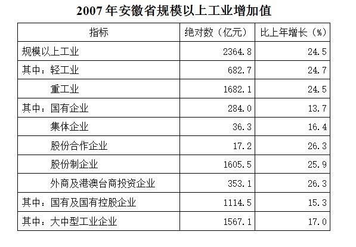

### 第 126 题

重工业增加值比轻工业增加值多了多少亿元：

A. 1000.6

B. 1000.4

C. 999.6

D. 999.4

第 126 题 · 答案与解析

**参考答案（粉笔题库参考内容）**

D

**解析**

重工业增加值为：1682.1亿元，轻工业增加值为：682.7亿元，由题意：1682.1-682.7=1682.1-682.1-0.6=999.4亿元。

故正确答案为D。

**考点**：简单加减计算、统计表

**来源**：2008年安徽省公务员录用考试《行测》题第126题

### 第 127 题

轻工业增加值为规模以上工业增加值的：

A. 22.4%

B. 24.6%

C. 26.1%

D. 28.9%

第 127 题 · 答案与解析

**参考答案（粉笔题库参考内容）**

D

**解析**

由题意：。

故正确答案为D。

**考点**：现期比重、统计表

**来源**：2008年安徽省公务员录用考试《行测》题第127题

### 第 128 题

国有企业增加值是集体企业增加值的：

A. 7.8倍

B. 5.5倍

C. 6.2倍

D. 8.6倍

第 128 题 · 答案与解析

**参考答案（粉笔题库参考内容）**

A

**解析**

由题意：采用直除法，可得其首位数字为7，答案中只有A选项为7。

故正确答案为A。

**考点**：现期倍数、统计表

**来源**：2008年安徽省公务员录用考试《行测》题第128题

### 第 129 题

以下判断正确的是：

A. 集体企业增加值增速最慢

B. 国有企业增加值最少

C. 外商及港澳台商投资企业与股份合作企业的增加值相同

D. 在所有企业类型中，股份制企业增加值最多

第 129 题 · 答案与解析

**参考答案（粉笔题库参考内容）**

D

**解析**

集体企业的增速明显比国有企业快，A错误；

明显股份合作企业的增加值最少，B错误；

外商及港澳台商投资企业与股份合作企业的增速相同但增加值必然不同，C错误。

故正确答案为D。

**考点**：统计表、综合分析

**来源**：2008年安徽省公务员录用考试《行测》题第129题

### 第 130 题

以下判断不正确的是：

A. 轻工业与重工业增加值的增长速度接近

B. 外商企业增速是“一枝独秀”

C. 大中型工业企业的贡献近三分之二

D. 国有及国有控股企业几乎占据“半壁江山”

第 130 题 · 答案与解析

**参考答案（粉笔题库参考内容）**

B

**解析**

轻工业增速为24.7%，重工业增速为24.5%，所以轻工业与重工业增加值的增长速度接近，A判断正确；

外商企业增速为26.3%，而股份合作企业的增速也为26.3%，故不能说是“一枝独秀”，B判断错误；

规模以上工业增加值为2364.8亿元，其中大中型工业企业增加值为1567.1亿元，，C判断正确；

规模以上工业增加值为2364.8亿元，国有及国有控股企业增加值为1114.5亿元，，很接近一半，D判断正确。

本题为选非题，故正确答案为B。

**考点**：统计表、综合分析

**来源**：2008年安徽省公务员录用考试《行测》题第130题

## 材料 3

根据下列材料完成以下各题。

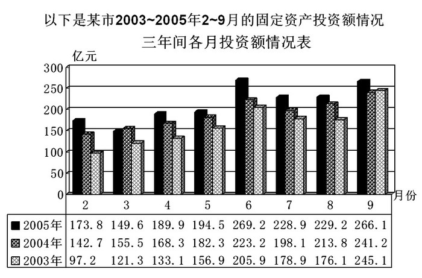

### 第 131 题

2005年二季度与三季度同比增长比较，二季度：

A. 高了3%

B. 低了3%

C. 高了3个百分点

D. 低了3个百分点

第 131 题 · 答案与解析

**参考答案（粉笔题库参考内容）**

C

**解析**

由题干“2005年二季度与三季度同比增长比较，二季度”，结合选项是高/低百分点，可判定本题为增长率差值计算。定位图形材料，2004年4-9月投资额分别为168.3亿元、182.3亿元、223.2亿元、198.1亿元、213.8亿元、241.2亿元；2005年4-9月投资额分别为189.9亿元、194.5亿元、269.2亿元、228.9亿元、229.2亿元、266.1亿元。根据增长率，可计算出2005年二季度同比增长率；2005年三季度同比增长率。则2005年二季度与三季度同比增长比较，14%-11%=3%，即二季度高了3个百分点。

故正确答案为C。

注释：

百分比和百分点的区别：①百分比通常用来描述实际量的变化情况，例如旅游人数、生产总值、产量等，而百分点通常用来描述百分数。

②百分比的计算通常为“先减后除”，即先作现期值与基期值的差，再用差值与基期值相除得到；而百分点的计算通常为“只减不除”，即直接将两个百分数直接相减并去掉百分号，而不用除法。

**考点**：一般增长率、统计图

**来源**：2008年安徽省公务员录用考试《行测》题第131题

### 第 132 题

2005年6月的投资规模比2003年2月的投资规模大约增长了几倍：

A. 1

B. 2

C. 3

D. 4

第 132 题 · 答案与解析

**参考答案（粉笔题库参考内容）**

B

**解析**

由题意可知2005年6月的投资规模比2003年2月的投资规模大约增长了，最接近2倍。

故正确答案为B。

**考点**：现期倍数、统计图

**来源**：2008年安徽省公务员录用考试《行测》题第132题

### 第 133 题

从上图可知，三年中投资规模同比增长速度最快的是：

A. 2004年2月

B. 2004年3月

C. 2004年8月

D. 2004年6月

第 133 题 · 答案与解析

**参考答案（粉笔题库参考内容）**

A

**解析**

观察柱形图，可知2004年2月同比增长速度为最快，相比上一年的增幅最大。

故正确答案为A。

**考点**：一般增长率、统计图

**来源**：2008年安徽省公务员录用考试《行测》题第133题

### 第 134 题

2004年年初至二季度末，投资规模同比增长的变化情况是：

A. 上升

B. 回落

C. 持平

D. 波动

第 134 题 · 答案与解析

**参考答案（粉笔题库参考内容）**

B

**解析**

观察柱形图，可知增速在回落，事实上2004年2月的增速是最大的，就是相比上一年的增长幅度是最大的。

故正确答案为B。

**考点**：一般增长率、统计图

**来源**：2008年安徽省公务员录用考试《行测》题第134题

### 第 135 题

下列哪句话是错误的：

A. 2005年二、三两季度的投资规模较2004年二、三季度各月的投资规模有不同幅度的增长

B. 2004年上半年各月的投资规模较2003年上半年各月的投资规模有不同幅度的增长

C. 2005年4～9月与二、三两季度投资规模的变化方向是一致的

D. 2005年全年投资规模的同比增长速度是一路攀升的

第 135 题 · 答案与解析

**参考答案（粉笔题库参考内容）**

D

**解析**

A项，观察柱状图2005年二、三两季度的投资规模较2004年二、三季度各月的投资规模有不同幅度的增长，正确；

B项，2004年上半年各月的投资规模较2003年上半年各月的投资规模有不同幅度的增长，正确；

C项，2005年4～9月与二、三两季度投资规模的变化方向是一致的，都是保持上升状态，正确；

D项明显错误，事实上，2005年投资规模同比增长速度在3月是负值，显然不是一路攀升。

本题为选非题，故正确答案为D。

**考点**：统计图、综合分析

**来源**：2008年安徽省公务员录用考试《行测》题第135题

## 材料 4

据2006年4月6日《新闻晚报》报道，3月份人民币汇率双向波动加剧，上周人民币汇率上下波动更加明显，到上周五，一下升值100点，创下汇改以来8.0170新高。而本周人民币兑美元稍有下跌后又开始步步走高。周一，1美元兑人民币中间价8.0210元，周二，1美元兑人民币中间价8.0194元。而昨日（4月5日星期三）人民币兑美元汇率收盘价一举突破8.01关口，达到8.0073：1，首度升至8.0000平台，再创汇改以来新高。

        根据中国外汇交易中心公布，2006年4月5日银行间外汇市场美元等交易货币兑人民币汇率的中间价为1美元兑人民币8.0116元，1欧元兑人民币9.8133元，100日元兑人民币为6.8242元，1港元兑人民币1.03252元。

        数据显示，2005年中国的外汇储备猛增了2100亿美元，总额达到8120亿美元。美国的对华贸易逆差激起了美国人对巨额贸易赤字的焦虑感，因此一直要求人民币升值，希望以此来缓解巨大的贸易逆差。

### 第 136 题

根据专家推断，2006年内人民币将升值3％左右，按4月5日外汇市场美元兑人民币汇率的中间价推算，人民币兑美元的汇率到2006年年底将跌至多少：

A. 8.0000左右

B. 7.7713左右

C. 7.2055左右

D. 7.0000左右

第 136 题 · 答案与解析

**参考答案（粉笔题库参考内容）**

B

**解析**

4月5日“1美元兑人民币8.0116元”，人民币升值3%，所以年底人民币对美元的汇率将跌至。

故正确答案为B。

**考点**：文字资料、现期计算

**来源**：2008年安徽省公务员录用考试《行测》题第136题

### 第 137 题

2006年4月5日人民币兑美元外汇的收盘价是＿＿＿＿＿创汇改以来的新高：

A. 8.0000

B. 8.0073

C. 8.0116

D. 8.0194

第 137 题 · 答案与解析

**参考答案（粉笔题库参考内容）**

B

**解析**

资料中明确指出“4月5日星期三人民币兑美元汇率收盘价一举突破8.01关口，达到8.0073：1”（第一段末句）。

故正确答案为B。

**考点**：文字资料、直接找数

**来源**：2008年安徽省公务员录用考试《行测》题第137题

### 第 138 题

2005年中国的外汇储备增幅为：

A. 20.86%

B. 25.86%

C. 30.88%

D. 34.88%

第 138 题 · 答案与解析

**参考答案（粉笔题库参考内容）**

D

**解析**

由题意：，这个结果和34.88%最接近。

故正确答案为D。

**考点**：一般增长率、文字资料

**来源**：2008年安徽省公务员录用考试《行测》题第138题

### 第 139 题

按4月5日人民币兑外币汇率的中间价，1欧元可换多少美元：

A. 78.6202

B. 1.2249

C. 1.1429

D. 0.8164

第 139 题 · 答案与解析

**参考答案（粉笔题库参考内容）**

B

**解析**

由题意：，结果和B项1.2249最接近。

故正确答案为B。

**考点**：文字资料、比值计算

**来源**：2008年安徽省公务员录用考试《行测》题第139题

### 第 140 题

下面哪个图可反映2006年3月5日至4月6日期间1美元兑人民币的汇率中间价的实时趋势：

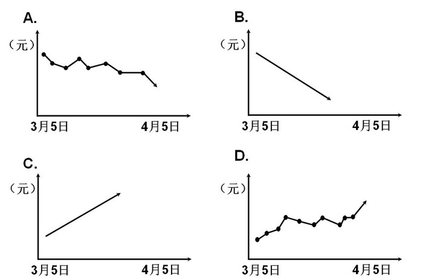

A. A

B. B

C. C

D. D

第 140 题 · 答案与解析

**参考答案（粉笔题库参考内容）**

A

**解析**

由“3月份人民币汇率双向波动加剧，上周人民币汇率上下波动更加明显”和“而昨日（4月5日星期三）人民币兑美元······8.0000平台，再创汇改以来新高”可知，人民币汇率呈现上升状态，那么美元兑换人民币显然为贬值的过程，排除C、D两项，并且贬值过程不可能是一条平滑的曲线，排除B项。

故正确答案为A。

**考点**：文字资料、直接找数

**来源**：2008年安徽省公务员录用考试《行测》题第140题

