# 2009年安徽省公务员录用考试《行测》题

<!-- gwy:overview:start -->
> **安徽 · 2009 · 行测 · 统考** ｜ 140 题 · 图片 17 处 · 答案随题折叠

| 题型模块 | 题量 | 题号 |
| --- | ---: | ---: |
| 数量关系 | 15 | 1–15 |
| 言语理解与表达 | 40 | 16–55 |
| 判断推理 | 35 | 56–90 |
| 常识判断 | 35 | 91–125 |
| 资料分析 | 15 | 126–140 |
| **合计** | **140** | |

导航：[题型与作答说明](#题型与作答说明) · [题目](#题目) · [材料 1](#材料-1)
<!-- gwy:overview:end -->

> 候选采集稿。参考答案及解析来自粉笔页面，不代表官方答案或真实高分答卷；来源使用许可与原卷对应关系仍需人工核实。

## 题型与作答说明

数量关系

（15题）

本部分包括数字推理与数学运算两种类型的试题。

言语理解与表达

（40题）

本部分包括语句表达与阅读理解两种类型的题目。

判断推理

（35题）

本部分包括定义判断、类比推理、图形推理与逻辑判断四种类型的试题。

常识判断

（35题）

要求你依据常识做出判断。请注意，似乎合理的答案可能有多种，你应选择最为合理的一个。

资料分析

（15题）

针对下列图、表或文字回答问题。你应根据资料提供的信息进行分析、比较、计算、处理。

## 题目

### 第 1 题

7，14，10，11，14，9，（    ），（    ）

A. 19，8

B. 18，9

C. 17，8

D. 16，7

第 1 题 · 答案与解析

**参考答案（粉笔题库参考内容）**

A

**解析**

数列项数较多，考虑多重数列，交叉分开找规律：

奇数项：7，10，14，（    ），无明显规律，考虑作差。后项减前项得3，4，？，猜测是公差为1的等差数列，则？=5，故所求奇数项=14+5=19；

偶数项：14，11，9，（    ），无明显规律，考虑作差。后项减前项得-3，-2，？，猜测是公差为1的等差数列，则？=-1，故所求偶数项=9+(-1)=8。

因此，所求两项分别为19、8。

故正确答案为A。

**来源**：2009年安徽省公务员录用考试《行测》题第1题

### 第 2 题

97，95，92，87，（    ）

A. 81

B. 79

C. 74

D. 66

第 2 题 · 答案与解析

**参考答案（粉笔题库参考内容）**

B

**解析**

数列起伏较小且无明显特征，优先考虑多级数列。前项减后项作差后得到新数列：2，3，5，（    ），观察新数列，猜测新数列为质数列或简单递推和数列。若为质数列，则新数列下一项为7，所求项为87-7=80，匹配选项无结果；若新数列为简单递推和数列，下一项=3+5=8，则所求项为87-8=79，匹配选项有结果。

故正确答案为B。

**来源**：2009年安徽省公务员录用考试《行测》题第2题

### 第 3 题

1/4，3/10，（    ），2/5

A. 23/50

B. 17/40

C. 11/30

D. 7/20

第 3 题 · 答案与解析

**参考答案（粉笔题库参考内容）**

D

**解析**

观察数列，题干和选项均为分数，优先考虑分数数列。观察选项分母数值较大且均为整十，考虑将原数列通分，转化为：5/20，6/20，(    )，8/20，观察分子是公差为1的等差数列，则所求项分子为7，故所求项为7/20。

故正确答案为D。

**来源**：2009年安徽省公务员录用考试《行测》题第3题

### 第 4 题

1089，2178，3267，······，（    ）

A. 9810

B. 9801

C. 9180

D. 9081

第 4 题 · 答案与解析

**参考答案（粉笔题库参考内容）**

B

**解析**

观察数列，所求项不确定位置，考虑分析数列的共性。

方法一：观察发现，1089=1089×1，2178=1089×2，3267=1089×3，故数列各项应为1089的整数倍，观察选项，只有B项符合此规律，9801=1089×9。

方法二：观察发现，数列各项均存在千位比百位大1，十位比个位小1，观察选项只有B项9801符合此规律。

故正确答案为B。

**来源**：2009年安徽省公务员录用考试《行测》题第4题

### 第 5 题

5，15，10，215，（    ）

A. \-205

B. \-115

C. \-225

D. \-230

第 5 题 · 答案与解析

**参考答案（粉笔题库参考内容）**

B

**解析**

数列起伏明显，考虑递推数列。观察发现：5^2−15=10，15^2 − 10 = 215，规律为：第一项^2 − 第二项= 第三项，故所求项= 10^2 − 215= -115。

故正确答案为B。

**来源**：2009年安徽省公务员录用考试《行测》题第5题

### 第 6 题

123456788×123456790-123456789×123456789=

A. \-1

B. 0

C. 1

D. 2

第 6 题 · 答案与解析

**参考答案（粉笔题库参考内容）**

A

**解析**

方法一：观察计算式各项均接近123456789，且多次出现，将123456789用符号a代替，代入原计算式可得：（a-1）×（a+1）-a×a=a^2-1-a^2=-1。

方法二：观察选项尾数不同，故可利用尾数法计算本题。原式尾数=0-1，则原式尾数为9或-1，只有A项符合。

故正确答案为A。

**来源**：2009年安徽省公务员录用考试《行测》题第6题

### 第 7 题

已知a+b=8，ab=-20，则(a-b)a³+(b-a)b³=

A. 96

B. \-96

C. 2096

D. 12096

第 7 题 · 答案与解析

**参考答案（粉笔题库参考内容）**

D

**解析**

方法一：将题干计算式进行分解：(a-b)a^3+(b−a)b^3= (a − b) ×(a^3-b^3)= (a-b)×(a-b)× (a^2 + ab + b^2)=(a-b)^2×[(a + b)^2 - ab] =[(a + b)^2 − 4ab] ×[(a + b)^2 − ab]=[8^2−4×(−20)]× [8^2 − (−20)]= (64 + 80) ×(64+20)=12096。

方法二：根据韦达定理可推出，a、b为方程x^2 − 8x − 20 = 0的两个根，设a＞b，可推出：a=10，b=-2，则题干算式= [10−(−2)]×10^3+(−2−10)×(-2)^3= 12 × 1000+12×8=12096。

故正确答案为D。

**来源**：2009年安徽省公务员录用考试《行测》题第7题

### 第 8 题

一个人从山下沿30°角的坡度登上山顶，共走了300米，那么这座山的高度是多少米：

A. 100

B. 150

C. 200

D. 250

第 8 题 · 答案与解析

**参考答案（粉笔题库参考内容）**

B

**解析**

如下图所示，可知所求山的高度为直角三角形中30°角对应的直角边，根据结论：在直角三角形中，30°角所对直角边等于斜边的一半，可得，山的高度= 300 × 1/2 = 150米。

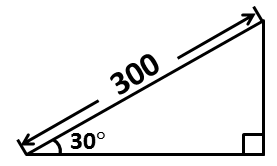

故正确答案为B。

**考点**：几何公式类-平面图形、几何结论类-三角形相关

**来源**：2009年安徽省公务员录用考试《行测》题第8题

### 第 9 题

王工的自驾车耗油是百公里8升，原来的油价为6元一升，今年初调为5元一升，王工加了300元钱的油，可以比原来多跑多少公里：

A. 85

B. 100

C. 110

D. 125

第 9 题 · 答案与解析

**参考答案（粉笔题库参考内容）**

D

**解析**

根据题意可知，下调前300元可购买300/6 = 50升油，下调后300元可购买300/5 = 60升油，即可多买60-50=10升油，推出可多跑10/8 × 100 = 125公里。

故正确答案为D。

**考点**：和差倍比问题

**来源**：2009年安徽省公务员录用考试《行测》题第9题

### 第 10 题

矩形的一边增加了10%，与它相邻的一边减少了10%，那么矩形的面积：

A. 增加10%

B. 减少10%

C. 不变

D. 减少1%

第 10 题 · 答案与解析

**参考答案（粉笔题库参考内容）**

D

**解析**

根据题意，假设该矩形是边长为10的正方形，可知原矩形面积为10×10=100，一边增加10%后变为10×(1+10%)=11，一边减少10%后变为10×(1-10%)=9，可推出新矩形面积为11×9=99，故面积减少(100-99)/100 = 1%。

故正确答案为D。

**考点**：几何公式类-平面图形

**来源**：2009年安徽省公务员录用考试《行测》题第10题

### 第 11 题

当含盐为30%的60克盐水蒸发为含盐40%的盐水时，盐水重量是多少克：

A. 45

B. 50

C. 55

D. 60

第 11 题 · 答案与解析

**参考答案（粉笔题库参考内容）**

A

**解析**

方法一：根据浓度=溶质量/溶液量，则盐水中含盐量=30%×60=18克，蒸发后盐水重量= 18/40% = 45克。

方法二：设蒸发后盐水重量为x克，根据题意可知蒸发前后溶质质量不变，由此可列：60×30%=x×40%，解得x=45。

故正确答案为A。

**来源**：2009年安徽省公务员录用考试《行测》题第11题

### 第 12 题

人们将1/10表示为1月10日，也有人将1/10表示为10月1日，这样一年中就有不少混淆不清的日期了，当然，8/15和15/8只能表示为8月15日，那么一年中像这样不会搞错的日期最多会有多少天：

A. 221

B. 222

C. 216

D. 144

第 12 题 · 答案与解析

**参考答案（粉笔题库参考内容）**

B

**解析**

根据题意可知，会搞错的日期为：（1-12）/（1-12），共有：12×12=144天，已知闰年一年共366天，故不会搞错的日期最多有：366-144=222天。

故正确答案为B。

备注：严谨来说，本题没有正确选项，在会搞错的144天中，（1/1）,（2/2），（3/3），······，（12/12），这12种情况也是不会搞错的日期，故不会搞错的日期最多有：222+12=234天。

**考点**：星期日期问题

**来源**：2009年安徽省公务员录用考试《行测》题第12题

### 第 13 题

某养殖场养了224头牲畜。其中羊比牛多38只，牛比猪多6只。如果将牛总数的75%用来换羊，一头牛换5只羊，那么，羊总共有多少只？

A. 342

B. 174

C. 240

D. 268

第 13 题 · 答案与解析

**参考答案（粉笔题库参考内容）**

A

**解析**

设原本养殖场共有x只羊，则共有(x-38)只牛，共有(x-38-6)只猪，根据题意“养殖场养了224头牲畜”，可列方程：x+(x-38)+(x-38-6)=224，解得x=102，则更换后的羊的总数为：102+(102-38)×75%×5=342只。

故正确答案为A。

**考点**：和差倍比问题

**来源**：2009年安徽省公务员录用考试《行测》题第13题

### 第 14 题

某住户安装了分时电表，白天电费是0.55元，夜晚是0.3元，计划7月用电400度，电费不能超过160元，问白天最多不能超过多少度？

A. 150

B. 160

C. 170

D. 180

第 14 题 · 答案与解析

**参考答案（粉笔题库参考内容）**

B

**解析**

方法一：设7月份白天用电x度，则夜晚用电(400-x)度，根据题意“电费不能超过160元”，可列方程：0.55x+0.3×(400-x)≤160，整理得到：0.25x+120≤160，可推出当不等式右面取到160时，x可取得最大值，即0.25x+120=160，解得x=160。

方法二：利用线段法解题。假设400度电全部白天使用，则需要400×0.55=220元；假设400度电全部夜晚使用，则需要400×0.3=120元，而实际最多花费160元，利用线段法“距离与量成反比”，可推出(220-160)/(160-120)=夜晚用电量/白天用电量=3/2，故白天用电量最多为400 × 2/5 = 160度。

故正确答案为B。

**考点**：分段计算问题、非典型最值问题

**来源**：2009年安徽省公务员录用考试《行测》题第14题

### 第 15 题

某个月有5个星期三，并且第三个星期六是18号，请问以下哪项不能确定？

A. 这个月有31天

B. 这个月最后一个星期日不是28号

C. 这个月没有5个星期六

D. 这个月有可能是闰年2月份

第 15 题 · 答案与解析

**参考答案（粉笔题库参考内容）**

A

**解析**

根据题意“第三个星期六是18号”，可知本月所有星期六的日期为：4号，11号，18号，25号，由此可推出5个星期三分别为：1号，8号，15号，22号，29号。

A项：由以上分析可知，本月最少29天最多31天，故不能确定一定是31天，选项描述不确定；

B项：由以上分析可知，28号是星期二，不是星期日，故选项正确可确定；

C项：由以上分析可知，第四个星期六是25号，故不可能存在第五个星期六，选项正确可确定；

D项：闰年的二月共29天，由上述分析可知，天数可以满足，故有可能。选项描述正确可确定。

本题为选非题，故正确答案为A。

**考点**：星期日期问题

**来源**：2009年安徽省公务员录用考试《行测》题第15题

### 第 16 题

在这场全球性的金融危机中，中国不可能＿＿＿。

填入横线上的词语最恰当的是：

A. 特立独行

B. 独善其身

C. 独步天下

D. 孤独求败

第 16 题 · 答案与解析

**参考答案（粉笔题库参考内容）**

B

**解析**

本题考查选择成语填空的能力。

空格之前的语境与空格构成了条件关系，即“全球性金融危机”情况下，中国必然受到影响，强调“危机”与“中国”的联系性。

B项正确，“独善其身”意思为在不好的环境中，只顾保全自己，也有修身养性的意思，综合来看，符合语境。

A项“特立独行”意思为不随波逐流，强调个人志行高洁；C项“独步天下”意思为超群出众，无人可比；D项“孤独求败”强调能力卓著，无人能打败。A、C、D三者均强调个人特性，无法体现中国与全球性经济危机的联系性。

故正确答案为B。

**考点**：关联关系-并列关系、成语填空

**来源**：2009年安徽省公务员录用考试《行测》题第16题

### 第 17 题

某市公开选拔了一批党政领导干部。从年龄结构上看，＿＿的这批干部普遍年轻；从＿＿上看，他们的教育背景普遍较好；至于他们是否具有＿＿的能力和水平，还需要在实践中进一步检验。

依次填入横线上的词语最恰当的一组是：

A. 履职 履新 履历

B. 履职 履历 履新

C. 履新 履职 履历

D. 履新 履历 履职

第 17 题 · 答案与解析

**参考答案（粉笔题库参考内容）**

D

**解析**

本题考查近义实词词义范围的辨析和填空。

“履职”指行使职责，侧重过程；“履新”指就任新职，侧重状态和结果；“履历”指具体的个人简历，包括学习、工作背景等。从语境来看，第一个空格强调干部状态，故选择“履新”，指新就职的干部；第二个空格强调教育背景，“履历”最合适；第三个空格强调行事能力和水平，“履职”最合适。综上，D项正确。

故正确答案为D。

**考点**：实词填空、词的辨析-搭配对象、词的辨析-词义侧重

**来源**：2009年安徽省公务员录用考试《行测》题第17题

### 第 18 题

将下列无序的语句，按合理的逻辑关系，还原为一则完整的简讯，正确的一组是：

①职业中介聚集地和自发形成的人力资源交易场所为重点

②清理整顿人力资源市场秩序的专项行动

③检查中介机构、用人单位遵守就业管理有关法律法规情况

④本市将开展

⑤2009年2月9日至3月9日

⑥以工商企业密集区、流动人口聚居地

A. ④②⑤③⑥①

B. ⑤④②⑥①③

C. ⑥①④②③⑤

D. ⑤④⑥①②③

第 18 题 · 答案与解析

**参考答案（粉笔题库参考内容）**

B

**解析**

由题干可知排序内容为简讯。在简讯写作时，应注意要素排序，一般将时间放在首位，随后概括事件，最后做具体解释。由此可知⑤排首位，④②为事件主体，根据“以……为重点”关键词可知⑥在①前，③为具体解释，对应B项。

故正确答案为B。

**考点**：确定顺序

**来源**：2009年安徽省公务员录用考试《行测》题第18题

### 第 19 题

下列括号中的成语，使用不恰当的一句是：

A. 公安人员（昼伏夜出），经过二十多天的侦查，终于抓获了这个黑社会头目

B. 个别民警认为工作时间饮点酒是小事一桩，就（不以为意），结果因违犯公安部颁布的“五条禁令”而受到处分

C. 解决返乡农民的再就业问题，是当前头等大事，各乡镇领导切不可对此（置之度外）

D. 不管大家跟他怎么解释，他仍是（振振有词）地说：“不管怎样，我还是保留自己的观点。”

第 19 题 · 答案与解析

**参考答案（粉笔题库参考内容）**

A

**解析**

本题考查成语误用辨析的能力。

A项不恰当，“昼伏夜出”指白天在家休息，晚上出来活动，多指小偷或某些动物的习性，含贬义，用来形容公安人员，语境感情色彩不妥。

B项“不以为意”指不把它放在心上，表示对人或事抱轻视态度；C项“置之度外”指不去考虑，为正义的事不把个人的生死利害等放在心上；D项“振振有词”指理直气壮的样子，形容自以为理由很充分，说个不休，强词夺理。B项“不以为意”、C项“置之度外”、D项“振振有词”均符合语境，使用得当。

本题为选非题，故正确答案为A。

**来源**：2009年安徽省公务员录用考试《行测》题第19题

### 第 20 题

本书作者希望以这本书为读者学习英语句型起到举一反三的作用。

与上面句子意思相同的一句是：

A. 本书作者希望以这本书能对读者在学习英语句型方面起到举一反三的作用

B. 本书作者希望以这本书能帮助读者在学习英语句型方面起到举一反三的作用

C. 本书作者希望能以这本书为读者正确地理解英语句型起到举一反三的作用

D. 本书作者希望这本书能引导读者在学习英语句型方面起到举一反三的作用

第 20 题 · 答案与解析

**参考答案（粉笔题库参考内容）**

B

**解析**

本题考查词句理解的能力。

B项正确，题干主要在说作者希望这本书能在学生学习英语句型时对学生起到一定的帮助作用，强调“帮助作用”。

A项具有迷惑性，A项、B项与题干句子含义均一致，但是B项比A项更明确强调了书的辅助、帮助作用，故不选A项；C项“正确地理解”与题干不符，故不选；D项“引导”题干并未提及，故不选。

故正确答案为B。

**考点**：句子

**来源**：2009年安徽省公务员录用考试《行测》题第20题

### 第 21 题

下列句子中，没有歧义的一句是：

A. 他先后将该公司的6辆车分别送给副市长和其他领导干部的子女长期使用

B. 那天下午，数十位死难者的亲属聚集在矿主的家门口，要求讨个说法

C. 本人已八十高龄，体弱多病，目前头脑尚清醒，决定辞世后X楼X室产权归义女李小玲继承，特立此遗嘱

D. 奇瑞汽车、江淮汽车的升级换代产品在本届车博会上受到专家的一致好评

第 21 题 · 答案与解析

**参考答案（粉笔题库参考内容）**

C

**解析**

本题考查歧义辨析的能力。

C项无歧义。

A项有歧义，是送给“副市长的子女和其他领导干部的子女”，还是“副市长本人和其他领导干部的子女”，对象不明；B项有歧义，“数十位死难者的亲属”可以理解为“死难者有数十位”，或者“亲属有数十位”；D项有歧义，是“奇瑞汽车、江淮汽车的升级换代产品”，还是“奇瑞汽车的升级换代产品和江淮汽车的升级换代产品”，指代不明，故不选。

故正确答案为C。

**来源**：2009年安徽省公务员录用考试《行测》题第21题

### 第 22 题

下列有歧义的一句是：

A. 昨天你参加演出了吗

B. 谁陪我去超市买东西呢

C. 妈妈给我打电话，说明天就回家

D. 我没有时间等你，自己先走吧

第 22 题 · 答案与解析

**参考答案（粉笔题库参考内容）**

C

**解析**

本题考查歧义辨析的能力。

C项有歧义，可以有两种理解，“妈妈明天回家”或者“妈妈让我明天回家”，对象不明，故C项当选。

A、B、D三项均无歧义。

故正确答案为C。

**来源**：2009年安徽省公务员录用考试《行测》题第22题

### 第 23 题

下列句子中，没有歧义的一句是：

A. 刘淘喜欢赞扬青年学生的作品

B. 天色渐晚，自行车还没修好，修车的急坏了

C. 有偿新闻应当受到严肃批评，这是极其错误的

D. 我不知道她老人家怎么了，她怎么能这样呢

第 23 题 · 答案与解析

**参考答案（粉笔题库参考内容）**

D

**解析**

本题考查歧义辨析的能力。

D项无歧义。

A项有歧义，“赞扬青年学生的作品”可有两种理解，“刘淘喜欢作品的类型是青年学生的”或者“刘淘本身喜欢赞扬青年学生写的作品”，侧重点可不同；B项有歧义，“修车的”指代不明，可以是“拿自行车去修的人”，也可是“自行车的修理工”；C项有歧义，指代不明，可以理解为“有偿新闻是错误”或“批评有偿新闻是错误的”，均不选。

故正确答案为D。

**来源**：2009年安徽省公务员录用考试《行测》题第23题

### 第 24 题

人们才发现自己马群里的马在一夜之间忽然变多了。

与上面句子语法结构相同的一句是：

A. 有人看见你在大街上拿着书走来走去

B. 他曾经看见两位虎头虎脑的青年从桃园茶社里慢慢地走出来

C. 交通局派来的一辆由最好司机驾驶的最好的汽车，早已等在养老院门口

D. 他一直密切关注IT产业的发展情况

第 24 题 · 答案与解析

**参考答案（粉笔题库参考内容）**

B

**解析**

本题考查分析句子语法结构的能力。

题干的结构为“主谓宾”的复杂句式，其中宾语又拆为“主谓”结构。

B项中，主语为“他”，谓语为“看见”，宾语为“青年从桃园茶社走出来”，其中宾语可拆分为“主谓”结构，与题干结构相同，故B项正确。

A项为主谓宾补的简单句；C项为主谓结构；D项为主谓宾的简单句。A、B、C三项均不选。

故正确答案为B。

**来源**：2009年安徽省公务员录用考试《行测》题第24题

### 第 25 题

美国试图通过解决流动性危机来解决支付性危机无异于<u>抱薪救火</u>，借更多的债来解决债务危机，这种救助力度越大，危机扩散幅度就越深，持续时间也越长。

可以替换划线部分的词语是：

A. 杯水车薪

B. 扬汤止沸

C. 火上浇油

D. 剜肉补疮

第 25 题 · 答案与解析

**参考答案（粉笔题库参考内容）**

C

**解析**

本题考查词语替换的能力。

句子中“抱薪救火”的意思是抱着柴草去救火，比喻用错误的方法去消除灾难，反而使灾祸扩大。材料中的意思就是使问题更严重。

C项正确，“火上浇油”指在火上放上油，比喻有意增加他人的愤怒或助长事态发展，意思相似。

A项错误，“杯水车薪”指用一杯水去救一车着了火的柴草，比喻无济于事，徒劳无功；B项错误，“扬汤止沸”指把锅里开着的水舀起来再倒回去，使它凉下来不沸腾，比喻办法不彻底，不能从根本上解决问题；D项错误，“剜肉补疮”比喻只顾眼前，用有害的方法来救急。A、B两项与“抱薪救火”不构成近义关系，D项强调手段而非结果，故均不选。

故正确答案为C。

**来源**：2009年安徽省公务员录用考试《行测》题第25题

### 第 26 题

下列各句中，没有语病的一句是：

A. 对于农村小学，非常关心的一个问题是如何把大量的优质教育资源输入到农村小学的课堂里去，使农村学校的老师和孩子能够把他们的课上好

B. 作家出版社最近出版了巴金先生记述性、回忆性文字的汇编《我的家》，该书以图文形式首次全面展现了一代文学大师鲜为人知的家庭生活

C. 作为2008年北京奥运会保险合作伙伴，中国人保以更适合公众参加的形式组织了弘扬奥林匹克精神、服务奥运，分享奥运带来的激情和欢乐

D. 为了拉动内需，日前国家发改委等六部委联合发文，鼓励发展节能环保型小排量汽车，要求各地各部门消除对小排量汽车的各种限制措施

第 26 题 · 答案与解析

**参考答案（粉笔题库参考内容）**

B

**解析**

本题考查语病辨析的能力。

A项缺少主语；C项“组织了弘扬奥林匹克精神、服务奥运”一句成分缺失；D项“鼓励发展节能环保型小排量汽车”与 “要求各地各部门消除对小排量汽车的各种限制措施”顺序颠倒，应该是要求在前，鼓励在后，故均不选。

故正确答案为B。

**来源**：2009年安徽省公务员录用考试《行测》题第26题

### 第 27 题

下列各句中，有语病的一句是：

A. 近几年的调查数据显示，随着育儿方式和儿童膳食结构的改变，儿童肥胖症的发生率正在逐渐增加

B. 要提高人均资源，不能靠减少人口，而只能依靠科技创新，依靠高效的行政和法治下的市场对资源的合理配置

C. 抑郁症的发生和生物、社会、心理三个方面都有关系，工作紧张、压力增大等社会因素使越来越多的现代人被抑郁困扰

D. 目前我市确有个别学校出现了聚集性的流感样病例，疾控中心对此正在做进一步的病原调查核实，已指导校方采取了有效措施

第 27 题 · 答案与解析

**参考答案（粉笔题库参考内容）**

C

**解析**

本题考查病句判断的能力。

C项有语病，“工作紧张、压力增大等”属于社会、心理因素。

故正确答案为C。

**来源**：2009年安徽省公务员录用考试《行测》题第27题

### 第 28 题

下列各句中，没有语病的一句是：

A. 照片拍的好，诗歌写的有味，是由一个人的思想认识、艺术水平的高低决定的

B. 水资源短缺严重制约着我国西部广大地区经济建设和生态建设的发展，能否做好水的开源节流工作是西部大开发成功的关键之一

C. 国外盛行的“花明天的钱过今天的日子”的消费理念，如今在我国表现得也很抢眼，多数市民买商品房选择了按揭贷款

D. 越来越多的下岗职工凭着再就业的优惠政策走上了创业之路，他们把国家贴息贷款的一半以上作为自己重新创业的启动资金

第 28 题 · 答案与解析

**参考答案（粉笔题库参考内容）**

C

**解析**

本题考查病句辨析的能力。

C项无语病。

A项“照片拍的好，诗歌写的有味”为一面，而“思想认识、艺术水平的高低”则是两面，为一面对两面，故不选；B项“能否做好”，与后面“成功的关键之一”相矛盾，也是一面对两面，故不选；D项题干的意思是，下岗职工创业就一定是重新创业，而下岗职工在工作岗位并非全部进行重新创业，“重新创业”不准确，故不选。

故正确答案为C。

**来源**：2009年安徽省公务员录用考试《行测》题第28题

### 第 29 题

下列各句中，有语病的一句是：

A. 本届民族运动会选择在广州举办，不仅在该赛事的办赛途径和方向上体现了新意，而且在促进不同地区的相互交流学习上起到积极作用

B. 人类文化史上的大浩劫——秦始皇的焚书、中世纪的精神桎梏、各个王朝的文字狱、法西斯对文化的杀戮——并不曾使任何一个时代、任何一个民族的文化真正中断、灭亡

C. 滥用外来语所造成的支离破碎的语境，既破坏了汉语文字的严谨与和谐，影响了汉语表意功能的发挥，也消解了中国文化精深而丰富的内涵

D. 摄影家们把自己对山川、草木、城市、乡野的感受与作家不同，没有倾注于笔下，而是直接聚焦于镜头

第 29 题 · 答案与解析

**参考答案（粉笔题库参考内容）**

D

**解析**

本题考查语病辨析的能力。

D项结构混乱，主体举棋不定，“把······”和“与······不同”句式杂糅。此句可改为：摄影家们与作家不同，他们没有把自己对山川、草木、城市、乡野的感受倾注于笔下，而是直接聚焦于镜头。

故正确答案为D。

**来源**：2009年安徽省公务员录用考试《行测》题第29题

### 第 30 题

下列各句中，没有语病、句意明确的一句是：

A. 过去人们只是读他们的小说，不曾也很少注意到他们的形象

B. 世界卫生组织宣布，正在研讨中的抗流感新型疫苗，预计年内将进行首次临床试验

C. 靠生死搏斗夺取种群的统治权，是某些动物群落权力交接的唯一方式，虽残酷，却也符合优胜劣汰的种群优化之道

D. 最近又读到一篇介绍四位“贪内助”钱迷心窍，利令智昏，帮助甚至鼓励丈夫敛财受贿，结果把丈夫推向犯罪深渊的过程，提醒官员家庭引以为鉴

第 30 题 · 答案与解析

**参考答案（粉笔题库参考内容）**

C

**解析**

本题考查病句辨析的能力。

C项无语病，句意明确。

A项“不曾”指从来没有，“很少”指次数很少，两者矛盾，排除；B项“正在研讨中”的疫苗还停留在认识阶段，与“临床实验”存在阶段性跳跃，语意不连贯，排除；D项提取主干“读到······过程”动宾搭配不当，排除。

故正确答案为C。

**来源**：2009年安徽省公务员录用考试《行测》题第30题

### 第 31 题

美国科学家的一份报告指出：滨海湿地生态系统每公顷每年创造的综合价值达4025美元，相当于同等面积的热带雨林的2倍，或其他森林的13倍，或草地的17倍，或农田的44倍。

对句中“价值”的理解不正确的一项是：

A. 滨海湿地是具有丰富的生物多样性的特殊生态系统

B. 滨海湿地对全球生态平衡具有不可替代的重要作用

C. 滨海湿地有很高的生物生产力和重要的海岸防护功能

D. 滨海湿地可以为沿海地区创造出很高的国民经济价值

第 31 题 · 答案与解析

**参考答案（粉笔题库参考内容）**

D

**解析**

本题考查分析词语指代的能力。

定位材料，可知“价值”为滨海湿地生态系统的综合价值，范围应包括生态方面的。

D项“国民经济价值”材料中无法体现，故理解不正确。

A、B、C三项均为生态价值，符合材料。

本题还可以通过常识来判断：湿地的最大效益是它的环境效益。A、B、C三项都是讲生态效益，D项讲的经济效益。

本题为选非题，故正确答案为D。

**考点**：实词

**来源**：2009年安徽省公务员录用考试《行测》题第31题

### 第 32 题

在职称评审委员会会议上，张教授对其他人对他提出的关于“反对给严重违反校纪校规的李华晋升为教授”的建议持反对意见，他感到十分遗憾和不理解，随即忿懑地退出了会议室。

对李华晋升教授，张教授最终所持的态度是：

A. 同意

B. 不同意

C. 未置可否

D. 置之不理

第 32 题 · 答案与解析

**参考答案（粉笔题库参考内容）**

B

**解析**

材料关键句为“他提出的关于‘反对给严重违反校纪校规的李华晋升为教授’的建议”，定位材料语境可知，其中“他”指代为张教授，建议内容为不同意李华晋升教授。张教授对别人的反对不理解，愤懑离开会场，意味着张教授没有改变自己的立场，故张教授的态度为“不同意”。

故正确答案为B。

**考点**：特殊问法

**来源**：2009年安徽省公务员录用考试《行测》题第32题

### 第 33 题

如果有朝一日机器在我们自以为优越的那种重要品质上超过我们，我们就要向自己的创造物双手奉上那唯一的特权。

对该句的正确理解是：

A. 当机器在优越品质上超过人类时，人类就将无法控制机器的思维能力

B. 如果某一天机器在各方面超过人类，机器就将使人类失去思维能力

C. 当机器也具有思维能力以后，人类就将承认思维不再是自己的特权

D. 如果某一天机器具备了人类的重要品质，机器就将享有人类的所有权利

第 33 题 · 答案与解析

**参考答案（粉笔题库参考内容）**

C

**解析**

本题考查细节判断的能力。

C项正确，材料关键句为“向自己的创造物双手奉上那唯一的特权”，也就是说，思维作为我们人类重要的品质，不再是人类自己的特权。

A项错误，“无法控制”为过度推理，故不选；B项错误，“机器在各方面超过人类”偏离题意，无中生有，故不选；D项错误，“享有人类的所有权利”为过度推理，故不选。

故正确答案为C。

**考点**：细节判断题

**来源**：2009年安徽省公务员录用考试《行测》题第33题

### 第 34 题

热带居民的血液中R球蛋白含量较高，而蛋白质的含量则较低；寒带居民血液中，蛋白质的含量较高，而R球蛋白含量较低。这同寒带居民以肉食为主，而热带居民以素食为主有关。

这段话主要的意思是：

A. 不同地区人们的饮食习惯不同

B. 不同地区的食物来源不同

C. 食物结构影响人体的血液成分比例

D. 素食者更加健康长寿

第 34 题 · 答案与解析

**参考答案（粉笔题库参考内容）**

C

**解析**

本题属于中心理解题。文段第一句话通过分号连接两个并列复句，说明热带居民和寒带居民血液的成分比例不同，第二句解释了造成这种差异的原因，即饮食习惯不同。所以文段表达的是饮食习惯不同，引起血液成分的差异。结合选项，C项符合文意，当选。

A项，未指出饮食习惯对血液成分的影响，偏离文段中心，排除；

B项，原文未涉及“食物来源”相关内容，无中生有，排除；

D项，原文未涉及“健康长寿”相关内容，无中生有，排除。

故正确答案为C。

**考点**：分述句特征-引入铺垫

**来源**：2009年安徽省公务员录用考试《行测》题第34题

### 第 35 题

时间怀有一种公平的道义，对它所拿去的，它会给我们其他补偿。它夺去了我们肢体和精神的灵活，却给予我们安静和安详。

对这段话理解正确的是：

A. 无所谓浪费时间

B. 耽误的时间可以得到补偿

C. 不具有灵活的肢体和精神的人能获得安宁

D. 可以补偿青春活力流逝的是晚年的宁静

第 35 题 · 答案与解析

**参考答案（粉笔题库参考内容）**

D

**解析**

文段开篇提出话题“时间拿走的，会给我们补偿”，后文介绍了具体的补偿内容，即肢体不灵活，心灵却会安静，结合前文时间话题，可知说的是晚年的安静和安详可以弥补消失的年轻活力，故D项正确。D项符合题意，当选。

A项，文段论述“时间对拿走的会给一些补偿”，“无所谓浪费时间”程度过重，与原文不符，排除；

B项，不是“时间”得到补偿，而是时间拿走我们的东西，会用其他东西给予补偿，且文段论述的是“时间”，并非“耽误的时间”，表述错误，排除；

C项，文段前提为“它夺去了我们肢体精神的灵活”，即为时间夺走我们的肢体精神灵活才给予安静和安详，并非所有“不具有灵活肢体精神的人”能获得安宁，排除。

故正确答案为D。

**考点**：细节判断题

**来源**：2009年安徽省公务员录用考试《行测》题第35题

### 第 36 题

今日中国文化，需要的不是流氓精神，而是新的文化绅士精神。如果说，旧文化已经显示出其可笑之处，那替代它们的也不应当是山寨文化，而是应真正具有原创性的独立文化。“山寨”或许有反抗的努力，却没有自由精神。他们或许有天才，但却不能指向真善美的创造。

下列表述，符合上述这段话意思的是：

A. 山寨文化是流氓文化

B. 山寨文化不是真正具有原创性的独立文化

C. 山寨文化正是由于依附于旧文化而缺乏独立自由之精神

D. 山寨文化颠覆了传统的真善美

第 36 题 · 答案与解析

**参考答案（粉笔题库参考内容）**

B

**解析**

本题考查细节判断。

B项正确，文中的“替代它们的也不应当是山寨文化，而是应真正具有原创性的独立文化”是“不是······而是······”前后语意相反。

A项错误，因为文中虽然提到了“流氓精神”但却没有提及“山寨文化”和“流氓文化”之间的关系；C项错误，“依附于”在题干中无依据；D项错误，偷换概念，程度加重，导致绝对，故均不选。

故正确答案为B。

**考点**：细节判断题

**来源**：2009年安徽省公务员录用考试《行测》题第36题

### 第 37 题

房价理性回调，让老百姓能够用合理的价格实现住房梦想，其后自然会去大胆地消费和开支。从这个意义上讲，救市的确要救房地产，但是救房地产的最好方法就是让房价下跌。一直跌到让多数老百姓能够承受为止。

这段话表达了希望房价下跌的观点，其理由是：

A. 目前的房价缺乏理性

B. 老百姓期待合理的住房价格

C. 房价跌到多数老百姓能够承受的程度，就会拉动住房消费，使房地产业进入良性发展的轨道，从而提升经济

D. 房价虚高使老百姓住房梦想成为泡影

第 37 题 · 答案与解析

**参考答案（粉笔题库参考内容）**

C

**解析**

本题考查细节判断的能力。

由“其后自然会去大胆地消费和开支”和“救市的确要救房地产”可知，让房价下跌的初级目的是“救房地产”，但终极目的是为了“救市”，其手段是刺激消费，综合来看原因，C项正确。

A、B、D三项在表达希望房价下跌的原因时都不够全面、不够彻底。

故正确答案为C。

**考点**：细节判断题

**来源**：2009年安徽省公务员录用考试《行测》题第37题

### 第 38 题

法国作家福楼拜曾说：“科学和艺术在山麓分手，回头又在顶峰汇聚。”

这句话的含义最准确的一项是：

A. 科学与艺术各属的领域不同，但它们探求奥秘的手段是一样的

B. 科学与艺术研究天地自然的方式不同，但最后还是要相互合作相互借鉴的

C. 科学与艺术使用的语言不同，但是表达的内容却是一样的

D. 科学与艺术有许多不同，但是它们的本质和使命都是从杂乱的现象中整理出秩序和规律

第 38 题 · 答案与解析

**参考答案（粉笔题库参考内容）**

D

**解析**

本题为中心理解题。

D项正确，“山麓和顶峰”对应“本质和使命”，汇聚则意味着两者在本质上是一样的，D项既说明了两者有不同，又承认了两者的本质是一样的。

A项错误，由“在山麓分手”可知它们探求奥秘的手段不是一样的，故排除；B项错误，“相互合作相互借鉴”材料中没有体现，故排除；C项错误，“语言不同”属于妄加揣测，福楼拜的这句话并没有提到科学与艺术的不同在哪里，故排除。

故正确答案为D。

**来源**：2009年安徽省公务员录用考试《行测》题第38题

### 第 39 题

一个人有两个耳朵，能听话；两只眼睛，能看东西；两个鼻孔，能闻味。听话，能听正面的，也能听反面的；看东西，能看白的，也能看黑的；闻气味，能闻香的，也能闻臭味的，所以，＿＿＿。

横线上为这段文字所填写的结论性语句是：

A. 人体构造也是符合美学原理

B. 人的机能也是合乎辩证规律的

C. 面对纷繁复杂的世界，我们必须善于辨别

D. 万事万物都具有两面性的特点

第 39 题 · 答案与解析

**参考答案（粉笔题库参考内容）**

B

**解析**

本题考查语句填空的能力。

B项正确，材料具体介绍了人“耳”、“眼”、“鼻”的机能，强调都是两个，并用了一组具有辩证概念的词，如“正反”、“黑白”、“香臭”。意在说明身体机能与“辩证”之间存在某种关系，“所以”后的横线处应该得出结论，故“人的机能也是合乎辩证规律的”能承接现象，作为结论语意连贯。

A项错误，“美学原理”材料未能体现，故不选；C项错误，过度引申，故不选；D项错误，范围扩大，忽略了材料主体，故不选。

故正确答案为B。

**考点**：横线在结尾

**来源**：2009年安徽省公务员录用考试《行测》题第39题

### 第 40 题

一个知名企业向社会招聘高级管理人才，面试中有一道试题：“请写出你原来所在单位的最大秘密和对我公司有何价值？”应聘者对此各陈己见，但最后被聘用的却是一位对此题交白卷者。有人问及原因，老总回答道：“这样的人值得信任。”

应聘者对其试卷交白卷却被聘用，这件事说明了什么？对此理解最正确的一项是：

A. 聪明地不做胜过了愚蠢地做

B. 有创新精神才能出奇制胜

C. 表现与众不同才能崭露头角

D. 人格是成功的重要因素

第 40 题 · 答案与解析

**参考答案（粉笔题库参考内容）**

D

**解析**

本题为中心理解题。

D项正确，材料中招聘单位的问题是为了测试应聘者对单位的忠诚度，由“这样的人值得信任”可知，材料着重表现的是对不出卖原公司的行为的赞美，是对人格的赞美。材料并非讲“创新”或“才能”。

A、B、C三项均偏离题意，故不选。

故正确答案为D。

**来源**：2009年安徽省公务员录用考试《行测》题第40题

### 第 41 题

据报载，英国有调查机构曾以《世界上谁最快乐》为题做过一次调查，统计数字显示排在前几位的分别是以下四种人：刚发表长篇小说的作家、刚生下小孩的女人、刚顺利做完一个大手术的医生、玩沙子堆砌成功的小孩。

以上几种人之所以最快乐的原因在于：

A. 从事创造性劳动并经过努力获得了成功

B. 快乐与否在于自我感受，不是取决于物质条件

C. 兴趣是最好的老师，快乐在兴趣之中

D. 有志者事竟成，有志者能获得快乐

第 41 题 · 答案与解析

**参考答案（粉笔题库参考内容）**

A

**解析**

本题为中心理解题。

A项正确，材料列举的最快乐的四种人中，强调了“刚发表长篇小说”、“刚生完小孩”、“刚顺利做完手术”、“堆砌沙子成功”，这些例子都为创造性劳动，并获得了成功。

B项错误，“自我感受”与“物质条件”在材料中并没有体现出来；C项错误，“兴趣”并非材料关注点；D项错误，“有志者事竟成”强调坚持，材料中无法体现。

故正确答案为A。

**考点**：关联词-并列、特殊问法

**来源**：2009年安徽省公务员录用考试《行测》题第41题

### 第 42 题

但丁说过：“道德常常能够填补人们智慧的缺陷，而智慧却不能同样填补道德的缺陷。”

对这句话理解无误的是：

A. 在某种意义上，道德比智慧对人更重要

B. 一个人可以缺乏智慧，但是不能缺乏道德

C. 智慧的缺陷可以填补，而道德的缺陷却不能填补

D. 道德的缺陷，往往会带来智慧上无可弥补的缺陷

第 42 题 · 答案与解析

**参考答案（粉笔题库参考内容）**

A

**解析**

A项正确，但丁的话是说明道德和智慧之间的关系，既然道德能够填补智慧的缺陷，而智慧不能填补道德的缺陷，那么道德对人来说比智慧更重要。

B项错误，虽然也有A项的意思，但“缺乏智慧”与“缺乏道德”原文中并没有阐述；C项错误，曲解题意，材料并非讲能够改善问题；D项错误，道德缺陷使智慧产生缺陷，材料中没有体现。故B、C、D三项均不选。

故正确答案为A。

**来源**：2009年安徽省公务员录用考试《行测》题第42题

### 第 43 题

管理大师德鲁克提出了一种现代管理方法，即目标管理，他认为，目标不仅是管理者下达的，而且要得到被管理者的认同，只有这样，有难度的工作才不会被员工所拒绝和回避。

这句话表达的意思是：

A. 德鲁克提出目标管理方法

B. 目标由管理者确定

C. 管理者与被管理者应共同商定目标

D. 工作不应有难度，否则员工会拒绝

第 43 题 · 答案与解析

**参考答案（粉笔题库参考内容）**

A

**解析**

本题属于中心理解题。文段是总-分结构，首句介绍德鲁克提出的“目标管理”这一现代管理方法，后文对“目标管理”这一概念进行具体解释。可知文段主要是介绍“目标管理”，结合选项，A项符合。

B项，是文段具体解释的内容，属于文段分述的内容，非文段中心，排除；

C项，文段说的是目标要得到被管理者的认同，并不代表“与被管理者共同商定”，对文段理解有偏差，排除；

D项，原文未体现相关内容，无中生有，排除。

故正确答案为A。

**考点**：分述句特征-其他

**来源**：2009年安徽省公务员录用考试《行测》题第43题

### 第 44 题

试验结果表明：用自来水烧饭，维生素B1损失程度和烧饭的时间、温度成正比，一般损失30％；若用开水、蒸馏水烧饭，则不会引起维生素B1的损失。淘米的次数与维生素B1的损失成正比，但是，无论使用开水、自来水还是蒸馏水淘米，维生素B1的损失都是40％。

由这个实验结果可以得出：

A. 应该用开水、蒸馏水淘米

B. 淘米时要节约用水

C. 应该用开水来淘米、烧饭

D. 应该减少淘米的次数，用开水来烧饭

第 44 题 · 答案与解析

**参考答案（粉笔题库参考内容）**

D

**解析**

本题为细节判断题。

材料重点讲如何做饭以最大程度保证维生素B1不流失。由材料可推出，烧饭与水有关，开水或蒸馏水烧饭不会引起维生素B1的损失；淘米与水无关，应尽量减少淘米次数。

综合来看，D项正确。

A项淘米无关什么水；B项“节约用水”偏离题意；C项根据材料最后一句话可知不对。

故正确答案为D。

**考点**：细节判断题

**来源**：2009年安徽省公务员录用考试《行测》题第44题

### 第 45 题

跳舞、唱歌别在意是否有他人关注；做事不要计较别人议论；参加竞聘面试别担心强手的对抗。

这句话的意思是：

A. 只要自己痛快就行

B. 做自己喜欢做的事情

C. 成功全靠自己，不要靠别人

D. 做事要独立，自信

第 45 题 · 答案与解析

**参考答案（粉笔题库参考内容）**

D

**解析**

本题为中心理解题。

D项正确，材料从兴趣、行事、竞争三方面来讲述一个人不应太在意他人看法，应该自信、独立。

A项的观点过于绝对；B项观点不全面，只体现了一点；C项无中生有，材料没有提及成功的方法，故均不选；

故正确答案为D。

**考点**：关联词-并列

**来源**：2009年安徽省公务员录用考试《行测》题第45题

### 第 46 题

读书是个人的一种生活习惯，是由文化素养决定的。没有对知识的追求、没有对文化的爱好，很难想象能让人静下心来去读书。阅读的习惯，要从小培养，从小处做起，只有对文化知识的热爱和追求，才能让我们习惯于阅读。国人的读书习惯和爱好绝非一个青少年读书节就能解决的。所以，阅读还是靠平日的习惯。

这段文字的中心议题是：

A. 阅读习惯

B. 倡导读书

C. 从小爱读书

D. 追求知识

第 46 题 · 答案与解析

**参考答案（粉笔题库参考内容）**

A

**解析**

本题为中心理解题。

材料从读书是一个人的生活习惯谈起，随后提出阅读习惯需要培养，由“所以”得出结论：“阅读要靠平日的习惯”。

综合来看，材料论述的中心是阅读习惯而非倡导与追求，A项正确。

B、D项偏离题意；C项只是文中观点的一部分，不够全面，均不选。

故正确答案为A。

**考点**：关联词-因果

**来源**：2009年安徽省公务员录用考试《行测》题第46题

### 第 47 题

储蓄是经济增长的资源基础，但最大限度的储蓄增长率并不是最优的经济增长率，只有适度的储蓄增长率才容易带来较大的经济增长率。

对这句话理解正确的是：

A. 储蓄增长率应与经济增长率同步

B. 储蓄增长率与最优的经济增长率成反比

C. 储蓄增长速度如果无限度地增长，会影响经济增长速度

D. 就是储蓄不增长，经济也会增长

第 47 题 · 答案与解析

**参考答案（粉笔题库参考内容）**

C

**解析**

本题为中心理解题。

分析材料可知，“但”表转折，引出主旨，即增长率并非越大越好，只有适度的储蓄增长率才容易带来较大的经济增长率，故C项正确。

储蓄增长率与经济增长率的具体关系，材料并没有具体而确定的体现，故A、B、D三项表述均过于绝对。

故正确答案为C。

**考点**：关联词-转折

**来源**：2009年安徽省公务员录用考试《行测》题第47题

## 材料 1

科学家创造出一台DNA计算机，并让它解决一些较复杂的运算问题。他们认为，这台寿命很短的计算机虽然不实用，但它正走出科幻世界，成为一种现实的DNA计算技术。史密斯教授说：“这是一种非自动化的计算机——就像算盘那样，但我们相信它可以像常规计算机一样实现自动化。”常规计算机的技术正在迅速接近微型化的极限，科学家梦想对DNA及RNA的用于保存复杂生物信息的巨大储存能力加以利用。

        尽管这一技术研究取得了成功，但在大多数试验中，DNA分子是悬浮在充满液体的试管中的。史密斯小组把DNA分子的活动限制在固体表面上。这使技术得到简化，尽管仍无法用它造出可像常规计算机那样解决复杂问题的大型DNA计算机。

        经数年研究，史密斯小组造出了几台DNA计算机，每台都由100万亿个人工合成的DNA链状结构组成，研究人员对DNA链状结构进行编码，使之针对某个待解决问题能包含所有可能的答案。这些结构能反复解决这个问题，但需要人工帮助把这些DNA链栓到一块盖着薄薄的金片的玻璃上，然后反复地浸入不同的酶溶液中，使酶与DNA发生相互作用，剔除掉不当的答案。每台“计算机”在数天时间里可以进行数项不同的计算。

        美国自1994年起就有十来个研究小组从事分子计算研究。杜克大学的教授说：“利用生物技术进行计算的方法有多种，目前还不大清楚哪一种方法将脱颖而出。”普林斯顿大学教授劳拉的小组致力于开发利用RNA分子的计算潜力，她的小组最近改造了RNA链，使其能处理类似于下国际象棋时遇到的复杂问题。她说，史密斯小组的化学计算机可以解决16种可能答案的问题，而普林斯顿的RNA计算机可以搜索到512种可能的答案。

### 第 48 题

对“DNA计算机”的理解不正确的一项是：

A. DNA计算技术是一种利用生物技术进行计算的技术

B. DNA计算技术的研究与开发涉及生物学与化学领域

C. DNA计算技术是根据DNA对生物信息的加工储存原理设计的

D. DNA计算技术的研究正逐步深入，但目前尚未取得成功

第 48 题 · 答案与解析

**参考答案（粉笔题库参考内容）**

D

**解析**

本题考查细节判断的能力。

定位材料，由“尽管这一技术研究取得了成功”一句可知，D项中“但目前尚未取得成功”与原文不符，故D项为正确答案。

由“利用生物技术进行计算的方法有多种，目前还不大清楚哪一种方法将脱颖而出。”可知，A项符合原文；由“DNA”“RNA”“酶溶液”等词可知，DNA计算技术的研究与开发涉及生物学与化学领域，B项符合原文；由“科学家梦想对DNA及RNA的用于保存复杂生物信息的巨大储存能力加以利用。”可知，C项符合原文。

故正确答案为D。

**来源**：2009年安徽省公务员录用考试《行测》题第48题

### 第 49 题

编制《DNA计算机与常规计算机的比较表》，其中不正确的一项是：

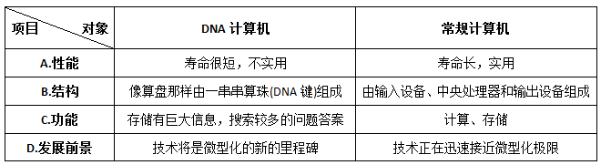

A. A

B. B

C. C

D. D

第 49 题 · 答案与解析

**参考答案（粉笔题库参考内容）**

C

**解析**

本题考查细节判断的能力。

由“这使技术得到简化，尽管仍无法用它造出可像常规计算机那样解决复杂问题的大型DNA计算机”可知，常规计算机也可解决复杂问题。

本题为选非题，故正确答案为C。

**来源**：2009年安徽省公务员录用考试《行测》题第49题

### 第 50 题

文中认为DNA计算机“是一种非自动化的计算机”，下列作为这一观点的根据的一项是：

A. 每台都由大约100万亿个人工组成DNA链状结构进行编码

B. 为解答某个待解决的问题，研究人员对DNA链状结构进行编码

C. 需人工帮助把栓在玻璃片上的DNA链反复浸入不同的酶溶液中

D. 每台DNA计算机在数天时间里可以进行数项不同的计算

第 50 题 · 答案与解析

**参考答案（粉笔题库参考内容）**

C

**解析**

本题为细节判断题。

由原文“但需要人工帮助把这些DNA链栓到一块盖着薄薄的金片的玻璃上，然后反复地浸入不同的酶溶液中，使酶与DNA发生相互作用，剔除掉不当的答案。”可知，DNA计算机为“非自动化的计算机”，故C项正确。

A、B、D三项为DNA计算机的工作过程与计算效果，不能为“半自动化”提供依据。

故正确答案为C。

**来源**：2009年安徽省公务员录用考试《行测》题第50题

### 第 51 题

下列说法不符合原文意思的一项是：

A. 1994年史密斯小组从事分子计算的研究并制造出几台DNA自动计算机

B. 常规计算机的技术接近微型化的极限，所以科学家们致力于DNA计算机的研究开发

C. DNA计算机正走出科幻时代，成为一种现实可行的计算机新技术

D. 目前对RNA计算潜力的开发利用比DNA分子大，能处理更为复杂的问题

第 51 题 · 答案与解析

**参考答案（粉笔题库参考内容）**

A

**解析**

本题考查细节判断的能力。

由材料可知，“经数年研究，史密斯小组造出了几台DNA计算机”和“美国自1994年起就有十来个研究小组从事分子计算研究”并无直接关系，无法推出史密斯小组何时造出计算机，A项将两处杂糅在一起，表述错误。

B、C、D三项均正确。

本题为选非题，故正确答案为A。

**来源**：2009年安徽省公务员录用考试《行测》题第51题

## 材料 2

信息文化的直接后果是把全球结成一个紧密的信息整体，无论身处何地，一旦被纳入由电脑、电视、卫星、电话、电传组成的现代化信息网络，就可以与整个世界同时存在，同时知晓这个世界正在发生的种种变化。某种局部的社会变迁，通过全球一体化的信息网络，可以及时准确无误地传播到全球范围，从而产生全球性影响，使全球各区域之间的关联性大大增强。另一方面，信息一体化暴露了不同社会之间的差距，强化了不同社会之间的频繁接触，从而使人们很快意识到各自的处境和差距，有利于互相交流、协调发展、取长补短、加速前进，追赶代表全球先进水平的发展浪潮。

        正如不同的土壤中可以开出不同的花朵一样，信息文化的崛起改变了人们的群体意识。浓厚的乡土意识是口头传播时代的产物、人们只能与本乡土的小群体频繁接触、从而产生一种乡土依恋心理。强烈的民族意识是文字传播时代的产物。不同乡土的人群依靠共同的文字认同，共同的文字支撑着共同的文化。只有进入电讯时代，各民族之间的普遍的文化认同才能发生。面对卫星电视和电子计算机，人们接受的是全方位传递的文化，人们必须依靠异种文化为背景，才能更好地理解、发展自己的文化。人们越来越超越自己的民族和国家，从全球协调发展的角度去思考和认识问题，从而形成了普遍的全球意识。

### 第 52 题

对“信息一体化”两方面的作用的解释，正确的一项是：

A. 把全球结成一个信息整体，并暴露不同社会之间的差距，促进交流和发展

B. 使局部的社会变迁发生全球性影响，增强各区域之间的关联性，并暴露不同社会之间的差距，促进交流和发展

C. 把全球结成一个信息整体，使人们了解世界发生的种种变化，从而追赶代表全球先进水平的发展浪潮

D. 使本地区的社会变迁发生全球化影响，同时又意识到自己的处境和差距，从而取长补短，加速前进

第 52 题 · 答案与解析

**参考答案（粉笔题库参考内容）**

B

**解析**

本题属于细节判断题。

根据材料第一段可知，“信息一体化”的两个作用：一方面形成紧密的信息网络，“使全球各区域之间的关联性大大增强”；另一作用为“暴露了不同社会之间的差距，强化了不同社会之间的频繁接触，从而使人们很快意识到各自的处境和差距，有利于互相交流、协调发展”等，B项完整表述了两方面的作用，故当选。

A项忽略了“关联性”，太过片面；C项忽略了“暴露差距”，太过片面；D项过于空泛，且忽略了“关联性”，故均不选。

故正确答案为B。

**来源**：2009年安徽省公务员录用考试《行测》题第52题

### 第 53 题

对第1段出现的概念，解释正确的一项是：

A. “信息文化”指电脑、电视、卫星、电话、电传等信息手段

B. “信息网络”指全球各区域之间的关联性以及不同社会的频繁接触

C. “信息一体化”指用现代化手段把全球各个区域结成一个信息整体

D. “不同社会”指社会制度不同的国家或地区

第 53 题 · 答案与解析

**参考答案（粉笔题库参考内容）**

C

**解析**

本题考查细节判断的能力。

C项正确，符合文意。

A项错误，由材料可知，“信息文化”指在信息一体化情况下出现的文化现象或状态，并非指信息手段；B项错误，“信息网络”指电脑、电视、卫星、电话、电传等构成的现代化的网络，并不包括“不同社会的频繁接触”；D项错误，“不同社会”强调的是信息文化的不同，而非强调社会制度。

故正确答案为C。

**来源**：2009年安徽省公务员录用考试《行测》题第53题

### 第 54 题

对信息文化间接后果的概括，不恰当的一项是：

A. 信息文化的崛起改变了人们的群体意识

B. 信息文化使人们接受全方位的文化传播

C. 信息文化使人们的意识越来越超越自己的民族和国家

D. 信息文化使人们形成普遍的全球意识

第 54 题 · 答案与解析

**参考答案（粉笔题库参考内容）**

B

**解析**

本题考查细节判断的能力。

B项不恰当，为信息文化的直接后果。

A项恰当，材料第一段为信息文化的直接后果，第二段为信息文化的间接后果，其中，有关间接后果的句子有“信息文化的崛起改变了人们的群体意识”；C、D项恰当，“人们越来越超越自己的民族和国家，从全球协调发展的角度去思考和认识问题，从而形成了普遍的全球意识”。

本题为选非题，故正确答案为B。

**来源**：2009年安徽省公务员录用考试《行测》题第54题

### 第 55 题

对“正如不同的土壤可以开出不同的花朵一样”所比喻的内容，理解错误的一项是：

A. 浓厚的乡土意识是口头传播时代的产物

B. 强烈的民族意识是文字传播时代的产物

C. 群体意识是信息文化崛起的产物

D. 普遍的全球意识是电讯时代的产物

第 55 题 · 答案与解析

**参考答案（粉笔题库参考内容）**

C

**解析**

本题考查语句理解的能力。

由第二段首句可知，比喻句后边的内容“信息文化的崛起改变了人们的群体意识”为本段主旨，C项“群体意识是信息文化崛起的产物”与主旨不符，“崛起”无从谈起，理解错误，当选。

综合材料来看，A、B、D三项是对首句比喻的具体阐释，理解正确。

本题为选非题，故正确答案为C。

**来源**：2009年安徽省公务员录用考试《行测》题第55题

### 第 56 题

必要条件：当一事物情况M不存在时，另一事物情况N也一定不会存在，那么前者(M)就是后者(N)的必要条件。

根据这一定义，下列各项中，M与N构成必要条件关系的是：

A. 一个数能被2整除(M)，该数为偶数(N)

B. 发生重大安全责任事故(M)，人员伤亡(N)

C. 良好的家庭教育(M)，孩子成才(N)

D. 一个国家自然资源丰富(M)，该国经济发达(N)

第 56 题 · 答案与解析

**参考答案（粉笔题库参考内容）**

A

**解析**

第一步：抓住定义中的关键词。

关键词强调“M不存在时，N也一定不会存在”时，“M为N的必要条件”。

第二步：逐一判断选项。

A项M不存在即一个数不能被2整除，可得到该数不为偶数，即N不存在，符合定义；

B项无“重大安全责任事故”，也可能存在“人员伤亡”的情况；

C项无“良好的家庭教育”，孩子也可能成才；

D项一个国家无“丰富自然资源”，经济也可能发达，三项在无M的情况下，N 也有可能存在，均不选。

故正确答案为A。

**考点**：拆词

**来源**：2009年安徽省公务员录用考试《行测》题第56题

### 第 57 题

座右铭：本来指写出来放在座位边上用来激励、警戒、约束自己行为的格言警句，后来把一个人铭记在心或经常自我提醒的一句或少数几句格言警句也叫做座右铭。

根据以上定义，下列语句中不适合用作座右铭的是：

A. 天若有情天亦老，人间正道是沧桑

B. 先天下之忧而忧，后天下之乐而乐

C. 良言一句三冬暖，恶语伤人六月寒

D. 横眉冷对千夫指，俯首甘为孺子牛

第 57 题 · 答案与解析

**参考答案（粉笔题库参考内容）**

A

**解析**

第一步：抓住定义中的关键词。

关键词强调“激励、警戒、约束自己行为”、“铭记在心”、“自我提醒”的格言警句。

第二步：逐一判断选项。

A项表达了人生的哲理，即事物是不断向前发展着的，谁也不能逆历史潮流而行，并不适合约束自己行为或自我提醒，不适合作座右铭；

B项适合一个人，尤其是为官者“铭记在心”；

C项适合一个人自我提醒；

D项适合激励自己，约束自己行为，均适合作座右铭。

本题为选非题，故正确答案为A。

**考点**：拆词

**来源**：2009年安徽省公务员录用考试《行测》题第57题

### 第 58 题

资源整合：市场主体为实现特定目的，将各种资源进行优化配置，综合利用，使之发挥良好效益的一系列措施办法。

以下不属于资源整合的是：

A. 李大妈将沿街房屋改造装修，邻居王伯出资，合伙开办了一家便民超市

B. 某纺织厂与房地产公司商定，将市区厂房整体拆除，新建住宅小区，组建物业公司，安置本厂员工转岗就业

C. 某煤炭企业出资，当地村民出力，将塌陷区改造成水上游乐园

D. 某企业将闲置设备和库存物资销售，所得资金购买股票，收益不菲

第 58 题 · 答案与解析

**参考答案（粉笔题库参考内容）**

D

**解析**

第一步：抓住定义中的关键词。

关键词强调对象为“市场主体”，手段是“优化配置”、“综合利用”，目的效果是“发挥良好效益”。

第二步：逐一判断选项。

A、B、C三项在手段上属于“优化配置”，故不选。

本题为选非题，故正确答案为D。

**考点**：方式目的

**来源**：2009年安徽省公务员录用考试《行测》题第58题

### 第 59 题

柔性管理：组织以人为中心，灵活运用各种管理方法，通过影响人的心理，产生良好的管理效果。

以下属于柔性管理的是：

A. 张莉7岁的孩子感冒发烧，家中无人照看，只好带着上班，领导让她调休，送孩子去医院

B. 某机关组团出国学习考察，顺道去迪尼乐园游玩了一天，有关领导特批报销费用

C. 办公室主任负责考勤，无论谁迟到，考勤记录均为合格，同事关系相处很好

D. 新员工小王试用期培训考试不合格，车间主任考虑她是副总的亲戚，破例让她转上岗

第 59 题 · 答案与解析

**参考答案（粉笔题库参考内容）**

A

**解析**

第一步：抓住定义中的关键词。

关键词强调“以人为中心”、“影响人的心理”、“产生良好的管理效果”。

第二步：逐一判断选项。

A项因孩子生病，领导让张莉调休，这种做法会让员工觉得温暖，体现了“以人为中心”，会“产生好的管理效果”，正确。

B、C、D三项特批报销费用、不负责任的考勤记录、破例转上岗，均不能“产生良好的管理效果”，反而可能产生不良后果。

故正确答案为A。

**考点**：方式目的

**来源**：2009年安徽省公务员录用考试《行测》题第59题

### 第 60 题

法律道德背反现象：许多人以为合乎道德的行为是不会违法的，但是现实社会中，某些符合一般道德原则的行为却被法律所禁止。下列哪项不属于“法律道德背反现象”：

A. 某护士出于同情，应一癌症晚期患者本人要求帮助他实行安乐死，以解除其无法忍受的痛苦，后被控犯谋杀罪

B. 某甲花一万元从人贩子手上购买一男孩为子，视为己出，关爱有加，两年后民警来“解救”时，孩子不愿离开现“父母”

C. 某乙为解决农民工子女上学难，办了一所收费低廉的小学，被指非法办学而不得不停办，许多孩子因此再度失学

D. 某丙刑满释放回乡后扬言报复“仇人”，并准备了凶器，其父劝阻无效后为免其犯下血案将其捆绑关押在家长达三个月，该行为涉嫌非法拘禁

第 60 题 · 答案与解析

**参考答案（粉笔题库参考内容）**

B

**解析**

第一步：抓住定义中的关键词。

关键词强调“符合一般道德原则”的行为被“法律禁止”。

第二步：逐一分析选项。

B项购买男孩为子明显不合乎道德，为违法行为，不属于法律道德背反现象。

A、C、D三项均符合定义。

本题为选非题，故正确答案为B。

**考点**：单定义-其他句式

**来源**：2009年安徽省公务员录用考试《行测》题第60题

### 第 61 题

红绿灯：开关柜

A. 千斤顶：百米尺

B. 手摇床：脚踏车

C. 加热炉：冷却罐

D. 装卸车：录放机

第 61 题 · 答案与解析

**参考答案（粉笔题库参考内容）**

D

**解析**

第一步：判断题干词语间逻辑关系。

红绿灯是一种指挥交通运行的信号灯，开关柜是一种电气设备，二者无明显逻辑关系，考虑拆分,“红”和“绿”是反义词，“开”和“关”是反义词。

第二步：判断选项词语间逻辑关系。

A项：千斤顶是顶开重物的轻小起重设备，百米尺是一种专用于测量100米距离的卷尺工具，二者无明显逻辑关系，考虑拆分,“千”和“斤”不是反义词，“百”和“米”不是反义词，与题干逻辑关系不一致，排除；

B项：手摇床是通过手动摇动实现婴儿哄睡或者调整倾斜度的床，脚踏车是一种交通工具，二者无明显逻辑关系，考虑拆分,“手”和“摇”不是反义词，“脚”和“踏”不是反义词，与题干逻辑关系不一致，排除；

C项：加热炉是将物料或工件加热到轧制成锻造温度的设备，冷却壶是指汽车冷却系统中的副水壶、膨胀壶或冷却液储液壶，二者无明显逻辑关系，考虑拆分,“加”和“热”不是反义词，“冷”和“却”不是反义词，与题干逻辑关系不一致，排除；

D项：装卸车用于货物装车、卸车及搬运作业的机械设备，录放机是指一种用于录制和播放音频或视频信号的设备，二者无明显逻辑关系，考虑拆分,“装”和“卸”是反义词，“录”和“放”是反义词，与题干逻辑关系一致，当选。

故正确答案为D。

**考点**：拆分思维

**来源**：2009年安徽省公务员录用考试《行测》题第61题

### 第 62 题

导盲犬：缉毒犬

A. 警犬：军犬

B. 奶牛：耕牛

C. 斗鸡：肉鸡

D. 赛马：辕马

第 62 题 · 答案与解析

**参考答案（粉笔题库参考内容）**

D

**解析**

第一步：判断题干词语间逻辑关系。

导盲犬和缉毒犬是并列关系，二者是从功能角度上进行分类。导盲犬是工作犬的一种，必须经过严格的后天训练。缉毒犬是工作犬的一种，也必须经过严格的后天训练。

第二步：判断选项词语间逻辑关系。

A项，警犬和军犬是并列关系，二者是从使用主体的角度进行分类，但是需要注意，二者之间是有交叉的。警犬是指由警察机关使用的具有一定警务用途的犬，题干中的缉毒犬是警犬的一种。军犬是指在军队中服役的犬，具有追踪、鉴别、警戒、看守、巡逻、搜捕、通讯、携弹、侦破、搜查毒品、爆炸物等任务。不难发现，警犬和军犬都有搜查毒品的功能。因而与题干并不严格相符；

B项，奶牛和耕牛是并列关系，二者是从功能角度上进行分类，但是要注意，奶牛产奶和耕牛耕田并不需要人类进行严格的后天训练；

C项，斗鸡和肉鸡是同级的并列关系，二者虽然都是从功能角度上进行了划分，但与题干中需要经过严格后天训练的条件不同。斗鸡是以善打善斗而著称的珍禽，两雄相遇或为争食，或为夺偶相互打斗时，可置生死于度外，战斗到最后一口气。肉鸡是用于肉食使用的饲养鸡，也不需要经过严格的后天训练；

D项，赛马和辕马是并列关系，二者都是从功能角度上进行的分类，而且均需要严格的后天训练。赛马是用于比赛的马匹，只有经过后天严格训练才能用于竞技比赛。辕马是指在四匹马或更多马拉的马车中最靠近前轮的马，同样需要经过后天严格训练才可以承担此功能。

故正确答案为D。

**考点**：逻辑关系-并列关系

**来源**：2009年安徽省公务员录用考试《行测》题第62题

### 第 63 题

森林：树木

A. 建筑群：建筑物

B. 生物：动物

C. 食品：牛奶

D. 电脑：硬盘

第 63 题 · 答案与解析

**参考答案（粉笔题库参考内容）**

A

**解析**

第一步：判断题干词语间逻辑关系。

题干两词是包容中的组成关系，“森林”是由“树木”组成的，强调一棵棵树木组成森林。

第二步：判断选项词语间逻辑关系。

与题干相同逻辑关系的即为A项，“建筑群”是由“建筑物”组成的，强调一栋栋建筑物构成建筑群。

B、C两项为种属关系，“动物”属于“生物”、“牛奶”属于“食品”与题干逻辑不同，排除。

D项“硬盘”是“电脑”的一部分，是组成关系，但是电脑并不是由一个一个硬盘组成的，电脑中除了硬盘，还有其他的组成部分，与题干逻辑不同，排除。

故正确答案为A。

**考点**：逻辑关系-包容关系

**来源**：2009年安徽省公务员录用考试《行测》题第63题

### 第 64 题

故宫：太和殿

A. 黄山：天都峰

B. 奥运会：奥运村

C. 台湾岛：日月潭

D. 长城：八达岭

第 64 题 · 答案与解析

**参考答案（粉笔题库参考内容）**

D

**解析**

第一步：判断题干词语间逻辑关系。

题干两词是包容关系中的组成关系，太和殿是故宫的一部分，且都是人为建造的。

第二步：判断选项词语间逻辑关系。

A、C两项虽然是组成关系，但两者为自然物；

B项为对应关系；

D项与题干为相同逻辑关系，八达岭是长城的一部分，且都是人为建造的。

故正确答案为D。

**考点**：逻辑关系-包容关系

**来源**：2009年安徽省公务员录用考试《行测》题第64题

### 第 65 题

涨跌：盈亏

A. 善恶：好坏

B. 胖瘦：高矮

C. 输赢：胜负

D. 对错：正误

第 65 题 · 答案与解析

**参考答案（粉笔题库参考内容）**

A

**解析**

第一步：判断题干词语间逻辑关系。

涨跌导致盈亏，且顺序对应，涨对应盈，跌对应亏，二者为因果对应关系。

第二步：判断选项词语间逻辑关系。

与题干相同逻辑关系的即为A项，善恶导致好坏，且善对应好，恶对应坏。

B项是形容人的四种状态，属于并列关系，单个词语中两字分别是反义对应；C、D两项为并列关系。

故正确答案为A。

**考点**：拆分思维、逻辑关系-对应关系

**来源**：2009年安徽省公务员录用考试《行测》题第65题

### 第 66 题

切割：缝补

A. 拼凑：剪裁

B. 拖延：推诿

C. 装卸：搬运

D. 挖掘：填埋

第 66 题 · 答案与解析

**参考答案（粉笔题库参考内容）**

D

**解析**

第一步：判断题干词语间逻辑关系。

题干两词是反义词。

第二步：判断选项词语间逻辑关系。

A项拼凑的反义词是拆散；

B项无明显逻辑关系；

C项装卸两字词义相反，与搬运不构成反义词；

D项与题干逻辑关系一致，挖掘和填埋是反义词。

故正确答案为D。

**考点**：语义关系-反义关系

**来源**：2009年安徽省公务员录用考试《行测》题第66题

### 第 67 题

体检：化验：健康

A. 质检：公示：达标

B. 招聘：面试：录用

C. 报关：商标：审核

D. 考试：评阅：合格

第 67 题 · 答案与解析

**参考答案（粉笔题库参考内容）**

D

**解析**

第一步：判断题干词语间逻辑关系。

题干三词是对应关系，且是本人行为、他人行为与结果一一对应关系，（本人）体检，（医院）化验，结果是健康。

第二步：判断选项词语间逻辑关系。

A项中质检的是他人，而非本人；

B项中招聘的也是他人，而非本人；

C项中商标与审核均与题干不对应；

与题干逻辑关系相同的即为D项，（本人）考试，（老师）评阅，结果是合格。

故正确答案为D。

**考点**：逻辑关系-对应关系

**来源**：2009年安徽省公务员录用考试《行测》题第67题

### 第 68 题

腊月：小寒：大寒

A. 正月：立春：雨水

B. 三月：清明：寒食

C. 五月：端午：夏至

D. 八月：中秋：秋分

第 68 题 · 答案与解析

**参考答案（粉笔题库参考内容）**

A

**解析**

第一步：判断题干词语间逻辑关系。

题干三个词语是对应关系，小寒和大寒都是二十四节气，都在农历腊月。

第二步：判断选项词语间逻辑关系。

A项，立春和雨水都在正月，正确。

B项，三月对应的节气是清明和谷雨，且寒食不是二十四节气，排除。

C项，五月对应的节气是芒种和夏至，且端午不是二十四节气，排除。

D项，八月对应的节气是白露和秋分，且中秋不是二十四节气，排除。

故正确答案为A。

**考点**：逻辑关系-对应关系

**来源**：2009年安徽省公务员录用考试《行测》题第68题

### 第 69 题

速度：时间：距离

A. 利率：本金：利息

B. 质量：品种：数量

C. 利润：成本：产值

D. 收入：支出：剩余

第 69 题 · 答案与解析

**参考答案（粉笔题库参考内容）**

A

**解析**

第一步：判断题干词语逻辑关系。

题干三词是对应关系，且对应关系为速度与时间之积为距离。

第二步：判断选项词语间逻辑关系。

与题干相同逻辑关系的即为A项，利率与本金之积为利息。

B、C、D三项均无此对应关系。

故正确答案为A。

**考点**：逻辑关系-对应关系

**来源**：2009年安徽省公务员录用考试《行测》题第69题

### 第 70 题

构思：写作：发表

A. 点火：燃烧：熄灭

B. 播种：耕耘：收获

C. 改革：实验：创新

D. 设计：生产：销售

第 70 题 · 答案与解析

**参考答案（粉笔题库参考内容）**

D

**解析**

第一步：判断题干词语间逻辑关系。

先构思、再写作、最后发表，三者为时间顺序的对应关系，且三者的主体均为人。

第二步：判断选项词语间逻辑关系。

A项，先点火，再燃烧，最后熄灭，三者为时间顺序的对应关系，但是点火、熄灭的主体可以是人，而燃烧的主体是物品，与题干逻辑关系不一致，排除；

B项，先播种，再耕耘，最后收获，三者为时间顺序的对应关系，且三者的主体均为人，与题干逻辑关系一致，保留；

C项，三词无时间顺序，与题干逻辑关系不一致，排除；

D项，先设计，再生产，最后销售，三者为时间顺序的对应关系，且三者的主体均为人，与题干逻辑关系一致，保留。

比较题干与B、D两项，题干和D项均包含人的创造性思维活动，而B项不包含。

故正确答案为D。

**考点**：逻辑关系-对应关系

**来源**：2009年安徽省公务员录用考试《行测》题第70题

### 第 71 题

从所给四个选项中，选择最合适的一个填入问号处，使之呈现一定的规律性：

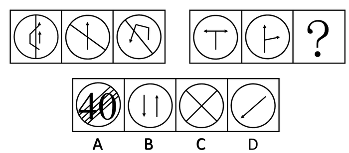

A. A

B. B

C. C

D. D

第 71 题 · 答案与解析

**参考答案（粉笔题库参考内容）**

B

**解析**

第一组中，各个箭头指向一个方向；第二组中，已知图形各有两个箭头，且均指向两个方向。

故正确答案为B。

**考点**：特殊规律-功能元素

**来源**：2009年安徽省公务员录用考试《行测》题第71题

### 第 72 题

从所给四个选项中，选择最合适的一个填入问号处，使之呈现一定的规律性：

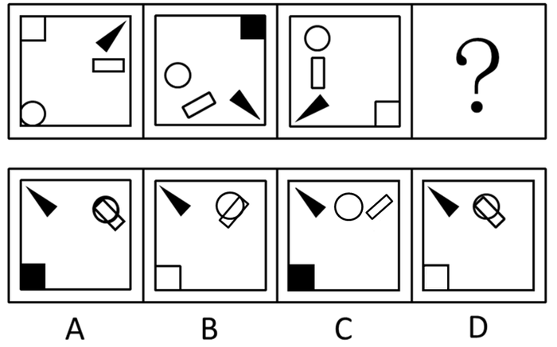

A. A

B. B

C. C

D. D

第 72 题 · 答案与解析

**参考答案（粉笔题库参考内容）**

A

**解析**

元素组成相同，考虑位置规律。长方形在顺时针移动，且自身在逆时针45度旋转；方块偶数为黑色，奇数为白色，且在4个角移动；黑三角也是顺时针移动，同时自身也在顺时针90度旋转。

故正确答案为A。

**考点**：位置规律-旋转

**来源**：2009年安徽省公务员录用考试《行测》题第72题

### 第 73 题

左边给定的是正方体的外表面展开图，右边哪一项能由它折叠而成？

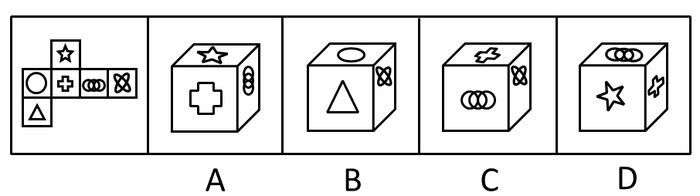

A. A

B. B

C. C

D. D

第 73 题 · 答案与解析

**参考答案（粉笔题库参考内容）**

D

**解析**

A项应为

B项应为

C项应为

故正确答案为D。

**考点**：空间类-空间重构-六面体

**来源**：2009年安徽省公务员录用考试《行测》题第73题

### 第 74 题

左边给定的是正方体的外表面展开图，右边哪一项能由它折叠而成？

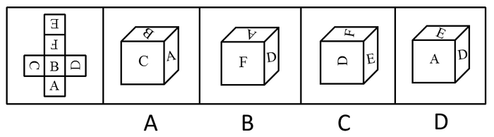

A. A

B. B

C. C

D. D

第 74 题 · 答案与解析

**参考答案（粉笔题库参考内容）**

C

**解析**

本题为空间重构题。逐一分析选项。

A项：选项中字母A所在的面中A的顶部指向的是字母B所在的面中B的下半部分圆弧，而题干中字母A所在的面中A的顶部没有指向的是字母B所在的面中B的下半部分圆弧，选项与展开图不一致，排除；

B项：选项中字母A所在的面与字母F所在的面为相对面，不能同时出现，选项与展开图不一致，排除；

C项：选项与展开图一致，当选；

D项：选项中字母A所在的面中A指向的是字母E所在的面，而题干中字母A所在的面指向的是字母B所在的面，选项与展开图不一致，排除。

故正确答案为C。

**考点**：空间类-空间重构-六面体

**来源**：2009年安徽省公务员录用考试《行测》题第74题

### 第 75 题

从所给四个选项中，选择最合适的一个填入问号处，使之呈现一定的规律性：

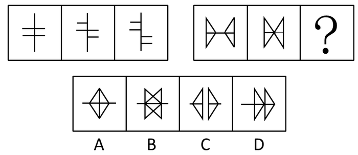

A. A

B. B

C. C

D. D

第 75 题 · 答案与解析

**参考答案（粉笔题库参考内容）**

B

**解析**

元素组成相同，考查位置规律。第一组以竖线为轴，左半部分沿竖线向上移动，右半部分沿竖线向下运动。第二组中两个三角形以横线为轴，相向移动。

故正确答案为B。

**考点**：位置规律-平移

**来源**：2009年安徽省公务员录用考试《行测》题第75题

### 第 76 题

从所给四个选项中，选择最合适的一个填入问号处，使之呈现一定的规律性：

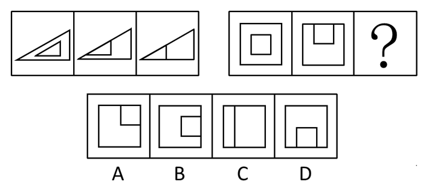

A. A

B. B

C. C

D. D

第 76 题 · 答案与解析

**参考答案（粉笔题库参考内容）**

A

**解析**

解析一：第一组三个图形，直线段数依次为6、5、4；第二组直线段数前两个为8、7，故第三个图直线段数应为6。分析各选项，直线段数分别为6、7、5、7。

故正确答案为A。

解析二：第一组每个图形都是由外部图形和内部图形组成，规律为内部图形的移动，第二个图形即为内部图形三角形移动到上面，与外部图形相交一条边，第三个图形即为第一个图形移到最左面，与外部图形相交两条边。同理，第二组的第三个图形即为第一个图形内的正方形与外部正方形相交两条边，仅A项满足。

故正确答案为A。

**考点**：数量规律-线

**来源**：2009年安徽省公务员录用考试《行测》题第76题

### 第 77 题

从所给四个选项中，选择最合适的一个填入问号处，使之呈现一定的规律性：

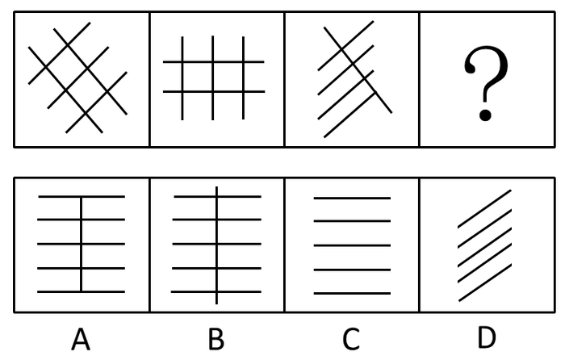

A. A

B. B

C. C

D. D

第 77 题 · 答案与解析

**参考答案（粉笔题库参考内容）**

C

**解析**

图一斜向左的两条线顺时针旋转，且数量加1，斜向右的三条线同样顺时针旋转，且数量减1，依此规律变化得到图二、三。据此规律，图三中，斜向左的一条线顺时针旋转并减少1，斜向右的四条线顺时针旋转且增加1，得到5条水平平行线。

故正确答案为C。

**考点**：数量规律-复合

**来源**：2009年安徽省公务员录用考试《行测》题第77题

### 第 78 题

从下列四个选项中，选出与其他三个图形不同的一个图形：

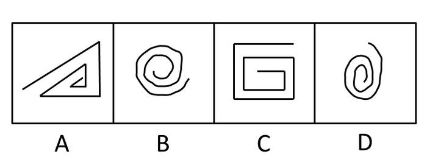

A. A

B. B

C. C

D. D

第 78 题 · 答案与解析

**参考答案（粉笔题库参考内容）**

C

**解析**

考查图形时针方向，从图形的中心开始，沿线运动，可知A、B、D三项均为逆时针运动；C项为顺时针运动。

故正确答案为C。

**考点**：位置规律-旋转

**来源**：2009年安徽省公务员录用考试《行测》题第78题

### 第 79 题

下列哪个图形与其他图形不同：

A. A

B. B

C. C

D. D

第 79 题 · 答案与解析

**参考答案（粉笔题库参考内容）**

D

**解析**

特殊考点，元素内部特征，各个选项图形可以看成是内部两个直角和外部两个直角组成。

其中A、B、C三项中四个直角各指向一个方向，而D项中四个直角指向两个方向。

故正确答案为D。

**考点**：样式规律-遍历

**来源**：2009年安徽省公务员录用考试《行测》题第79题

### 第 80 题

下列哪个图形与其他不同：

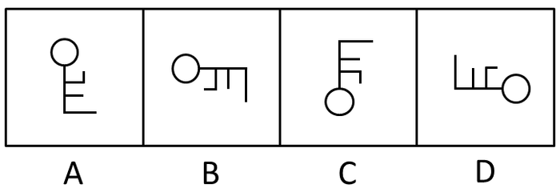

A. A

B. B

C. C

D. D

第 80 题 · 答案与解析

**参考答案（粉笔题库参考内容）**

A

**解析**

一个元素构成，确定考查位置中的方向，B、C、D三项均由一个图形的逆时针旋转而得，A项为图形翻转而得。

故正确答案为A。

**考点**：位置规律-综合

**来源**：2009年安徽省公务员录用考试《行测》题第80题

### 第 81 题

雨后的山色是美丽的，即使没有人欣赏它。

上述文字是对下列哪项的反驳：

A. 美丽是肤浅的

B. 味道是不可数的

C. 美丽只在人的眼里

D. 人们只想看喜欢的东西

第 81 题 · 答案与解析

**参考答案（粉笔题库参考内容）**

C

**解析**

第一步：找到论点和论据。

本题的论点是雨后山色即使无人欣赏也是美丽的。本题没有论据。

第二步：判断削弱方式。

本题只有论点没有论据，需削弱论点。

第三步：逐一判断选项的作用。

A中“美丽是肤浅的”说的是美丽的性质，而题干说人们的欣赏和美丽的关系，A错误；

B中“味道”在题干中并未涉及，B是无关项，B错误；

C中“美丽只在人的眼里”说明美丽必须有人欣赏才是美丽，这反驳了题干中“无人欣赏也是美丽的”，C削弱了论点，C正确；

D中“人只想看喜欢的东西”和题干中“美丽”无关，D错误。

故正确答案为C。

**考点**：削弱论点

**来源**：2009年安徽省公务员录用考试《行测》题第81题

### 第 82 题

失眠或睡眠质量差会严重影响人的身心健康。调查发现，很多睡眠不好的人都有睡前饮用咖啡的习惯。因此，喝咖啡有助于提高睡眠质量，是治疗失眠症的辅助手段。

以下哪项为真，对题干的结论是最有力的反驳：

A. 咖啡有很好的安眠作用

B. 有证据表明，咖啡有提神的作用，这很可能是导致他们睡眠不好的原因

C. 咖啡是人们喜爱的饮料

D. 咖啡辅助治疗失眠症，将产生严重的副作用

第 82 题 · 答案与解析

**参考答案（粉笔题库参考内容）**

B

**解析**

第一步：找到论点和论据。

本题的论点是喝咖啡有助于提高睡眠质量，是治疗失眠症的辅助手段。论据是很多睡眠不好的人都有睡前饮用咖啡的习惯。

第二步：逐一判断选项的作用。

A中“咖啡有很好的安眠作用”在论点和论据间搭桥从而证明咖啡有助于睡眠，A加强，A错误；

B中“咖啡有提神的作用，这很可能是导致他们睡眠不好的原因”说明睡前喝咖啡会提神，进而表明咖啡不能治疗失眠，B削弱，B正确；

C中“咖啡是人们喜爱的饮料”和题干内容无关，C是无关项，C错误；

D中“咖啡辅助治疗失眠症，将产生严重的副作用”说明咖啡作为辅助手段有副作用，但副作用与论点无关，属无关项。

故正确答案为B。

**考点**：削弱论点

**来源**：2009年安徽省公务员录用考试《行测》题第82题

### 第 83 题

一位退休教师说：“老师最喜欢的是成绩最好的学生，我也是这样。现在回顾30多年的教学生涯才发现：一个学生成绩好不等于他将来的事业很成功。在我所教过的学生中，有的人读书时成绩很好，有的人后来事业很成功。但是却没有一个当年成绩最好的学生后来在事业上很成功。”

如果该老师说的话为真，以下哪项也必然为真：

A. 该老师当年最喜欢的学生后来在事业上都不是很成功

B. 后来在事业上很成功的学生中，有的是该老师当年最不喜欢的

C. 该老师的学生中，当年成绩最差的后来在事业上也都不成功

D. 凡是老师最喜欢的学生，毕业后在事业上都不会很成功

第 83 题 · 答案与解析

**参考答案（粉笔题库参考内容）**

A

**解析**

第一步：抓住题干的主要信息。

题干叙述了老师对学生的喜好，以及成绩好的学生和成绩不好的学生与他们的事业成功与否的关系。

第二步：逐一判断选项的作用。

A项，由题干中“老师最喜欢的学生成绩最好”和“没有一个当年成绩最好的学生后来在事业上很成功”可以推出老师最喜欢的学生没有一个在事业上成功，即“该老师当年最喜欢的学生后来在事业上都不是很成功”，A正确；

B项，题干中没有涉及到老师最不喜欢的学生，B是无关项，B错误；

C项，成绩最差的学生和其在事业上成功与否的关系在题干中并未涉及，C错误；

D项，“凡是……都……”过于绝对。题干只是从该退休教师的情况出发，这并不能推及到所有老师，D错误。

故正确答案为A。

**考点**：日常结论

**来源**：2009年安徽省公务员录用考试《行测》题第83题

### 第 84 题

因为化纤是用石油等原料人工合成的，生产化纤会产生许多污染物，要用掉许多能量和水，而且化纤垃圾在自然环境中降解速度很慢，所以一般人都认为穿着纯棉织物要比使用化纤物更环保。

下列哪项如果为真，会对上述观点构成最强有力的质疑：

A. 最新的化纤纤维在外观、手感、吸湿性等方面与纯棉织物没有什么明显差别

B. 科学家正在研究回收、利用、处理化纤垃圾的新办法

C. 纯棉织物价格比较高，占人口多数的工薪阶层和农民想穿也穿不起

D. 棉花是使用农药最多的农作物，世界上的杀虫剂25％被用于棉花种植

第 84 题 · 答案与解析

**参考答案（粉笔题库参考内容）**

D

**解析**

第一步：找到论点和论据。

本题的论点是穿着纯棉织物要比使用化纤物更环保。论据是化纤是用石油等原料人工合成的，生产化纤会产生许多污染物，要用掉许多能量和水，而且化纤垃圾在自然环境中降解速度很慢。

第二步：逐一判断选项的作用。

A项，题干说纯棉织物的环保性和化纤物的污染性，而A说“外观、手感、吸湿性”，A和题干内容无关，A错误；

B项，论据说化纤垃圾降解慢，B说“研究回收、利用、处理化纤垃圾的新办法”，B是对题干论据的削弱，不能证明纯棉织物更具有环保性，B错误；

C项，题干说纯棉织物的环保性，而C说纯棉织物的价格，C和题干内容无关，C错误；

D项，棉花的种植使用了大量农药，说明纯棉织物的原料生产过程中也存在污染，进而说明纯棉织物不一定比化纤物更环保，D削弱了论点，D正确。

故正确答案为D。

**考点**：削弱论点

**来源**：2009年安徽省公务员录用考试《行测》题第84题

### 第 85 题

甲、乙、丙、丁、戊分别住在同一个小区的1、2、3、4、5号房子内。现已知：①甲与乙不是邻居。②乙的房号比丁小。③丙住的房号数是双数。④甲的房号比戊大3号。

根据上述条件，丁所住的房号是：

A. 2号

B. 3号

C. 4号

D. 5号

第 85 题 · 答案与解析

**参考答案（粉笔题库参考内容）**

B

**解析**

第一步：观察题干。

本题给出的若干信息之间联系性不强，适合用假设法。由“丙住的房号数是双数”，可知丙要么住2号房子，要么住4号房子。因此，对丙住的房子号进行假设。

第二步：逐一假设并对选项进行判断。

由于“甲的房号比戊大3号”，所以戊的房号和甲房号只有两种情况：戊1号时，甲4号；戊2号时，甲5号。

假设丙的房号是2号，那么戊的房号只能是1号，甲的房号只能是4号。又因为“乙的房号比丁小”，所以乙的房号只能是3号，丁的房号只能是5号。乙的房号是3号，甲的房号是4号，这和题干中“甲与乙不是邻居”不符，因此假设不成立。

假设丙的房号是4号，那么戊的房号只能是2号，甲的房号只能是5号。又因为“乙的房号比丁小”，所以乙的房号只能是1号，丁的房号只能是3号。这和题干中“甲与乙不是邻居”相符合，因此假设成立。

综上所述，甲的房号是5号，乙的房号是1号，丙的房号是4号，丁的房号是3号，戊的房号是2号。

故正确答案为B。

**考点**：假设

**来源**：2009年安徽省公务员录用考试《行测》题第85题

### 第 86 题

在市场经济条件下，每个商品生产的经营者都是独立的经济主体，都有充分的自主权。因此，他们生产什么，如何生产都由自己说了算。

以下哪项最能削弱上述结论：

A. 商品生产的经营者都是独立的经济主体就意味着由自己决定自己的命运

B. 商品生产经营者享有充分的自主权利这就意味着由自己决定生产什么

C. 商品生产经营者必须了解市场行情和消费者的需求等，才能生产出适销对路的产品

D. 每个商品生产的经营者虽然是独立的经济主体，但是在经营中也要顾及他人的利益

第 86 题 · 答案与解析

**参考答案（粉笔题库参考内容）**

C

**解析**

第一步：找到论点和论据。

本题的论点是经营者生产什么，如何生产都由自己说了算。论据是在市场经济条件下，每个商品生产的经营者都是独立的经济主体，都有充分的自主权。

第二步：逐一判断选项的作用。

A中“独立的经济主体就意味着由自己决定自己的命运”说明当经营者是独立经济主体时，经营者能够决定生产什么，如何生产，A加强论点，A错误；

B中“享有充分的自主权这就意味着由自己决定生产什么”说明经营者有自主权是能够决定生产什么，如何生产，B加强论点，B错误；

C中“了解市场行情和消费者的需求等，才能生产出适销对路的产品”说明经营者在决定生产什么，如何生产时还要了解市场行情和消费者的需求，这表明经营者的决定还受其他因素的影响而不仅仅是因为自主权，C削弱了论点，C正确；

D中“顾及他人的利益”也是影响经营者决定的其他因素，D也有削弱作用，但是D没有直接针对“生产”进行削弱，D的削弱程度不及C，D错误。

故正确答案为C。

**考点**：削弱论点

**来源**：2009年安徽省公务员录用考试《行测》题第86题

### 第 87 题

某司机驾驶违章，民警说：“对你要么扣照，要么罚款。”司机说：“我不同意。”

那么，按照司机的说法，以下哪项他必须同意：

A. 扣照，但不罚款

B. 罚款，但不扣照

C. 如果不能做到既不扣照又不罚款，那么就既扣照，又罚款

D. 承认错误，下次不再违章

第 87 题 · 答案与解析

**参考答案（粉笔题库参考内容）**

C

**解析**

第一步：翻译题干。

民警：扣照和罚款二选一。

司机反对，即司机认为的情况有两种可能性：（1）-扣照 且 -罚款 或（2）扣照 且 罚款

第二步：对选项进行转化推导。

A、B两项：符合民警的说法，不符合司机的说法，排除；

C项：“不能做到既不扣照又不罚款”否定了或关系的其中一项，或关系否一推一，从而必然推出肯定另外一个结论“既扣照，又罚款”，当选；

D项：“承认错误”和题干无关，排除。

故正确答案为C。

**考点**：常规翻译

**来源**：2009年安徽省公务员录用考试《行测》题第87题

### 第 88 题

要对社会现象作详尽的了解，探索规律，便一定要走进现实社会中找资料，绝不能凭空臆度。要明白事情的因果关系，建立有关的理论，不能没有实质的资料，以供验证理论之用。所以：

A. 从事社会研究的人，一定同时也是从事实践工作的人

B. 要从事社会研究，不能不从实际工作中收集资料

C. 依据实质的资料作社会研究，则不具有理论性

D. 社会研究只需有实质的资料就可以了

第 88 题 · 答案与解析

**参考答案（粉笔题库参考内容）**

B

**解析**

第一步：抓住每句话中的对象及其关系。

题干第一句说要对社会现象作详尽的了解便要走进现实社会中找资料；第二句说要明白事情的因果关系，建立有关的理论，就要有实质的资料。

第二步：判断整体关系。

题干主要叙述了找实质资料对研究社会现象、明白事情因果、建立理论的必要性。

第三步：逐一判断选项的作用。

A项，题干说找实质资料这种研究方式，而A说“从事社会研究的人”“从事实践工作的人”，A和题干并不相关，A错误；

B项，题干中“要对社会现象作详尽的了解便要走进现实社会中找资料”意味着“从事社会研究要从实际工作中收集资料”，经过双重否定后可以得到B，B正确；

C项，题干中“不能没有实质的资料，以供验证理论之用”说明实质资料能帮助验证理论，这意味着依据实质的资料作社会研究存在理论性，C错误；

D项，“只需有实质的资料”过于绝对，实质资料只是社会研究的条件之一，D错误。

故正确答案为B。

**考点**：日常结论

**来源**：2009年安徽省公务员录用考试《行测》题第88题

### 第 89 题

目前，生物加工食物体系要成为现实，还有几件事要做。先得能在培养基里培养出蔬菜和水果的组织，还得能扩大产量以应市场之需。而要大量经济地生产，还得研制出廉价原料，利用其中的基本营养成分进行批量生产。

由此可以推出：

A. 研制出廉价原料是生物加工食物体系的关键

B. 目前已经能在培养基里培养出蔬菜或水果的组织

C. 只要有廉价的原料就能扩大产量

D. 目前的原料太昂贵

第 89 题 · 答案与解析

**参考答案（粉笔题库参考内容）**

D

**解析**

第一步：抓住题干的主要信息。

生物加工食物体系的实现需要满足“在培养基里培养出蔬菜和水果的组织”、“研制出廉价原料”、“扩大产量以应市场之需”等条件。

第二步：逐一判断选项的作用。

A项，题干中“要大量经济地生产，还得研制出廉价原料”说明“研制出廉价原料”是“大量经济地生产”的关键，并不能推出“研制出廉价原料”是“生物加工食物体系”的关键，A错误；

B项，题干中要实现生物加工食物体系“先得能在培养基里培养出蔬菜和水果的组织”说明目前还不能在培养基里培养出蔬菜和水果的组织，B错误；

C项，题干中“要大量经济地生产，还得研制出廉价原料”说明“大量经济地生产”需要“研制出廉价原料”，但并不意味着有了“廉价原料”就一定能“大量经济地生产”，C错误；

D项，题干中需要“研制出廉价原料”说明目前的原料价格太昂贵阻碍了“大量经济地生产”，D正确。

故正确答案为D。

**考点**：日常结论

**来源**：2009年安徽省公务员录用考试《行测》题第89题

### 第 90 题

中兴集团要招聘20名中层管理人员，最不可能被招上的学历是大专以下，或是完全没有管理工作经验的人，而懂英语或懂日语的人被录用的可能性更高。

如果上述断定为真，以下哪位求职者最有可能被选上：

A. 张先生现年40岁，中专学历，毕业后曾到京华大学经济管理学院进修半年，最近刚辞去已任职5年的华庭宾馆大堂经理的职务

B. 王女士是经济管理学院的副教授，硕士学历，出版有管理学专著，曾任某商场公关见习经理

C. 刘小姐是外语学院2000年本科毕生.毕业后当过半年涉外导游，近两年做专职翻译，精通英语和日语

D. 老孙曾是闻名遐迩的南行集团总裁，曾被誉为无学历、无背景、白手起家的传奇式企业家。因为南行集团的倒闭使他不得不从头做起来

第 90 题 · 答案与解析

**参考答案（粉笔题库参考内容）**

C

**解析**

第一步：翻译题干。

①（大专以下或没有经验）→最不可能被录用

②（懂英语或懂日语）→可能被录用

第二步：根据题干信息进行推导。

A项，张先生是中专学历，即大专以下，在①中，肯定前件必然肯定后件，张先生属于最不可能被录用的一类，排除。

B项，王女士是硕士学历且有经验，在①中，否定前件后件未知，无法判断王女士会不会被录用，排除。

C项，刘小姐懂英语也懂日语，在②中，肯定前件必然肯定后件，刘小姐被录用的可能性最大，正确。

D项，老孙没有学历，即大专以下，在①中，肯定前件必然肯定后件，老孙属于最不可能被录用的一类，排除。

故正确答案为C。

**考点**：常规翻译

**来源**：2009年安徽省公务员录用考试《行测》题第90题

### 第 91 题

依据《宪法》规定，关于公民权利和自由的表述，下列判断正确的是：

A. 劳动、受教育和依法服兵役既是公民的基本权利，又是公民的基本义务

B. 休息权的主体是全体公民

C. 公民在年老、疾病或者未丧失劳动能力的情况下，有从国家和社会获得物质帮助的权利

D. 2004年《宪法修正案》规定，国家尊重和保障人权

第 91 题 · 答案与解析

**参考答案（粉笔题库参考内容）**

D

**解析**

A项错误，《宪法》第五十五条规定：“保卫祖国、抵抗侵略是中华人民共和国每一个公民的神圣职责。依照法律服兵役和参加民兵组织是中华人民共和国公民的光荣义务。”

B项错误，《宪法》第四十三条规定：“中华人民共和国劳动者有休息的权利。”

C项错误，《宪法》第四十五条规定：“中华人民共和国公民在年老、疾病或者丧失劳动能力的情况下，有从国家和社会获得物质帮助的权利。”选项中说“未丧失劳动能力”。

故正确答案为D。

**考点**：宪法

**来源**：2009年安徽省公务员录用考试《行测》题第91题

### 第 92 题

以下关于农民工工伤保险的处理，正确的是：

A. 农民工所在单位未参加工伤保险，可以不承担工伤保险责任

B. 工程承包人没有用工主体资格，雇佣农民工发生工伤事故，由发包企业赔偿

C. 农民工工作中被第三者伤害，用人单位不承担工伤保险责任

D. 用人单位与农民工约定，因本人违章作业造成工伤，不承担工伤保险

第 92 题 · 答案与解析

**参考答案（粉笔题库参考内容）**

B

**解析**

工伤保险是劳动者在工作中或在规定的特殊情况下，遭受意外伤害或患职业病导致暂时或永久丧失劳动能力以及死亡时，劳动者或其遗属从国家和社会获得物质帮助的一种社会保险制度。根据《工伤保险条例》第十六条规定：“职工符合本条例第十四条、第十五条的规定，但是有下列情形之一的，不得认定为工伤或者视同工伤：（一）故意犯罪的； （二）醉酒或者吸毒的； （三）自残或者自杀的。除以上情况外，其他只要是符合工伤范围的都可以获得赔偿”。

故正确答案为B。

**本题相关知识点：**

1、工伤保险对象的范围是在生产劳动过程中的劳动者。

2、工伤保险的责任具有赔偿性。工伤即职业伤害所造成的直接后果是伤害到职工生命健康，并由此造成职工及家庭成员的精神痛苦和经济损失，也就是说劳动者的生命健康权、生存权和劳动权受到影响、损害甚至被剥夺了。

3、工伤保险实行无过错责任原则。无论工伤事故的责任归于用人单位还是职工个人或第三者，用人单位均应承担保险责任。

4、工伤保险不同于养老保险等险种，劳动者不缴纳保险费，全部费用由用人单位负担。即工伤保险的投保人为用人单位。

5、工伤保险待遇相对优厚，标准较高，但因工伤事故的不同而有所差别。

6、工伤保险作为社会福利，其保障内容比商业意外保险要丰富。除了在工作时的意外伤害，也包括职业病的报销、急性病猝死保险金、丧葬补助（工伤身故）。

**考点**：劳动法和经济法

**来源**：2009年安徽省公务员录用考试《行测》题第92题

### 第 93 题

山寨手机在制售过程中，可能涉及的违法行为不包括：

A. 模仿品牌畅销手机，侵犯知识产权

B. 产品质量难以保证，侵犯消费者权益

C. 生产销售厂商逃税漏税，损害国家利益

D. 传播淫秽短信，造成精神文化污染

第 93 题 · 答案与解析

**参考答案（粉笔题库参考内容）**

D

**解析**

无论是通过质检有入网许可证的手机还是山寨手机都可以传播任何信息，手机作为通信终端，不必对通信内容进行控制。

故正确答案为D。

**考点**：民法典

**来源**：2009年安徽省公务员录用考试《行测》题第93题

### 第 94 题

根据现行的《食品安全法》，以下表述不正确的是：

A. 《食品安全法》与《食品卫生法》是对我国食品安全共同监管的两部重要法律

B. 由国务院卫生行政部门，对现行食用农产品质量安全标准、食品标准、食品质量标准和有关食品的行业标准中强制执行的标准进行整合，统一公布食品安全标准

C. 食品安全监督管理部门对食品不得实施免检制度，对“问题食品”实行召回制度

D. 名人在食品广告中向消费者做虚假宣传，造成消费者权益受损的，与食品生产经营者共同承担连带责任

第 94 题 · 答案与解析

**参考答案（粉笔题库参考内容）**

A

**解析**

《食品安全法》于2009年6月1日正式实施，其中第104条规定，《食品卫生法》同时废止。

本题为选非题，故正确答案为A。

**考点**：劳动法和经济法

**来源**：2009年安徽省公务员录用考试《行测》题第94题

### 第 95 题

在下列哪种情况下，用人单位延长劳动者工作时间应受到《劳动法》有关限制性规定的约束：

A. 发生自然灾害、事故或因其他原因，威胁劳动者生命健康和财产安全，需要紧急处理的

B. 生产设备发生故障，影响生产和公众利益，必须及时抢修的

C. 交通运输线路、公共设施发生故障，影响生产和公众利益，必须及时抢修的

D. 用人单位取得大量订单，为了在短期内完成交货，必须组织突击生产的

第 95 题 · 答案与解析

**参考答案（粉笔题库参考内容）**

D

**解析**

《劳动法》第四十二条规定：有下列情形之一的，延长工作时间不受本法第四十一条规定的限制：（一）发生自然灾害、事故或者因其他原因，威胁劳动者生命健康和财产安全，需要紧急处理的；（二）生产设备、交通运输线路、公共设施发生故障，影响生产和公众利益，必须及时抢修的。

故正确答案为D。

**考点**：劳动法和经济法

**来源**：2009年安徽省公务员录用考试《行测》题第95题

### 第 96 题

以下应依法惩处的经济垄断行为是：

A. 某商场即将歇业装修，以亏本价格倾销库存商品，一时间，使得周边竞争对手的生意清淡

B. 某市餐饮协会为保证卫生质量和食品安全，要求会员单位必须使用统一消毒的餐具

C. 根据国际市场原油价格变化，国家发改委决定调整国内成品油价格

D. 某出版社对其出版的《国学大全》精装本定了“天价”

第 96 题 · 答案与解析

**参考答案（粉笔题库参考内容）**

B

**解析**

我国法律所规定的垄断行为包括：（一）垄断协议；（二）滥用市场支配地位；（三）具有或者可能具有排除、限制竞争效果的经营者集中；（四）滥用行政权力排除、限制竞争。

A项错误，A项是正常的经济行为；

B项正确，B项属于经营者达成垄断协议的行为；

C项错误，C项是行政行为；

D项错误，D项是正常的经济行为。

故正确答案为B。

**本题相关知识点：**

经济垄断源于滥用经济力的优势，并且其滥用者应是经营者或经营者的联合体。实践表明，经济力的优势并不必然属于某一个经营者或经营者联合体。相反，它可以属于甲经营者，也可以属于乙经营者。甚至，属于本来并没有经济优势的若干经营者组成的联合体。换言之，经济力的优势并非具有永久的独占性，它是在竞争中形成的。问题在于，经济力优势的占有者为了保持自己的优势而采用非竞争的手段，不允许他人再与之进行竞争。经济力优势滥用的根本特征，是以集中的经济力或联合的经济力支配市场，从而使他人成为经济从属者的可能。

**考点**：劳动法和经济法

**来源**：2009年安徽省公务员录用考试《行测》题第96题

### 第 97 题

李庄和赵庄为相邻一块土地的所有权归属发生争议，李庄的村干部就此事请示乡政府。

下列哪一种答复意见是错误的：

A. “这件事，乡政府可以出面召集你们双方协商解决。”

B. “如果你们双方达不成协议，我们乡政府是无权处理的”

C. “你们可以去县政府申请处理，也可以直接去县法院起诉。”

D. “在纠纷解决之前，你们双方必须维持土地利用的现状。”

第 97 题 · 答案与解析

**参考答案（粉笔题库参考内容）**

C

**解析**

《土地管理法》第十六条规定：土地所有权和使用权争议，由当事人协商解决；协商不成的，由人民政府处理。单位之间的争议，由县级以上人民政府处理；个人之间、个人与单位之间的争议，由乡级人民政府或者县级以上人民政府处理；当事人对有关人民政府的处理决定不服的，可以自接到处理决定通知之日起三十日内，向人民法院起诉；在土地所有权和使用权争议解决前，任何一方不得改变土地利用现状。

A、B、D三项正确；

C项错误，可以直接去县法院起诉是错误的。

本题为选非题，故正确答案为C。

**考点**：民法典

**来源**：2009年安徽省公务员录用考试《行测》题第97题

### 第 98 题

某美容店向王某推荐一种新品牌的护肤品。王某对“名牌产品”价格如此便宜感到疑惑。店家解释为店庆优惠活动。王某买回使用后，面部出现红肿、痛痒，苦不堪言。经质检部门认定属于假冒劣质产品，王某遂向美容店索赔。

对此，下列哪一选项是正确的：

A. 美容店不知道该产品为假名牌，不应承担责任

B. 美容店不是假名牌产品的生产者，不应承担责任

C. 王某对该产品有怀疑仍接受了服务，也应承担部分责任

D. 美容店违反了保证商品和服务安全的义务，应当承担全部责任

第 98 题 · 答案与解析

**参考答案（粉笔题库参考内容）**

D

**解析**

题干中王某在使用了在该美容店购买的不合格产品后，面部出现红肿、痒痛等症状。美容店作为该护肤品的销售者没有尽到保证商品和服务安全的义务。《中华人民共和国产品质量法》第43条规定：因产品存在缺陷造成人身、他人财产损害的，受害人可以向产品的生产者要求赔偿，也可以向产品的销售者要求赔偿。《中华人民共和国消费者权益保护法》第35条规定，消费者或者其他受害人因商品缺陷造成人身、财产损害的，可以向销售者要求赔偿，也可以向生产者要求赔偿。所以王某可以要求美容店承担损失的全部责任。

故正确答案为D。

**考点**：劳动法和经济法

**来源**：2009年安徽省公务员录用考试《行测》题第98题

### 第 99 题

张某和王某是邻居，在一起行政案件的执行中，人民法院执行人员误将案外人员王某的一间房屋当作被执行人张某的房屋强行拆毁。王某提出赔偿请求，该损失应由谁赔偿：

A. 应当由张某负责赔偿

B. 应当由人民法院执行人员负责赔偿

C. 应当由人民法院负责赔偿

D. 属于意外事件，由王某自己承担

第 99 题 · 答案与解析

**参考答案（粉笔题库参考内容）**

C

**解析**

《国家赔偿法》第十九条规定：行使国家侦查、检察、审判、监狱管理职权的机关及其工作人员在行使职权时侵犯公民、法人和其他组织的合法权益造成损害的，该机关为赔偿义务机关，因此应由人民法院进行赔偿。

故正确答案为C。

**考点**：行政法

**来源**：2009年安徽省公务员录用考试《行测》题第99题

### 第 100 题

胡锦涛总书记明确指出：“坚定不移地惩治腐败，是我们党的力量的表现，是全党同志与广大人民群众的共同愿望。”这里，“党的力量”来源于：

A. 人民群众

B. 自身建设

C. 领导核心

D. 组织纪律

第 100 题 · 答案与解析

**参考答案（粉笔题库参考内容）**

A

**解析**

我们党的历史充分证明，党的力量来源于人民群众的拥护和支持，党和人民群众的血肉联系是党立于不败之地的根本保证。任何一个胜利和成功，都是贯彻群众路线的结果；离开群众，违背群众路线的基本原则，革命就会遭受损失，甚至失败。

故正确答案为A。

**来源**：2009年安徽省公务员录用考试《行测》题第100题

### 第 101 题

中国特色社会主义“四位一体”建设指：

A. 经济建设、政治建设、道德建设、社会建设

B. 经济建设、政治建设、文化建设、社会建设

C. 经济建设、政治建设、法治建设、文化建设

D. 经济建设、政治建设、社会建设、生态建设

第 101 题 · 答案与解析

**参考答案（粉笔题库参考内容）**

B

**解析**

2005年10月党的十六届五中全会的会议中，把我国社会主义建设任务进一步表述为“社会主义经济建设、政治建设、文化建设和社会建设”。

故正确答案为B。

**来源**：2009年安徽省公务员录用考试《行测》题第101题

### 第 102 题

以下关于中国政党制度的表述不正确的是：

A. 中国政党建设是中国共产党领导的多党合作和政治协商制度

B. 中国共产党与民主党派合作的方针是“长期共存，互相监督，肝胆相照，荣辱与共”

C. 中国政党制度的特点是共产党执政，民主党派轮流参政

D. 人民政协是中国共产党领导的多党合作和协商的重要机构

第 102 题 · 答案与解析

**参考答案（粉笔题库参考内容）**

C

**解析**

中国政党制度之一是在国家政权中，共产党是执政党，民主党派是参政党，而不是轮流参政。

A、B、D三项正确。

本题为选非题，故正确答案为C。

**来源**：2009年安徽省公务员录用考试《行测》题第102题

### 第 103 题

我国最基层人民政府是：

A. 街道办事处

B. 乡（镇）人民政府

C. 村民委员会

D. 社区居委会

第 103 题 · 答案与解析

**参考答案（粉笔题库参考内容）**

B

**解析**

我国的基层政权包括农村基层政权和城市基层政权两部分。按照《宪法》和《地方组织法》的规定：在农村，是指乡、民族乡、镇一级；在城市，是指不设区的市、市辖区一级。街道办事处是市辖区人民政府或功能区管委会（例：经济技术开发区管委会）的派出机关，而非人民政府。

故正确答案为B。

**来源**：2009年安徽省公务员录用考试《行测》题第103题

### 第 104 题

2007年9月，我国正式成立国家预防腐败局，负责全国预防腐败工作的组织协调、综合规划、政策制定和检查指导等重要工作。这一举措旨在加强：

A. 国家权力机关监督

B. 国家司法机关监督

C. 执政党监督

D. 行政系统内部监督

第 104 题 · 答案与解析

**参考答案（粉笔题库参考内容）**

D

**解析**

行政系统内部监督，是指国家在行政机关内部设立的专门机关，对其国家行政机关及其工作人员是否遵守国家法律和纪律或对有关公共事务的处理是否符合法律和政策予以检查、调查、处理或提出建议的制度。行政系统外部监督的形式主要包括国家权力机关的监督、人民法院和人民检察院的监督、政党监督、社会舆论监督。题干中指出我国成立国家预防腐败局，负责全国预防腐败工作的组织协调、综合规划、政策制定和检查指导等重要工作，来防止国家行政机关和工作人员贪腐行为。

故正确答案为D。

**来源**：2009年安徽省公务员录用考试《行测》题第104题

### 第 105 题

某市交通管理局发布文件，规定对高速公路过往车辆征收过路费。丁某驾车路过被征收，认为属于乱收费，欲讨个说法。

下列选项中不正确的是：

A. 丁某可以直接对该征收行为提起行政复议

B. 丁某可以针对该规范性文件要求复议审查

C. 丁某可以在申请复议征收行为时要求审查该规范性文件

D. 丁某不必经过复议，可以直接向人民法院提起行政诉讼

第 105 题 · 答案与解析

**参考答案（粉笔题库参考内容）**

B

**解析**

A项正确，《行政复议法》第十一条第五项规定：有下列情形之一的，公民、法人或者其他组织可以依照本法申请行政复议：（五）对行政机关作出的征收征用决定及其补偿决定不服。

B项错误，法律规定不得单独就规范性文件提起复议审查申请。

C项正确，《行政复议法》第十三条规定：公民、法人或者其他组织认为行政机关的行政行为所依据的下列规范性文件不合法，在对行政行为申请行政复议时，可以一并向行政复议机关提出对该规范性文件的附带审查申请：（一）国务院部门的规范性文件；（二）县级以上地方各级人民政府及其工作部门的规范性文件；（三）乡、镇人民政府的规范性文件；（四）法律、法规、规章授权的组织的规范性文件。

D项正确，法律未规定本题情形要以复议为行政诉讼的前置程序。

本题为选非题，故正确答案为B。

**考点**：行政法

**来源**：2009年安徽省公务员录用考试《行测》题第105题

### 第 106 题

2009年国务院政府工作报告中指出，在市场化需求增长乏力的背景下。“大幅度＿＿＿，这是扩大内需最主动、最直接、最有效的措施”：

A. 增加信贷规模

B. 增加政府支出

C. 支持中小企业

D. 增加农民收入

第 106 题 · 答案与解析

**参考答案（粉笔题库参考内容）**

B

**解析**

国务院总理温家宝在十一届全国人大二次会议上作政府工作报告时说，“要坚持灵活审慎的调控方针，提高宏观调控的应变能力和实际效果，尽快扭转经济增速下滑趋势，保持经济平稳较快发展。实施积极的财政政策。一是大幅度增加政府支出，这是扩大内需最主动、最直接、最有效的措施。二是实行结构性减税和推进税费改革。三是优化财政支出结构，继续加大对重点领域投入，严格控制一般性开支，努力降低行政成本。”

故正确答案为B。

**考点**：宏观经济与调控政策

**来源**：2009年安徽省公务员录用考试《行测》题第106题

### 第 107 题

下列属于城乡居民均等化的公共服务措施是：

A. 农民工子女在城里上学也一样享受基础教育阶段的免费教育

B. 地方政府对外来人口购买商品房准予办理本地户口

C. 国有企业对农民工实行同工同酬

D. 城市下岗职工到农村创业获得银行优惠贷款

第 107 题 · 答案与解析

**参考答案（粉笔题库参考内容）**

A

**解析**

我国为实现公共服务均等化采取的措施包括坚持基础教育的公益性质，努力实现教育公平。主要做法是加大财政对教育投入，规范教育收费，扶持贫困地区、民族地区教育，健全学生资助制度，保障经济困难家庭、进城务工人员子女平等接受义务教育。2007年取消了全国农村义务教育学杂费，2008年秋季开学将取消全国城市义务教育学杂费。

故正确答案为A。

**本题相关知识点：**

除了努力实现教育公平外，我国还确定了“完善公共财政制度，逐步实现基本公共服务均等化”的方针；坚持公共医疗卫生的公益性质，努力构建公共卫生服务体系；加快建立覆盖城乡居民的社会保障体系，保障人民基本生活；坚持实施积极的就业政策，健全公共就业服务体系。

**来源**：2009年安徽省公务员录用考试《行测》题第107题

### 第 108 题

我国劳动力供大于求的总体格局并没有发生根本性改变，因此政府应当：

A. 加快产业升级，吸纳更多的劳动力就业

B. 发展劳动密集型产业，缓解就业压力

C. 取消或降低企业最低工资标准

D. 放松失业率控制标准

第 108 题 · 答案与解析

**参考答案（粉笔题库参考内容）**

A

**解析**

现阶段我国劳动力供大于求的总体格局并没有发生根本性改变，针对这个难题，应该（一）完善区域功能定位，发展比较优势产业，加快产业升级；（二）大力扶持中小企业，积极推进服务业发展，吸纳更多的劳动力就业；（三）多管齐下，推进就业与创业工程。

故正确答案为A。

**考点**：宏观经济与调控政策

**来源**：2009年安徽省公务员录用考试《行测》题第108题

### 第 109 题

从2009年起，国家对农村低收入人口全面实施扶贫政策。

对该政策理解不正确的是：

A. 农村绝对贫困人口和低收入人口不再区别对待

B. 国家综合实力提高，惠及更多农民，提高扶贫标准

C. 有利于提高贫困人口的自我发展能力

D. 不再实行农村最低生活保障制度

第 109 题 · 答案与解析

**参考答案（粉笔题库参考内容）**

D

**解析**

本题考查新思想。

十七届三中全会《决定》进一步明确了新阶段扶贫开发的政策措施和工作重点，明确提出：实行新的扶贫标准，对农村低收入人口全面实施扶贫政策，把尽快稳定解决扶贫对象温饱并实现脱贫致富作为新阶段扶贫开发的首要任务。新的扶贫标准，不仅仅是维持生存的标准，而是提供更多发展条件和发展机会的标准。

本题为选非题，故正确答案为D。

**考点**：社会建设

**来源**：2009年安徽省公务员录用考试《行测》题第109题

### 第 110 题

我国流动人口的计划生育工作，由：

A. 其户籍所在地的人民政府负责管理

B. 其现居住地人民政府负责管理

C. 其户籍所在地和现居住地的人民政府共同负责管理，以现居住地为主

D. 其户籍所在地和现居住地的人民政府共同负责管理，以户籍所在地为主

第 110 题 · 答案与解析

**参考答案（粉笔题库参考内容）**

C

**解析**

本题考查法律常识。

根据2002年9月1日起施行的《中华人民共和国人口与计划生育法》第十四条规定：流动人口的计划生育工作由其户籍所在地和现居住地的人民政府共同负责管理，以现居住地为主。

故正确答案为C。

**考点**：其他法律法规

**来源**：2009年安徽省公务员录用考试《行测》题第110题

### 第 111 题

某处长对下属做思想政治工作，引用孟子的话说：“鱼，我所欲也；熊掌，亦我所欲也，二者不可得兼，舍鱼而取熊掌者也。”这是在教育下属：

A. 要在不同的需要中进行最佳抉择

B. 不同的需要是不能兼顾的

C. 要把低层次需要引导到高层次需要上来

D. 需求层次高就是思想境界高

第 111 题 · 答案与解析

**参考答案（粉笔题库参考内容）**

A

**解析**

“二者不可得兼，舍鱼而取熊掌者也”说明需在两者之间选择时，应进行最佳的选择。

故正确答案为A。

**来源**：2009年安徽省公务员录用考试《行测》题第111题

### 第 112 题

俗话说：“一山难容二虎”。从管理的角度看，对这句话最合适的理解是：

A. 组织中的领导个性不一致，必将导致不团结

B. 组织需要集中统一管理，不能“政出多门”

C. 组织中的能人太多，必然造成内耗

D. 组织目标需要达成共识，不能有不同意见

第 112 题 · 答案与解析

**参考答案（粉笔题库参考内容）**

B

**解析**

“一山难容二虎”比喻在一个地方两个强者不能相容。从管理的角度看，组织需要有集中统一管理，否则容易导致领导无力、权力分散。

故正确答案为B。

**来源**：2009年安徽省公务员录用考试《行测》题第112题

### 第 113 题

在职业道德修养中，“慎独”的意思是：

A. 单位人际关系复杂，做事一定要小心谨慎

B. 走自己的路，让别人说去吧

C. 即使没有监督，也要管好自己

D. 广交朋友，但要保持个性

第 113 题 · 答案与解析

**参考答案（粉笔题库参考内容）**

C

**解析**

“慎独”是我国古代儒家创造出来的具有我国民族特色的自我修身方法。最先见于《礼记・大学》和《礼记・中庸》。它是指即使一个人独处依然要以严格的道德标准来约束自己，而不是放任自己。在职业道德修养中就引申为即使没有监督，也管好自己。

故正确答案为C。

**来源**：2009年安徽省公务员录用考试《行测》题第113题

### 第 114 题

中国古代记载文字的器物曾经有：①竹简，②青铜器，③帛书，④甲骨文，⑤纸张。它们在历史上出现的先后顺序是：

A. ①③④②⑤

B. ④②①③⑤

C. ①②④③⑤

D. ④②③①⑤

第 114 题 · 答案与解析

**参考答案（粉笔题库参考内容）**

B

**解析**

本题不严谨，掌握知识即可。

竹简出现于春秋战国时期，青铜器出现于夏商时期，帛书大约和竹简同时出现和流行，甲骨文的历史至少可上溯到4500—5000年之前，纸是由东汉的蔡伦发明的。所以按照时间排序应为④甲骨文、②青铜器、①竹简或③帛书、⑤纸张。

故正确答案为B或D均可。

**考点**：文化常识

**来源**：2009年安徽省公务员录用考试《行测》题第114题

### 第 115 题

以下历史事件发生的先后顺序不正确的是：

A. 鸦片战争 洋务运动 戊戌变法

B. 辛亥革命 五四运动 国共合作

C. 七七事变 西安事变 皖南事变

D. 辽沈战役 淮海战役 渡江战役

第 115 题 · 答案与解析

**参考答案（粉笔题库参考内容）**

C

**解析**

A项正确，“鸦片战争”，第一次鸦片战争（1840年6月～1842年8月）；“洋务运动”，该运动自19世纪60年代到90年代；“戊戌变法”，1898年；

B项正确，“辛亥革命”，1911年；“五四运动”，1919年5月4日；“国共合作”，国共第一次合作，1924年至1927年大革命时期；

C项错误，“七七事变”，1937年7月7日，又称“卢沟桥事变”；西安事变，1936年12月12日，又称“双十二事变”；皖南事变发生于1941年1月4日~1月14日；

D项正确，“辽沈战役”，1948年9月12日开始，同年11月2日结束；“淮海战役”，战役于1948年11月6日开始，1949年1月10日结束；“渡江战役”，1949年4月20日晚和21日。

本题为选非题，故正确答案为C。

**考点**：中国历史

**来源**：2009年安徽省公务员录用考试《行测》题第115题

### 第 116 题

曹操的“何以解忧，唯有杜康”诗句中的“杜康”，是指：

A. 益友

B. 胜景

C. 美酒

D. 民歌

第 116 题 · 答案与解析

**参考答案（粉笔题库参考内容）**

C

**解析**

“何以解忧，唯有杜康”这首诗出自曹操的《短歌行》，“杜康”相传是最早造酒的人，这里就用他的名字来作酒的代称。

故正确答案为C。

**考点**：文化常识

**来源**：2009年安徽省公务员录用考试《行测》题第116题

### 第 117 题

“狮身人面像”这一古代建筑奇迹出自：

A. 古希腊

B. 古印度

C. 古罗马

D. 古埃及

第 117 题 · 答案与解析

**参考答案（粉笔题库参考内容）**

D

**解析**

狮身人面像，又称“斯芬克斯”，与金字塔同为古埃及文明最有代表性的遗迹。

故正确答案为D。

**考点**：文化常识

**来源**：2009年安徽省公务员录用考试《行测》题第117题

### 第 118 题

以下不是出自《论语》的名言是：

A. 有朋自远方来，不亦乐乎

B. 每日三省吾身

C. 三人行，必有吾师

D. 天行健，君子以自强不息

第 118 题 · 答案与解析

**参考答案（粉笔题库参考内容）**

D

**解析**

除“天行健，君子以自强不息”出自《周易》外，其他三个选项均出自《论语》。

本题为选非题，故正确答案为D。

**考点**：文学常识

**来源**：2009年安徽省公务员录用考试《行测》题第118题

### 第 119 题

以下属于英文音译的网站名称是：

A. 网易

B. 谷歌

C. 新浪

D. 百度

第 119 题 · 答案与解析

**参考答案（粉笔题库参考内容）**

B

**解析**

A项错误，网易是网址是www.163.com，由中文翻译成的英文为“net ease”；

B项正确，谷歌网站的英文名字为“google”；

C项错误，新浪是由四通利方和华渊资讯网合并而成。sina一词源于拉丁文的中国sino，在拉丁语系中， Sino是 “中国”之意，而在古印度语中，China也是中国的意思，与英语China (中国)合拼，取名sina，意为“中国”；

D项错误，“百度”二字源于中国南宋词人辛弃疾的《青玉案·元夕》诗句：“众里寻他千百度”，象征着百度对中文信息检索技术的执著追求。

故正确答案为B。

**考点**：文化常识

**来源**：2009年安徽省公务员录用考试《行测》题第119题

### 第 120 题

以下科技常识正确的是：

A. 原子弹爆炸是核能聚变的反应过程

B. 使用甲醇含量高的建材进行家庭装修，容易导致室内环境污染

C. “钛”因为耐高温，比铝还轻，被称为“太空金属”

D. 手机刚接通时的电子辐射最强

第 120 题 · 答案与解析

**参考答案（粉笔题库参考内容）**

D

**解析**

A项错误，原子弹是利用核裂变链式反应放出的能量造成杀伤破坏作用的核武器；

B项错误，装修时造成室内污染的是甲醛，而不是甲醇；

C项错误，钛是一种金属元素，灰色，原子序数22，相对原子质量47.867。能在氮气中燃烧，熔点高。钛的密度比铝大，故钛比铝重；

故正确答案为D。

本题相关知识点：

手机开机之后，还没有进入移动通信网络，会发射信号搜索，尽量早点接入。这个过程中没有功率控制，有多大劲使多大劲，所以辐射量比较高。进网之后，手机会根据基站的指令进行调整，降低功率，所以辐射比较小。手机拨打电话也是这个道理，接通瞬间要先把电话接进来，尽量加大功率，辐射比较高，接通之后就会稳定下来，辐射降下来。

**考点**：化学常识

**来源**：2009年安徽省公务员录用考试《行测》题第120题

### 第 121 题

以下测量单位，不属于同一类测量功能的是：

A. 海里 链 节

B. 公顷 亩 平方尺

C. 吨 磅 斤

D. 盎司 加仑 升

第 121 题 · 答案与解析

**参考答案（粉笔题库参考内容）**

D

**解析**

盎司，英制重量单位；加仑，一种容（体）积单位；升，容量单位。盎司、加仑和升不属于同一类测量功能的测量单位。

本题为选非题，故正确答案为D。

本题相关知识点：

“节”的代号是英文“Knot”，是指地球子午线上纬度1分的长度。1929年国际水文地理学会议，通过用1分平均长度1852米作为1海里；1948年国际人命安全会议承认，1852米或6076.115英尺为1海里，故国际上采用1852米为标准海里长度。中国承认这一标准，用代号“M”表示。链是航海上计量短距离的单位，1链等于1/10海里。

**考点**：生活常识

**来源**：2009年安徽省公务员录用考试《行测》题第121题

### 第 122 题

以下生活常识不正确的是：

A. 微波炉不能使用金属器皿加热食品

B. 胡萝卜富含维生素，生吃效果最好

C. 扎啤是没有经过发酵的啤酒

D. 强化复合地板耐磨性好，但防水性能差

第 122 题 · 答案与解析

**参考答案（粉笔题库参考内容）**

B

**解析**

本题考查科技常识。

本题命制不严谨。

A项正确，微波炉加热原理是利用微波，金属器皿会发射微波，同时在一定条件下容易产生电火花，导致危险。

B项错误，胡萝卜素是脂溶性的，与脂类结合才更容易吸收。生吃胡萝卜会导致胡萝卜素的浪费。

C项错误，扎啤和普通啤酒都经过发酵，区别在于杀菌方式，普通啤酒经过高温杀菌，而扎啤采用其他的杀菌方法，不经过高温从而保持了更好的口感。

D项正确，强化复合地板是在原木粉碎后，填加胶、防腐剂、添加剂，经热压机高温高压压制处理而成，耐磨性更好，但防水性能较差。

本题命制不严谨，B、C两项均错误，其中，“扎啤是没有经过发酵的啤酒”这一错误说法常见于网络，流传度较广。

本题为选非题，故该真题判卷参考答案应为B项。

**考点**：生活常识

**来源**：2009年安徽省公务员录用考试《行测》题第122题

### 第 123 题

“捧着一颗心来，不带半根草去”出自安徽名人：

A. 张恨水

B. 陶行知

C. 朱光潜

D. 赵朴初

第 123 题 · 答案与解析

**参考答案（粉笔题库参考内容）**

B

**解析**

“捧着一颗心来，不带半根草去” 是陶行知的一句教育名言，寓意非常高尚，只讲付出，不要任何回报，表达了一种无私奉献的高尚精神。

故正确答案为B。

**考点**：文学常识

**来源**：2009年安徽省公务员录用考试《行测》题第123题

### 第 124 题

2008年，安徽省开始实施合芜蚌＿＿＿＿＿综合配套改革试验区建设：

A. 城乡一体化

B. 经济开发

C. 城市经济圈

D. 自主创新

第 124 题 · 答案与解析

**参考答案（粉笔题库参考内容）**

D

**解析**

2008年10月17日，安徽省委、省政府在合肥召开全省推进自主创新暨建设“合芜蚌自主创新综合配套改革试验区动员大会”。此举标志着安徽省力图通过体制机制的突破，探索依靠自主创新引领区域经济发展的新路径，建立比较完善的区域创新体系，成为中西部乃至全国创新型人才、企业和产业高地。

故正确答案为D。

**考点**：中国地理

**来源**：2009年安徽省公务员录用考试《行测》题第124题

### 第 125 题

庐剧是安徽的地方剧种，目前国家以＿＿＿＿名义对其实施保护：

A. 原产地名称

B. 重点文物

C. 自主知识产权

D. 非物质文化遗产

第 125 题 · 答案与解析

**参考答案（粉笔题库参考内容）**

D

**解析**

根据联合国教科文组织《保护非物质文化遗产公约》定义：非物质文化遗产指被各群体、团体、有时为个人所视为其文化遗产的各种实践、表演、表现形式、知识体系和技能及其有关的工具、实物、工艺品和文化场所。庐剧作为安徽的地方剧种，属于表演性质的非物质文化遗产。

故正确答案为D。

**考点**：文化常识

**来源**：2009年安徽省公务员录用考试《行测》题第125题

## 材料 3

根据下列材料完成以下各题。

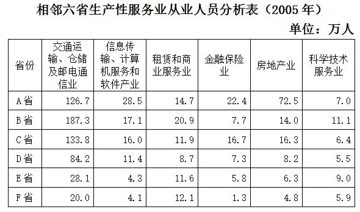

### 第 126 题

六省从业人数比例最悬殊的生产性服务业是：

A. 交通运输、仓储及邮电通信业

B. 信息传输、计算机服务和软件产业

C. 金融保险业

D. 房地产业

第 126 题 · 答案与解析

**参考答案（粉笔题库参考内容）**

C

**解析**

根据题干“······比例最悬殊······”，可判定本题为比值比较类问题。定位表格材料可得：交通运输、仓储及邮电通信业最悬殊的两个省份从业人员分为187.3万人和20.0万人，比值为187.3/20.0 ≈ 9.4；信息传输、计算机服务和软件产业最悬殊的两个省份从业人员分为28.5万人和4.1万人，比值为28.5/4.1 ≈ 7.0；金融保险业最悬殊的两个省份从业人员分为22.4万人和1.3万人，比值为22.4/1.3 ≈ 17.2；房地产业最悬殊的两个省份从业人员分为72.5万人和4.8万人，比值为72.5/4.8 ≈ 15.1，比值最悬殊的为金融保险业。

故正确答案为C。

**考点**：比值比较、统计表

**来源**：2009年安徽省公务员录用考试《行测》题第126题

### 第 127 题

C省与D省相比，从业人数最接近的生产性服务业是：

A. 信息传输、计算机服务和软件产业

B. 租赁和商业服务业

C. 金融保险业

D. 科学技术服务业

第 127 题 · 答案与解析

**参考答案（粉笔题库参考内容）**

D

**解析**

定位表格材料可得，C省与D省在信息传输、计算机服务和软件产业从业人员分为16.0万人和11.4万人，相差4.6万人；在租赁和商业服务业从业人员分别为11.9万人和8.7万人，相差3.2万人；在金融保险业从业人员分别为16.7万人和7.3万人，相差9.4万人；在科学技术服务业从业人员分别为6.4万人和5.5万人，相差0.9万人，故在科学技术服务业从业人数最接近。

故正确答案为D。

**考点**：直接找数、统计表

**来源**：2009年安徽省公务员录用考试《行测》题第127题

### 第 128 题

六省的生产性服务业，按从业人数多少排名相同的行业是：

A. 交通运输、仓储及邮电通信业

B. 信息传输、计算机服务和软件产业

C. 租赁和商业服务业

D. 科学技术服务业

第 128 题 · 答案与解析

**参考答案（粉笔题库参考内容）**

A

**解析**

定位表格材料可得：交通运输、仓储及邮电通信业在A-F省中排名均是第一名；信息传输、计算机服务和软件产业在A-F省中排名分别为：第三名，第三名，第四名，第二名，第六名，第五名；租赁和商业服务业在A-F省中排名分别为：第五名，第二名，第五名，第三名，第二名，第二名；科学技术服务业在A-F省中排名分别为：第六名，第五名，第六名，第六名，第三名，第三名。故排名相同的行业是交通运输、仓储及邮电通信业。

故正确答案为A。

**考点**：排序类、统计表

**来源**：2009年安徽省公务员录用考试《行测》题第128题

### 第 129 题

以从业人数为标准，C省与其他五省相比，相对较弱的行业是：

A. 交通运输、仓储及邮电通信业

B. 信息传输、计算机服务和软件产业

C. 金融保险业

D. 科学技术服务业

第 129 题 · 答案与解析

**参考答案（粉笔题库参考内容）**

D

**解析**

定位表格材料可得：C省和其他五省相比，交通运输、仓储及邮电通信业从业人员数133.8万人，排名第2；信息传输、计算机服务和软件产业从业人员数16.0万人，排名第3；金融保险业从业人员数16.7万，排名第2；科学技术服务业从业人员数6.4万人，排名第4，故相对较弱的是科学技术服务业。

故正确答案为D。

**考点**：排序类、统计表

**来源**：2009年安徽省公务员录用考试《行测》题第129题

### 第 130 题

就从业人数规模看，以下关于六省生产性服务业的判断不正确的是：

A. A省房地产业相对发达

B. E省、F省的信息传输、计算机服务和软件产业相对薄弱

C. F省的金融保险业很发达

D. B省从业人员数量最悬殊的两个行业是交通运输、仓储及邮电通信业与金融保险业

第 130 题 · 答案与解析

**参考答案（粉笔题库参考内容）**

C

**解析**

A项：定位表格材料可知，A省房地产业从业人数在六个省中排名第一，故A省房地产业相对发达，正确；

B项：定位表格材料可知，E、F省的信息传输、计算机服务和软件产业从业人数在六个省中分别排名第五、第六，故E省、F省的信息传输、计算机服务和软件产业相对薄弱，正确；

C项：定位表格材料可知，F省的金融保险业在六个省中排名第六，故F省的金融保险业并不发达，错误；

D项：定位表格材料可知，B省排名第一的是交通运输、仓储及邮电通信业，排名最后的是金融保险业，正确。

本题为选非题，故正确答案为C。

**考点**：统计表、综合分析

**来源**：2009年安徽省公务员录用考试《行测》题第130题

## 材料 4

根据下列材料完成以下各题。

        截止2007年12月，网民数已达到2.1亿人，比2007年6月增加4800万人，2007年一年增加了7300万，年增长率为53.3%。一年中平均每天增加网民20万人。目前，中国的网民人数略低于美国的2.15亿，位于世界第二位：中国16%的互联网普及率仍比全球平均水平19.1%低3.1个百分点。

        从地域上看，北京和上海的互联网普及率较高，已经分别达到46.6%和45.8%；从增量上看，广东由于手机网民数增长的拉动，增长人数最多，一年内共增加了1500万网民。

        2007年农村网民规模年增长率超过100%，达到127.7%，农村网民数量达到5262万人。7300万新增网民中的4成，即2917万来自农村。从网民居住地上看，网民居住在城镇的较多，74.9%都居住在城镇，城镇网民数已达到1.57亿人，而同期农村网民数量仅有5262万人。但农村网民数量增长非常迅速，年增长率超过100%，已达到127.7%，远高于城镇网民38.2%的增长率。但城镇与农村的互联网发展水平仍存在很大差距，城镇居民的互联网普及率是27.3%，农村仅为7.1%。

        中国的宽带网民数量增长迅速。2007年12月的宽带网民数已经达到1.63亿，占网民总体的77.6%，比2007年6月增加了4094万人，比2006年12月的1.04亿增加了5938万人。

### 第 131 题

农村网民数量占全国网民的比例达到了：

A. 1/3

B. 1/4

C. 2/5

D. 1/5

第 131 题 · 答案与解析

**参考答案（粉笔题库参考内容）**

B

**解析**

根据题干出现“······占······”，题干无时间要求默认与材料时间一致，可判定本题是现期比重问题。定位材料第一段可知：“截止2007年12月，网民数已达到2.1亿人”，定位材料第三段可知：“农村网民数量达到5262万人”，根据公式：= 比重 = 部分量/整体量，则农村网民数量占全国网民的比重= 0.5262亿人/2.1亿人 ≈ 1/4。

故正确答案为B。

**考点**：文字资料、现期比重

**来源**：2009年安徽省公务员录用考试《行测》题第131题

### 第 132 题

2007年，农村网民增长率比城市网民增长率高：

A. 87.5%

B. 89.5%

C. 91.5%

D. 93.5%

第 132 题 · 答案与解析

**参考答案（粉笔题库参考内容）**

B

**解析**

根据题干“2007年，农村网民增长率比城市网民增长率高······”，题干时间与材料时间一致，可判定本题为一般增长率问题。定位材料第三段可知：“农村网民数量增长非常迅速，······已达到127.7%，远高于城镇网民38.2%的增长率”，故农村网民增长率比城市网民增长率高127.7%-38.2%=89.5%。

故正确答案为B。

备注：本题选项表述并不严谨，两个增长率相减后的结果应xx百分点。

**考点**：一般增长率、文字资料

**来源**：2009年安徽省公务员录用考试《行测》题第132题

### 第 133 题

2007年6月与2006年相比，中国宽带网民增长了：

A. 17.4%

B. 33.2%

C. 45%

D. 56.7%

第 133 题 · 答案与解析

**参考答案（粉笔题库参考内容）**

A

**解析**

根据题干“2007年6月与2006年相比，······增长······”，结合选项为百分数，可判定本题为一般增长率问题。定位材料最后一段可知：“2007年12月的宽带网民数已经达到1.63亿，······比2007年6月增加了4094万人，比2006年12月的1.04亿增加了5938万人”，故2007年6月宽带网民数=1.63-0.4094≈1.22亿人，根据公式：增长率 = (现期量 - 基期量)/基期量，故所求增长率= (1.22 − 1.04)/1.04=0.18/1.04≈17.3%，与A项最接近。

故正确答案为A。

**考点**：一般增长率、文字资料

**来源**：2009年安徽省公务员录用考试《行测》题第133题

### 第 134 题

与世界互联网普及率相比：

A. 中国城镇居民互联网普及率高出3.1个百分点

B. 中国农村居民互联网普及率低7.1个百分点

C. 北京互联网普及率要高出25.5个百分点

D. 上海互联网普及率要高出26.7个百分点

第 134 题 · 答案与解析

**参考答案（粉笔题库参考内容）**

D

**解析**

定位材料第一段可知：“中国16%的互联网普及率仍比全球平均水平19.1%低3.1个百分点”，定位材料材料第二段可知：“北京和上海的互联网普及率较高，已经分别达到46.6%和45.8%”，定位材料最后三段可知：“城镇居民的互联网普及率是27.3%，农村仅为7.1%”。

A项：与世界互联网普及率（19.1%）相比中国城镇居民互联网普及率（27.3%）高27.3%-19.1%=8.2个百分点，错误；

B项：与世界互联网普及率（19.1%）相比中国农村居民互联网普及率（7.1%）低19.1%-7.1%=12个百分点，错误；

C项：与世界互联网普及率（19.1%）相比北京互联网普及率（46.6%）高46.6%-19.1%=27.5个百分点，错误；

D项：与世界互联网普及率（19.1%）相比上海互联网普及率（45.8%）高45.8%-19.1%=26.7个百分点，正确。

故正确答案为D。

**考点**：文字资料、简单加减计算

**来源**：2009年安徽省公务员录用考试《行测》题第134题

### 第 135 题

以下判断正确的是：

A. 中国互联网普及率仅次于美国，已经居世界前列

B. 中国农村网民增长速度高于城市，但互联网普及率低于城市

C. 广州手机网民数量超过了宽带网民数量

D. 2007年中国的城市网民新增数量及增长率都高于农村

第 135 题 · 答案与解析

**参考答案（粉笔题库参考内容）**

B

**解析**

A项：定位材料第一段可知：“中国的网民人数略低于美国的2.15亿，位于世界第二位：中国16%的互联网普及率仍比全球平均水平19.1%低3.1个百分点”，且中国人口基数大于美国，只能判断出中国普及率低于美国，无其他国家数据无法判断是否仅次于美国，也无法判断是否位于世界前列，错误；

B项：定位材料第三段可知：“农村网民数量增长······，已达到127.7%，远高于城镇网民38.2%的增长率。但······城镇居民的互联网普及率是27.3%，农村仅为7.1%”，可推出中国农村网民增长速度高于城市，但互联网普及率低于城市，正确；

C项：资料中未提到广州的手机网民数量是否超过宽带网民数量，错误；

D项：定位材料第三段可知：“7300万新增网民中的4成，即2917万来自农村······农村网民数量增长······，已达到127.7%，远高于城镇网民38.2%的增长率”，可知城市新增网民高于农村但是增长率低于农村，错误。

故正确答案为B。

**考点**：文字资料、综合分析

**来源**：2009年安徽省公务员录用考试《行测》题第135题

## 材料 5

根据下列材料完成以下各题。

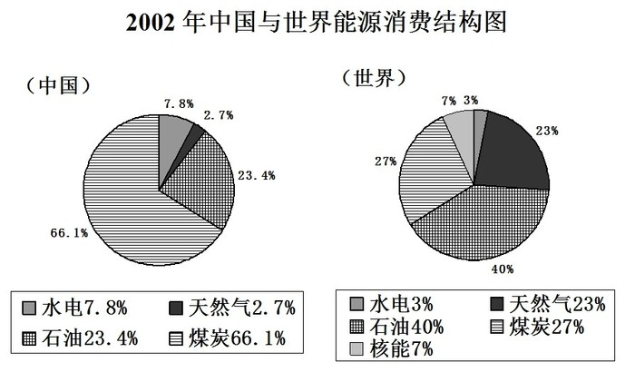

### 第 136 题

2002年中国煤炭消费比重高出世界煤炭消费比重多少个百分点：

A. 9.8

B. 10.2

C. 39.1

D. 66.1

第 136 题 · 答案与解析

**参考答案（粉笔题库参考内容）**

C

**解析**

根据题干“2002年，······比重高······百分点”，题干时间与材料时间一致，可判定本题为现期比重问题。定位统计图可知：中国煤炭消费比重为66.1%，世界煤炭消费比重为27%，故中国煤炭消费比重比世界煤炭消费比重高66.1%-27%=39.1个百分点。

故正确答案为C。

**考点**：现期比重、统计图

**来源**：2009年安徽省公务员录用考试《行测》题第136题

### 第 137 题

2002年世界能源消费构成中，占主导的是：

A. 煤炭

B. 石油

C. 天然气

D. 水电

第 137 题 · 答案与解析

**参考答案（粉笔题库参考内容）**

B

**解析**

定位统计图可知：世界能源消费中石油占比最大（40%），故世界能源消费构成中占主导地位的是石油。

故正确答案为B。

**考点**：直接找数、统计图

**来源**：2009年安徽省公务员录用考试《行测》题第137题

### 第 138 题

2002年中国能源消费构成中，占主导的是：

A. 煤炭

B. 石油

C. 天然气

D. 水电

第 138 题 · 答案与解析

**参考答案（粉笔题库参考内容）**

A

**解析**

定位统计图可知：中国能源消费中煤炭占比最大（66.1%），故中国能源消费构成中占主导地位的是煤炭。

故正确答案为A。

**考点**：直接找数、统计图

**来源**：2009年安徽省公务员录用考试《行测》题第138题

### 第 139 题

在国际上今后我国应着重保障什么的可靠、合理和稳定的供应：

A. 煤炭

B. 石油

C. 天然气

D. 水电

第 139 题 · 答案与解析

**参考答案（粉笔题库参考内容）**

B

**解析**

定位统计图可知：世界能源消费中石油占比最大（40%），故我国应着重保障石油的可靠、合理和稳定的供应。

故正确答案为B。

**考点**：直接找数、统计图

**来源**：2009年安徽省公务员录用考试《行测》题第139题

### 第 140 题

2002年中国能源消费结构图中没有核能这一项，其中原因最可能是：

A. 2002年前中国还没有建立核电站

B. 核能消费可能产生污染，所以不使用核能

C. 2002年中国的核能消费比重可能太小，没有列入

D. 中国的能源储备丰富，暂时不需要使用核能

第 140 题 · 答案与解析

**参考答案（粉笔题库参考内容）**

C

**解析**

A项：根据统计图数据可知2002年中国并没有核能消费，但是并不能推出中国没有建立核电站，根据常识也可知1991年中国第一座核电站秦山核电站建成，错误；

B项：根据常识可知，核能相对煤炭等污染更小，错误；

C项：存在2002年中国的核能消费比重可能太小从而没有列入的可能性，并且相较于其他选项，该选项可能性最大，正确；

D项：虽然中国能源储备丰富，但是中国人口众多，且核能污染更小，因此应加快发展核能，错误。

故正确答案为C。

**考点**：统计图、综合分析

**来源**：2009年安徽省公务员录用考试《行测》题第140题

