# 2010年安徽省公务员录用考试《行测》题

<!-- gwy:overview:start -->
> **安徽 · 2010 · 行测 · 统考** ｜ 130 题 · 图片 71 处 · 答案随题折叠

| 题型模块 | 题量 | 题号 |
| --- | ---: | ---: |
| 数量关系 | 15 | 1–15 |
| 言语理解与表达 | 35 | 16–50 |
| 判断推理 | 35 | 51–85 |
| 常识判断 | 30 | 86–115 |
| 资料分析 | 15 | 116–130 |
| **合计** | **130** | |

导航：[题型与作答说明](#题型与作答说明) · [题目](#题目) · [材料 1](#材料-1)
<!-- gwy:overview:end -->

> 候选采集稿。参考答案及解析来自粉笔页面，不代表官方答案或真实高分答卷；来源使用许可与原卷对应关系仍需人工核实。

## 题型与作答说明

数量关系

（15题）

本部分包括数字推理与数学运算两种类型的题目。

言语理解与表达

（35题）

根据题目要求，在四个选项中选出一个正确答案。

判断推理

（35题）

本部分包括定义判断、类比推理、图形推理与逻辑判断四种类型的题目。

常识判断

（30题）

本部分要求考生依据常识做出判断。请注意，似乎合理的答案可能有多种，你应选择最为合理的一个。

资料分析

（15题）

针对下列图、表或文字回答问题。你应根据资料提供的信息进行分析、比较、计算、处理。

## 题目

### 第 1 题

1，2，3，6，12，24，（  ）

A. 48

B. 45

C. 36

D. 32

第 1 题 · 答案与解析

**参考答案（粉笔题库参考内容）**

A

**解析**

数列无明显特征，且作差无规律，考虑递推数列。观察发现：1+2=3，1+2+3=6，1+2+3+6=12，1+2+3+6+12=24，故所求项=1+2+3+6+12+24=48。

故正确答案为A。

**来源**：2010年安徽省公务员录用考试《行测》题第1题

### 第 2 题

1，9，25，49，121，（  ）

A. 144

B. 154

C. 169

D. 177

第 2 题 · 答案与解析

**参考答案（粉笔题库参考内容）**

C

**解析**

数列各项数字均为平方数，考虑幂次数列。原数列可转化为：、、、、、（    ），发现新数列各项数字均为平方数，可优先排除B、D两项。由于新数列底数均为奇数，观察选项，只有C项满足。

故正确答案为C。

**来源**：2010年安徽省公务员录用考试《行测》题第2题

### 第 3 题

56，114，230，462，（  ）

A. 916

B. 918

C. 924

D. 926

第 3 题 · 答案与解析

**参考答案（粉笔题库参考内容）**

D

**解析**

数列起伏较大，且无幂次规律，考虑递推数列。观察发现，56×2+2=114，114×2+2=230，230×2+2=462，规律为：前一项×2+2=后一项，故所求项=462×2+2=926。

故正确答案为D。

**来源**：2010年安徽省公务员录用考试《行测》题第3题

### 第 4 题

1，（    ），，，

A. 0

B. 1

C. 

D. 

第 4 题 · 答案与解析

**参考答案（粉笔题库参考内容）**

D

**解析**

观察数列，大部分是分数形式，考虑将整数反约分成分数形式。结合分数和选项数字，原数列可转化为：，（    ），，，，后三个分数的分母两两之间作差依次为：6、8，推测差值组成的新数列是公差为2的等差数列，即2、4、6、8，验证：1+2=3，3+4=7，符合，故所求项的分母=1+2=3，分子为1，则所求项为。

故正确答案为D。

**来源**：2010年安徽省公务员录用考试《行测》题第4题

### 第 5 题

\[  (9，6）42（7，7）\]    \[  (7，3）40（6，4）\]    \[(8，2）（  ）（3，2）\]

A. 30

B. 32

C. 34

D. 36

第 5 题 · 答案与解析

**参考答案（粉笔题库参考内容）**

A

**解析**

数列由中括号分成三组，优先考虑分组找规律。观察发现，(9-6)×(7+7)=42，(7-3)×(6+4)=40，规律为：每组中前两项的差×后两项的和=中间项，故所求项为(8-2)×(3+2)=30。

故正确答案为A。

**来源**：2010年安徽省公务员录用考试《行测》题第5题

### 第 6 题

2009×20082008－2008×20092009＝（  ）

A. 0

B. 1

C. 2

D. 3

第 6 题 · 答案与解析

**参考答案（粉笔题库参考内容）**

A

**解析**

。

故正确答案为A。

**来源**：2010年安徽省公务员录用考试《行测》题第6题

### 第 7 题

在1-101中5的倍数的所有数的平均数是：

A. 52.5

B. 53.5

C. 54.5

D. 55.5

第 7 题 · 答案与解析

**参考答案（粉笔题库参考内容）**

A

**解析**

所有5的倍数组成的数列为公差为5等差数列，因此其平均数等于首项与末项和的一半。首项为5，末项为100，因此平均数＝(5＋100)÷2＝52.5。

故正确答案为A。

**考点**：数列问题

**来源**：2010年安徽省公务员录用考试《行测》题第7题

### 第 8 题

一个正方形队列，如减少一行和一列会减少19人，原队列有几个人：

A. 81

B. 100

C. 121

D. 144

第 8 题 · 答案与解析

**参考答案（粉笔题库参考内容）**

B

**解析**

方法一：逆向考虑，假定原正方形队列一边有n人，减少一行一列后一边有（n-1）人，因此减少人数为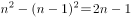。由题意2n-1=19，故n=10，因此原方阵有100人。

方法二：有一个人站在行与列的交点上，减少了一行和一列，则有一个人会重复。减少了19人，可知原数列每行或每列有(19+1)÷2=10人，因此原方阵有10×10=100人。

方法三：代入法，正方形方阵的总数有典型的“平方数”特征，分析题目可知，选项中的数据减去19应该是平方数，经代入验证发现只有B项符合要求。

故正确答案为B。

**来源**：2010年安徽省公务员录用考试《行测》题第8题

### 第 9 题

把一根线绳对折、对折、再对折，然后从对折后线绳的中间剪开，这根线绳被剪成了几小段：

A. 6

B. 7

C. 8

D. 9

第 9 题 · 答案与解析

**参考答案（粉笔题库参考内容）**

D

**解析**

对折3次，剪1刀，绳子变成。

剪绳问题：若初始为1根绳子，则绳子段数为切口数加1。一根绳子连续对折x次，剪y刀，则绳子被剪成段。

故正确答案为D。

**来源**：2018年重庆市选调优秀大学生到基层工作考试《行测》题第56题

### 第 10 题

按照中国篮球职业联赛的规则，各篮球队队员的号码可以选择的范围是0—55号，但选择两位数的号码时，每位数字不得超过5。那么，可供每支球队选择的号码共有多少个：

A. 30

B. 34

C. 36

D. 40

第 10 题 · 答案与解析

**参考答案（粉笔题库参考内容）**

D

**解析**

根据题意可知，若号码为一位数，有0到9共10个号码；若号码为两位数，则十位数可选1到5，个位数可选0到5（共6个数字），共计5×6＝30个号码。因此总的可选号码共10＋30＝40个。

故正确答案为D。

**考点**：基础排列组合

**来源**：2010年安徽省公务员录用考试《行测》题第10题

### 第 11 题

一列火车于中午12时离开A地驶往B地，另一列火车则于40分钟后离开B地驶往A地。若两列火车以相同的匀速在同一路线上行驶，全程需要3个半小时。问两列火车何时相遇？

A. 13:55

B. 14:00

C. 14:05

D. 14:10

第 11 题 · 答案与解析

**参考答案（粉笔题库参考内容）**

C

**解析**

由题意可知，两列火车速度相等且为匀速，所以路程之比等于时间之比。如图所示，火车走完AB之间全程共需3个半小时，即3小时30分钟。一列火车从A地到C地需要40分钟，此时另一列火车从B出发，则BC之间相距2小时50分钟的路程。假设两车在D点相遇，由于两车速度相等，则D为BC的中点，即CD为1小时25分钟的路程，AD=40分钟+1小时25分钟=2小时5分钟车程，故两车相遇时为14：05。

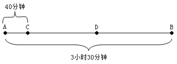

故正确答案为C。

**考点**：相遇追及

**来源**：2010年安徽省公务员录用考试《行测》题第11题

### 第 12 题

某数学竞赛共160人进入决赛，决赛共4题，做对第一题的有136人，做对第二题的有125人，做对第三题的有118人，做对第四题的有104人。那么，在这次决赛中至少有几人得满分：

A. 3

B. 4

C. 5

D. 6

第 12 题 · 答案与解析

**参考答案（粉笔题库参考内容）**

A

**解析**

根据题干“至少有几人得满分”，求四道题都做对的至少为多少，即求都满足的最少，可判定本题为多集合反向构造，解题方法为“反向-求和-作差”。①反向：1-4题做错的人数分别为160-136=24人、160-125=35、160-118=42人、160-104=56人；②求和：要让四道题目都做对的人最少，就让这四道题做错的人不重复，为24+35+42+56=157人；③作差：得满分的人最少为160-157=3人。

故正确答案为A。

**考点**：多集合反向构造

**来源**：2010年安徽省公务员录用考试《行测》题第12题

### 第 13 题

某商店一次进货6桶油，重量分别为15kg、16kg、18kg、19kg、20kg和31kg。上午卖出2桶，下午卖出3桶，下午卖的重量正好是上午的2倍。那么，剩下的一桶油重多少kg：

A. 15

B. 16

C. 18

D. 20

第 13 题 · 答案与解析

**参考答案（粉笔题库参考内容）**

D

**解析**

方法一：根据题意可知，下午卖的重量正好是上午的2倍，即上午卖的重量为1份，下午卖的重量为2份，全天卖的重量为3份，故全天卖出的重量能被3整除。全部6桶油的重量之和=15+16+18+19+20+31=119，的余数为2，不能整除，说明剩下的那桶油除以3的余数也为2，只有D项符合要求。

方法二：代入排除法，全天卖出的重量能被3整除，即全部6桶油的重量之和（119kg）减去剩下那桶油的重量能被3整除。代入四个选项，只有D项：119-20=99，能被3整除，正确。

故正确答案为D。

**考点**：和差倍比问题

**来源**：2010年安徽省公务员录用考试《行测》题第13题

### 第 14 题

一只蚂蚁发现了一只死螳螂，立刻回洞找来10只蚂蚁搬，搬不动；然后每只蚂蚁回去各找来10只蚂蚁，还是搬不动；于是每只蚂蚁又回去找来10个伙伴，大家齐心协力，终于把死螳螂拖回洞里。问一共有多少只蚂蚁参加了搬运：

A. 1210

B. 1257

C. 1331

D. 1441

第 14 题 · 答案与解析

**参考答案（粉笔题库参考内容）**

C

**解析**

方法一：

每次每只蚂蚁找10只蚂蚁来，因此每次蚂蚁总数都是上一次总数的11倍，根据题意可知共有3次倍增的过程，故最终参与搬运的蚂蚁数为。

方法二：

一只蚂蚁回洞找10只同伴，共有11只蚂蚁；11只蚂蚁再回洞找同伴，每只找10只，共找来同伴11×10＝110只，加上找同伴的11只，则共有蚂蚁110＋11＝121只；121只蚂蚁再回洞找同伴，共找来121×10＝1210只，加上去找同伴的121只，则共有蚂蚁1210＋121＝1331只。

故正确答案为C。

注意：计算时不要忘记加上去找同伴的那些蚂蚁。

**考点**：数列问题

**来源**：2010年安徽省公务员录用考试《行测》题第14题

### 第 15 题

一个边长为8cm的立方体，表面涂满油漆，现在将它切割成边长为0.5cm的小立方体，问两个表面有油漆的小立方体有多少个？

A. 144

B. 168

C. 192

D. 256

第 15 题 · 答案与解析

**参考答案（粉笔题库参考内容）**

B

**解析**

两个表面被涂油漆的小立方体位于棱上，且不位于大立方体的端点。大立方体棱长为8cm，切成小立方体棱长为0.5cm，则每条棱被分成16段，其中两端不符合要求，因此每条棱上有14个小立方体符合。立方体共有12条棱，则符合要求的小立方体有14×12＝168个。

故正确答案为B。

**考点**：几何公式类-立体图形、几何结论类-几何小题型

**来源**：2010年安徽省公务员录用考试《行测》题第15题

### 第 16 题

由于处在不同的历史发展时期，中国安全生产尤其是煤炭安全生产状况，无法和发达国家当下的水准<u>相提并论</u>，中国有必要借鉴发达国家的安全生产经验，大幅度提高安全生产水准。

可以替换划线部分的词语是：

A. 同日而语

B. 并行不悖

C. 异曲同工

D. 分庭抗礼

第 16 题 · 答案与解析

**参考答案（粉笔题库参考内容）**

A

**解析**

本题考查成语替换。

根据文意可知，横线处表达中国安全生产的水准比不上发达国家，“相提并论”指把不同的人或性质不同的事放在一起谈论或看待，A项“同日而语”指放在同一时间谈论，指相提并论，二者语义接近，可以替换，当选。

B项“并行不悖”指同时进行，不相冲突，C项“异曲同工”指说法不一而用意相同，或一件事情的做法不同而都巧妙地达到目的，D项“分庭抗礼”意为平起平坐，彼此对等可以抗衡，均与“相提并论”语义无关，排除。

故正确答案为A。

**来源**：2010年安徽省公务员录用考试《行测》题第16题

### 第 17 题

下列句子中，没有歧义的一句是：

A. 伊朗的“核武”问题，已引起美国总统奥巴马的密切关注。对此，美国有的国际问题专家则表示乐观

B. “依我看，这个考点最需要引起重视。”张老师补充道

C. 我在楼顶上栽的几盆花，长得枝繁叶茂

D. 厂长再次强调：“这个面子还是要的。”

第 17 题 · 答案与解析

**参考答案（粉笔题库参考内容）**

C

**解析**

本题考查歧义句辨析。

A项“对此”的“此”指代不明，既可指“伊朗的核武问题”也可指“奥巴马的密切关注”，存在歧义；

B项“考点”既可以指考查的知识点，也可指考试的地点，有歧义；

D项“面子”既可理解为“物体的表面”，也可理解为“情面”，存在歧义；

C项没有歧义。

故正确答案为C。

**来源**：2010年安徽省公务员录用考试《行测》题第17题

### 第 18 题

下列句子中，有歧义的一句是：

A. 这个合理化建议一经采纳，大大激发了全体员工献计献策的积极性

B. 部队是个大熔炉，三年里，我进步很大，因为首长对自己的要求十分严格

C. 他事先没作充分准备，遇到这样的意外情况就显得不知所措

D. 古人尚且能闻过则喜，今天有些人却常常讳疾忌医，这实在不应该

第 18 题 · 答案与解析

**参考答案（粉笔题库参考内容）**

B

**解析**

本题考查歧义辨析。

B项指代不明：“自己”既可以指“首长”，也可以指“我”，有歧义。

A、C、D三项均没有歧义。

故正确答案为B。

**来源**：2010年安徽省公务员录用考试《行测》题第18题

### 第 19 题

下列各句中，与其他几句意思不同的一句是：

A. 这里是所有的材料，这个项目就交给你了。

B. 所有这个项目的材料都在这里，交给你！

C. 关于这个项目的材料都在这里，交给你！

D. 这个项目的所有材料都在这里，交给你！

第 19 题 · 答案与解析

**参考答案（粉笔题库参考内容）**

A

**解析**

本题考查句意的理解。

B、C、D三项表达的意思都是“和这个项目有关的所有材料都交给你”，“给你”的是“材料”，而A项“给你”的是“项目”，意思不同。

故正确答案为A。

**考点**：句子

**来源**：2010年安徽省公务员录用考试《行测》题第19题

### 第 20 题

下面的句子中，括号中的成语使用有误的是：

A. 看到非洲草原上角马迁徙的场景，你一定会震撼不已——绵延几公里的角马群如黑色的洪流，（一泻千里），蔚为壮观

B. 年关临近，本是商品销售的最佳良机，受次贷危机的影响和欧元的持续走低，今年意大利的市场显得十分萧条，60％的华人企业（裹足不前）

C. 人类向自然毫无节制的索取，造成环境严重污染、资源日益匮乏，这种行为无异于（作茧自缚）

D. 我和汪剑做了四年的室友，对他的经历、性格、爱好都（了如指掌），我相信他绝不会出卖朋友

第 20 题 · 答案与解析

**参考答案（粉笔题库参考内容）**

B

**解析**

本题考查成语使用辨析。

B项“裹足不前”形容有所顾虑而止步不敢向前，偏重主观方面，是思想上的保守、缺乏斗志导致不前进，而题干中的华人企业显然是受客观条件的影响而停滞不前，“裹足不前”与语境不符；

A项“一泻千里”形容江河奔流直下，流地越快越远，原句中修饰“黑色的洪流”，使用正确；

C项“作茧自缚”比喻做了某件事，结果是自己受困，也比喻自己给自己找麻烦，修饰人类毫无节制的索取这一行为，恰当；

D项“了如指掌”形容对情况非常清楚，用在此句表示非常了解自己的室友，恰当。

本题为选非题，故正确答案为B。

**来源**：2010年安徽省公务员录用考试《行测》题第20题

### 第 21 题

将下列打乱了次序的语句进行调整，使其还原为一篇精美的小小说。正确的一项是：(    ) ①他直起腰，快步朝前走去。 ②五分硬币从他手指缝钻出，掉到地上。 ③后面传来低低的细语和响亮的、富有节奏的高跟鞋敲打路面的声音；恍惚间，他看到了那熟悉的，随风摆动的裙子。 ④他朝着校门外的瓜子摊儿走去，手伸进裤兜…… ⑤只有那五分硬币静静地躺在那里…… ⑥他弯下腰，刚要将它拾起……⑦高跟鞋的声响也渐渐远去。

A. ①②③④⑤⑥⑦

B. ④②⑥③①⑦⑤

C. ②⑤①③⑦⑥④

D. ⑤⑥③④②⑦①

第 21 题 · 答案与解析

**参考答案（粉笔题库参考内容）**

B

**解析**

本题可以采用排除法。

A项，从第1句的“他直起腰”、第6句的“他弯下腰”可知，第6句应排在第1句前面，应排除。

B项，符合时间先后和逻辑顺序，应选。

C项，从第1句的“他直起腰”、第6句的“他弯下腰”可知，第6句应排在第1句前面，应排除。

D项，第5句“只有那五分硬币静静地躺在那里……”言有尽而意无穷，明显应放在句尾引人回味，而不是放在开头引出故事，应排除。

故正确答案为B。

**考点**：确定顺序

**来源**：2010年安徽省公务员录用考试《行测》题第21题

### 第 22 题

下列各句中，没有语病的是：

A. 通过考察美国几所中学，使这些中国校长们的教育教学理念悄然地发生着变化

B. 机关考勤制度改革后，“一杯茶，一支烟，一张报纸看半天”的现象不见了，全勤的人数骤然增多，出勤率较前三个月有很大增加

C. 这个峡谷至今仍是个谜，听老人们说，那里从来就没有人能进去过，进去的人从来就没有能活着回来的

D. 市井百姓的生活变化实实在在。他们的欲求原本就简单，只是盼望着生活就这样一步一个脚印地往前走。然而，这看似简单、实则难得的进步，离不开中国稳扎稳打的“内功修炼”

第 22 题 · 答案与解析

**参考答案（粉笔题库参考内容）**

D

**解析**

本题考查病句辨析。

A项主语残缺，应该去掉“使”；

B项主谓搭配不当，“出勤率”不能说“增加”，而应该说“提高”；

C项逻辑错误，前后矛盾，既然“从来就没有人能进去过”，因而不可能有“进去的人”；

D项没有语病。

故正确答案为D。

**来源**：2010年安徽省公务员录用考试《行测》题第22题

### 第 23 题

下列各句中，有语病的是：

A. 深入开展学习实践科学发展观的活动，是用中国特色社会主义理论体系武装全党的重大举措

B. 那些手上有过硬技术的职工，企业即使面临困难，也要千方百计地挽留

C. 目前全国已有大约20个省份实现了城乡户籍的统一登记制度，取消了农村户口和城市户口的区别

D. 抓住时机推出有利于保增长、扩内需、调结构的改革措施，是提振市场信心的最好办法

第 23 题 · 答案与解析

**参考答案（粉笔题库参考内容）**

B

**解析**

本题考查病句辨析。

B项中“企业即使面临困难”前边的部分应当属于整个句子的状语成分，“那些手上有过硬技术的职工”不能单独做状语，应在前面加上介词“对于”，或者放在“挽留”的后面做宾语。

A、C、D三项没有语病。

故正确答案为B。

**来源**：2010年安徽省公务员录用考试《行测》题第23题

### 第 24 题

下列各句中，有语病的是：

A. 正确认识和处理中欧关系，必须站在长远和战略高度，具备深远的历史眼光和宽广的全球视野

B. 中国的网络发展还处在初级阶段，但中国网民的理性声音越来越大，正朝向理性探讨和分析以及知识共享的方向发展

C. 近几年的实践表明，平安建设是新形势下社会治安综合治理的新举措，也是构建社会主义和谐社会的基本内容和重要抓手

D. 要解决百姓的“购票难”，要赢得公众和舆论更多的理解和宽容，铁路部门必须在解决购票公平问题上有所作为

第 24 题 · 答案与解析

**参考答案（粉笔题库参考内容）**

B

**解析**

本题考查病句辨析。

B项“声音”与“朝向······发展”搭配不当，“朝向······方向发展”对的是前面“中国网络”，并非“网民理性的声音”。

A、C、D三项没有语病。

故正确答案为B。

**来源**：2010年安徽省公务员录用考试《行测》题第24题

### 第 25 题

下列各句中，没有语病的是：

A. 卫星遥感监测小麦品质这一成果成功后，可以用来确定一个地区适宜栽培的小麦品种，并指导农民科学施肥、科学种植，提高小麦品质，实现优质优价，增加农民收入

B. 本届大冬会男子冰球比赛先进行小组单循环比赛，然后根据积分排出小组名次，获得两个小组前两名的队伍进行半决赛，胜者争夺冠亚军

C. 为了建立公开、平等的市场环境，促进我国软件产业的健康和可持续发展，各地高度重视计算机软件版权保护工作，在严格版权管理制度、坚决打击侵权盗版非法行为、维护经济和文化市场秩序方面成效显著

D. 市场需要创意，营销需要灵感。市场要是没有创意，那么市场开拓就会成为一句空话；营销要是没有灵感，那么营销的结果就是死板与缺乏吸引力，营造市场的气氛也就没有什么看点了

第 25 题 · 答案与解析

**参考答案（粉笔题库参考内容）**

C

**解析**

本题考查病句辨析。

A项中主语残缺，应将“成功后”删除，应该是“这一成果，可以用来······”，排除；

B项中“两个小组前两名队伍”存在歧义，既可指“每一组的前两名队伍”，还可指“两个小组的前两名队伍”；

D项中“营造市场的气氛”与“看点”搭配不当；

C项没有语病，当选。

故正确答案为C。

**来源**：2010年安徽省公务员录用考试《行测》题第25题

### 第 26 题

一位父亲深情地对大学毕业刚走上工作岗位的儿子说：“世界上只有没出息的人，没有没出息的工作。”

这位父亲是要告诉儿子，要树立：

A. 自主择业观

B. 竞争就业观

C. 职业平等观

D. 自主创业观

第 26 题 · 答案与解析

**参考答案（粉笔题库参考内容）**

C

**解析**

据提问知此题为中心理解题。

材料中父亲的话重点在“没有没出息的工作”，可见父亲意在强调工作的平等性，认为职业没有高低贵贱之分，是一种职业平等的价值观。

A、B、D三项均没有切合“平等”。

故正确答案为C。

**来源**：2010年安徽省公务员录用考试《行测》题第26题

### 第 27 题

《梦溪笔谈》无疑代表了宋代地理观察的最高水平，但该书并不算一部地理著作，宋代地理观察的结果更集中地表现在游记中。

《梦溪笔谈》是游记吗：

A. 是

B. 不是

C. 其中一部分是

D. 目前还有争议

第 27 题 · 答案与解析

**参考答案（粉笔题库参考内容）**

B

**解析**

本题属于细节判断题。

文段首先指出《梦溪笔谈》的地位，即“代表了地理观察的最高水平”，接下来文段用转折词“但”引出观点“该书并不算是一部地理著作”。最后一句话是在总结宋代地理观察的结果，强调结果更集中表现在游记中，即宋代的地理著作就是游记，而《梦溪笔谈》并不是一部地理著作，故《梦溪笔谈》也不算是游记，对应B项。

故正确答案为B。

**考点**：细节判断题

**来源**：2010年安徽省公务员录用考试《行测》题第27题

### 第 28 题

过去几十年，中国社会淡化了民族民俗。随着人们生活富裕，需要用一个个节日掀起娱乐高潮，这时发现我们的传统节日“贫乏”，难以满足人们的精神文化需求，于是，那些富于人情味的洋节便顺理成章地钻入了中国人的生活。

这段话对洋节进入中国人生活的态度是：

A. 理解

B. 赞成

C. 反对

D. 无所谓

第 28 题 · 答案与解析

**参考答案（粉笔题库参考内容）**

A

**解析**

材料分析了洋节进入中国人生活的原因，对洋节进入中国人生活这种现象并未表现出是否赞成，而是用“顺理成章”表示了对此现象的理解和接受。A项忠于原文，为正确答案。

B项，“赞成”作者并没有正面体现，应排除。

C项，“反对”作者也没有正面体现，应排除。

D项，“无所谓”理解错误，应排除。

故正确答案为A。

**考点**：关联词-因果

**来源**：2010年安徽省公务员录用考试《行测》题第28题

### 第 29 题

需求不足造成生产过剩，而裁员和降薪又造成低收入群体收入继续下降，需求更加疲软，生产过剩更加严重。

根据以上这段话，下列说法错误的是：

A. 生产过剩是由需求不足导致的

B. 生产过剩是因为没有根据消费需求合理组织生产

C. 扩大需求可以缓解生产过剩带来的压力

D. 生产过剩和消费不足是互为因果、反复加剧的过程

第 29 题 · 答案与解析

**参考答案（粉笔题库参考内容）**

A

**解析**

本题属于细节判断题。

材料体现了两重意思：一是需求不足与生产过剩之间是互为因果、反复循环的过程；二是多方面原因导致生产过剩，需求不足只是其中的一个方面。

A项说法过于绝对、片面，根据文段表述，生产过剩是由很多原因引起的，表述错误。

B项根据文段表述意思可知，导致生产过剩的原因很多，有需求不足，或者是收入下降、购买力下降，选项“没有根据消费需求”指的就是没有考虑多方面原因造成的消费需求问题，表述正确；C项对应文段首句“需求不足造成生产过剩”，可知其表述正确；D项是针对整个文段进行理解，符合文段的中心，表述正确。

本题为选非题，故正确答案为A。

**考点**：细节判断题

**来源**：2010年安徽省公务员录用考试《行测》题第29题

### 第 30 题

世界经济论坛年会2月1日在瑞士达沃斯落下帷幕，出席论坛的经济专家们普遍认为，全球经济下滑尚未触底。

这句话告诉我们，出席世界经济论坛年会的经济专家：

A. 认为全球经济出现了下滑

B. 认为全球经济仍有继续下滑的趋势

C. 对全球经济下滑问题达成了共识

D. 对全球经济下滑的研究没有尽头

第 30 题 · 答案与解析

**参考答案（粉笔题库参考内容）**

B

**解析**

根据提问可知本题为中心理解题。

“尚未触底”意为还没有达到底线，还有继续下滑的趋势，和B项意思相符。

A、C两项只提到了下滑，至于下滑到何种程度没有提及，表达不够准确；D项偷换了概念，是“经济下滑”而不是“经济下滑的研究”。

故正确答案为B。

**来源**：2010年安徽省公务员录用考试《行测》题第30题

### 第 31 题

在临床使用抗菌药物时，依患者个人情况选择药品种类、严格要求第一次用药的剂量与浓度并在随后的药物使用频率、药物配伍方面都遵行严格的规定的话，尽管不能完全防止耐药菌株的出现，也应该能控制耐药状况的泛滥和恶化。

作者对使用抗菌药物后是否会出现耐药状况的看法是：

A. 不可避免

B. 未置可否

C. 可以控制

D. 无法确定

第 31 题 · 答案与解析

**参考答案（粉笔题库参考内容）**

A

**解析**

根据文段“尽管不能完全防止耐药菌株的出现，也应该能控制耐药状况的泛滥和恶化”可知，耐药菌株一定会出现，不能完全防止，对应A项。C项“可以控制”表示能够防止耐药菌株出现，与文意相悖，排除。B项、D项不合文意，文段已经表明了作者的态度，排除。

故正确答案为A。

**考点**：关联词-对策

**来源**：2010年安徽省公务员录用考试《行测》题第31题

### 第 32 题

周总理在欢迎基辛格二次访华的宴会上说：“中美关系的恢复要归功于毛主席和尼克松总统。当然，一定也要有一个人做先导，这个先导就是基辛格博士。”

这说明：

A. 基辛格访华标志着中美关系走向正常化

B. 基辛格对促进中美关系改善起到了决定性的作用

C. 毛主席和尼克松总统是中美关系改善的推动者

D. 基辛格为中美关系的改善奠定了基础

第 32 题 · 答案与解析

**参考答案（粉笔题库参考内容）**

D

**解析**

根据提问可知本题为中心理解题。

基辛格是中美关系恢复的“先导”，即为中美关系的恢复做出了前期的贡献，奠定了基础， 与D项意思一致。

A项观点材料没有提到；B项偷换概念，“决定性”作用不等于“先导”；C项没抓住重点，材料强调的是基辛格的作用。

故正确答案为D。

**来源**：2010年安徽省公务员录用考试《行测》题第32题

### 第 33 题

下列诗句蕴涵事物前进性与曲折性关系的是：

A. 四十年来画竹枝，日间挥写夜间思。冗繁削尽留清瘦，画到生时是熟时。

B. 寒江雪柳日新晴，玉树琼花满目春。历尽天华成此景，人间万事出艰辛。

C. 若言琴上有琴声，放在匣中何不鸣？若言声在指头上，何不于君指上听？

D. 自小刺头深草里，而今渐觉出蓬蒿。时人不识凌云木，直待凌云始道高。

第 33 题 · 答案与解析

**参考答案（粉笔题库参考内容）**

B

**解析**

本题为中心理解题。

A项是清代郑板桥的诗，体现了矛盾双方对立、统一，并在一定的条件下相互转化的哲理。作画时，一方面要追求“熟”——高超的、娴熟的艺术技巧、笔法；另一方面也要追求“生”——发现事物新的特点，运用新的表现手法；在另一方面，在手法上，要做到从“生”到“熟”的转化，追求两者的统一，矛盾双方在一定条件下也能相互转化。诗人四十余年的“日间挥写夜间思”的苦练，才能会达到“画到生时是熟时”的境界；

B项出自江泽民《长白山诗词选》所作七绝二首，诗词中的“寒江”“雪柳”“满目春”可以看出是经历了冬天迎来了春天，关键在于最后一句“历尽天华成此景，人间万事出艰辛”，可以看出事物的发展是前进性与曲折性的统一；

C项出自苏东坡的《琴诗》，“琴”“指头”“琴声”“演奏者”相互影响、相互制约，体现了事物间的相互关联、矛盾的对立统一；演奏者的思想感情和技能与琴、指之间的关系，又可以看作是事物的内部矛盾（内因）和事物的外部矛盾（外因）之间的关系。前者是音乐产生的根据，后者则是音乐产生的条件，两者缺一不可。这说明了事物的发展是内外因共同作用的结果的哲理；

D项诗句出自唐代杜荀鹤的《小松》，讲述的是小松变大松、由“小刺头”变成“凌云木”是一个渐进的过程。说明事物的发展总是经历由小到大、由弱到强、由不完善到比较完善的过程，并没有体现曲折性。

故正确答案为B。

**考点**：主题词

**来源**：2010年安徽省公务员录用考试《行测》题第33题

### 第 34 题

人民代表大会期间，某农民代表在讨论中对温家宝总理表示：“作为人民代表，要把农民的烦恼事讲给总理听。但我讲出来只是供您参考，不是要求您。”温家宝立即纠正说：“你是人民代表，有要求我的权利。”

对总理的话理解正确的是：

A. 人大代表是国家权力的直接行使者，政府工作要受到人大的监督

B. 人大代表是全体公民的代表，公民在法律面前一律平等

C. 人大代表是全体公民的直接代表，具有决定权和任免权

D. 政府工作要受到人大的监督，而人大代表不必接受政府的监督

第 34 题 · 答案与解析

**参考答案（粉笔题库参考内容）**

A

**解析**

本题考查词句理解。

“你是人大代表，有要求我的权利”中“你”是人大代表，而“我”是国务院总理，国务院就是中央人民政府，国务院所做的工作就是政府工作。从温总理的话可以看出政府与人大的关系就是A项所言“政府工作要受到人大的监督”。结合上述，A项符合题意。

B项“法律面前一律平等”无中生有；C项“具有决定权和任免权”与“有要求我的权利”并不等同；D项材料并未提及“而人大代表不必接受政府的监督”。

故正确答案为A。

**考点**：句子

**来源**：2010年安徽省公务员录用考试《行测》题第34题

### 第 35 题

鲁迅先生在民国十四年曾经说过：“我觉得革命以前，我是做奴隶，革命以后不多久，就受了奴隶的骗，变成他们的奴隶了······我觉得仿佛就没有所谓中华民国。”

对此理解正确的是：

A. 中华民国不只是一个空招牌

B. 国民革命之后社会并没有多少真实的进步

C. 国民革命之后，君主专制制度依然存在

D. 老百姓被奴役的命运是无法改变的

第 35 题 · 答案与解析

**参考答案（粉笔题库参考内容）**

B

**解析**

本题属于细节判断题。

从“做奴隶”到“受了奴隶的骗，变成他们的奴隶”，国民革命并没有改变“我”被剥削被压迫的地位，可见革命并没有取得多大的进步，B项表述正确。

从“没有所谓中华民国”可知A项错误；C项“君主专制制度依然存在”无中生有；D项本身表述有误。

故正确答案为B。

**考点**：细节判断题

**来源**：2010年安徽省公务员录用考试《行测》题第35题

### 第 36 题

大凡受过教育的中国人尽管可能听不懂彼此的方言，却能阅读同样的书籍······如果他们使用的是字母文字，中国恐怕早就分裂成像意大利、法国、葡萄牙那样的许多国家了。

这说明：

A. 欧洲分裂成许多小国家的主要原因是使用字母文字

B. 中国汉字既实用又具有艺术性

C. 统一文字有利于多民族国家的形成和发展

D. 字母文字只有艺术性没有实用性

第 36 题 · 答案与解析

**参考答案（粉笔题库参考内容）**

C

**解析**

根据提问知本题为中心理解题。

从“如果他们使用的是字母文字······就分裂成像意大利······”可知，字母文字不利于多民族国家的形成和发展，而统一的文字却可以对其起到促进作用。

由材料可知，使用字母文字是欧洲分裂成许多小国家的原因之一，A项增加“主要”，改变了原文的意思；B、D两项的“艺术性”材料并未提及。

故正确答案为C。

**考点**：分述句特征-引入铺垫

**来源**：2010年安徽省公务员录用考试《行测》题第36题

### 第 37 题

举行祭孔大典纪念孔子，就是要进一步发掘和丰富孔子儒家文化博大精深的思想内涵，使之不断创新发展，以“和而不同”、“兼收并蓄”的怀抱走向世界。

文中“和而不同”指的是：

A. 中华文化能和其他民族文化和睦相处

B. 中华文化和别的民族文化互不相连

C. 中华文化要吸收其他民族文化的精髓

D. 中华文化要和其他民族文化由不同逐渐走向融合

第 37 题 · 答案与解析

**参考答案（粉笔题库参考内容）**

A

**解析**

本题属于词语理解题。

“和而不同”、“兼收并蓄”指面对其他民族文化时，中华文化应秉持的开放、和睦的态度。

B项“互不相连”的表述明显错误；C项片面强调“兼收并蓄”；D项过于强调“融合”，抹杀了“不同”。

故正确答案为A。

**考点**：实词

**来源**：2010年安徽省公务员录用考试《行测》题第37题

### 第 38 题

脂肪也有好坏之分，好脂肪（如顺式脂肪、不饱和脂肪）有助于新陈代谢，是身体生长发育必不可少的物质。而反式脂肪（又名反式脂肪酸）则是不折不扣的坏脂肪。国外研究显示，反式脂肪可能提高人体内“坏”胆固醇水平、阻塞动脉、增加患心血管疾病风险。胎儿通过胎盘，新生婴儿通过母乳均可以吸收反式脂肪酸，影响孩子对好脂肪的吸收。同时，反式脂肪酸还会对青少年的中枢神经系统的生长发育造成不良影响，抑制前列腺素的合成。另有研究指出，反式脂肪酸还会减少男性荷尔蒙分泌，对精子产生负面影响，中断精子在身体内的反应。

以上这段话的主要内容是：

A. 脂肪的种类

B. 如何正确区分好坏脂肪

C. 反式脂肪危害大

D. 反式脂肪形成危害的基本原理

第 38 题 · 答案与解析

**参考答案（粉笔题库参考内容）**

C

**解析**

根据提问“主要内容”一词可知本题为中心理解题。

材料具体列举了其对一般人、胎儿、新生婴儿、青少年、男性等不同群体的危害。可见，材料的主要内容是说明反式脂肪的危害。

材料中只说“脂肪有好坏之分”，并未具体说明脂肪的分类，A项错误；B项材料未提及；材料中没有具体说明原理，D项错误。

故正确答案为C。

**考点**：关联词-并列

**来源**：2010年安徽省公务员录用考试《行测》题第38题

### 第 39 题

2008年10月6日，美国哈佛史密松天体物理中心宣布，格林威治时间10月7日2时46分，一颗编号为2008TC3的小行星将由苏丹北部上空进入地球大气层并发生燃烧。事后观测表明，2008TC3如期而至，误差时间只有15秒。能对直径不足3米的小行星进行如此精确预测，并在临撞阶段进行观测，这在人类历史上还是第一次，2008TC3也因此成为人类历史上第一颗被事先观测到的撞地小行星。该成就将对今后小天体撞地的预报和预防工作产生积极推动作用。一批顶尖天文学家已向联合国提出拨款申请，以建立“太空卫士网”，监视、防范甚至摧毁在“碰撞路线”上的小行星。

下列说法能够概括以上文字主要内容的是：

A. 2008TC3是人类历史上第一颗被事先观测到的撞地小行星

B. 人类首次准确预测一颗小行星撞击地球

C. 人类应该加强小天体撞地的预报和预防工作

D. 建立“太空卫士网”可以监视、防范甚至摧毁可能撞击地球的小行星

第 39 题 · 答案与解析

**参考答案（粉笔题库参考内容）**

B

**解析**

根据提问“主要内容”一词可知本题为中心理解题。

材料的主旨句是“能对直径不足3米的小行星进行如此精确预测，并在临撞阶段进行观测，这在人类历史上还是第一次”，材料的内容都是围绕这一事件展开的。

选项A是强干扰项，文段的重点不是在强调这颗小行星，而是强调人类首次预测这一事件，故A项不是文段的重点，排除；C、D两项只是文段后面解释说明的内容，不是重点，并且表述片面，排除。

故正确答案为B。

**考点**：主题词

**来源**：2010年安徽省公务员录用考试《行测》题第39题

### 第 40 题

美国北卡罗来纳大学的一个团队对约两万名7年级到12年级的男孩研究后发现，拥有一种叫MAOA的基因的2R变异类型的人倾向于发生犯罪和违法行为。但只有当这些男孩遭遇家庭、社交和学习成绩问题等压力时，不良行为才会出现。如一个年轻人无法同家人经常共同进餐，那么MAOA的2R变异基因就会激发他出现不良行为。但如果具有同样基因的人能和父母经常一起进餐，则有关风险就消失了。研究人员<u>称该研究可以扩展人类对违法和暴力行为的理解</u>。文中划线部分的意思是指它使我们了解：

A. MAOA的基因的2R变异类型的存在会导致反社会行为

B. MAOA的基因的2R变异类型只存在于男孩身上

C. 年轻人应该经常同家人共同进餐，以防止违法犯罪行为的发生

D. 违法犯罪行为的产生，既有社会背景，也有基因根源

第 40 题 · 答案与解析

**参考答案（粉笔题库参考内容）**

D

**解析**

从文段第一句可知一种叫MAOA的基因的2R变异类型的人倾向于发生违法犯罪等不良行为，从文段第二、三、四句可知当遭遇各种社会压力时，含有MAOA的基因的2R变异基因的人，会出现不良行为，综上可知，违法犯罪行为的产生，既有社会背景的压力又有基因的原因，D项表述正确，当选。

A项，表述错误，只有在含有MAOA的基因的2R变异基因的人遭遇家庭、社交等压力时，才会导致反社会行为，排除；

B项，表述错误，从文段可知，该团队只是对男孩做的研究，并未提到是否对女孩做研究，或是对女孩做研究后其是否含有MAOA的基因的2R变异基因，排除；

C项，表述错误，含有MAOA的基因的2R变异基因的人通过经常和家人共同进餐，可以防止违法犯罪行为的发生，排除。

故正确答案为D。

**考点**：句子

**来源**：2010年安徽省公务员录用考试《行测》题第40题

### 第 41 题

权利的贫困，很容易使人进入失败的循环，继续失败仿佛成为宿命，而改变命运则几乎不可能。一个被失败情绪笼罩的人，极易从开始的被动边缘化逐渐进入到主动边缘化，成为敌视社会的他者。

下列符合文意的是：

A. 长久沉浸于失败的颓唐中，必定敌视社会

B. 长久沉浸于失败的颓唐中，容易敌视社会

C. 缺乏权利的人必定失败

D. 缺乏权力的人容易失败

第 41 题 · 答案与解析

**参考答案（粉笔题库参考内容）**

B

**解析**

本题考查细节判断。

由原文“极易从开始的被动边缘化逐渐进入到主动边缘化，成为敌视社会的他者”可以推出B项表述符合文意。

因此，结合选项应该选择B。

A项中“必定”的表述过于绝对，材料说的是“极易······成为敌视社会的他者”，而不是一定会敌视社会，所以不选；C项也是表述绝对化，缺乏权利的人“很容易”失败，而不是“必定”会失败，所以不选；D项偷换概念，“权利”和“权力”有所区别，“权力”是一个政治概念，一般是指有权支配他人的强制之力，它总是和服从联结在一起，而“权利”是一个法律概念，一般指赋予人们的权力和利益，即自身拥有的维护利益之权。

故正确答案为B。

**考点**：细节判断题

**来源**：2010年安徽省公务员录用考试《行测》题第41题

### 第 42 题

历史剧一个必须承担的功能，就是认识历史。再现也好，表现也好，强调历史观不同也罢，历史的大格局是不能逾越的，因为历史是民族共有的，不是哪一个艺术家个人可以随意剪裁的布料，这也就给历史剧在艺术审美上提出了真实性和严肃性的要求。如果失去了对历史的尊重，也就不该或不能冠之以历史剧之名。

这段文字意在强调（  ）。

A. 历史剧必须承担起认识历史的功能

B. 历史剧应以真实还原历史为创作原则

C. 历史剧的演绎应建立在尊重历史的基础上

D. 历史剧应在真实性和娱乐性之间达到平衡

第 42 题 · 答案与解析

**参考答案（粉笔题库参考内容）**

C

**解析**

本题属于中心理解题。文段主要围绕“历史剧”展开论述，首先介绍历史剧必须承担的功能；后指出无论如何，历史的大格局不能逾越，并解释原因，引出历史剧的真实性和严肃性问题；文段最后一句以“如果失去了对历史的尊重，也就不该或不能冠之以历史剧之名”，这样的否定假设，提出文段的中心论点，即历史剧必须要尊重历史。结合选项，C项当选。

A项，“认识历史的功能”是用来引出文段的重点“尊重历史”，而其本身并不是文段强调的重点，故排除。

B项，文段未涉及“创作原则”相关内容，属于无中生有，故排除。

D项，原文讲述的是“真实性和严肃性”，而不是该项所说的“真实性和娱乐性”，属于偷换概念，故排除。

故正确答案为C。

【文段出处】《新&lt;三国>：违背历史情怀 获得了收视率》

**考点**：关联词-对策

**来源**：2010年安徽省公务员录用考试《行测》题第42题

## 材料 1

＿＿＿＿哟！

        你看那红的，黑的，白的，青的，嬉笑的，悲哀的，目眦怒得欲裂的面容，无论你怎样褒奖，怎样嫌弃。它们一点儿也不改变。红的还是红的，白的还是白的，目眦欲裂的还是目眦欲裂。

        人面呢？颜色比那纸制的小玩意好而且活动，带着生气。可是你褒奖他的时候，他虽是很高兴，脸上却装出很不情愿的样子；你指责他的时候，他虽是懊恼，脸上偏要显示出乐于纳言的颜色。

        人面到底是靠不住呀！<u>我们要学做面具，但不要戴它，因为面具后面应当让它空着才好。</u>

### 第 43 题

第一句话具有统括全文的作用，横线上应填充的文字为：

A. 人面却不同

B. 纸制的面具则不同

C. 纸制的面具更不同那人面

D. 人面远不如那纸制的面具

第 43 题 · 答案与解析

**参考答案（粉笔题库参考内容）**

D

**解析**

本题属于表面主旨题。

文段第二段在对比人面和面具，文段倒数第二句“人面到底是靠不住呀”进行总结，强调的主体是“人面”。文段首句的作用应该是引领下文，故文段的结构为“总分总”，对应最后一句，主体为“人面”。

A项以偏概全，没有提及比较对象“面具”；B、C 两项以面具作为阐述主体，予以排除。文中感慨人面虽然比面具好而且活动，带着生气，却总试图隐藏内心表情，不如面具来得真实，D项“人面不如面具”与文意一致。

故正确答案为D。

**来源**：2010年安徽省公务员录用考试《行测》题第43题

### 第 44 题

对文尾划线的句子，理解正确的是：

A. 因为面具虽然称作假面具但它不会做假

B. 因为面具固然有真实的一面但它毕竟是假面具

C. 因为面具有真有假，真假令人莫辨

D. 因为面具不会变化，假就是假，真就是真

第 44 题 · 答案与解析

**参考答案（粉笔题库参考内容）**

B

**解析**

本题属于词句理解题。

“我们要学做面具，但不要戴它”是一个带有转折的复句，包含了两层意思：一是我们要学做面具好的一面，因为面具“无论你怎样褒奖，怎样嫌弃。它们一点儿也不改变”；二是我们“不要戴它”，因为面具毕竟是假的，是不真实的，不能充当人面。用面具来遮掩人面，更是不真实的，重点强调面具的不真实性。B项体现了两层含义，与文意相符。

A项虽然体现了两层意思，但重点在强调面具不会做假，具有真实的一面，与作者意思相反；C项不符合文意，面具不存在有真有假；D项表述片面，只解释了面具真实的一面，没有表现出句中的第二层不真实的含义。

故正确答案为B。

**来源**：2010年安徽省公务员录用考试《行测》题第44题

### 第 45 题

短文将人面与面具对比，其用意强调说明的是：

A. 人面有时比面具更假

B. 面具有时比人面更假

C. 人面比面具更善于表演

D. 面具比人面更善于表演

第 45 题 · 答案与解析

**参考答案（粉笔题库参考内容）**

C

**解析**

本题为隐含主旨题。

材料中作者想表达的是面具是真实的，而人面却常常是虚伪的，C项重点强调人面，符合原文的意思。

A、B两项都认为面具是假的，故排除；作者的侧重点很明显在人面而不是面具，D项重点强调面具，排除。

故正确答案为C。

**来源**：2010年安徽省公务员录用考试《行测》题第45题

## 材料 2

近年来，在众多城市和工厂密布的珠三角地区，天空经常灰蒙蒙一片，大气能见度很差。

        很多市民可能并不清楚，棕色云团正是能见度下降的“罪魁祸首”：棕色云团中的一些微小颗粒，会吸收阳光，或者将部分阳光反射回大气。

联合国环境规划署的棕色云团报告就显示，自上世纪70年代以来，广州的日光强度已经下降了五分之一以上。

        北京大学环境系教授张远航及其同事在珠三角地区进行的研究表明，珠三角空气有很多污染物，其中那些粒径小于2.5微米的细颗粒物（PM2.5），是造成能见度衰退的主要因素。而中国现行的空气质量国家标准中，却没有关于PM2.5的规定。我们每天在电视上或者报纸上看到的空气质量日报中所谓的“可吸入颗粒物”，仅指那些粒径小于10微米的颗粒物（PMl0）。

联合国环境规划署的报告指出，每立方米：PM2.5的浓度如果上升20微克的话，中国和印度每年就会有约34万人死亡。即使按照折中的估计，棕色云团相关的PM2.5所致经济损失，也将分别占到中国GDP的3.6％以及印度GDP的2.2％。

        除了影响空气质量和人类健康，棕色云团还可能影响气候。在很多情况下，棕色云团与全球不断增加的温室气体交织在一起，正在对区域乃至全球气候系统产生极大影响。

        此外，棕色云团的成分非常复杂。其中硫酸盐等多种成分可以降温。而黑碳的成分正在加快喜马拉雅等地冰川的融化速度，因为黑碳沉降在冰雪上，会使冰雪颜色变暗，吸收热量的能力增强；黑碳还会加热空气。这些因素，都使得冰川融化加速。

        然而，棕色云团对整个气候系统带来的影响，实际上比这复杂得多。它可以通过反射阳光和吸收热量减缓全球气温上升的幅度。如果棕色云团一夜之间消失。全球气温可能迅速上升多达2度，而这正是一些科学家认为地球还能容忍的最大升温幅度。

### 第 46 题

以下最适合作为本文标题的是：

A. 棕色云团与城市能见度

B. 棕色云团的危害

C. 棕色云团中的PM2.5

D. 复杂的棕色云团

第 46 题 · 答案与解析

**参考答案（粉笔题库参考内容）**

D

**解析**

本题为标题选择题。

材料既说明棕色云团构成成分也说明了它的危害，同时还说明了它对全球气温升高的控制作用。D项是对全文的高度概括，最适合作为本文标题。

A、B、C三项以偏概全，都只说明了棕色云团中的某一个方面。

故正确答案为D。

**来源**：2010年安徽省公务员录用考试《行测》题第46题

### 第 47 题

棕色云团中造成能见度衰退的主要因素是：

A. 黑碳

B. 有机颗粒物

C. PM10

D. PM2.5

第 47 题 · 答案与解析

**参考答案（粉笔题库参考内容）**

D

**解析**

本题为细节判断题。

从材料“珠三角空气有很多污染物，其中那些粒径小于2.5微米的细颗粒物（PM2．5），是造成能见度衰退的主要因素”可知D项正确。

故正确答案为D。

**来源**：2010年安徽省公务员录用考试《行测》题第47题

### 第 48 题

关于棕色云团的危害，错误的是：

A. 减缓全球气温上升的幅度

B. 诱发疾病、致人死亡

C. 造成能见度下降

D. 加速冰川融化

第 48 题 · 答案与解析

**参考答案（粉笔题库参考内容）**

A

**解析**

本题为细节判断题。

A项是棕色云团的积极作用，不是危害。

B、C、D三项都是棕色云团的危害。

本题为选非题，故正确答案为A。

**来源**：2010年安徽省公务员录用考试《行测》题第48题

### 第 49 题

文章最后一段的意思是：

A. 如果气温升高2度以上，地球将岌岌可危

B. 棕色云团给地球和人类带来的不仅仅是危害

C. 棕色云团的危害具有复杂性

D. 棕色云团很有可能一夜之间消失

第 49 题 · 答案与解析

**参考答案（粉笔题库参考内容）**

B

**解析**

本题为表面主旨题。

文章最后一段论述的是棕色云团在减缓全球气温上升幅度方面的作用，B项符合文意。

材料说的是“全球气温升高”，A项“气温升高”表述不当；C项偷换主体，材料中指的是棕色云团具有复杂性，而非危害具有复杂性；D项表述错误，材料中只是一种假设——“如果棕色云团一夜之间消失”，并没有说是否有这种可能性。

故正确答案为B。

**来源**：2010年安徽省公务员录用考试《行测》题第49题

### 第 50 题

根据文章内容，下列说法正确的是：

A. 中国现行的空气质量国家标准有待改良

B. 政府应该采取行动，充分利用棕色云团的复杂性，使之造福社会

C. 为准确报告空气质量情况，中国应该提高空气质量检测技术水平

D. 中国现有空气质量标准忽略PM2.5细颗粒物，是因为它对人体健康的危害较小

第 50 题 · 答案与解析

**参考答案（粉笔题库参考内容）**

A

**解析**

本题为细节判断题。

从材料“中国现行的空气质量国家标准中，却没有关于PM2.5的规定”“PM2.5细颗粒物对人体健康的危害甚于PM10”可知，A项与文意相符。

B项与材料无关，文中介绍了棕色云团的复杂性，但并未提及利用其复杂性；

C项表述不当，根据“中国现行的空气质量国家标准中，却没有关于PM2.5的规定”可知，中国要准确报告空气质量情况，需要有关于PM2.5的规定，未提及检测技术水平；

D项表述错误，由 “而已有的研究表明，PM2.5细颗粒物对人体健康的危害甚于PM10”可知，PM2.5对人体健康的危害较大。

故正确答案为A。

**来源**：2010年安徽省公务员录用考试《行测》题第50题

### 第 51 题

继续教育，是指针对专业技术人员进行的以更新、补充、拓宽专业知识和培养、提高业务能力为目的的非学历教育。

根据以上定义，下列各项中属于继续教育的是：

A. 许多农村中学教师通过函授教育取得了本科文凭

B. 高等院校已获得教授、副教授职称的教师在职攻读博士学位

C. 为使小学教师适应新的课程标准，教育局连续三年举办暑期培训

D. 劳动局为帮助下岗职工实现再就业举办的多种形式职业培训

第 51 题 · 答案与解析

**参考答案（粉笔题库参考内容）**

C

**解析**

第一步：抓住定义中的关键词。

关键词强调“以更新、补充、拓宽专业知识和培养、提高业务能力为目的”、“非学历教育”。

第二步：逐一判断选项。

A、B两项不符合“非学历教育”；D项对下岗职工进行培训目的是实现再就业，而非“以更新、补充、拓宽专业知识和培养、提高业务能力为目的”，A、B、D三项均不属于继续教育；

C项表述符合定义，属于继续教育。

故正确答案为C。

**考点**：方式目的

**来源**：2010年安徽省公务员录用考试《行测》题第51题

### 第 52 题

行政调解，是指在国家行政机关的主持下，以当事人双方自愿为基础，以国家法律、法规及政策为依据，以自愿为原则，通过对争议双方的说服与劝导，促使双方当事人互让互谅、平等协商、达成协议，以解决有关争议而达成和解协议的活动。

以下属于行政调解行为的是：

A. 街道社居委对辖区内邻里纠纷进行调解

B. 工商局所辖的消费者协会对消费纠纷进行调解

C. 交警队对车辆碰撞事故进行责任认定．提出调处意见

D. 某市经济仲裁委员会对企业之间的经济合同纠纷进行调解

第 52 题 · 答案与解析

**参考答案（粉笔题库参考内容）**

C

**解析**

第一步：找出定义关键词。

关键词强调“国家行政机关的主持”。

第二步：逐一判断选项。

A项“街道社居委” 不是国家行政机关，其行为不属于行政调解行为，排除；

B项“消费者协会”不是国家行政机关，其行为不属于行政调解行为，排除；

C项“交警队”属于国家行政机关，符合定义，属于行政调解行为，当选；

D项“经济仲裁委员会”不是国家行政机关，其行为不属于行政调解行为，排除。

故正确答案为C。

**考点**：主客体

**来源**：2010年安徽省公务员录用考试《行测》题第52题

### 第 53 题

网络成瘾，是指个体反复过度使用网络导致的一种精神行为障碍，表现为对使用网络产生强烈欲望，突然停止或减少使用时出现烦躁、注意力不集中、睡眠障碍等。

以下属于网络成瘾的行为症候的是：

A. 李小兵高考之后，父母对其上网不再过问，他一不上网就感到精神恍惚

B. 学生张某勤工俭学，为某网吧做管理员。全部业余时间都在网吧，经常睡眠不足

C. 某公司销售部经理整天泡在网上，联络客户、处理订单、工作压力大，使他有些烦躁

D. 某职业技术学院电子商务专业的几位学生合伙开了电子购物网站，生意火爆，几乎没时间下线，老师说他们上课都有点心不在焉

第 53 题 · 答案与解析

**参考答案（粉笔题库参考内容）**

A

**解析**

第一步：抓住定义中的关键词。

关键词强调“对使用网络产生强烈欲望，突然停止或减少使用时出现烦躁、注意力不集中、睡眠障碍”。

第二步：逐一判断选项。

A项李小兵一不上网就感到精神恍惚，符合定义，属于网络成瘾；

B项张某因为在网吧工作导致的睡眠不足，不属于网络成瘾；

C项销售部经理是在网上工作，工作的压力导致其烦躁，不符合定义；

D项开电子购物网站的学生因为忙于生意而导致上课心不在焉，不符合定义，不属于网络成瘾。

故正确答案为A。

**考点**：拆词

**来源**：2010年安徽省公务员录用考试《行测》题第53题

### 第 54 题

知识产权是权利人通过创造性劳动形成的、或者合法取得的具有知识性、精神性价值和实际经济利益的财产权利。知识产权保护是个人或组织，依法对具有实际经济利益的知识产权进行保护。维护知识产权人合法权益的行为。

根据上述定义，以下不属于知识产权保护行为的是：

A. 民营科技企业与涉密员工订立商业秘密保护协议

B. 轻工学院赵老师长期从事技术研发工作，取得了多项发明专利

C. 模特大赛冠军李艳认为赞助商未经本人同意，擅自使用其照片用于化妆品广告宣传，构成侵权行为，已经起诉到法院

D. 个体工商户李某精心研究，制作“一招鲜”调味品，深受消费者欢迎，准备申请注册商标

第 54 题 · 答案与解析

**参考答案（粉笔题库参考内容）**

C

**解析**

第一步：找出定义关键词。

关键词强调“具有知识性、精神性价值和实际经济利益的财产权利”。

第二步：逐一分析选项。

A项：“订立商业秘密保护协议”要保护的就是这个科技企业的技术或者产品，属于知识性和经济利益的财产，是知识产权保护，符合定义；

B项：“发明专利”保护的发明也是知识性和实际经济利益的财产，是知识产权保护，符合定义；

C项：赞助商侵犯了模特李艳的肖像权，肖像权不属于知识产权的范围，李艳的行为不属于知识产权保护行为；

D项：“注册商标”保护的是李某制作的调味品，属于实际经济利益的财产，属于知识产权保护，符合定义。

本题为选非题，故正确答案为C。

**考点**：常规问法

**来源**：2010年安徽省公务员录用考试《行测》题第54题

### 第 55 题

楼宇经济，是指一种以商务商贸商用楼宇为载体的经济形态，通过开发、出租楼宇，招商引资，引进各类企业，从而开发税源，带动区域经济发展。

以下属于楼宇经济的现象是：

A. 某市政府规划建设滨湖新区，成片高层住宅拔地而起，蔚为壮观

B. 某县政府为节约建设用地，将大院内的平房一律拆除，新建多层办公楼数幢

C. 房地产公司新开发的房产，沿街房屋均是商住楼，底层作为经营门面，提供便民服务

D. 某市总商会投资兴建办公楼，除部分自用外，均向会员企业租售。周边银行酒店商场星罗棋布，形成“新商圈”

第 55 题 · 答案与解析

**参考答案（粉笔题库参考内容）**

D

**解析**

第一步：抓住定义中的关键词。

关键词强调“以商务商贸商用楼宇为载体”、“带动区域经济发展”。

第二步：逐一判断选项。

A项所建楼宇为住宅，B项修建的是办公楼，均不符合“商务商贸商用”，因此不属于楼宇经济；

C项“提供便民服务”不能体现“带动区域经济发展”，不属于楼宇经济，不符合定义；

D项所建楼宇向会员企业租售，形成“新商圈”，符合定义，属于楼宇经济。

故正确答案为D。

**考点**：方式目的

**来源**：2010年安徽省公务员录用考试《行测》题第55题

### 第 56 题

（  ）对于鱼虾相当于草原对于（  ）

A. 养殖 放牧

B. 渔民 牧民

C. 水产 牧草

D. 海洋 牛羊

第 56 题 · 答案与解析

**参考答案（粉笔题库参考内容）**

D

**解析**

第一步：将选项逐一代入，判断各选项前后部分的逻辑关系。

A项代入后，“养殖”和鱼虾之间是动作和对象的对应关系，草原和“放牧”是地点和动作的对应；

B项代入后，前面部分的前者是人物，后面部分的后者是人物；

C项“水产”和鱼虾构成包容关系中的种属关系，草原和“牧草”构成组成关系；

D项“鱼虾和海洋”、“牛羊和草原”都构成对应关系，即事物及其所在场所的对应。

第二步：逻辑关系相同即为答案。

由第一步可知逻辑关系完全相同的是D项。

故正确答案为D。

**考点**：逻辑关系-对应关系

**来源**：2010年安徽省公务员录用考试《行测》题第56题

### 第 57 题

交通肇事与道路的关系相当于（  ）与（  ）

A. 食物中毒 医院

B. 瓦斯爆炸 矿井

C. 校舍崩塌 地震

D. 河堤溃决 汛期

第 57 题 · 答案与解析

**参考答案（粉笔题库参考内容）**

B

**解析**

第一步：判断题干词语间的逻辑关系。

“交通肇事”和“道路”之间构成对应关系，即事件和发生场合的对应。

第二步：判断选项词语间的逻辑关系。

A项词语之间为因果关系，即“发生食物中毒事件后才到医院进行救治”；C、D项都构成事件和原因的对应关系；A、C、D三项都与题干词语的逻辑关系不合，因此排除。

B项词语之间构成事件和发生场合的对应关系，与题干逻辑一致。

故正确答案为B。

**考点**：逻辑关系-对应关系

**来源**：2010年安徽省公务员录用考试《行测》题第57题

### 第 58 题

（  ）对于目标相当于（  ）对于灯塔

A. 信心　风帆

B. 激情　桅杆

C. 行动　航行

D. 毅力　水手

第 58 题 · 答案与解析

**参考答案（粉笔题库参考内容）**

C

**解析**

第一步：将选项逐一代入，判断各选项前后部分的逻辑关系。

将选项代入题干后可以发现，A、B、D三项前后两部分均无明显的逻辑关系。

C项代入题干后，目标用来指导“行动”，灯塔用来指引“航行”，前后均为指导与被指导的对应关系。

第二步：逻辑关系相同即为答案。

由第一步可知逻辑关系完全相同的是C项。

故正确答案为C。

**考点**：逻辑关系-对应关系

**来源**：2010年安徽省公务员录用考试《行测》题第58题

### 第 59 题

编辑对于（  ）相当于（  ）对于蔬菜

A. 报纸　果农

B. 传媒　农业

C. 书刊　农村

D. 杂志　农民

第 59 题 · 答案与解析

**参考答案（粉笔题库参考内容）**

D

**解析**

第一步：将选项逐一代入，判断各选项前后部分的逻辑关系。

A项代入后，编辑和“报纸”构成对应关系，即职业和其作用对象的对应，而“果农”和蔬菜之间没有逻辑关系；

B项“编辑”是传媒行业的一种职业，而“蔬菜”是种植农业的一种，前后逻辑不一致；

C项编辑与“书刊”构成对应关系，“农村”和蔬菜没有逻辑关系；

D项编辑编撰“杂志”，“农民”种植蔬菜，均构成对应关系，即职业和其作用对象的对应。

第二步：逻辑关系相同即为答案。

由第一步可知逻辑关系完全相同的是D项。

故正确答案为D。

**考点**：逻辑关系-对应关系

**来源**：2010年安徽省公务员录用考试《行测》题第59题

### 第 60 题

（  ）对于信箱相当于电脑对于（  ）

A. 邮件　 激光

B. 邮局　 硬盘

C. 邮递员　程序员

D. 光缆　 光驱

第 60 题 · 答案与解析

**参考答案（粉笔题库参考内容）**

B

**解析**

第一步：将选项逐一代入，判断各选项前后部分的逻辑关系。

A项信箱是用来装“邮件”的，二者之间为对应关系，电脑和“激光”之间无明显逻辑关系；

B项信箱是“邮局”的一部分，“硬盘”是电脑的一部分，前后两部分均为包容关系中的组成关系；

C项“邮递员”将信件放入或取出信箱，“程序员”用电脑来编程，前后两部分的逻辑关系并不一致；

D项“光缆”和信箱无明显逻辑关系，“光驱”与电脑之间是包容关系中的组成关系。

第二步：逻辑关系相同即为答案。

由第一步可知逻辑关系完全相同的是B项。

故正确答案为B。

**考点**：逻辑关系-包容关系

**来源**：2010年安徽省公务员录用考试《行测》题第60题

### 第 61 题

冠心病　传染病

A. 熊猫　哺乳动物

B. 京剧　豫剧

C. 细菌　病毒

D. 鲤鱼　两栖动物

第 61 题 · 答案与解析

**参考答案（粉笔题库参考内容）**

D

**解析**

第一步：判断题干词语间逻辑关系。

题干两词“冠心病”是一种病，但不是“传染病”。

第二步：判断选项词语间逻辑关系。

A项是包容关系；

B、C项均是并列关系；

与题干相同逻辑关系的为D项，即“鲤鱼”是一种动物，但不是“两栖动物”。

故正确答案为D。

**考点**：逻辑关系-包容关系

**来源**：2010年安徽省公务员录用考试《行测》题第61题

### 第 62 题

拳击    摔跤

A. 射击　击剑

B. 乒乓球　羽毛球

C. 篮球　排球

D. 举重　跳水

第 62 题 · 答案与解析

**参考答案（粉笔题库参考内容）**

B

**解析**

第一步：判断题干词语间逻辑关系。

拳击和摔跤是并列关系，且都是在两人之间进行的对抗性运动。

第二步：判断选项词语间逻辑关系。

A项，射击和击剑是并列关系，但射击不是在两人之间进行的对抗性运动，排除；

B项，乒乓球和羽毛球是并列关系，且都是在两人之间进行的对抗性运动，与题干关系一致，当选；

C项，篮球和排球是并列关系，但二者都是团体运动，排除；

D项，举重和跳水是并列关系，但二者都不是在两人之间进行的对抗性运动，排除。

故正确答案为B。

**考点**：逻辑关系-并列关系

**来源**：2010年安徽省公务员录用考试《行测》题第62题

### 第 63 题

徘徊　徜徉

A. 妩媚　婵娟

B. 忐忑　感念

C. 惭愧　惆怅

D. 逍遥　进退

第 63 题 · 答案与解析

**参考答案（粉笔题库参考内容）**

A

**解析**

第一步：判断题干词语间逻辑关系。

“徘徊”指在一个地方来回地走，比喻犹豫不决，也比喻事物在某个范围内来回浮动、起伏。“徜徉”指闲游，安闲自在地步行。两者是近义关系。

第二步：判断选项词语间逻辑关系。

A项，“妩媚”指姿容美好，可爱，“婵娟”可以形容姿态曼妙优雅，二者有近义关系，当选；

B项，忐忑和感念两个词语之间无明显的逻辑关系，排除；

C项，惭愧和惆怅两个词语之间无明显的逻辑关系，排除；

D项，逍遥和进退两个词语之间无明显的逻辑关系，排除。

故正确答案为A。

**考点**：语义关系-近义关系

**来源**：2010年安徽省公务员录用考试《行测》题第63题

### 第 64 题

干渴　茶杯

A. 饥饿　面包

B. 寒冷　衣柜

C. 思恋　短信

D. 贫穷　财富

第 64 题 · 答案与解析

**参考答案（粉笔题库参考内容）**

B

**解析**

第一步：判断题干词语间逻辑关系。

题干中“茶杯”里的水可以解渴，“干渴”与“茶杯”之间为对应关系。

第二步：判断选项词语间逻辑关系。

A项“面包”可以使人免去“饥饿”；C项“短信”可以寄托“思恋”；D项“财富”可以驱除“贫穷”。A、C、D三项的逻辑关系与题干并不一致，因此排除。

与题干逻辑关系相同的为B项，“衣柜”里的衣服可以御寒，“寒冷”和“衣柜”之间为对应关系。

故正确答案为B。

**考点**：逻辑关系-对应关系

**来源**：2010年安徽省公务员录用考试《行测》题第64题

### 第 65 题

考古　文物　博物馆

A. 教育　人才　企业

B. 贸易　商品　工厂

C. 播种　收获　土地

D. 培训　演示　博览会

第 65 题 · 答案与解析

**参考答案（粉笔题库参考内容）**

A

**解析**

第一步：判断题干词语间逻辑关系。

题干三词是谓语、宾语和场所间的对应关系，即“考古”发现的“文物”在“博物馆”展览。

第二步：判断选项词语间逻辑关系。

与题干逻辑关系相同的为A项，即“教育”培养的“人才”在“企业”工作；

B项“贸易”与“商品”间不是谓语和宾语间的对应关系；

C项中“土地”不是场所；

D项“培训”与“博览会”之间没有逻辑关系。

故正确答案为A。

**考点**：逻辑关系-对应关系

**来源**：2010年安徽省公务员录用考试《行测》题第65题

### 第 66 题

从所给四个选项中，选择最合适的一个填入问号处，使之呈现一定的规律性：

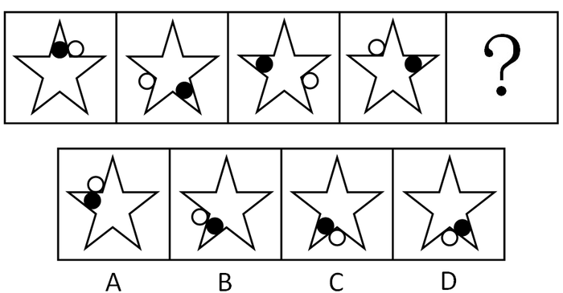

A. A

B. B

C. C

D. D

第 66 题 · 答案与解析

**参考答案（粉笔题库参考内容）**

C

**解析**

元素组成相同，考查位置规律。

观察题干图形可以发现，黑色小球和白色小球分别在五角星内和五角星外移动。黑色小球在五角星内部，在两边相交而成的内角上，每次顺时针旋转2个内角。白色小球在五角星外部，在两边相交成的外角上，每次逆时针旋转2个外角。

选项中，只有C项符合此规律。

故正确答案为C。

**考点**：位置规律-旋转

**来源**：2010年安徽省公务员录用考试《行测》题第66题

### 第 67 题

从所给四个选项中，选择最合适的一个填入问号处，使之呈现一定的规律性：

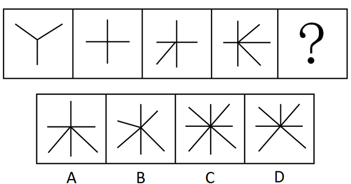

A. A

B. B

C. C

D. D

第 67 题 · 答案与解析

**参考答案（粉笔题库参考内容）**

D

**解析**

观察前四个图形可知，每图中线段的条数分别为3、4、5、6，所以下一图中线段的条数应为7。

故正确答案为D。

**考点**：数量规律-线

**来源**：2010年安徽省公务员录用考试《行测》题第67题

### 第 68 题

从所给四个选项中，选择最合适的一个填入问号处，使之呈现一定的规律性：

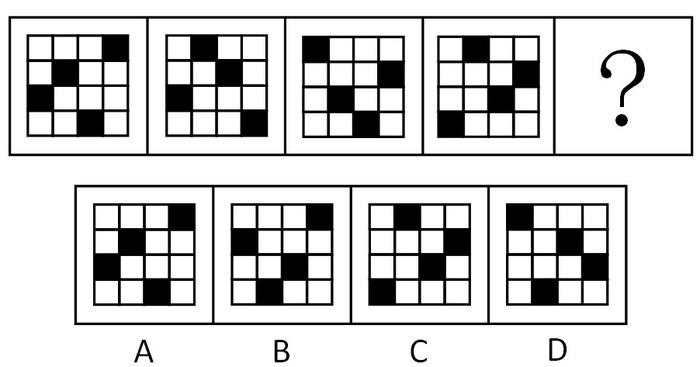

A. A

B. B

C. C

D. D

第 68 题 · 答案与解析

**参考答案（粉笔题库参考内容）**

C

**解析**

元素组成相同，考查位置规律。

观察前面图形可以发现，第一图顺时针旋转90度得到第二图；第二图顺时针旋转180度得到第三图；第三图顺时针旋转270度得到第四图，所以第四图应顺时针旋转360度，得到第五图，即第四个图与第五个图相同。

故正确答案为C。

**考点**：位置规律-旋转

**来源**：2010年安徽省公务员录用考试《行测》题第68题

### 第 69 题

从所给四个选项中，选择最合适的一个填入问号处，使之呈现一定的规律性：

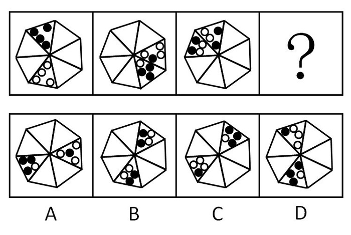

A. A

B. B

C. C

D. D

第 69 题 · 答案与解析

**参考答案（粉笔题库参考内容）**

A

**解析**

元素组成相同，优先考虑位置规律。

观察可知，黑色圆点所在区域每次顺时针平移3格，且黑色圆点每次减少1个，白色圆圈增加1个；白色圆圈所在区域每次逆时针平移2格，且黑色圆点每次增加1个，白色圆圈减少1个。只有A项符合。

故正确答案为A。

**考点**：数量规律-复合

**来源**：2010年安徽省公务员录用考试《行测》题第69题

### 第 70 题

从所给四个选项中，选择最合适的一个填入问号处，使之呈现一定的规律性：

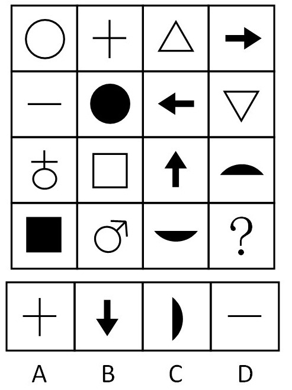

A. A

B. B

C. C

D. D

第 70 题 · 答案与解析

**参考答案（粉笔题库参考内容）**

B

**解析**

观察前三行图形可发现，前两行图形相似，意义相反，比如黑白圆圈、加减号、上下三角、箭头反向；第三、四行也应符合此规律，因此“？”处应填向下的箭头。

故正确答案为B。

**考点**：数量规律-素

**来源**：2010年安徽省公务员录用考试《行测》题第70题

### 第 71 题

从所给四个选项中，选择最合适的一个填入问号处，使之呈现一定的规律性：

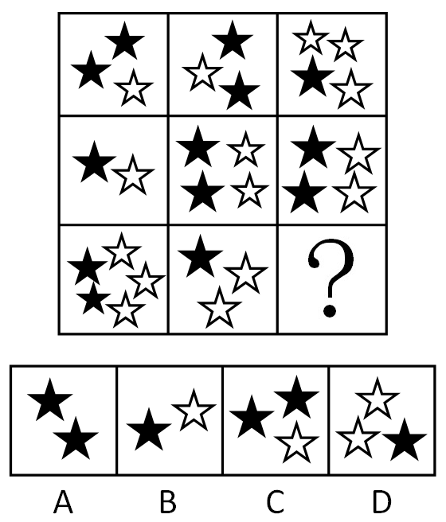

A. A

B. B

C. C

D. D

第 71 题 · 答案与解析

**参考答案（粉笔题库参考内容）**

A

**解析**

观察可知，前两行中每行均有5个黑色五角星和5个白色五角星组成，因此第三行也应符合此规律。

故正确答案为A。

**考点**：数量规律-素

**来源**：2010年安徽省公务员录用考试《行测》题第71题

### 第 72 题

从四个图形选项中把与众不同的一个挑出来。

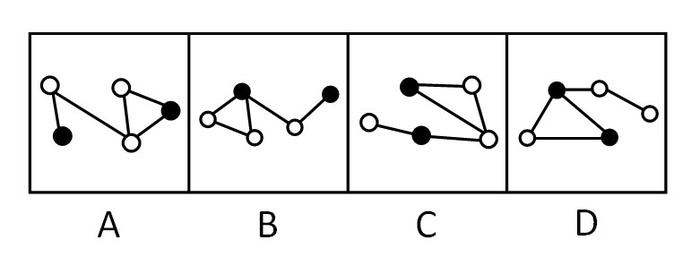

A. A

B. B

C. C

D. D

第 72 题 · 答案与解析

**参考答案（粉笔题库参考内容）**

D

**解析**

元素组成相同，考查元素内部特征。

A、B、C项的图形均是一条实线只连接1个白球、1个黑球或是2个白球；

D项不同于其他三项，一条实线有连接2个黑球的情况。

故正确答案为D。

**考点**：特殊规律-图形间关系

**来源**：2010年安徽省公务员录用考试《行测》题第72题

### 第 73 题

从四个图形选项中把与众不同的一个挑出来。

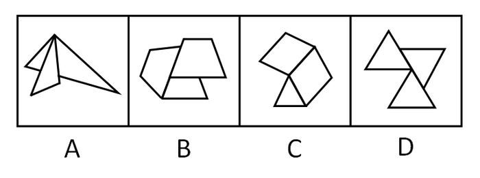

A. A

B. B

C. C

D. D

第 73 题 · 答案与解析

**参考答案（粉笔题库参考内容）**

C

**解析**

元素种类。

观察可知，A、B、D三项的图形都是由三个相同元素组成，即A、D项均由3个三角形组成，B项由3个梯形组成；C项图形的组成元素不相同。

故正确答案为C。

**考点**：数量规律-面

**来源**：2010年安徽省公务员录用考试《行测》题第73题

### 第 74 题

从四个图形选项中把与众不同的一个挑出来。

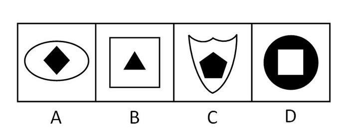

A. A

B. B

C. C

D. D

第 74 题 · 答案与解析

**参考答案（粉笔题库参考内容）**

D

**解析**

元素内部特征考查。

题目图形由两部分组成，观察其间的关系，观察可知，A、B、C项的图形均是黑色图形包含在白色图形里面，而D项是白色图形包含在黑色图形里面。

故正确答案为D。

**考点**：特殊规律-图形间关系

**来源**：2010年安徽省公务员录用考试《行测》题第74题

### 第 75 题

左边给定的是正方体的外表面展开图，请将下列所犯错误与众不同的一项挑出来。

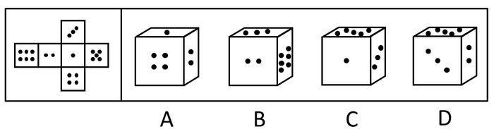

A. A

B. B

C. C

D. D

第 75 题 · 答案与解析

**参考答案（粉笔题库参考内容）**

D

**解析**

A项：4点面朝正前方时，1点面在上方，2点面应该在左方而不是右方，属于相邻关系错误；

B项：2点面朝正前方时，3点面在上方，6点面应该在左方而不是右方，属于相邻关系错误；

C项：1点面朝正前方时，5点在上方，3点面应该在左方而不是右方，属于相邻关系错误；

D项：从平面展开图中可以看出，点数为2和5的面是相对的关系，不能在立体图形中同时出现，属于相对面的错误。

要挑出与众不同的，D的错误跟ABC不同。

故正确答案为D。

**考点**：空间类-空间重构-六面体

**来源**：2010年安徽省公务员录用考试《行测》题第75题

### 第 76 题

有钱并不意味着幸福，有一项覆盖面相当广的调查显示，在自认为有钱的被调查者中，只有的人感觉自己是幸福的。

要使上述论证成立，以下哪项必须为真？

A. 在不认为自己有钱的被调查者中，感觉自己是幸福的人多于

B. 在自认为有钱的被调查者中，其余的都感觉自己很不幸福

C. 许多自认为有钱的人，实际上并不有钱

D. 是否幸福的标准是当事人的自我感觉

第 76 题 · 答案与解析

**参考答案（粉笔题库参考内容）**

D

**解析**

第一步：找到论点和论据。

论点：有钱并不意味着幸福。

论据：有一项覆盖面相当广的调查显示，在自认为有钱的被调查者中，只有的人感觉自己是幸福的。

第二步：逐一判断选项。

A项：在不认为自己有钱的被调查者中，感觉自己是幸福的人多于，一定程度上说明了没钱不意味着不幸福，与有钱并不意味着幸福无直接关系，为无关项，排除；

B项：在自认为有钱的被调查者中，其余的都感觉自己很不幸福，与题干中“只有的人感觉自己是幸福的”提供的信息相同，是对论据的肯定，属于补充论据，保留；

C项：自认为有钱的人实际上并不有钱，与有钱并不意味着幸福无直接关系，为无关项，排除；

D项：幸福与否是当事人的自我感觉，即在感觉幸福和真幸福间搭桥，从而加强题干的论证，保留。

比较B、D两项，D项搭桥的加强力度强于B项补充论据，D项当选。

故正确答案为D。

**考点**：搭桥

**来源**：2010年安徽省公务员录用考试《行测》题第76题

### 第 77 题

左撇子的人比右撇子的人更容易患某些免疫失调症。例如过敏。然而，左撇子也有优于右撇子的地方，例如，左撇子更擅长于由右脑半球执行的工作。而人的数学推理的工作一般是由右脑半球执行的。

由此可推出：

Ⅰ.患有过敏或其他免疫失调症的人中，左撇子比右撇子多；

Ⅱ.在所有数学推理能力强的人当中，左撇子的比例高于所有数学推理能力弱的人中左撇子的比例；

Ⅲ.在所有左撇子中，数学推理能力强的比例高于数学推理能力弱的比例。

A. 仅Ⅰ

B. 仅Ⅱ

C. 仅Ⅲ

D. Ⅰ和Ⅲ

第 77 题 · 答案与解析

**参考答案（粉笔题库参考内容）**

B

**解析**

第一步：抓住题干主要信息。

第一点说明左撇子的人比右撇子的人更容易患某些免疫失调症；第二点说明左撇子也有优于右撇子的地方，左撇子更擅长于由右脑半球执行的工作；第三点说明人的数学推理的工作一般是由右脑半球执行的。

第二步：分析题干信息，并结合选项得出答案。

Ⅰ：患有过敏或其他免疫失调症的人中，左撇子比右撇子多，由第一步中第一点可知左撇子的人比右撇子的人更容易患过敏，但左撇子本身人数少，因此Ⅰ中说法无法推出；

Ⅱ：由第一步中第二点和第三点可以得出左撇子比右撇子擅长数学推理的工作，因此，左撇子在数学推理能力强里的比例更高。相对的右撇子在数学推理能力强的比例更低。相反右撇子比左撇子数学推理能力弱，因此，右撇子在数学推理能力弱里的比例更高，左撇子在数学推理能力弱里的比例更低，因此Ⅱ中说法可以推出；

Ⅲ：题干没有提到擅长数学推理的人在左撇子中的比例，在所有左撇子中，即使数学推理能力强的比例低于数学推理能力弱的比例，但左撇子只要数学推理能力强的比例高于右撇子就能说明左撇子的优越性，因此Ⅲ中说法无法推出。

综上，只有Ⅱ中说法可以推出。

故正确答案为B。

**考点**：日常结论

**来源**：2010年安徽省公务员录用考试《行测》题第77题

### 第 78 题

威尼斯面临的问题具有典型意义。一方面，为了解决市民的就业，增加城市的经济实力，必须保留和发展它的传统工业，这是旅游业所不能替代的经济发展的基础；另一方面，为了保护其独特的生态环境，必须杜绝工业污染，但是，发展工业将不可避免地导致工业污染。

可见：

A. 威尼斯将不可避免地面临经济发展的停滞或生态环境的破坏

B. 威尼斯市政府的正确决策应是停止发展工业以保护生态环境

C. 威尼斯市民的生活质量只依赖于经济和生态环境

D. 如果有一天威尼斯的生态环境受到了破坏，这一定是它为发展经济所付出的代价

第 78 题 · 答案与解析

**参考答案（粉笔题库参考内容）**

A

**解析**

第一步：抓住题干主要信息。

第一点说明威尼斯为了解决市民的就业，增加城市的经济实力，必须保留和发展它的传统工业；第二点说明威尼斯为了保护其独特的生态环境，必须杜绝工业污染；第三点说明发展工业将不可避免地导致工业污染。

第二步：分析题干信息，并结合选项得出答案。

题干中提到威尼斯必须保留和发展它的传统工业，但发展工业不可避免地导致工业污染这一自身矛盾，但没有提出解决矛盾的办法。

A项：威尼斯将不可避免地面临经济发展的停滞或生态环境的破坏，这正是题干信息交代的威尼斯面临的矛盾问题，因此A中说法可以推出；

B项：威尼斯市政府的正确决策应是停止发展工业以保护生态环境，题干中并未提出解决办法，只是说明了问题存在，因此B中说法无法推出；

C项：威尼斯市民的生活质量“只依赖于”经济和生态环境，说法过于绝对，题干并未提及，因此C中说法无法推出；

D项：如果有一天威尼斯的生态环境受到了破坏，这“一定是”它为发展经济所付出的代价，说法过于绝对，由题干信息无法得出，因此D中说法无法推出。

故正确答案为A。

**考点**：日常结论

**来源**：2010年安徽省公务员录用考试《行测》题第78题

### 第 79 题

张教授是学术道德和学术诚信委员会委员，所以网上批评他学术不端行为的帖子不可能是真的。

以下哪项如果为真，上述推断才是必然可靠的：

A. 该委员会的委员在人选之前都经过严格审查

B. 网络上的言论是不可靠的，且批评的帖子没有署真名

C. 该委员会的委员从来没有人被指责有学术不端行为

D. 凡是学术道德和学术诚信委员会的委员都不会有学术不端行为

第 79 题 · 答案与解析

**参考答案（粉笔题库参考内容）**

D

**解析**

第一步：分析题干信息。

条件：张教授与学术道德和学术诚信委员会委员的关系。

结论：张教授与不会有学术不端行为的关系。

第二步：根据三段论特点得到以下步骤，直接得出结论。

1在条件和结论不同的对象间搭桥，即在学术道德和学术诚信委员会委员与不会有学术不端行为间搭桥；

2搭桥的方向：由条件的对象指向结论的对象，即由学术道德和学术诚信委员会委员推出不会有学术不端行为；

3该表达必须是充分的表达，即所有学术道德和学术诚信委员会委员都不会有学术不端行为。

第三步：分析选项得出答案。

通过分析，D中说法正是第二步的结论。

故正确答案为D。

**考点**：搭桥

**来源**：2010年安徽省公务员录用考试《行测》题第79题

### 第 80 题

一个人从饮食中摄入的胆固醇和脂肪越多，他的血清胆固醇指标就越高。存在着一个界限，在这个界限中，二者成正比；超过了这个界限，即使摄入的胆固醇和脂肪急剧增加，血清胆固醇指标也只会缓慢地有所提高。这个界限对于各个人种是一样的，大约是欧洲人均胆固醇和脂肪摄入量的1/2。

可见：

A. 中国的人均胆固醇和脂肪摄入量是欧洲的1/2，但中国的人均血清胆固醇指标不一定等于欧洲人的1/2

B. 如果把胆固醇和脂肪的摄入量控制在上述界限内，就能确保血清胆固醇指标的正常

C. 上述界限可以通过减少胆固醇和脂肪的摄入量得到降低

D. 3/4的欧洲人的血清胆固醇含量超出正常指标

第 80 题 · 答案与解析

**参考答案（粉笔题库参考内容）**

A

**解析**

第一步：抓住题干主要信息。

第一句说明从饮食中摄入的胆固醇和脂肪越多，血清胆固醇指标就越高；第二句说明存在着一个界限，在这个界限中，二者成正比；第三句说明过了这个界限，即使摄入的胆固醇和脂肪急剧增加，血清胆固醇指标也只会缓慢地有所提高；第四句说明这个界限对于各个人种是一样的，大约是欧洲人均胆固醇和脂肪摄入量的1/2。

第二步：分析题干信息，并结合选项得出答案。

A项：中国的人均胆固醇和脂肪摄入量是欧洲的1/2，但中国的人均血清胆固醇指标不一定等于欧洲人的1/2，由第一步中第三句中的信息可知，A中说法可以推出；

B项：题干并未涉及如何“确保血清胆固醇指标的正常”，因此B中说法无法推出；

C项：由第一步中第一句的信息可知，减少胆固醇和脂肪的摄入量降低的是在这个界限范围内的血清胆固醇指标而不是这个界限本身，因此C中说法无法推出；

D项：3/4的欧洲人的血清胆固醇含量超出正常指标，题干并未涉及“血清胆固醇含量超出正常指标”，因此D中说法无法推出。

故正确答案为A。

**考点**：日常结论

**来源**：2010年安徽省公务员录用考试《行测》题第80题

### 第 81 题

随着中国经济的发展，私人轿车进入家庭对中国人来说已不再是遥远的梦想。然而，随着私家车的日益增多，将使本来就十分严重的交通紧张状况面临雪上加霜的困境。因此，中国的交通问题最终必然限制私人轿车的发展。

以下哪项如果为真，最能驳斥上述观点：

A. 应先发展交通，再发展轿车工业

B. 私人轿车的增多不是交通紧张状况加剧的主要原因

C. 随着轿车进入家庭，必将带动中国交通的大发展，从来就是先有车，然后才有路

D. 在人口众多、交通不发达的中国，发展私人轿车是不切实际的

第 81 题 · 答案与解析

**参考答案（粉笔题库参考内容）**

C

**解析**

第一步：找到论点和论据。

本题论点是中国的交通问题最终必然限制私人轿车的发展。论据是随着私家车的日益增多，将使本来就十分严重的交通紧张状况面临雪上加霜的困境。

第二步：逐一判断选项的作用。

A项：应先发展交通，再发展轿车工业，这只是一种措施，与交通问题影响私人轿车的发展无直接关系，属无关选项；

B项：私人轿车的增多不是交通紧张状况加剧的主要原因，只能说明私人轿车不是影响交通的主要原因，与交通问题影响私人轿车的发展无直接关系，属无关选项；

C项：随着轿车进入家庭，必将带动中国交通的大发展，说明中国的交通问题不仅不会限制私人轿车的发展，私人轿车的发展反而会带动中国交通的发展，即削弱选项，是答案；

D项：发展私人轿车是不切实际的，这只是一种建议，与交通问题影响私人轿车的发展无直接关系，属无关选项。

故正确答案为C。

**考点**：削弱论据

**来源**：2010年安徽省公务员录用考试《行测》题第81题

### 第 82 题

某高校本科生毕业论文中被发现有违反学术规范行为的人次在近10年来明显增多，这说明当代大学生在学术道德方面的素质越来越差。

以下哪项如果为真，将会明显削弱上述结论：

A. 互联网的强大功能为学术不端行为带来了极大的便利

B. 高校没有对大学生进行学术道德方面的相关教育

C. 近10年来大学本科毕业生的数量大幅增加

D. 仍有三十名大学本科生的毕业论文被评为省优秀论文

第 82 题 · 答案与解析

**参考答案（粉笔题库参考内容）**

C

**解析**

第一步：找到论点和论据。

论点：当代大学生在学术道德方面的素质越来越差。

论据：某高校本科生毕业论文中被发现有违反学术规范行为的人次在近10年来明显增多。

第二步：判断削弱方式。

论点强调当代大学生学术道德素质，论据强调近10年来违反学术规范行为的人次，所以论点与论据间不存在明显因果关系，需削弱论证，在论点和论据间不搭桥。

第三步：逐一判断选项的作用。

A项：互联网为学术不端行为带来便利，是在解释违反学术规范行为的人次增多，在一定程度上加强了论点；

B项：高校没有对大学生进行学术道德方面的相关教育，这也是在解释违反学术规范行为的人次增多，在一定程度上也加强了论点；

C项：近10年来大学本科毕业生的数量大幅增加，说明毕业生的总体数量多了，相应的违反学术规范行为的人也就比以前多了，很好的解释了为什么最近10年该校本科生毕业论文违反学术规范行为的人明显增多，从而在当代大学生学术道德素质和近10年来违反学术规范行为的人次间不搭桥，是削弱论证，是答案；

D项：有三十名大学本科生的毕业论文被评为省优秀论文，与大学生在学术道德方面的素质越来越差无直接关系，属无关选项。

故正确答案为C。

**考点**：拆桥

**来源**：2010年安徽省公务员录用考试《行测》题第82题

### 第 83 题

在驾驶资格考试中，桩考是对学员要求很高的一项测试。在南崖市各驾驶学校以往的考试中，有一些考官违反工作纪律，也有些考官责任心不强，随意性较大，这些都是学员意见比较集中的问题。今年1月1日起，各驾驶学校考场均在场地的桩上安装了桩考器，由目测为主变成机器测量，使场地驾驶考试完全实现了电脑操作，提高了科学性。

以下哪项如果为真，将最有力地怀疑了这种仪器的作用：

A. 机器都是人发明的，并且最终还是由人来操纵，所以，在执法中防止考官徇私仍有很大的必要

B. 桩考器严格了考试纪律，但是也会引起部分学员的反对，因为这样一来，就很难托关系走后门了

C. 机器测量的结果直接通过计算机打印，随意性的问题能完全消除

D. 场地驾驶考试也要包括考察学员在驾驶室中的操作是否规范

第 83 题 · 答案与解析

**参考答案（粉笔题库参考内容）**

A

**解析**

第一步：找到论点和论据。

本题论点是桩上安装了桩考器，由目测为主变成机器测量，使场地驾驶考试完全实现了电脑操作，提高了科学性，没有明显论据。

第二步：逐一判断选项。

A项：机器是由人来操纵，可能会出现考官徇私，在一定程度上说明了这个机器并不一定就是可靠的，否定了它的科学性，削弱了论点；

B项：桩考器严格了考试纪律，引起部分学员的反对，这与怀疑了这种仪器的作用无直接关系，属于无关项；

C项：机器测量的结果直接通过计算机打印，随意性的问题能完全消除，这说明了机器的可靠，具有科学性，加强了论点；

D项：说明了还存在有其他的因素，也并没有说明机器不能考察驾驶室中的操作，并不明确。

故正确答案为A。

**考点**：削弱论点

**来源**：2010年安徽省公务员录用考试《行测》题第83题

### 第 84 题

某公司招聘，甲乙丙丁四个人去参加面试。面试结束之后四人对结果进行预测如下：

甲说：“我们四个人都能进公司”；

乙说：“我不能进公司”；

丙说：“乙和我都不能进公司”；

丁说：“不会所有人都能进公司”。

结果表明，只有两个人的预测是正确的，这两个人是：

A. 甲和丙

B. 乙和丁

C. 乙和丙

D. 丙和丁

第 84 题 · 答案与解析

**参考答案（粉笔题库参考内容）**

B

**解析**

第一步：找突破口。

本题突破口为甲和丁之间的矛盾关系，两人的话必有一真和一假。

第二步：看其他的话。

本题只有两句为真，故乙和丙的话也必有一真和一假。假设丙的话为真，则乙的话也为真，不符合题意，因此丙的话为假，乙的话为真。从而得到乙不能进公司，丙能进公司。

第三步：判断突破口中两句话的真假。

由乙不能进公司，丙能进公司可知，甲的话为假，丁的话为真。

综上，只有乙和丁的话为真。

故正确答案为B。

**考点**：两真两假

**来源**：2010年安徽省公务员录用考试《行测》题第84题

### 第 85 题

某发展中国家所面临的问题是：要维持它的经济发展，必须不断加强国内企业的竞争力；要保持社会稳定，必须不断建立健全养老、医疗、失业等社会保障体系；而要建立健全社会保障体系，则需要企业每年为职工缴纳一定比例的社会保险费；如果企业每年为职工缴纳这样比例的社会保险费，则会降低企业的竞争力。

以下哪项结论可以从上面的陈述中推出：

A. 这个国家无法维持它的经济发展，或者不能保持它的社会稳定

B. 这个国家或者可以维持它的经济发展，或者可以保持它的社会稳定

C. 如果降低企业每年为职工缴纳社会保险费的比例，则可以保持企业的竞争力量

D. 这些国家既可以保持经济发展，又可以保证社会稳定

第 85 题 · 答案与解析

**参考答案（粉笔题库参考内容）**

A

**解析**

第一步：翻译题干。

① 经济发展→加强企业竞争力；

② 社会稳定→建立健全社会保障体系；

③ 建立健全社会保障体系→企业每年为职工缴纳一定比例的社会保险费；

④ 企业每年为职工缴纳一定比例的社会保险费→－加强企业竞争力。

将②③④的推导关系连起来即为：社会稳定→建立健全社会保障体系→企业每年为职工缴纳一定比例的社会保险费→－加强企业竞争力。

第二步：逐一分析选项。

由题干分析可知：经济发展→加强企业竞争力，社会稳定→－加强企业竞争力，利用逆否等价得到“经济发展→－社会稳定”和“社会稳定→－经济发展”，由此可知经济发展和社会稳定不能同时存在。

A项：－经济发展或－社会稳定，由题干可知经济发展和社会稳定不能同时存在，因此A中说法可以推出，当选；

B项：经济发展或社会稳定，但由题干可知经济发展和社会稳定不能同时存在，因此B中说法无法推出，排除；

C项：－企业每年为职工缴纳一定比例的社会保险费→加强企业竞争力，“－企业每年为职工缴纳一定比例的社会保险费”是④中“企业每年为职工缴纳一定比例的社会保险费→－加强企业竞争力”的否前，无法推出确定性的结论，因此C中说法无法推出，排除；

D项：经济发展且社会稳定，但由题干可知经济发展和社会稳定不能同时存在，因此D中说法无法推出，排除。

故正确答案为A。

**考点**：常规翻译

**来源**：2010年安徽省公务员录用考试《行测》题第85题

### 第 86 题

科学发展观的本质特征是：

A. 实践性

B. 科学性

C. 可持续性

D. 可协调性

第 86 题 · 答案与解析

**参考答案（粉笔题库参考内容）**

A

**解析**

在党的十七大上，胡锦涛在《高举中国特色社会主义伟大旗帜 为夺取全面建设小康社会新胜利而奋斗》的报告中提出，科学发展观第一要义是发展，核心是以人为本，基本要求是全面协调可持续性，根本方法是统筹兼顾。

A项正确，实践范畴是马克思主义哲学最核心、最基础的范畴，马克思主义的实践观告诉我们：全部社会生活在本质上是实践的。马克思主义中国化的中国特色社会主义理论体系是在中国社会主义建设和改革开放实践过程中产生、形成和发展的，其本质特征就是其实践性，即中国特色社会主义建设的伟大实践。

B、C、D三项错误，科学性、可持续性和可协调性，是科学发展观的特征，而不是本质特征，并且可持续性和可协调性是科学发展观的基本要求。

故正确答案为A。

**来源**：2010年安徽省公务员录用考试《行测》题第86题

### 第 87 题

建设中国特色社会主义经济、政治、文化的基本政策有机统一，不可分割，构成党在社会主义初级阶段的：

A. 基本路线

B. 基本纲领

C. 基本方针

D. 基本原则

第 87 题 · 答案与解析

**参考答案（粉笔题库参考内容）**

B

**解析**

本题考查社会主义初级阶段的基本纲领。

A项错误，社会主义初级阶段的基本路线是领导和团结全国各族人民，以经济建设为中心，坚持四项基本原则，坚持改革开放，自力更生，艰苦创业，为把我国建设成为富强、民主、文明、和谐的社会主义现代化国家而奋斗。

B项正确，党在社会主义初级阶段的基本纲领，即建设有中国特色社会主义的经济、政治、文化的基本目标和基本政策，三者有机统一、缺一不可、相互促进、相辅相成。

C项错误，在社会主义初级阶段党中央提出了抓住机遇、深化改革、扩大开放、促进发展、保持稳定的基本方针。

D项错误，我国的四项基本原则是指坚持社会主义道路，坚持人民民主专政，坚持中国共产党的领导，坚持马克思列宁主义、毛泽东思想。

故正确答案为B。

**来源**：2010年安徽省公务员录用考试《行测》题第87题

### 第 88 题

2010年1月15日，我国出现了千年一遇的（  ）现象，云南、湖南、安徽、山东等十几个省市的群众观看到这难得一见的天文景观。

A. 日全食

B. 月全食

C. 日环食

D. 月环食

第 88 题 · 答案与解析

**参考答案（粉笔题库参考内容）**

C

**解析**

2010年1月15日下午，罕见的日环食现身天宇。此次月亮进入太阳的“怀抱”即环食阶段长达11分钟，号称千年最长日环食。环食带从我国的云南省入境，宽度在500千米以上，主要经过河南省、四川省、重庆市、湖北省、山东省，除东北黑龙江最东部的部分地区外，我国的绝大多数地区可见不同程度的日偏食。日环食，是日食的一种，发生时太阳的中心部分黑暗，边缘仍然明亮，形成光环。这是因为月球在太阳和地球之间，但是距离地球较远，不能完全遮住太阳而形成的。因此，A、B、D三项不符合题意。

故正确答案为C。

**考点**：生活常识

**来源**：2010年安徽省公务员录用考试《行测》题第88题

### 第 89 题

坚定不移地惩治腐败是我们党有力量的表现，也是全党同志与广大人民群众的共同愿望，“党的力量”来源于：

A. 军队

B. 加强党风建设

C. 人民群众

D. 共产主义理想信念

第 89 题 · 答案与解析

**参考答案（粉笔题库参考内容）**

C

**解析**

人民群众是历史的创造者，是推动历史前进的决定性力量。中国共产党的发展历程证明：保持党与人民群众的密切联系是党一往无前、战无不胜的根本保证，人民群众是党的力量源泉和胜利之本。

故正确答案为C。

**来源**：2010年安徽省公务员录用考试《行测》题第89题

### 第 90 题

根据我国宪法的规定，下列机关中（  ）有权制定行政法规。

A. 全国人大

B. 全国人大常委会

C. 国务院

D. 国务院各部委

第 90 题 · 答案与解析

**参考答案（粉笔题库参考内容）**

C

**解析**

根据我国宪法规定，全国人大有权制定和修改法律；全国人大常委有权制定和修改除应当由全国人大制定的法律以外的其他法律；国务院有权制定行政措施和行政法规，国务院各部委根据法律和国务院的行政法规、决定、命令，在本部门的权限内，发布命令、指示和规章。

故正确答案为C。

**考点**：宪法

**来源**：2010年安徽省公务员录用考试《行测》题第90题

### 第 91 题

白家村年满十八周岁以上村民600人，村民会议投票表决罢免村委会副主任高某。下列哪项是罢免被通过的最低人数要求：

A. 121人

B. 151人

C. 301人

D. 401人

第 91 题 · 答案与解析

**参考答案（粉笔题库参考内容）**

C

**解析**

《村民委员会组织法》第16条规定，本村五分之一以上有选举权的村民联名，可以要求罢免村民委员会成员。罢免要求应当提出罢免理由。被提出罢免的村民委员会成员有权提出申辩意见。村民委员会应当及时召开村民会议，投票表决罢免要求。罢免村民委员会成员须经有选举权的村民过半数通过。600人的过半数最少是301人。

故正确答案为C。

**考点**：宪法

**来源**：2010年安徽省公务员录用考试《行测》题第91题

### 第 92 题

根据《行政许可法》，除可以当场作出行政许可决定的外，行政机关应当自受理行政许可申请之日起＿＿＿＿内作出行政许可决定。

填入划线部分最恰当的一项是：

A. 三日

B. 七日

C. 十日

D. 二十日

第 92 题 · 答案与解析

**参考答案（粉笔题库参考内容）**

D

**解析**

《行政许可法》第四十二条规定，“可以当场作出行政许可决定的外，行政机关应当自受理行政许可申请之日起二十日内作出行政许可决定。二十日内不能作出决定的，经本行政机关负责人批准，可以延长十日，并应当将延长期限的理由告知申请人。但是，法律、法规另有规定的，依照其规定。”

故正确答案为D。

本题相关知识点：行政机关作出准予行政许可的决定，应当自作出决定之日起十日内向申请人颁发、送达行政许可证件，或者加贴标签、加盖检验、检测、检疫印章。

**考点**：行政法

**来源**：2010年安徽省公务员录用考试《行测》题第92题

### 第 93 题

下列关于行政处罚中“一事不再罚原则”的表述正确的是（    ）。

A. 针对同一个违法行为，不能进行多次行政处罚

B. 针对同一个违法行为，不能进行两次或两次以上的罚款

C. 针对同一个违法行为，不能由两个或两个以上的行政机关处罚

D. 针对同一个违法行为，不能依据同一法律规范进行两次或两次以上的处罚

第 93 题 · 答案与解析

**参考答案（粉笔题库参考内容）**

B

**解析**

本题考查行政处罚法的相关知识。

根据《行政处罚法》第29条规定，对当事人的同一个违法行为，不得给予两次以上罚款的行政处罚。同一个违法行为违反多个法律规范应当给予罚款处罚的，按照罚款数额高的规定处罚。所谓“一事不再罚”，是指行政机关不得以同一事实和同一依据，对当事人的同一个违法行为给予两次罚款的行政处罚。“一事不再罚”原则是行政处罚的一个基本原则。因此，“一事不再罚”针对的是对同一违法行为，不得进行两次以上（包括两次）罚款，其他行政处罚类型（如行政拘留等）不适用“一事不再罚”原则。所以，A、C、D三项表述错误。

故正确答案为B。

**考点**：其他法律法规

**来源**：2010年安徽省公务员录用考试《行测》题第93题

### 第 94 题

下列选项中不属于行政处罚措施的是（    ）。

A. 罚款

B. 警告

C. 行政拘留

D. 拘役

第 94 题 · 答案与解析

**参考答案（粉笔题库参考内容）**

D

**解析**

本题考查我国行政处罚措施的相关知识。

行政处罚种类，是指行政处罚外在的具体表现形式。根据我国《行政处罚法》第9条的规定，行政处罚有以下6种：（一）警告、通报批评；（二）罚款、没收违法所得、没收非法财物；（三）暂扣许可证件、降低资质等级、吊销许可证件；（四）限制开展生产经营活动、责令停产停业、责令关闭、限制从业；（五）行政拘留；（六）法律、行政法规规定的其他行政处罚。

本题为选非题，故正确答案为D。

**考点**：行政法

**来源**：2010年安徽省公务员录用考试《行测》题第94题

### 第 95 题

下列关于行政诉讼的被告，表述不正确的是：

A. 它只能是组织，不能是个人

B. 它是被诉的一方当事人，可以以自己的名义应诉

C. 对共同行政行为不服的，作出共同行政行为的行政机关为共同被告

D. 在行政委托关系中，被委托的行政机关是被告

第 95 题 · 答案与解析

**参考答案（粉笔题库参考内容）**

D

**解析**

根据《行政诉讼法》第26条第1款规定，公民、法人或者其他组织直接向人民法院提起诉讼的，作出行政行为的行政机关是被告。行政诉讼的被告是指被原告起诉指控侵犯其行政法上的合法权益和与之发生行政争议，而由人民法院通知应诉的行政主体。必须明确，行政诉讼的被告不是行政机关的工作人员，而是行政机关本身。根据行政诉讼法和最高院有关司法解释的规定，行政主体作被告的情况主要有以下几种：（1）作出具体行政行为的行政机关作被告；（2）改变原具体行政行为的复议机关作被告；（3）共同作出行政行为的行政机关是共同被告；（4）行政机关委托的组织所作的行政行为，委托的行政机关是被告；（5）由法律、法规授权的组织所作的具体行为，该组织是被告。

A项正确，行政诉讼的被告只能为组织（主要是行政机关和被授权的组织），而不能是个人（具体的工作人员）。

B项正确，行政诉讼的被告，属于行政诉讼中的一方当事人，可以以自己的名义应诉，另一方当事人为原告。

C项正确，根据《行政诉讼法》第26条第4款规定，两个以上行政机关作出同一行政行为的，共同作出行政行为的行政机关是共同被告。

D项错误，根据《行政诉讼法》第26条第5款规定，行政机关委托的组织所作的行政行为，委托的行政机关是被告。

本题为选非题，故正确答案为D。

**考点**：行政法

**来源**：2010年安徽省公务员录用考试《行测》题第95题

### 第 96 题

某市某区人民政府决定将区建材工业局管理的国有小砖厂出售。小砖厂的承包人以侵犯其经营自主权为由提出行政复议申请，本案的行政复议机关应当是：

A. 市国有资产管理局

B. 市经济贸易局

C. 市人民政府

D. 区人民政府

第 96 题 · 答案与解析

**参考答案（粉笔题库参考内容）**

C

**解析**

根据《行政复议法》第二十四条规定：“县级以上地方各级人民政府管辖下列行政复议案件：（一）对本级人民政府工作部门作出的行政行为不服的；（二）对下一级人民政府作出的行政行为不服的；（三）对本级人民政府依法设立的派出机关作出的行政行为不服的；（四）对本级人民政府或者其工作部门管理的法律、法规、规章授权的组织作出的行政行为不服的。”

故正确答案为C。

**本题相关知识点：**

行政复议机关是指依照法律的规定，有权受理行政复议申请，依法对具体行政行为进行审查并作出裁决的行政机关。这种组织的特征是：

1.行政复议机关是行政机关。

2.行政复议机关是有权行使行政复议权的行政机关。

3.行政复议机关是能以自己的名义行使行政复议权，并对行为后果独立承担法律责任的行政机关。如各级人民政府、各级政府的组成部门包括公安、司法、海关。工商管理、教育、卫生等部门，都可以作为行政复议机关。

**考点**：行政法

**来源**：2010年安徽省公务员录用考试《行测》题第96题

### 第 97 题

下列哪项不属于突发公共卫生事件：

A. 某工厂工人在食堂就餐时发生大规模食物中毒

B. 某化工厂化学原料发生泄漏，造成周围居民大面积中毒

C. 某制鞋厂长期使用甲苯等工业原料，致使多名员工患上肌肉萎缩症

D. 在广东等地出现的禽流感

第 97 题 · 答案与解析

**参考答案（粉笔题库参考内容）**

C

**解析**

《中华人民共和国突发事件应对法》第3条规定：本法所称突发事件，是指突然发生，造成或者可能造成严重社会危害，需要采取应急处置措施予以应对的自然灾害、事故灾难、公共卫生事件和社会安全事件。

C项错误，多名员工患上肌肉萎缩症的事件，属于长期使用甲苯等工业原料所致，是长期积累的结果，不具有突发性。

本题为选非题，故正确答案为C。

**考点**：其他法律法规

**来源**：2010年安徽省公务员录用考试《行测》题第97题

### 第 98 题

下列应当负刑事责任的是：

A. 武大饮酒过量神志不清，暴打妻子致其重伤

B. 刘二见胡同里有一人强暴妇女，于是拿砖头将其打昏，事后鉴定为重伤

C. 张三15岁，盗窃珠宝店财物价值20余万元

D. 李四精神病发作砍死其父

第 98 题 · 答案与解析

**参考答案（粉笔题库参考内容）**

A

**解析**

A项正确，《刑法》第18条第4款规定，醉酒的人犯罪，应当负刑事责任；

B项错误，属于正当防卫；

C项错误，已满十四周岁不满十六周岁的人，犯故意杀人、故意伤害致人重伤或者死亡、强奸、抢劫、贩卖毒品、放火、爆炸、投放危险物质罪的，应当负刑事责任；

D项错误，精神病人在不能控制自己行为的时候造成危害结果，不负刑事责任。

故正确答案为A。

备注： 2021年3月1日起实施的《刑法修正案（十一）》第一条规定：将刑法第十七条修改为：“已满十六周岁的人犯罪，应当负刑事责任。”“已满十四周岁不满十六周岁的人，犯故意杀人、故意伤害致人重伤或者死亡、强奸、抢劫、贩卖毒品、放火、爆炸、投放危险物质罪的，应当负刑事责任。”“已满十二周岁不满十四周岁的人，犯故意杀人、故意伤害罪，致人死亡或者以特别残忍手段致人重伤造成严重残疾，情节恶劣，经最高人民检察院核准追诉的，应当负刑事责任。”“对依照前三款规定追究刑事责任的不满十八周岁的人，应当从轻或者减轻处罚。”“因不满十六周岁不予刑事处罚的，责令其父母或者其他监护人加以管教；在必要的时候，依法进行专门矫治教育。”

**考点**：刑法

**来源**：2010年安徽省公务员录用考试《行测》题第98题

### 第 99 题

依照我国现行法，下列自然人中为限制民事行为能力或无民事行为能力的人的是：

A. 张某，双耳失聪

B. 王某，精神失常

C. 李某，高位截瘫

D. 赵某，双目失明

第 99 题 · 答案与解析

**参考答案（粉笔题库参考内容）**

B

**解析**

本题考查法律常识。

《中华人民共和国民法典》第十九条：“八周岁以上的未成年人为限制民事行为能力人，实施民事法律行为由其法定代理人代理或者经其法定代理人同意、追认，但是可以独立实施纯获利益的民事法律行为或者与其年龄、智力相适应的民事法律行为。”

《中华人民共和国民法典》第二十二条：“不能完全辨认自己行为的成年人为限制民事行为能力人，实施民事法律行为由其法定代理人代理或者经其法定代理人同意、追认，但是可以独立实施纯获利益的民事法律行为或者与其智力、精神健康状况相适应的民事法律行为。”

《中华人民共和国民法典》第二十条：“不满八周岁的未成年人为无民事行为能力人，由其法定代理人代理实施民事法律行为。”

《中华人民共和国民法典》第二十一条：“不能辨认自己行为的成年人为无民事行为能力人，由其法定代理人代理实施民事法律行为。”

本题中，A、C、D三项均为身体残疾，并不是年龄或辨认能力方面的缺陷。

故正确答案为B。

**考点**：民法典

**来源**：2010年安徽省公务员录用考试《行测》题第99题

### 第 100 题

下列不属于《侵权责任法》包括的民事权益的是：

A. 债权

B. 发现权

C. 姓名权

D. 隐私权

第 100 题 · 答案与解析

**参考答案（粉笔题库参考内容）**

A

**解析**

《侵权责任法》第2条规定：“侵害民事权益，应当依照本法承担侵权责任。本法所称民事权益，包括生命权、健康权、姓名权、名誉权、荣誉权、肖像权、隐私权、婚姻自主权、监护权、所有权、用益物权、担保物权、著作权、专利权、商标专用权、发现权、股权、继承权等人身、财产权益。”

A项错误，债权属于相关债法中的民事权益。

B、C、D三项正确，都属于《侵权责任法》包括的民事权益。

本题为选非题，故正确答案为A。

**考点**：民法典

**来源**：2010年安徽省公务员录用考试《行测》题第100题

### 第 101 题

有效制约和监督权力的关键是：

A. 限制政府权力，规范政府行为

B. 建立健全制约和监督机制

C. 发扬民主，健全法制

D. 规范政府权力运作，打造阳光政府

第 101 题 · 答案与解析

**参考答案（粉笔题库参考内容）**

B

**解析**

要有效地制约和监督权力，防止权力的滥用，关键就在于建立健全制约和监督机制。制约和监督机制具体包括：充分发挥人民民主对权力的制约和监督和加强法制对权力的制约和监督。

故正确答案为B。

**来源**：2010年安徽省公务员录用考试《行测》题第101题

### 第 102 题

决策过程中遇到首次出现的问题，无先例可循，此类决策属于：

A. 确定型决策

B. 风险型决策

C. 单一性决策

D. 非程序性决策

第 102 题 · 答案与解析

**参考答案（粉笔题库参考内容）**

D

**解析**

非程序性决策处理的是那些偶然发生的、无先例可循的、非常规性问题；确定型决策面临的是一种比较确定的自然状态，可选方案的预期结果是相对明确的；风险型决策面临的是多种可能的自然状态，可选方案在不同自然状态下的结果不同，未来会出现哪一种自然状态，事前虽难以肯定，但却可以预测其出现的概率。

故正确答案为D。

本题相关知识点：

1、风险型决策是指决策者对决策对象的自然状态和客观条件比较清楚，也有比较明确的决策目标，但是实现决策目标必须冒一定风险。

2、确定型决策是指决策过程的结果完全由决策者所采取的行动决定的一类问题，它可采用最优化、动态规划等方法解决。

**来源**：2010年安徽省公务员录用考试《行测》题第102题

### 第 103 题

电子政务在实现资源共享的同时，可以从根本上规范政府行为，避免暗箱操作，减少：

A. “寻租”行为

B. “梗阻”行为

C. “贯通”行为

D. “沟通”行为

第 103 题 · 答案与解析

**参考答案（粉笔题库参考内容）**

A

**解析**

所谓寻租，指经营者不择手段地通过疏通政府获取许可证、特许经营证、授权书或者一定配额等比其他竞争者优惠的条件，从而取得垄断地位，赚取超额利润的行为。电子政务有利于保证政府行为的规范化、透明化，从而减少寻租行为。

故正确答案为A。

**来源**：2010年安徽省公务员录用考试《行测》题第103题

### 第 104 题

价格变动会引起需求量变动。在日常生活中，价格变动对需求量影响较小的一组商品是：

A. 电视机、食用油、禽蛋

B. 蔬菜、米面、日用调味品

C. 金银首饰、液化气、家用摄像机

D. 海鲜产品、电脑、轿车

第 104 题 · 答案与解析

**参考答案（粉笔题库参考内容）**

B

**解析**

本题考查经济常识。

价格变动对生活必需品的需求量影响较小，对高档消费品的需求量影响较大。

A项错误，电视机不属于生活必需品，价格变动对它的需求量影响较大。

B项正确，蔬菜、米面、日用调味品都属于生活必需品，价格变动对它们的需求量影响都较小。

C项错误，金银首饰、家用摄像机都不属于生活必需品，价格变动对它们的需求量影响较大。

D项错误，电脑、轿车都不属于生活必需品，价格变动对它们的需求量影响较大。

故正确答案为B。

**考点**：微观经济

**来源**：2010年安徽省公务员录用考试《行测》题第104题

### 第 105 题

政府为了保护农业生产者，对部分农业产品规定了保护价格。为了采取这种价格政策，应采取相应的措施是：

A. 取消农业税

B. 对城镇居民实行粮食配给制

C. 当市场上出现农产品过剩时进行收购

D. 扩大农民家电消费

第 105 题 · 答案与解析

**参考答案（粉笔题库参考内容）**

C

**解析**

A项错误，取消农业税是宏观政策，并不与保护价格的措施必然相配合；

B项错误，粮食配给制度是反市场行为，一般在计划经济和战争时期应用；

C项正确，保护价格高于均衡价格，会刺激生产，限制消费，导致市场过剩，当市场出现过剩时，政府应及时入市收购并予以储备，否则保护价格必然流于形式；

D项错误，扩大农民家电消费属于扩大内需措施，和农产品市场并无直接关联。

故正确答案为C。

**考点**：宏观经济与调控政策

**来源**：2010年安徽省公务员录用考试《行测》题第105题

### 第 106 题

西游记中的西天是指：

A. 埃及

B. 印度

C. 西藏

D. 新疆

第 106 题 · 答案与解析

**参考答案（粉笔题库参考内容）**

B

**解析**

西天，是中国古代对印度的称谓，因为印度古称天竺，在中国西南方向，故略称西天，所谓“西天取经”即指去印度取经。

故正确答案为B。

**考点**：文化常识

**来源**：2010年安徽省公务员录用考试《行测》题第106题

### 第 107 题

下面诗词搭配正确的是：

A. 随风潜入夜，润物细无声——《春夜喜雨》李白

B. 接天莲叶无穷碧，映日荷花别样红——《晓出净慈寺送林子方》杨万里

C. 不是花中偏爱菊，此花开尽更无花——《菊花》陶渊明

D. 洛阳亲友如相问，一片冰心在玉壶——《凉州词》王昌龄

第 107 题 · 答案与解析

**参考答案（粉笔题库参考内容）**

B

**解析**

A项错误，《春夜喜雨》是唐代杜甫的作品，全诗内容为：好雨知时节，当春乃发生。随风潜入夜，润物细无声。野径云俱黑，江船火独明。晓看红湿处，花重锦官城；

B项正确，《晓出净慈寺送林子方》是宋代杨万里的作品，全诗为：毕竟西湖六月中，风光不与四时同。接天莲叶无穷碧，映日荷花别样红；

C项错误，《菊花》是唐代元稹作品，全诗内容为：秋丛绕舍似陶家，遍绕篱边日渐斜。不是花中偏爱菊，此花开尽更无花；

D项错误，“洛阳亲友如相问，一片冰心在玉壶”确为王昌龄作品，但不是《凉州词》中诗句，而是出自《芙蓉楼送辛渐》，全诗内容为：寒雨连江夜入吴，平明送客楚山孤。洛阳亲友如相问，一片冰心在玉壶。

故正确答案为B。

**考点**：文学常识

**来源**：2010年安徽省公务员录用考试《行测》题第107题

### 第 108 题

《三字经》的派别是：

A. 儒家

B. 道家

C. 法家

D. 墨家

第 108 题 · 答案与解析

**参考答案（粉笔题库参考内容）**

A

**解析**

《三字经》蕴含着典型的儒家思想和主张，并被后世儒家誉为“蒙学之冠”。《三字经》是中国古代历史文化的宝贵遗产，是学习中华传统文化不可多得的儿童启蒙读物。它短小精悍、朗朗上口，千百年来，家喻户晓。其内容涵盖了历史、天文、地理、道德以及一些民间传说，所以说熟读《三字经》可知天下事。

故正确答案为A。

**考点**：文学常识

**来源**：2010年安徽省公务员录用考试《行测》题第108题

### 第 109 题

紫外线促使人体合成（  ）以预防佝偻病。

A. 维生素A

B. 维生素B

C. 维生素C

D. 维生素D

第 109 题 · 答案与解析

**参考答案（粉笔题库参考内容）**

D

**解析**

佝偻病俗称缺钙，在婴儿期较为常见，是由于维生素D缺乏引起体内钙、磷代谢紊乱，而使骨骼钙化不良的一种疾病。佝偻病的诱因之一就是日照不足，因为皮肤内7-脱氢胆固醇需经波长为296～310nm的紫外线照射始能转化为维生素D3，日光中紫外线的照射与维生素D的合成有密切关系。

故正确答案为D。

**考点**：生物常识

**来源**：2010年安徽省公务员录用考试《行测》题第109题

### 第 110 题

声音在哪个介质中传播最快：

A. 空气

B. 金属

C. 玻璃

D. 水

第 110 题 · 答案与解析

**参考答案（粉笔题库参考内容）**

B

**解析**

声音的传播速度取决于传播介质，传播介质密度越大，传播速度就越快，相反密度越小，传播速度就越慢。声音在固体中的传播速度最快，其次是液体，最后是气体。因为金属的密度一般大于玻璃的密度，故声音在金属中的传播速度是最快的。

故正确答案为B。

**考点**：物理常识

**来源**：2010年安徽省公务员录用考试《行测》题第110题

### 第 111 题

我们感冒时，常会感到呼吸不畅，主要原因是：

A. 气管、支气管分泌痰液太多

B. 鼻黏膜分泌液过多

C. 鼻黏膜充血肿胀

D. 声带充血肿胀

第 111 题 · 答案与解析

**参考答案（粉笔题库参考内容）**

C

**解析**

感冒时，病毒侵袭，鼻腔炎症使得鼻黏膜充血肿胀，鼻道狭窄甚至闭塞，再加上分泌液即鼻涕增多，就会造成呼吸不畅。

故正确答案为C。

**考点**：生物常识

**来源**：2010年安徽省公务员录用考试《行测》题第111题

### 第 112 题

家里的白炽灯用久了会发黑，是因为：

A. 灰尘

B. 钨蒸气凝华

C. 钨丝烧断

D. 灯泡变旧

第 112 题 · 答案与解析

**参考答案（粉笔题库参考内容）**

B

**解析**

现在的白炽灯大多选用钨丝作为灯丝材料，而钨丝受热易产生升华现象，一部分钨原子变为钨蒸气，离开钨丝，遇见较冷的灯泡玻璃时会产生凝华现象，故用久的钨丝灯会变黑。

故正确答案为B。

**考点**：物理常识

**来源**：2010年安徽省公务员录用考试《行测》题第112题

### 第 113 题

新房在装修后，有一股难闻的气味弥漫整个屋子，对人体是有害的。所以有人提出在装修完的新房里点蜡烛以吸收这些有毒的气体，但事实上这一做法对消除该难闻气味毫无作用。这种难闻的有毒的气体主要是由装修材料中的（  ）成分挥发出来的。

A. 甲醚

B. 甲醇

C. 甲醛

D. 乙醇

第 113 题 · 答案与解析

**参考答案（粉笔题库参考内容）**

C

**解析**

各种人造板材中由于使用了脲醛树脂粘合剂，因而可含有甲醛。新式家具的制作，墙面、地面的装饰铺设，都要使用粘合剂。凡是大量使用粘合剂的地方，总会有甲醛释放。甲醛是无色、具有强烈气味的刺激性气体，其35%~40%的水溶液通称福尔马林。甲醛是原浆毒物，能与蛋白质结合，吸入高浓度甲醛后，会出现呼吸道的严重刺激和水肿、眼刺痛、头痛，也可发生支气管哮喘。故本题中装修后房子里的味道是甲醛。

故正确答案为C。

**考点**：化学常识

**来源**：2010年安徽省公务员录用考试《行测》题第113题

### 第 114 题

我国黑龙江北部一月份平均气温在以下，漠河的最低气温曾达到过，因此只能使用酒精温度计而不能使用水银温度计，是因为：

A. 水银比酒精传热快

B. 水银比酒精传热慢

C. 水银比酒精的凝固点低

D. 水银比酒精的凝固点高

第 114 题 · 答案与解析

**参考答案（粉笔题库参考内容）**

D

**解析**

水银和酒精都具有明显的热胀冷缩特性。酒精本身膨胀系数不稳定，纯度较差，易蒸发。而水银相较酒精，导热快、比热小、易提纯、沸点高（），用水银做感应液的温度计灵敏度和精确度都较高。但水银凝固点为，测定低温不适宜，而酒精凝固点低（），用来测定低温比较好。所以高寒环境中，应选用酒精温度计。

故正确答案为D。

**考点**：物理常识

**来源**：2010年安徽省公务员录用考试《行测》题第114题

### 第 115 题

人类选择月球作为探测宇宙星际航行的第一站的主要原因是：

A. 探索月球的危险性小

B. 月球上富含地球上稀缺的矿种，且分布广泛

C. 月球是地球的卫星，是距离地球最近的天体

D. 月球上有高真空、强辐射和失重环境，这是将来加工工业的理想场所

第 115 题 · 答案与解析

**参考答案（粉笔题库参考内容）**

C

**解析**

月球是地球的唯一天然卫星，也是离地球最近的天体，且月球上富含多种矿藏以及它是将来加工工业的理想场所，因此人类地外探测的第一个目标选择了月球。究其最主要的原因是月球离地球最近，便于人们进行探测。

故正确答案为C。

**考点**：自然地理

**来源**：2010年安徽省公务员录用考试《行测》题第115题

## 材料 3

以下是反映我国人才资源现状的一些数据：在高层次人才方面，两院院士由刚建院的233人和96人，发展到2003年的688人和663人。在教育科技人才方面，2003年中国科技人员总数达320多万人，比1993年增长近。从我国专业技术人才队伍的学历来看，从1999年到2003年本科人才的比例由18.1%上升到24.2%。从全国的国有企事业单位专业技术人员的变动来看，1990年国有企事业单位总人数为9443万人，到2003年降到5575万人，但是，专业技术人员总数却由1080.9万人增长到2174万人。以平均每万名职工中拥有专业技术人员的比例来看，1990年为1144.7人，到2003年增为3899.5人。

        在全国29个专业技术系列中。高级职称以上的高层次人才总计为157.3万人，仅占人才总量的5.5%。

        目前，我国企业专业技术人员比例偏低，仅占35%，远低于美、英的80.8%和61.4%。我国高级技工占职工总数的比重仅占5%，西方发达国家这一比例超过35%。

### 第 116 题

到2003年，我国两院院士人数已经相当于建院初期的：

A. 4.1倍

B. 3.9倍

C. 3.7倍

D. 3.5倍

第 116 题 · 答案与解析

**参考答案（粉笔题库参考内容）**

A

**解析**

刚建院时我国两院院士总人数为233＋96＝329人，2003年我国两院院士总人数为688＋663＝1351人，故到2003年，我国两院院士人数已经相当于建院初期的1351÷329，直除首位为4。

故正确答案为A。

**考点**：文字资料、现期倍数

**来源**：2010年安徽省公务员录用考试《行测》题第116题

### 第 117 题

我国1993年科技人员总数约为：

A. 185万人

B. 218万人

C. 232万人

D. 240万人

第 117 题 · 答案与解析

**参考答案（粉笔题库参考内容）**

D

**解析**

我国1993年科技人员总数约为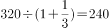万人。

故正确答案为D。

**考点**：基期计算、文字资料

**来源**：2010年安徽省公务员录用考试《行测》题第117题

### 第 118 题

我国平均每个专业技术系列中拥有的高级职称以上的高层次人才约为：

A. 4.66万人

B. 5.42万人

C. 5.71万人

D. 6.13万人

第 118 题 · 答案与解析

**参考答案（粉笔题库参考内容）**

B

**解析**

利用估算法，我国平均每个专业技术系列中拥有高级职称以上的高层次人才约为万人，估算值接近于真实值且小于真实值。

故正确答案为B。

**考点**：文字资料、现期平均数

**来源**：2010年安徽省公务员录用考试《行测》题第118题

### 第 119 题

2003年与1990年相比，国有企事业单位中的专业技术人员占国有企事业单位职工总数的比例上升了：

A. 22.6个百分点

B. 25.3个百分点

C. 27.5个百分点

D. 28.8个百分点

第 119 题 · 答案与解析

**参考答案（粉笔题库参考内容）**

C

**解析**

1990年国有企事业单位中的专业技术人员占国有企事业单位职工总数比例约为1080.9÷9443≈11.4%；2003年比例约为2174÷5575≈39.0%，故2003年相较1990年比例上升了39.0%－11.4%＝27.6%。

故正确答案为C。

**考点**：两期比重、文字资料

**来源**：2010年安徽省公务员录用考试《行测》题第119题

### 第 120 题

以下判断不正确的是：

A. 每万名职工拥有的专业技术人员10多年间增长了2倍多

B. 我国本科学历人才占专业技术人才队伍的比重接近四分之一

C. 我国高级技工占职工总数的比重仅为西方发达国家的七分之一

D. 国有企事业单位中专业技术人员数量变化趋势与职工总数变化成正相关

第 120 题 · 答案与解析

**参考答案（粉笔题库参考内容）**

D

**解析**

A项正确，由材料可知，1990年每万名职工拥有的专业技术人员为1144.7人，2003年为3899.5人。可知后者是前者的3倍多，增长了2倍多；

B项正确，由“从1999年到2003年本科人才的比例由18.1%上升到24.2%”，可知该项正确；

C项正确，我国高级技工占职工总数的比重为5%，西方发达国家已经超过35%，前者约占后者的七分之一；

D项错误，1990年到2003年间，国有企事业单位中专业技术人员数量呈上升趋势，职工总数呈下降趋势。

本题为选非题，故正确答案为D。

**考点**：文字资料、综合分析

**来源**：2010年安徽省公务员录用考试《行测》题第120题

## 材料 4

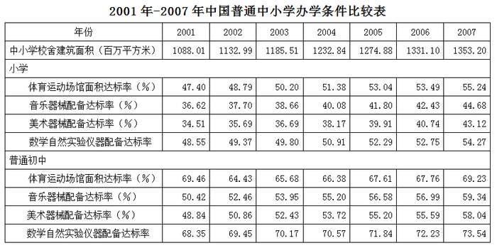

### 第 121 题

2007年比2001年中小学校舍建筑面积增加了：

A. 27%

B. 24%

C. 22%

D. 18%

第 121 题 · 答案与解析

**参考答案（粉笔题库参考内容）**

B

**解析**

2007年中小学校舍建筑面积比2001年增加了，且与之很接近。

故正确答案为B。

**考点**：一般增长率、统计表

**来源**：2010年安徽省公务员录用考试《行测》题第121题

### 第 122 题

2007年与2001年相比，小学四项达标率增幅最小的是：

A. 体育运动场馆面积

B. 音乐器械配备

C. 美术器械配备

D. 数学自然实验仪器配备

第 122 题 · 答案与解析

**参考答案（粉笔题库参考内容）**

D

**解析**

2007年与2001年相比：

小学体育运动场馆面积增幅为（55.24%-47.40%）÷47.40%≈16.5%；

音乐器械配备增幅为(44.68%-36.62%)÷36.62%≈22%；

美术器械配备增幅为；

数学自然实验仪器配备增幅为(54.27%-48.55%)÷48.55%≈11.8%。

增幅最小的是数学自然实验仪器配备。

故正确答案为D。

**考点**：一般增长率、统计表

**来源**：2010年安徽省公务员录用考试《行测》题第122题

### 第 123 题

2001年以来，普通初中四项达标率增速最快的是：

A. 体育运动场馆面积

B. 音乐器械配备

C. 美术器械配备

D. 数学自然实验仪器配备

第 123 题 · 答案与解析

**参考答案（粉笔题库参考内容）**

C

**解析**

A、B选项错误，与2001年相比，普通初中体育运动场馆面积的达标率约为-0.3%，音乐器械配备达标率增幅明显小于美术器械，美术器械配备增速为，数学自然实验仪器配备增速为，易知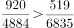，因此美术器械配备的达标率增速最高。

故正确答案为C。

**考点**：一般增长率、统计表

**来源**：2010年安徽省公务员录用考试《行测》题第123题

### 第 124 题

2007年，普通初中的四项平均达标率比小学高出近：

A. 10个百分点

B. 12个百分点

C. 14个百分点

D. 16个百分点

第 124 题 · 答案与解析

**参考答案（粉笔题库参考内容）**

D

**解析**

2007年普通初中四项平均达标率为个百分点；小学四项平均达标率为：个百分点。前者比后者高出65.04-49.33=15.71个百分点。

故正确答案为D。

**考点**：现期平均数、统计表

**来源**：2010年安徽省公务员录用考试《行测》题第124题

### 第 125 题

按2001—2007年的发展速度，以下判断正确的是：

A. 到2010年，小学的办学条件将会进一步改善，但仍差于中学的办学条件

B. 到2010年，小学的美术器械配备达标率将高于音乐器械配备达标率

C. 到2010年，中小学校舍建筑面积将会大幅增加

D. 到2010年，中小学的体育场馆面积将占到总校舍建筑面积的三分之一

第 125 题 · 答案与解析

**参考答案（粉笔题库参考内容）**

A

**解析**

A项正确，与2001年相比，2007年小学办学条件四项达标率均有所提高，故小学的办学条件将会进一步改善。但由前面计算可知，小学的办学条件与中学的办学条件差距较大，所以2010年小学办学条件仍差于中学办学条件；

B项错误，2010年小学的美术器械配备达标率与音乐配备达标率的大小关系从表格中是无法预知的；

C项错误，观察表格，可知中小学校舍建筑面积呈缓慢增长趋势；

D项错误，表格数据只能反映出中小学体育场馆面积达标率，不能推出面积所占总校舍建筑面积比例。

故正确答案为A。

**考点**：统计表、综合分析

**来源**：2010年安徽省公务员录用考试《行测》题第125题

## 材料 5

下图是有关网民性别结构的数据资料。

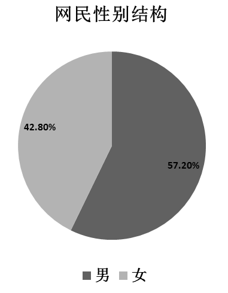

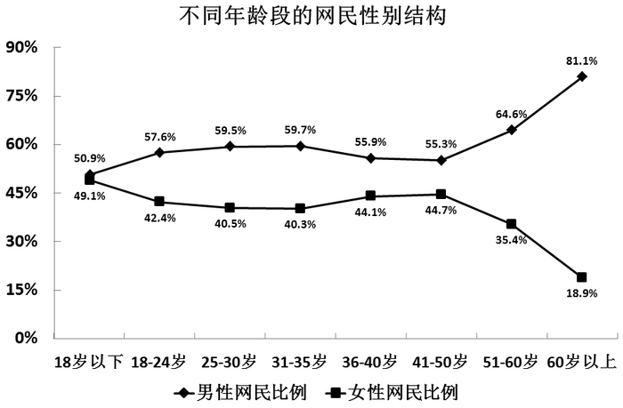

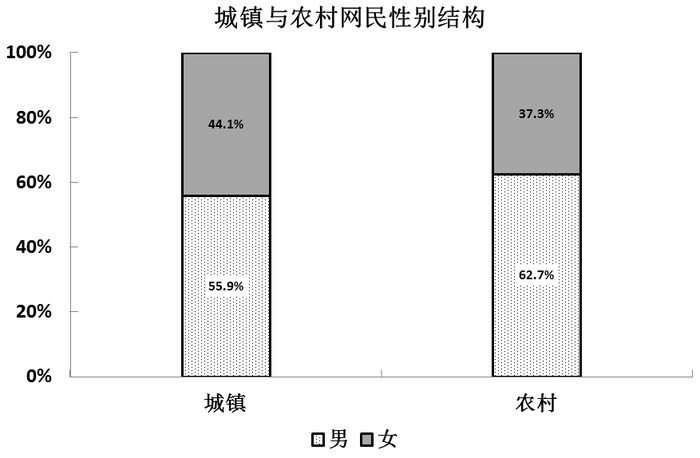

### 第 126 题

男性网民占比比女性网民多：

A. 12.8个百分点

B. 14.4个百分点

C. 15.6个百分点

D. 16.2个百分点

第 126 题 · 答案与解析

**参考答案（粉笔题库参考内容）**

B

**解析**

观察饼状图，男性网民占57.2%，女性网民占42.8%，则男性网民占比比女性网民多57.2%－42.8%＝14.4%。

故正确答案为B。

**考点**：简单加减计算、统计图

**来源**：2010年安徽省公务员录用考试《行测》题第126题

### 第 127 题

农村男性网民占农村网民的比例比城镇男性网民占城镇网民的比例高：

A. 5.6个百分点

B. 6.4个百分点

C. 6.8个百分点

D. 7.2个百分点

第 127 题 · 答案与解析

**参考答案（粉笔题库参考内容）**

C

**解析**

观察柱状图，农村男性网民占农村网民的比例为62.7%，城镇男性网民占城镇网民的比例为55.9%，则农村男性网民占农村网民的比例比城镇男性网民占城镇网民的比例高62.7%-55.9%=6.8%。

故正确答案为C。

**考点**：简单加减计算、统计图

**来源**：2010年安徽省公务员录用考试《行测》题第127题

### 第 128 题

在60岁以下的各年龄组中男女网民差距最大的是：

A. 25—30岁

B. 31—35岁

C. 36—40岁

D. 51—60岁

第 128 题 · 答案与解析

**参考答案（粉笔题库参考内容）**

D

**解析**

题干中要求“60岁以下的各年龄组”，对应折线图，两线距离最大的即为男女网民数量差距最大的年龄段。

故正确答案为D。

**考点**：直接找数、统计图

**来源**：2010年安徽省公务员录用考试《行测》题第128题

### 第 129 题

城镇网民人数占网民总数的比重为：

A. 78.6%

B. 80.9%

C. 21.4%

D. 19.1%

第 129 题 · 答案与解析

**参考答案（粉笔题库参考内容）**

B

**解析**

由题意“城镇网民人数占网民总数的比重为”判定此题

男性网民占57.2%，城镇男性网民占城镇网民的55.9%，农村男性网民占农村网民的62.7%。运用线段法，可知城镇网民与农村网民的增长率距离之比为（57.2%-55.9%）:(62.7%-57.2%)=1.3:5.5，量与距离成反比，则城镇网民与农村网民的人数之比为5.5:1.3，则城镇网民占网民总数的比重为。

故正确答案为B。

**考点**：现期比重、统计图

**来源**：2010年安徽省公务员录用考试《行测》题第129题

### 第 130 题

以下结论中从材料中无法推出的一项是：

A. 与网民性别比最接近的年龄组是18-24岁

B. 男性网民人数最少的年龄段是18岁以下年龄组

C. 城镇女性网民人数多于农村男性网民人数的二倍

D. 与城镇网民性别比最接近的年龄组是36-40岁

第 130 题 · 答案与解析

**参考答案（粉笔题库参考内容）**

B

**解析**

A项正确，网民男女性别比为，18-24岁年龄组的男女性别比为，性别比最接近；

B项错误，18岁以下年龄组是男性网民占比最少的年龄段，但由于各年龄组的网民人数未知，无法判断18岁以下年龄组是否是男性网民人数最少的年龄段；

C项正确，由上题可知，令城镇网民人数为55，农村网民人数为13，则城镇女性网民人数与农村男性网民人数之比为；

D项正确，36-40岁年龄组男性网民占比等于城镇男性网民占比。

本题为选非题，故正确答案为B。

**考点**：统计图、综合分析

**来源**：2010年安徽省公务员录用考试《行测》题第130题

