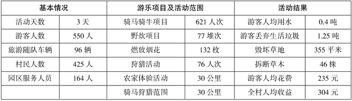

# 2011年安徽省公考《申论》题（B卷）

<!-- gwy:overview:start -->
> **安徽 · 2011 · 申论 · B类** ｜ 5 题 · 图片 1 处 · 答案随题折叠

导航：[题目](#题目) · [材料 1](#材料-1)
<!-- gwy:overview:end -->

> 候选采集稿。参考答案及解析来自粉笔页面，不代表官方答案或真实高分答卷；来源使用许可与原卷对应关系仍需人工核实。

## 给定材料

### 材料 1

①乡村旅游分为传统乡村旅游和现代乡村旅游两种。传统的乡村旅游出现在工业革命以后，主要源于一些来自农村的城市居民以“回老家”度假的形式出现，在中国常常把这种传统的乡村旅游归类于探亲旅游。现代乡村旅游是在20世纪80年代出现在农村区域的一种新型的旅游模式，尤其是在20世纪90年代以后发展迅速。现代乡村旅游并不以探亲访友为主，旅游的时间也不仅仅局限于假期。现代乡村旅游可以充分利用农村区域的优美景观、自然环境和建筑、文化等资源，对农村经济的发展发挥重要作用。它带动了农村产业结构的调整，促进农业综合发展，推进农业的产业化发展。我国现代乡村旅游始于20世纪80年代后期，但它对于乡村经济的发展，农民增收和社会主义新农村建设却影响深远。实践证明，大力发展乡村旅游不仅丰富了旅游活动的内容，扩大了旅游容量，而且带动了农村产业结构的调整，加速了农民脱贫致富的步伐，促进了农村经济的发展，为解决“三农”问题和全面建设小康社会提供了一条有效的途径。

中国是农业大国，又是农业古国。悠久的农业历史，丰富的农耕文化，是发展乡村农业文化旅游的良好基础。中国是一个多民族的国家，全国有56个民族分布在广大乡村，尤其是西部地区是少数民族集中分布区。民族风俗、民族文化、民族习惯、民族生活、民族建筑、民族节庆活动等丰富多彩，是发展乡村民俗文化旅游的独特资源。国民经济的发展和城市化进程的加快以及城市居民收入的增加、休假时间的增多、交通条件的改善和人们消费观念的转变，都为发展乡村旅游提供了广阔市场。

目前，我国乡村旅游主要有田园农业旅游模式、民俗风情旅游模式、农家乐旅游模式、村落乡镇旅游模式、休闲度假旅游模式、科普及教育旅游模式与回归自然旅游模式等。

②从大范围看，所有在乡村社区开展的旅游都可以称为乡村旅游，它是与都市旅游相对称的。乡村旅游与民族旅游、农业旅游、生态旅游关系密切、它较好地适应了人们返璞归真、回归自然的心理需要，特别是对城市居民，长期生活在钢筋混凝土的环境中，工作和生活节奏快、压力大，乡村山清水秀的自然风貌、悠然自得的生活劳动场景、清新的空气、新鲜无污染的绿色饮食等，都具有非常大的吸引力。

乡村旅游的客源主体是城市居民，乡村旅游的主要形式有古村落、古镇、民族村和大中城市周边的度假村、山庄、农家乐等。目前，我国乡村旅游的主体产品是吸引附近的大中城市居民前往短期度假、休闲、娱乐，吸引远程和国外游客前往旅游的乡村旅游主要是一部分与民族民俗旅游、历史文化旅游相结合的民族村寨、古村古镇旅游，如江苏、浙江、安徽、山西等地开发的水乡古镇、古村落旅游。

乡村是指城市以外的广大地区，在中国一般是指县城以下的广大区域，既包括乡村居民点，也包括乡村的农田、森林、草原，是一个地域综合体，有的称乡村地域系统。乡村旅游既包括乡村观光农业旅游，又包括乡村民俗文化风情旅游，还包括乡村休闲度假旅游和乡村自然生态旅游，是具有区域性和综合性的新型旅游业。

### 材料 2

某县锦山乡锦山村地处风景秀丽的锦山山麓，是该县“乡村游”示范点。在建设社会主义新农村的过程中，该村利用独特的自然资源，开辟了一个锦山游乐园。2010年5月1—3日，记者王某参加了该村组织的游乐活动，并实地做了调查采访。以下是调查采访的统计表:

### 材料 3

①国外发达国家通用的乡村旅游发展政策包括：乡村旅游的宏观管理、行业管理、市场规范和经营自律机制等，形成了完善的促进乡村旅游快速和健康发展的政策保障。20世纪90年代的英国面临农民收入下降、农村环境恶化等问题时，成立了农村事务部并实施了农村管理方案、农村经济多样化等政策，政府年投入约5亿英镑改善农村基础设施，为了继续提高对农村事务的支持水平，2007年拨付16亿英镑来支持英国农村发展计划。由于政府支持，英国乡村旅游迅速发展。1995年芬兰成立了乡村政策委员会，包括了从政府到非政府机构的所有部门，委员会的工作任务是协调乡村发展尺度，推进乡村资源的有效配置。

国外乡村游的管理法规严格，注重细节和定量化。如韩国农村部门对农民发展农业观光事业制订了严格的管理法规。美国对乡村旅游制订了严格的管理法规，要求农场必须设立流动厕所和饮用水源，露天场所则需提供消毒水。日本对乡村旅游提出了严格的定量管理指标。乡村旅游发展较好的国家都通过制定严格的法律法规来规范乡村旅游企业运营的行为，保障了乡村旅游业的良好发展。

②早在1865年，世界乡村旅游发展先驱国家之一的意大利就成立了“农业与旅游全国协会”，不久以后，日本、匈牙利、西班牙、斯洛伐克和罗马尼亚等国也相继专门成立了乡村旅游协会。国外的协会相对成熟，如法国农会、罗马尼亚乡村生态和文化旅游协会(IFHA)及爱尔兰的农舍度假协会等已经在乡村旅游的发展中发挥着不可替代的作用。以罗马尼亚为例，“农家会”旅游收入已占到罗马尼亚全国旅游业总收入的约20%。“农家乐”旅游的繁荣与IFHA的作用是分不开的。IFHA于1994年成立，目前在全国设有32个地方分会，共有8000多家农户为正式会员。该协会还在意大利、美国和英国设立了代表处。IFHA规定，每个接待游客的农户都必须有营业执照和卫生检验证，在家门前挂上“乡村家庭旅店”的牌子。IFHA按农户的接待条件以“菊花”为等级把这些农家旅店分为“二花级”和“三花级”。为了提高服务水准，协会每年都组织培训班，由专业教师传授有关知识。协会还帮助农户寻找客源。另外，协会还根据各地不同的习俗组织有地方特色的旅游活动，如举办“葡萄酒节”“炸糕节”“肉馅菜卷节”等。

③据Jupifer Research研究报告称，美国利用在线营销方式的旅游市场收入2005年已超过540亿美元，利用节目宣传促销的方式成本低而效果好。法国乡村旅游企业RC在滨海旅游节期间，通过海报宣传，制作指示路标等，在两天内接待了800多位游客，其中有500多名游客乘坐了游船参观。此外，国外往往采用直接销售、间接销售和混合销售等多种模式。法国由于企业条件限制，而选择间接销售渠道，但每次交易要为中间商支付一定费用。还有一点，国外非常重视经营与合作。法国乡村旅游企业RC的营销总监为对其别墅推销，邀请了该地区竞争对手来公司并参观了Chenille Change所有景点，随后到餐厅享用鸡尾酒并讨论合作的可能性。

从市场推广媒介来看，现在乡村旅游的宣传主要是通过互联网来进行的。借助互联网可以向世界范围的对乡村旅游感兴趣的人提供及时、全面和立体的信息，是国外乡村旅游的主要宣传手段。国外的网站在建设上也比较成熟，旅游者能一目了然地在其网站获得各种相关信息。

④英国乡村旅游大多采取以农场为主体的经营方式，一般一个农场旅游景点聘用全日制工作人员在10名以内，为发展旅游业进行投资的规模也在5万英镑左右，年接待游客四五万人，规模并不大。英国乡村旅游大多定位于“农业开展多种经营的一个方面”层面上，乡村旅游紧密依托于农业生产活动的开展，虽然农业为了开展旅游又进行了有针对性的建设，但农业的主体地位并没有得到削弱，农业生产本身可能为了方便旅游者观光进行了一些必要调整，但这种调整并没有改变农业生产的性质。

意大利政府规定，接待游客用房必须是非农业生产活动用房，游客的食物全部或大部分必须是本地农场或当地农场的产品，乡村旅游应该以从事农业活动为主要内容。乡村旅游主要利用农场的现有条件和资源，允许维修原有的庄园或别墅。还规定对向旅游者出售的当地农产品的质量和特性进行评估和鉴定，出售价格应低于市场批发价。

⑤日本是亚洲开展乡村旅游较早的国家。日本各地农场结合生产独辟蹊径，富有诗情画意的田园风光和各具特色的服务设施吸引了大批国内外游客。旅行社也开发了丰富多彩的农业旅游产品，组织旅游者春天插秧，秋天收割，捕鱼捞虾，草原放牧，牛棚挤奶。参加者有农业教学研究人员、学生、银行职员、公司白领等，人均消费2.5万至4万日元。到了收获季节，旅行社还会选出一小包稻米或茶叶给游客寄去，让游客亲口尝一下自己的劳动果实，服务十分周到。当苹果、梨子、葡萄、西瓜之类的瓜果快熟的时候，美国的农庄就在报刊上刊登广告，招揽游客去农场摘水果度假，城里人热烈响应，纷纷根据广告上的示意地图开车前往，美国参加乡村旅游的人数每年达到2000万人次。

目前，在日本、瑞士和我国台湾等地，还出现了更高级的乡村旅游形式，租地自种。城里人在乡下租一块“自留地”，假日里携带妻子，呼朋唤友，到乡下的“自家地里”翻土耕种、施肥浇水，平时则由农场主负责照看。这种浅尝辄止的劳动方式为忙碌的城市生活平添了许多雅趣，深受欢迎。

⑥意大利把乡村旅游称为“绿色假期”，将乡村旅游与现代化的农业和优美的自然环境、多姿多彩的民风民俗、新型生态环境及其他社会现象整合在一起，成为一个综合性项目。这对农村资源的综合开发和利用，改善城乡关系，起着重要的纽带作用。

乡村旅游区一般都是生态环境脆弱地区，对环境变化十分敏感，它抵抗外界干扰能力较差，稳定性较差，人类在开发和利用旅游资源的同时不可避免地与生态环境产生矛盾。生态旅游的迅速升温也给某些最热门的旅游景点的环境保护带来了压力，有些热点的自然环境因人满为患遭到了破坏，特别是那些原始的、与世隔绝的地方。因此，加拿大旅游当局认为有必要限制旅游者的人数。在不列颠哥伦比亚省城瓜伊哈那斯国家公园，游客不论进入哪一个景点，每次的人数不得超过12人。在温哥华岛，任何人如想去太平洋海岸的“西岸小径”旅游，必须在3个月前登记。在开发旅游景点时，避免大兴土木等有损自然景观的做法。旅游交通以步行为主，接待设施小巧，尽一切可能将旅游对自然景观的影响降至最低。在管理中，提出了“留下的只有脚印，带走的只有照片”等保护环境的响亮口号，并在旅游目的地设置一些解释大自然奥秘和宣传保护大自然的标牌。让游客在愉悦中增强环境意识，使旅游区成为提高人们环境意识的天然大课堂。

### 材料 4

①2007年，国家旅游局、农业部关于“大力推进全国乡村旅游工作”的通知明确提出，“十一五”期间，使已有乡村旅游项目得到明显提升和完善，基本形成种类丰富、档次适中的乡村旅游产品体系和特色突出、发展规范的乡村旅游格局，满足人民生活水平提高对旅游消费的需求。争取每年新增乡村旅游就业30万人以上，间接就业150万人，每年旅游从业农民人均纯收入增长5%，在全国建成具有乡村旅游示范意义的100个县、1000个乡（镇）、10000个村（即“百千万工程”），为社会主义新农村建设做出积极贡献。

2009年，国家住房和城乡建设部，国家旅游局发文，决定开展全国特色景点旅游名镇（村）示范工作。

2010年，国家旅游局根据《全国旅游标准化发展规划（2009—2015）》和全国旅游工作会议的部署，下发《关于全面推进旅游标准化试点工作的通知》，决定在全国范围内全面推进旅游标准化试点工作。

②新西兰的旅游人类学专家科林·比姆在一篇论文中指出：“一个地方的独特之处就是这个地方的主要财富……如果你们有独特的建筑，那么就保护它们，并让它依旧是古雅的模样。如果你们有独特的音乐、歌谣或舞蹈，那么就保护它们，让它古香古色。如果你们有独特的耕作方法，那么就保护它们，并教给他人。如果你们有传统的文化信仰，那么就保护它们，并熏陶他人。千万不要破坏这些资源！”

③一方山水，一方人文。文化是自然环境孕育的，离开文化尤其是离开本土文化的旅游是大有缺憾的。那些说唱艺术、表演艺术、工艺艺术、美术品等都融合了当地的历史和文化，是自然和人文的有机结合，是时间的经年锻造，是具有垄断性，无法被复制的旅游资源，最受游客青睐和钟情，最有实力做乡村旅游的支撑。

不少地方的乡村旅游开发和经营中普遍存在各自为政的现象，资源和资金没有形成有效合力，乡村旅游普遍存在规模小、经营者品牌意识淡薄的现象。在乡村旅游开发中，片面强调对乡村自然资源的开发，而忽视了乡土文化、乡村民俗等文化内涵的开发；对乡村旅游文化狭义和片面的理解，忽视了对农村其他资源的开发和利用。

④2010年4月，在上海举行的长三角乡村旅游论坛上，一项由联合国旅游组织旅游专家委员会发布的《世界旅游景气报告》显示，全球范围内大约有3%的国际游客是乡村旅游者，乡村旅游以年均增幅6%的速度攀升，高于旅游市场总体4%的发展速度。

到乡下享受大自然的精髓，是人们在传统都市旅游、海滨度假、人造景区以外的又一种旅游选择。世界旅游组织把乡村旅游解释为乡村文化为产品核心的旅游。构成乡村旅游最核心的三部分是自然、人和文化。发展乡村旅游的最终目标是促进人类进步，促进人类与自然的和谐、人与人之间的和谐、传统与现代的和谐、城市与乡村的和谐。近年来，乡村旅游对可持续发展的贡献，引起人们更多的关注。

联合国旅游组织旅游专家委员会委员陈某认为，乡村良好的自然风光、质朴的农耕文化、传统文化、地域文化是吸引游客的重要因素。在度假过程中，游客有机会体验当地文化遗产和传统，购买当地产品和手工艺品，享受当地美食，参与村民们的活动。因此她建议，乡村旅游产品包装的关键是当地化和特色化；住宿设施有一定的闲居性，提供真实而质朴的旅游服务，防止过度商业化对文化和村民的侵蚀。

调查显示，在一些乡村，由于受传统生产方式和文化价值的影响，村民对以服务为导向的旅游业非常陌生，他们缺乏组织旅游业的专业技能，不了解游客的需求和兴趣，不理解发展与保护的平衡关系，不清楚村落发展的承载力，导致盲目破坏性开发，牺牲了村庄的原生态环境，成为房地产开发商的经营对象，破坏了“农”的环境，失去了“家”的氛围。专家认为，乡村旅游开发，要坚持生态性和有限性，不能一味地强调经济性。

据了解，目前相当多乡村旅游规划存在“城市化”倾向。乡村旅游的优势在“农”字——农村风光，农家饭菜，农事活动。目前，整个国际乡村旅游实践，都表现出某些定位不准，装饰城市化，乡土环境氛围不足等偏差——乡村旅游存在的“城市化”倾向，降低了“乡村游”的吸引力和影响力。

有研究显示，在乡村旅游开发之前，乡村社区的一些独特文化和历史传统鲜为人知，处于逐渐衰微的状态，乡村旅游发展通过发掘、包装和宣传当地的历史传承和独特文化，提高了乡村的知名度，增加了乡村社区的自豪感。在这一过程中，乡村旅游的经营者和当地政府总是会逐渐认识到乡村文化在旅游业中的核心作用而加以保护、开发。四川乡村旅游的发展过程就证明了这一点。在乡村旅游发展中，四川农民的文化意识逐渐增强，并意识到继承和保护本地文化特色的重要性。藏族、羌族、彝族等少数民族更加注重保护自己的民族文化，并且在发展乡村旅游时注重突出民族文化特色。

### 材料 5

安徽省旅游局“乡村旅游工作报告”节选：

2008年元月份，胡锦涛总书记视察安徽时曾指出“要提高乡村旅游业发展水平”，为贯彻落实胡锦涛总书记的重要指示精神，深入学习实践科学发展观，安徽省旅游业紧紧围绕建设社会主义新农村战略部署，在省委省政府、国家旅游局的坚强领导和有力指导下，统一认识，围绕中心，立足省情，服务大局，以科学发展观为指导，以服务“三农”，建设社会主义新农村为主旨，牢固树立“大旅游、大产业”的观念，以旅助农，借农强旅，把握机遇，乘势向上，采取积极有效措施，扎实开展乡村旅游工作，加快了乡村旅游发展的步伐。

一是制定了乡村旅游创建计划。2007年8月份，在全省旅游系统建设旅游产业大省电视电话会议上，省旅游局发出了建设县域旅游和乡村旅游的动员令，就是要实施县域旅游发展工程“525”计划，即到2010年，全省建成50个旅游县（市、区），200个旅游乡镇，500个旅游村（星级农家乐），其中部分县（市、区）和乡（镇）村进入全国乡村旅游“百千万”行列。2009年，省旅游局制定了《2009—2012年安徽省乡村旅游行动计划》。以旅游强县、优秀旅游乡镇和星级农家乐等多级活动为抓手，以创促建，以点带面，形成综合创建体系，全力推进乡村旅游发展，截至2009年底，全省先后授予35个县（市、区）“旅游经济强县”和“旅游经济强县创建工作先进单位”称号，其中被国家旅游局批准的中国旅游经济强县1名。命名最佳旅游乡镇49家，优秀旅游乡镇133家，旅游乡镇66家，优秀旅游乡镇总数达到248家；农家乐示范点124家，评选出全省星级农家乐583家，其中五星级农家乐30家，四星级75家。2010年3月份，安徽省有4个乡镇被国家住房和城乡建设部、国家旅游局共同命名为全国特色景观旅游名镇（村）。2011年3月，在北京召开的发布会上，由中国旅游协会、休闲农业与乡村旅游分会评定的首批40家星级企业（园区）名单公布。经过专家实地试评、评审委员会审定、网上公示等各环节，芜湖怡龙生态园、安徽悬龙世界木屋村和安庆永顺植物园被授予三星级园区。

二是\_\_\_\_\_\_\_\_\_\_。2006年初，安徽省在全国率先提出创建旅游乡镇活动，3月17日，省政府下发了《关于开展创建优秀旅游乡镇活动的意见》（皖政办\[2006\]19号），在全省启动安徽优秀旅游乡镇创建工作。2008年3月，制定出台了《安徽省乡村旅游实施意见》；4月份，召开了全省乡村旅游现场推进会，对全省乡村旅游的发展“把好脉”、“开好方”，决定充分运用“三农”资源发展乡村旅游业，全面拓展农业的功能和领域，积极促进农民增收致富，扎实推进社会主义新农村建设，全省大部分市县乡镇结合本地实际情况也相继出台了发展乡村旅游扶持政策和安排乡村旅游发展资金。近年来，省旅游局还先后与省农委、省水利厅、省林业厅、省体育局等部门建立战略合作关系，一批“农家乐”、“森林人家”、“水上人家”应运而生。

三是\_\_\_\_\_\_\_\_\_\_。2004年10月安徽省旅游局会同省发改委，结合本省实际，制定了安徽省《创建旅游强县实施标准》，在全省开展旅游强县创建活动，奏响了“大旅游”与“大农业”相融合的序曲，2006年初，在全国率先出台了《安徽省创建优秀旅游乡镇评定标准》，后又相继制定了《省“农家乐”评定标准》《“农家乐”等级划分与评分标准》，在农家乐旅游快速发展的同时，各市也开始着手规范农家乐旅游。合肥市、黄山市、池州市分别制定了《合肥农家乐评分标准》、《农家乐（乡村酒店）旅游服务质量等级的划分与评定》、《池州市农家乐服务质量通用要求》。标准化的建设，提升了旅游产品质量，规范了旅游经营行为，服务管理保障了旅游者的合法权益，实现了可持续发展。

四是\_\_\_\_\_\_\_\_\_\_。从90年代开始，安徽省在全国率先开展了“旅游开发扶贫”工作，并取得了喜人的成绩，涌现出一批“旅游扶贫、旅游富民”的典型，如：位于黄山脚下的汤口镇农民依托黄山风景区，放下锄头从事旅游，开餐馆跑客运，从昔日偏僻的穷山村，变为现今名闻遐迩的“旅游专业村”。颖上县八里河镇，坚持政府主导，围绕改善农业生态条件，不断壮大产业链，以生态农业景区劳动乡村旅游发展，走出了一条“农民动手办旅游，荒滩变明珠”的成功之路等；合肥市包河区大圩乡通过发展体制乡村旅游，由一个“负债乡”变成了一个“富裕乡”、“国家4A级风景区的旅游乡”；肥西的三岗更是通过苗木花卉、农业与旅游业的结合，探索出了一条都市依托型乡村旅游发展的好路子；蚌埠市怀远县禾泉农庄通过发展生态休闲农业创办出了一条特色化农产品销售产业链，农庄每年产值近5000万元，成为我省皖北乡村旅游的一颗明珠，根据这些成功的经验和市场需求，在全省进行推广与交流，并要求各市结合资源条件和人文实际，因地制宜，创新机制，创新模式，分类指导，鼓励探索条件不同的旅游开发经营模式与管理模式。

虽然近年来乡村旅游在安徽省有所发展，社会经济效益有所增长，但总体来看，除极少数有长远规划外，大多数尚属于朦胧模仿自发开发，在发展思路、经营管理、保障机制等方面尚存在一定的问题，亟待解决。

## 题目

### 第 1 题

**请根据给定材料，用精练语句。给“乡村旅游”下一个确切定义。（6分）**

关联材料：材料 1、材料 2、材料 3、材料 4、材料 5

第 1 题 · 答案与解析

**参考答案（粉笔题库参考内容）**

乡村旅游是为适应人们回归自然的心理需求，在乡村社区开展的以城市居民为客源主体，利用农村文化、自然景观资源，发展田园农业、民俗风情等模式的新型旅游业，具有区域性和综合性。

**解析状态：unknown（来源未提供）**

### 第 2 题

**【给定资料**5**】总结了安徽省乡村旅游工作的做法与成效，请仿照“一是制定了乡村旅游创建计划”，在填空横线上依次归纳其余的三个方面。**

关联材料：材料 5

作答要求：

要求：动词不能重复。（9分）

第 2 题 · 答案与解析

**参考答案（粉笔题库参考内容）**

一是下发了乡村旅游实施意见和具体扶持政策。

二是出台了规范乡村旅游质量经营的各项标准。

三是选树了一批乡村旅游扶贫、富民的先进典型。

**解析状态：unknown（来源未提供）**

### 第 3 题

**【给定资料**3**】介绍了国外乡村旅游的经验，请归纳国外有哪些经验值得我们借鉴。**

关联材料：材料 3

作答要求：

要求：语言简洁，每条一句话。（12分）

第 3 题 · 答案与解析

**参考答案（粉笔题库参考内容）**

一、制定严格的管理乡村旅游的法律法规，为乡村旅游快速健康发展提供完善的政策保障。

二、组建乡村旅游协会，规范旅游经营行为，进行乡村旅游技能培训提高服务标准，组织特色旅游活动。

三、重视经营与合作，采用多种营销模式，宣传促销乡村旅游。

四、以农业生产活动为依托，规范旅游接待和产品提供，开展适度规模的乡村旅游。

五、积极开发新型乡村旅游产品，创新旅游形式，提供极具特色和优质服务的乡村旅游。

六、综合开发和利用农村资源，以保护自然景观为前提，发展综合性的绿色乡村旅游。

**解析状态：unknown（来源未提供）**

### 第 4 题

**假定你是【给定资料**2**】中的那位记者，请将表格中的统计资料和说明的问题，以及自己的意见，用建议书的形式反映给当地村委会。**

关联材料：材料 2

作答要求：

要求：

（1）篇幅500字左右；

（2）只写主文内容，抬头和落款省略；

（3）语言简洁顺畅、条理清晰、结构完整。（23分）

第 4 题 · 答案与解析

**参考答案（粉笔题库参考内容）**

关于锦山乡锦山村游乐活动调查的建议书

锦山村是该县“乡村游”示范点，利用独特的自然资源优势，开辟了锦山游乐园。经过调查发现锦山村乡村游中存在一些问题需要改进。问题与建议如下：

问题：

一、基本情况。随队车辆与游客人数比例大，给乡村带来交通压力以及车辆安置保管问题。服务人员不足，没有充分调动村民力量。

二、游乐项目和活动范围。游乐项目较为传统，不环保，简单依托自然环境，缺乏特色以及对游牧文化和民俗风情的开发。

三、活动结果。草地毁坏草木折断现象严重，破坏自然和生态环境；垃圾随意丢弃，污染严重；游客消费水平不高，村民收入增加不明显。

建议：

一、加强对旅游车辆的统一规划和管理，提供良好乘车环境，倡导游客乘坐本村专门车辆，减少随行私车。

二、立足本村文化和民俗风情，积极创新，开发拓展旅游产品种类，增强旅游产品吸引力，增加游客数量和消费项目，从而大幅提高村民收入。

三、项目开发要建立在保护生态自然环境的基础上，同时对游客加强环境保护教育，降低旅游对自然环境的影响。

**解析状态：unknown（来源未提供）**

### 第 5 题

**请根据给定资料，紧扣“乡村旅游与乡村文化”这一话题，自定立意，自拟标题，写一篇1000～1200字的议论文。**

关联材料：材料 1、材料 2、材料 3、材料 4、材料 5

作答要求：

要求：

（1）不能另立话题、不要照搬给定材料；

（2）观点明确，论述充分，论证有力；

（3）结构完整，层次清晰，语言准确、简练、顺畅。（50分）

第 5 题 · 答案与解析

**参考答案（粉笔题库参考内容）**

**论乡村旅游的文化性**

当下，生活在钢筋水泥的城市中的人们越来越渴望亲近和回归自然，向往乡村淳朴、温馨的生活氛围，自驾游、乡村采摘游、农家乐游成为时下流行的休闲方式。乡村旅游热在丰富人们的业余生活、促进乡村经济的发展的同时，也出现了商业开发过度、牺牲原生态村庄环境、“城市化”倾向等不和谐现象。究其原因，是忽略了乡村旅游的文化性。

文化性在旅游发展中具有重要的意义。乡村良好的自然风光、质朴的农耕文化、传统文化、地域文化是吸引游客的重要因素。乡村不同于城市的地方在于最自然的风光和最淳朴的文化。然而，当前乡村旅游千篇一律的“城市化”倾向，违背了乡村本身的文化特点。走进丽江、西塘等知名古镇的街头，随处可见大大小小的酒吧，与城市基本无异。旅游开发的过度商业化不仅破坏了农村原生态的自然环境，也侵蚀了乡村的文化性和村民的思想。农村质朴的民气逐渐淡化，取而代之的是人与人之间交往的利益化。商业化和城市化倾向降低了乡村旅游的吸引力和影响力。此外，对乡村旅游的规划定位不准，忽视乡村本身特色文化是阻碍乡村旅游发展的重要原因。

**发挥乡村旅游的文化性，应当重视对乡土文化、乡村民俗等文化内涵的开发。**挖掘当地历史传承和特色文化。世界旅游组织把乡村旅游解释为以乡村文化为产品核心的旅游。而当前旅游景点纪念品千篇一律，丝巾、手帕、刻字工艺品等泛滥，无论到哪里都可以见到同样的商品，毫无文化性和个性可言。一方山水，一方人文，旅游如果离开本土文化，是不完整的。乡村旅游的产品应当具有不同于城市商业的特色。融合当地历史文化的说唱艺术、表演艺术、工艺品、美术品是最有垄断性和无法复制的旅游资源。如印象•丽江、印象•西湖等大型实景演出深受游客的亲睐和钟情，这是将自然与人文的有机结合。我们一方面应当认识乡村文化在旅游当中的核心作用，另一方面应当注重传统文化的保护、发扬和继承。只有我们重视对传统乡土、民族文化的传承和发扬，才能更好的提高乡村知名度，增加乡村社区的自豪感，促进乡村旅游行业的规范。

**发挥乡村旅游的文化性，需要加强服务教育，培训村民组织旅游业的专业技能，引导理解发展与保护的平衡关系。**乡村旅游的魅力就在于真实而质朴的旅游服务，村民由于受传统的生产方式和文化价值的影响，对以服务为导向的旅游业非常陌生。政府一方面需要加大投入扶植乡村旅游发展，帮助村民摆脱贫困处境，另一方面需要进行宣传教育，真正树立农民的环保意识、运营管理和服务能力，从根本上保障村庄原生态环境，提高乡村旅游品质。在坚持乡村旅游生态性和有限性的基础上，重视经济性。只有提高农民经营管理的能力，才能切实借农强旅，把握机遇，扎实开展乡村旅游工作。

正如旅游学家科林•比姆所说：“一个地方的独特之处就是这个地方的主要财富。”对于农村旅游来说，农村的文化就是农村的财富。因此，我们只有重视乡村旅游的文化性，重视人文精神，发挥农民的主体作用，才能够为旅游产业的长足发展提供良好的保障。

**解析状态：unknown（来源未提供）**

