# 2011年安徽省公务员录用考试《行测》题

<!-- gwy:overview:start -->
> **安徽 · 2011 · 行测 · 统考** ｜ 130 题 · 图片 100 处 · 答案随题折叠

| 题型模块 | 题量 | 题号 |
| --- | ---: | ---: |
| 数量关系 | 15 | 1–15 |
| 言语理解与表达 | 25 | 16–40 |
| 判断推理 | 45 | 41–85 |
| 常识判断 | 30 | 86–115 |
| 资料分析 | 15 | 116–130 |
| **合计** | **130** | |

导航：[题型与作答说明](#题型与作答说明) · [题目](#题目) · [材料 1](#材料-1)
<!-- gwy:overview:end -->

> 候选采集稿。参考答案及解析来自粉笔页面，不代表官方答案或真实高分答卷；来源使用许可与原卷对应关系仍需人工核实。

## 题型与作答说明

数量关系

（15题）

对于本部分试题，你可以在草稿纸上运算。如果你不能快速巧妙的计算，可以跳过不做，待你有时间再返回来做。

言语理解与表达

（25题）

根据题目要求，在四个选项中选出一个正确答案。

判断推理

（45题）

本部分包括定义判断、类比推理、图形推理与逻辑判断四种类型的试题。

常识判断

（30题）

要求你依据常识做出判断。请注意，似乎合理的答案可能有多种，你应选择最为合理的一个。

资料分析

（15题）

针对下列图、表或文字回答问题。你应根据资料提供的信息进行分析、比较、计算、处理。

## 题目

### 第 1 题

20+19-18-17+16+15-14-13+12+11···+4+3-2-1=（    ）

A. 10

B. 15

C. 19

D. 20

第 1 题 · 答案与解析

**参考答案（粉笔题库参考内容）**

D

**解析**

解析1：

。

解析2：

。

故正确答案为D。

**来源**：2011年安徽省公务员录用考试《行测》题第1题

### 第 2 题

的个位数字是：

A. 3

B. 4

C. 5

D. 6

第 2 题 · 答案与解析

**参考答案（粉笔题库参考内容）**

C

**解析**

原式各项的尾数按照到依次循环。为此先计算的尾数，即1+4+9+6+5+6+9+4+1的尾数，为5。那么所有数字之和的尾数要么为5，要么为0，结合选项。

故正确答案为C。

**来源**：2011年安徽省公务员录用考试《行测》题第2题

### 第 3 题

计算：（    ）

A. 

B. 

C. 

D. 

第 3 题 · 答案与解析

**参考答案（粉笔题库参考内容）**

B

**解析**

括号内先计算，可得原式，除首尾项外，其余两两相消，由此可知计算结果为。

故正确答案为B。

**来源**：2011年安徽省公务员录用考试《行测》题第3题

### 第 4 题

在1000以内，除以3余2，除以7余3，除以11余4的数有多少个：

A. 4

B. 5

C. 6

D. 7

第 4 题 · 答案与解析

**参考答案（粉笔题库参考内容）**

B

**解析**

同余问题，不符合“余同取余，和同加和，差同减差，最小公倍数做周期”的口诀，则需要通过余数组获得通式。除以3余2的余数组为2、5、8、11、14、17；除以7余3的余数组为3、10、17。结合此两者可知满足前面两个条件的被除数可写成21n＋17，其余数组为17、38、59；而除以11余4的余数组为4、15、26、37、48、59。结合此两者可知满足三个条件的被除数可写成231n＋59。由题意：，解得。所以这样的数共有5个。

故正确答案为B。

口诀解释：余同取余，例如“一个数除以7余1，除以6余1，除以5余1”，可见所得余数恒为1，则取1，被除数的表达式为210n＋1；和同加和，例如“一个数除以7余1，除以6余2，除以5余3”，可见除数与余数的和相同，取此和8，被除数的表达式为210n＋8；差同减差，例如“一个数除以7余3，除以6余2，除以5余1”，可见除数与余数的差相同，取此差4，被除数的表达式为210n－4。特别注意前面的210是5、6、7的最小公倍数。

**来源**：2011年安徽省公务员录用考试《行测》题第4题

### 第 5 题

甲、乙两人同地同向直线行走，其速度分别为7千米/时和5千米/时。乙先走2小时后甲才开始走，则甲追上乙需：

A. 4小时

B. 5小时

C. 6小时

D. 7小时

第 5 题 · 答案与解析

**参考答案（粉笔题库参考内容）**

B

**解析**

解析1：

简单追及问题，甲追上乙需小时。

解析2：

甲追上乙时，甲、乙所走路程相同。设甲x小时追上乙，则7x=5(x+2)，解得x=5。

故正确答案为B。

**考点**：相遇追及

**来源**：2011年安徽省公务员录用考试《行测》题第5题

### 第 6 题

如图所示，有两排蜂房，一只蜜蜂从左下角的1号蜂房开始去8号蜂房，假设只朝右上或右下逐个爬行。则不同的走法有：

A. 16种

B. 18种

C. 21种

D. 24种

第 6 题 · 答案与解析

**参考答案（粉笔题库参考内容）**

C

**解析**

到达右下角的走法等于到达其正左侧蜂房方法数与到达其左上蜂房方法数之和，到达右上角的走法等于到达其正左侧蜂房方法数与到达其左下蜂房数之和。据此从左下角出发，按照的顺序，依次标出从1号蜂房出发到8号蜂房的方法数，如下图所示。

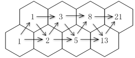

故正确答案为C。

**考点**：基础排列组合

**来源**：2011年安徽省公务员录用考试《行测》题第6题

### 第 7 题

有一种红砖，长24厘米、宽12厘米、高5厘米，至少用多少块红砖才能拼成一个实心的正方体：

A. 600块

B. 800块

C. 1000块

D. 1200块

第 7 题 · 答案与解析

**参考答案（粉笔题库参考内容）**

D

**解析**

要拼成正方体，则每条边的长度必须是24、12、5的最小公倍数，也即为120。此时每条边上需要的砖数分别是5、10、24，因此至少需要红砖5×10×24＝1200块。

故正确答案为D。

**考点**：公倍数与公约数问题、几何其他题型

**来源**：2011年安徽省公务员录用考试《行测》题第7题

### 第 8 题

某学校的全体学生刚好排成一个方阵，最外层的人数是108人，则这个学校共有多少学生：

A. 724人

B. 744人

C. 764人

D. 784人

第 8 题 · 答案与解析

**参考答案（粉笔题库参考内容）**

D

**解析**

最外层人数为108，则此时方阵的边长为，则总人数为。

公式：方阵中，。

故正确答案为D。

**来源**：2011年安徽省公务员录用考试《行测》题第8题

### 第 9 题

某工厂的一个生产小组，当每个工人都在岗位工作时，9小时可以完成一项生产任务。如果交换工人甲和乙的岗位，其他人不变，可提前1小时完成任务；如果交换工人丙和丁的岗位，其他人不变，也可提前1小时完成任务。如果同时交换甲和乙、丙和丁的岗位，其他人不变，可以提前多少小时完成这项任务：

A. 1.4

B. 1.8

C. 2.2

D. 2.6

第 9 题 · 答案与解析

**参考答案（粉笔题库参考内容）**

B

**解析**

根据题意，假设工程总量为72，交换甲和乙或丙和丁的工作岗位，均可8小时完成任务，说明交换甲和乙或丙和丁，整体工作效率由72÷9=8变为72÷8=9，提高了9-8=1。则同时交换甲和乙、丙和丁，整体效率提高了2×1=2，则效率由8变成8+2=10，于是完成这项任务需耗费72÷10=7.2小时，提前了9-7.2=1.8小时完成。

故正确答案为B。

**考点**：给完工时间型

**来源**：2011年安徽省公务员录用考试《行测》题第9题

### 第 10 题

一满杯纯牛奶，喝去20%后用水加满，再喝去60%。此时杯中的纯牛奶占杯子容积的百分数为：

A. 52%

B. 48%

C. 42%

D. 32%

第 10 题 · 答案与解析

**参考答案（粉笔题库参考内容）**

D

**解析**

第一次喝去20%后纯牛奶剩余80%，再喝去60%后纯牛奶只剩。

故正确答案为D。

**来源**：2011年安徽省公务员录用考试《行测》题第10题

### 第 11 题

在我国民间常用十二生肖进行纪年，十二生肖的排列顺序是鼠、牛、虎、兔、龙、蛇、马、羊、猴、鸡、狗、猪。2011年是兔年，那么2050年是：

A. 虎年

B. 龙年

C. 马年

D. 狗年

第 11 题 · 答案与解析

**参考答案（粉笔题库参考内容）**

C

**解析**

，所以是兔年之后的第三个生肖，即马年。

故正确答案为C。

**考点**：周期余数问题

**来源**：2011年安徽省公务员录用考试《行测》题第11题

### 第 12 题

一个半径为r的圆用一些半径为的圆去覆盖，至少要用几个小圆才能将大圆完全盖住：

A. 5个

B. 6个

C. 7个

D. 8个

第 12 题 · 答案与解析

**参考答案（粉笔题库参考内容）**

C

**解析**

已知大圆半径为r，小圆半径为，则4个小圆的面积恰好等于一个大圆的面积。为保证小圆尽可能的覆盖大圆，当4个小圆不重叠时，所覆盖大圆部分的面积必小于大圆自身面积。若用5个小圆覆盖大圆，因为小圆的直径等于大圆的半径，所以当5个小圆不重叠时，无法覆盖住大圆的圆周。而6个小圆则恰好盖住大圆圆周，此时中间空白处再加上1个小圆，即可将大圆完全覆盖。所以共需要7个小圆。如下图所示。

故正确答案为C。

**考点**：几何公式类-平面图形

**来源**：2011年安徽省公务员录用考试《行测》题第12题

### 第 13 题

有120名职工投票，从甲、乙、丙三人中选举一人为劳模，每人只能投一次，且只能选一个人，得票最多的人当选。统计票数的过程发现，在前81张票中，甲得21票，乙得25票，丙得35票。在余下的选票中，丙至少再得几张选票就一定能当选：

A. 15

B. 18

C. 21

D. 31

第 13 题 · 答案与解析

**参考答案（粉笔题库参考内容）**

A

**解析**

乙和丙的票数较接近，乙对丙的威胁最大，考虑最坏的情况，在剩余的39张票中，只在乙丙中分配。先分给乙10张，此时乙丙都得35票，还剩29票，如果乙和丙均再得14张选票，二者票数相同，仍然不能保证丙当选，于是丙需要再得1张选票，即在最后29票中只要分15票给丙，就可以保证丙必然当选。

故正确答案为A。

**考点**：最不利构造

**来源**：2011年安徽省公务员录用考试《行测》题第13题

### 第 14 题

某招聘会在入场前若干分钟就开始排队，每分钟来的求职人数一样多，从开始入场到等候入场的队伍消失，同时开4个入口需30分钟，同时开5个入口需20分钟。如果同时打开6个入口，需多少分钟：

A. 8

B. 10

C. 12

D. 15

第 14 题 · 答案与解析

**参考答案（粉笔题库参考内容）**

D

**解析**

假定原有人数为y人，每分钟新增人数为x人，则可得：，，解得x=2，y=60。将6个入口代入，可得所需时间为分钟。

故正确答案为D。

公式：在牛吃草模型背景下，公式为，其中y表示原有草量的存量，以牛数与天数的乘积来衡量；x表示专门吃新增加草量所需要的牛数。

**来源**：2011年安徽省公务员录用考试《行测》题第14题

### 第 15 题

如图所示：A、B、C分别是面积为60、170、150的三张不同卡片，它们部分重叠放在一起盖在桌面上，总共盖住的面积为280，且A与B、B与C、C与A重叠部分的面积分别是22、60、35。

问阴影部分的面积是多少：

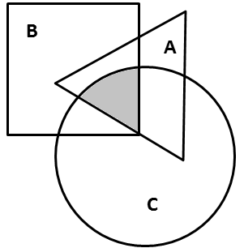

A. 15

B. 16

C. 17

D. 18

第 15 题 · 答案与解析

**参考答案（粉笔题库参考内容）**

C

**解析**

套用三集合容斥原理公式，60+170+150-22-60-35+x=280，根据尾数法知答案为C。

故正确答案为C。

三集合容斥原理公式：。

**考点**：三集合

**来源**：2011年安徽省公务员录用考试《行测》题第15题

### 第 16 题

优良的出版文化可以＿＿＿＿积极向上的时代精神，提升国民的文化素养，而一味以经济回报为＿＿＿＿的娱乐化出版，不仅危害读者的心灵，从长远看，＿＿＿＿的是全社会的健康发展，最终出版业自身也难逃厄运。

依次填入句中划线处最恰当的一组词语是：

A. 构筑 导向 戕害

B. 建筑 指导 侵害

C. 营筑 指标 妨害

D. 创造 趋向 祸害

第 16 题 · 答案与解析

**参考答案（粉笔题库参考内容）**

A

**解析**

第一空，填入的词应与“时代精神”搭配。“营筑”指建筑，修建；“建筑”指建造建筑物，这两个词不能与抽象名词“时代精神”搭配。显然“创造”也不能与“时代精神”搭配。“构筑”既可指构造建筑，又可指构建，后接抽象名词，故该空应填“构筑”。第二空，材料原句指经济回报引导出版的方向。“指标”指计划中规定达到的目标；“趋向”指趋势，均不符合语意。“指导”为指点引导，“导向”指引导的方向，“导向”一词更贴近原文语境，故该空应填“导向”。第三空，填入的词应与“健康发展”搭配。选项中的词均有有害、损坏的意思，“戕害健康”是固定搭配，故该空应填“戕害”。

故正确答案为A。

**考点**：实词填空、对应关系-前后呼应、词的辨析-搭配对象

**来源**：2011年安徽省公务员录用考试《行测》题第16题

### 第 17 题

①像慈母拍着将睡未睡的婴儿似的，它轻轻地拍着石岸；

②水里小小的鱼儿，还有顽皮的小虾儿，在眼前游来游去；

③盈盈的湖水一直荡漾到脚边，却又缓缓地退回去了；

将以上三句话填在“四周的景色秀丽异常”一句的后面，语序最恰当的一组是：

A. ①③②

B. ③②①

C. ①②③

D. ③①②

第 17 题 · 答案与解析

**参考答案（粉笔题库参考内容）**

D

**解析**

易看出句①运用拟人修辞手法是用来修饰句③的，则句①应紧接在句③后面，观察选项只有D符合。

“四周的景色秀丽异常”后应承接写景的句子，即句③。后又由景及物，即由“湖水”转到“水里的鱼”，则句③①后接句②。经验证，D项正确。

故正确答案为D。

**考点**：确定顺序

**来源**：2011年安徽省公务员录用考试《行测》题第17题

### 第 18 题

下面句子中，语法结构与其它三句不同的是：

A. 李老师戴上老花镜看报

B. 老张赶驴子到河边饮水

C. 小王骑车到医院看叔叔

D. 赵师傅找尺子量玻璃

第 18 题 · 答案与解析

**参考答案（粉笔题库参考内容）**

B

**解析**

B项的语法结构与其它三项不同。B项“赶”这一动作的发出者是老张，“饮水”这一动作的发出者是驴子。“驴子”先是充当“赶”的宾语，又充当了“饮水”的主语，属于兼语句。

A项戴上老花镜、看报两个动作的发出者都是李老师；C项骑车到医院、看叔叔两个动作的发出者都是小王；D项找尺子、量玻璃两个动作的发出者都是赵师傅，A、C、D三项都是连动句。

本题为选非题，故正确答案为B。

**来源**：2011年安徽省公务员录用考试《行测》题第18题

### 第 19 题

下列句子中，修辞手法运用不恰当的是：

A. 可爱的青菜，土地美丽的女儿，请用你朴素的光辉照耀我

B. 我的心像一只小鸟，从哨音里展翅飞出去，飞过迷蒙的烟水、苍茫的群山，停落在故乡熟悉的大榕树上

C. 太阳从地平线上露出笑脸，用她那柔美的金色手指，悄悄地捡走了草地上的珠玑

D. 所有这些语言手段，尖锐、泼辣、犀利有力，像一颗颗威力无比的枪弹，戳穿了敌人的心脏

第 19 题 · 答案与解析

**参考答案（粉笔题库参考内容）**

A

**解析**

A项采用比喻的修辞手法，将“青菜”比作“土地美丽的女儿”，然而“青菜”却无法作为“光辉”的发出者，属于修辞误用，故A项错误。

B项用了比喻的修辞手法，将“我的心”比作“小鸟”，而且“飞”和“落”等动作都可以由小鸟发出，修辞运用恰当；C项用了拟人和比喻的修辞手法，将“太阳光和露水”分别比作“金色的手指”和“珠玑”，属于比喻修辞；“露出笑脸”和“悄悄地捡走”属于拟人修辞，修辞运用恰当；D项用了比喻的修辞手法，将“语言手段”比作“枪弹”，突出了语言手段尖锐、泼辣、犀利有力的特点，修辞运用恰当。

本题为选非题，故正确答案为A。

**来源**：2011年安徽省公务员录用考试《行测》题第19题

### 第 20 题

下列句子中，标点符号使用正确的一项是：

A. “这究竟是怎么一回事呢？同志们。”队长严肃地对大家说。

B. 基础知识到底扎实不扎实？这对以后的继续深造有着重要的影响。

C. 我正准备给爷爷理理发，爷爷却笑了：“你？笤帚疙瘩戴帽子——充人哩。”

D. 明天去呢？还是后天去呢？她实在拿不定主意了。

第 20 题 · 答案与解析

**参考答案（粉笔题库参考内容）**

C

**解析**

C项标点符号使用正确。

A项句子是倒装句，问号应放在句尾，故应改为“这究竟是怎么一回事呢，同志们？”；B项句子是陈述句非疑问句，故问号应改为逗号；D项句子是选择疑问句，选择疑问句中间的停顿应用逗号，句末才用问号。故第一个问号应改为逗号。

故正确答案为C。

**来源**：2011年安徽省公务员录用考试《行测》题第20题

### 第 21 题

下列句子中，括号内的词语使用有误的是：

A. 袁隆平的研究成果解决了十多亿人的吃饭问题，令世界为之（侧目）。

B. 英国SBB“环球钢讯”近日公布了2010年的全球钢铁企业20强名单，中国六家钢铁企业（跻身）全球钢企十强。

C. 苏轼有一首著名的诗《题西林壁》，“横看成岭侧成峰，远近高低各不同。不识庐山真面目，只缘身在此山中”。后两句生动地说明一个人若处身于某种环境之中，往往不能清楚地（洞察）事情的本来面目。

D. 就我国的基本国情来说，几千年的文明古国既给我们带来了深厚的文化（底蕴），也给我们留下了长期封建统治的历史负担。

第 21 题 · 答案与解析

**参考答案（粉笔题库参考内容）**

A

**解析**

A项“侧目”常指由于敬畏而不敢正视或由于愤恨而怒目而视，材料的意思是袁隆平的研究成果让世界都很震惊和赞叹，并不是让世界“不敢正视”或“怒目而视”。所以“侧目”与原句语境不符，使用有误。

B项“跻身”指突然获得成绩，使自己（的地位）上升到（某种行列、位置等），与原文中国六家钢铁企业上升全球钢企十强的语境相符；C项“洞察”指观察得很清楚透彻，发现内在的意义，与原文“本来面目”的语境相符；D项“底蕴”指文明的积淀，可与“文化”搭配，与原文“深厚”的语境相符。

本题为选非题，故正确答案为A。

**来源**：2011年安徽省公务员录用考试《行测》题第21题

### 第 22 题

下列各组中，两句话所表达的意思不相同的一组是：

A. （1）非经批准不能擅自离开工作岗位。（2）非得经过批准才能离开工作岗位。

B. （1）除非领导去请，他才会来。（2）除非领导去请，他是不会来的。

C. （1）小王刚参加工作不久，缺乏工作经验，难免会出现一些差错。（2）小王刚参加工作不久，缺乏工作经验，难免不出现一些差错。

D. （1）这样的事，她何尝乐意做？（2）这样的事，她何尝不乐意做？

第 22 题 · 答案与解析

**参考答案（粉笔题库参考内容）**

D

**解析**

D项中句（1）表达她不愿意去做这样的事，句（2）表达她愿意去做此事。两句话所表达的意思不相同。

A项两句话都表达“只有经过批准，才能离开工作岗位”的意思；B项两句都表达“只有领导去请，他才会来”的意思；C项两句都表达“小王会出现差错”的意思。

本题为选非题，故正确答案为D。

**考点**：句子

**来源**：2011年安徽省公务员录用考试《行测》题第22题

### 第 23 题

下列句子中，语序无误的是：

A. 上海闵行区某公司疑似发生员工食物中毒，目前有90余人前往医院就诊。

B. 上海闵行区某公司发生疑似员工食物中毒，目前有90余人前往医院就诊。

C. 上海闵行区某公司发生员工疑似食物中毒，目前有90余人前往医院就诊。

D. 上海闵行区某公司发生员工食物疑似中毒，目前有90余人前往医院就诊。

第 23 题 · 答案与解析

**参考答案（粉笔题库参考内容）**

C

**解析**

根据句子可以判断，确定员工已经生病，并进医院，但是不能确定是不是食物中毒。因此“疑似”一词应放在“食物中毒”前。

故正确答案为C。

**来源**：2011年安徽省公务员录用考试《行测》题第23题

### 第 24 题

下列句子中，有语病的是：

A. 学校把培养和提高学生的实践能力作为教育教学的重要目标，以满足社会对人才的需求。

B. 为满足社会对人才的需求，学校把培养和提高学生的实践能力作为教育教学的一项重要目标。

C. 学校把培养和提高学生的实践能力作为教育教学的一项重要目标，为满足社会对人才的需求。

D. 学校把培养和提高学生的实践能力作为教育教学的一项重要目标，满足了社会对人才的需求。

第 24 题 · 答案与解析

**参考答案（粉笔题库参考内容）**

D

**解析**

选项D前半句是未然时态，后半句是已完成的时态，时态矛盾。

A、B、C三项均无语病。

故正确答案为D。

**来源**：2011年安徽省公务员录用考试《行测》题第24题

### 第 25 题

下列句子中，没有语病的是：

A. 春节期间，全市工商系统严格执行值班制度和纪律，春节在岗值班人员为此还进行了专门培训，以提高处置应急事件和应答电话投诉咨询的水平。

B. 这类犯罪活动涉及面广、技术含量高、易防难打，仅仅依靠公安等部门无法得到有效治理，必须充分运用综合治理手段，动员宣传、金融、电信、教育等部门乃至社会各界力量齐抓共管。

C. 对拒不整改生产场所卫生条件的餐饮具集中消毒企业，卫生监督所将通知工商管理部门建议暂缓核发其工商营业执照。

D. 市规划局马局长表示，市奥体中心二期工程从设计之初不仅要考虑赛事要求，还要考虑场馆综合利用和塑造城市景观，目标是打造多功能的城市文体中心。

第 25 题 · 答案与解析

**参考答案（粉笔题库参考内容）**

D

**解析**

D项没有语病。

A项词语搭配不当及语序不当。“执行”与“制度和纪律”搭配不当，应改为“遵守制度和纪律”。此外，句中出现了两个主语“全市工商系统”和“春节在岗值班人员”，应将“为此”移到“春节在岗值班人员”之前；B项偷换主语，“必须充分运用综合治理手段······齐抓共管”的主语已经不是“这类犯罪活动”了；C项句式杂糅，“通知”和“建议”不能同时出现，后半句应改为“卫生监督所将通知工商管理部门暂缓核发其工商营业执照”。

故正确答案为D。

**来源**：2011年安徽省公务员录用考试《行测》题第25题

### 第 26 题

“他的诗歌读不完”，下列对这句话的理解错误的是：

A. 他爱读诗歌，读起来没完没了

B. 他不爱读诗歌，读起来总是半途而废

C. 他是诗人，作品多得读不完

D. 他收藏的诗歌很多，读也读不完

第 26 题 · 答案与解析

**参考答案（粉笔题库参考内容）**

B

**解析**

B项理解错误。

“读不完”是指事情可以延续发展下去或指数量很多，故A、C、D三项理解正确。

故正确答案为B。

**来源**：2011年安徽省公务员录用考试《行测》题第26题

### 第 27 题

最近的科学研究发现，宇宙中许多物体都能发出霍金辐射，霍金辐射比预想的更普遍，因此可以通过研究霍金辐射来了解黑洞寿终时刻的情形。

根据这段话，我们知道：

A. 宇宙中普遍存在霍金辐射

B. 宇宙中的物体普遍能发出霍金辐射

C. 在此次发现之前，科学家对霍金辐射在宇宙中是否存在是未置可否的

D. 此次发现使科学家确定了黑洞寿终时刻的情形

第 27 题 · 答案与解析

**参考答案（粉笔题库参考内容）**

A

**解析**

据材料“宇宙中许多物体都能发出霍金辐射”可知，“宇宙中普遍存在霍金辐射”，A项正确。

材料讲“宇宙中许多物体能发出霍金辐射”，即只有一部分物体能发出霍金辐射，并非“宇宙中的物体普遍能发出霍金辐射”，故B项错误；C项在材料中未提及；D项表述“确定了黑洞寿终时刻的情形”，表示完成时态。而材料只是说明通过研究可了解黑洞寿终时刻的情形，故D项错误。

故正确答案为A。

**考点**：细节判断题

**来源**：2011年安徽省公务员录用考试《行测》题第27题

### 第 28 题

与“不登高山，不知天之高也；不临深溪，不知地之厚也”蕴含的哲学道理一致的是：

A. 不入虎穴，焉得虎子

B. 君子欲讷于言而敏于行

C. 博观而约取，厚积而薄发

D. 操千曲而后晓声，观千剑而后识器

第 28 题 · 答案与解析

**参考答案（粉笔题库参考内容）**

D

**解析**

“不登高山，不知天之高也；不临深溪，不知地之厚也”蕴含的哲学道理是实践出真知。

D项“操千曲而后晓声，观千剑而后识器”指只有经过大量实践才能获取真知。两者都强调实践的重要性。

B项“君子欲讷于言而敏于行”告诫人们要少说话多做事；C项“博观而约取，厚积而薄发”指要经过长时间的准备和积累然后才能大有可为，施展作为；B、C两项显然与题目蕴含的哲理不一致。A项是强烈干扰项，“不入虎穴，焉得虎子”比喻不冒危险，就不能成事；今用来比喻不经历最艰苦的实践，就不能取得真知。该句侧重“付出”与“收获”的关系，并非实践的重要性。

故正确答案为D。

**来源**：2011年安徽省公务员录用考试《行测》题第28题

### 第 29 题

拥有120年历史的道琼斯通讯社宣布，聘请新华在线在中国独家代理其信息产品。这意味着，今后，国内新闻媒体和政府机构同步使用道琼斯中文语言财经消息、评论成为可能。据悉，道琼斯通讯社以其独立、领先的财经新闻闻名于世，每24小时发布8000多则市场消息。此次，新华在线专门推出“引擎计划”，为道琼斯服务中国本土开路。它还入乡随俗，接受国内个别用户的财政信息服务要求。

最适合做上面一段新闻标题的是：

A. 道琼斯通讯社大力拓展中国市场

B. 道琼斯通讯社以其独立、快捷的信息赢得了中国的市场

C. 道琼斯通讯社以其独特的服务和本土化的战略满足用户的信息需求

D. 新华在线为道琼斯代理信息发布

第 29 题 · 答案与解析

**参考答案（粉笔题库参考内容）**

D

**解析**

一般情况下，新闻的导语即为整段新闻的重点。

首句“道琼斯通讯社宣布，聘请新华在线在中国独家代理其信息产品”是这则新闻的导语，导语中包含了两个主体“道琼斯通讯社”和“新华在线”，导语主要表达“新华在线为道琼斯代理信息发布”，因此D项最适合做材料的标题。

A、B、C三项均未提到新闻的另一重要主体“新华在线”，故不选。

故正确答案为D。

**考点**：标题填入题

**来源**：2011年安徽省公务员录用考试《行测》题第29题

### 第 30 题

近日，英国剑桥大学医学院癌症研究所和美国冷泉港实验室的科学家宣布，他们在独立进行的研究活动中，从多种人体癌细胞中分离出了单独的基因，通过大量实验证明了这些基因可以使人体正常的健康细胞发生癌变。多年来，基因研究领域的科学家一直认为，可以通过改变这种基因的办法来使癌细胞转变为正常细胞。现在，他们果然找到了这种基因，从而使人们在战胜癌症的进程中又前进了一大步。

下列说法符合上文意思的是：

A. 这些基因的发现是不同的研究机构相互合作的结果

B. 这些基因能够对癌细胞进行修复，因此可以成功的医治癌症

C. 科学家们发现了这些基因，因而成功地克服了癌症

D. 科学家们的这一发现在人类攻克癌症的历史进程中具有深远的影响

第 30 题 · 答案与解析

**参考答案（粉笔题库参考内容）**

D

**解析**

由材料“他们果然找到了这种基因，从而使人们在战胜癌症的进程中又前进了一大步”，可以判断出D项正确。

A项的“相互合作”与材料中的“独立进行的研究活动”不符，故A项错误；由材料可知“这些基因可以使人体正常的健康细胞发生癌变”，并非“这些基因能够对癌细胞进行修复”，故B项错误；C项表述“成功克服了癌症”，表示完成时态。而材料只是说明这一发现使人们在战胜癌症的进程中又前进了一大步，故C项错误。

故正确答案为D。

**考点**：细节判断题

**来源**：2011年安徽省公务员录用考试《行测》题第30题

### 第 31 题

从人类可持续发展的角度来说，植物性食品对于地球资源的利用率确实要高一些。对于那些为了这个目标而素食的人来说，确实应该给予充分的尊敬。但是，人类的发展毕竟是为了让人们活得更美好。那些让人们活得很美好的东西，无论是汽车飞机还是电脑网络，都是依靠消耗地球资源而存在的。相对于这些，肉食对地球的影响并没有那么巨大。对于很多人来说，肉食却是生活中最重要的需求。素食，作为一种个人选择，当然应该受到尊重。但是，素食主义者也不应该为任何原因而站在道德的制高点上，要求别人也素食。

对以上语段的理解，错误的一项是：

A. 当一个人是为了人类可持续发展的目标而选择素食，我们才应该尊敬他

B. 人们选择素食还是肉食，并不足以具有改变世界的力量

C. 素食主义者往往站在道德的制高点上，要求别人也素食

D. 人们为了活得更美好而消耗地球资源，这是无可指责的

第 31 题 · 答案与解析

**参考答案（粉笔题库参考内容）**

A

**解析**

材料中提到“对于那些为了这个目标而素食的人来说，确实应该给予充分的尊敬”，可理解为应该尊重为了人类可持续发展的目标而选择素食的人。但并不代表只有为了这个目标的素食者才应该受到尊重。故A项说法错误。

由材料“相对于这些，肉食对地球的影响并没有那么巨大”可知，选择素食还是肉食对地球的影响不甚巨大，故B项说法正确；材料中提到“素食主义者也不应该······要求别人也素食”，由作者的态度可知素食主义者站在道德的制高点要求别人也素食是常有的现象，故C项说法正确；由材料“人类的发展毕竟是为了让人们活得更美好”和“那些让人们活得很美好的东西······都是依靠消耗地球资源而存在的”可知，让人们活得美好的东西需要依靠地球资源，而人们活得美好是人类发展的目标，是无可指责的，故D项说法正确。

本题为选非题，故正确答案为A。

**考点**：细节判断题

**来源**：2011年安徽省公务员录用考试《行测》题第31题

### 第 32 题

专家分析认为，随着国家调控政策的效果显现，物价上涨过快的势头会得到一定遏制。受物价上涨的惯性影响，预期2011年初CPI同比可能会继续小幅上涨，全年价格总水平将呈现温和上涨态势。

下列表述，符合上述这段话意思的是：

A. 国家采取的调控政策可以保证物价不再上涨

B. 预期2011年中后期CPI将不再上涨

C. 消除了物价上涨惯性的影响，CPI才有可能下降

D. 预期2011年的物价总水平仍然会上涨，但幅度不大

第 32 题 · 答案与解析

**参考答案（粉笔题库参考内容）**

D

**解析**

由材料全年价格总水平将呈现“温和上涨态势”可知，国家采取调控政策后，2011年全年的价格总水平仍会上涨，但幅度不大。故D项说法正确。

A、B两项从文中并不能推断出来，所以不选；C项属于强加理解，材料中并未表达“上涨惯性”与“CPI”下降之间的关系，故C项说法错误。

故正确答案为D。

**考点**：细节判断题

**来源**：2011年安徽省公务员录用考试《行测》题第32题

### 第 33 题

美国研究人员初步证实，西兰花等十字花科蔬菜中富含被称作异硫酸氰酯的化合物（ITC），可以优先杀死变异P53基因，并留下P53基因。由P53基因组成的蛋白质有助于阻止癌细胞生长，不过P53基因一旦发生变异，就失去了这种保护作用，而变异的P53基因与差不多一半的人类癌症有关。

西兰花可以防癌的原因是：

A. 西兰花中富含的异硫酸氰酯（ITC）能够杀死癌细胞

B. 西兰花能够阻止正常的P53基因发生变异

C. 西兰花中含有能够消灭变异P53基因，保留正常P53基因的物质

D. 西兰花中含有有助于阻止癌细胞生长的蛋白质

第 33 题 · 答案与解析

**参考答案（粉笔题库参考内容）**

C

**解析**

据材料可知，未变异的P53基因有助于防癌，而西兰花富含ITC，ITC可优先杀死变异的P53基因，保留未变异基因。故C项是西兰花可以防癌的原因。

ITC杀死的是变异P53基因，并非直接杀死癌细胞，故A项错误；西兰花只是能杀死变异P53基因，并非能阻止P53基因变异，故B项错误；有助于阻止癌细胞生长的蛋白质是由P53基因组成的，P53基因是人体基因，并非西兰花含有P53基因，故D项错误。

故正确答案为C。

**考点**：细节判断题

**来源**：2011年安徽省公务员录用考试《行测》题第33题

### 第 34 题

环境保护部副部长张力军在回答记者提问时说，我国传统的污染物排放量仍然很大，超过我国的环境容量，致使一些地区环境质量达不到国家规定的标准。随着经济的快速发展，一些新的环境问题不断产生，特别是危险化学品、持久性有机污染物、电子垃圾等。我国水和大气的环境问题还没有完全解决好，土壤的污染现在又凸显在我们面前。

根据以上信息，可以得出的结论是（    ）。

A. 传统的污染物排放没有解决，新的环境问题又层出不穷，中国环境问题面临严峻形势

B. 新的环境问题是经济快速发展的必然产物

C. 我国一些地区环境质量达不到国家规定的标准，是因为传统的污染物排放量大

D. 环境污染问题的呈现有它的特殊规律，即先出现水和大气的污染，再出现土壤的污染

第 34 题 · 答案与解析

**参考答案（粉笔题库参考内容）**

A

**解析**

文段首句指出我国传统污染物排放量很大超过环境容量，致使一些地区环境质量不达标，接着指出随着经济发展，新问题不断产生。尾句对前文进行总结，旧问题还没完全解决好，新问题又出现，对应A项。

B项，由“随着经济的快速发展，一些新的环境问题不断产生”可知，经济快速发展只是新环境问题产生的一个背景，并不能得出“新的环境问题是经济快速发展的必然产物”这一结论，选项错误，排除。

C项，由文段第一句可知，传统污染物排放量超过环境容量才会致使一些地区环境质量达不到国家规定的标准，选项缺少这一前提，且该部分并非文段结论，排除；

D项，文段仅客观描述我国先后出现的环境问题，无法得出选项概括的特殊规律，排除。

故正确答案为A。

**考点**：分述句特征-引入铺垫

**来源**：2011年安徽省公务员录用考试《行测》题第34题

### 第 35 题

最新一项研究表明，到本世纪末，地球平均气温将比现在升高3。这一预测是以近年来地球气温升高现象与温室效应为依据的。温室效应，在物理学上是指透视阳光的密闭空间由于与外界缺乏对流等热交换而产生的保温效应。大气层中的二氧化碳是主要的温室气体，它可以减少地表热量向空间散失，使大气层保持一定的热量。

根据上文，下列关于“温室效应”概念的解释，准确的是：

A. 指二氧化碳等温室气体剧增以后，又与外界缺乏对流等热交换，从而使地表气温相应升高的效应

B. 指在接受阳光的密闭空间中能够影响地表气温的二氧化碳含量增加，使地表气温升高的效应

C. 指由于与外界缺乏对流等热交换，能够接受阳光的一定密闭空间中所产生的一种保温效应

D. 指大气中主要的温室气体，通过减少地表热量向空间散失，在特定密闭空间中产生的保温效应

第 35 题 · 答案与解析

**参考答案（粉笔题库参考内容）**

D

**解析**

由材料“温室效应，在物理学上是指透视阳光的密闭空间由于与外界缺乏对流等热交换而产生的保温效应”和“大气层中的二氧化碳是主要的温室气体，它可以减少地表热量向空间散失，使大气层保持一定的热量”可知，“温室效应”是温室气体通过减少地表热量向空间散失，使密闭空间与外界缺乏热交换而产生的保温效应。故D正确。

由材料可知温室气体剧增而造成密闭空间与外界缺乏热交换，A项中的“又”无法体现出两者的因果关系；温室气体使气温上升的原理是“减少地表热量向空间散失，使大气层保持一定的热量”，而温室气体本身并不能影响地表温度，故B项错误；C项未提到“与外界缺乏对流等热交换”与温室气体的关系，没有全面理解“温室效应”的概念。

故正确答案为D。

**考点**：细节判断题

**来源**：2011年安徽省公务员录用考试《行测》题第35题

## 材料 1

板块结构理论认为，地球的外壳分为若干部分或称为板块，这些板块始终处于相对运动之中。板块的不断移动，使断层——穿过岩层的地质裂缝——的应力不断增加，造成岩层的略微变形，最终断裂而产生断层地震。这时变形的岩层会弹回来，像一根拉长的橡皮带绷断后一样。其后，断层的各边都移动，岩层的弹性畸变也消失了。

        地震前断层周围的应力会增大，这个概念促使人们想到许多检测这种地震警报的方法，科学家可以通过重新测量绘制地图时使用的三角测量点的网络来测出微小的变形。他们也可以在适当的地方安放应变仪或倾斜计这类仪器。由于变形能改变蓄水能力（或者说通过使细小裂缝开启或闭合而改变岩层的孔隙度），因此孔隙内的水位也可以提供有用的信息。现在卫星已可以用来对地球表面的点进行测量，其精度可达几厘米，所以现在的许多测量点都可以从空间重新测绘。所有这些方法在可能发生地震时都会有所显示。

        当一个断层的不同部分活动的方式互不相同时，如果断层的一个部分经常有中度地震，而它的一个邻近地带在历史记载中却没有发生过地震，那么断层的这个平静地带（称作地震空白区）就可能是将发生地震的地方。

        但是断层的所有部分不都是照这种方式活动的。有些活断层从来没有产生过引起人们注意的地震。由于许多岩层极其缓慢变形的共同作用的结果，它们在不断地滑动，其速度与板块的移动相一致，这种活动方式所产生的地震很轻微，不借助灵敏的地震仪，是不会觉察到的，这个过程叫做蠕动。正在蠕动的断层不会发生严重的地震灾害，除非蠕动停止。通过对蠕动的断层和地震空白区的多年监视，研究人员能够确定出将来最可能发生地震的地区。

### 第 36 题

“岩层的弹性畸变”消失的原因是：

A. 地震消除了积存在板块中的应力

B. 断裂的岩层不断向各边移动

C. 地震使积存在板块中的应力增加

D. 板块的不断移动使岩层断裂

第 36 题 · 答案与解析

**参考答案（粉笔题库参考内容）**

A

**解析**

定位原文第一自然段，可知“岩层的弹性畸变”是断层应力增加造成的，随着断层应力不断增加，岩层断裂而产生地震，地震消除了积存在板块中的应力，地震后变形的岩层恢复，使“岩层的弹性畸变”消失。

正确答案为A。

B项“断裂的岩层不断向各边移动”与“岩层的弹性畸变消失”同时发生，前者不是后者发生的原因；C项说法明显错误，地震后变形的岩层恢复，可见应力被消除了，并非增加了；D项“板块的不断移动使岩层断裂”是地震产生的原因，而地震消除应力才是“岩层的弹性畸变”消失的原因。

故正确答案为A。

**来源**：2011年安徽省公务员录用考试《行测》题第36题

### 第 37 题

①重新测量三角测量点网络的变形情况②安放应变仪或倾斜计③改变岩层的孔隙度④观察孔隙内水位的变化⑤通过卫星对三角测量点重新测绘

上述检测地震警报的方法正确的一组是：

A. ①②③

B. ②④⑤

C. ①②④⑤

D. ①②③⑤

第 37 题 · 答案与解析

**参考答案（粉笔题库参考内容）**

C

**解析**

此题考查细节判断。定位原文第二自然段，由“科学家可以通过重新测量绘制地图时使用的三角测量点的网络来测出微小的变形”可知①、⑤正确。

由材料“他们也可以在适当的地方安放应变仪或倾斜计这类仪器。由于变形能改变蓄水能力（或者说通过使细小裂缝开启或闭合而改变岩层的孔隙度），孔隙内的水位也可以提供有用的信息。”可知，“安放应变仪或倾斜计”或“观察孔隙内水位的变化”是监测地震警报的方法，单纯“改变岩层的孔隙度”是不能监测地震警报的，故②、④正确，③错误。

故正确答案为C。

**来源**：2011年安徽省公务员录用考试《行测》题第37题

### 第 38 题

第四段中“其速度与板块的移动相一致”的“其”指的是：

A. 活断层各部分的滑动

B. 许多岩层的变形

C. 活断层各部分的变形

D. 许多岩层的滑动

第 38 题 · 答案与解析

**参考答案（粉笔题库参考内容）**

A

**解析**

此题考查词语指代。定位原文第四自然段的“其速度与板块的移动相一致”，“其”指代前面语句的“它们的滑动”，而“它们”又特指“活断层的各部分”，因此“其”指的是“活断层各部分的滑动”。

故正确答案为A。

**来源**：2011年安徽省公务员录用考试《行测》题第38题

### 第 39 题

下列说法中，与原文意思不一致的是：

A. 地震灾害之所以不可能消除，是因为地球板块始终处于相对运动之中

B. 断层的应力始终处于“产生——增大——消除”的不断循环之中

C. 地震空白区之所以最可能发生地震，是因为它各部分的活动方式互不相同

D. 正在蠕动的断层如果停止了蠕动，就有可能发生严重的地震灾害

第 39 题 · 答案与解析

**参考答案（粉笔题库参考内容）**

C

**解析**

此题考查细节判断。由材料第三自然段“当······时，如果······，那么······”可知文中陈述的是一种假定的条件，即如果断层的一个部分经常有中度地震，而它的一个邻近地带没有发生过地震，地震空白区就可能发生地震，C项错把假设关系表述为因果关系，且“最可能”的说法也与材料表述不符。

由第一自然段“这些板块始终处于相对运动之中 ”和“板块的不断移动······最终断裂而产生断层地震”可知，板块始终处于相对运动，相对运动最终造成岩层断裂而产生地震，故A项正确；由第一自然段“板块的不断移动······岩层的弹性畸变也消失了”和“板块始终处于相对运动之中”可知，断层的应力始终处于“产生——增大——消除”的不断循环之中，B项正确；由第四自然段“正在蠕动的断层不会发生严重的地震灾害，除非蠕动停止”可知，断层停止蠕动，可能发生严重的地震灾害，D项正确。

本题为选非题，故正确答案为C。

**来源**：2011年安徽省公务员录用考试《行测》题第39题

### 第 40 题

本文所表达的主要观点是：

A. 板块运动与地震的关系

B. 地震产生的原因及地震预报

C. 不同的地质运动会产生不同类型的地震

D. 借助观察蠕动是预报地震的有效方法

第 40 题 · 答案与解析

**参考答案（粉笔题库参考内容）**

B

**解析**

此题考查文章主旨。文段第一自然段解释了地震的成因，二、三、四自然段进一步说明了如何预测地震灾害，整篇材料构成了分——分的结构。全文的主要观点应是前后内容的概括，故正确答案为B。

A项是前面“分”的部分；D项是后面“分”的部分；C项在材料中未提到，均不选。

故正确答案为B。

**来源**：2011年安徽省公务员录用考试《行测》题第40题

### 第 41 题

超敏反应，是指机体接受特定抗原持续刺激或同一抗原再次刺激所致的功能紊乱和组织损伤等病理性免疫反应。

根据上述定义，下列选项不属于超敏反应的是：

A. 一朝被蛇咬，十年怕井绳

B. 某药物虽然对治疗胃肠疾病十分有效，但也有部分患者服后出现口干、心悸等反应

C. 某甲因长期使用激素，停药后全身出现“虚胖”现象

D. 某患者在进行青霉素皮试后，出现了淋巴结肿大的现象

第 41 题 · 答案与解析

**参考答案（粉笔题库参考内容）**

A

**解析**

第一步：抓住定义中的关键词。

①特定抗原持续刺激或同一抗原再次刺激；②功能紊乱和组织损伤等病理性免疫反应。

第二步：逐一判断选项。

A项“被蛇咬”不符合要点①，“怕井绳”也不符合要点②，因此不属于超敏反应；

B、C、D三项都符合定义要点。

本题为选非题，故正确答案为A。

**考点**：单定义-其他句式

**来源**：2011年安徽省公务员录用考试《行测》题第41题

### 第 42 题

反映论，是指坚持认识的本质是人脑对客观世界反映的认识论原则，亦即思想是反映存在的理论。

根据上述定义，下列不属于反映论的是：

A. “存在就是被感知”

B. “从物到感觉和思想”

C. “凡以知，人之性也；可以知，物之理也”

D. “没有被反映者就没有反映者”

第 42 题 · 答案与解析

**参考答案（粉笔题库参考内容）**

A

**解析**

第一步：找出定义关键词。

 “认识的本质是人脑对客观世界反映”、“思想反映存在”。

第二步：逐一分析选项。

A项，“存在就是被感知”是近代英国哲学家贝克莱的观点，指只有被感知的事物才是存在的，没有被感知的事物并不存在，不符合“思想反映存在”，而是“思想定义存在”，这是主观唯心主义哲学的观点，不符合定义，当选；

B项，“从物到感觉和思想”是列宁的观点，指的是感觉和思想是由物质引起的，符合 “认识的本质是人脑对客观世界反映”、“思想反映存在”，符合定义，排除；

C项，“凡以知，人之性也；可以知，物之理也”是荀子的观点，意思是“能够认识事物，是人的本性；可以被认识，是事物的自然之理”，即认为人有认识客观事物的能力，而客观事物本身又是可以被认识的，符合“认识的本质是人脑对客观世界反映”、“思想反映存在”，符合定义，排除；

D项，“没有被反映者就没有反映者”主张人的认识来源于客观世界，核心意思是反映必须以客观存在的实体为前提，没有客观存在的实体，也就没有反映，符合“认识的本质是人脑对客观世界反映”、“思想反映存在”，符合定义，排除。

本题为选非题，故正确答案为A。

**考点**：单定义-其他句式

**来源**：2011年安徽省公务员录用考试《行测》题第42题

### 第 43 题

和谐经济学，是指以社会经济系统的结构和功能为研究对象，以提高这一系统的功能——生产力为目的，看到的是人与自然之间的协调与可持续发展。

根据上述定义，下列属于发展和谐经济行为的是：

A. 某国家级贫困县决定建矿开采一种稀有金属。其理由是：虽然必须砍掉200多亩树林，一个山涧小水库也要废掉，并因此影响1000多人饮水和2000多亩土地灌溉。但该矿建成后，对发展该县经济具有重要意义

B. 某企业为在规定时间内完成客户定单，连续五天要求工人每天加班5至6个小时，工人虽然很疲劳但对加班费还是满意的

C. 某市大小采金矿有100多个，虽然大多企业设备老化、选矿技术落后，但是该市还是决定继续发展金矿业，因为该市财政收入主要来源于金矿

D. 某市在审查外资投资时发现，一家大型化工企业设备陈旧、能耗高，废水处理系统也很落后，于是断然决定停止引进该企业

第 43 题 · 答案与解析

**参考答案（粉笔题库参考内容）**

D

**解析**

第一步：抓住定义中的关键词。

和谐经济学的研究对象是“社会经济系统的结构和功能”，目的是提高这一系统的“生产力”，看到的是“人与自然之间的协调与可持续发展”。

第二步：逐一判断选项。

A项没有实现“人与自然之间的协调与可持续发展”；

B项是企业内部的工作安排，不属于和谐经济学的研究对象；

C项没有体现出“提高生产力”和“人与自然之间的协调与可持续发展”；

D项某市考虑到该外企的生产能力和对环境污染的问题，断然停止引进该企业，看到了人与自然之间的协调与可持续发展，符合定义。

故正确答案为D。

**考点**：方式目的

**来源**：2011年安徽省公务员录用考试《行测》题第43题

### 第 44 题

职业培训，是指按照不同职业岗位的要求，对接受培训的人员进行职业知识与实际技能的培训和训练。

根据上述定义，下列属于职业培训的是：

A. 某社区对本区“两劳”（劳改、劳教）释放人员进行了集中教育

B. 某培训机构举办了拟参加今年播音主持专业高考学生的考前培训班

C. 某企业对今年新进的员工进行“我与企业共荣辱”教育

D. 某市人力资源和社会保障局计划上半年举办一期电脑培训班，三期家政培训班，培训对象全部是该市下岗人员

第 44 题 · 答案与解析

**参考答案（粉笔题库参考内容）**

D

**解析**

第一步：抓住定义中的关键词。

该定义中的关键词为“职业岗位的要求”、“职业知识与实际技能”。

第二步：逐一判断选项。

A项，对“两劳”释放人员进行的教育不是出于职业岗位的要求，且教育的内容不属于职业知识与实际技能；

B项，培训对象是“播音主持专业高考学生”，是为备考而培训，不是出于职业岗位的要求；

C项，培训内容不属于职业知识与实际技能；

D项，电脑培训和家政培训是为下岗人员培训的，目的是训练下岗人员的职业技能，符合定义。

故正确答案为D。

**考点**：方式目的

**来源**：2011年安徽省公务员录用考试《行测》题第44题

### 第 45 题

外部不经济，指企业或个人的日常生产或生活，由于其他企业或个人的活动而受到不利的影响，但又不能从造成这些影响的企业和个人那里得到相应补偿的现象。

据此判断，下列选项中属于外部不经济的是：

A. 张某的一项新发明被其他人使用，使用者并没有向他支付使用费

B. 黄河上游的居民大量种草植树，自己在收获了木材的同时也改善了下游居民的水源质量，但他们并没有向下游居民收取任何费用

C. 淮河上游的造纸厂直接向淮河排放污水，造成下游两岸农作物大量减产，造纸厂没有向受影响的农民进行赔偿

D. 一家企业生产规模扩大之后，随着产品数量的大幅度增长，生产成本不但没有下降反而上升了，但是，这种上升的成本却无法得到补偿

第 45 题 · 答案与解析

**参考答案（粉笔题库参考内容）**

C

**解析**

第一步：抓住定义中的关键词。

该定义中的关键词为“由于其他企业或个人的活动而受到不利的影响”、“不能······得到相应补偿”。

第二步：分析选项。

A、B、D三项虽然都没有获得相应的补偿，但没有体现受到不利的影响，不符合定义；

C项中农民的农作物因造纸厂排放的污水而导致大量减产，农民没有获得相应的赔偿，符合定义的两个条件。

故正确答案为C。

**考点**：原因结果

**来源**：2011年安徽省公务员录用考试《行测》题第45题

### 第 46 题

融资，指为支付超过现金的购货款而采取的货币交易手段，或为取得资产而集资所采取的货币手段。

根据以上定义，下列选项不属于融资行为的是：

A. 小张为了方便上下班，拿出自己的8万元积蓄，另找父母借了3万元买了一辆小轿车

B. 某单位准备利用一块闲置土地解决职工住宿，但尚缺3千万资金，有人提议向职工借钱，并支付适当的利息，以后分期偿还

C. 某企业拟上马刚开发的一项新产品，向银行贷款

D. 张先生打算把一家饭店盘下来，钱不够找到了朋友李先生借了50万元，约定两年内连本带息全部还清

第 46 题 · 答案与解析

**参考答案（粉笔题库参考内容）**

A

**解析**

第一步：抓住定义中的关键词。

该定义的关键词为“货币交易手段”。

第二步：逐一判断选项。

A项，跟父母借钱购车只是借款行为，没有形成“货币交易”，不符合定义；

B、C、D三项，向职工借钱并支付利息、向银行贷款、跟朋友借钱并支付利息，均为货币交易行为，符合定义。本题要求选出不属于融资行为的选项。

本题为选非题，故正确答案为A。

**考点**：方式目的

**来源**：2011年安徽省公务员录用考试《行测》题第46题

### 第 47 题

共生营销，是指两个或两个以上的企业通过分享市场营销中的资源，达到降低成本、提高效率、增强市场竞争力为目的的一种营销策略。

根据上述定义，下列属于共生营销的是：

A. 甲企业和乙企业决定整合资源，建立企业集团

B. 甲、乙、丙三家小家电企业决定建立市场消费信息共享机制，定期通报协调各自生产小家电的品种、品质和价格定位

C. 某物流公司把货从甲地运到乙地，又从乙地带货到甲地，来回不放空，提高了公司效益

D. 某商场既卖甲企业的产品，也卖乙企业的产品

第 47 题 · 答案与解析

**参考答案（粉笔题库参考内容）**

B

**解析**

第一步：抓住定义中的关键词。

该定义强调“两个或两个以上的企业”、“分享市场营销中的资源”。

第二步：逐一判断选项。

A项，甲、乙两企业是整合资源建立企业集团，不属于分享市场营销中的资源，不符合定义；

B项，甲、乙、丙三家小家电企业建立市场消费信息共享机制，符合两个或两个以上的企业分享市场营销中的资源；

C、D两项的主体都是一个企业，不符合定义。

故正确答案为B。

**考点**：主客体

**来源**：2011年安徽省公务员录用考试《行测》题第47题

### 第 48 题

非对称信息，是指某些行为人拥有另一些行为人不拥有的信息。

根据上述定义，下列属于非对称信息的是：

A. 某企业发布信息招聘一名部门经理，要求男性、年龄不超过30岁，经考核面试合格后录用。应聘者甲、乙一路过关进入最后一轮筛选，在决定谁最后胜出时，乙被告知，因其不是本市户口，所以不予录用

B. 某单位在春节后上班第一天召开大会，规定职工上班时间不得玩游戏。一个月后，小李违规受到处理。小李争辩说，单位以前有过要求，以后再未提出类似要求

C. 某市在本市各大媒体上发布招录50名公务员消息，张某说他最近一直在外地，不知道这个消息，所以错过了报名时间

D. 某电视购物频道联手建材商家进行团购促销宣传，小李说他不知道

第 48 题 · 答案与解析

**参考答案（粉笔题库参考内容）**

A

**解析**

第一步：找出定义关键词。

“拥有另一些行为人不拥有的信息”。

第二步：逐一分析选项。

A项：某企业在发布招聘信息时没有要求具备“本市户口”，等到进入最后一轮时，乙才获知这一信息，企业的这一规定是乙不拥有的信息，符合“拥有另一些行为人不拥有的信息”，符合定义，当选；

B项：单位召开大会，规定职工上班时间不得玩游戏，属于公开的信息，不符合“拥有另一些行为人不拥有的信息”，不符合定义，排除；

C项：招录公务员的信息，属于公开的信息，不符合“拥有另一些行为人不拥有的信息”，不符合定义，排除；

D项：某电视购物频道的团购促销，属于公开的信息，不符合“拥有另一些行为人不拥有的信息”，不符合定义，排除。

故正确答案为A。

**考点**：单定义-其他句式

**来源**：2011年安徽省公务员录用考试《行测》题第48题

### 第 49 题

光的折射是一种光学现象，是指光由一种介质斜射入另一种介质或在同一种不均匀介质中传播时方向发生偏折的现象。

根据以上定义，下列不属于光的折射的是：

A. 某海边经常出现海市蜃楼现象

B. 鱼儿在清澈的水里面游动，可以看得很清楚。然而，沿着你看见鱼的方向用鱼叉去叉它，却叉不到

C. 太阳光照在镜面上，再从镜面上照到学生的脸上，学生会感到刺眼

D. 当你站在岸边，看见清澈见底、深不过齐腰的水时，千万不要贸然下去，因为实际水深比你看到的要深得多

第 49 题 · 答案与解析

**参考答案（粉笔题库参考内容）**

C

**解析**

第一步：找出定义关键词。

“光由一种介质斜射入另一种介质”、“在同一种不均匀介质中传播”、“方向发生偏折”。

第二步：逐一分析选项。

A项：海市蜃楼是地球上物体反射的光经不同密度大气折射而形成的虚像，符合“在同一种不均匀介质中传播”、“方向发生偏折”，符合定义，排除；

B项：叉不到鱼是因为鱼反射的光从水里进入空气时发生了偏折，符合“光由一种介质斜射入另一种介质”、“方向发生偏折”，符合定义，排除；

C项：太阳光照在镜面，再从镜面照到学生的脸上，没有体现光从一种介质摄入另一种介质，也没有体现在不均匀介质中传播，该项属于光的反射，不符合“光由一种介质斜射入另一种介质”、“在同一种不均匀介质中传播”，不符合定义，当选；

D项：实际水深比看到的要深得多，说明水底反射的光从水中进入空气时发生了偏折，符合“光由一种介质斜射入另一种介质”、“方向发生偏折”，符合定义，排除。

本题为选非题，故正确答案为C。

**考点**：原因结果

**来源**：2011年安徽省公务员录用考试《行测》题第49题

### 第 50 题

教育均衡，是指通过法律法规确保给公民或未来公民以同等的受教育权利和义务，通过政策制定与调整及资源调配而提供相对均等的教育机会和条件，以客观公正的态度和科学有效的方法实现教育效果和成功机会的相对均衡。

根据上述定义，下列不属于实施教育均衡的行为是：

A. 某市教育局规定，市郊与市中心城区的中小学教师、优秀骨干教师和一般教师实行常态化的轮流调岗

B. 某校要求，所有老师每年必须发表一篇论文，否则，下一年度考核视为不合格，学校将不予聘任

C. 某市决定，不再实行经费拨付的“扶优扶强”政策，而是对硬件条件较差的学校倾斜，力争三年内使本市所有学校办学硬件条件基本平衡

D. 某市发文通知，从本学期起，取消重点中小学差别，所有学生就近入学

第 50 题 · 答案与解析

**参考答案（粉笔题库参考内容）**

B

**解析**

第一步：找出定义关键词。

“通过法律法规”、“受教育权利和义务”、“提供相对均等的教育机会和条件”。

第二步：逐一分析选项。

A、C、D三项都是通过制定法规或政策，都体现出“提供相对均等的教育机会和条件”，符合定义，排除；

B项是学校的规定，不是通过法律法规的手段，且教师考核不属于“受教育权利和义务”，不符合定义，当选。

本题为选非题，故正确答案为B。

**考点**：方式目的

**来源**：2011年安徽省公务员录用考试《行测》题第50题

### 第 51 题

夏天：空调

A. 师傅：骑车

B. 省长：开会

C. 年底：奖金

D. 军人：打仗

第 51 题 · 答案与解析

**参考答案（粉笔题库参考内容）**

C

**解析**

第一步：判断题干词语间逻辑关系。

在夏天使用空调，第一个词为时间，第二个词为该时间相对应的事物，两个词构成对应关系。

第二步：判断选项词语间逻辑关系。

A、B、D三项的第一个词都不是时间，与题干逻辑不相符；

C项，在年底发奖金，“年底”表示时间，发“奖金”通常会在年底发生，与题干逻辑相符。

故正确答案为C。

**考点**：逻辑关系-对应关系

**来源**：2011年安徽省公务员录用考试《行测》题第51题

### 第 52 题

和谐：和睦

A. 内隐：外显

B. 懦弱：胆怯

C. 温和：暴躁

D. 诚实：虚伪

第 52 题 · 答案与解析

**参考答案（粉笔题库参考内容）**

B

**解析**

第一步：判断题干词语间逻辑关系。

“和谐”和“和睦”为近义词，两词构成近义关系。

第二步：判断选项词语间逻辑关系。

A、C、D三项中的两个词语构成反义关系，B项，“懦弱”和“胆怯”为近义词，与题干逻辑相符。

故正确答案为B。

**考点**：语义关系-近义关系

**来源**：2011年安徽省公务员录用考试《行测》题第52题

### 第 53 题

摩擦物体：产生热量

A. 春天播种：秋天收获

B. 认识错误：改正缺点

C. 刻苦勤奋：成绩优秀

D. 嗜烟酗酒：损害健康

第 53 题 · 答案与解析

**参考答案（粉笔题库参考内容）**

D

**解析**

第一步：判断题干词语间逻辑关系。

摩擦物体必然会产生热量。题干两个词构成必然因果关系。

第二步：判断选项词语间逻辑关系。

A项：春天播种，秋天可能会有收获，也可能没有收获，两个词构成或然因果关系，与题干逻辑关系不一致，排除；

B项：认识错误可能会改正缺点，也可能不会，属于或然因果关系，与题干逻辑关系不一致，排除；

C项：刻苦勤奋可能会成绩优秀，也可能不会，属于或然因果关系，与题干逻辑关系不一致，排除；

D项：嗜烟酗酒必然会损害身体，两者构成必然因果关系，与题干逻辑关系一致，当选。

故正确答案为D。

**考点**：逻辑关系-对应关系

**来源**：2011年安徽省公务员录用考试《行测》题第53题

### 第 54 题

汽车：汽油：奔跑

A. 电灯：电流：发光

B. 飞机：跑道：起飞

C. 火车：铁轨：奔驰

D. 电视：电线：显示屏

第 54 题 · 答案与解析

**参考答案（粉笔题库参考内容）**

A

**解析**

第一步：判断题干词语间逻辑关系。

汽油通过汽车转化成能量，让汽车能够奔跑。第二个词是第一个词的能量来源，第三个词是第一个词发出的动作，三个词构成一一对应的关系。

第二步：判断选项词语间逻辑关系。

A项：电流通过电灯转化成能量，使电灯能够发光，与题干逻辑一致，当选。

B项：“跑道”是“飞机”的运行环境，不是能量来源，与题干逻辑关系不一致，排除；

C项： “铁轨”是“火车”运行的环境，不是能量来源，与题干逻辑关系不一致，排除；

D项：显示屏是电视的一个组成部分，不是电视发出的动作，与题干逻辑关系不一致，排除。

故正确答案为A。

**考点**：逻辑关系-对应关系

**来源**：2011年安徽省公务员录用考试《行测》题第54题

### 第 55 题

木材：纸张：画架

A. 面粉：馒头：蒸锅

B. 白银：首饰：酒具

C. 混凝土：钢材：桥梁

D. 棉花：鸭绒：被子

第 55 题 · 答案与解析

**参考答案（粉笔题库参考内容）**

B

**解析**

第一步：判断题干词语间逻辑关系。

木材制成纸张，也可以制成画架，第一个词与二、三都是原材料、成品对应关系。

第二步：判断选项词语间逻辑关系。

A项：面粉制成馒头，面粉是原料，馒头是成品，但是馒头可以放在蒸锅里，二者不是原材料对应，与题干逻辑关系不一致，排除；

B项：白银可以制成首饰，也可以制成酒具，第一个词与二、三都是原材料、成品对应关系，与题干逻辑关系一致，当选；

C项：混凝土与钢材都属于建筑材料，为并列关系，与题干逻辑关系不一致，排除；

D项：棉花和鸭绒都是被子的填充材料，为并列关系，与题干逻辑关系不一致，排除。

故正确答案为B。

**考点**：逻辑关系-对应关系

**来源**：2011年安徽省公务员录用考试《行测》题第55题

### 第 56 题

厂房 对于 （  ） 相当于 教室 对于 （  ）

A. 工厂，学生

B. 机器，教师

C. 工人，桌椅

D. 工厂，学校

第 56 题 · 答案与解析

**参考答案（粉笔题库参考内容）**

D

**解析**

第一步：将选项逐一代入，判断词语之间的逻辑关系。

A项，厂房对于工厂是包容关系，教室对于学生是地点与人员的对应关系；

B项，厂房对于机器是地点与物品的对应关系，教室对于教师是地点与人员的对应关系；

C项，厂房对于工人是地点与人员的对应关系，教室对于桌椅是地点与物品的对应关系；

D项，厂房对于工厂是包容关系，教室对于学校是包容关系。

第二步：逻辑相同即为答案。

D项都属于包容关系。

故正确答案为D。

**考点**：逻辑关系-包容关系

**来源**：2011年安徽省公务员录用考试《行测》题第56题

### 第 57 题

“浓” 对于 （  ） 相当于 “否”（音同“丕”） 对于 （  ）

A. 清，是

B. 淡，泰

C. 稀，定

D. 疏，是

第 57 题 · 答案与解析

**参考答案（粉笔题库参考内容）**

B

**解析**

第一步：将选项逐一代入，判断词语之间的逻辑关系。

A项，“浓”是“清”的反义词，构成反义关系，“否” （音同“丕”）对于“是”没有直接关系，“是”为音同“否”的“否”的反义词；

B项“浓”对于“淡”是反义关系，两者互为反义词，“否” （音同“丕”）对于“泰”是反义关系，两者互为反义词；

C项，“浓”是“稀”的反义词，构成反义关系，“否” （音同“丕”）对于“定”没有直接关系；

D项，“浓”对于“疏”没有直接逻辑关系，“否” （音同“丕”）对于“是”也没有直接逻辑关系。

第二步：逻辑相同即为答案。

B项都属于反义关系。

故正确答案为B。

**考点**：语义关系-反义关系

**来源**：2011年安徽省公务员录用考试《行测》题第57题

### 第 58 题

记者 对于（  ） 相当于 营业员 对于 （  ）

A. 报社，商场

B. 采访，商品

C. 编辑，经理

D. 报社，经理

第 58 题 · 答案与解析

**参考答案（粉笔题库参考内容）**

A

**解析**

第一步：将选项逐一代入，判断词语之间的逻辑关系。

A项，“记者”对于“报社”构成人员与工作地点的对应关系，“营业员”对于“商场”也是构成人员与工作地点的对应关系；

B项，“记者”对于“采访”是人员与工作内容的对应关系，“营业员”对于“商品”构成人员与工作对象的对应关系；

C项，“记者”对于“编辑”构成并列关系，“营业员”对于“经理”构成上下级的对应关系；

D项，“记者”对于“报社”构成人员与工作地点的对应关系，“营业员”对于“经理”构成上下级的对应关系。

第二步：逻辑相同即为答案。

A项都属于人员与工作地点的对应关系。

故正确答案为A。

**考点**：逻辑关系-对应关系

**来源**：2011年安徽省公务员录用考试《行测》题第58题

### 第 59 题

（  ） 对于 演讲  相当于 （  ） 对于 汇报

A. 激情，详尽

B. 举办，常规

C. 即兴，旁听

D. 专题，请示

第 59 题 · 答案与解析

**参考答案（粉笔题库参考内容）**

A

**解析**

第一步：将选项逐一代入，判断词语之间的逻辑关系。

A项，“激情”对于“演讲”构成事物与其特点的对应关系，“详尽”对于“汇报”也构成事物与其特点的对应关系，即演讲要有激情，汇报要详尽；

B项，“举办”对于“演讲”构成动宾关系，“常规”和“汇报”构成事物与其特点的对应关系；

C项，“即兴”和“演讲”构成事物与其特点的对应关系，“旁听”对于“汇报”构成动宾关系；

D项，“专题”对于“演讲”构成事物与其特点的对应关系，“请示”对于“汇报”构成并列关系。

第二步：逻辑相同即为答案。

A项都属于事物与其特点的对应关系。

故正确答案为A。

**考点**：逻辑关系-对应关系

**来源**：2011年安徽省公务员录用考试《行测》题第59题

### 第 60 题

（  ）  对于 商品经济社会，相当于 （  ）   对于 生命机体

A. 商品流通，血液循环

B. 文化建设，新陈代谢

C. 工厂，器官

D. 国家，食物

第 60 题 · 答案与解析

**参考答案（粉笔题库参考内容）**

A

**解析**

第一步：将选项逐一代入，判断词语之间的逻辑关系。

A项，“商品经济社会”的“商品流通”，相当于“生命机体”的“血液循环”，“商品流通”和“血液循环”分别是保证“商品经济社会”和“生命机体”正常运作的条件，这两组词都构成对应关系；

B项，“文化建设”对于“商品经济社会”没有明显逻辑关系，“新陈代谢”是“生命机体”活动的基本特征；

C项，“商品经济社会”可能会有工厂，也可能没有工厂，而“生命机体”一定会有“器官”，第一组词构成或然关系，第二组词构成必然关系；

D项“国家”对于“商品经济社会”是或然关系，“食物”为“生命机体”提供能量，构成对应关系。

第二步：逻辑相同即为答案。

A项都构成对应关系。

故正确答案为A。

**考点**：逻辑关系-对应关系

**来源**：2011年安徽省公务员录用考试《行测》题第60题

### 第 61 题

从所给四个选项中，选择最合适的一个填入问号处，使之呈现一定的规律性：

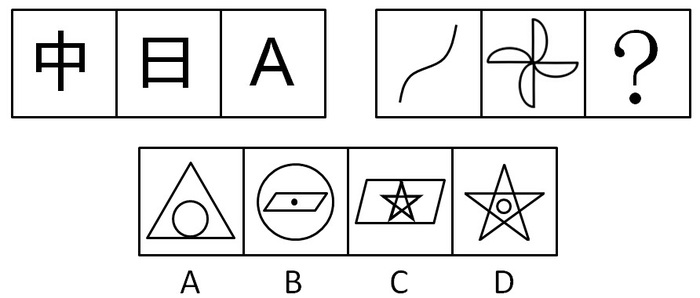

A. A

B. B

C. C

D. D

第 61 题 · 答案与解析

**参考答案（粉笔题库参考内容）**

B

**解析**

元素组成凌乱，考虑属性。

观察可发现，第一组图中的三个图形均为沿纵轴对称的轴对称图形，第二组图中的已知图形均为中心对称图形，依此规律，可知问号处也应为中心对称图形。四个选项中，只有B项为中心对称图形。

故正确答案为B。

**考点**：属性规律-对称性

**来源**：2011年安徽省公务员录用考试《行测》题第61题

### 第 62 题

从所给四个选项中，选择最合适的一个填入问号处，使之呈现一定的规律性：

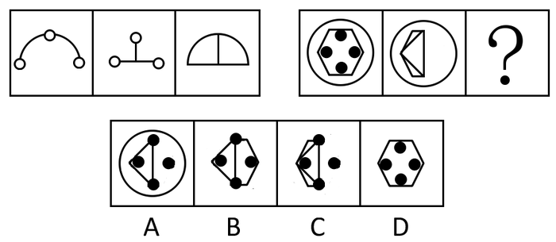

A. A

B. B

C. C

D. D

第 62 题 · 答案与解析

**参考答案（粉笔题库参考内容）**

B

**解析**

观察可发现，第一组图中，前两个图形叠加，去同存异得到第三个图形。依此规律，第二组图中的第三个图形，应该由前两个图形叠加后去同存异得到，四个选项中只有B项符合此规律。

故正确答案为B。

**考点**：样式规律-加减同异

**来源**：2011年安徽省公务员录用考试《行测》题第62题

### 第 63 题

从所给四个选项中，选择最合适的一个填入问号处，使之呈现一定的规律性：

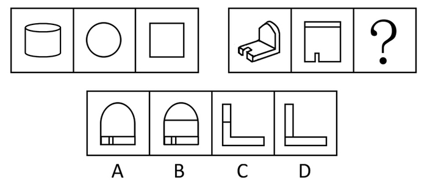

A. A

B. B

C. C

D. D

第 63 题 · 答案与解析

**参考答案（粉笔题库参考内容）**

A

**解析**

第一组图中，第二个图形为第一个图形的俯视图，第三个图形为第一个图形的主视图。第二组图中，第二个图形为第一个图形的俯视图，依此规律，第三个图形应该是第一个图形的主视图，A项的图形符合。

故正确答案为A。

**考点**：空间类-三视图

**来源**：2011年安徽省公务员录用考试《行测》题第63题

### 第 64 题

从所给四个选项中，选择最合适的一个填入问号处，使之呈现一定的规律性：

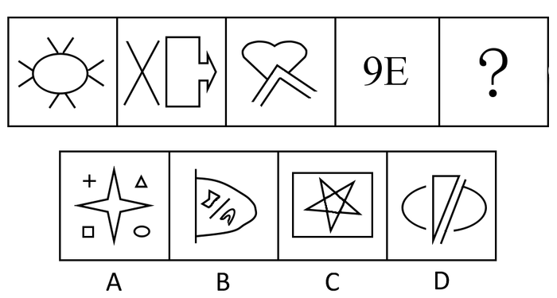

A. A

B. B

C. C

D. D

第 64 题 · 答案与解析

**参考答案（粉笔题库参考内容）**

D

**解析**

首先观察元素组成凌乱，不存在明显的属性特点。

再看已知图形中，每个图形均包含一个封闭区域。依此规律，未知图形也只包含一个封闭区域。四个选项中，A项的封闭区域有四个，B项有三个，C项有七个，D项有一个。

故正确答案为D。

**考点**：数量规律-面

**来源**：2011年安徽省公务员录用考试《行测》题第64题

### 第 65 题

从所给四个选项中，选择最合适的一个填入问号处，使之呈现一定的规律性：

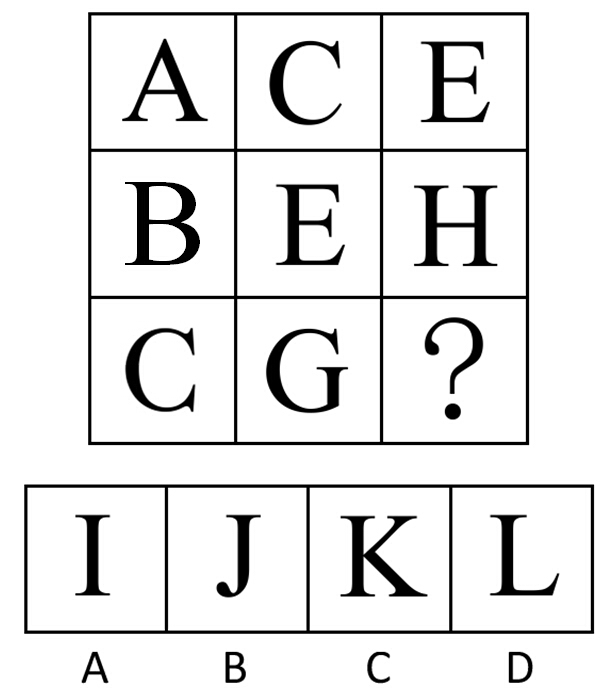

A. A

B. B

C. C

D. D

第 65 题 · 答案与解析

**参考答案（粉笔题库参考内容）**

C

**解析**

九宫图中，以行为单位，第一行中，字母A和C、C和E之间，分别隔了一个字母。第二行中，字母B和E、E和H之间，分别隔了两个字母。第三行中，C和G之间隔了三个字母，依此规律，问号处和G相隔三个字母，即为C项的“K”。

故正确答案为C。

**考点**：数量规律-素、文字/字母/数字类

**来源**：2011年安徽省公务员录用考试《行测》题第65题

### 第 66 题

从所给四个选项中，选择最合适的一个填入问号处，使之呈现一定的规律性：

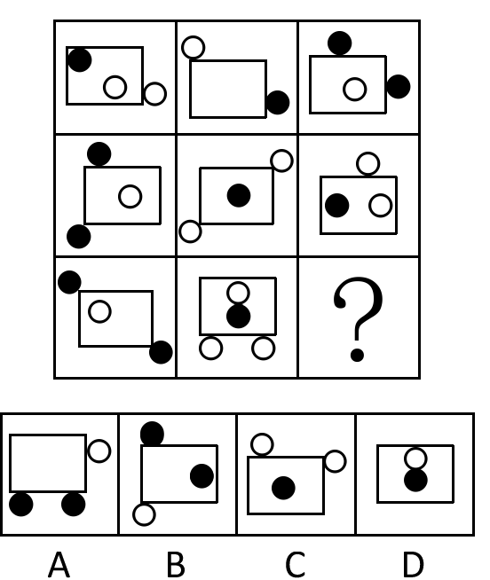

A. A

B. B

C. C

D. D

第 66 题 · 答案与解析

**参考答案（粉笔题库参考内容）**

C

**解析**

九宫图中，以行为单位，黑圆圈在第一行和第二行中均出现4次，个数不变；白圆圈在第一行中出现4次，在第二行中出现5次，个数递增。依此规律，第三行中的黑圆圈的总个数应为4个，白圆圈的总个数应为6个，C项的图形满足这一条件。

故正确答案为C。

**考点**：数量规律-素

**来源**：2011年安徽省公务员录用考试《行测》题第66题

### 第 67 题

从所给四个选项中，选择最合适的一个填入问号处，使之呈现一定的规律性：

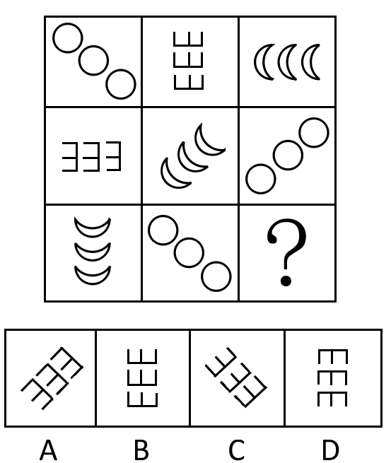

A. A

B. B

C. C

D. D

第 67 题 · 答案与解析

**参考答案（粉笔题库参考内容）**

D

**解析**

九宫格优先横行看，第一行中由三个圆圈组成的图形，在第二行中顺时针旋转了90度，在第三行中继续顺时针旋转了90度；第一行中，由三个月牙形组成的图形，在第二行中逆时针旋转了45度，在第三行中继续逆时针旋转了45度。

依此规律，第一行中由三个山字形组成的图案，在第二行中逆时针旋转了90度，在第三行中应该是继续逆时针旋转90度，只有D项符合。

故正确答案为D。

**考点**：位置规律-旋转

**来源**：2011年安徽省公务员录用考试《行测》题第67题

### 第 68 题

下列哪一个选项的图形可以由题干的线条组成：

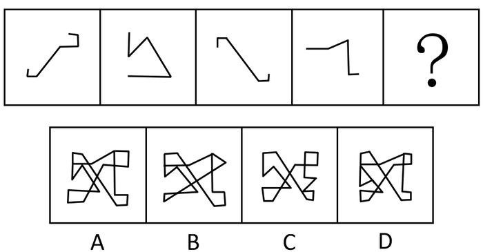

A. A

B. B

C. C

D. D

第 68 题 · 答案与解析

**参考答案（粉笔题库参考内容）**

A

**解析**

本题仅需将线条组合即可，在组合时，关键抓住已知图形中第二个图形和第四个图形锐角的位置。

故正确答案为A。

**来源**：2011年安徽省公务员录用考试《行测》题第68题

### 第 69 题

下图中1号位置上方放置了一个正方体，当前的上、右、前三个面分别标有字母A、B、C，且已知A、B、C三个面的对面分别标有字母D、E、F。图中标有序号的方格与正方体面上正方形大小相等。现将正方体沿图中方格按标注的数字序号顺序滚动，则滚动到第21格上方时，正方体朝上的一面上的字母为：

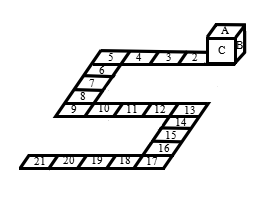

A. A

B. C

C. E

D. F

第 69 题 · 答案与解析

**参考答案（粉笔题库参考内容）**

A

**解析**

正方体从1到5正好滚动一圈，也就是说，在1、5、9、13、17、21这几个数字上，正方体的位置是一样的，所以到第21格上方时，正方体朝上的一面上的字母为“A”。

故正确答案为A。

**考点**：位置规律-翻转

**来源**：2011年安徽省公务员录用考试《行测》题第69题

### 第 70 题

剪纸是中国的民间艺术，剪纸方法很多，下图是一种剪纸方法的图示（先将纸折叠，然后再剪，展开即得到图案）,下面哪些图案不能用上述方法剪出：

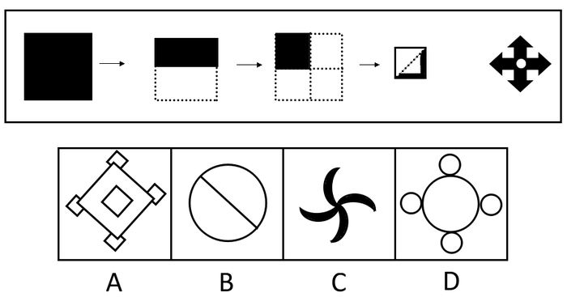

A. A

B. B

C. C

D. D

第 70 题 · 答案与解析

**参考答案（粉笔题库参考内容）**

C

**解析**

根据题干给出的剪纸方法，可知得到的图形至少具有两条相互垂直的对称轴。

A、B、D三项均包含至少两条相互垂直的对称轴，C项是中心对称图形，不含有相互垂直的对称轴。

本题为选非题，故正确答案为C。

**考点**：属性规律-对称性

**来源**：2011年安徽省公务员录用考试《行测》题第70题

### 第 71 题

某产品滞销或者是因为质量不好，或者是因为价格太高，或者是因为广告促销没有做好； 经分析该产品质量很好，那么：

A. 该产品滞销是因为价格太高

B. 该产品滞销是因为广告促销没有做好

C. 该产品滞销或者是因为价格太高，或者是因为广告促销没有做好

D. 该产品滞销或者既不是因为价格太高，也不是因为广告促销没有做好

第 71 题 · 答案与解析

**参考答案（粉笔题库参考内容）**

C

**解析**

题干中包含关联词“或者”，属关联词推导题型。

第一步：翻译题干。利用充分必要条件。

第一句：某产品滞销质量不好 或 价格太高 或 广告促销没有做好；

第二句：某产品：-质量不好。

第二步：通过选项可知需要判断该产品滞销可推出什么原因。

根据选言命题的推导规则，否定一个选言肯定其他选言，根据第二句“（-质量不好）”可推出“价格太高 或 广告促销没有做好”，即产品滞销或者是因为价格太高，或者是因为广告促销没有做好。

故正确答案为C。

**考点**：常规翻译

**来源**：2011年安徽省公务员录用考试《行测》题第71题

### 第 72 题

如果你的住房是2006年以后的新建楼房，那就带有外墙保温层。由此可推出：

A. 只有2006年以后新建的楼房才带有外墙保温层

B. 所有2006年以后新建的楼房都带有外墙保温层

C. 有些2006年以前新建的楼房也带有外墙保温层

D. 所有2006年以前新建的楼房都不带有外墙保温层

第 72 题 · 答案与解析

**参考答案（粉笔题库参考内容）**

B

**解析**

题干包含典型关联词，属关联词推导题型。

第一步：翻译题干。利用充分必要条件。

2006年以后的新建楼房带有外墙保温层。

第二步：逐一翻译选项并判断正确选项。利用逆否规则。

A项，带有外墙保温层2006年以后新建的楼房，“带有外墙保温层”属于肯后件，无法推出绝对表达的结论，推理无效；

B项，2006年以后新建的楼房带有外墙保温层，符合题干的推导关系；

C项，-2006年以后新建的楼房带有外墙保温层，犯了否前件推出肯后件的推导错误；

D项，-2006年以后新建的楼房带有外墙保温层，犯了否前件推出否后件的推导错误。

故正确答案为B。

**考点**：常规翻译

**来源**：2011年安徽省公务员录用考试《行测》题第72题

### 第 73 题

如果所有的鸟都会飞，并且企鹅是鸟，那么企鹅会飞。从这个前提出发，需要加上下列哪一项前提，才能逻辑地推出“有些鸟不会飞”的结论：

A. 有的鸟会飞，并且企鹅是鸟。

B. 企鹅不会飞，并且企鹅是鸟。

C. 企鹅不会飞，但所有的鸟会飞。

D. 企鹅不会飞，并且企鹅不是鸟。

第 73 题 · 答案与解析

**参考答案（粉笔题库参考内容）**

B

**解析**

第一步：翻译题干。

前提：所有的鸟都会飞∩企鹅是鸟企鹅会飞。

结论：有些鸟不会飞。

第二步：根据题干信息进行推导。

前提“所有的鸟都会飞∩企鹅是鸟企鹅会飞”是个假言命题，前件“所有的鸟都会飞∩企鹅是鸟”是一个联言命题，后件为“企鹅会飞”；结论“有些鸟不会飞”是对前提前件中支命题“所有鸟都会飞”的否定。

要否定前件中的一个支命题，首先要否定前件，根据逆否规则，否后件可以推出否前件，可知要否定“所有的鸟都会飞”，得先否定“企鹅会飞”，即保证“-企鹅会飞”。

 根据逆否规则，“-企鹅会飞（所有的鸟都会飞∩企鹅是鸟）”，根据摩根规则，“-（所有的鸟都会飞∩企鹅是鸟）”等价于“-所有的鸟都会飞∪-企鹅是鸟”，即“或者有些鸟不会飞，或者企鹅不是鸟”。“或者有些鸟不会飞，或者企鹅不是鸟”是选言命题，要得到有些鸟不会飞，即需要否定另一个支命题“企鹅不是鸟”，即保证“企鹅是鸟”。

综上分析，要得到“有些鸟不会飞”这一结论，需要添加的前提条件是“企鹅不会飞，并且企鹅是鸟”。

故正确答案为B。

**考点**：常规翻译

**来源**：2011年安徽省公务员录用考试《行测》题第73题

### 第 74 题

孩子感冒时，鼻子和嗓子里黏液是由感冒病毒引起产生的。而乳制品只是粘在了嗓子眼里，让人感到有点不舒服。当孩子感冒时，可以继续给他提供牛奶或其他乳制品。由此可见：

A. 食用乳制品可以减缓孩子感冒带来的不适

B. 孩子感冒时不能食用乳制品

C. 孩子感冒时的不适与食用乳制品无关

D. 食用乳制品会增加嗓子里黏液的产生

第 74 题 · 答案与解析

**参考答案（粉笔题库参考内容）**

C

**解析**

第一步：抓住题干主要信息。

第一句指出感冒时感冒病毒引起鼻子和嗓子产生黏液，第二句话说明乳制品只是粘在了嗓子眼，第三句说明孩子感冒仍可继续食用牛奶或其他乳制品。

第二步：分析题干信息，结合选项得出答案。

由题干信息可知，孩子感冒时的不舒服跟食用乳制品无关，即选项C。

A、D两项在题干中均未提及，题干只指出乳制品会粘在嗓子眼引起有些不舒服，没有说明能否减缓感冒带来的不适，也没有说明是否会增加嗓子里黏液的产生，属于无关选项；

B项与题干的第三句相反。

故正确答案为C。

注意：选项中 “感冒时的不适”是指由感冒引起的不适症状，区别于题干所提到的“乳制品粘在嗓子眼里，让人感到有点不舒服”。

**考点**：日常结论

**来源**：2011年安徽省公务员录用考试《行测》题第74题

### 第 75 题

甲乙丙三朋友去参观车展，看到一款轿车。甲说：“这不是‘奇瑞’，也不是‘荣威’。” 乙说：“这不是‘奇瑞’，而是‘红旗’。”丙说：“这不是‘红旗’，而是‘奇瑞’。”后来， 车展管理员说：“三人中，有一个人的两个判断都对；另一个人的两个判断都错；第三个人的两个判断一对一错。”由此可知：

A. 这辆轿车是奇瑞轿车

B. 这辆轿车是荣威轿车

C. 这辆轿车是红旗轿车

D. 上面三辆轿车都不是

第 75 题 · 答案与解析

**参考答案（粉笔题库参考内容）**

A

**解析**

第一步：翻译题干。

甲：-奇瑞 且 -荣威；乙：-奇瑞 且 红旗；丙：-红旗 且 奇瑞。

第二步：找关系。

乙和丙之间的矛盾关系，即要么丙的判断全对，乙的判断全错，要么丙的判断全错，乙的判断全对。

第三步：看其余。

结合第二步和车展管理员的话可知，两个判断一对一错的是甲。

假如甲的前半句是对的，则这辆车不是奇瑞，是荣威。验证乙、丙的判断，如果这辆车是荣威，则乙、丙的判断全错，不符合题意，因此甲的话应该是前半句是错的，后半句是对的，即这辆车是奇瑞，不是荣威。再验证乙、丙的真假。这辆车是奇瑞，乙的两个判断全错，丙的两个判断全对，符合题意。

故正确答案为A。

**考点**：框架题

**来源**：2011年安徽省公务员录用考试《行测》题第75题

### 第 76 题

一位博士生导师说：现在的博士生论文，语句越来越难读懂，本届学生交给我的博士生论文都写得很差，句子不通，还有不少错别字。

下列哪一个选项最能削弱这位大学博导的论证：

A. 上述论证没有证明博士生导师能够判断博士生的写作水平

B. 这位博导的学生水平是否能够代表所有博士生的水平尚需得到证实

C. 上文的论证并没有排除这位博士生导师不是一个好老师的可能性

D. 在上文论述中没有提供反面的论点

第 76 题 · 答案与解析

**参考答案（粉笔题库参考内容）**

B

**解析**

第一步：找出论点和论据。

论点：现在的博士生论文，语句越来越难读懂。

论据：本届学生交给我的博士生论文都写得很差，句子不通，还有不少错别字。

本题论点强调的是现在的博士生，论据强调的是本届给他论文的博士生，论点和论据强调的对象不同，削弱优先考虑拆桥，即在“本届给他论文的博士生”与“现在的博士生”之间断开联系。

第二步：逐一分析选项。

A项：该项指出没有证明博士生导师能够判断博士生的写作水平，但不代表该导师不能证明博士生论文的好坏，话题不一致，无法削弱，排除；

B项：该项指出这位博导的学生水平是否能够代表所有博士生的水平尚需得到证实，说明这位博导的学生水平不一定能代表所有博士生的水平，因此不能得出所有博士生论文的语句越来越难读懂的结论，拆断了论据和论点间的联系，为拆桥项，可以削弱，当选；

C项：该项讨论的是这位博导是否是好老师，与论点讨论的现在博士生论文的语句是否越来越难读懂的话题无关，无关选项，无法削弱，排除；

D项：该项指出上文论述未提供反面论点，但论证的成立与否，并不依赖于是否存在反面论点，无关选项，无法削弱，排除。

故正确答案为B。

**考点**：拆桥

**来源**：2011年安徽省公务员录用考试《行测》题第76题

### 第 77 题

某公司招聘总经理秘书，程蔷、朱莉、李萍、薛芳四人前去应聘。该公司规定的录用条件是：①有硕士研究生学历。②英语口语会话熟练。③有两年以上文秘工作经验。现在已知：

（1）程蔷和朱莉两人中有一人只上过本科

（2）朱莉和薛芳的最后学历相同

（3）李萍和薛芳英语会话能力相仿

（4）每个人至少符合一个条件，有三人符合条件①，二人符合条件②，一人符合条件 ③

经考核，四人中有一人符合要求被录用。这个人是：

A. 程蔷

B. 朱莉

C. 李萍

D. 薛芳

第 77 题 · 答案与解析

**参考答案（粉笔题库参考内容）**

B

**解析**

第一步：翻译题干。

录用条件：①有硕士研究生学历②英语口语会话熟练③有两年以上文秘工作经验。

第二步：找突破口。

本题突破口为信息量最大对象，即朱莉和薛芳。由（2）可知，朱莉和薛芳要么都符合条件①，要么都不符合，由于有三个人符合条件①，所以朱莉和薛芳只能是都符合条件①；再由（1）可知，程蔷不符合条件①。要被录用需满足三个条件，程蔷不符合条件①，可推出程蔷不可能被录用。

第三步：结合题干的其他信息继续推导。

由于只有一个人符合条件③，这个人不可能是已被排除的程蔷，又由于每个人至少符合一个条件，因此程蔷必须符合条件②。由（3）可知，李萍和薛芳要么都符合条件②，要么都不符合；由于只有两个人符合条件②，已知程蔷符合，因此李萍和薛芳均不符合，剩下朱莉符合条件。

第四步：整理推论，判断正确答案。

由上述推论可得出：

程蔷：（-①有硕士研究生学历）（②英语口语会话熟练）（-③有两年以上文秘工作经验）；

李萍：（①有硕士研究生学历）（-②英语口语会话熟练）（-③有两年以上文秘工作经验）；

薛芳：（①有硕士研究生学历）（-②英语口语会话熟练）（-③有两年以上文秘工作经验）；

由于程蔷、李萍、薛芳均有一项不符合录用条件，可知被录用的人为朱莉。

故正确答案为B。

**考点**：框架题

**来源**：2011年安徽省公务员录用考试《行测》题第77题

### 第 78 题

美国科学家泰勒几乎每天都有10个新想法，其中有9个半都是错的，但他并不在乎，仍然孜孜不倦的进行科学研究，“每天半个对的新想法”积累起来，使泰勒获得了巨大的成功，成为世界闻名的“氢弹之父”。因此：

A. 要创新就会犯错误

B. 新想法总会有90%是错的

C. 美国人并不在乎错误

D. 泰勒是个善于创新的人

第 78 题 · 答案与解析

**参考答案（粉笔题库参考内容）**

D

**解析**

第一步：抓住题干主要信息。

第一句强调泰勒新想法很多，第二句说明泰勒不在乎新想法错的多对的少，关键在于他坚持不断积累对的想法，第三句讲泰勒取得的成就。

第二步：分析题干信息，结合选项得出答案。

从题干信息可推知，泰勒是个想法很多的人，即选项D，泰勒是个善于创新的人。

A项的说法过于笼统，没有扣住题干信息；

B、C两项中新想法的错误率和美国人是否在乎犯错误，题干并未提及，无法推知。

故正确答案为D。

**考点**：日常结论

**来源**：2011年安徽省公务员录用考试《行测》题第78题

### 第 79 题

科学不是宗教，宗教都主张信仰，所以主张信仰都不科学。

下列最能说明上述推理不成立的是：

A. 犯罪行为都是违法行为，违法行为都应受到社会的谴责，所以应受到社会谴责的行为都是犯罪行为

B. 商品都有使用价值，阳光当然有使用价值，所以阳光当然是商品

C. 不刻苦学习的人都成不了业务骨干，小李是刻苦学习的人，所以小李能成为业务骨干

D. 中国人不是美国人，美国人都说英语，所以，说英语的都不是中国人

第 79 题 · 答案与解析

**参考答案（粉笔题库参考内容）**

D

**解析**

第一步：翻译题干。

科学宗教，宗教主张信仰，结论：主张信仰科学。

第二步：逐一翻译选项。

A项，犯罪行为违法行为，违法行为受到社会谴责，结论：受到社会谴责犯罪行为；

B项，商品使用价值，阳光使用价值，结论：阳光商品；

C项，-刻苦学习业务骨干，小李刻苦学习，结论：小李业务骨干；

D项，中国人美国人，美国人说英语，结论：说英语中国人。

将选项与题干对比格式可以看出，D项与题干的推理形式一致，最能说明题干推理不成立。

故正确答案为D。

**考点**：推理形式

**来源**：2011年安徽省公务员录用考试《行测》题第79题

### 第 80 题

光是一种电磁波。不能吸收光电磁波的物体，一般是透明的物体。半透明的物体只吸收光的一部分，也叫滤色体。不透明的物体能吸收光的全部，也叫黑体。透明的动物身体没有吸收可视光的能力，看不出色素来，其隐蔽性较强。隐形动物的秘密就在于它的身体是透明的，同时又是无色的。因此：

A. 有些隐形动物的身体是透明的，但可能是有色的

B. 不透明动物的身体能吸收可视光，有明显色彩，隐蔽性差

C. 透明的能吸收光电磁波的物体可被称为白体

D. 红色的金鱼属滤色体

第 80 题 · 答案与解析

**参考答案（粉笔题库参考内容）**

B

**解析**

第一步：抓住题干主要信息。

题干分别说明透明物体、半透明物体、不透明物体吸收光的能力。第二句，透明的物体不能吸收光；第三句，半透明的物体也叫滤色体，只吸收光的一部分；第四句，不透明的物体也叫黑体，吸收光的全部；第五句，透明的动物身体不能吸收光，所以看不出色素，隐蔽性强；第六句，隐形动物的身体是透明的，又是无色的。

第二步：分析题干信息，结合选项得出答案。

题干从“透明的物体不能吸收光”推出“透明的动物身体不能吸收光”，得出“透明的动物看不出色素，隐蔽性强”；同理，根据第四句话，可知半透明的动物身体能吸收光的一部分，能显示出色彩，隐蔽性不强，B项正确。

A项，与题意相悖，题干已说明，隐形动物是无色的；

C项，题干没有提及白体，无法推知；

D项，半透明的物体为滤色体，但红色的金鱼是否为半透明的物体，题干没有提及，故无法推出。

故正确答案为B。

**考点**：日常结论

**来源**：2011年安徽省公务员录用考试《行测》题第80题

### 第 81 题

血液中脂肪蛋白含量的增多，会增加人体阻止吸收过多的胆固醇的能力，从而降低血液中的胆固醇。有些人通过有规律的体育锻炼和减肥，能明显地增加血液中高浓度脂肪蛋白的含量。

由此可知：

A. 体育锻炼和减肥是降低血液中高胆固醇的最有效的办法

B. 有些人通过有规律的体育锻炼和减肥来降低血液中的胆固醇

C. 标准体重的人只需要通过有规律的体育锻炼就能降低血液中的胆固醇

D. 不经常进行体育锻炼的人，特别是胖子，随着年龄的增大，血液中出现胆固醇的风险越来越大

第 81 题 · 答案与解析

**参考答案（粉笔题库参考内容）**

B

**解析**

第一步：翻译题干。

脂肪蛋白含量增多降低血液中的胆固醇。

规律的体育锻炼和减肥脂肪蛋白含量增多。

将以上两个推导关系连起来即为：规律的体育锻炼和减肥降低血液中的胆固醇

第二步：逐一判断选项。

A项的“最有效”题干未提及；

B项为正确选项；

C项“标准体重”在文中未提及；

D项的年龄和胖子文中未提及。

故正确答案为B。

**考点**：日常结论

**来源**：2011年安徽省公务员录用考试《行测》题第81题

### 第 82 题

语言在人类的交流中起重要的作用。如果一种语言是完全有效的，那么，其基本语言的每一种可能的组合都能够表达有独立意义和可以理解的词。但是，如果人类的听觉系统接收声音信号的功能有问题，那么，并非基本语言每一种可能的组合都能够成为有独立意义和可以理解的词。可见：

A. 如果人类的听觉系统接收声音信号的功能正常，那么一种语言的基本语言的每一种可能的组合都能够成为有独立意义和可以理解的词。

B. 语言的有效性导致了人类交流的实用性。

C. 如果基本语言每一种可能的组合都能够成为有独立意义和可以理解的词，则该语言完全有效。

D. 如果人类的听觉系统接收声音信号的功能有问题，那么语言就不可能完全有效。

第 82 题 · 答案与解析

**参考答案（粉笔题库参考内容）**

D

**解析**

第一步：翻译题干。利用充分必要条件。

第二句：语言是完全有效的基本语言的每一种可能的组合都能够表达有独立意义和可以理解的词。

第三句：人类的听觉系统接收声音信号的功能有问题基本语言的每一种可能的组合都能够表达有独立意义和可以理解的词。

根据逆否规则，从第二句可推出第三句：

\-基本语言的每一种可能的组合都能够表达有独立意义和可以理解的词语言是完全有效的。

根据充分必要条件命题的传递规则，从第二句和第三句可推知：

人类的听觉系统接收声音信号的功能有问题语言是完全有效的。

第二步：逐一翻译选项。

A项，-人类的听觉系统接收声音信号的功能有问题基本语言的每一种可能的组合都能够表达有独立意义和可以理解的词，这是对第三句话前半部分的否定，无法推出绝对表达的结论；

B项，题干没有谈及交流的实用性，属于无关选项；

C项，基本语言的每一种可能的组合都能够表达有独立意义和可以理解的词语言是完全有效的，这是对第一句话后半部分的肯定，无法推出绝对表达的结论；

D项符合题干的推导关系。

故正确答案为D。

**考点**：常规翻译

**来源**：2011年安徽省公务员录用考试《行测》题第82题

### 第 83 题

在市场经济里，供求状况是不断变化的。大企业往往可以通过大规模生产获取大量利润，但也可能因为供求错位一时无法立即作出反应而造成重大损失。而小型企业虽说利润不算很高，却能灵活适应市场变化，及时转产。因此：

A. 在市场经济中小企业要比大企业好得多

B. 大规模的经营组织方式不可取

C. 不能简单否定小型经营模式

D. 搞小企业是小打小闹，浪费精力

第 83 题 · 答案与解析

**参考答案（粉笔题库参考内容）**

C

**解析**

第一步：抓住题干主要信息。

第二句，大企业可获取大利润，但也可能出现重大损失；第三句，小企业利润不算高，但能灵活适应市场。

第二步：分析题干信息，结合选项得出答案。

题干说明大、小企业各自的优缺点。题干提到小企业能够灵活适应市场变化，及时转产，这是对小企业经营模式的肯定，因此C项表述正确，D项错误。

题干只分析大、小企业两者的区别，没有说明哪个更好，A项无法推出；B项，题干没有说明经营模式的可取性问题，B项无法推出；A、B均属于无关选项。

故正确答案为C。

**考点**：日常结论

**来源**：2011年安徽省公务员录用考试《行测》题第83题

### 第 84 题

西欧在建立文明社会时打破了原有的氏族关系，建立以区域为中心的政治关系。中国与西欧不同，它在建立文明社会时没有打破原有的氏族关系，相反却以氏族关系为依据，以血缘关系为纽带建立起国家制度。这样的国家是以家族的宗法关系为主干，所以：

A. 在中国文明里，家为国的本位，国是家的放大

B. 西欧的文明不重视血缘亲情关系

C. 西欧的文明比中国的文明先进

D. 以氏族为基础更容易建立文明社会制度，所以中国的文明更悠久

第 84 题 · 答案与解析

**参考答案（粉笔题库参考内容）**

A

**解析**

第一步：抓住题干主要信息。

题干分析中国和西欧在建立政治关系方面的区别。

第一句说明西欧在建立文明社会时建立以区域为中心的政治关系；

第二句讲中国在建立文明社会时以氏族关系为依据，以血缘关系为纽带建立起国家制度；

第三句分析以氏族关系为依据，以血缘关系为纽带建立起国家制度的国家，以家族的宗法关系为主干。

第二步：分析题干信息，结合选项得出答案。

由题干可知，中国以家族的宗法关系为主干，因此家是国的本位，国是家的放大，即选项A正确。

B项中，题干没有说明西欧文明是否重视血缘亲情关系，无法推出；

C项中，题干没有对比西欧文明和中国文明哪个更先进，无法推出；

D项中，题干只提到中国在建立文明社会时是以氏族关系为依据的，并没有说明以氏族为基础是否更容易建立文明制度。

故正确答案为A。

**考点**：日常结论

**来源**：2011年安徽省公务员录用考试《行测》题第84题

### 第 85 题

改革户籍制度已经成为某市当前社会改革的重要内容之一，其要点就是放宽对外来人口的限制。但决策者却面临两难，一方面他们懂得吸引外来人口对加快该市城市化进程有着重要意义，另一方面又担心人口激增会带来许多压力。因此在决策班子里形成了“开放”和“保守”两种意见。

下列各项如果是真的，都只能支持上述某种意见，除了：

A. “二元化”的户籍制度，已经严重不适应目前社会经济发展需求

B. 由于计划生育政策和生育观念的转变，该市近年来幼儿园和中小学数量递减

C. 该市现有的交通、教育等基础条件和服务设施，不能满足其城市人口扩容的需要

D. 据该市公安部门统计，近年来该市犯罪案件增加，案犯中来自流动人口的比例提高

第 85 题 · 答案与解析

**参考答案（粉笔题库参考内容）**

B

**解析**

第一步：找出论点。

论点：“开放”意见是改革会吸引外来人口对加快城市化进程有重要意义，“保守”意见是改革会导致人口激增，带来压力。

第二步：弄清题意。

从提问句可知，四个选项中，除了一个，其他三个都能支持上述两种意见中的其中一个。

第三步：逐一判断选项。

A项“二元化”的户籍制度不适应目前的发展需求，说明要改革户籍制度以加快发展，支持“开放”意见；

B项谈的是学校建设，跟外来人口无关，属于无关选项；

C项说明该市不能再增加人口，支持“保守”意见；

D项说明流动人口带来治安治理方面的压力，支持“保守”意见。

本题为选非题，故正确答案为B。

**考点**：加强选非题

**来源**：2011年安徽省公务员录用考试《行测》题第85题

### 第 86 题

2010年11月16日，联合国教科文组织将中国申报的《中医针灸》和（  ）列入人类非物质文化遗产代表作名录。

A. 徽剧

B. 粤剧

C. 京剧

D. 越剧

第 86 题 · 答案与解析

**参考答案（粉笔题库参考内容）**

C

**解析**

2010年11月16日，联合国科教文组织保护非物质文化遗产政府间委员会第五次会议在肯尼亚首都内罗毕举行，会议审议并通过将中国申请的项目《中医针灸》和京剧列为人类非物质文化遗产代表作品名录。

故正确答案为C。

**本题相关知识点：**

徽剧、粤剧和越剧都在2006年6月被列入第一批国家级非物质文化遗产名录，其中粤剧在2009年入选联合国科教文组织“人类非物质文化遗产代表作名录”。

**考点**：文化常识

**来源**：2011年安徽省公务员录用考试《行测》题第86题

### 第 87 题

2010年12月10日至12日召开的中央经济工作会议指出，2011年国家宏观经济政策的基本取向是实施积极的财政政策和（    ）的货币政策。

A. 宽松

B. 稳健

C. 从紧

D. 适度宽松

第 87 题 · 答案与解析

**参考答案（粉笔题库参考内容）**

B

**解析**

2010年12月10日至12日，中央经济工作会议在北京举行。会议明确提出， 2011年宏观经济政策的基本取向要“积极稳健、审慎灵活”。“积极”是要继续发展经济，“稳健”是要控制通胀，二者分别对应两大政策：积极的财政政策和稳健的货币政策。

故正确答案为B。

**考点**：宏观经济与调控政策

**来源**：2011年安徽省公务员录用考试《行测》题第87题

### 第 88 题

在当代中国，坚持发展是硬道理的本质要求，就是（   ）。

A. 坚持科学发展

B. 坚持以经济建设为中心

C. 坚持改革开放

D. 坚持为人民利益谋发展

第 88 题 · 答案与解析

**参考答案（粉笔题库参考内容）**

A

**解析**

党的十七届五中全会（2010年）强调，在当代中国，坚持发展是硬道理的本质要求，就是坚持科学发展，更加注重以人为本，更加注重全面协调可持续发展，更加注重统筹兼顾，更加注重保障和改善民生，促进社会公平正义。

故正确答案为 A。

**来源**：2011年安徽省公务员录用考试《行测》题第88题

### 第 89 题

2011年“两会”期间，许多网民利用网络交流形式向温家宝总理提出了许多好的意见和建议，促进了决策的科学化和民主化。这种“民意直达高层直通车”的沟通方式主要体现了：

A. 社会听证制度

B. 社情民意反映制度

C. 专家咨询制度

D. 重大事项社会公示制度

第 89 题 · 答案与解析

**参考答案（粉笔题库参考内容）**

B

**解析**

深入了解民情，充分反映民意，是决策成功的关键。党的十六大报告指出，“各级决策机关都要完善重大决策的规则和程序，建立社情民意反映制度，建立与群众利益密切相关的重大事项社会公示制度和社会听证制度，完善专家咨询制度，实行决策的论证制和责任制，防止决策的随意性。”

本题中，2011年“两会”期间，温家宝总理与网民在网络上互动，有利于深入了解民情，让决策更民主化和科学化，所以这种“民意直达高层直通车”的沟通方式主要体现了社情民意反映制度。

故正确答案为B。

**来源**：2011年安徽省公务员录用考试《行测》题第89题

### 第 90 题

2010年7月，国家发改委下发《关于开展低碳省区和低碳城市试点工作的通知》。我国坚持走低碳之路，主要体现了科学发展观的：

A. 核心

B. 第一要义

C. 根本方法

D. 基本要求

第 90 题 · 答案与解析

**参考答案（粉笔题库参考内容）**

D

**解析**

胡锦涛在党的十七大报告上提出，“科学发展观第一要义是发展，核心是以人为本，基本要求是全面协调可持续性，根本方法是统筹兼顾。”坚持走低碳之路，本质是坚持全面可持续发展，主要体现了科学发展观的基本要求。

故正确答案为D。

**来源**：2011年安徽省公务员录用考试《行测》题第90题

### 第 91 题

“抓住了民情、民意、民生、民力，就抓住了行政根本。”这里“行政根本”主要指：

A. 政府的行政职能

B. 政府的依法行政水平

C. 政府的为民宗旨

D. 政府的行政执行能力

第 91 题 · 答案与解析

**参考答案（粉笔题库参考内容）**

C

**解析**

这道题比较简单，“民情、民意、民生、民力”全都是围绕人民，体现的就是政府执政的为民宗旨。

故正确答案为C。

**来源**：2011年安徽省公务员录用考试《行测》题第91题

### 第 92 题

下列机构（简称）不属于我国民主党派的是：

A. 侨联

B. 民革

C. 台盟

D. 民盟

第 92 题 · 答案与解析

**参考答案（粉笔题库参考内容）**

A

**解析**

民主党派是指在中国大陆范围内，除执政党中国共产党以外的八个参政党的统称。它们是：中国国民党革命委员会（民革）、中国民主同盟（民盟）、中国民主建国会、中国民主促进会、中国农工民主党、中国致公党、九三学社、台湾民主自治同盟（台盟）。

中国侨联是由全国归侨、侨眷组成的全国性人民团体，前身是延安侨联和全国侨联筹委会。

本题为选非题，故正确答案为A。

**考点**：政治建设

**来源**：2011年安徽省公务员录用考试《行测》题第92题

### 第 93 题

社会主义市场经济理论认为，计划经济和市场经济属于不同的：

A. 经济制度范畴

B. 资源配置方式

C. 生产关系范畴

D. 经济增长方式

第 93 题 · 答案与解析

**参考答案（粉笔题库参考内容）**

B

**解析**

市场经济是根据市场价值规律，通过市场机制或价格机制来实现配置资源，生产什么、生产多少和如何生产完全由企业按照自己的经营目标决定；而计划经济属于指令型经济，按照行政权力的意志来配置资源，由中央政府决定生产什么、生产多少和如何生产。考量一个社会的经济体制是属于计划经济还是市场经济，主要看其资源配置方式。

故正确答案为B。

**本题相关知识点：**

资源配置是指将包括物质资源和人力资源在内的经济资源按比例地分配在各种产品和劳务的生产上，以满足人们各种不同的需要。优化的资源配置要达到两个目的，资源配置的合理性和资源利用的充分性。

**考点**：市场经济

**来源**：2011年安徽省公务员录用考试《行测》题第93题

### 第 94 题

当前，物价上涨较快，通胀预期增强，这个问题涉及民生，关系全局，影响稳定。解决这一问题，政府可以采取的措施是：

A. 减少各种税收

B. 扩大银行贷款规模

C. 增加货币发行量

D. 提高银行存贷款利率

第 94 题 · 答案与解析

**参考答案（粉笔题库参考内容）**

D

**解析**

物价上涨较快，通胀预期增强，说明需要政府采取措施管理好通胀预期，防止经济出现大的波动。管理好通胀预期，抑制通货膨胀，关键在于减少货币的流动性，政府可以采取的具体措施包括：控制货币供应量；调节和控制社会总需求；增加商品有效供给，调整经济结构；紧缩货币政策包括调整利率等；增加供给调节需求；优化产业结构等等。

A、B、C三项错误，减税、扩大银行贷款规模、增加货币发行量都会导致市场流通的货币增加，不利于抑制通货膨胀。

故正确答案为D。

**本题相关知识点：**

通货膨胀和通货紧缩是常识判断的常考点。考生在备考过程中要弄懂这两者的区别，了解防范通货膨胀和通货紧缩该采取的措施。

在纸币流通条件下，因货币供给大于货币实际需求，也即现实购买力大于产出供给，导致货币贬值，而引起的一段时间内物价持续而普遍地上涨，这种现象属于通货膨胀。

市场上流通货币减少，人民的货币所得减少，购买力下降，引起物价下跌，这种情况属于通货紧缩。解决通货紧缩，可采取宽松的货币政策和财政政策，对产业进行结构性调整等措施。

**考点**：宏观经济与调控政策

**来源**：2011年安徽省公务员录用考试《行测》题第94题

### 第 95 题

2011年3月11日，日本发生核泄漏事故。我国国民为了防止核辐射扩散对健康有可能带来的不利影响，于是争相抢购碘盐、碘片等预防性物品，个别商店趁机哄抬物价。这 一事实说明市场调节具有：

A. 自发性

B. 滞后性

C. 盲目性

D. 竞争性

第 95 题 · 答案与解析

**参考答案（粉笔题库参考内容）**

A

**解析**

此题为争议题。题目中有两个市场主体，消费者对核辐射过分恐惧而哄抢货物，属于盲目性；个别商店借机哄抬物价，追求不正当利益，属于自发性。题干强调的是个别商店借机哄抬物价这一事实，因此粉笔倾向选择自发性。

故正确答案为A。

**考点**：微观经济

**来源**：2011年安徽省公务员录用考试《行测》题第95题

### 第 96 题

从交易对象的属性及它们在社会再生产过程中的作用划分，我们可以把市场划分为商品市场和生产要素市场。下列不属于生产要素市场的是：

A. 消费品市场

B. 金融市场

C. 劳动力市场

D. 技术市场

第 96 题 · 答案与解析

**参考答案（粉笔题库参考内容）**

A

**解析**

生产要素市场是在生产经营活动中利用的各种经济资源的统称，一般包括土地、劳动力、资本、技术和信息等。市场经济要求生产要素商品化，以商品的形式在市场上通过市场交易实现流动和配置，从而形成各种生产要素市场。依据不同的生产要素，生产要素市场可分为资金市场、劳动力市场、房地产市场、技术市场、信息市场、产权市场等。消费品市场属于商品市场，非生产要素市场。

本题为选非题，故正确答案为A。

**考点**：市场经济

**来源**：2011年安徽省公务员录用考试《行测》题第96题

### 第 97 题

某日，甲某在街上闲逛时，发现一辆摩托车停在路边，车主乙某正在和别人聊天，甲某 趁乙某不注意骑上摩托车就跑，后被警察抓住。甲某触犯的罪名是：

A. 抢劫罪

B. 盗窃罪

C. 抢夺罪

D. 交通肇事罪

第 97 题 · 答案与解析

**参考答案（粉笔题库参考内容）**

C

**解析**

本题为争议题。

A项错误，抢劫罪是以非法占有为目的，以暴力、胁迫或者其他方法，强行劫取公私财物的行为。暴力方法指的是对财物的所有人、占有人、管理人不法行使有形力，使被害人不能反抗的行为；胁迫的方法一般是指以当场使用暴力相威胁，使被害人产生恐惧心理因而不能反抗的行为，其他方法指的是除暴力、胁迫以外的造成被害人不能反抗的强制方法，最典型的是采用药物、酒精等使被害人暂时丧失自由意志，然后劫取财物，本题明显不是抢劫罪。

D项错误，交通肇事罪是指违反交通运输管理法规，因而发生重大交通事故，致人重伤、死亡或者使公私财物遭受重大损失的行为，本题显然也不属于交通肇事罪。

争议主要集中在B项和C项之间。

按照传统刑法理论，盗窃罪是“秘密窃取”公私财物，抢夺罪是“公然夺取”他人财物，两罪区分的关键在于一个“秘密”，一个“公然”。在传统刑法理论的视野下，本案成立抢夺罪。

但是按照最新观点，盗窃罪既包括秘密窃取也包括公开盗窃，即以和平的方式破坏主人对于财物的占有，建立自己对于财物的占有支配的行为；抢夺行为主要表现为对物暴力，进而取得财物的过程。两罪区分的关键是有无“对物暴力”。本题题干并不明确，如果人和车之间并没有直接接触，那么根据最新的刑法相关理论来讲“骑上就跑”不属于对物的暴力，宜认定为“盗窃罪”，因此本题存在争议。

因本题出现时间较早（2011年），题干不严谨，且作为常识考查的内容一般依据传统理论，因此粉笔题库给出倾向性答案为C。

**考点**：刑法

**来源**：2011年安徽省公务员录用考试《行测》题第97题

### 第 98 题

下列基本制度中主要目的在于保障行政公正原则的是：

A. 回避制度

B. 表明身份制度

C. 简易程序制度

D. 时效制度

第 98 题 · 答案与解析

**参考答案（粉笔题库参考内容）**

A

**解析**

行政公正原则指行政主体及其工作人员办事公道，不徇私情，平等对待不同身份、民族、性别和不同宗教信仰的行政相对人。行政公正原则的基本精神是公平、合理地对待行政相对人和处理行政管理事项。

A项正确，回避制度是指行政机关在行政执法过程中，如相应事项与本人有利害关系或者其他关系，或者行政机关被认为有成见或者偏见，可能影响公正处理的，应主动回避或应当事人的申请回避，不得参与该事项的处理制度；

B项错误，表明身份制度是行政执法人员在开展民政行政执法行为活动过程中，应当及时向行政相对人出示行政执法证件、表明自身身份及有权从事该项活动的行为；

C项错误，简易程序，又称当场处罚程序，是相对普通程序而言的程序，其主要针对违法事实清楚、证据确凿、情节简单、因果关系明确的违反行政管理的行为，其主要特点在于“当场决定并当场处罚”；

D项错误，时效制度也称期间制度，是指行政行为的全过程或其各个阶段应受到法定时间限制的制度。

从四个选项的定义看，B、C、D 三项跟保障行政公正原则无关。

故正确答案为A。

**来源**：2011年安徽省公务员录用考试《行测》题第98题

### 第 99 题

下列选项中不属于民商法调整的社会关系是：

A. 甲、乙两公司之间发生的买卖合同纠纷

B. 王某与其弟弟之间因继承发生的纠纷

C. 何某与其所供职的公司之间发生的知识产权纠纷

D. 李某与某派出所因罚款数额产生的纠纷

第 99 题 · 答案与解析

**参考答案（粉笔题库参考内容）**

D

**解析**

民商法调整的是平等主体之间的财产关系和人身关系，包括民法和商法。民法主要包括物权法、债权法、人身权法、侵权法、知识产权法、婚姻家庭法、继承法等；商法（包括商主体法和商行为法）主要包括公司法、企业法、保险法、票据法、破产法、海商法、商业银行法、证券法等。

A、B、C三项错误，这三项的主体地位均是平等的，涉及的都是财产关系，属于民商法调整的社会关系；

D 项正确，某派出所属于行政机关，李某和派出所之间的纠纷属于行政纠纷，由行政法调整。

故正确答案为D。

**考点**：民法典

**来源**：2011年安徽省公务员录用考试《行测》题第99题

### 第 100 题

某日，刘某因给朋友过生日而喝醉了。在意识不清的情况下，刘某用刀捅死了前来劝阻其闹事的饭店服务员。下列关于刘某行为的判断正确的是：

A. 刘某是在意识不清情况下实施的杀人行为，因而不构成犯罪

B. 刘某应负刑事责任，但应从轻或减轻处罚

C. 刘某酗酒后杀人，应当从重处罚

D. 刘某的行为构成故意杀人罪

第 100 题 · 答案与解析

**参考答案（粉笔题库参考内容）**

D

**解析**

我国《刑法》第十八条规定：“醉酒的人犯罪，应当负刑事责任。”酒后犯罪和正常人犯罪一样对待。醉酒的行为，并不是故意杀人罪的法定从重或者从轻情节。另外，犯罪行为的免除事由也不包括醉酒。

故正确答案为D。

**考点**：刑法

**来源**：2011年安徽省公务员录用考试《行测》题第100题

### 第 101 题

行政决策过程中最核心、最关键的一步是：

A. 发现问题，确定目标

B. 调查预测，拟定方案

C. 评估优选，确定方案

D. 实施方案，修正完善

第 101 题 · 答案与解析

**参考答案（粉笔题库参考内容）**

C

**解析**

行政决策过程可大致分为五个步骤：分析问题，确定目标；调查预测，拟定方案；评估优选，确定方案；实施方案，修正完善；评估决策。这个过程中，最核心、最关键的一步是采用先进的决策技术和方法，按照科学决策的原则和程序进行决策，即评估优选，确定方案。

故正确答案为C。

**来源**：2011年安徽省公务员录用考试《行测》题第101题

### 第 102 题

1911年，中国爆发了一场革命，它推翻了中国两千多年封建君主专制，使民主共和国的观念从此深入人心。这场革命是：

A. 戊戌变法

B. 太平天国革命

C. 辛亥革命

D. 新民主主义革命

第 102 题 · 答案与解析

**参考答案（粉笔题库参考内容）**

C

**解析**

爆发于1911年的辛亥革命结束了中国长达两千年之久的君主专制制度，是一次伟大的革命运动。辛亥革命是近代中国比较完全意义上的资产阶级民主革命。它在政治上、思想上给中国人民带来了不可低估的解放作用。革命使民主共和的观念深入人心。

故正确答案为C。

**本题相关知识点：**

戊戌变法指1898年（农历戊戌年）以康有为为首的改良主义者通过光绪皇帝所进行的资产阶级政治改革，是中国清朝光绪年间（1898年）的一项政治改革运动。戊戌变法也叫百日维新，代表人物是康有为和梁启超。

太平天国运动是19世纪中叶中国的一场大规模反清运动。洪秀全、杨秀清、萧朝贵、冯云山、韦昌辉、石达开组成的领导集团在广西金田村发动对满清朝廷的武力对抗，后建国号“太平天囯”，并于1853年攻下金陵，号称天京（今南京），定都于此。1864年，太平天国首都天京陷落，标志着运动失败。

中国的新民主主义革命是从1919年五四运动开始的，在此之前的近代以来的资产阶级民主革命为中国的旧民主主义革命。新民主主义革命是无产阶级领导的，以反对帝国主义、封建主义、官僚资本主义为主的人民民主革命。区别新旧民主主义革命的最根本标志是领导权掌握在谁的手中。

**考点**：中国历史

**来源**：2011年安徽省公务员录用考试《行测》题第102题

### 第 103 题

下列哪次会议把毛泽东思想确立为党的指导思想：

A. 中共七大

B. 遵义会议

C. 中共八大

D. 瓦窑堡会议

第 103 题 · 答案与解析

**参考答案（粉笔题库参考内容）**

A

**解析**

中共七大于1945年4月23日至6月11日在延安举行。大会通过了毛泽东《论联合政府》的政治报告，并确立毛泽东思想为党的指导思想，将毛泽东思想写入党章。

故正确答案为A。

**本题相关知识点：**

遵义会议是指1935年1月15日至17日，中共中央政治局在贵州遵义召开的独立自主地解决中国革命问题的一次极其重要的扩大会议。遵义会议事实上确定了毛泽东的领导地位。

中共八大于1956年9月15日至27日在北京举行，大会通过了第二个五年计划的建议和新党章，确定把党的工作重点转向社会主义建设。

瓦窑堡会议是中国共产党于1935年12月17日至25日在陕北瓦窑堡召开的政治局扩大会议。该会议批判了党内长期存在着的“左”倾关门主义，制定了抗日民族统一战线的策略方针。

**来源**：2011年安徽省公务员录用考试《行测》题第103题

### 第 104 题

安徽省人民政府2011年《政府工作报告》提出了今年经济社会发展的主要目标，其中，全省生产总值增长：

A. 7%以上

B. 8%以上

C. 9%以上

D. 10%以上

第 104 题 · 答案与解析

**参考答案（粉笔题库参考内容）**

D

**解析**

安徽省人民政府在2011年的《政府工作报告》中指出：“2011年是‘十二五’第一年，面临的宏观环境总体有利，发展前景看好，但国际国内形势依然复杂多变，保持经济平稳较快发展、调整经济结构、管理通胀预期的任务十分艰巨。我们要充分把握发展机遇，妥善应对各种挑战，加快经济发展方式转变，进一步巩固扩大经济回升向好态势。综合考虑，今年经济社会发展的主要目标是：全省生产总值增长10%以上，财政收入增长12%，社会消费品零售总额增长18%，固定资产投资增长20%，城乡居民收入增长10%以上，居民消费价格涨幅控制在4%左右······”

故正确答案为D。

**考点**：宏观经济与调控政策

**来源**：2011年安徽省公务员录用考试《行测》题第104题

### 第 105 题

近年来，安徽省自主创新战略平台建设取得突破性进展，一批企业的自主创新能力大幅提升，其中，＿＿＿＿＿＿成为自主创新的一面旗帜。

A. 合肥江汽

B. 马鞍山华菱重卡

C. 芜湖奇瑞

D. 铜陵铜基新材料

第 105 题 · 答案与解析

**参考答案（粉笔题库参考内容）**

C

**解析**

通过自主创新，芜湖奇瑞公司实现从发动机、自动变速箱和整车的完全自主设计，具备每年投放市场8款到10款车型能力，节能环保型产品研发更是走在业界前列，成为自主创新的一面旗帜。

故正确答案为C。

**考点**：市场经济

**来源**：2011年安徽省公务员录用考试《行测》题第105题

### 第 106 题

孔子是我国古代伟大的思想家和教育家，儒家学派创始人，世界最著名的文化名人之一。下列不是孔子名言的是：

A. 温故而知新，可以为师矣

B. 三人行，必有我师焉

C. 小不忍则乱大谋

D. 上善若水，水善利万物而不争

第 106 题 · 答案与解析

**参考答案（粉笔题库参考内容）**

D

**解析**

A、B、C三项错误，均出自《论语》；

D项正确，“上善若水，水善利万物而不争”出自《老子》，意思是，最高境界的善行就像水的品性一样，泽被万物而不争名利。

故正确答案为D。

**考点**：文学常识

**来源**：2011年安徽省公务员录用考试《行测》题第106题

### 第 107 题

汉字产生的标志是殷商后期所形成的初步定型的甲骨文，其后经过了六千多年的演变，形成了我们今天的文字。下列汉字演变过程的时间排列顺序正确的是：

A. 隶书 小篆 楷书 行书

B. 小篆 隶书 行书 楷书

C. 隶书 小篆 行书 楷书

D. 小篆 隶书 楷书 行书

第 107 题 · 答案与解析

**参考答案（粉笔题库参考内容）**

D

**解析**

汉字的演变过程，按照汉字演变的顺序，大体上可分为：甲骨文，金文，大篆，小篆，隶书，楷书，行书。

故正确答案为D。

**考点**：文化常识

**来源**：2011年安徽省公务员录用考试《行测》题第107题

### 第 108 题

在我国交通标志中，蓝底白色自行车图案表示：

A. 禁止非机动车通行

B. 准许非机动车通行

C. 非机动车通道

D. 自行车停放区域

第 108 题 · 答案与解析

**参考答案（粉笔题库参考内容）**

B

**解析**

蓝底白色自行车图案表示准许非机动车通行。注意，蓝底白色自行车图案还有形状之分。圆形标志表示非机动车行驶，此标志设在道路的起点及交叉口入口前适当位置；方形标志设在该车道的起点及交叉路口和入口前适当位置，表示该车道只供非机动车行驶。

C项错误，非机动车通道只提到一种情形，故不能入选。

故正确答案为B。

**本题相关知识点：**

交通标志主要可分为警告标志、禁令标志、指示标志、指路标志、旅游区标志、作业区标志、告示标志七种。交通标志的底色主要有黄色、蓝色、绿色、棕色几种：

黄色表示警告，用于警告标志的底色；

蓝色表示指令、遵循，用于指示标志的底色，也表示地名、路线、方向等的行车信息，用于一般道路指路标志的底色；

绿色表示地名、路线、方向等的行车信息，用于高速公路和城市快速路指路标志的底色；

棕色表示旅游区及景点项目的指示，用于旅游区标志的底色；

白色用于标志的底色、文字和图形符号以及部分标志的边框。

**考点**：生活常识

**来源**：2011年安徽省公务员录用考试《行测》题第108题

### 第 109 题

现在，世界通用的阿拉伯数字的发明者是：

A. 古阿拉伯人

B. 古埃及人

C. 古希腊人

D. 古印度人

第 109 题 · 答案与解析

**参考答案（粉笔题库参考内容）**

D

**解析**

现今国际通用的阿拉伯数字实际上最初是由印度人发明的，后由阿拉伯人传向欧洲，之后再经欧洲人将其现代化。阿拉伯人的传播，成为该种数字最终被国际通用的关键节点，所以人们称其为“阿拉伯数字”。也正是因为这种称法，后人多误以为阿拉伯数字是阿拉伯人发明的。

故正确答案为D。

**考点**：文化常识

**来源**：2011年安徽省公务员录用考试《行测》题第109题

### 第 110 题

我们经常收看中央电视台的“天气预报”节目，气象预报员所说的“今天晚上”指的是：

A. 20时到明早6时

B. 20时到24时

C. 20时到明早8时

D. 18时到明早6时

第 110 题 · 答案与解析

**参考答案（粉笔题库参考内容）**

C

**解析**

“天气预报”节目中，气象预报员所说的 “今天夜间”指 20:00 到次日早上 8:00 这 12 个小时，“明天白天到夜间”则是指明天上午 8:00 到明天晚上 20:00 这 12 个小时。

故正确答案为C。

**考点**：生活常识

**来源**：2011年安徽省公务员录用考试《行测》题第110题

### 第 111 题

通过微生物发酵方法将有机物质转换而产生的气体燃料是：

A. 氢气

B. 沼气

C. 液化气

D. 天然气

第 111 题 · 答案与解析

**参考答案（粉笔题库参考内容）**

B

**解析**

沼气，顾名思义就是沼泽里的气体。它是各种有机物质，在隔绝空气（还原条件），并在适宜的温度、湿度下，经过微生物的发酵作用产生的一种可燃烧气体。

故正确答案为B。

**本题相关知识点：**

氢气是世界上已知的最轻的气体，无色无味。氢气的密度非常小，只有空气的，所以氢气可作为飞艇的填充气体（由于氢气具有可燃性，安全性不高，飞艇现多用氦气填充）。灌好的氢气球，往往过一夜，第二天就飞不起来了。这是因为氢气能钻过橡胶上人眼看不见的小细孔，溜之大吉。

液化石油气是炼油厂在进行原油催化裂解与热裂解时所得到的副产品。液化气为无色气体或黄棕色油状液体，有特殊臭味，用作石油化工的原料， 也可用作燃料。

天然气是一种多组分的混合气态化石燃料，主要成分是烷烃，其中甲烷占绝大多数。它主要存在于油田和天然气田，也有少量出于煤层。天然气为无色无味的气体，但在送到最终用户之前，还要用硫醇来给天然气添加气味，以助于泄漏检测。

**考点**：化学常识

**来源**：2011年安徽省公务员录用考试《行测》题第111题

### 第 112 题

下列关于地震自救表述不正确的是：

A. 为防止次生灾害的发生，首先要切断电源、气源

B. 应疏散到屋外平地、小胡同、陡山坡及河岸边

C. 在家中可选择床下、桌子底下就地避险

D. 在单元楼内，可选择开间小的卫生间、厨房、储藏室及墙角躲避

第 112 题 · 答案与解析

**参考答案（粉笔题库参考内容）**

B

**解析**

本题考查地震自救的相关知识。

A项，地震发生时，电线、煤气管道可能受地震影响而发生短路、泄漏等危险，从而引起火灾。为防止次生灾害的发生，应切断电源、气源。该项正确。

B项，地震发生时，高大建筑物的玻璃碎片和大楼外侧混凝土碎块等可能掉下伤人，窄小胡同中堆放的物品倒塌也极易发生危险，陡山坡与河岸边在地震时容易发生山体滑坡、河堤崩塌，从而发生危险。该项错误。

地震来临，无法离开屋内时，应该尽可能地藏在小范围的空间内，由于空间小的卫生间、厨房、储藏室及墙角不易坍塌，可以躲在床下、桌子下以及卫生间或厨房这种开间小的房屋。C、D项正确。

本题为选非题，故正确答案为B。

**考点**：生活常识

**来源**：2011年安徽省公务员录用考试《行测》题第112题

### 第 113 题

由于风的磨蚀作用，一些小山包的下部往往遭受较强的剥蚀作用，并逐渐形成向里凹的形态。如果小山包上部的岩层比较松散，在重力作用下就容易垮塌形成陡壁，形成一种独特的地貌形态。我们称之为：

A. 丹霞地貌

B. 雅丹地貌

C. 喀斯特地貌

D. 张家界地貌

第 113 题 · 答案与解析

**参考答案（粉笔题库参考内容）**

B

**解析**

B项正确，由风蚀作用导致小山包上部岩层松散、易垮塌、形成陡壁的地貌属于雅丹地貌；

A项，丹霞地貌是由于地壳变动形成；C项，喀斯特地貌是由水流侵蚀造成；D项，张家界地貌是砂岩地貌的一种，以流水侵蚀、重力崩塌、风化等形成。

“雅丹”在维吾尔语中的意思是“具有陡壁的小山包”。

故正确答案为B。

**考点**：其他

**来源**：2011年安徽省公务员录用考试《行测》题第113题

### 第 114 题

黄金分割又称黄金律，是指事物各部分间一定的数学比例关系，被公认为最具有审美意义的比例数字，是最能引起人的美感的比例，因此被称为黄金分割。那么这个黄金分割点是多少：

A. 0.598

B. 0.618

C. 0.689

D. 1.618

第 114 题 · 答案与解析

**参考答案（粉笔题库参考内容）**

B

**解析**

黄金分割又称黄金律，是指事物各部分间一定的数学比例关系，即将整体一分为二，较大部分与较小部分之比等于整体与较大部分之比，其比值为1∶0.618或1.618∶1，即长段为全段的0.618。0.618被公认为是最具有审美意义的比例数字。上述比例是最能引起人的美感的比例，因此被称为黄金分割。

故正确答案为B。

**本题相关知识点：**

在生活中，“黄金分割”有着很多的应用。对人体解剖很有研究的意大利画家达·芬奇发现，人的肚脐位于身长的0.618处。画家们发现，按0.618∶1来设计腿长与身高的比例，画出的人体身材最优美。科学家们还发现，当外界环境温度为人体温度的0.618倍时，人会感到最舒服。

**考点**：生活常识

**来源**：2011年安徽省公务员录用考试《行测》题第114题

### 第 115 题

下列关于日食和月食的判断，正确的是：

A. 日、月食的成因只与日、地、月三个天体的几何位置有关

B. 日食与月食都是自然现象，所以它们是不可能准确预报的

C. 当月相是朔的时候就一定会发生日食

D. 如果日食带在我国经过，肯定是东部的居民先看到

第 115 题 · 答案与解析

**参考答案（粉笔题库参考内容）**

A

**解析**

A项正确，日食是由于月球对太阳光的遮挡形成的，月食是由于地球对太阳光的遮挡形成的，故日、月食的成因只与日、地、月三个天体的几何位置有关。

B项错误，日食与月食的发生时间可根据地、月运行规律准确推算得出，是可以准确预报的。

C项错误，日食发生需满足两个条件：①日食总是发生在朔日（农历初一，此时月球处于日、地之间，月球阴暗的一面对着地球）；②太阳和月球都移到白道和黄道的交点附近。月球运行的轨道（白道）和太阳运行的轨道（黄道）并不在一个平面上，白道平面和黄道平面有59'的夹角，只有当太阳和月球都移到白道和黄道的交点附近时才会发生日食。因此，不是所有朔日必定发生日食。

D项错误，由于月亮自西向东运动，月影也是自西向东移动，因此总是西部地区比东部先看到日食。

故正确答案为A。

**考点**：自然地理

**来源**：2011年安徽省公务员录用考试《行测》题第115题

## 材料 2

进入新世纪以来，我国经济总量在世界的位次不断提升。1978年，我国GDP只有1482亿美元，居世界第十位。经过30多年的快速发展，2010年我国GDP达到58791亿美元，超过日本成为世界第二大经济体，仅次于美国。

        主要农产品产量位居世界前列。2010年，我国粮食产量达到54641万吨，比1978年增长79.3%。棉花产量597万吨，增长1.8倍。油料产量3239万吨，增长5.2倍。近年来，我国谷物、肉类、籽棉、花生、茶叶、水果等农产品产量稳居世界第一位。

        制造业大国地位初步确立。按照国际标准工业分类，2007年，在22个制造业大类中，我国在7个大类中名列第一，有15个大类名列前三。美国经济咨询公司环球通视数据表明，2009年我国制造业产出占世界的18.6%，比美国稍低1.3个百分点，位居世界第二。到目前为止，我国钢、煤、水泥、棉布等200多种工业品产量居世界第一位。

        货物出口额跃居世界第一。1978年，我国货物进出口总额占世界贸易总额的比重不到1%，居世界第二十九位。2009年，我国货物出口额超过德国居世界第一位，货物进口额居世界第二位。2010年，我国货物进出口总额达到29728亿美元，创历史新高。

### 第 116 题

2010年，我国人均GDP大约为：

A. 1000多美元

B. 2000多美元

C. 3000多美元

D. 4000多美元

第 116 题 · 答案与解析

**参考答案（粉笔题库参考内容）**

D

**解析**

据材料可知，2010年我国GDP为58791亿美元，人口大约为13亿，则人均GDP为58791÷13，用直除法，首位为4，只有D符合。

故正确答案为D。

**考点**：文字资料、现期平均数

**来源**：2011年安徽省公务员录用考试《行测》题第116题

### 第 117 题

1978年我国粮食产量大约为：

A. 11310万吨

B. 30475万吨

C. 43330万吨

D. 68904万吨

第 117 题 · 答案与解析

**参考答案（粉笔题库参考内容）**

B

**解析**

2010年我国粮食产量达到54641万吨，比1978年增长79.3%，则1978年粮食产量为万吨，与B项最接近。

故正确答案为B。

**考点**：基期计算、文字资料

**来源**：2011年安徽省公务员录用考试《行测》题第117题

### 第 118 题

2010年的油料产量约比1978年增加了：

A. 2597万吨

B. 2645万吨

C. 2718万吨

D. 2809万吨

第 118 题 · 答案与解析

**参考答案（粉笔题库参考内容）**

C

**解析**

2010年油料产量3239万吨，比1978年增长5.2倍，则1978年油料产量为万吨，则2010年油料产量比1978年增加了3239－530＝2709万吨，与C项最接近。

故正确答案为C。

**考点**：增长量计算、文字资料

**来源**：2011年安徽省公务员录用考试《行测》题第118题

### 第 119 题

2009年美国和中国制造业产出之和共占世界的：

A. 38.5%

B. 19.9%

C. 17.3%

D. 35.9%

第 119 题 · 答案与解析

**参考答案（粉笔题库参考内容）**

A

**解析**

2009年我国制造业产出占世界的18.6%，比美国稍低1.3个百分点，则中国和美国制造业产出之和占世界的百分比大于18.6%×2＝37.2%，只有A符合条件。

故正确答案为A。

**考点**：文字资料、简单加减计算

**来源**：2011年安徽省公务员录用考试《行测》题第119题

### 第 120 题

根据上述资料，可以推出的是：

A. 2009年，我国货物进出口总额肯定居世界第一位

B. 2009年，我国货物进出口总额在世界的位次比1978年至少上升了27位

C. 2007年，在22个制造业大类中我国至少在8个大类中名列第三

D. 中国是世界上粮食出口量最多的国家

第 120 题 · 答案与解析

**参考答案（粉笔题库参考内容）**

B

**解析**

A选项错误，2009年，我国货物出口额超过德国居世界第一位，货物进口额居世界第二位，则我国货物进出口总额可能居世界第一位或第二位；

B选项正确，1978年，我国货物进出口总额居世界第二十九位，2009年居世界第一位或第二位，则 2009年我国货物进出口总额在世界的位次比1978年至少上升了27位；

C选项无法推出，2007年，在22个制造业大类中，我国在7个大类中名列第一，有15个大类名列前三，因此只能判断出在8个大类中名列第二或第三，而不是第三；

D选项无法推出，材料中并未提到我国粮食出口的排名。

故正确答案为B。

**考点**：文字资料、综合分析

**来源**：2011年安徽省公务员录用考试《行测》题第120题

## 材料 3

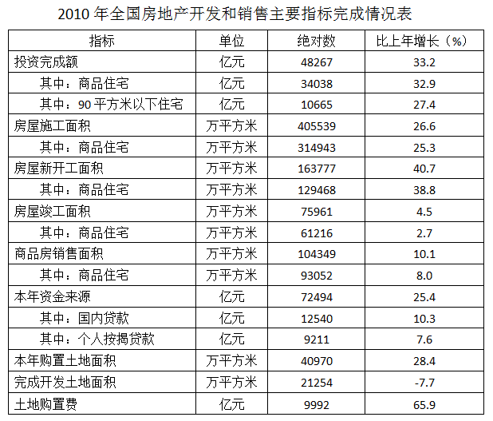

### 第 121 题

2010年全国非商品住宅投资完成额约占房地产投资完成额的：

A. 41.8%

B. 29.48%

C. 58.20%

D. 70.52%

第 121 题 · 答案与解析

**参考答案（粉笔题库参考内容）**

B

**解析**

2010年全国房地产投资完成额为48267亿元，商品住宅投资完成额34038亿元，则商品住宅投资完成额占房地产投资完成额的，则非商品住宅投资完成额约占房地产投资完成额的30%，与B项最接近。

故正确答案为B。

**考点**：现期比重、统计表

**来源**：2011年安徽省公务员录用考试《行测》题第121题

### 第 122 题

2010年全国房地产开发资金来源中，个人按揭贷款约占：

A. 12.71%

B. 17.30%

C. 87.29%

D. 82.70%

第 122 题 · 答案与解析

**参考答案（粉笔题库参考内容）**

A

**解析**

2010年全国房地产开发资金来源共72494亿元，个人按揭贷款9211亿元，则个人按揭贷款约占总资金来源的，与A项最接近。

故正确答案为A。

**考点**：现期比重、统计表

**来源**：2011年安徽省公务员录用考试《行测》题第122题

### 第 123 题

2010年全国房地产业完成开发土地面积比上年下降了7.7%，原因可能是：

A. 本年房地产投资额减少了

B. 本年购置土地面积下降了

C. 本年房屋新开工面积减少了

D. 政府对房地产业的宏观调控

第 123 题 · 答案与解析

**参考答案（粉笔题库参考内容）**

D

**解析**

从表格中可以发现，本年房地产投资额、购置土地面积、房屋新开工面积比上年都有上升，因此原因只可能是来自于政府对房地产业的宏观调控。

故正确答案为D。

**考点**：统计表、综合分析

**来源**：2011年安徽省公务员录用考试《行测》题第123题

### 第 124 题

2010年用于房地产开发的土地购置价格全国平均为：

A. 3438元/平方米

B. 1578元/平方米

C. 2439元/平方米

D. 4420元/平方米

第 124 题 · 答案与解析

**参考答案（粉笔题库参考内容）**

C

**解析**

2010年房地产开发土地购置费共9992亿元，购置土地面积40970万平方米，因此平均价格为99920000÷40970元/平方米，用直除法，首位为2。

故正确答案为C。

**考点**：现期平均数、统计表

**来源**：2011年安徽省公务员录用考试《行测》题第124题

### 第 125 题

根据以上资料，不能推出的是：

A. 2010年我国房地产开发中，商品住宅开发占的份额最大

B. 2010年我国房地产开发投资增长较快，但房屋竣工面积增长较慢

C. 与房屋施工面积相比较，2010年我国房屋新开工面积的增幅较大

D. 2010年用于房地产开发的单位面积土地购置价格肯定比上年下降了

第 125 题 · 答案与解析

**参考答案（粉笔题库参考内容）**

D

**解析**

A项正确，根据121题，2010年商品住宅开发所占比重为70%，显然所占份额最大；

B项正确，从表中可以看出2010年我国房地产开发投资增长33.2%，房屋竣工面积增长4.5%；

C项正确，从表中可以看出2010年我国房屋施工面积增幅26.6%，房屋新开工面积增幅40.7%；

D项错误，从表中可以看出2010年土地购置费比上年增长65.9%，全年购置土地面积增长28.4%，单位面积购置价格必然比上年上升。

本题为选非题，故正确答案为D。

**考点**：统计表、综合分析

**来源**：2011年安徽省公务员录用考试《行测》题第125题

## 材料 4

“十一五”期间，我国城镇就业人员增长持续快于全国就业人员增长，城镇就业人员占全国就业人员总量的比重从2005年的36.0%上升到2009年的39.9%。

       “十一五”期间，我国第一产业就业人员由2005年的33970万人，减少到2009年的29708万人，年均减少1066万人；第二产业就业人员从2005年的18084万人，增加到2009年的21684万人，年均增加900万人；第三产业就业人员从2005年的23771万人，增加到2009年的26603万人，年均增加708万人。我国三次产业就业人员的比重由2005年的44.8:23.8:31.4,转变为2009年的38.1:27.8:34.1，如下图所示。

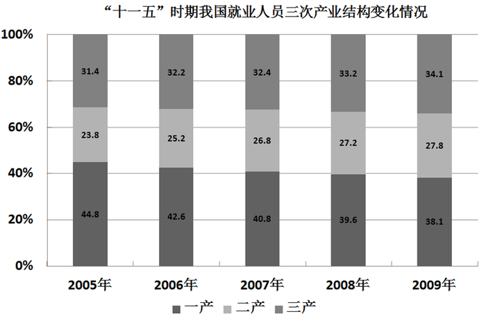

       2009年末，有限责任公司、股份有限公司以及外商和港澳台商投资企业等其他经济组织就业人员5088万人，比2005年增加1394万人，年均增加349万人；2009年，非公经济中，城镇私营个体经济组织就业人员为9789万人，比2005年增加了3553万人，年均增加888万人。“十一五”时期的前四年，城镇非公有制经济组织共吸纳就业4947万人，年均增加超过1200万人。

### 第 126 题

2009年我国就业人员总量大约为：

A. 75825万人

B. 77995万人

C. 79789万人

D. 75088万人

第 126 题 · 答案与解析

**参考答案（粉笔题库参考内容）**

B

**解析**

2009年我国第一、二、三产业就业人员分别为29708万人、21684万人、26603万人。因此2009年我国就业人员总量为29708＋21684＋26603，尾数为5，排除C、D选项，29708+21684+26603>29000+21000+26000=76000。

故正确答案为B。

**考点**：简单加减计算、综合资料

**来源**：2011年安徽省公务员录用考试《行测》题第126题

### 第 127 题

2009年农村就业人员占全国就业人员的总量比重比2005年下降：

A. 3.9个百分点

B. 4.5个百分点

C. 5.3个百分点

D. 6.2个百分点

第 127 题 · 答案与解析

**参考答案（粉笔题库参考内容）**

A

**解析**

城镇就业人员占全国就业人员总量的比重从2005年的36.0%上升到2009年的39.9%，上升了3.9个百分点，则农村就业人员所占比重下降了3.9个百分点。

故正确答案为A。

**考点**：简单加减计算、综合资料

**来源**：2011年安徽省公务员录用考试《行测》题第127题

### 第 128 题

“十一五”期间，我国就业人员三次产业结构变动的趋势是：

A. 第一产业就业比重上升，第三产业就业比重下降

B. 第二产业就业比重上升，第三产业就业比重下降

C. 第一、三产业就业比重下降，第二产业就业比重上升

D. 第一产业就业比重下降，第二、三产业就业比重上升

第 128 题 · 答案与解析

**参考答案（粉笔题库参考内容）**

D

**解析**

通过观察条形图可以发现，第一产业就业比重下降，第二、三产业就业比重上升。

故正确答案为D。

**考点**：直接找数、综合资料

**来源**：2011年安徽省公务员录用考试《行测》题第128题

### 第 129 题

资料表明，“十一五”期间我国：

A. 公司类经济组织就业人员超过城镇私营个体经济组织就业人员

B. 城市就业人员高于农村就业人员

C. 2005年，城镇私营个体经济组织就业人员大约为3553万人

D. 非公有制经济组织就业人员大幅增加

第 129 题 · 答案与解析

**参考答案（粉笔题库参考内容）**

D

**解析**

A选项错误，2009年末，有限责任公司、股份有限公司以及外商和港澳台商投资企业等其他经济组织就业人员5088万人，城镇私营个体经济组织就业人员为9789万人，公司类经济组织就业人员低于城镇私营个体经济组织就业人员；

B选项错误，“十一五”期间，我国城镇就业人员占全国就业人员总量的比重从2005年的36.0%上升到2009年的39.9%，低于50%，故城市就业人员低于农村就业人员；

C选项错误，2009年城镇私营个体经济组织就业人员为9789万人，比2005年增加了3553万人，所以2005年城镇私营个体经济组织就业人员为9789-3553=6263万人；

D选项正确，“十一五”时期的前四年，城镇非公有制经济组织共吸纳就业4947万人，年均增加超过1200万人，故非公有制经济组织就业人员大幅增加。

故正确答案为D。

**考点**：综合分析、综合资料

**来源**：2011年安徽省公务员录用考试《行测》题第129题

### 第 130 题

根据资料，可以推出，“十一五”期间我国：

A. 就业人员总量不断下降，就业结构趋于恶化

B. 就业人员总量稳定增加，就业结构得到改善

C. 就业人员总量不断下降，就业结构得到改善

D. 就业人员总量稳定增加，就业结构趋于恶化

第 130 题 · 答案与解析

**参考答案（粉笔题库参考内容）**

B

**解析**

从2005年到2009年，就业人数总体呈增加趋势，且三大产业就业人员比重差距缩小，说明就业结构有所改善。

故正确答案为B。

**考点**：综合分析、综合资料

**来源**：2011年安徽省公务员录用考试《行测》题第130题

