# 2012年安徽省公务员录用考试《行测》题

<!-- gwy:overview:start -->
> **安徽 · 2012 · 行测 · 统考** ｜ 130 题 · 图片 15 处 · 答案随题折叠

| 题型模块 | 题量 | 题号 |
| --- | ---: | ---: |
| 常识判断 | 30 | 1–30 |
| 言语理解与表达 | 25 | 31–55 |
| 数量关系 | 15 | 56–70 |
| 判断推理 | 45 | 71–115 |
| 资料分析 | 15 | 116–130 |
| **合计** | **130** | |

导航：[题型与作答说明](#题型与作答说明) · [题目](#题目) · [材料 1](#材料-1)
<!-- gwy:overview:end -->

> 候选采集稿。参考答案及解析来自粉笔页面，不代表官方答案或真实高分答卷；来源使用许可与原卷对应关系仍需人工核实。

## 题型与作答说明

常识判断

（30题）

要求你依据常识做出判断。请注意，似乎合理的答案有多个，请选择你认为最恰当的一个。

言语理解与表达

（25题）

请根据题目要求，在四个选项中选出一个最恰当的答案。

数量关系

（15题）

在这部分试题中，每道题呈现一段表述数字关系的文字，要求你迅速、准确地计算出答案。

判断推理

（45题）

本部分包括图形推理、定义判断、类比推理与逻辑判断四种类型的试题。

资料分析

（15题）

所给出的图、表、文字或综合性资料均有若干个问题要你回答，你应该根据资料提供的信息进行分析、比较、计算和判断推理。

## 题目

### 第 1 题

2011年12月12日召开的中共经济工作会议提出，2012年我国经济工作总基调是：

A. 进中求稳

B. 稳中求进

C. 又快又好

D. 又好又快

第 1 题 · 答案与解析

**参考答案（粉笔题库参考内容）**

B

**解析**

2011年经济工作会议强调，2012年要突出把握好稳中求进的工作总基调。“稳”是前进的基础，体现在“四个保持”上：保持宏观经济政策基本稳定，保持经济平稳较快发展，保持物价总水平基本稳定，保持社会大局稳定。“进”是发展的方向，就是要继续抓住和用好战略机遇期，在转变发展方式上取得新进展，在深化改革开放上取得新突破，在改善民生上取得新成效。

故正确答案为B。

**考点**：宏观经济与调控政策

**来源**：2012年安徽省公务员录用考试《行测》题第1题

### 第 2 题

根据我国“十二五”发展规划，到2015年，单位国内生产总值二氧化碳排放量要降低17%。实现这一目标，最主要是：

A. 发展低碳经济

B. 转变经济发展方式

C. 改善生态环境

D. 保持经济快速发展

第 2 题 · 答案与解析

**参考答案（粉笔题库参考内容）**

B

**解析**

本题考查时事政治。

2012年1月13日，国务院印发《“十二五”控制温室气体排放工作方案》。主要目标是：大幅度降低单位国内生产总值二氧化碳排放，到2015年全国单位国内生产总值二氧化碳排放比2010年下降17%。总体要求是：坚持以科学发展为主题，以加快转变经济发展方式为主线，牢固树立绿色、低碳发展理念，统筹国际国内两个大局，把积极应对气候变化作为经济社会发展的重大战略，作为加快转变经济发展方式、调整经济结构和推进新的产业革命的重大机遇，坚持走新型工业化道路。

故正确答案为B。

**考点**：时事政治-其他

**来源**：2012年安徽省公务员录用考试《行测》题第2题

### 第 3 题

安徽省第九次党代会提出，要在“十二五”期间努力把安徽省打造成“三个强省”，下列不属于“三个强省”的是：

A. 工业强省

B. 经济强省

C. 文化强省

D. 生态强省

第 3 题 · 答案与解析

**参考答案（粉笔题库参考内容）**

A

**解析**

中共安徽省第九次党代会二十六日在合肥开幕，安徽省委书记张宝顺在作报告时表示，安徽未来五年将努力打造「三个强省」，即加速崛起的经济强省、充满活力的文化强省、宜居宜业的生态强省，加快建设美好安徽。

本题为选非题，故正确答案为A。

**来源**：2012年安徽省公务员录用考试《行测》题第3题

### 第 4 题

社会主义和谐社会的核心价值是：

A. 以民为本

B. 社会稳定

C. 诚实守信

D. 公平正义

第 4 题 · 答案与解析

**参考答案（粉笔题库参考内容）**

D

**解析**

社会和谐是中国特色社会主义的本质属性，是国家富强、民族振兴、人民幸福的重要保证。公平正义是和谐社会的核心价值取向，因为公平正义是社会主义本质的根本要求，是维护社会稳定的前提条件，是坚持以人为本的重要表现。

故正确答案为D。

**来源**：2012年安徽省公务员录用考试《行测》题第4题

### 第 5 题

从长期看，经济增长的最主要推动力量是：

A. 资本积累

B. 储蓄力量提高

C. 技术进步

D. 人口

第 5 题 · 答案与解析

**参考答案（粉笔题库参考内容）**

C

**解析**

“人口红利”是指一个国家的劳动年龄人口占总人口比重较大，抚养率比较低，为经济发展创造了有利的人口条件，整个国家的经济呈高储蓄、高投资和高增长的局面。科学技术是第一生产力。科学技术在当代生产力发展中起着决定性作用，技术进步已成为推动经济增长的首要因素。

故正确答案为C。

**考点**：市场经济

**来源**：2012年安徽省公务员录用考试《行测》题第5题

### 第 6 题

当前，我国扩大内需主要应着力扩大：

A. 消费需求

B. 投资需求

C. 政府采购需求

D. 出口需求

第 6 题 · 答案与解析

**参考答案（粉笔题库参考内容）**

A

**解析**

中央明确提出要扩大内需，这方面既要扩大投资内需，也要强调扩大消费内需。当前中国消费内需的不足是经济结构中比较薄弱的环节。亚洲金融危机之后，我国消费占GDP之比逐渐由60％回落到40％左右，远远低于国外水平。同时，消费结构正呈现出家庭消费比重偏低而公共消费比重过高，物质型的消费较多而服务型的消费较少等特点。

故正确答案为A。

**考点**：宏观经济与调控政策

**来源**：2012年安徽省公务员录用考试《行测》题第6题

### 第 7 题

用来衡量一个国家或地区居民收入差距的指标是：

A. 消费者价格指数

B. 恩格尔系数

C. 基尼系数

D. GDP折算系数

第 7 题 · 答案与解析

**参考答案（粉笔题库参考内容）**

C

**解析**

基尼系数，或译坚尼系数，是20世纪初意大利经济学家基尼，根据劳伦茨曲线所定义的判断收入分配公平程度的指标。是比例数值，在0和1之间，是国际上用来综合考察居民内部收入分配差异状况的一个重要分析指标。

故正确答案为C。

**本题相关知识点:**

恩格尔系数(Engel's Coefficient)是食品支出总额占个人消费支出总额的比重。19世纪德国统计学家恩格尔根据统计资料，对消费结构的变化得出一个规律：一个家庭收入越少，家庭收入中（或总支出中）用来购买食物的支出所占的比例就越大，随着家庭收入的增加，家庭收入中（或总支出中）用来购买食物的支出比例则会下降。

消费者价格指数（CPI,Consumer Price Index）是世界各国普遍编制的一种指数，它可以用于分析市场价格的基本动态，是政府制定物价政策和工资政策的重要依据。

**考点**：市场经济

**来源**：2012年安徽省公务员录用考试《行测》题第7题

### 第 8 题

某公司占据家具制造业70%的市场份额，下列行为不属于滥用市场支配地位的是：

A. 以不公平的高价销售沙发

B. 没有正当理由，以低于成本的价格销售衣橱

C. 没有正当理由，在销售写字台时搭售电脑桌

D. 与第二大家具制造商协商协定提高实木家具价格

第 8 题 · 答案与解析

**参考答案（粉笔题库参考内容）**

D

**解析**

根据《反垄断法》第17条第一项、第二项和第五项的规定：“禁止具有市场支配地位的经营者从事下列滥用市场支配地位的行为：以不公平的高价销售商品或者不公平的低价购买商品；没有正当理由，以低于成本的价格销售商品；没有正当理由搭售商品，或者在交易时附加其他不合理的交易条件。”所以只有选项D不属于滥用市场支配地位的行为。

本题为选非题，故正确答案为D。

**考点**：劳动法和经济法

**来源**：2012年安徽省公务员录用考试《行测》题第8题

### 第 9 题

下列哪项不属于公务员所享受的权利：

A. 公务员非经所在地人大许可不受公安机关逮捕

B. 非因法定事由、法定程序不被免职、降职、辞退或处分

C. 小李因个人原因向所在单位申请辞职

D. 小王不满上级给予的处分，提出申诉和控告

第 9 题 · 答案与解析

**参考答案（粉笔题库参考内容）**

A

**解析**

根据《公务员法》第十五条的规定：“公务员享有下列权利：（一）获得履行职责应当具有的工作条件；（二）非因法定事由、非经法定程序，不被免职、降职、辞退或者处分；（三）获得工资报酬，享受福利、保险待遇；（四）参加培训；（五）对机关工作和领导人员提出批评和建议；（六）提出申诉和控告；（七）申请辞职；（八）法律规定的其他权利。”

本题为选非题，故正确答案为A。

**考点**：行政法

**来源**：2012年安徽省公务员录用考试《行测》题第9题

### 第 10 题

关于未成年人保护法，下列说法正确的是：

A. 未成年人是指未满二十周岁的公民

B. 十四周岁以上不满十六周岁的未成年人犯罪的案件不可公开审理

C. 该法是义务教育法的制定依据

D. 该法由全国人大政协会议通过并颁布

第 10 题 · 答案与解析

**参考答案（粉笔题库参考内容）**

B

**解析**

A、D选项错误，根据《未成年人保护法》第2条规定：本法所称未成年人是指未满十八周岁的公民。此法在1991年9月4日第七届全国人民代表大会常务委员会第二十一次会议通过。

B选项正确，根据《刑事诉讼法》第274条规定：审判的时候被告人不满十八周岁的案件，不公开审理。

C选项错误，义务教育法制定的依据是《宪法》。

故正确答案为B。

**考点**：其他法律法规

**来源**：2012年安徽省公务员录用考试《行测》题第10题

### 第 11 题

具体行政行为是指行政主体在行政管理活动中行使行政权力，针对特定的相对人，就特定的具体事宜，做出的能对相对人实体权利、义务产生直接影响的行为。以下不属于具体行政行为的是：

A. 某县政府发布命令拆迁该县鼓楼街东西两侧30米内的房屋

B. 某市住房和建设局与某建筑公司签订《住宅建设合同书》

C. 某税务局向某公司送达《减免税批准通知书》

D. 某工商局向公民甲颁发营业执照

第 11 题 · 答案与解析

**参考答案（粉笔题库参考内容）**

B

**解析**

具体行政行为，是指行政主体在行政管理过程中，针对特定的人或事采取具体措施的行为。其行为的内容和结果将直接影响某一个人或组织的权利或义务，其最突出的特点就是行为对象的特定化和具体化，包括行政许可行为、行政处罚行为等。

B项错误，属于民事合同，不属于具体行政行为。

本题为选非题，故正确答案为B。

**考点**：行政法

**来源**：2012年安徽省公务员录用考试《行测》题第11题

### 第 12 题

张某有甲、乙、丙三子，张某去世后，没有留下遗嘱。在其遗产处理前，甲明确表示放弃继承，乙明确表示要继承，丙没有作出放弃或接受的继承表示，那么丙的行为视为：

A. 放弃继承

B. 接受继承

C. 丧失继承权

D. 转继承

第 12 题 · 答案与解析

**参考答案（粉笔题库参考内容）**

B

**解析**

根据《中华人民共和国民法典》第一千一百二十四条：“继承开始后，继承人放弃继承的，应当在遗产处理前，做出放弃继承的表示。没有表示的，视为接受继承。受遗赠人应当在知道受遗赠后两个月内，做出接受或者放弃受遗赠的表示。到期没有表示的，视为放弃受遗赠。”本题丙作为继承人没有表示视为接受继承。

故正确答案为B。

**考点**：民法典

**来源**：2012年安徽省公务员录用考试《行测》题第12题

### 第 13 题

关于知识产权，下列说法正确的是：

A. 知识产权为权利人所有，不能随意转让

B. 知识产权只是在特定的国家领域内发生法律效力

C. 知识产权如无设定期限，则永久有效

D. 企业的注册商标不属于知识产权

第 13 题 · 答案与解析

**参考答案（粉笔题库参考内容）**

B

**解析**

知识产权，指“权利人对其所创作的智力劳动成果所享有的专有权利”，知识产权具有专有性的特点，即独占性或垄断性，除权利人同意或法律规定外，权利人以外的任何人不得享有或使用该权利。

A项错误，知识产权主体分为：知识产权出让主体与知识产权受让主体，根据与知识产权转让有关的法律法规和双方签定的转让合同，可以将知识产权权利进行出让；

B项正确，知识产权具有地域性；

C项错误，知识产权具有时间性，即法律对各项权利的保护，都规定有一定的有效期；

D项错误，知识产权主要包括著作权、专利权、商标权等。

故正确答案为B。

**考点**：民法典

**来源**：2012年安徽省公务员录用考试《行测》题第13题

### 第 14 题

关于19世纪下半叶至20世纪初的“唯意志论”，下列说法不正确的是：

A. 代表人物是叔本华和尼采

B. 主要观点是“意志是宇宙的本体”

C. 先于马克思主义哲学产生

D. 受印度哲学和佛学影响较大

第 14 题 · 答案与解析

**参考答案（粉笔题库参考内容）**

C

**解析**

以叔本华和尼采为代表的唯意志论，特别是其非理性主义倾向，对19世纪末20世纪初流行于德、法等国的生命哲学和历史哲学的发展有很大的影响。叔本华研究过印度哲学，受印度佛学影响较大，认为科学和哲学在意志领域达到了极限，只有依靠神秘的洞察力才能领悟到意志的本性。马克思哲学产生于19世纪40年代，早于“唯意志论”。

本题为选非题，故正确答案为C。

**考点**：哲学-其他

**来源**：2012年安徽省公务员录用考试《行测》题第14题

### 第 15 题

关于《资治通鉴》，下列叙述不正确的是：

A. 《资治通鉴》是中国第一部官修编年体通史，是正史的代表作，其成书规模仅次于《史记》

B. 《资治通鉴》书名的由来，是北宋神宗认为该书“鉴于往事，有资于治道”而钦赐此名的

C. 《资治通鉴》全书294卷，共记载了16个朝代1362年的历史，历经19年编纂完成

D. 《资治通鉴》的内容以政治、军事和民族关系为主，兼及经济、文化和历史人物评价，编者总结出许多经验教训，供统治者借鉴，是一部名副其实的皇家参考资料

第 15 题 · 答案与解析

**参考答案（粉笔题库参考内容）**

A

**解析**

《资治通鉴》，是北宋司马光主编的一部多卷本编年体史书，共294卷，历时19年告成。它以时间为纲，事件为目，从周威烈王二十三年（公元前403年）写起，到五代的后周世宗显德六年（公元959年）征淮南停笔，涵盖16朝1362年的历史。它是中国第一部编年体通史，在中国官修史书中占有极重要的地位。《史记》有本纪十二篇，表十篇，书八篇，世家三十篇，列传七十篇，共一百三十篇，规模小于《资治通鉴》。

本题为选非题，故正确答案为A。

**考点**：中国历史

**来源**：2012年安徽省公务员录用考试《行测》题第15题

### 第 16 题

清明节是我国民间重要的传统节日，期间有很多民俗活动。下列不是清明节民俗活动的是：

A. 祭祖

B. 植树

C. 登高

D. 踏青

第 16 题 · 答案与解析

**参考答案（粉笔题库参考内容）**

C

**解析**

清明节的习俗是丰富有趣的，除了讲究禁火、扫墓，还有踏青、荡秋千、蹴鞠、打马球、植树、插柳、放风筝等一系列风俗体育活动。相传这是因为清明节要寒食禁火，为了防止寒食冷餐伤身，所以大家来参加一些体育活动，以锻炼身体。登高是九月初九重阳节的习俗之一。

本题为选非题，故正确答案为C。

**考点**：文化常识

**来源**：2012年安徽省公务员录用考试《行测》题第16题

### 第 17 题

以画虾著称的画家是：

A. 齐白石

B. 徐悲鸿

C. 吴冠中

D. 张大千

第 17 题 · 答案与解析

**参考答案（粉笔题库参考内容）**

A

**解析**

A项正确，齐白石(1864—1957)，湖南湘潭人，是我国20世纪著名的书画大师和书法篆刻巨匠。齐白石的绘画，以其纯朴的民间艺术风格与传统的文人画风相融合，达到了中国现代花鸟画最高峰。他80岁之后，画虾技术颇为精湛，令人叹为观止；

B项错误，徐悲鸿（1895—1953），江苏宜兴人，中国现代美术事业的奠基者。他常画的奔马、雄狮、晨鸡等，给人以生机和力量，表现了令人振奋的积极精神。尤其是他画的奔马，更是驰誉世界，几近成了现代中国画的象征和标志；

C项错误，吴冠中（1919—2010），江苏宜兴人，当代著名画家、油画家、美术教育家。他勤于著述，立论独特，而且文字生动流畅。其中，关于抽象美、形式美、形式决定内容、生活与艺术要如风筝不断线等观点，曾引起美术界的争论；

D项错误，张大千（1899—1983），四川内江人，是二十世纪中国画坛最具传奇色彩的国画大师。早期专心研习古人书画，特别是在山水画方面卓有成就。后旅居海外，画风工写结合，重彩、水墨融为一体，尤其是泼墨与泼彩，开创了新的艺术风格。

故正确答案为A。

**考点**：文化常识

**来源**：2012年安徽省公务员录用考试《行测》题第17题

### 第 18 题

下列关于甲骨文的说法不正确的是：

A. 甲骨文又称卜辞

B. 甲骨文反映了商王的活动

C. 甲骨文是中国汉字的萌芽

D. 甲骨文主要发现于河南安阳

第 18 题 · 答案与解析

**参考答案（粉笔题库参考内容）**

C

**解析**

汉字形成系统的文字是公元前16世纪的商朝。考古证实，在商朝早期，中国文明已发展到相当高的水平，其主要特征之一就是甲骨文的出现。甲骨文是刻在龟甲和兽骨上的古老文字。在商代，国王在做任何事情之前都要占卜，甲骨就是占卜时的用具。

C项错误，甲骨文是一种成熟而系统的文字，从考古材料来看，在甲骨文以前，我国境内已有很多尚未成熟的文字符号出现，不是汉字的萌芽。

本题为选非题，故正确答案为C。

**考点**：中国历史

**来源**：2012年安徽省公务员录用考试《行测》题第18题

### 第 19 题

“修身齐家治国平天下”出自于哪部著作：

A. 《论语》

B. 《孟子》

C. 《大学》

D. 《中庸》

第 19 题 · 答案与解析

**参考答案（粉笔题库参考内容）**

C

**解析**

这句话出自《礼记·大学》。原文为：古之欲明明德与天下者，先治其国；欲治其国者，先齐其家；欲齐其家者，先修其身；欲修其身者，先正其心；欲正其心者，先诚其意；欲诚其意者，先致其知，致知在格物。物格而后知至，知至而后意诚，意诚而后心正，心正而后身修，身修而后家齐，家齐而后国治，国治而后天下平。

故正确答案为C。

**考点**：文学常识

**来源**：2012年安徽省公务员录用考试《行测》题第19题

### 第 20 题

下列关于老子的说法不正确的是：

A. 道德经是其主要作品

B. 主张“无为而治”

C. 被道教尊称为道祖

D. 接受并发展了庄子的哲学思想

第 20 题 · 答案与解析

**参考答案（粉笔题库参考内容）**

D

**解析**

D项错误，庄子是著名的思想家、哲学家、文学家，是道家学派的代表人物，老子哲学思想的继承者和发展者，先秦庄子学派的创始人。D项将继承关系搞反了，所以不正确。

本题为选非题，故正确答案为D。

**考点**：文化常识

**来源**：2012年安徽省公务员录用考试《行测》题第20题

### 第 21 题

关于宋词，下列说法不正确的是：

A. “人比黄花瘦”是女词人李清照的名句

B. “有井水处即能歌柳词”说的是柳永

C. “樯橹灰飞烟灭”说的是官渡之战

D. 辛弃疾是“豪放派”代表词人之一

第 21 题 · 答案与解析

**参考答案（粉笔题库参考内容）**

C

**解析**

“樯橹灰飞烟灭”说的是赤壁之战。

本题为选非题，故正确答案为C。

**考点**：文学常识

**来源**：2012年安徽省公务员录用考试《行测》题第21题

### 第 22 题

下列关于中国近代史上的一些重大事件，表述正确的是：

A. 新文化运动兴起的标志是《新青年》杂志的出版

B. 一二·九运动是中共领导反对内战的学生爱国运动

C. 新三民主义是第二次国共合作的政治思想基础

D. 秋收起义是中共独立领导武装斗争的开始

第 22 题 · 答案与解析

**参考答案（粉笔题库参考内容）**

A

**解析**

本题考查毛中特。

A选项正确，新文化运动的兴起以《新青年》杂志的创办为标志。《新青年》是在1915年9月创刊的。原名《青年》，自第二卷第一号（1916年9月）才改名为《新青年》。编者是陈独秀；

B选项错误，1935年的12月9日，北平（北京）大中学生数千人在中国共产党的领导下举行了抗日救国示威游行，反对华北自治，反抗日本帝国主义，掀起全国抗日救国新高潮，史称“一二·九”运动。这是中国共产党领导的一次大规模学生爱国运动；

C选项错误，第一次国共合作的政治基础和共同纲领是新三民主义；

D选项错误，八一南昌起义，常简称南昌起义或者八一起义，国民党称南昌暴动、南昌兵变，指1927年8月1日，中国江西南昌，由中国共产党领导的军队针对中国国民党的分共政策而发起的武装反抗事件。由周恩来、谭平山、叶挺、朱德、刘伯承等中共人士和贺龙领导——贺龙在事件后加入中国共产党；领导人当中还有第20军的苏联军事顾问库马宁。南昌起义是土地革命战争时期，继承孙中山的武昌革命起义，中共联合国民党左派，打响了武装反抗国民党反动派的第一枪，揭开了中国共产党独立领导武装斗争和创建革命军队的序幕；8月1日为中国人民解放军建军纪念日。

故正确答案为A。

**考点**：党的历史

**来源**：2012年安徽省公务员录用考试《行测》题第22题

### 第 23 题

关于美国《独立宣言》，下列说法正确的是：

A. 《独立宣言》是美洲13个英属殖民地宣告脱离大不列颠王国，并宣告独立的纲领性文件

B. 《独立宣言》批准之日即7月4日成为美国独立纪念日

C. 《独立宣言》是以著名政治家本杰明·富兰克林为主要代表起草的

D. 《独立宣言》的中心思想是天赋人权学说，它深刻阐述了资产阶级民主主义原则

第 23 题 · 答案与解析

**参考答案（粉笔题库参考内容）**

B

**解析**

A项错误，《独立宣言》为北美洲13个英属殖民地宣告自大不列颠王国独立，并宣明此举正当性之文告；

B项正确，《独立宣言》为美国最重要的立国文书之一，它的批准之日即7月4日成为美国独立纪念日；

C项错误，《独立宣言》是由托马斯·杰斐逊起草，并由其他13个殖民地代表签署的最初申明美国从英国独立的文件，宣言继承并发展了洛克的天赋人权学说，把人们追求幸福的权利明确写入；

D项错误，《独立宣言》的中心思想是宣布美国独立，它深刻地阐述了资产阶级民主主义原则。

故正确答案为B。

**来源**：2012年安徽省公务员录用考试《行测》题第23题

### 第 24 题

下列国际单位制对应不正确的是：

A. 功率—瓦特

B. 电流—伏特

C. 电阻—欧姆

D. 频率—赫兹

第 24 题 · 答案与解析

**参考答案（粉笔题库参考内容）**

B

**解析**

A项正确，功率符号（P）单位名称（瓦特）简称“瓦”，符号是“W”；

B项错误，电流符号（I）单位名称（安培）简称“安”，符号是“A”，这个单位是为了纪念法国物理学家安培在电学研究中的巨大贡献而命名；

C项正确，电阻符号（R）单位名称（欧姆），符号是“Ω”；

D项正确，交流电的频率是指它单位时间内周期性变化的次数，单位是赫兹（Hz）。

本题为选非题，故正确答案为B。

**考点**：物理常识

**来源**：2012年安徽省公务员录用考试《行测》题第24题

### 第 25 题

不是生物多样性的组成部分之一的是：

A. 遗传多样性

B. 物种多样性

C. 环境多样性

D. 生态系统多样性

第 25 题 · 答案与解析

**参考答案（粉笔题库参考内容）**

C

**解析**

生物多样性是指一定范围内多种多样活的有机体（动物、植物、微生物）有规律地结合所构成的稳定的生态综合体。这种多样包括动物、植物、微生物的物种多样性，物种的遗传与变异的多样性及生态系统的多样性。

本题为选非题，故正确答案为C。

**考点**：生物常识

**来源**：2012年安徽省公务员录用考试《行测》题第25题

### 第 26 题

赤潮主要由（  ）引起的。

A. 珊瑚虫

B. 低气压

C. 浮游生物

D. 火山喷发

第 26 题 · 答案与解析

**参考答案（粉笔题库参考内容）**

C

**解析**

赤潮是在特定的环境条件下，海水中某些浮游植物、原生动物或细菌爆发性增殖或高度聚集而引起水体变色的一种有害生态现象。赤潮是一个历史沿用名，它并不一定都是红色。

故正确答案为C。

**考点**：其他

**来源**：2012年安徽省公务员录用考试《行测》题第26题

### 第 27 题

我国：①第一高峰 ②第一大湖 ③第一大岛 ④第一大经济特区

从南向北排序，依次是：

A. ③②④①

B. ④③②①

C. ④③①②

D. ③④①②

第 27 题 · 答案与解析

**参考答案（粉笔题库参考内容）**

C

**解析**

中国第一高峰是珠穆朗玛峰，位于中国西藏自治区。中国第一大湖是青海湖，位于中国青海省。中国第一大岛是台湾岛。第一大经济特区是海南岛。

故正确答案为C。

**考点**：中国地理

**来源**：2012年安徽省公务员录用考试《行测》题第27题

### 第 28 题

下列关于河流的描述，不正确的是：

A. 尼罗河是干流流经国家数量最多的河流

B. 伏尔加河是世界上最长的内流河

C. 亚马逊河是世界上水量最丰沛的河流

D. 湄公河的上游在中国境内被称为澜沧江

第 28 题 · 答案与解析

**参考答案（粉笔题库参考内容）**

A

**解析**

多瑙河是欧洲第二长河，在欧洲河流中长度仅次于伏尔加河。它发源于德国西南部，自西向东流，流经奥地利、斯洛伐克、匈牙利、克罗地亚、塞尔维亚、保加利亚、罗马尼亚、摩尔多瓦、乌克兰，最后注入黑海。多瑙河是世界上干流流经国家最多的河流。

本题为选非题，故正确答案为A。

**本题相关知识点：**尼罗河是一条流经非洲东部与北部的河流，与中非地区的刚果河以及西非地区的尼日尔河并列非洲最大的三个河流系统。尼罗河长6670公里，是世界上最长的河流。

**考点**：世界地理

**来源**：2012年安徽省公务员录用考试《行测》题第28题

### 第 29 题

关于气象和地质灾害的说法，不正确的是：

A. 火山喷发能形成地热、矿产等资源

B. 泥石流活动周期与暴雨、洪水的活动周期大体一致

C. 沙尘天气形成和变化主要因素是低层大气环流的变化

D. 我国一般只在春夏季的长江淮河流域发生洪涝灾害

第 29 题 · 答案与解析

**参考答案（粉笔题库参考内容）**

D

**解析**

我国洪涝灾害多发生于春、夏、秋季，以夏季最为集中。我国的洪涝灾害最为常见且危害范围较广。雨涝灾害最严重的地区主要为东南沿海地区、湘赣地区、淮河流域，次多雨涝区有长江中下游地区、南岭、武夷山地区、海河和黄河下游地区、四川盆地、辽河、松花江地区。

本题为选非题，故正确答案为D。

**考点**：自然地理

**来源**：2012年安徽省公务员录用考试《行测》题第29题

### 第 30 题

地球是一个赤道两极部分比较凸出的扁球体，而非几何学中所说的正球体，造成这种现象的主要原因是：

A. 自身引力结果

B. 自转造成

C. 自身形成过程中形成

D. 太阳及其他行星引力

第 30 题 · 答案与解析

**参考答案（粉笔题库参考内容）**

B

**解析**

由于地球的自转，除地轴以外，地球上的质点都以地轴为中心做圆周运动，因而都产生惯性离心力，只要地球不停止转动，这种力就永远存在，并且力的方向都是垂直于地轴而背离地轴的。惯性离心力可分解为两个分力，一是垂直于地球表面的分力，一是水平分力，水平分力均指向赤道，因此地球上的物质有向赤道运动的趋势，使地球由正球体变成长球体。地球由大陆、大洋两部分组成，大陆是刚体的物质组成，不易发生显著运动，而海洋中的水是流体，可以有明显的运动，地球扁球体的形状不是固定不变的，它因地球自转速度的变化而变化，如果地球自转速度变快，离心力增大，海水从高纬流向低纬，地球偏心率增大；若地球自转速度变慢，离心力减小，海水从低纬流向高纬，地球偏心率减小。

故正确答案为B。

**考点**：自然地理

**来源**：2012年安徽省公务员录用考试《行测》题第30题

### 第 31 题

母语的基本性质决定了母语高等教育的“培根固本”特征，母语教育对于维系＿＿＿，传承优秀传统，构筑心灵世界具有不可＿＿＿的作用。

A. 民族风俗 低估

B. 民族情感 轻视

C. 文化认同 替代

D. 文化精神 缺少

第 31 题 · 答案与解析

**参考答案（粉笔题库参考内容）**

C

**解析**

本题考查实词语境最佳选择。

突破口为第二个空格，“不可替代的作用”是固定搭配。

第一空，文化认同是一种群体文化认同的感觉，是一种个体被群体的文化影响的感觉，本国人民对自身文化的强烈认同，既是该国自立于世界民族之林的伟大精神力量，又是使民族在激烈的国际竞争中立于不败之地的内在因素。母语教育对于维系文化认同具有不可替代的作用是符合文意的，验证C选项正确。

故正确答案为C。

**考点**：实词填空、词的辨析-搭配对象

**来源**：2012年安徽省公务员录用考试《行测》题第31题

### 第 32 题

网络尤其是微博等传播渠道加快了信息传播的速度，很多信息省去了求证环节就被＿＿＿发布了出去，为流言的传播提供了便利。但是这些方便快捷的传播渠道，也可以为传播权威信息所用，公开透明的传播渠道本身也有＿＿＿功能，也可以大大缩减流言的生命期。

A. 直接 自净

B. 随意 反省

C. 广泛 修正

D. 轻松 过滤

第 32 题 · 答案与解析

**参考答案（粉笔题库参考内容）**

A

**解析**

本题考查实词语境最佳选择。

阅读文段，根据第一空前面的“省去了求证环节”可知，第一空应该选“直接”或“随意”，故排除C、D两项。

第二空，“反省”是指检查自己的思想行为，检查其中的错误；“自净”是指受污染的物体经本身的作用达到净化或无害化的现象。文段中提到“公开透明的传播渠道”是指通过发布真实信息，消除流言，类似于降低污染物浓度，减少污染物毒性的自净过程，因此第二个空格应该填“自净”。

故正确答案为A。

**考点**：实词填空、对应关系-前后呼应

**来源**：2012年安徽省公务员录用考试《行测》题第32题

### 第 33 题

好的小说应该是可读性、艺术性和思想性的完美结合，比如大仲马的小说，之所以流行百年而不衰，就是因为有着＿＿＿＿＿＿的故事情节和高超的写作技巧以及深刻的思想内容。

 填入划横线部分最恰当的一项是：

A. 完美无瑕

B. 津津有味

C. 引人入胜

D. 意犹未尽

第 33 题 · 答案与解析

**参考答案（粉笔题库参考内容）**

C

**解析**

此题考查成语的辨析与填空。

首先解释一下各选项成语的含义：“完美无瑕”指十分完善、美好，没有缺点；“津津有味”形容有滋味，有趣味；“引人入胜”指引人进入佳境（指风景或作品等）；“意犹未尽”指还没有尽兴，意思还有没被全部表达出来。

显然“完美无瑕”不可用于故事情节，故排除A；“津津有味”一般作谓语、宾语，而画横线处应填定语，故排除B；D选项用来形容活动感想，与文意不符，因此排除D。C选项可以用来描述文学作品，可做定语，同时也符合文意。

故正确答案为C。

**考点**：关联关系-因果关系、成语填空

**来源**：2012年安徽省公务员录用考试《行测》题第33题

### 第 34 题

太空经济是指太空探索和开发活动创作的产品、服务等，＿＿＿通信、金融、医疗、国防等领域，以及新兴的太空旅游等服务。太空经济与科技，社会进步和产业发展具有很强的＿＿＿性，太空活动的各项技术往往都具备向其他行业转化的潜能。

A. 包括 对比

B. 包含 一致

C. 涵盖 关联

D. 涉及 互补

第 34 题 · 答案与解析

**参考答案（粉笔题库参考内容）**

C

**解析**

本题考查实词语境最佳选择。

第一空，需要注意动宾搭配，选项中能与“领域”搭配的只有“涵盖”和“涉及”，因此排除A、B两项。

第二空，空格前提到“社会进步和产业发展”，这两者之间应该是“相互关联或相互作用”的关系，而不是“相互补充”的关系，因此排除D选项。

故正确答案为C。

**考点**：实词填空、对应关系-前后呼应、词的辨析-搭配对象

**来源**：2012年安徽省公务员录用考试《行测》题第34题

### 第 35 题

王国维读书治学的一个重要方法，就是对一个问题，总是先＿＿＿地收集资料，然后＿＿＿地予以分析，最后进行综合性的总结，从而达到对这一问题深刻的认识。

A. 谨慎 抽丝剥茧

B. 全面 独出心裁

C. 广泛 条分缕析

D. 仔细 分门别类

第 35 题 · 答案与解析

**参考答案（粉笔题库参考内容）**

D

**解析**

第一空，横线处修饰“收集资料”，B项“全面”、C项“广泛”、D项“仔细”置于文中均可。A项“谨慎”更侧重于“慎重”，不符合资料收集的特点，排除。

第二空，横线处修饰“分析”，根据后文“最后进行综合性的总结”可知，先对收集到的资料进行分类分析，再进行总结。D项“分门别类”指把一些事物按照特性和特征分别归入各种门类，符合文意，当选。B项“独出心裁”泛指想出的办法与众不同，文中没有王国维的方法与其他人不一样之意，排除；C项“条分缕析”指分析得细密清楚而有条理，与“分析”语义重复，排除。

故正确答案为D。

【文段出处】《王国维读书与治学之路》

**考点**：对应关系-前后呼应、混搭填空、词的辨析-搭配对象

**来源**：2012年安徽省公务员录用考试《行测》题第35题

### 第 36 题

对文艺精品的判断，时间验证较之空间效应更为重要。遗憾的是，当下某些人的创作＿＿＿是：急功近利，注重眼前的实惠，难耐寂寞，对空间效应的追求远大于对时间验证的关注，因而作品中从生活到艺术都＿＿＿“将来时态”和“未来意识”。

A. 现象 需要

B. 事实 欠缺

C. 趋势 寻求

D. 倾向 缺乏

第 36 题 · 答案与解析

**参考答案（粉笔题库参考内容）**

D

**解析**

第一空，横线处搭配“创作”，根据后文“急功近利，注重眼前的实惠，难耐寂寞，对空间效应的追求远大于对时间验证的关注”可知，这是当下一部分人创作上流露出来的取向、偏好。D项“倾向”指发展的方向、趋势，侧重主观流露出的取向，符合文意，保留。A项“现象”指客观存在的情况，B项“事实”指已经发生、确凿的客观情况，二者均侧重客观现实，文段侧重部分创作者主观上的创作取向，并非客观既定事实，排除；C项“趋势”指事物整体发展的大走向，文段只是“某些人”的做法，并非行业整体发展大势，程度过重，排除。

第二空，代入验证，根据前文“对空间效应的追求远大于对时间验证的关注”可知，作品缺少“将来时态”和“未来意识”。D项“缺乏”指没有或不足，符合文意，当选。

故正确答案为D。

**考点**：关联关系-因果关系、实词填空、对应关系-前后呼应、词的辨析-搭配对象

**来源**：2012年安徽省公务员录用考试《行测》题第36题

### 第 37 题

金砖国家的经济活力和发展前景令国际社会刮目相看，但现阶段这些国家自身经济发展仍面临一些困难，如经济结构不尽合理，基础设施相对落后，金融市场功能尚不完善，地区发展差异明显等。解决好这些问题，就要充分发挥金融的核心作用，通过加强金融合作、探索合作机制、丰富合作内容、完善合作方式，有效提高资源配置效率。

这段文字意在说明金砖国家：

A. 迫切需要深化金融合作

B. 自身经济发展面临困境

C. 具有带动全球经济发展的潜力

D. 目前以金融业为工作重点

第 37 题 · 答案与解析

**参考答案（粉笔题库参考内容）**

A

**解析**

本题为中心理解题。

阅读材料，可以发现材料整体上是“提出问题······解决问题”的结构。文段首先提出金砖国家在现阶段的经济发展中面临一些困难，然后提出解决这些困难的方法是充分发挥金融的核心作用，深化金融合作，通过合作提高资源配置效率，故A项最符合题意。

B项为文段的前半部分提出问题的内容，并非文段的重点，排除；C项属于无中生有，排除；D项也属于无中生有，文段虽强调了金融合作的重要性，但是没有提到金砖国家当前以此为工作重点，因此排除D项。

故正确答案为A。

**考点**：关联词-对策

**来源**：2012年安徽省公务员录用考试《行测》题第37题

### 第 38 题

在法国人到达北美之前，这片土地早已住着土著居民北美印第安人。据说他们的祖先早在3万至1万年前便陆续通过亚洲东北角当时与北美仍接壤的地带（即今白令海峡）来到阿拉斯加和育空地区的非冻土地带居住下来，有的继续向北美东南部扩散，直到大西洋沿岸和南美尖端。一般认为，<u>这里</u>最早的土著人属于亚洲的蒙古种族，当时亚洲还处在石器时期，这从当代加拿大发掘出来的石制器具和武器可以得到佐证。

上述文段中的“这里”具体指的是：

A. 大西洋沿岸

B. 阿拉斯加

C. 加拿大

D. 美洲

第 38 题 · 答案与解析

**参考答案（粉笔题库参考内容）**

D

**解析**

本题考查词句理解。

文段中的“这里”出现在最后一句开头，最后一句没有涉及“这里”的信息，因此要从前文寻找答案。文段开头提到“北美”住着土著人，接着提到“来到阿拉斯加和育空地区的非冻土地带居住下来，有的继续向北美东南部扩散，直到大西洋沿岸和南美尖端”，说明土著人在整个美洲都有过居住的记录，因此“这里”指的是“美洲”。其他三个选项都过于片面，没有涵盖所有地区，因此排除A、B、C三个选项。

故正确答案为D。

**考点**：代词

**来源**：2012年安徽省公务员录用考试《行测》题第38题

### 第 39 题

阅读同看电影、看录像、听音乐会有很大不同。后者是一块巨大的生日蛋糕，可以美味地共享；而前者只是孤灯下的一盏清茶，只是独啜，仿佛倾听一个遥远的灵魂对你一个人窃窃私语，他在不同的时间对不同的人说过同样的话，但此时你感觉他只是在为你而歌唱。

对这段文字概括最恰当的是：

A. 在阅读中最能体验孤独的滋味

B. 阅读的收获难以与人分享

C. 阅读的乐趣来源于内心的体会

D. 阅读的魅力需独自品味

第 39 题 · 答案与解析

**参考答案（粉笔题库参考内容）**

D

**解析**

本题为中心理解题。

文段将“阅读”和“看电影、看录像、听音乐会”作对比，突出阅读的魅力。

因此，结合选项应该选择D。

A项曲解了文段的含义，文意是一个人的时候能体会阅读的魅力，而不是说阅读能体验孤独的滋味，故排除A；B选项无中生有，文段没有提到阅读关于收获和分享的内容，故排除B；C项虽然有一定道理，但是没有抓住文段的关键，尤其是文段中对比的目的，突出阅读是一个人的事情，D项比C项更符合，因此排除C选项。

故正确答案为D。

**考点**：关联词-转折

**来源**：2012年安徽省公务员录用考试《行测》题第39题

### 第 40 题

①进行良好的时间管理，同时需要这些品质

②把握好间隔和规律正是时间管理的内容

③当鸡蛋越来越多，情况越来越糟的时候，你要有能力控制局面

④进行时间管理，就好像抛鸡蛋

⑤要做好抛鸡蛋的动作，需要耐心、毅力、练习和计划

⑥你要不停地把手中的一只鸡蛋换成另一只，还要保持所有的鸡蛋都不落到地上

将以上6个句子重新排序，语序正确的是：

A. ②④③⑥⑤①

B. ⑤①⑥④③②

C. ②④⑤⑥①③

D. ④⑥⑤①③②

第 40 题 · 答案与解析

**参考答案（粉笔题库参考内容）**

D

**解析**

首先观察首句特征，发现②④⑤这三句话作为首句的选择不好确定。

通过阅读题干可以发现⑥句和⑤句是描述抛鸡蛋动作的，应该连在一起，故排除B、C两项；①句应该是文段中间承上启下的句子，后面应该接着需要的品质，因此不是最后一个，故排除A，由此可得正确答案为D。

将D选项进行验证。D选项首先通过④句引出时间管理和抛鸡蛋的话题，接着通过⑥、⑤两句来描述抛鸡蛋的要点，然后通过①句引出管理时间需要的品质，是控制局面的能力（即③句），最后用②句进行总结。由此可得D正确符合逻辑。

故正确答案为D。

**考点**：确定捆绑

**来源**：2012年安徽省公务员录用考试《行测》题第40题

### 第 41 题

毋庸置疑，晚清以来中国遭逢千百年未遇之大变局，被强行纳入世界资本主义体系当中，从世界中心沦为所谓边缘的“远东”，在世界历史和文化上一再缺席，遭遇了深刻的文化身份危机，不断被误读、曲解和妖魔化。正是在这一历史语境中，发现东方与文化输出就显得越发重要和紧迫。

这段文字中的“历史语境”是指：

A. 中国被西方列强边缘化

B. 晚清中国所遭遇的历史大变局

C. 中国融入资本主义体系的时机

D. 对中国文化的误读、曲解和妖魔化

第 41 题 · 答案与解析

**参考答案（粉笔题库参考内容）**

D

**解析**

本题考查词句理解。

阅读文段可知晚清中国文化不断被误读、曲解和妖魔化，紧接着在最后一句出现“历史语境”，根据就近原则以及文段含义，可知D选项符合题意。

因此，结合选项应该选择D。

A、B、C三项没有把握住文段的关键点，因此排除。

故正确答案为D。

**考点**：实词

**来源**：2012年安徽省公务员录用考试《行测》题第41题

### 第 42 题

一个民族、一个国家，只有保护和重视自己的传统文化才能生存而不被别的国家和民族所同化。关注中国传统文化就是关注中国的未来。越尊重传统文化，越能更好地开放。传统文化的根扎得越深，吸收外国文化的能力就越强。

与上文表达的意义不符合的选项是：

A. 重视传统文化是一个国家和民族生存发展的基础

B. 重视传统文化才能最大限度地保持文化的独立性

C. 重视传统文化才能强化文化的同化能力

D. 重视传统文化就能够更好吸收其他国家的文化

第 42 题 · 答案与解析

**参考答案（粉笔题库参考内容）**

C

**解析**

本题考查细节判断。

阅读可知，文段强调重视传统文化才能生存而不被别的国家和民族所同化，才能更好地开放，才能更好地吸收外国的文化。由此可见A、B、D选项是符合文意的，而C选项观点与文段表达观点相反，重视传统文化为的是不被别的国家和民族所同化，而不是强大文化的同化能力。

本题为选非题，故正确答案为C。

**考点**：细节判断题

**来源**：2012年安徽省公务员录用考试《行测》题第42题

### 第 43 题

作为一个古老的复兴的东方大国，对西方来说，中国很神秘，就像当年马可·波罗到中国以后的描写：遍地是黄金，到处是白银。西方人看了游记，只是觉得中国很富有，但到底怎么富有，就只有靠想象了。现在，西方看中国，真实的成分有，想象的成分也不少。

这段文字主要说明了：

A. 西方人对中国的认识与实际仍存在偏差

B. 西方对中国的了解还停留在马可·波罗时期

C. 马可·波罗的描述构成了西方人认识中国的基础

D. 中国的快速发展使西方出现认识上的严重滞后

第 43 题 · 答案与解析

**参考答案（粉笔题库参考内容）**

A

**解析**

本题为中心理解题。

阅读文段可知，西方对中国的了解建立在真实和想象两部分，换言之与实际存在偏差。

因此，结合选项应该选择A。

B选项不符合文意，马克·波罗的游记对于西方了解中国有一定作用，但是不能推出西方对中国的了解还停留在那个时期，也不能就此认定马可·波罗的描述是西方认识中国的基础，因此排除B、C；D选项文段没有提到，属于无中生有，因此排除。

故正确答案为A。

**考点**：关联词-并列

**来源**：2012年安徽省公务员录用考试《行测》题第43题

### 第 44 题

从经济学角度看，基本问题有两个：一是激励机制问题，二是协调问题。归根到底，制度是用来解决这两个问题的。无论你用什么方法，只要能解决就是好的制度。所以世界上并不存在一种标准的制度，当人们脱离这些基本问题，简单地套用某些概念的时候，就套出毛病来了。

这段文字意在说明：

A. 解决激励机制与协调问题的重要性

B. 如何运用经济学原理评价一种制度

C. 如何运用经济学原理解决实际问题

D. 制定制度的根本目的与评价标准

第 44 题 · 答案与解析

**参考答案（粉笔题库参考内容）**

D

**解析**

本题为中心理解题。

文段通过经济学的两个基本问题引出主体词“制度”，并进一步阐述了制度的目的是解决两个基本问题，同时阐述制度的评价标准，故D选项符合题意。

因此，结合选项应该选择D。

A、B、C三个选项没有抓住主题词以及文段的关键点，因此排除。

故正确答案为D。

**考点**：主题词

**来源**：2012年安徽省公务员录用考试《行测》题第44题

### 第 45 题

我在接触历史之前，想象大部分领域都已经被人耕耘过了，后来发现并非如此。即使是被大家炒得很热的人物，你仔细去研究已有的研究成果，和一些相关的史料作对比，就会发现，几乎每个人、每一段历史，都有被历史学家疏忽的地方，有大量的空白存在。

对这段文字的观点概括最准确的是：

A. 人们对历史的认识存在误区

B. 历史研究依然大有可为

C. 目前的历史研究成果较为有限

D. 急需加强历史研究方法的探讨

第 45 题 · 答案与解析

**参考答案（粉笔题库参考内容）**

B

**解析**

本题为中心理解题。

文段通过接触历史前和接触历史后对历史研究的看法进行对比，发现历史研究还有大量空白存在，值得研究。

因此，结合选项应该选择B。

A选项不是个完整的观点，只提出了条件，没有相应结论，故排除；C、D两项的观点文段没有提到，属于无中生有，因此排除C、D。

故正确答案为B。

**考点**：关联词-对策

**来源**：2012年安徽省公务员录用考试《行测》题第45题

### 第 46 题

根据世界银行的统计报告，发达国家的最终消费支出占GDP的比例一般在80%左右，发展中国家一般在70%以上。近30年来，由于我国经济增长较快，投资率较高，消费率呈现出稳步下降的趋势，最终消费支出占GDP的比例大约在55%-65%之间波动。2001年至今，消费率则一直保持在60%以下。全民消费在国民经济中所占比重大大低于国际平均水平。

从这段话中可以推断出，我国的消费政策应调整为：

A. 维持现有的国民消费水平，使国民经济发展保持一定的后劲

B. 进一步提高国民消费水平，保持国民经济平稳较快发展

C. 继续发扬艰苦奋斗的优良传统，努力促使消费水平稳步下降

D. 积极提倡超前消费，力争超越发达国家80%的消费指标

第 46 题 · 答案与解析

**参考答案（粉笔题库参考内容）**

B

**解析**

文段开篇介绍发达国家与发展中国家最终消费支出占 GDP 的比例情况，接着介绍我国近30年来经济发展及消费情况，指出我国消费率稳步下降，全民消费在国民经济中的比重远低于国际水平。故从文段可推断出，我国消费政策应做出调整，着力提升国民消费水平，以此助力国民经济平稳健康发展，对应B项。

A项“维持现有的国民消费水平”、C项“促使消费水平稳步下降”均无法解决我国消费率低于国际平均水平的问题，不利于国民经济发展，排除；

D项“提倡超前消费”文段未涉及，无中生有，且盲目追求消费指标不符合客观的经济发展规律，排除。

故正确答案为B。

**考点**：分述句特征-引入铺垫

**来源**：2012年安徽省公务员录用考试《行测》题第46题

### 第 47 题

某市出台限购令后，不少网友表示支持该市限购令出台，并希望该市房价在限购令的影响下能有所下降。从搜房网调查结果来看，限购令出台一个月后，近7成网友对该市限购令表示不满意，他们认为在这一个月期间的调控效果一般，没有预想中的那么给力。

这段话的主要内容是：

A. 搜房网对某市限购令出台后效果的调查

B. 网友对某市限购令的看法

C. 某市限购令出台后的效果

D. 某市出台限购令

第 47 题 · 答案与解析

**参考答案（粉笔题库参考内容）**

B

**解析**

本题为中心理解题。

文段首先阐述了网友对某市推出限购令的支持态度，接着通过搜房网的调查说明网友对于限购令的效果不满意。由此可以看出“网友”和“限购令”是文段的主题词，因此主要讲的是网友对某市限购令的看法。

因此，结合选项应该选择B。

A、C、D三项都没有提到主题词“网友”，因此排除。

故正确答案为B。

**考点**：主题词

**来源**：2012年安徽省公务员录用考试《行测》题第47题

### 第 48 题

企业家舆论形象会对所代表的企业产生直接的影响，而在企业舆论事件中，企业家的言论与举措会受到媒体和网友最为集中的关注。企业舆情应对中，积极的态度是缓解负面舆论的最大助力。企业家在舆情应对上总体表现良好，但是也有企业家应对不当，导致负面舆情扩大，有损个人和企业声誉。

这段话的重点阐述对象是：

A. 企业家舆论形象

B. 企业舆情事件

C. 企业舆情应对

D. 企业家舆情应对

第 48 题 · 答案与解析

**参考答案（粉笔题库参考内容）**

D

**解析**

文段首先通过提出企业家舆论形象的影响，引出重点，即企业家的言论和举措会受到关注。后文详细地介绍了企业家在应对舆情方面的表现，故文段的重点阐述对象应该是企业家对舆情的应对。结合选项，D项当选。

A项文段虽然提到，但不是重点，排除；B、C两项的主体是企业，而文段阐述的主体是企业家，偏离文段中心，排除。

故正确答案为D。

**考点**：主题词

**来源**：2012年安徽省公务员录用考试《行测》题第48题

### 第 49 题

现在人们闻之色变的沙尘暴，即由于强烈的风将大量沙尘卷起，造成空气浑浊，能见度小于1000米的风沙天气现象，实际古已有之，它本是雕塑大地外貌的自然力之一，是大自然的一项工程，并且在全球生态平衡中占有一席之地。

关于沙尘暴的解释，最准确的一项是：

A. 沙尘暴是雕塑大地外貌的自然力之一，是大自然的一项工程

B. 沙尘暴是由于风将大量的沙尘卷起，使空气浑浊，能见度小于一千米的风沙天气现象

C. 沙尘暴这种天气现象是一种自然力的表现，与人类活动无关

D. 沙尘暴就是在人类因素的干扰下产生的

第 49 题 · 答案与解析

**参考答案（粉笔题库参考内容）**

B

**解析**

本题考查细节判断。

分析文段可知“沙尘暴即由······天气现象”，是对沙尘暴的定义。

因此，结合选项应该选择B。

A选项“沙尘暴是雕塑大地外貌的自然力之一，是大自然的一项工程”只是一种描述性的说法，并没有对沙尘暴是什么进行解释，因此排除A选项；C、D两项本身就是错误的，因此排除C、D两项。

故正确答案为B。

**考点**：细节判断题

**来源**：2012年安徽省公务员录用考试《行测》题第49题

### 第 50 题

唾液内含有的免疫球蛋白A原本发挥的是抗菌作用，英国拉夫巴勒大学研究人员发现唾液中这一蛋白的数量与人体免疫力呈正相关。他们花费了三年多时间，对38位参加过美洲杯帆船赛的赛手进行测试，观察到大约有四分之三的赛手在患上感冒前的两周时，尽管当时感觉良好，但唾液中免疫球蛋白A水平已经急剧下降。

英国的研究人员对唾液进行的此项研究，其意义在于：

A. 揭示了通过检测唾液内含有的免疫球蛋白A数量，人们可以判断自身的免疫力状况，在免疫力低下时及时采取措施，以防疾病袭扰

B. 明确了唾液中免疫球蛋白A的数量越高，则人体免疫力越强，这是因为免疫球蛋白A在发挥作用

C. 发现了感冒的潜伏期为两周，在此期间，唾液中免疫球蛋白A水平已经急剧下降，而人们不会有免疫力下降的感觉

D. 颠覆了人们对唾液内含有的免疫球蛋白A的抗菌作用的认识

第 50 题 · 答案与解析

**参考答案（粉笔题库参考内容）**

A

**解析**

本题考查细节判断。

文段首先指出“唾液内含有的免疫球蛋白A有抗菌作用”，接着通过研究证明“唾液中免疫球蛋白A的数量与人体免疫力呈正相关”，由此可知此项研究的意义是人们通过自己唾液免疫球蛋白A的数量判断自己的免疫力，以防疾病来袭。

因此，结合选项应该选择A。

B、C两项只是陈述了事实，没有阐述此研究的意义，因此排除B、C两项；文段没有提到人们对唾液内含有的免疫球蛋白A的抗菌作用的原有认识，因此没有“颠覆”一说，排除D项。

故正确答案为A。

**考点**：细节判断题

**来源**：2012年安徽省公务员录用考试《行测》题第50题

### 第 51 题

从蜻蜓低飞预测天气，到蟾蜍搬家预测地震，中国古代民间积累了不少的经验。这些经验经过一代代人口口相传，时至今日，在民间——也包括今天的网络上来看，依旧有不低的信任度。而现代地震研究，强调的则是数据和概率。在古代对于某一地区的准确预报，放在今天信息汇集和横向对比、统计来看，则不再有普遍适用的意义。

对于中国古代民间积累的地震预报的经验，作者认为它：

A. 是在老百姓中传承多年的民间智慧的结晶，具有相当的可信度

B. 与重视数据和概率的现代地震研究背道而驰，不可信

C. 具有偶然性，不能作为地震预报的依据

D. 可以在现代地震研究中得到有效利用

第 51 题 · 答案与解析

**参考答案（粉笔题库参考内容）**

C

**解析**

文段阐述民间经验时至今日依旧有不低的信任度，接着通过转折词“而”指出现代地震研究强调的是数据和概率，并否定民间经验普遍适用意义。

因此，结合选项应该选择C。

A、D选项观点与文段含义相反，直接排除；B选项观点文段没有指出，文段只是认为民间经验没有普遍适用意义，不能说明完全不可信，因此排除B。

故正确答案为C。

**考点**：关联词-转折

**来源**：2012年安徽省公务员录用考试《行测》题第51题

### 第 52 题

一棵树上的苹果熟了。因为太高，踮起脚都够不到，只好搬来木梯，就在我伸手欲摘的一瞬，苹果突然落了下来，摔在地上，成了一团果泥。这便是生活中所谓的无奈——眼看到手，却又失手。但不算白费力气，至少，我知道了这只苹果不属于我。如果这时从木梯上下来，再去摘其他树上的也不算晚。这个故事给我们最重要的启示是：

A. 在现实中要善于发现机会、抓住机会

B. 在生活中不要气馁、不要迷失自己，要不断努力、不断追求

C. 在遇到任何事情的时候要保持一个平常心，要学会泰然处之

D. 生命中任何一次探索，都是一次成功的经验的累积

第 52 题 · 答案与解析

**参考答案（粉笔题库参考内容）**

D

**解析**

本题为中心理解题。

文段先讲了个故事，主要意思是眼看到手边的东西又失去了，紧接着通过转折词“但”揭示有些事情虽然失败了，但是还是为成功积攒了经验。

因此，结合选项应该选择D。

A、B、C三项没有抓住文段的重点，因此排除。

故正确答案为D。

**来源**：2012年安徽省公务员录用考试《行测》题第52题

### 第 53 题

如果说在小说观念上，从真实到虚构是一条必然之路，中国的小说家们也在这条必然之路上，自觉不自觉地朝背离历史叙事的方向走去。同时，从话本的兴起兴盛，再到拟话本、短篇小说、长篇小说，中国的小说家汲取各种语言文字形式的养分，也在从话本的语言文字传统逐步演进的道路上朝着背离文言传统的方向走去。

这段话中谈及到中国小说家的两个背离，下列对背离的涵义解说不正确的一项是：

A. 摆脱了像三国演义、水浒传那样的以历史故事为题材的叙事模式

B. 背离了虽然典雅、精美，但缺乏浅易、通俗特点的文言叙述方式

C. 汲取各种语言文字形式的养分，使小说创作的语言更加丰富多彩

D. 抛弃了中国小说的传统创作方法，完全走向背离传统的另一条创作之路

第 53 题 · 答案与解析

**参考答案（粉笔题库参考内容）**

D

**解析**

本题考查细节判断。

文段中的“背离”包括两方面：一是背离历史叙事的方向，二是背离文言传统的方向。由此可知A、B、C三项符合；D选项文段没有提到，属于无中生有，排除。

本题为选非题，故正确答案为D。

**考点**：细节判断题

**来源**：2012年安徽省公务员录用考试《行测》题第53题

### 第 54 题

“Core Competence”通行的中文翻译是“核心竞争力”，但它的准确译法应该是“核心能力”。所谓“核心能力”，不是一个公司独有的某种技术或工艺，也不是公司内部某个人或某个部门的能力，而是指公司整合不同的生产技能和技术后形成的一种综合能力，是公司集体学习、运作的结果。核心能力是内在的、无形的、本源的，它难以被竞争对手所复制。一个公司凭借核心能力才能持续为客户提供独特的价值和利益，才能不断催生新产品，开辟新市场。

下列对核心能力的理解，最符合文意的一项是：

A. 核心能力是指一种综合能力，它的形成不可能一蹴而就

B. 核心能力不是指个人能力，而是指公司独有的技术

C. 核心能力被竞争对手复制的可能性很大

D. 核心能力与顾客所看重的价值和利益无关

第 54 题 · 答案与解析

**参考答案（粉笔题库参考内容）**

A

**解析**

本题考查细节判断。

文段中的“核心能力”是指公司整合不同的生产技能和技术后形成的一种综合能力，是公司集体学习、运作的结果，不是短时间形成的。

因此，结合选项应该选择A。

B选项中核心能力是公司独有的技术这一观点是错误的，因此排除B项；C选项与文段中“核心能力是内在的、无形的、本源的，它难以被竞争对手所复制”的观点相悖，因此排除C项；D选项与文段中“一个公司凭借核心能力才能持续为客户提供独特的价值和利益”的观点相悖，予以排除。

故正确答案为A。

**考点**：细节判断题

**来源**：2012年安徽省公务员录用考试《行测》题第54题

### 第 55 题

不必回避世界遗产的经济价值，但世界遗产首先是世界上独一无二的珍贵资源，不能视同普通经济资源来开发利用；同时世界遗产是必须妥善保护的资源，脆弱、易损，具有不可再生性，一旦破坏就会造成不可逆转的损失，在保护与开发利用间，无疑应以保护为主。再者，世界遗产是全世界人民共有的资源，绝不仅仅属于遗产所在地，更不能作为利益集团的独有经济资源而被随意当成摇钱树。世界遗产还属于代际资源，在利用上要体现代际公平，我们负有将其完整的传给子孙后代的重大责任，要可持续利用。

对这段文字的主旨概括最准确的是：

A. 世界遗产重在保护而非开发

B. 世界遗产的保护意识有待加强

C. 世界遗产是全人类共有的财富

D. 世界遗产是不可再生的珍贵资源

第 55 题 · 答案与解析

**参考答案（粉笔题库参考内容）**

A

**解析**

本题为中心理解题。

文段首句指出世界遗产不能视同为普通的经济资源进行开发，第二句强调对于世界遗产必须妥善保护，末句强调世界遗产为代际资源，做好资源的完整性，要做好传承。整个文段都在强调对世界遗产的保护工作。

因此，结合选项应该选择A。

B、C、D三项都没有抓住保护世界遗产这个重点，予以排除。

故正确答案为A。

**考点**：主题词

**来源**：2012年安徽省公务员录用考试《行测》题第55题

### 第 56 题

计算110.1²+1210.3²+1220.4²+1260.8²的值为：

A. 4555940.8

B. 4555940.9

C. 4555941.18

D. 4555940.29

第 56 题 · 答案与解析

**参考答案（粉笔题库参考内容）**

B

**解析**

根据尾数法，可知最后两位（即小数点之后）为：01+09+16+64=90。

故正确答案为B。

**来源**：2012年安徽省公务员录用考试《行测》题第56题

### 第 57 题

13又4/19+86又15/19×0.25+86又15/19×0.625+86又15/19×0.125=

A. 98

B. 99

C. 100

D. 101

第 57 题 · 答案与解析

**参考答案（粉笔题库参考内容）**

C

**解析**

对后面三项提取公因式，直接计算：

13又4/19+86又15/19×0.25+86又15/19×0.625+86又15/19×0.125=13又4/19 + 86又15/19×(0.25+0.625+0.125) =13 4/19 + 86 15/19 = 100。

故正确答案为C。

**来源**：2012年安徽省公务员录用考试《行测》题第57题

### 第 58 题

以正方形的4个顶点和中心点中的任意三点为顶点可以构成几种面积不等的三角形：

A. 1

B. 2

C. 3

D. 4

第 58 题 · 答案与解析

**参考答案（粉笔题库参考内容）**

B

**解析**

总共两类三角形：第一类是由正方形中心和相邻两个顶点构成，第二类是由正方形相邻三个顶点构成，因此可以构成2种面积不等的三角形。

故正确答案为B。

**考点**：几何其他题型

**来源**：2012年安徽省公务员录用考试《行测》题第58题

### 第 59 题

两个圆柱形水井，甲井的水深是乙井的一半，水面直径是乙井的2倍，蓄水量为40立方米，问乙井的蓄水量为多少立方米：

A. 20

B. 40

C. 60

D. 80

第 59 题 · 答案与解析

**参考答案（粉笔题库参考内容）**

A

**解析**

甲井水面直径是乙井的2倍，由S=πr^2，则水面面积是乙井的4倍，而水深为乙井的一半，因此甲井蓄水体积是乙井的2倍，因此乙井的蓄水量是：40 ÷ 2 = 20立方米。

故正确答案为A。

**考点**：几何公式类-立体图形、几何结论类-相似图形

**来源**：2012年安徽省公务员录用考试《行测》题第59题

### 第 60 题

将25台笔记本电脑奖励给不同的单位，每个单位奖励的电脑数量均不等，最多可以奖励几个单位：

A. 5

B. 6

C. 7

D. 8

第 60 题 · 答案与解析

**参考答案（粉笔题库参考内容）**

B

**解析**

解析1：

从1台开始算起，1＋2＋3＋4＋5＋6＝21，还多4台，不能再单独奖励给一个单位，只能分到后4个单位，因此最多可以奖励6个单位。

解析2：

该题实质为等差数列的计算问题，各单位分得电脑数量不等，可设为分别分得1、2、3…n，根据等差数列的求和公式可得：(n(n + 1))/2 ≤ 25，即求使得不等式成立的最大正整数n的值，解得n=6。

故正确答案为B。

**考点**：最不利构造

**来源**：2012年安徽省公务员录用考试《行测》题第60题

### 第 61 题

某数加上5再乘以5再减去5再除以5结果还是5，这个数是多少：

A. 0

B. 1

C. －1

D. 5

第 61 题 · 答案与解析

**参考答案（粉笔题库参考内容）**

B

**解析**

解析1：将过程逆反过来，可知这个数为：(5×5+5)÷5−5=1。

解析2：此题目可采用直接代入法，将四选项依次代入验证可知只有B选项符合。

故正确答案为B。

**考点**：和差倍比问题

**来源**：2012年安徽省公务员录用考试《行测》题第61题

### 第 62 题

在某状态下，将28克某种溶质放入99克水中，恰好配成饱和溶液。从中取出1/4溶液，加入4克溶质和11克水，请问此时浓度变为多少：

A. 21.61%

B. 22.05%

C. 23.53%

D. 24.15%

第 62 题 · 答案与解析

**参考答案（粉笔题库参考内容）**

B

**解析**

本题需要注意判断溶液的浓度，首先要判断溶液是否饱和。由于99克水最多可以溶解28克溶质，则11克水最多可以溶解28/9克溶质，即小于4克溶质，因此饱和溶液加入4克溶质和11克水仍为饱和溶液，故饱和溶液浓度为：28/(28 + 99) × 100% ≈ 22.05%。

故正确答案为B。

**来源**：2012年安徽省公务员录用考试《行测》题第62题

### 第 63 题

现在是下午三点半，那么20万秒之后你能听到的第一声整点报时是几点钟的：

A. 凌晨0点

B. 凌晨4点

C. 下午2点

D. 下午6点

第 63 题 · 答案与解析

**参考答案（粉笔题库参考内容）**

A

**解析**

1小时合3600秒，200000÷3600=500÷9，因此20万秒合计55小时又5/9小时。每24小时为一天，因此从55小时中去除2天后还剩7小时。从下午三点半再过7小时为晚上十点半，再过5/9小时，为晚上11点之后。因此接下来听到的第一声整点报时为凌晨0点。

故正确答案为A。

**考点**：周期余数问题

**来源**：2012年安徽省公务员录用考试《行测》题第63题

### 第 64 题

一支600米长的队伍行军，队尾的通讯员要与最前面的连长联系，他用3分钟跑步追上了连长，又在队伍休息的时间以同样的速度跑回了队尾，用了2分24秒，如队伍和通讯员均匀速前进，则通讯员在行军时从最前面跑步回到队尾需要多长时间：

A. 48秒

B. 1分钟

C. 1分48秒

D. 2分钟

第 64 题 · 答案与解析

**参考答案（粉笔题库参考内容）**

D

**解析**

队伍休息时，队伍自身速度为0，可知通讯员的速度为：600 ÷ 12/5 = 250米/分钟。队伍行进时，通讯员从队尾到队首用3分钟，可知通讯员与队伍的速度差为：600÷3=200米/分钟，因此队伍的行进速度为：250－200＝50 米/分钟，因此在队伍行进时，通讯员从队首到队尾用时为：600÷(250+50)=2分钟。

故正确答案为D。

**考点**：相遇追及

**来源**：2012年安徽省公务员录用考试《行测》题第64题

### 第 65 题

一件商品相继两次分别按折扣率为10%和20%进行折扣，已知折扣后的售价为540元，那么折扣前的售价为：

A. 600元

B. 680元

C. 720元

D. 750元

第 65 题 · 答案与解析

**参考答案（粉笔题库参考内容）**

D

**解析**

由题意可知折扣前售价为：540÷(1−20%)÷(1−10%)=750元。

故正确答案为D。

**考点**：和差倍比问题、经济利润问题

**来源**：2012年安徽省公务员录用考试《行测》题第65题

### 第 66 题

社区活动中心有40名会员，全部由老人和儿童组成。第一次社区活动组织全体老年会员参加，第二次活动组织全体女性成员参加。结果共有12人两次活动全部参加，6人两次活动全未参加。已知老人与儿童的男女比例相同，且老人数量多于儿童，问社区活动中心的会员中，老人，儿童各多少名：

A. 30 10

B. 18 22

C. 28 12

D. 25 15

第 66 题 · 答案与解析

**参考答案（粉笔题库参考内容）**

A

**解析**

解析1：

由题意可知12人为女性老会员，有6人为男性儿童。假定男性老会员为x名，则女性儿童有(40-12-6-x)人，根据题意可得：x:12=6:(40-12-6-x)，解得x＝18或x＝4（不合题意，舍去）。因此老人、儿童分别有30、10人。

解析2：

本题系两集合容斥原理的变形命题，若将老年会员看作性质1，将女性会员看作性质2，则恰好构成一个两集合容斥原理的模型。设老年会员、女性会员人数分别为A、B，则根据推论公式有：A+B-12=40-6；另一方面，根据男女比例相等可知：6/(B−12)=(A−12)/12，解得A=30，B=16，因此老年会员有30人，从而儿童有10人。

故正确答案为A。

**考点**：两集合、和差倍比问题

**来源**：2012年安徽省公务员录用考试《行测》题第66题

### 第 67 题

工作人员做成了一个长60厘米，宽40厘米，高22厘米的箱子，因丈量错误，长和宽均比设计尺寸多了2厘米，而高比设计尺寸少了3厘米，那么该箱子的表面积与设计时的表面积相差多少平方厘米：

A. 4

B. 20

C. 8

D. 40

第 67 题 · 答案与解析

**参考答案（粉笔题库参考内容）**

C

**解析**

实际表面积为(60×40+40×22+60×22)×2，设计表面积为(58 × 38 + 38 × 25 + 58 × 25) × 2，计算尾数，实际表面积尾数为0，设计表面积尾数为(4+0+0)×2=8二者之差尾数为2或8，显然只有C符合条件。

故正确答案为C。

**考点**：几何公式类-立体图形

**来源**：2012年安徽省公务员录用考试《行测》题第67题

### 第 68 题

如图，街道XYZ在Y处拐弯，XY＝1125米，YZ＝855米，在街道一侧等距装路灯，要求X，Y，Z处各装一盏路灯，这条街道最少要安装多少盏路灯：

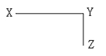

A. 47

B. 46

C. 45

D. 44

第 68 题 · 答案与解析

**参考答案（粉笔题库参考内容）**

C

**解析**

要使得路灯等距，则需先求1125与855的最大公约数，最大公约数为45。因此安装路灯最少为(1125 + 855) ÷ 45 + 1 = 45盏。

故正确答案为C。

**来源**：2012年安徽省公务员录用考试《行测》题第68题

### 第 69 题

A、B、C、D四人去羽毛球馆打球，A每隔5天去一次，B每隔11天去一次，C每隔17天去一次，D每隔29天去一次，5月18日，四个人恰好在羽毛球馆相遇，则下一次相遇时间为：

A. 9月18日

B. 10月14日

C. 11月14日

D. 12月18日

第 69 题 · 答案与解析

**参考答案（粉笔题库参考内容）**

C

**解析**

A、B、C、D 四人的周期分别为6、12、18、30，因此周期的最小公倍数为180。从5月18日向后数180天，180天约为6个月，因此该时间必然落在11月。

故正确答案为C。

**考点**：周期相遇问题

**来源**：2012年安徽省公务员录用考试《行测》题第69题

### 第 70 题

如下图所示，A、B两点是圆形体育场直径的两端，两人从A、B点同时出发，沿环形跑道相向匀速而行，他们在距A点弧形距离80米处的C点第一次相遇，接着又在距B点弧形距离60米处的D点第二次相遇，问这个圆形体育场的周长是多少米：

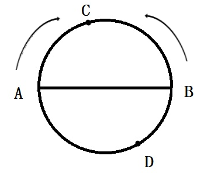

A. 240

B. 300

C. 360

D. 420

第 70 题 · 答案与解析

**参考答案（粉笔题库参考内容）**

C

**解析**

根据题意可知两人第一次相遇时走的路程和为半个圆周，在D点第二次相遇时总路程和为1.5个圆周。因此每个人第一次相遇时走的路程和总路程之比都是0.5：1.5=1：3。设圆的周长为x米，有80/(x/2+60)=1/3，解得x＝360。

故正确答案为C。

**考点**：相遇追及

**来源**：2012年安徽省公务员录用考试《行测》题第70题

### 第 71 题

从所给的四个选项中，选择最合适的一个填入问号处，使之呈现一定的规律性：

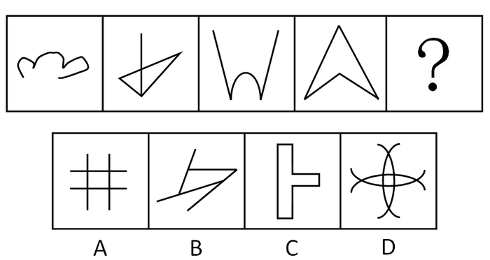

A. A

B. B

C. C

D. D

第 71 题 · 答案与解析

**参考答案（粉笔题库参考内容）**

C

**解析**

元素组成凌乱，考数数。数笔画，本题每幅图形都是由一笔画成。

故正确答案为C。

**考点**：数量规律-线

**来源**：2012年安徽省公务员录用考试《行测》题第71题

### 第 72 题

从所给的四个选项中，选择最合适的一个填入问号处，使之呈现一定的规律性：

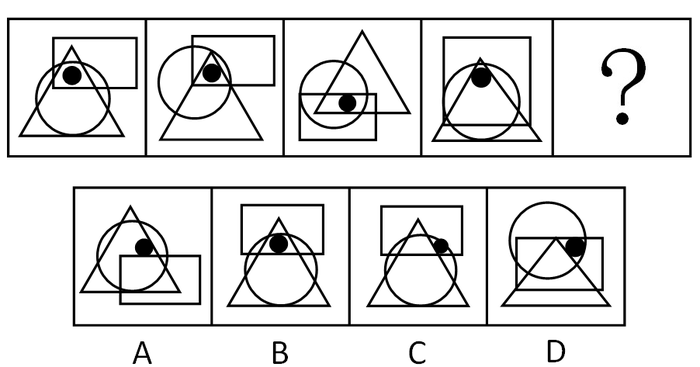

A. A

B. B

C. C

D. D

第 72 题 · 答案与解析

**参考答案（粉笔题库参考内容）**

B

**解析**

特殊考点——标记的点。题干中的小黑点处在圆形、长方形、三角形三者的交接区域，A、C、D三项中都有一个图形不包含在内，只有B项满足这个规律。

故正确答案为B。

**考点**：特殊规律-功能元素

**来源**：2012年安徽省公务员录用考试《行测》题第72题

### 第 73 题

从所给的四个选项中，选择最合适的一个填入问号处，使之呈现一定的规律性：

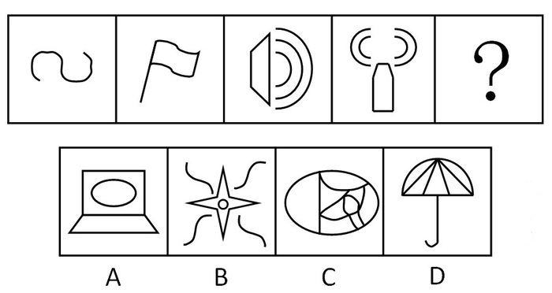

A. A

B. B

C. C

D. D

第 73 题 · 答案与解析

**参考答案（粉笔题库参考内容）**

B

**解析**

元素组成凌乱，考数数。数曲线，已知图形曲线数分别是1、2、3、4、（5），呈等差数列，图中只有选项B曲线数为5。

故正确答案为B。

**考点**：数量规律-线

**来源**：2012年安徽省公务员录用考试《行测》题第73题

### 第 74 题

从所给的四个选项中，选择最合适的一个填入问号处，使之呈现一定的规律性：

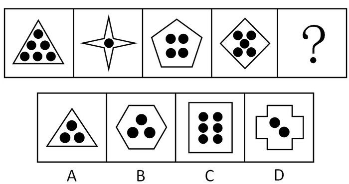

A. A

B. B

C. C

D. D

第 74 题 · 答案与解析

**参考答案（粉笔题库参考内容）**

B

**解析**

元素组成凌乱，且分为内外两部分，通常观察两者之间的关系。

交点个数为3，8，5，4，

内部黑点为6，1，4，5，

数交点和小黑点数目之和，点的个数都是9。

故正确答案为B。

**考点**：数量规律-复合

**来源**：2012年安徽省公务员录用考试《行测》题第74题

### 第 75 题

从所给的四个选项中，选择最合适的一个填入问号处，使之呈现一定的规律性：

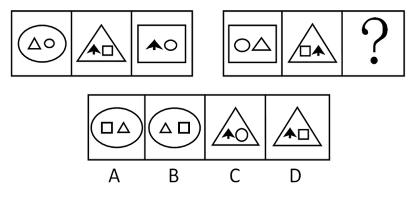

A. A

B. B

C. C

D. D

第 75 题 · 答案与解析

**参考答案（粉笔题库参考内容）**

A

**解析**

元素组成相似，外部周遍和内部叠加综合考查。边框的三种情况（圆形、三角形、矩形）均出现一遍，第三个图形的里面部分是由第一个和第二个图形的内部部分元素组成，取第二个图形的左图加上第一个图形的右图，依此规律，问号处的图形边框是圆形，内部的元素左边是矩形，右边是三角形。

故正确答案为A。

**考点**：样式规律-遍历

**来源**：2012年安徽省公务员录用考试《行测》题第75题

### 第 76 题

从所给的四个选项中，选择最合适的一项填入问号处，使之呈现一定的规律性：

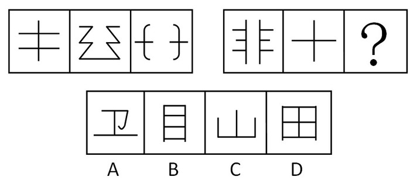

A. A

B. B

C. C

D. D

第 76 题 · 答案与解析

**参考答案（粉笔题库参考内容）**

C

**解析**

元素组成凌乱，考虑属性，题干中的图形都是对称的，且都是开放的（不具有封闭空间）。A项不是对称图形；B、D两项均具有封闭空间。

故正确答案为C。

**考点**：属性规律-复合

**来源**：2012年安徽省公务员录用考试《行测》题第76题

### 第 77 题

从所给的四个选项中，选择最合适的一个填入问号处，使之呈现一定的规律性：

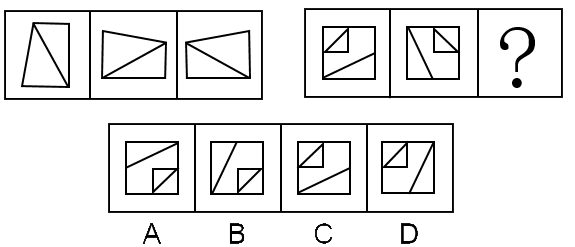

A. A

B. B

C. C

D. D

第 77 题 · 答案与解析

**参考答案（粉笔题库参考内容）**

D

**解析**

元素组成相同，考查位置规律。第一个图形先经过顺时针旋转90度得到第二个图形，第二个图形再经过水平翻转得到第三个图形。

故正确答案为D。

**考点**：位置规律-综合

**来源**：2012年安徽省公务员录用考试《行测》题第77题

### 第 78 题

从所给的四个选项中，选择最合适的一个填入问号处，使之呈现一定的规律性：

A. A

B. B

C. C

D. D

第 78 题 · 答案与解析

**参考答案（粉笔题库参考内容）**

A

**解析**

元素以行为单位，组成相似，考虑元素叠加。每一行中的第一个图形都是由后两个图形经过简单叠加后形成的。

故正确答案为A。

**考点**：样式规律-加减同异

**来源**：2012年安徽省公务员录用考试《行测》题第78题

### 第 79 题

请从所给的四个选项中，选择最合适的一个填入问号处，使之呈现一定的规律性：

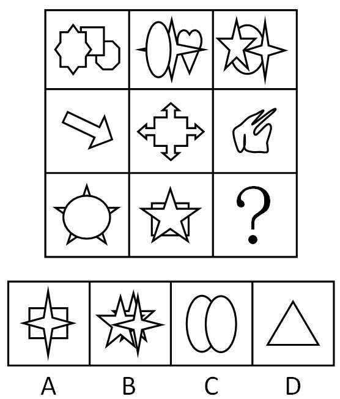

A. A

B. B

C. C

D. D

第 79 题 · 答案与解析

**参考答案（粉笔题库参考内容）**

A

**解析**

元素组成凌乱，考数数。考虑元素种类和个数，第一行元素种类和个数都是3，第二行元素种类和个数都是1，第三行元素种类和个数都是2。

故正确答案为A。

**考点**：数量规律-素

**来源**：2012年安徽省公务员录用考试《行测》题第79题

### 第 80 题

左边给定的立体图是由下面哪一项折叠而成的：

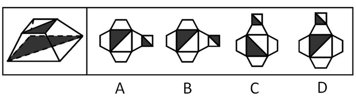

A. A

B. B

C. C

D. D

第 80 题 · 答案与解析

**参考答案（粉笔题库参考内容）**

A

**解析**

根据“立体图形中两个阴影三角形的相对位置”做题，BD图形中形成的立体图形，上下面的阴影三角形应该是处于相同位置，即位于同一侧，均不符合题干，C项中也不符合相对。

故正确答案为A。

**来源**：2012年安徽省公务员录用考试《行测》题第80题

### 第 81 题

品质成本是指企业为了保证和提高产品品质而支出一切费用和由于产品品质未达到规定的要求而造成的一切损失。

根据上述定义，下列属于品质成本的是：

A. 某医药企业为树立产品良好的品质形象聘请专家代言的费用

B. 某汽车制造商为新产品开展品质见证之旅主题试乘试驾活动的费用

C. 某保健品公司因为涉嫌虚构夸大产品功效而被处罚缴纳的罚款

D. 某食品生产企业因产品人工色素含量超标，被质监部门查处缴纳罚款

第 81 题 · 答案与解析

**参考答案（粉笔题库参考内容）**

D

**解析**

第一步：抓住定义中的关键词。

关键词强调“保证和提高产品品质”、“产品品质未达到规定的要求而造成的一切损失”。

第二步：逐一判断选项。

A中聘请专家代言并不能提高产品品质；

B中开展品质见证之旅也不能提高产品品质，A、B均属于宣传产品品质的行为；

C中保健品公司所造成的损失并不是由于产品品质没有达到规定要求导致的，而是夸大宣传。A、B、C均不符合定义。

故正确答案为D。

**考点**：方式目的

**来源**：2012年安徽省公务员录用考试《行测》题第81题

### 第 82 题

故意毁坏财物罪是指达到刑事责任年龄且具备刑事责任能力的自然人故意毁坏或者损坏公私财物，数额较大或者有其他严重情节的行为。犯罪目的只是损坏公私财物，并非非法占有。

根据上述定义，下列属于故意毁坏财物罪的是：

A. 张某不满公司年终分红方案，私自拿走公司贵重物品

B. 精神病人李某抢走路人财物并致其伤残

C. 王某对自己的新房装修过度，导致居民楼出现裂缝

D. 赵某破坏高压线路，导致整个地区停电三天

第 82 题 · 答案与解析

**参考答案（粉笔题库参考内容）**

D

**解析**

第一步：抓住定义中的关键词。

“故意毁坏财物罪”定义的关键词强调“具备刑事责任能力的自然人”、“故意毁坏或者损坏公私财物”、“不具有非法占有的目的”。

第二步：逐一判断选项。

A项中张某的行为具有非法占有的目的；

B项中的李某不具有刑事责任能力；

C项中的王某并不是故意毁坏或者损坏公私财物。

A、B、C三项均不符合定义。

故正确答案为D。

**考点**：方式目的

**来源**：2012年安徽省公务员录用考试《行测》题第82题

### 第 83 题

人际冲突有两种：工作性冲突与情绪性冲突（关系冲突）。工作性冲突是因为对工作本身有不同的理解、思路和方法；情绪性冲突则是情绪上的对立或敌意。

根据上面的定义，下面属于情绪性冲突的是：

A. 某单位领导因为坚持原则和下属发生严重的争执

B. 一位年轻女孩子，因男友的冷漠，和他吵起来了

C. 一位年轻的同事正在向顾客说明什么，但顾客表现得很激动

D. 一位老者正在教训那些采摘校园玫瑰花的人

第 83 题 · 答案与解析

**参考答案（粉笔题库参考内容）**

B

**解析**

第一步：找到定义关键词。

关键词强调“情绪上的对立或敌意”。

第二步：逐一分析选项。

A项：领导坚持原则与下属发生争执并非情绪上的对立或敌意，而是属于工作性冲突，排除；

B项：年轻女孩因男友的冷漠和他吵起来，体现了“情绪上的对立”，符合定义，当选；

C项：顾客表现得很激动，并未体现情绪上的对立或敌意，排除；

D项：老者正在教训采摘校园玫瑰花的人，也未体现“情绪上的对立或敌意”，排除。

故正确答案为B。

**考点**：常规问法

**来源**：2012年安徽省公务员录用考试《行测》题第83题

### 第 84 题

结构性失业，是指由于经济结构（包括产业结构、产品结构、地区结构）发生了变化，现有劳动力的知识、技能、观念、区域分布等不适应这种变化，与市场需求不匹配而引发的失业。

根据上述定义，下列属于结构性失业的是：

A. 小王因为所学专业偏冷，大学毕业后马上就“失业”了

B. 文化水平不高的张阿姨不适应现代化的要求，失业了

C. 小李由于没有大学英语六级证书，在找工作时老是碰壁

D. 上海的一家企业缺少高级工，存在人才空位现象

第 84 题 · 答案与解析

**参考答案（粉笔题库参考内容）**

B

**解析**

第一步：抓住定义中的关键词。

关键词强调“由于经济结构发生变化”、“现有劳动力的技能等与市场需求不匹配”。

第二步：逐一判断选项。

A中没有经济结构的变化，C中也不涉及经济结构的变化，D中没有失业。

故正确答案为B。

**考点**：原因结果

**来源**：2012年安徽省公务员录用考试《行测》题第84题

### 第 85 题

工作扩大化是指在横向水平上增加工作任务的数目或变化性，使工作多样化。工作丰富化是指从纵向上赋予员工更复杂、更系列化的工作，使员工有更大的控制权。

下列属于工作丰富化的是：

A. 自助餐的伙计在面食、沙拉、蔬菜、饮品和甜点部轮换工作

B. 邮政部门的员工从原来只专门负责分拣邮件增加到同时分送到各邮政部门

C. 在某传输数据系统公司，员工可以经常提出自己喜欢的工作并随后转入新的岗位

D. 在一家研究所，一个部门主管告诉她的下属，只要在预算内并且合法，他们就可以做想做的任何研究

第 85 题 · 答案与解析

**参考答案（粉笔题库参考内容）**

D

**解析**

第一步：判断考查定义。

题目考查“工作丰富化”，所以仅需在题干中阅读“工作丰富化”相关内容。

第二步：抓住定义中的关键词。

关键词包括“纵向上”、“更复杂、更系列化的工作”、“更大的控制权”。

第三步：逐一判断选项。

A项中工作内容的变化，是横向的，不是纵向的；

B项中邮政部门的员工只是增加了工作任务，而且新增加的工作不是更复杂的；

C项工作任务的变化并不一定是更复杂、更系列化的工作。A、B、C三项均不符合定义。

故正确答案为D。

**考点**：常规问法

**来源**：2016年重庆市选调优秀大学生到基层工作考试《行测》题第66题

### 第 86 题

职务发明，是指企业、事业单位、社会团体、国家机关的工作人员执行本单位的任务或者主要是利用本单位的物质条件所完成的职务发明创造。

下列属于职务发明的是：

A. 张大爷参加老年健身活动俱乐部，发明了一种新型的健身器材

B. 小李受公司委托参加了某高校一项课题研究，发明了一种新技术

C. 刘老师在家设计了一个多功能黑板，以方便平时上课

D. 王同学在读高中时就发明了一种多功能雨伞，并获得了专利

第 86 题 · 答案与解析

**参考答案（粉笔题库参考内容）**

B

**解析**

第一步：抓住定义中的关键词。

关键词强调“执行本单位的任务”、“利用本单位的物质条件”  、“职务发明创造”。

第二步：逐一判断选项。

A选项中的张大爷并不是执行本单位的任务；

C选项中的刘老师没有利用本单位的物质条件；

D选项中的王同学也不是执行本单位的任务；

选项A、C、D均不符合定义。

故正确答案为B。

**考点**：方式目的

**来源**：2012年安徽省公务员录用考试《行测》题第86题

### 第 87 题

乐观，是指认识事物过程中的一种心理状态，表现为关心事物的正向价值，并把最大正向价值作为其行为方案的选择标准，即相信自己有足够的行为能力来承受和减弱原有负向价值对自己的不良影响，并使原有正向价值发挥更大的积极效应。

下列最符合上述关于乐观的定义的是：

A. 长风破浪会有时，直挂云帆济沧海

B. 风力掀天浪打头，只须一笑不须愁

C. 今年欢笑复明年，秋月春风等闲度

D. 烹羊宰牛且为乐，会须一饮三百杯

第 87 题 · 答案与解析

**参考答案（粉笔题库参考内容）**

A

**解析**

第一步：抓住定义中的关键词。

关键词强调“认识事物过程”、“关心事物的正向价值”、“相信自己有足够的行为能力来承受和减弱原有负向价值对自己的不良影响”。

第二步：翻译选项。

A选项出自李白的《行路难》，说实现我理想的那一天会来到的，相信我一定能够克服眼前的困难，我将会大显身手，大展宏图；

B选项出自杨万里的《闷歌行》，原诗：风力掀天浪打头，只须一笑不须愁。近看两日远三日，气力穷时自会休。诗人告诉我们，纵使风大浪高，也不要慌，不要愁，要一笑了之。为什么？因为少则两天，多则三天，风力就会逐渐减弱，浪头就会逐渐平静下来。你只要稳住心，耐着性，把好舵，就会迎来风平浪静的好日子；

C选项出自白居易的《琵琶行》，意思是说随随便便就打发消磨了美好的青春年华，劝人们珍惜时光；

D选项出自李白的《将进酒》，这两句诗人描绘一场盛宴，抒发胸中豪情，劝人们及时饮酒行乐。

第二步：逐一判断选项。

B选项中没有认识事物的过程，C选项中没有相信自己有足够的能力，D选项中没有关心事物的正向价值，B、C、D均不符合定义。

故正确答案为A。

**考点**：单定义-其他句式

**来源**：2012年安徽省公务员录用考试《行测》题第87题

### 第 88 题

自居作用，是指一个人把他所钦佩或崇拜的人的特点、某一团队或某种主张作为自己的特点，用以弥补自己的缺点和不足。自居作用有两种：一是使自己模仿他人的行为；二是利用别人的优点、荣誉等来满足自己的愿望。

根据上述定义，下列属于自居作用的是：

A. 见贤思齐

B. 谈笑有鸿儒，往来无白丁

C. 人云亦云

D. 满招损，谦受益

第 88 题 · 答案与解析

**参考答案（粉笔题库参考内容）**

A

**解析**

第一步：抓住定义中的关键词。

“使自己模仿他人的行为”、“利用别人的优点等来满足自己的愿望”。

第二步：逐一分析选项。

A项：“见贤思齐”指看见贤能的人就想着向他学习，使自己变得和他一样，符合定义关键词“使自己模仿他人的行为”，并且是优点，当选；

B项：“谈笑有鸿儒，往来无白丁”指说自己交往的都是知识渊博的“鸿儒”，而没有知识浅薄的“白丁”，借此说明自己是一个生活高雅而有品位的人，没有模仿别人，不符合定义，排除；

C项：“人云亦云”指别人说什么就跟着说什么，形容没有主见，没有体现出利用别人的优点，不符合定义，排除；

D项：自己自满于已取得的成绩，将会招来损失和灾害；谦虚而时时改掉自己的不足，就能因此而得益，没有模仿别人，排除。

故正确答案为A。

**考点**：方式目的

**来源**：2012年安徽省公务员录用考试《行测》题第88题

### 第 89 题

知觉防御，是指个体进行自我保护的一种思想方法倾向，它使人比较容易观察能满足个体需要的事物，对于满足个体需要无关的事物则是视而不见、听而不闻。

下列选项中不属于知觉防御的是：

A. 先天下之忧而忧，后天下之乐而乐

B. 两耳不闻窗外事，一心只读圣贤书

C. 可怜后主还祠庙，日暮聊为梁父吟

D. 商女不知亡国恨，隔江犹唱后庭花

第 89 题 · 答案与解析

**参考答案（粉笔题库参考内容）**

A

**解析**

第一步：找出定义关键词。

“容易观察能满足个体需要的事物”。

第二步：逐一分析选项。

A项“先天下之忧而忧，后天下之乐而乐”以一种忧国忧民的心态，先看到忧虑，然后才看到欢乐，不符合“容易观察能满足个体需要的事物”，不符合定义，当选；

B项一心只读圣贤书，对于满足个体需要无关的事物则是视而不见、听而不闻，符合“容易观察能满足个体需要的事物”，符合定义，排除；

C项中的《梁父吟》是孔明为相时喜欢的歌谣，诗人杜甫在现实生活中并没有孔明那样的际遇，却“日暮聊为梁父吟”显然属于“容易观察能满足个体需要的事物”，符合定义，排除；

D项中的商女在亡国时，依然没有感到忧虑，属于“容易观察能满足个体需要的事物”，符合定义，排除。

本题为选非题，故正确答案为A。

**考点**：单定义-其他句式

**来源**：2012年安徽省公务员录用考试《行测》题第89题

### 第 90 题

消费信贷，是指银行等金融机构向消费者为消费而发放的贷款。消费信贷往往需要采取综合的担保措施以及进行充分的市场信用调查，在法律上表现为买卖合同（往往是分期付款买卖）、借款合同、担保合同的综合体。

根据上述定义，下列属于消费信贷的是：

A. 某饭店允许某位客户的赊账行为

B. 某农村信用合作社为农民购车发放小额贷款

C. 某职工为购房与单位签合同预支20年的住房补贴

D. 在资产清收、处置过程中，银行垫付债务人的诉讼费、经济纠纷款等

第 90 题 · 答案与解析

**参考答案（粉笔题库参考内容）**

B

**解析**

第一步：抓住定义中的关键词。

“银行等金融机构”、“为消费而发放的贷款”。

第二步：逐一判断选项。

A项：某饭店不属于金融机构，不符合“银行等金融机构”，不符合定义，排除；；

B项：农村信用合作社，符合“银行等金融机构”，为农民购车发放小额贷款，符合“为消费而发放的贷款”，符合定义，当选；

C项：单位不属于金融机构，不符合“银行等金融机构”，不符合定义，排除；

D项：没有消费，也没有贷款，不符合“为消费而发放的贷款”，不符合定义，排除。

故正确答案为B。

**考点**：主客体

**来源**：2012年安徽省公务员录用考试《行测》题第90题

### 第 91 题

谬误：语法

A. 木头：煤炭

B. 俗气：文章

C. 馒头：面粉

D. 快乐：高兴

第 91 题 · 答案与解析

**参考答案（粉笔题库参考内容）**

B

**解析**

第一步：判断题干词语间逻辑关系。

题干两词是语法关系，且前者可以用来形容后者。

第二步：判断选项词语间逻辑关系。

与题干逻辑关系一致的即为B项。A项是并列关系；C项是对应关系，后者是制作前者的材料；D项是近义词，A、C、D三项均与题干逻辑关系不一致，排除。

故正确答案为B。

**考点**：语法关系

**来源**：2012年安徽省公务员录用考试《行测》题第91题

### 第 92 题

川剧：变脸

A. 滑稽戏：逗乐

B. 西河大鼓：弹三弦

C. 二人转：转手绢

D. 京剧：画脸谱

第 92 题 · 答案与解析

**参考答案（粉笔题库参考内容）**

C

**解析**

第一步：判断题干词语间逻辑关系。

“变脸”是运用在“川剧”中特有的表演特技，是一种绝活，二者属于对应关系。

第二步：判断选项词语间逻辑关系。

Ａ项：“滑稽戏”的目的是“逗乐”，二者属于目的对应关系，排除；

Ｂ项：“西河大鼓”的表演中有“弹三弦”作为伴奏，二者属于对应关系，但“弹三弦”不是具体的表演特技，排除；

Ｃ项：“转手绢”是“二人转”中的表演特技，是一种绝活，二者属于对应关系，与题干逻辑关系一致，当选；

D项：“画脸谱”是中国传统戏曲演员脸上的绘画，用于舞台演出时的化妆造型艺术，不仅在“京剧”中出现，且属于造型艺术而不是表演技术，排除。

故正确答案为C。

**考点**：逻辑关系-对应关系

**来源**：2012年安徽省公务员录用考试《行测》题第92题

### 第 93 题

火山：岩浆

A. 小麦：面包

B. 汽车：尾气

C. 海洋：岛屿

D. 地下水：喷泉

第 93 题 · 答案与解析

**参考答案（粉笔题库参考内容）**

B

**解析**

第一步：判断题干词语间逻辑关系。

题干两词是对应关系，且是事物与其产物间的一一对应关系，即火山喷出岩浆。

第二步：判断选项词语间逻辑关系。

与题干相同逻辑关系的即为B项；

A项不是一一对应关系；

C项不是事物与其产物间的对应关系；

D项不是一一对应关系。

故正确答案为B。

**考点**：逻辑关系-对应关系

**来源**：2012年安徽省公务员录用考试《行测》题第93题

### 第 94 题

真诚：真挚

A. 论证：论点

B. 顽强：顽劣

C. 果断：武断

D. 争议：争执

第 94 题 · 答案与解析

**参考答案（粉笔题库参考内容）**

D

**解析**

第一步：判断题干词语间逻辑关系。

真诚和真挚均指真心实意，为语义关系中的近义关系。

第二步：判断选项词语间逻辑关系。

A项：论点是论证的一部分，二者为组成关系，与题干逻辑关系不一致，排除；

B项：顽强的意思是坚强不屈，顽劣的意思是顽固恶劣，二者不存在语义关系，与题干逻辑关系不一致，排除；

C项：果断的意思是不犹豫，武断的意思是不顾情理是否持平而随意评决他人的是非曲直，二者不存在语义关系，与题干逻辑关系不一致，排除；

D项：争执和争议均指争论，为近义关系，与题干逻辑关系一致，当选。

故正确答案为D。

**考点**：语义关系-近义关系

**来源**：2012年安徽省公务员录用考试《行测》题第94题

### 第 95 题

画家：作家

A. 工人：农民

B. 土豆：山芋

C. 绿茶：红茶

D. 军人：诗人

第 95 题 · 答案与解析

**参考答案（粉笔题库参考内容）**

D

**解析**

第一步：判断题干词语间逻辑关系。

题干两词是交叉关系，有的人兼具画家和作家两种身份。

第二步：判断选项词语间逻辑关系。

A项，工人和农民是并列关系，二者没有交叉的部分，一个人不能既是农民又是工人。该项应排除。

B项，土豆和山芋是并列关系，土豆是土豆，山芋是山芋，不存在交叉的部分。该项应排除。

C项，绿茶和红茶是并列关系，茶不可能既是绿茶又是红茶。该项应排除。

D项，军人和诗人是交叉关系，有的人兼具诗人和军人两种身份。该项应选。

故正确答案为D。

**考点**：逻辑关系-交叉关系

**来源**：2012年安徽省公务员录用考试《行测》题第95题

### 第 96 题

人生：阅历：经验

A. 身体：营养：体重

B. 企业：销量：产能

C. 职场：学识：成功

D. 学校：生源：名气

第 96 题 · 答案与解析

**参考答案（粉笔题库参考内容）**

B

**解析**

第一步：判断题干词语间逻辑关系。

“人生”通过增加“阅历”增长“经验”，增加“阅历”是增长“经验”的充分条件。

第二步：判断选项词语间逻辑关系。

A项：增加“营养”不一定增加“体重”，二者不是充分条件，与题干逻辑关系不一致，排除；

B项：“企业”通过增加“销量”来提高“产能”，增加“销量”是提高“产能”的充分条件，与题干逻辑关系一致，当选；

C项：增加“学识”不一定“成功”，二者不是充分条件，与题干逻辑关系不一致，排除；

D项：扩大“生源”不一定提高“名气”，二者不是充分条件，与题干逻辑关系不一致，排除。

故正确答案为B。

**考点**：逻辑关系-对应关系

**来源**：2012年安徽省公务员录用考试《行测》题第96题

### 第 97 题

茶水：茶壶：茶杯

A. 乘客：公交车：出租车

B. 杂志：书架：阅览室

C. 人才：学校：企业

D. 课本：书店：印刷厂

第 97 题 · 答案与解析

**参考答案（粉笔题库参考内容）**

C

**解析**

第一步：判断题干词语间逻辑关系。

题干三词是对应关系，茶水从茶壶输送到茶杯。

第二步：判断选项词语间逻辑关系。

与题干相同逻辑关系的即为C，人才从学校输送到企业，A中后两个词是并列关系，没有先后，B中后两个词是包容关系，D中课本可以从印刷厂输送到书店，但是后两词的顺序颠倒。

故正确答案为C 。

**考点**：逻辑关系-对应关系

**来源**：2012年安徽省公务员录用考试《行测》题第97题

### 第 98 题

药品：药房：药方

A. 旅行：飞机：机票

B. 桌餐：饭店：菜单

C. 存款：银行：银行卡

D. 电影：影院：电影票

第 98 题 · 答案与解析

**参考答案（粉笔题库参考内容）**

D

**解析**

第一步：判断题干词语间逻辑关系。

拿着“药方”去“药房”买“药品”，是一种购买行为，第二个词是场所，且“药方”可能是自己带到“药房”的。

第二步：判断选项词语间逻辑关系。

A项：第二个词“飞机”不是场所，与题干逻辑关系不一致，排除；

B项：拿着“菜单”在“饭店”点“桌餐”，但菜单一定是饭店的，与题干逻辑关系不一致，排除；

C项：拿着“银行卡”去“银行”“存款”，并不是一种购买行为，与题干逻辑关系不一致，排除；

D项：拿着“电影票”去“影院”看“电影”，是一种购买行为，且电影票是自己的，与题干逻辑关系一致，当选。

故正确答案为D。

**考点**：逻辑关系-对应关系

**来源**：2012年安徽省公务员录用考试《行测》题第98题

### 第 99 题

老师 对于 （ ）相当于（ ）对于 病人

A. 书本 父母

B. 学校 医院

C. 学生 医生

D. 教室 药品

第 99 题 · 答案与解析

**参考答案（粉笔题库参考内容）**

C

**解析**

将选项逐一代入，判断各选项前后部分的逻辑关系。

A项：前面部分是对应关系，后面部分无明显逻辑关系，排除；

B项：前面部分是对应关系，是职业与工作场所的对应关系，后面部分是对应关系，是场所与身份的对应关系，前后逻辑关系不一致，排除；

C项：前面部分是对应关系，是服务人员与服务对象的关系，后面部分是对应关系，是服务人员与服务对象的关系，前后逻辑关系一致，当选；

D项：前面部分是对应关系，是职业与工作场所的对应关系，后面部分是对应关系，是物品与作用对象的对应关系，与题干逻辑关系不一致，排除。

故正确答案为C。

**考点**：逻辑关系-对应关系

**来源**：2012年安徽省公务员录用考试《行测》题第99题

### 第 100 题

玫瑰 对于（  ）相当于（ ）对于 鲸鱼

A. 香精 鱼翅

B. 花园 海水

C. 蔷薇 海豚

D. 月季 鲨鱼

第 100 题 · 答案与解析

**参考答案（粉笔题库参考内容）**

C

**解析**

第一步：将选项逐一代入，判断各选项前后部分的逻辑关系。

A项中前面部分是对应关系，后面部分无明显逻辑关系，前后逻辑关系不一致，排除；

B项中前面部分是对应关系，生物和生活环境的对应关系，后面部分是对应关系，生活环境与生物的对应关系，前后逻辑关系不一致，排除；

C项中前面部分是并列关系，后面部分是并列关系，前后逻辑关系一致，保留；

D项中前面部分是并列关系，后面部分是并列关系，前后逻辑关系一致，保留。

第二步：答案不唯一时，再判断题干词语间第二重逻辑关系，并在选项中进行选择。

C、D两项都是并列关系，C项中玫瑰和蔷薇都是蔷薇科的花，海豚和鲸鱼都是哺乳动物，相比D选项（D项中月季是蔷薇科的花，但是鲨鱼不是哺乳动物），关系更近一步。

故正确答案为C。

**考点**：逻辑关系-并列关系

**来源**：2012年安徽省公务员录用考试《行测》题第100题

### 第 101 题

有人认为“美是客观的”，比如你无论是否看到黄山的美景，它都是存在着的；也有人认为“美是主观的”，一些在你眼中的美女在其他人看来却是不怎么样，可见：

A. 没有绝对的美，也没有绝对的丑

B. “美是客观的”不正确

C. 美是相对的，是存在于我们主客观世界里的

D. 美是主观，还是客观，属于萝卜白菜各有所爱

第 101 题 · 答案与解析

**参考答案（粉笔题库参考内容）**

D

**解析**

第一步：翻译题干。

题目当中“有人认为······也有人认为······”，是各抒己见。

第二步：逐一判断选项的作用。

A选项，题干中并未涉及“绝对的美”或者“相对的美”推不出；

B选项，题干中也没有涉及到这两种观点是否正确，只是“有人认为”，推不出；

C选项，偷换概念，“美是客观的”“美是主观的”这样的表述和“美是存在于我们主客观世界里的”这一表述意思并不相同，是不同的概念；

D选项，美是客观还是主观的属于各抒己见，符合题意。

故正确答案为D。

**考点**：日常结论

**来源**：2012年安徽省公务员录用考试《行测》题第101题

### 第 102 题

根据美国营养学家的研究，花菜中含有一氯化物-吲哚。科研人员将一种类似花菜中吲哚的特殊物质注入一批志愿试验人员体内，注射一周后，采血进行化验检查，结果发现这些受试者体内可致乳腺癌的雌激素的水平降低，得出花菜有预防乳腺癌的功效。

如果以下各项为真，最能质疑上述推测的是：

A. 花菜中吲哚的含量较低

B. 一些常吃花菜的人也患有乳腺癌

C. 很多从来不吃花菜的人也没有患乳腺癌

D. 雌激素的水平不是导致乳腺癌的唯一因素

第 102 题 · 答案与解析

**参考答案（粉笔题库参考内容）**

D

**解析**

第一步：找出论点和论据。

论点：花菜有预防乳腺癌的功效。

论据：花菜中含有一氯化物-吲哚，可使致乳腺癌的雌激素的水平降低。

第二步：逐一分析选项。

A项：吲哚的含量题干中没有提及，属于无关选项，排除；

B项：论点说的是花菜有预防乳腺癌的功效，预防的意思是使患病概率降低，而不是不得病，B选项中说的是有人患有乳腺癌，属于偷换概念，不能削弱，排除；

C项：讨论的是不吃花菜的人，与论点吃花菜无关，排除；

D项：即在乳腺癌和雌激素水平间不搭桥，证明二者无关，由于雌激素不是导致乳腺癌的唯一因素，所以花菜中即使含有可以降低雌激素在人体内水平的物质，也不能说明花菜有预防乳腺癌的功效，隔断了雌性激素与乳腺癌之间的联系，当选。

故正确答案为D。

**考点**：拆桥

**来源**：2012年安徽省公务员录用考试《行测》题第102题

### 第 103 题

在发生了若干起由于汽车本身质量问题而导致的严重事故之后，某汽车公司开始针对导致事故发生的技术原因在全球范围内召回旗下部分系列的产品。鉴于事故造成的严重后果，这种举措也许短时间内并不能重新赢回消费者对其品牌的信赖，但亡羊补牢的措施总算没有使其遭到所有人的抛弃。

由此可以推知：

A. 该公司旗下其他系列的产品不存在类似的质量问题

B. 亡羊补牢的措施终究会使消费者对该公司的信赖回升到原有水平

C. 消费者对该公司及其产品信赖，部分原因在于它能够较好地处理出现的问题

D. 该公司召回产品的目的是避免因同类质量问题再次出现事故

第 103 题 · 答案与解析

**参考答案（粉笔题库参考内容）**

C

**解析**

第一步：抓住每句话中的事件及其关系。

第一句强调汽车本身质量问题而导致的严重事故，汽车公司召回旗下部分系列的产品，第二句说明这种举措短时间内不能重新赢回消费者对其品牌的信赖，但总算没有使其遭到所有人的抛弃，两句之间是因果关系。

第二步：判断整体关系。

汽车严重事故招致品牌信任度下降，召回的举措使部分消费者没有对其丧失信心。

第三步：逐一判断选项的作用。

A中其他系列的产品，题干没有提及，不能推出；

B中亡羊补牢的措施终究会使消费者对该公司的信赖回升到原有水平，原文只说措施总算没有使其遭到所有人的抛弃，明显信赖没有回到原来的水平，至于最终怎样，在这里不能做出判断，B不能推出；

C中由“亡羊补牢的措施总算没有使其遭到所有人的抛弃”可知消费者的信赖，部分原因在于它能够较好地处理出现的问题，可以推出；

D该公司召回产品的目的是避免因同类质量问题再次出现事故同时挽回公司信誉，D不全面。

故正确答案为C。

**考点**：日常结论

**来源**：2012年安徽省公务员录用考试《行测》题第103题

### 第 104 题

班主任在期末总结会上说：“我们班的同学在过去的一年里取得了优异的成绩，有的在奥数竞赛中获了奖，有的在英语口语比赛中获了奖，有的在舞蹈比赛中获了奖。我们班有许多女同学······”

由此可以推出：

A. 取得优异成绩的全部是女同学

B. 取得优异成绩的肯定有女同学

C. 取得优异成绩的女同学多于男同学

D. 取得优异成绩的可能没有女同学

第 104 题 · 答案与解析

**参考答案（粉笔题库参考内容）**

D

**解析**

第一步：抓住每句话中的对象及其关系。

题干中老师提到的所有对象均没有关系，这些对象包括奥数竞赛、英语口语、舞蹈比赛、女同学。

第二步：判断整体关系。

由于对象之间并没有关系，所以对于这些对象之间关系的推测只能是可能，不能是一定。

第三步：逐一判断选项的作用。

A、B、C全是肯定性的表述，只有D是可能性的表述。

故正确答案为D。

**考点**：日常结论

**来源**：2012年安徽省公务员录用考试《行测》题第104题

### 第 105 题

一家汽车生产商推出标准型、豪华型两款车型，豪华型的安全性能比标准型好很多，两款车型同时上市后，豪华型的销量一直没有超过标准型。由此，该生产商认为安全性能并非顾客考虑的首要因素。

如果以下各项为真，最能削弱该生产商观点的是：

A. 大部分顾客对标准型汽车的信赖度更高

B. 豪华型汽车的价格与标准型相差不是很多

C. 大部分顾客认为标准型汽车的安全性能足以满足日常生活需要

D. 购买标准型汽车的大多是集体客户，所以标准汽车销售量一直很高

第 105 题 · 答案与解析

**参考答案（粉笔题库参考内容）**

C

**解析**

第一步：找到论点和论据。

本题论点是安全性能并非顾客考虑的首要因素，论据是一家汽车生产商推出标准型、豪华型两款车型，豪华型的安全性能比标准型好很多，两款车型同时上市后，豪华型的销量一直没有超过标准型。

第二步：判断削弱方式。

提问句是否定生产商观点，而生产商观点是结论，所以本题削弱论点。

第三步：逐一判断选项的作用。

A、B都属于加强论据的选项，说明顾客更加偏好标准型的车型，C削弱论点，说明安全性是顾客考虑的因素，D说明豪华型的销量一直没有超过标准型的原因还有可能是，购买标准型汽车的大多是集体客户，所以标准汽车销售量一直很高，属削弱论据的他因削弱选项，C比D的力度要更强。

故正确答案为C。

**考点**：削弱论点

**来源**：2012年安徽省公务员录用考试《行测》题第105题

### 第 106 题

科学家发现，在过去的200年内，地球的磁场急剧的衰减。科学家预言，照这种速度发展下去，在未来的1000年内，地球磁场可能会完全消失，地球生灵将面临前所未有的宇宙射线大灾难。

由此可以推出：

A. 目前地球磁场的衰减速度比200年前更快

B. 人类无法改变地球磁场急剧衰减的状况

C. 今后来自外太空的辐射强度将会越来越大

D. 地球磁场可阻挡来自太空的辐射

第 106 题 · 答案与解析

**参考答案（粉笔题库参考内容）**

D

**解析**

第一步：抓住每句话中的对象及其关系。

第一句强调过去的200年内，地球的磁场急剧的衰减，第二句说明在未来的1000年内，地球磁场可能会完全消失，地球生灵将面临前所未有的宇宙射线大灾难。

第二步：判断整体关系。

过去的200年内，地球的磁场急剧的衰减→未来的1000年内，地球磁场可能会完全消失→地球生灵将面临前所未有的宇宙射线大灾难。

第三步：逐一判断选项的作用。

A题干只说未来的1000年内，地球磁场可能会完全消失，没有说明衰减速度，A不能推出；

B题干根本没有提到人类，B不能推出；

C题干只说地球磁场消失，会导致地球遭遇射线大灾难，没有谈到外太空的辐射强度，C不能推出；

D从题干的最后一句话，即地球磁场完全消失，地球生灵将面临前所未有的宇宙射线大灾难，可知地球磁场可阻挡来自太空的辐射。

故正确答案为D。

**考点**：日常结论

**来源**：2012年安徽省公务员录用考试《行测》题第106题

### 第 107 题

科学研究发现，植物对触摸作出反应是因为它们认为自己正在遭受风的打击，因此“觉得”必须提高强度防止风的破坏。每天只要对植物的茎进行几秒钟的抚摸和敲击就可使植物枝干的密度加强。在植物被触摸不到30分钟后，植物的基因便可生成使其体内钙含量提高的蛋白质。钙的增加相应地又导致一种名为钙调蛋白的物质的增多，该物质可以使植物更为坚固。

如果下列各项为真，能够质疑上述结论的是：

A. 菜农们在将温室中的幼苗移种至露天之前，一般会对秧苗进行敲打

B. 在移种甜菜之前，要去除掉甜菜中的水分并用扫帚拍打它们

C. 在农田边缘经常受风的作物倒伏概率比在农田中央吹不到风的作物要高80%

D. 如果碰到含羞草的叶子，它就会在几秒钟之内缩做一团，出现该现象的原因是钙迅速流进了它的细胞

第 107 题 · 答案与解析

**参考答案（粉笔题库参考内容）**

C

**解析**

第一步：找到论点和论据。

本题论点是每天只要对植物的茎进行几秒钟的抚摸和敲击就可使植物枝干的密度加强，论据是在植物被触摸不到30分钟后，植物的基因便可生成使其体内钙含量提高的蛋白质。钙的增加相应地又导致一种名为钙调蛋白的物质的增多，该物质可以使植物更为坚固。

第二步：判断削弱方式。

论点与论据存在明显的因果关系，需削弱论点。

第三步：逐一判断选项的作用。

A、B都是加强论点的选项；

C项削弱论点，说明经常受到拍打和敲击的植物躯干密度并没有加强；

D选项说的是含羞草，这种植物自身的特性就是受到触碰会缩起来，与躯干的密度没有关系，本题对含羞草的收缩原因作出了解释，从侧面论证了论据中的在植物被触摸不到30分钟后，植物的基因便可生成使其体内钙含量提高的蛋白质，加强了论据的前部分。

故正确答案为C。

**考点**：削弱论据

**来源**：2012年安徽省公务员录用考试《行测》题第107题

### 第 108 题

某市风景优美，气候宜人。该市晨曦路两侧开设的几乎全部都是老年疗养院，来自全国各地的很多老年人来此旅游、疗养。晨曦路只有很少几座居民住宅，但是晨曦路附近却有很多专门经营儿童用品的商店，而且生意还相当火爆。

下列哪一项是最能解释这一现象：

A. 晨曦路附近的专门经营儿童用品的商店所出售的商品物美价廉

B. 来此疗养的老人都是有子女带着孩子陪同的，他们需为孩子购买所需物品

C. 居住在晨曦路的居民虽然不多，但孩子们之间经常互相赠送

D. 晨曦路附近的儿童用品商店闹中取静购物环境良好

第 108 题 · 答案与解析

**参考答案（粉笔题库参考内容）**

B

**解析**

第一步：找出题干矛盾。

晨曦路两侧几乎都是老年疗养院，居民住宅很少，但附近却有很多儿童用品商店，而且生意火爆。

第二步：逐一分析选项。

A项：选项指出儿童用品的商店的商品物美价廉，但晨曦路两侧几乎都是老年疗养院，居民住宅很少，说明儿童用品商店的受众很少，就算商品物美价廉，也无法解释为什么儿童用品商店生意火爆，不能解释题干矛盾，排除；

B项：选项指出来此疗养的老人都是有子女带着孩子陪同的，他们需为孩子购买所需物品，说明儿童用品商店的受众其实很多，可以解释题干矛盾，当选；

C项：选项指出居住在晨曦路的孩子们经常互相赠送礼物，但晨曦路两侧几乎都是老年疗养院，居民住宅很少，说明儿童用品商店的受众很少，就算孩子们常互赠礼物，也无法解释为什么儿童用品商店生意火爆，不能解释题干矛盾，排除；

D项：选项指出儿童用品商店购物环境良好，但晨曦路两侧几乎都是老年疗养院，居民住宅很少，说明儿童用品商店的受众很少，就算商店购物环境良好，也无法解释为什么儿童用品商店生意火爆，不能解释题干矛盾，排除。

故正确答案为B。

**考点**：原因解释

**来源**：2012年安徽省公务员录用考试《行测》题第108题

### 第 109 题

人工合成食用色素，是用从煤焦油中分离出来的苯胺染料为原料制成的，故又称煤焦油色素或苯胺色素，如合成苋菜红、胭脂红及柠檬黄等等。偶尔食用添加一定量的人工合成食用色素的食品，并不会引发中毒、泻泄等状况。因此，人们可以放心食用添加少量人工合成色素的食品。

以下哪项如果为真，最能削弱上述论证：

A. 食用添加少量人工合成食用色素的食品不利于人体健康

B. 经常食用和偶尔食用对人体的影响不同

C. 苯胺染料含对人体有害的物质

D. 食用添加少量天然食用色素的食品不会影响人体健康

第 109 题 · 答案与解析

**参考答案（粉笔题库参考内容）**

A

**解析**

第一步：分析题干，找到论点论据。

论点：人们可以放心食用添加少量人工合成色素的食品。

论据：偶尔食用添加一定量的人工合成食用色素的食品，并不会引发中毒、泄泻等状况。

第二步：逐一分析选项。

A项：点明人工合成食用色素不利于人体健康，不能放心食用，削弱论点；

B项：经常和偶尔的影响具体有什么不同不明确，且题干没有提到经常食用，为不明确选项；

C项：虽然苯胺染料含有有害物质，但是其制成的人工合成食用色素有没有害不明确，为不明确选项；

D项：讨论食用天然食用色素的影响，与题干的食用人工合成色素无关，为无关选项。

故正确答案为A。

**考点**：削弱论点

**来源**：2012年安徽省公务员录用考试《行测》题第109题

### 第 110 题

近日，某检验检疫局对从德国进口的百余箱机电产品木质包装箱开箱检查时发现，其中两箱有大量疑似白蚁，数量在几千只左右，密度较大，导致部分箱体出现多处蚁孔。现场采集的标本经鉴定为台湾乳白蚁。由于这种白蚁在欧洲是没有分布的，所以专家推测，可能是在中国境内运输中感染的。由此可以推出：

A. 货物不是直接从德国空运过来的

B. 货物运输经过了台湾

C. 白蚁繁殖速度很快

D. 中国境内的台湾乳白蚁很多

第 110 题 · 答案与解析

**参考答案（粉笔题库参考内容）**

A

**解析**

第一步：抓住每句话中的对象及其关系。

第一句说明，检验检疫局从德国进口的百余箱机电产品的其中两箱中发现大量疑似白蚁，第二句说明白蚁的种类为台湾乳白蚁，第三句说明这种白蚁在欧洲是没有分布的，可能是在中国境内运输中感染的。

第二步：判断整体关系。

德国进口产品中发现台湾乳白蚁，推测进口产品在境内运输中受感染。

第三步：逐一判断选项的作用。

A项：货物一定不是直接从德国空运过来的，因为欧洲没有这种白蚁，因此可以推出；

B项：题干中没提到台湾乳白蚁是台湾特有，所以不能推出，B错误；

C项：白蚁繁殖速度，题干中没有说明在中国境内到底呆了多久，不能因为数量多就说明繁殖速度快，也有可能是货物在境内时间长导致数量多，C错误；

D项：题干中只是提到了箱子里面的乳白蚁密度较大，但并不能得出中国境内这种白蚁多不多，D错误。

故正确答案为A。

**考点**：日常结论

**来源**：2012年安徽省公务员录用考试《行测》题第110题

### 第 111 题

英国一家非常受欢迎的专卖三明治的快餐店，最近把三明治的价格提高了0.2欧元，即从1.8欧元提到2欧元。可是涨价后仅仅一个月，所有的服务员都不约而同地辞职了。

下列哪项如果为真，能最好地解释上述现象：

A. 价格上涨后，快餐店就可以继续赠送顾客饮料，而服务员嫌麻烦

B. 服务员的小费比以前大大地减少了。因为售价是整数，顾客可能没有零钱给小费了

C. 尽管三明治的价格上涨了，但是并没有相应地增加服务员的工资

D. 由于价格上涨，除了某些老主顾经常来光顾，店里的生意可是日渐冷清了

第 111 题 · 答案与解析

**参考答案（粉笔题库参考内容）**

B

**解析**

第一步：找出题干矛盾。

三明治涨价了，但服务员都不约而同地辞职了。

第二步：逐一分析选项。

A项：继续赠送顾客饮料，而服务员嫌麻烦，赠送顾客饮料是一直都存在的服务，无法解释三明治涨价之后为什么所有的服务员都不约而同地辞职了，不能明确解释题干矛盾，排除；

B项：三明治售价涨到整数，无人给小费，服务员收入少了，可以解释为什么三明治涨价之后所有的服务员都不约而同地辞职了，可以解释题干矛盾，当选；

C项：没有相应地增加服务员的工资，不能明确解释三明治涨价之后为什么所有的服务员都离职了，无法解释题干矛盾，排除；

D项：店里冷清，不能明确解释三明治涨价之后为什么所有的服务员都离职了，无法解释题干矛盾，排除。

故正确答案为B。

**考点**：原因解释

**来源**：2012年安徽省公务员录用考试《行测》题第111题

### 第 112 题

本能可以使生物对刺激做出复杂的反应。相对非本能反应，本能反应只需要很少的神经细胞。具有非本能反应能力的大脑一定有大量的神经细胞，而没有哪种昆虫的大脑具有如此数量的神经细胞。

根据这段文字，可以知道：

A. 昆虫的反应一般是本能反应

B. 大脑小于或等于昆虫大脑的生物只能做出本能反应

C. 大脑大于昆虫大脑的生物都有能力做出非本能反应

D. 拥有高级大脑的生物做出大的反应一般不是本能反应

第 112 题 · 答案与解析

**参考答案（粉笔题库参考内容）**

A

**解析**

日常结论题，根据题干信息逐一分析选项。

A项：题干第三句指出“具有非本能反应能力的大脑一定有大量的神经细胞，而没有哪种昆虫的大脑具有如此数量的神经细胞”，说明昆虫没有非本能反应，即昆虫的反应一般是本能反应，可以推出，当选；

B项：题干并未提及大脑的大小与本能反应的关联，无中生有，无法推出，排除；

C项：题干并未提及大脑的大小与非本能反应的关联，无中生有，无法推出，排除；

D项：题干第二句和第三句指出“本能反应只需要很少的神经细胞。具有非本能反应能力的大脑一定有大量的神经细胞”，但没有提及拥有高级大脑的生物做出大的反应需要的神经细胞数量多少，因此无法推出是否为本能反应，无法推出，排除。

故正确答案为A。

**考点**：日常结论

**来源**：2012年安徽省公务员录用考试《行测》题第112题

### 第 113 题

由于在乐业天坑中最大的天坑——大石围的底部的原始森林中发现了与恐龙同时代的植物桫椤，有人据此推测，大石围应形成于恐龙时代，即6500万年前。

如果下列各项为真，哪项最能反驳上述推测：

A. 桫椤至今仍然存在

B. 在其他乐业天坑中未发现桫椤

C. 恐龙无法进入这个极深的天坑

D. 没有在大石围中发现恐龙化石

第 113 题 · 答案与解析

**参考答案（粉笔题库参考内容）**

A

**解析**

第一步：找到论点和论据。

 论点是大石围应形成于恐龙时代。

 论据是在大石围的底部的原始森林中发现了与恐龙同时代的植物桫椤。

第二步：逐一判断选项的作用。

A选项是否定其前提，即桫椤这种植物至今仍然存在，不能说明在大石围底部的原始森林中发现的桫椤是与恐龙同时代的，削弱论点；

B选项说其他天坑中没有出现这种植物，但是并不能说明大石围底部的桫椤不是那个年代的，所以不能削弱；

C选项恐龙存在的时间和恐龙能不能进入天坑没有任何联系；

D选项没有在大石围中发现恐龙化石，不能说明恐龙没有生存在大石围时代。

故正确答案为A。

**考点**：拆桥

**来源**：2012年安徽省公务员录用考试《行测》题第113题

### 第 114 题

近期一项电脑市场调查显示：按照一品牌学生购买者占全部购买者的百分比计算，A、B两品牌电脑名列前两位，比例分别为68%和52%。但是，在过去6个月的学生购买电脑量排行榜中，国产C品牌一直排在首位。

下列哪项为真，最有助于解释上述矛盾：

A. 有关机构设立排行榜在一定程度上影响学生消费者对品牌的选择

B. C品牌的学生购买者占其购买者的比例也曾在相当长的时间内高于其他品牌

C. 与A、B两种品牌相比，C品牌电脑性价比更高，更符合学生要求

D. 某种品牌学生购买者占各品牌学生购买者总数的百分比，与某种品牌学生购买者占该品牌全部购买者的百分比是不同的

第 114 题 · 答案与解析

**参考答案（粉笔题库参考内容）**

D

**解析**

第一步：找出题干矛盾。

A、B两品牌电脑中学生购买者占比较大，但学生购买电脑量排行榜中，国产C品牌一直排在首位。

第二步：逐一分析选项。

A项前后的调查是同一时期的，不能产生A中描述的情况，A不正确；

B、C两项都是否定了论据来解释论点，不符合题干要求；

D项矛盾产生的原因在于计算方式不同，是答案。

故正确答案为D。

**考点**：原因解释

**来源**：2012年安徽省公务员录用考试《行测》题第114题

### 第 115 题

大众意识到新闻传媒中可能有偏见并且怀疑新闻传媒强有力的传播效果。然而，大众对被报道的每一条新闻貌似有理的评价与新闻主体是不一致的，因为大众的评价是以从新闻媒介中得到的资料为背景的。

如果作者上述的观点是正确的，那么他在试图说明（  ）。

A. 如果在新闻传媒所报道的新闻中普遍存在偏见，那么公众要识别这些偏见是困难的

B. 新闻传媒修改他们的报道以适应特殊的政治议事日程

C. 新闻媒介把其偏见强加在往往不会被意识到失真的报道中，反而使它变成大众感兴趣和可信的观念中的一部分

D. 新闻报道者与大众在重大的社会问题上的观点是完全一致的，因为新闻报道者也是这个社会中的一员

第 115 题 · 答案与解析

**参考答案（粉笔题库参考内容）**

A

**解析**

本题属于中心理解题。

文段第一句介绍大众对新闻传媒的评价；第二句介绍大众对新闻媒介的评价是以从新闻媒介中得到的信息资料为背景的。整合文段的意思，即大众以从新闻媒介中获得的资料为背景来评价新闻传媒。也就是意味着“如果在新闻传媒所报道的新闻中普遍存在偏见，那么公众要识别这些偏见是困难的”，所以A项正确。

B项，原文未涉及“政治议事日程”相关内容，属于无中生有，故排除；

C项，原文未涉及“新闻媒体的偏见是大众感兴趣的”相关内容，属于无中生有，故排除；

D项，原文未涉及“重大的社会问题”的观点问题，属于无中生有；且“完全一致”表述过于绝对，故排除。

故正确答案为A。

【文段出处】《简论新闻报道中的媒介偏见》

**考点**：关联词-转折、特殊问法

**来源**：2012年安徽省公务员录用考试《行测》题第115题

## 材料 1

2011年，某市接待海内外旅游者2123万人次，同比增长17.8%。其中，接待入境旅游者87.71万人次，同比增长8.2%。在入境旅游者中，外国旅游者51.1万人次，同比下降8.6%；港澳台旅游者36.61万人次，同比增长43%。全年旅游总收入168.15亿元，同比增长27.20亿元。其中，国际旅游创汇2.44亿美元，同比增长10.9%。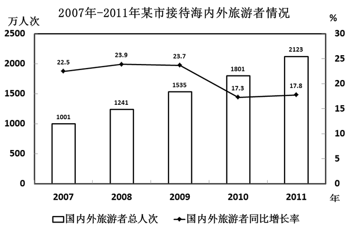

### 第 116 题

2011年，该市接待境内旅游者约多少万人次？

A. 1762

B. 2035

C. 2071

D. 2086

第 116 题 · 答案与解析

**参考答案（粉笔题库参考内容）**

B

**解析**

定位文字材料可得：“2011年，该市接待海内外旅游者2123万人次。其中，入境旅游者87.71万人次。”故境内旅游者人数 = 2123 − 87.71 ≈ 2123 − 88 = 2035万人次。

故正确答案为B。

**考点**：简单加减计算、综合资料

**来源**：2012年安徽省公务员录用考试《行测》题第116题

### 第 117 题

2006—2011年，该市接待海内外旅游者年平均增加多少万人次？

A. 244.4

B. 261.2

C. 280.5

D. 322.5

第 117 题 · 答案与解析

**参考答案（粉笔题库参考内容）**

B

**解析**

根据题干“2006—2011年，该市······年平均增加多少万人次”，可判断本题为年均增长量问题。定位柱状图可知：2011年海内外旅游者人数为2123万人，2007年为1001万人，同比增长22.5%。则2006年的海内外旅游者人数=现期/(1+r)=1001/(1+22.5%)≈1000/1.23≈813万人次。代入年均增长量公式：(现期-基期)/年份差，故2006—2011年，该市接待海内外旅游者年平均增加人数= (2123 − 813)/5 = 1310/5 = 262万人次，与B项最为接近。

故正确答案为B。

**考点**：年均增长量、综合资料

**来源**：2012年安徽省公务员录用考试《行测》题第117题

### 第 118 题

2010年，该市接待入境旅游者约占海内外旅游者总人次的：

A. 4.5%

B. 4.1%

C. 3.8%

D. 2.4%

第 118 题 · 答案与解析

**参考答案（粉笔题库参考内容）**

A

**解析**

根据题干“2010年，······占······”，结合选项均为百分数且材料数据为2011年，可判定本题为基期比重问题。定位文字材料可得：“2011年，某市接待海内外旅游者2123万人次，同比增长17.8%。其中，接待入境旅游者87.71万人次，同比增长8.2%。”代入基期比重公式：A/B×(1+b)/(1+a)，故2010年该市接待入境旅游者约占海内外旅游者总人次的比重= 87.71/2123 × (1 + 17.8%)/(1 + 8.2%) ≈ 88/2123 × 1^+ ≈ 4.1% × 1^+，比4.1%大，只有A项符合。

故正确答案为A。

**考点**：基期比重、综合资料

**来源**：2012年安徽省公务员录用考试《行测》题第118题

### 第 119 题

2011年，该市旅游总收入同比增长：

A. 16.2%

B. 17.8%

C. 18.0%

D. 19.3%

第 119 题 · 答案与解析

**参考答案（粉笔题库参考内容）**

D

**解析**

根据题干“······同比增长”，结合选项均为百分数，可判定本题为一般增长率问题。定位文字材料可得：“全年旅游总收入168.15亿元，同比增长27.20亿元。”代入增长率公式：增长量/基期量 = 增长量/(现期量-增长量)，故2011年旅游总收入同比增长为27.20/(168.15−27.20)≈ 27/141 ≈ 19%。

故正确答案为D。

**考点**：一般增长率、综合资料

**来源**：2012年安徽省公务员录用考试《行测》题第119题

### 第 120 题

能够从资料中推出的是：

A. 2011年，该市港澳台入境旅游者比去年增长约20万人次

B. 2010年，该市国际旅游创汇不足2亿美元

C. 2007—2011年中，该市海内外旅游者接待量同比增长率最大的是2008年

D. 与2010年相比，2011年该市入境旅游者接待量占海内外旅游者总接待量的比重有所增长

第 120 题 · 答案与解析

**参考答案（粉笔题库参考内容）**

C

**解析**

A项：定位文字材料可得：“2011年港澳台入境旅游者36.61万人次，同比增长43%。”故2011年该市港澳台入境旅游者比去年的增长量= 现期量/(1+r) × r = 36.61/(1+43%) × 43% ≈37/(1+1/2.5) × 1/2.5 = 37/3.5 ≈ 10万人次，错误；

B项：定位文字材料可得：“2011年国际旅游创汇2.44亿美元，同比增长10.9%。”故2010年国际旅游创汇=现期/(1 + r) = 2.44/(1 + 10.9%) ≈ 2.44/1.11 ≈ 2.2亿美元，超过2亿美元，错误；

C项：定位柱状图可知：2008年的增长率为23.9%，大于其他年份的增长率，正确；

D项：定位文字材料可得：2011年入境旅游的增长率a=8.2%，海内外旅游的增长率b=17.8%。根据两期比重比较结论，当a&lt;b时，比重下降，故相比2010年，2011年入境旅游占海内外旅游者比重有所下降，错误。

故正确答案为C。

**考点**：综合分析、综合资料

**来源**：2012年安徽省公务员录用考试《行测》题第120题

## 材料 2

根据所给资料，完成各题。

        2009年全国海洋生产总值31964亿元，比上年增长8.6%。全国海洋生产总值占国内生产总值的9.53%，占沿海地区生产总值的15.5%。海洋第一产业增加值1879亿元，海洋第二产业增加值15062亿元，海洋第三产业增加值15023亿元。

2001—2009年全国海洋生产总值占国内生产总值比重

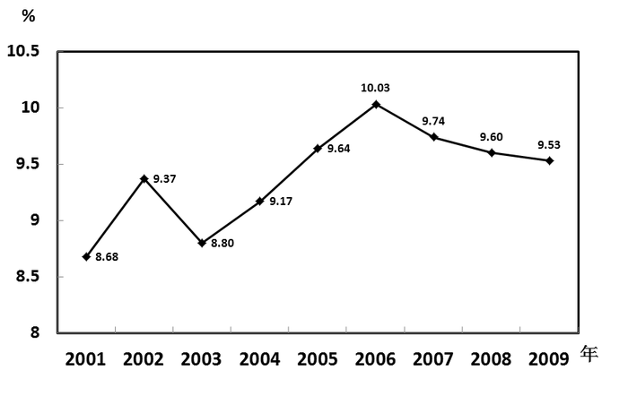

2009年全国主要海洋产业增加值

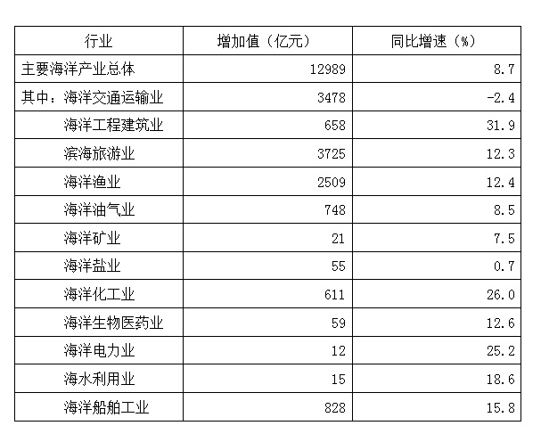

### 第 121 题

2009年我国海洋经济三大产业增加值的比重约为：

A. 5.9：47.3：46.8

B. 5.9：47.1：47.0

C. 7.2：47.3：45.5

D. 7.2：47.0：45.8

第 121 题 · 答案与解析

**参考答案（粉笔题库参考内容）**

B

**解析**

根据题干“2009年······比重约为”，结合材料数据为2009年，可判定本题为现期比重问题。定位文字材料可得：海洋经济第一、第二、第三产业的增加值分别为1879、15062、15023。则三者之和=1879+15062+15023=31964，因此海洋经济第一产业的增加值所占比重为：1879/31964 × 100% ≈ 1900/32000 × 100% ≈ 5.9%，排除C、D选项；

海洋经济第二产业的增加值所占比重为：15062 ÷ 31964 × 100% ≈ 47.1%，选B。（注：因观察到A、B选项中此数据比较接近，故此处不能估算。）

故正确答案为B。

**考点**：现期比重、综合资料

**来源**：2012年安徽省公务员录用考试《行测》题第121题

### 第 122 题

下列哪一年全国海洋生产总值占国内生产总值的比重同比增幅最大：

A. 2002年

B. 2004年

C. 2006年

D. 2008年

第 122 题 · 答案与解析

**参考答案（粉笔题库参考内容）**

A

**解析**

根据题干“······比重同比增幅最大”，由于比重自身是率，一般不考查比重的变化率，因此对比重的增长问题优先进行作差计算。定位折线图可知，全国海洋生产总值占国内生产总值比重从2001—2008年的相关数据。

2002年比重的增幅为：9.37%-8.68%=0.69%；

2004年比重的增幅为：9.17%-8.80%=0.37%；

2006年比重的增幅为：10.03%-9.64%=0.39%；

2008年比重的增幅为：9.60%-9.74%=-0.14%。

可以看出2002年的增幅最大。

故正确答案为A。

**考点**：一般增长率、综合资料

**来源**：2012年安徽省公务员录用考试《行测》题第122题

### 第 123 题

将2009年各海洋产业增加值从大到小排列，以下正确的是：

A. 海洋渔业 海水利用业 海洋矿业

B. 滨海旅游业 海洋化工业 海洋电力业

C. 海洋交通运输业 海洋盐业 海洋船舶工业

D. 海洋工程建筑业 海洋油气业 海洋生物医药业

第 123 题 · 答案与解析

**参考答案（粉笔题库参考内容）**

B

**解析**

可直接定位表格读取数据，进行比较：

A项：海洋渔业(2509)＞海洋矿业(21)>海水利用业(15)，错误；

B项：滨海旅游业(3725)＞海洋化工业(611)＞海洋电力业(12)，正确；

C项：海洋交通运输业(3478)＞海洋船舶工业(828)>海洋盐业(55)，错误；

D项：海洋油气业(748)>海洋工程建筑业(658)＞海洋生物医药业(59)，错误。

故正确答案为B。

**考点**：排序类、综合资料

**来源**：2012年安徽省公务员录用考试《行测》题第123题

### 第 124 题

2009年我国有几个海洋产业增加值的同比增幅高于主要海洋产业总体水平：

A. 6

B. 7

C. 8

D. 9

第 124 题 · 答案与解析

**参考答案（粉笔题库参考内容）**

C

**解析**

定位表格可得：主要海洋产业总体增幅为8.7%，大于该增幅的产业有海洋工程建筑业(31.9%)、滨海旅游业(12.3%)、海洋渔业(12.4%)、海洋化工业(26%)、海洋生物医药业(12.6%)、海洋电力业(25.2%)、海水利用业(18.6%)、海洋船舶工业(15.8%)，共8个海洋产业。

故正确答案为C。

**考点**：直接找数、综合资料

**来源**：2012年安徽省公务员录用考试《行测》题第124题

### 第 125 题

下列说法正确的是：

A. 2008年海洋生物医药业增加值高于海洋盐业

B. 2009年增加值排名第三的海洋产业其同比增速也排名第三

C. 2008年全国海洋生产总值占国内生产总值的比重高于2005年

D. 2009年主要海洋产业中只有海洋交通运输业是增加值同比下降的

第 125 题 · 答案与解析

**参考答案（粉笔题库参考内容）**

D

**解析**

A项：定位表格可得：2009年，海洋生物医药业的增加值为59亿元，同比增速为12.6%；海洋盐业的增加值为55亿元，同比增速为0.7%。代入基期计算公式：现期/(1+r)，故2008年海洋生物医药业的增加值= 59/(1+12.6%)，海洋盐业的增加值= 55/(1 + 0.7%)。通过观察两个分数可知，分母变化速度明显快于分子变化速度，所以分母小的分数大，故有59/(1 + 12.6%)＜55/(1+0.7%)，错误；

B项：定位表格可得：2009年增加值排名第三的产业为海洋渔业，但增速排名第三的为海洋电力业，错误；

C项：定位折线图可得：2008年海洋生产总值占国内生产总值的比重为9.60%，而2005年的比重为9.64%，2008年的比重低于2005年的比重，错误；

D项：定位表格可知，2009年只有海洋运输业增加值的同比增速为负值（-2.4%），增速为负则表明2009年海洋运输业增加值是同比下降的，正确。

故正确答案为D。

**考点**：综合分析、综合资料

**来源**：2012年安徽省公务员录用考试《行测》题第125题

## 材料 3

根据所给资料，完成各题。

        2009年7月，全国粗钢产量同比增长12.6%，增速比上个月提高6.6个百分点；钢材产量同比增长19.4%，增速比上个月提高5.4个百分点；焦炭产量同比增长6.3%；铁合金产量同比增长15.1%。钢材出口181万吨，比上月增加38万吨；进口174万吨，比上月增加11万吨。钢坯进口57万吨，比上月增加19万吨。焦炭出口5万吨，比上月增加2万吨。

        1—7月，全国粗钢产量31731万吨，同比增长2.9%，增速同比下降6.4个百分点。钢材产量37784万吨，同比下降7.6%，增速同比下降4.1个百分点。焦炭产量19048万吨，同比下降3.5%，上年同期的同比增长率为11.3%。铁合金产量1124万吨，同比增长0.8%，增速同比下降16.8个百分点。钢坯进口323万吨，同比增长27.9倍。钢材出口1116万吨，同比下降67.3%；进口988万吨，同比增长1.6%。铁矿砂进口35525万吨，同比增长31.8%。焦炭出口28万吨，同比下降96.6%。

### 第 126 题

2009年6月，全国钢材产量的同比增长率为：

A. 5.4%

B. 14.0%

C. 19.4%

D. 24.8%

第 126 题 · 答案与解析

**参考答案（粉笔题库参考内容）**

B

**解析**

定位文字材料第一段可得：“钢材产量同比增长19.4%，增速比上个月提高5.4个百分点。”故2009年6月，全国钢材产量的同比增长率为：19.4%－5.4%＝14%。

故正确答案为B。

**考点**：文字资料、简单加减计算

**来源**：2012年安徽省公务员录用考试《行测》题第126题

### 第 127 题

下列选项中，2009年7月，环比增长率最高的为：

A. 钢材出口量

B. 钢材进口量

C. 钢坯进口量

D. 焦炭出口量

第 127 题 · 答案与解析

**参考答案（粉笔题库参考内容）**

D

**解析**

根据题干“······环比增长率最高”，可判定本题为增长率比较问题。定位文字材料第一段，将相关数据代入公式：增长率 = 增长量/基期量 = 增长量/(现期量 − 增长量)。

钢材出口量增长率为：38/(181−38) = 38/143 ＜ 50%；

钢材进口量增长率为：11/(174 − 11) = 11/163 ＜ 50%；

钢坯进口量增长率为：19/(57-19)=19/38=50%；

焦炭出口量增长率为：2/(5−2) = 2/3 ＞ 50%。

因此焦炭出口量的增长率最高。

故正确答案为D。

**考点**：一般增长率、文字资料

**来源**：2012年安徽省公务员录用考试《行测》题第127题

### 第 128 题

2009年，1—5月，全国钢坯月均进口量为多少万吨？

A. 45.6

B. 46.2

C. 47.4

D. 49.0

第 128 题 · 答案与解析

**参考答案（粉笔题库参考内容）**

A

**解析**

根据题干“2009年······月均······万吨”，结合材料数据为2009年，可判定本题为现期平均数问题。定位文字材料第一段可得：“2009年7月全国钢坯进口57万吨，比上月增加19万吨。”则2009年6月全国钢坯进口量为:57-19=38万吨。定位文字材料第二段可得：“2009年1-7月，全国钢坯进口323万吨。”则2009年1-5月，全国钢坯月均进口量进口总量/月份数=(323−57−38)/5=228/5=45.6万吨。

故正确答案为A。

**考点**：文字资料、现期平均数

**来源**：2012年安徽省公务员录用考试《行测》题第128题

### 第 129 题

2007年，1-7月，全国粗钢产量约为多少亿吨？

A. 2.0

B. 2.4

C. 2.8

D. 3.2

第 129 题 · 答案与解析

**参考答案（粉笔题库参考内容）**

C

**解析**

根据题干“2007年1-7月······亿吨”，结合材料数据为2009年1-7月，可判定本题为间隔基期问题。定位文字材料第二段可得：“2009年1-7月全国粗钢产量为31731万吨，同比增长2.9%，增速同比下降6.4个百分点。” 则2008年1-7月同比增长：2.9%+6.4%=9.3%。间隔增长率= r1+r2+r1×r2 = 2.9%+9.3%+2.9%×9.3% ≈ 12.2%+0.3% = 12.5%。间隔基期公式：现期量/(1+间隔增长量)，故2007年1-7月全国粗钢产量31731/(1+12.5%)≈32000/1.1≈29000万吨=2.9亿吨，与 C项最为接近。

故正确答案为C。

**考点**：文字资料、间隔基期

**来源**：2012年安徽省公务员录用考试《行测》题第129题

### 第 130 题

下列说法与资料相符的是：

A. 2008年1-7月，全国粗钢产量高于钢材产量

B. 2009年1-7月，全国焦炭产量低于2007年同期水平

C. 2008年1-7月，全国铁矿砂进口量超过3亿吨

D. 2009年1-7月，全国钢材进出口总量比上年有所下降

第 130 题 · 答案与解析

**参考答案（粉笔题库参考内容）**

D

**解析**

A项：定位文字材料第二段可得：“2009年1-7月，全国粗钢产量31731万吨，同比增长2.9%；钢材产量37784万吨，同比下降7.6%。” 代入基期计算公式：现期/(1+r)，故2008年1-7月，全国粗钢产量为31731/(1+2.9%)＜31731，钢材产量为37784/(1-7.6%)＞37784，显然前者小于后者，因此A项错误；

B项：定位文字材料第二段可得：“2009年1-7月，全国焦炭产量为19048万吨，同比下降3.5%，上年同期的同比增长率为11.3%。” 间隔增长率=r1+r2+r1×r2=−3.5%+11.3%+(−3.5%)×11.3%≈7.8%−0.4%=7.4%。间隔基期公式：现期量/(1+间隔增长率)，故2007年全国焦炭产量= 19048/(1 + 7.4%) ＜ 19048，所以2007年全国焦炭产量小于2009年，错误；

C项：定位文字材料第二段可得：“2009年1-7月，铁矿砂进口35525万吨，同比增长31.8%。” 代入基期计算公式：现期/(1+r)，故2008年1~7月，全国铁矿砂进口量为：35525/(1+31.8%)＜35525/1.3＜39000/1.3= 3000万吨 = 3亿吨，因此C错误；

D项：定位文字材料第二段可得：“2009年1-7月，钢材出口1116万吨，同比下降67.3%；进口988万吨，同比增长1.6%。”则2009年1-7月钢材进出口总量：1116+988=2104万吨。基期计算公式：现期/(1+r)，故2008年，钢材出口量为：1116/(1-67.3%) ＞ 1116/0.4 = 2790 ＞ 2104，即2008年钢材的出口量＞2009年钢材的进出口总量。因此2008年钢材进出口总量肯定超过2009年，正确。

故正确答案为D。

**考点**：文字资料、综合分析

**来源**：2012年安徽省公务员录用考试《行测》题第130题

