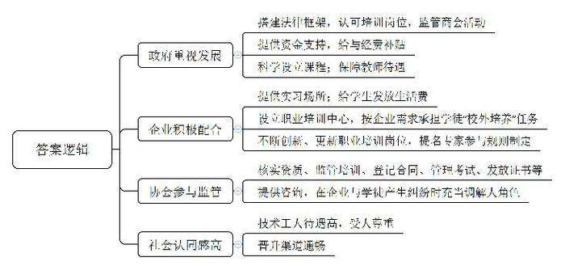

# 2013年公务员多省联考《申论》题（安徽B卷）

<!-- gwy:overview:start -->
> **安徽 · 2013 · 申论 · B类** ｜ 4 题 · 图片 1 处 · 答案随题折叠

导航：[题目](#题目) · [材料 1](#材料-1)
<!-- gwy:overview:end -->

> 候选采集稿。参考答案及解析来自粉笔页面，不代表官方答案或真实高分答卷；来源使用许可与原卷对应关系仍需人工核实。

## 给定材料

### 材料 1

2009年，一群来自深圳的普通工人成为美国《时代》周刊的年度人物。周刊一出版，中国工人的灿烂笑容，瞬间给处于经济低迷的世界带来希望。他们坚毅的目光，质朴的外表，倔强的神态，真实地反映了中国工人的性格，这种性格，为“中国制造”贴上了光亮的标签。中国工人一直以勤劳、坚韧的姿态出现在历史各个时期。建国之初，“咱们工人有力量”这昂扬的旋律曾伴随共和国的成长，点亮了一个时代。无论是石油开采，还是钢铁制造，各个行业都闪耀着工人的光彩，“工人老大哥”成为令人艳羡的称呼。工人成了国家和工厂的主人，这极大地激发了工人的工作热情和生产积极性。大庆的“铁人”王进喜“宁可少活20年，拼命也要拿下大油田”的忘我拼搏精神，老英雄孟泰“为鞍钢谱写的一曲自力更生的凯歌”的创业精神，激励着工人们创造出一个又一个生产奇迹，为共和国的建设做出了不可磨灭的贡献。工人的内心骄傲是那么强烈，归属感油然而生。

随着时代的更替，社会条件发生转变，生产方式进行了变更。在一段历史时期，农民工成为中国独有的劳动用工方式，一定程度上消化了农村剩余劳动力，以低成本支持着工业化发展。改革开放早期，农民工是一批将外出务工作为副业的农村人口，由外出务工而带来的财富转移在一定程度上起到了平衡城乡差距的作用。但这种情况随着农民工群体的代际更替发生了变化，“80后”“90后”的新一代农民工客观上已经无法回到农村，他们成了新时代的“新工人”。

### 材料 2

“她们太没有责任心了，上班的时候还玩手机，聊天，哪像我们啊。”谢紫头一扭，提高声调对着李婧舒说，李婧舒笑了笑，不做声。

这是条小小的商业街，有可供歇脚的长凳，时近黄昏，“70后”谢紫和“90后”李婧舒在此聊着天。街外，由于植被稀少，工业园区被巨大而又沉闷的灰色笼罩，灰色的天，灰色的厂房，身着蓝色和浅灰色工装的女工们来来往往，货车和摩托车四处穿梭。这个工业区的高峰时期，曾工作和居住着8万人，但随着企业部分产能的向外转移，现在只有3万人左右了。人群的聚散，青春的过往，10年前就来到这里的湖南人谢紫是目睹者，就连她自己，也是几进几出，换厂、结婚、生孩子，在生活中，她以家乡为据点，在工作中，她以这里为据点，两边穿梭，沉默又坚韧。

去年刚刚高中毕业的李婧舒是新一批的落脚者，她说她也认同谢紫对她们年轻人的看法，但时代不同了，现在的选择多多啊，年轻人可没有那么好的耐性，绝大部分人的志向并不在那些单调枯燥的生产线上，不愿干了就走呗。像她这样的年轻人，如今已经成为她所在的城区外来务工人员的主流。这个庞大而年轻的外来工群体的归依，正在给中国社会的发展提出越来越现实的挑战。

来自湖北荆州，现在在这个工业区一家外资企业打工的一名李姓男员工说：“我们四周是高高的围墙，还有铁丝网，戒备森严，好像监狱一样，连上厕所都限定时间，平均一天要工作12个小时以上。”已经在广州打工7年的小王，今年25岁，也在这家厂里上班，他的话语里藏着许多无奈：“你看我们的厂房，条件好着呢。可是，一进车间，所有人就失去了名字。工人密密麻麻的坐着，工作的时候根本没空说上一句话，得死命盯着手里的活，稍微一放松，零件从你眼前滑过，钱就从你眼前溜走了，因为我们都是计件工资。最近我总是想起卓别林的经典电影《摩登时代》，有时我会想，我们是不是和电影中的夏尔洛很像？没有多少人真正关心我们！”但是，这家厂的厂长助理王先生却说：“现在的年轻工人，已与他们的父辈不同，并不满足于做工挣钱。他们大多受过初中以上教育，对自由、个人尊重越来越重视，如果无法满足他们的要求，他们马上就会跳槽。企业如果不能有一批长期忠诚的骨干，企业壮大和职工发展都很难谈得上。”

一项调查显示，当下国内仅有1%的人愿意做工人。有人评价道：“中国的工人获得了美国《时代》周刊的认同，却没有在中国获得普遍的认同。”在一些人的眼中，中国的工人，现在基本成了流水线操作者的代名词，是不需要多高技术的作业者。劳动力，不仅仅是生产要素，更是一个个有着喜怒哀乐，有着梦想和追求，有着家庭生活的活生生的人。他们不仅要安身立命，他们也要有尊严，甚至还要——抬头仰望星空。诺贝尔奖获得者、印度著名经济学家阿马蒂亚·森曾说过这样的一句话：“在一个走向现代化的国家中，经济发展是必然的事情。相比较于经济的发展，更为重要的事情是让更多的人——尤其是普通人，能够分享到经济发展的成果。”显然，这句话同样契合中国的实际，中国工人，需要时代的认同，需要社会的尊重，还需要有发自内心的骄傲。

### 材料 3

盛昌是一家制鞋企业，在很长一段时间内曾是耐克在深圳的主要代工厂，规模最大时达10万人之多。如今它偏居一隅，隐藏在一段年久失修的小路最深处，周围只有几处零散的小作坊。“盛昌曾是横岗地区知名的企业，除了耐克，盛昌也为其他跨国公司代工。”该厂安全负责人沈先生介绍，“现在只能接到一些小品牌的零散订单，这在以前根本不会接。现在用工成本很高，熟练工的工资涨得更快。对我们来说，加薪是找死，不加薪是等死。现在耐克将代工企业逐步外迁，我们现在真是有心无力了。”就连盛昌对面卖奶茶的大娘都深切地感受到了这种变化，她说：“这两年生意太难做了，一杯奶茶只卖到1块钱，在深圳这样的高消费城市，已经无法再便宜了，可是现在就是这1块钱的奶茶都不好卖了。”这样一家效益曾经很好的代工企业，现在雇员仅剩三四千人，正可谓“盛极而衰”。

全国何止成千上万个盛昌？“中国制造”曾经疯狂席卷全球，阿富汗人骑的自行车，越南人骑的摩托车，巴基斯坦小店里摆放的文具用品，美国人看的电视机和穿的衣服，欧洲人用的家电和玩具，都贴着“中国制造”的标签，中国一度成为了“世界工厂”。然而，中国的“世界工厂”名号只是“代工厂”的另一种说法。这些企业靠的仅是低技术含量和劳动密集型产业链。随着劳动力优势的逐渐丧失，一度把为世界品牌代工视为骄傲的工厂，现在不得不面临疲于维持的状态，甚至走上破产的命运。中国的工业化发展似乎陷入了某种困境，靠廉价劳动力优势支撑起来的国家经济发展，如同竭泽而渔。

A市是长三角经济圈中一个重要的新兴工业城市，以制造业为主体，经济发达。近年，A市的制造业一样面临劳动力成本上升的制约因素，过去以代工制造为主导的发展模式越来越受到挑战。如何实现产业结构转型升级，A市探索在向产品发展设计、研发和营销向两头延伸的同时，实施中间分离，在现代制造业中拓展现代服务业，既助推现代制造业进一步发展，也实现了产业整体转型升级。在A市，很多企业剥离主副业，实施二三产业拓展分离。比如从玩具制造企业中，拓展分离出了玩具商贸有限公司，由其专门从事市场推广、品牌塑造和商品销售。剥离后，产品研发、品牌塑造、销售可以走上专业化、社会化和市场化发展的道路，实现做强做大的目标。通过转型升级，企业在发展过程中提升了自主创新的能力，逐渐塑造起自己的品牌，不再依附于代工模式，最终实现外资和民资、现代制造业和现代服务业两翼齐飞的局面。

发展经济就像开汽车一样，在直道上可以快一点，但如果要转90度或更大角度的弯，就必须要把速度降下来。不论是因为中国的人口红利正在逐渐消失之中，还是因为本身的发展需要，中国的制造业都亟待转型升级，在转型期，会出现像盛昌一样“盛极而衰”的企业，也会涌现出像A市这样的成功经验。

### 材料 4

某大学的陈博士认为，劳动力短缺对于未来中国发展来说是个积极的信号。短缺的劳动力市场会使我们开始关注劳动力资源对于中国崛起梦想的重要性。只有当为这种稀缺的劳动力资源支付更高的报酬时，我们才会认识到人力资本投资的重要性，而技术创新也会随之绽放。他说，如今有的人在谈论中国崛起之际，总爱用那些以廉价劳动力堆积出来的GDP和羽翼渐丰的国际影响力作为他们的例证，这是一种认识的误区。他介绍到，世界银行资深经济学家杰里夫·萨克斯教授发现了一个非常有趣的“资源诅咒”现象：自然资源丰富的国家并没有获得想象中的高速经济增长，比如，拥有丰富资源的尼日利亚和委内瑞拉正经历着较低增长或者还在痛苦的经济增长中挣扎；而相反的是，韩国、新加坡和瑞士等自然资源相对匮乏的国家，经济却表现出异常的稳定性和持续性。现在看来，拥有丰富石油资源的俄罗斯也已陷入“石油诅咒”的陷阱之中。究其原因，就在于这些顺取逆守的资本家在获得原始资本积累之后，非但没有像新自由主义者所期望的那样，向社会支付再生产所需要的市场价格，反而利用与地方政府以及其他政治力量的强大勾结，向工人支付低于再生产所需的低工资，以更低的价格继续获得大片优良的自然资源。陈博士说：“我并不担心处于发展轨道的中国会像俄罗斯那样陷入‘石油诅咒’陷阱，但是非常担忧会陷入‘人口诅咒’的陷阱。”目前中国制造业如若不应对得当，极有可能沦为建立在沙子上的王国，难以经受真正的风雨洗礼。

### 材料 5

当虚拟经济在发达国家尤其是美国占据主导地位的时候，越来越多的人沉迷于金融市场的海洋里，实体经济不可避免地受到冲击。在“次贷危机”引发的国际金融风暴里，发达国家从高速增长一下子跌入茫茫沼泽地。经此一劫，发达国家认识到：脱离制造业的虚拟经济“虚火”，是酿成危机进而造成全球经济长期低迷的主因。卢·兰奇是美国通用电气家电业务的设计主管，他说：“过去我们曾认为我们负责设计然后控制销售就万事大吉，现在我们发现这是个错误，一旦你把生产转移出去，就很可能再也回不来了。而这种变化是一点点显现的：当你第一次把烤面包机和热水器转移到海外生产时，你还知道如何制作这些产品，因为昨天、上个月或者上个季度你还在生产它们；但是当产品更新换代、技术不断进步后，为降低成本而不断更换代工厂的时候，设计产品的人与生产产品的人之间的差距就像太平洋一样宽广。”越来越多的美国公司开始认识到，过去十几年美国经济的外包浪潮是个严重的错误。

现在，回归实业几乎成为欧美等发达经济体共同的战略选择。美国从2009年到2012年，先后推出了《美国制造业振兴法案》、“购买美国货”、“五年出口倍增计划”、“降低制造业的税收负担”等多项政策措施，推动美国制造业复兴和回归实体经济。到2012年1月，美国制造业的经济活动连续30个月保持增长，总体经济活动连续32个月保持增长。制造业出口一直稳步上升，2011年约占出口总额的52%。失业率从2009年10月的10.2%降至7.9%，制造业贡献了超过40万个就业岗位。这些数据表明，美国制造业正走在“回归”的路上。另一方面，美国制造业“回归”走的是高端路线，旨在打造先进制造业，基建和科研、教育、可再生能源及节能项目、智能电网、医疗信息化、环境保护等是其投资的重点。

早在1999年，学者冯艾盟就指出制造业是未来经济繁荣的关键，他认为，与先进的服务业相比，制造业所能创造的就业岗位组合要好得多——每个人都能从制造业中获得工作，从蓝领工人到工程师、科学家，乃至顶级高管。先进的制造商可以积累大量秘密的生产诀窍，这些诀窍要通过一代又一代人“从做中学”，拥有这些诀窍能避免其受到来自于拥有廉价劳动力的海外竞争对手的威胁。按单位产能，制造业公司的出口能力比服务业公司强大近10倍。制造业的出口能力之所以表现优异，是因为制造业产品在整个世界范围内的出售几乎不会遇到适应性的问题，而服务业产品如电脑软件，需要付出高昂的代价，才能满足海外市场上不同的文化需求。

在战后经济复兴的过程中，日本政府制定了“产业合理化计划”，把综合机械加工、冶金和化工等制造业作为发展出口的主力产业。早在1958年，日本就制定了职业训练法，重视劳动力素质和职业教育的做法一直延续至今。正是日本的制造业中有一大批以技术为自豪的劳动者，使许多日本产品精致异常，日本产品形象深入人心，制造业不断得以发展。进入20世纪80年代，日本企业开始进军欧美市场，在当地成立公司，当地采购、当地生产。1985年以后，日元急剧升值，日本产品的价格竞争力相对下降，为降低生产成本，出口企业纷纷将工厂迁往人工费低廉的亚洲各国，随着制造业基地对外转移，引起国内制造业的萎缩，出现了所谓“产业空洞化”现象，日本国内看似继续引领研发，却离工厂越来越远，创造力越来越弱，日本的有识之士惊呼“我们正处于空前的空心化危机中”。

“德国制造”125年的历史就像一个童话，它是德国在“二战”后崛起的密码，世界金融危机中挺立不倒的依靠，欧债危机中仍“一枝独秀”的答案。100多年中，任何一件“德国制造”产品都像一块热气腾腾的蛋糕，受到各国的欢迎。当美英等西方国家纷纷把制造业向发展中国家外包，自己转向来钱更容易的金融业时，德国仍将主要精力放在制造业产品质量与技术水平的提高上。正是这种制造业立国的发展战略，不仅让德国保持了较高的就业率，促进了德国科技创新能力的不断提高，也使得德国具备了抵御金融危机冲击的坚实产业基础。美国《新闻周刊》曾在题为“众厂之厂”的文章中感叹：德国制造之所以称霸世界，是因为德国人能把普通的金属敲打成震惊世界的科技奇迹。有专家认为，德国的制造业与美英制造业最大的不同在于，德国重视以人为主导的生产，而美英重视以资本为主导的生产。在金融危机期间，美英国家的制造业部门大量裁员，而德国政府通过政府扶持和补贴等手段，尽量维持制造业的就业稳定。因为资本没有思想，人才有，工程师一旦被解雇就再难重返岗位了，这也正是危机过后德国的研发密集型制造业能迅速恢复的重要原因。

### 材料 6

克里斯蒂安是德国勃兰登堡州一个小企业的木工。他初中毕业后，面临的选择是继续深造学习，还是进入职业学校学一门手艺。“我和父母分析了自己的情况和家庭条件后，决定上职业学校的木工专业。”克里斯蒂安介绍说，“在德国，经职业技术培训后的技术工人待遇很高，也很受尊重。我16岁上职业学校时，每月就能挣400欧元，足够自己生活了。再过两年我就有资格参加高级技师考试，26岁我完全有可能成为高级技工。”德国大学学制较长，一般6年，克里斯蒂安的初中同学大学毕业后起码26岁，6年大学的开销最少4万欧元，毕业后还一贫如洗的时候，他的存折上已经有5位数字的存款了。

德国制造很大程度上归功于这个国家高水平的职业技术教育。德国目前有各种职业学校9000多所，除了30%左右的青年上大学外，绝大多数人都选择了不同形式的职业教育。职业培训的费用主要由政府和企业承担，培养一名职业学校学生每年平均花费1.5万欧元，而普通学校的学生只是这一费用的三分之一。另外，企业还提供实习场所，并发给学生每月500至800欧元不等的生活费。德国《职业教育法》中，对参与职业教育企业的资格、设备、场所等方面都有所规定，能够进行职业技术教育，表明了企业的水平，对于企业来说是一种荣誉，当然企业也会享受到国家的经费补贴。但也不是所有企业都有能力或愿意亲自培养人才，对一些企业来说，购买培训设备、找人实施培训的费用十分昂贵。于是，一些专门帮助企业承担学徒“校外培养”任务的职业培训中心应运而生。企业需要什么，培训中心就培训什么。

在德国职业教育体系中，政府和工业界都扮演着非常重要的角色。无论是联邦政府、地方政府还是企业、工商协会，各司其职，目的只有一个：培养技术型人才，保持德国竞争力。德国联邦政府主要负责搭建合理的法律框架，认可培训岗位并对培训、创新以及相关研究提供必要的资金支持。为职业教育学校设定课程，为教职人员提供资金支持等事务则落到各联邦州的头上。同时，联邦州还需监管商会活动，因为商会在职业教育中承担了监管企业、证书发放等重要任务。作为职业教育体系中的中坚力量，企业有必要不断创新、更新职业培训岗位，提名专家参与规则制定，并提供一定的培训补贴。工商联合会和手工业协会两大协会负责监管企业，包括核实企业培训资质、监管企业培训、登记培训合同、管理考试等重要环节。此外，商会还会为企业培训提供咨询，在企业与学徒产生纠纷时充当调解人角色。法国总统曾感慨地说，德国每年要向西欧出口很多产品，但看来还应该出口另一种产品，这就是职业教育和职业培训制度。

### 材料 7

浙江Z公司新品线组长老梁，利用3个月的工余时间，经过100多次反复的试验，攻破了“丝攻短牙（拔牙）项目”，让该公司每年仅这个工序就节约了10多万的生产线成本。“作为生产工人，最关心的就是产品的合格率。我这样做，只是坚持了我的工作准则，尽量降低产品的废品率，节约生产成本。”老梁这样理解自己的自主创新，“我是通过这种创造性劳动体会到了更多的价值。我们工人不该只是流水线上的生产工具，我们应该成为一个个充满创造性的个体。其实只要给我们工人一个杠杆，我们同样能撬动地球！”

宝钢集团以全国钢铁业6%的产量，实现了全行业约30%的利润。有何秘诀呢？“职工是企业力量之基、活力之源！”宝钢集团董事长说，“宝钢式创新的最大特色是‘蓝领创新’，每天产生专利4件，五成由一线工人创造。”工人发明家孔利明20多年来，为宝钢解决各类设备的疑难杂症，主导生产工艺改进，直接创造的经济效益达上千万元。“我的大学在宝钢。”这是孔利明的肺腑之言。出身钳工的卢江海在孔利明的带动下，立足本职岗位搞专利研发，成为宝钢的“金点子大王”，一年内他提出13条合理化建议，创造26项实用专利、4项发明专利。宝钢的职工创新以开放式的岗位责任制为基础，逐步形成深入的创新体系和跨岗位、跨区域、跨专业的协同创新机制，同时，还建立了全覆盖的创新激励的体系，职工创新奖励从10元到100万元。“机器不能代替人，中国工人在任何时代都是有力量的，关键在于怎样激发他们的创造力。”上海市总工会主席认为，宝钢“蓝领创新”，就是现代企业制度下如何依靠职工的最好诠释。

### 材料 8

“一招鲜，吃遍天”，“有了金刚钻，揽得瓷器活”，这些充满生活智慧的俗语，揭示了一个道理：知识和技能最重要，而劳动者知识和技能的提升，离不开职业培训。

近年来，我国不断加大劳动者职业培训力度，“十一五”期间，全国共培训劳动者达8600万人次。但总的来看，我国劳动力总体素质偏低，还难以适应经济发展和结构调整的需要。2010年10月，国务院印发《关于加强职业培训促进就业的意见》，明确提出了建立职业培训工作新机制、健全面向全体劳动者的职业培训制度。要贯彻落实好《意见》要求，进一步健全职业培训体系，积极开展职前和在职全程培训，全面提高劳动者素质。

## 题目

### 第 1 题

“给定资料3”陈述了我国部分制造业企业两种不同的发展模式，请用简洁的语言，分别给这两种模式冠名，并对其特征加以说明。

关联材料：材料 3

作答要求：（17分）

（1）分开表述；

（2）内容准确有条理；

（3）超过300字。

第 1 题 · 答案与解析

**参考答案（粉笔题库参考内容）**

一、以盛昌为代表的代工制造发展方式，是一种传统的制造业发展模式。这种发展方式1.技术含量低，依靠劳动密集型产业链，曾盛极一时；2.随着用工成本增加，廉价劳动力优势的逐渐丧失，就会艰难维持，甚至破产。

二、以A市为代表的实现制造业转型升级的发展方式，是一种现代的制造业发展模式。这种方式1.探索向产品设计、研发和营销两头延伸；2.在现代制造业中拓展现代服务业，实现二三产业分离，走专业化、社会化、市场化发展道路；3助推现代制造业发展，也实现产业整体转型升级；4.提升企业自主创新力，塑造品牌，助推企业做大做强。

因此，我们要摒弃传统制造业发展方式，学习A市，积极创新，推动产业结构转型升级，发展现代制造业。

**解析**

> 粉笔页面在本题只提供参考答案与「考点 / 来源」，没有单独的文字解析。

**来源**：2013年公务员多省联考《申论》题（安徽B卷）

### 第 2 题

**根据“资料6”分析归纳职业技术教育在德国成功的原因。**

关联材料：材料 6

作答要求：全面准确，条理清楚，250字左右。（18分)

第 2 题 · 答案与解析

**参考答案（粉笔题库参考内容）**

1.政府重视发展。搭建法律框架，认可培训岗位，监管商会活动；提供资金支持，给与经费补贴；科学设立课程；保障教师待遇。2.企业积极配合。提供实习场所；给学生发放生活费；设立职业培训中心，按企业需求承担学徒“校外培养”任务；不断创新、更新职业培训岗位，提名专家参与规则制定。3.协会参与监管。负责核实资质、监管培训、登记合同、管理考试、发放证书等，同时提供咨询，在企业与学徒产生纠纷时充当调解人角色。4.社会认同感高。技术工人待遇高，受人尊重，晋升渠道通畅。

**解析**

**参考答案说明**：本答案从“政府”“企业”“协会”“社会”等不同的主体，对职业技术教育在德国取得成功的原因进行了分条撰写。各条要点之间在内容上是并列关系，且每一条要点以“总括词+具体小点”的形式书写。

**来源**：2013年公务员多省联考《申论》题（安徽B卷）

**答题演示（粉笔页面原文，含审题—读料—要点提取全过程）**

> 以下为粉笔页面本题「答题演示」分区的原文转写；它不是官方答案，也不是参考作答，与上方参考答案并列存放。

**第一步——审题**

通过勾画题干关键词，明确题型，题目的主题、答题要素、材料范围和作答要求等。

<u>根据</u>“<u>资料</u>6”【出现“根据”一词，提示我们只需阅读资料6】分析归纳<u>职业技术教育在德国成功</u>的<u>原因</u>【由“分析……原因”可知本题是单一题；要找职业技术教育为何能在德国取得成功。“分析归纳”说明要有总结分类的意识，每一条要点尽量将概括性强的词语前置，以“总括词+具体小点”的形式书写要点】。

要求：全面准确，条理清楚，250字左右。（18分）

第二步——阅读资料，提取要点

**资料**6

**段****1****：**克里斯蒂安是德国勃兰登堡州一个小企业的木工。他初中毕业后，面临的选择是继续深造学习，还是进入职业学校学一门手艺。“我和父母分析了自己的情况和家庭条件后，决定上职业学校的木工专业。”克里斯蒂安介绍说，“在德国，经<u>职业技术培训后的技术工人待遇很高</u>，<u>也很受尊重</u>。我16岁上职业学校时，每月就能挣400欧元，足够自己生活了。再过两年我就<u>有资格参加高级技师考试</u>，26岁我完全有可能<u>成为高级技工</u>。”德国大学学制较长，一般6年，克里斯蒂安的初中同学大学毕业后起码26岁，6年大学的开销最少4万欧元，毕业后还一贫如洗的时候，他的存折上已经有5位数字的存款了。

〖（1）“职业技术培训后的技术工人待遇很高，也很受尊重”使得德国职业教育取得成功，由此可摘抄出原因：①技术工人待遇高，受人尊重。（2）“有资格参加高级技师考试”“有可能成为高级技工”，意味着在参加职业教育后，能够有较好的发展前景和晋升渠道，从中可概括出成功的原因：②晋升渠道通畅。〗

**段****2****：**德国制造很大程度上归功于这个国家高水平的职业技术教育。德国目前有各种职业学校9000多所，除了30%左右的青年上大学外，绝大多数人都选择了不同形式的职业教育。职业培训的<u>费用主要由政府和企业承担</u>、培养一名职业学校学生每年平均花费1.5万欧元，而普通学校的学生只是这一费用的三分之一。另外，<u>企业还提供实习场所</u>，并<u>发给学生</u>每月500至800欧元不等的<u>生活费</u>。德国《职业教育法》中，对参与职业教育企业的资格、设备、场所等方面都有所规定，能够进行职业技术教育，表明了企业的水平，对于企业来说是一种荣誉，当然<u>企业也会享受到国家的经费补贴</u>。但也不是所有企业都有能力或愿意亲自培养人才，对一些企业来说，购买培训设备、找人实施培训的费用十分昂贵。于是，一些专门帮助企业承担学徒“校外培养”任务的<u>职业培训中心</u>应运而生。企业<u>需要什么培训中心就培训什么</u>。

〖（1）“费用主要由政府和企业承担”提示出德国职业教育有政府和企业的资金支持，可概括出原因：③政府和企业能够提供资金支持。（2）“企业还提供实习场所”“发给学生生活费”提示出企业的支持方式，可摘抄出原因：④企业能提供实习场所，并给学生发放生活费。（3）“企业会受到国家经费补贴”提示政府的投入还包含补贴企业，可摘抄出原因：⑤国家给与企业经费补贴。（4）“职业培训中心”“企业需要什么培训中心培训什么”提示在职业教育中会按需培养，可概括出成功原因：⑥设立职业培训中心，按企业需求承担学徒“校外培养”任务。〗

**段****3****：**在德国职业教育体系中，政府和工业界都扮演着非常重要的角色。无论是联邦政府、地方政府还是企业、工商协会，各司其职，目的只有一个：培养技术型人才，保持德国竞争力。德国<u>联邦政府</u>主要负责<u>搭建合理的法律框架</u>，<u>认可培训岗位</u>并对培训、创新以及相关研究<u>提供必要的资金支持</u>。<u>为职业教育学校设定课程</u>，<u>为教职人员提供资金支持等事务</u>则落到各联邦州的头上。同时，联邦州还需<u>监管商会活动</u>，因为<u>商会</u>在职业教育中承担了<u>监管企业、证书发放</u>等重要任务。作为职业教育体系中的中坚力量，企业有必要<u>不断创新、更新职业培训岗位</u>，<u>提名专家参与规则制定</u>，<u>并提供一定的培训补贴</u>。工商联合会和手工业协会两大<u>协会负责监管企业</u>，包括<u>核实企业培训资质、监管企业培训、登记培训合同、管理考试等</u>重要环节。此外，商会还会<u>为企业培训提供咨询</u>，<u>在企业与学徒产生纠纷时充当调解人角色</u>。法国总统曾感慨地说，德国每年要向西欧出口很多产品，但看来还应该出口另一种产品，这就是职业教育和职业培训制度。

〖（1）“联邦政府负责搭建合理法律框架”“认可培训岗位”“提供资金支持”，提示联邦政府为推动职业教育采取的措施，从中可摘抄出原因：⑦政府搭建法律框架，认可培训岗位，提供资金支持。（2）“为职业教育设定课程”“为教职人员提供资金支持”是各联邦州政府为推动职业教育发展采取的措施，可概括出原因：⑧科学设立课程，保障教师待遇。（3）“联邦州还需监管商会活动”提示联邦政府为推动职业教育采取的措施，从中可摘抄出原因：⑨监管商会。（4）“商会在职业教育中承担了监管企业、证书发放等重要任务”提示出商会在职业教育中的任务，可摘抄出原因：⑩商会承担了监管企业、证书发放的任务。（5）“不断创新、更新职业培训岗位，提名专家参与规则制定，并提供一定的培训补贴”提示企业推动职业教育采取的做法，可从中摘抄出原因：⑪企业不断创新、更新职业培训岗位，提名专家参与规则制定，提供培训补贴。（6）“协会负责监管企业”“核实企业培训资质、监管企业培训、登记培训合同、管理考试等”“为企业培训提供咨询”“充当调解人角色”提示两大协会发挥的作用，可概括出原因：⑫协会负责监管企业、核实资质、监管培训、登记合同、管理考试，同时提供咨询，在企业与学徒产生纠纷时充当调解人角色。〗

第三步——按题目要求整理要点【梳理各个要点，发现这些要点是从“政府”“企业”“协会”“社会”四个方面展开，可以将要点按照这四类进行划分。每一条要点尽量将概括性强的词语前置，以“总括词+具体小点”的形式书写要点】

【要点③⑤⑦⑧⑨为政府方面的原因，政府重视职业教育发展并为之做出努力，可以提炼出前置总括词“政府重视发展”。】1.政府重视发展。【要点⑦⑨为法律层面】搭建法律框架，认可培训岗位，监管商会活动；【要点③⑤为资金层面】提供资金支持，给与经费补贴；【要点⑧为教育层面】科学设立课程；保障教师待遇。

【要点④⑥⑪为企业方面的原因，企业配合政府，共同推动职业教育发展，可以提炼出前置总括词“企业积极配合”。】2.企业积极配合。【要点④为学生提供帮助】提供实习场所；给学生发放生活费；【要点⑥为适应市场需求】设立职业培训中心，按企业需求承担学徒“校外培养”任务；【要点⑪为行业自身发展】不断创新、更新职业培训岗位，提名专家参与规则制定。

【要点⑩⑫为协会方面的原因，协会与政府共同监管，助推职业教育成功，可以提炼出前置总括词“协会参与监管”。】3.协会参与监管。负责核实资质、监管培训、登记合同、管理考试、发放证书等，同时提供咨询，在企业与学徒产生纠纷时充当调解人角色。

【要点①②为社会方面的原因，民众对职业教育认可，推动了职业教育发展，可以提炼出前置总括词“社会认同感高”。】4.社会认同感高。【要点①】技术工人待遇高，受人尊重，【要点②】晋升渠道通畅。

### 第 3 题

**假设某市总工会领导阅读了“资料7”后，拟在全市制造业中开展“蓝领创新”活动，请以“XX市总工会”的名义，代写一份倡议书。**

关联材料：材料 7

作答要求：定位准确，内容全面，语言生动，具有号召力。（400-450字)（20分）

第 3 题 · 答案与解析

**参考答案（粉笔题库参考内容）**

关于开展“蓝领创新”活动的倡议书

广大职工朋友：

创新是民族进步的灵魂，是国家兴旺发达的不竭动力，也是企业可持续发展的必然要求。职工是企业的力量之基、活力之源。目前我市制造业正处于转型升级的攻关期，为了企业能够顺利转型，走上高质量的发展之路，也为实现我们新时代工人的自身价值，我会决定在全市制造企业中开展“蓝领创新”活动，鼓励一线工人自主创新，激发蓝领工人的创造性。

在此倡议各位在岗职工：一、转变观念，发挥自主性和创造性，开拓创新。二、爱岗敬业，坚持工作准则，节约生产成本。三、立足本职岗位不断学习、钻研，相互带动。四、针对工作中出现的各种疑难杂症，勇于提出合理化建议，积极改进生产工艺，申请专利，创造更大的经济和社会效益。另外，企业也要建立和完善创新激励的机制体系，以物质、精神等多种方式，激发职工的创新动力，依靠职工，实现可持续发展。

“蓝领创新”是时代之势，是发展所需。希望各位工友积极投身到“蓝领创新”的活动中来，在本职岗位上发挥自己的聪明才智，实现自身理想与价值！

市总工会

XX年XX月XX日

**解析**

> 粉笔页面在本题只提供参考答案与「考点 / 来源」，没有单独的文字解析。

**来源**：2013年公务员多省联考《申论》题（安徽B卷）

### 第 4 题

给定资料7中“其实只要给我们工人一个杠杆，我们同样能撬动地球！”根据对这句话的理解，参考给定资料，自拟标题，自选角度，写一篇不少于800字的文章。（45分）

关联材料：材料 1、材料 2、材料 3、材料 4、材料 5、材料 6、材料 7、材料 8

作答要求：

（1）中心明确，思想深刻；

（2）内容充实，论证有力；

（3）思路清晰，语言流畅。

第 4 题 · 答案与解析

**参考答案（粉笔题库参考内容）**

**论发挥工人创造力的三个杠杆**

中国的工人地位很尴尬：干着最脏最累的活，拿着最低的报酬，屡被拖欠着工资，受着城里人歧视，生活在城市的最底层，经常面临着失业的窘境，这就是新时代工人的写照。但是工人的内心很坚强，不卑不亢，自强不息！正是这个群体发出了铿锵有力的呐喊：只要给我们工人一个杠杆，我们同样能够撬动地球！这种精神令我们惭愧，更令我们汗颜，不禁让我们反思，工人到底需要什么的杠杆呢？

只有关注工人诉求，突破制约工人创造力发挥的瓶颈，才能破解难题。他们不仅需要人性的工作环境，需要完善的制度设计，更需要社会的尊重和认同。工作环境、技术提升、制度设计是工人创造力发挥的三大杠杆。

**改善工作环境，提高工资待遇水平，是新工人创造力发挥的前提。**建筑工人、环卫工人、技术人员……他们在最脏最累的工作岗位上埋头苦干，他们用双手清洁了城市，给城市整洁的市容市貌，但是工资水平在国家规定的最低工资标准线上徘徊；同时，更应关注的是工人的工作环境缺乏人性化，例如：吉林的德惠禽业公司大火烧死烧伤近200人，致命原因是车间大门紧锁，大火燃起时很多工人被活活烧死在门口，如此环境是何等的缺乏人性！企业必须转变观念，主动提高工人工资待遇，创造宽松人性化的工作环境。

**加强职业技术培训，完善创新激励机制，是发挥工人创造力的保障。**依靠廉价劳动力创造城市经济发展奇迹的时代已经过去，自主创新、塑造高端品牌的时代已经到来，如果不能实现自主创新、技术升级、产业结构调整，中国的制造业、中国的经济只能沦为建立在沙子上的王国。企业和政府必须搭建自主创新的平台，完善创新的激励机制。既要完善职业教育政策、体系和内容，又要将制造业和制造工人上升到发展战略的高度予以重视；既要给与创新的工人物质的奖励，又要给与精神的表彰；既要完善创新的体制机制，更要形成工人争先恐后创新的氛围。只有如此，才能够激发工人的工作热情和积极性，视产品质量为企业生命线，主动创新，提升产品质量。

**社会尊重，城市包容，时代认同是新工人发挥创造力的关键。**当前工人受到的歧视和排斥，主要来自于户籍制度的限制。随着时代的更替，社会条件转变，生产方式的变更，农民工群体的代际变化，新一代农民工户籍在农村但客观上已经无法回到农村，人在城市却难以融入城市。严重的户籍制度障碍，导致工人没有在城市买车买房的权利，他们的孩子享受不到城市高素质的教育，城市的社会保障更是遥不可及。试问，如何让农民工去感觉自己是城市的主人？如何增强群众的归属感？稳定推进户籍制度改革刻不容缓！

尊重工人，尊重劳动，尊重创新不是一句空话一句口号，更要落实到行动！让全社会共同努力，在改善工作条件，创新激励机制、推进户籍制度改革的同时，推动民族的创新和产业结构的调整，进而实现中华民族百年复兴的梦想！

**解析**

> 粉笔页面在本题只提供参考答案与「考点 / 来源」，没有单独的文字解析。

**来源**：2013年公务员多省联考《申论》题（安徽B卷）

