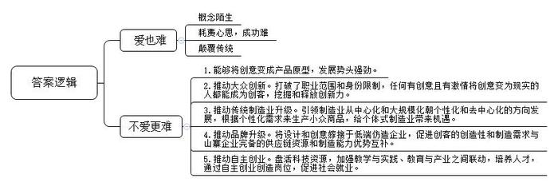
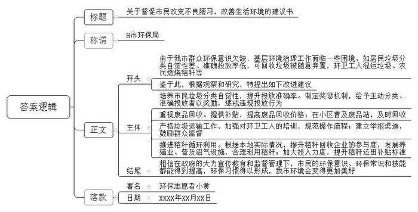
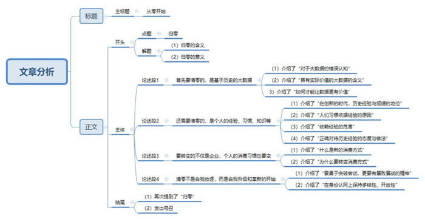

# 2015年公务员多省联考《申论》题（安徽A卷）

<!-- gwy:overview:start -->
> **安徽 · 2015 · 申论 · A类** ｜ 4 题 · 图片 4 处 · 答案随题折叠

导航：[题目](#题目) · [材料 1](#材料-1)
<!-- gwy:overview:end -->

> 候选采集稿。参考答案及解析来自粉笔页面，不代表官方答案或真实高分答卷；来源使用许可与原卷对应关系仍需人工核实。

## 给定材料

### 材料 1

创客是指利用开源硬件和互联网将各种创意变为实际产品的人，他们将制造业搬到了自己桌面上，电子服装、健康手环、智能手表、导电墨水、食物烹饪器等等，用户能想到的产品都有可能在创客手中实现。创客在带有加工车间和工作室功能的软硬件开放实验室（创客空间）将创意变成产品原型，实现从0到1。

对很多中国人而言，“创客”还是个较为陌生的概念，但凭借蓬勃生命力和强劲发展势头，创客正在悄然影响着传统制造业。许多创客空间在产品设计和原型创造基础上，还延伸了兼具产品孵化和企业孵化的功能，在这里不仅可以实现从0到1再到100，即从创意到产品原型再到小批量产品，还能给创客提供创业场地、管理咨询、投融资、渠道销售等服务。在用户体验和互联网推动下，创客产品成为热门的个性化定制商品；也有小部分创客产品经过市场检验获得大众需求的认可，成为工业化生产的大众商品。无论哪种形式，都完成了从创意向创业的转化过程，这种转化也正是创客文化繁荣发展的本质。

创客运动在中国的兴起时间虽短却发展迅猛，国内强大的制造业生态体系，丰富的人力资源，雄厚的资本和艺术沉淀是创客扎根成长的肥沃土地，它所迸发出的潜力是未来工业体系和经济发展的重要机遇。深圳是国内创客产业链最完整的城市，被誉为创客天堂。创客在这里可以找到齐全的电子元器件、各类加工厂和技术工程人员，快速完成从创意到产品原型再到小批量生产的全过程；与深圳的务实高效相比，上海的创客显得气定神闲、回归本质，具有国外兴趣使然的创新氛围；北京的创客则更具跨界协同创新及创业精神，因为北京是顶尖技术人才，文艺人才和资本机构云集的城市。

创客群体没有职业范围和身份限制，任何有创意且有激情将创意变为现实的人都能成为创客。在创客空间，既看不到高精端的大型仪器设备，也看不到众多发明专利和成果，创客空间里有的是热爱创造的人，他们以兴趣为导向，以创意为起点，以体验为动力，通过自我满足的创业方式将大众群体中蕴藏的巨大创新力挖掘和释放出来。

传统制造业以满足大众基本需求为目标，规模化生产出利润丰厚的热门产品。但随着热门产品的同质化发展和激烈竞争，大众需求会逐渐向个性化需求分解，这是经济发展给消费者选择产品带来的必然趋势。创客在这种趋势利导下产生，引领制造业从中心化和大规模形态朝着个体式和去中心化的方向发展，根据个性化需求来生产小众商品，给个体式制造业带来机遇。

2013年11月，英国《经济学家》杂志刊发的一篇题为《中国制造》的文章让“中国创客”成为焦点。该文指出，中国创客的力量不可小觑，其潜在优势就是他们与所谓的山寨制造体系密切联系。企业之所以山寨是因为没有设计和创意，依靠模仿他人产品来生产制造，而创客恰恰是设计和创意的源泉和载体。在互联网时代，软件开源和硬件开源给中国企业提供了难得的平等创新机会，若能将创客的设计和创意嫁接于低端仿造企业，让创客的巨大创造性和制造需求与山寨企业完备的供应链资源和制造能力优势互补，或许能迸发出惊人的能量，这未必不是山寨企业转型的一条出路。

2013年11月4日，清华大学启动创客驻校计划，计划每年聘请国内外知名创客进驻学校创客空间，鼓励学生主动参与创新实践，提升跨学科的技术与创意交流。此外，多所大学甚至一部分中学和职业院校也积极推动创客教育，各具特色、充满活力的教育创客空间盘活了院校科技资源，加强了教学与实践、教育与产业之间联动，培养出具有创新创业精神的一流人才。国内每年毕业的几百万大学生是创客运动的最佳人选，他们能将学业中萌发的创意思想和积累的研究成果衍变为创客项目，用自主创业的方式实现就业。这些创客项目转化为创业公司以后，会吸引更多不同层次的社会人才加入其中。麦肯锡2013年研究报告指出，由于机器人和网络技术的突飞猛进，过去10年大型制造企业的雇佣人数持续减少，因为规模制造对自动化生产系统的紧密依赖逐步取代了人工参与。而创客运动引领的个体式制造业根据用户个性化需求来定制生产商品，对技术、工程、艺术等各行各业人工劳动力的需求巨大，必然创造出大量新的就业岗位。

有人感叹：创客啊，耗费了多少脑汁和心思，颠覆了多少传统和习惯，获得了多少惊喜和满足，蕴藏了多少期待和愿景？真让人“爱也难，不爱更难！”

### 材料 2

伴随着密集出台的反腐禁令，每逢佳节倍思“清”，渐渐成为中国官场的新常态，而不少事业单位基层员工和企业白领也没了以往的节日福利。不仅中秋节，过年也是“福利归零”。人们坚决支持中央反腐倡廉，但一些执行者借反腐之名拿掉职工应有福利的做法也引发了争议。以中秋节为例，在“节日反腐令”的背景下，月饼甚至成了一个敏感词。某单位员工小罗表示，往年单位在中秋节时还会给员工发月饼，从去年开始就什么都没有了。“没有就没有呗，我觉得无所谓啊。”今年他自己上网订了几盒月饼。在一家国企分公司工作的白领小姚说，以往过中秋节大家喜气洋洋地去领几盒月饼，今年就感觉冷冷清清的，“给多少是一回事，哪怕只是一份月饼，也感觉公司想着我们，有种大家庭的感觉，但现在什么都没有了，确实让人很失望。一盒月饼不在价值，没有了，就也没了人情味。”

“谁敢发啊，万一撞到枪口上怎么办？”一家事业单位的中层领导在接受记者采访的时候说，“其实我觉得发几盒月饼问题不算大，不过现在从中央到地方查得这么严，发了不一定有问题，不发肯定没问题，所以，多一事不如少一事啊！”

另一家国企单位领导则表示，反腐败跟发福利完全是两回事，不能泼脏水把孩子也倒掉了，该发的还是要发。记者反问他：如果有的领导趁机给自己多发福利呢？这位领导沉默了一下说：该抓的还是要抓。

### 材料 3

多年来，很多人已经习惯了到风景秀美的地方开会，并且冬天到南方暖和暖和，夏天到北方凉快凉快，人们形象地称之为“候鸟式开会”。早在1998年，中央就下发了《关于严禁党政机关到风景名胜区开会的通知》，2014年又再次出台规定，明令禁止到21个风景名胜区开会，并且加大监管力度，使不良会风明显好转。但是，仍有少数地方一时还不适应这种变化，仍习惯于“打擦边球”的老一套做法，比如有意选择在风景名胜区附近的地方开会，方便会后组织所谓的“文化考察”活动。比如为了到某个风景名胜区开会，有意将会议地点安排在途中需要在风景名胜所在地转车或飞机中转的地方，会议名称也可以改头换面，遮人耳目。还有的故意设分会场。如此煞费苦心，无非想借着开会的机会图点儿实惠。原计划明年将在一个旅游城市承办一届行业年会的某单位领导最近很犯难：如果真的能够常抓不懈，使清廉之风形成新的常态，当然很好。但是，冰冻三尺非一日之寒，长期形成的惯性，就像在高速公路上跑时速120公里的车，能一下子刹住吗？

### 材料 4

自从开展党的群众路线教育实践活动，贯彻执行中央“八项规定”，狠刹“四风”以来，各地公款消费现象得到有效遏制，以致一些酒店、歌厅的生意也大不如前，甚至门庭冷落，让经营者感到很纠结。

张某开了一家中等规模的海鲜饭店，生意一直都还不错。他最倚重的是每逢周末、节假日，各种同学聚会、生日宴请、结婚喜宴、活动庆典等等，虽然让他忙得不可开交，但也乐在其中，用他的话说，这是饭店的“经济支柱”。然而，这两年的情形有点不大对，这类生意量急剧下降。2014年夏天，高考成绩公布，张某以为一波接一波的“谢师宴”将会像往年一样闪亮登场，早早备好了每桌1888元到5888元不同档次的菜单，准备赚一笔。可奇怪的是，今年一桌也没有预订出去。一打听，不是学生和家长不请了，而是老师们都纷纷谢绝了。张某有点费解：“这谢师宴又不是公款消费，学生和家长掏自个儿的腰包感谢老师的培养，这种人之常情难道也有错儿？”

即使跟公款消费毫无关系的顾客自掏腰包的消费，也比过去有了很大改观。人少菜多、浪费严重的现象越来越少，饭后“打包”、“光盘”行动日益普遍。“这个嘛……唉！我的钱还怎么赚呐？”张某摇着头，心情颇为复杂。

### 材料 5

互联网的日益普及和开发利用，不断为人们的工作和生活提供方便，网上购物、网上预约、网上咨询等等风靡中国。尤其对年轻人来说，他们更习惯于依靠网络解决各种困难，24岁的小茜对此深有体会。以前逢年过节要回家探亲，买火车票是最让她头疼的事。裹着大衣在寒冷的夜里排队购票、托关系找人购票、买“黄牛党”高价票等等，这些都曾亲身经历过。现在有了网络购票，别提多方便省事了。前不久小茜跟母亲通电话，听说母亲想到当地一家医院看“专家门诊”，可是排队很长时间还不一定能挂上号。小茜立刻到网上替母亲挂上了专家号。

李先生一直为儿子小学毕业上哪所初中犯愁。同事给他支招，赶紧找人托关系打招呼，该花钱就花钱。李先生知道，这是多年来老百姓为孩子上学求人的“惯例”。即使心里一万个不乐意，可是为了孩子，求人花钱，也是正常。谁知今年区里实行了“新政”，学区内八成小学生通过电脑派位的形式进入学区初级中学学习。学生可填报两次志愿，第一批次可填报不少于4所学校，第二批次可填报不少于5所学校。第一批次志愿面对全区所有学生，不设身份限制，全区所有优质资源品牌学校将拿出15%的比例用于第一批次派位。第二批次志愿学生只可填报自己所在学区内的中学，电脑根据志愿随机分配。结果，李先生的儿子顺利进入一所理想的中学。

小林买了一套装修好的二手房，准备利用国庆假期搬家。他的父母特地从老家赶来，还带了舅舅、表哥等三四个人来帮忙。谁知小林早已请好了搬家公司，总共花了800元，半天时间东西全部搬上楼安置妥当。小林在楼下饭店请父母舅舅们吃饭，舅舅说：“没帮上忙，还害你花钱请吃饭。早知道这样我们就不来了。”表哥说：“你们长辈的老习惯今后可以改改了。找亲友帮忙搬家，人累得够呛不说，钱也不少花，光是一顿饭加上烟酒钱，就够付人家搬家费了。”父亲说：“搬新家是喜事，找人帮忙是老习惯，请人吃饭感谢感谢，也是人之常情嘛。不过，要是光算经济账，看来还真不如请搬家公司。”

小辉父母家里的一台老式电视机坏了，要买台新的。早已养成办事“找关系”习惯的小辉父亲，有个经常一起钓鱼的好朋友，儿子在家电商场工作。小辉父亲不知打哪儿听说商场职工买东西可以打九折，就打算请这位朋友吃顿饭，请他的儿子帮忙，能便宜一二百块钱。小辉听说后连忙阻止了父亲。他上网一查，同样一款电视机，网上价格比商场便宜300多块。他从网上订购了一台，第三天电视机就送到家里，父母非常高兴。小辉跟父亲说：“现在不比从前了，像电视机这样的东西，市场供应那么充足，还用得着找关系吗？”

### 材料 6

南方H市环保志愿者小黄觉得自己每天都生活在苦恼中。他和其他志愿者每个月都会上门向小区居民发放垃圾袋并现场进行分类投放指导。“有督导的时候，分类效果明显就好，但往往过一段时间，乱丢混丢的又多起来。”

厨余垃圾处理是道中国特色的垃圾难题。小黄说，中国菜中汤汤水水的厨余垃圾占垃圾总量的2/3，其中的有机物会使其变臭，而且会污染垃圾中的可回收物。为分出厨余垃圾，要鼓励居民家庭把垃圾分干湿两类。可是即便只分出湿垃圾，准确投放率也不到30%。小黄看过一则简报，其中提到呼和浩特年降雨量400毫米，年蒸发量却可达2000毫米，湿垃圾没等处理就干了。“唉，可惜我们市不是呼和浩特啊！”

小黄的母亲从老家过来暂住，她把小黄家里阳台上一半的空间都堆放了废纸箱和废瓶子。“前段时间攒了一箱矿泉水瓶才卖1块多钱，卖废品现在也不划算，价格低还占地儿！”

据估算，目前我国每年再生资源回收量有1.6亿吨，其中约8000万吨来源于生活垃圾，而我国每年产生的生活垃圾有2.5亿吨，生活垃圾的资源回收率达到30%以上。作为垃圾分类的重要环节，废品回收却一直没有被重视。

小黄认为，居民把家中可回收利用的物品卖掉，是良好的生活习惯。但目前可回收物的价格较低，而又常常不能马上处理，居民无处存放，这影响了他们的积极性。由于干湿分类没有做好，被弃置的垃圾当中有很多可利用的资源被湿垃圾污染了，若再进行人工分类分拣，成本很高。

邻居张大妈刚刚把垃圾分类丢入垃圾箱，就看到收垃圾的环卫工人将“可回收”与“不可回收”两箱垃圾混倒进运输车。“分好了又被混运，还不如不分。”她对小黄说。

目前，多数地方对垃圾分类的投入很少，就连投入相对多的北京、上海、广州、杭州等地也难以满足需求。小黄以广州为例算了一笔账，“如果这样持续3至4年，仅垃圾袋就需14亿元，以200人配1名指导员计算，广州市1800万人，每年需花费40亿元。这样的投入显然不可持续。”小黄感叹，“唉，中国的垃圾分类到底有没有出路啊？”

小黄的老家就在H市的郊区，去年秋收季节回家，发现家里跟其他村民一样将地里的秸秆放火烧了，于是跟父母争吵起来。

小黄：烧秸秆浪费资源，污染空气，又会破坏土壤结构，造成农田质量下降，你们不知道吗？

母亲：知道啊。县里乡里年年宣传，村里年年广播，怎么不知道呢？

小黄：那你们为什么明知故犯？

父亲：你这孩子，说的轻巧。不烧，你能怎样？每年农忙忙死人，哪有时间来捯饬那么多的秸秆？

小黄：不是说有企业要回收秸秆吗？

母亲：那都是广播里说说的，到现在也没见有人来回收过。我们这里不沤沼气，又不养牛，那么多秸秆怎么办？现在搬进楼房住，家家户户也不烧锅灶了，当柴禾都没人要。

小黄：政府不是有专门补贴，用于秸秆加工还田吗？

父亲：要粉碎，买腐化剂，请人帮工，一亩地只补贴10元钱，够吗？

小黄沉默了。他感到很苦恼，在博客中写道：看来光埋怨农民是不能解决问题的，焚烧秸秆是村民多年的习惯做法，省时省力又省心，一时很难改掉。随着PM2.5环境监测的升级，焚烧对空气的负面影响日益显著，田间秸秆的出路究竟在哪里呢？

### 材料 7

以下是根据一位资深广告人在某会议上的发言录音整理的部分内容：

现在是一个大数据的时代，我们被逼跟着数据在走，我们在继续往前走的时候，要倒退到原点回顾一下你当初为什么要做这件事情，这是世界各地尤其是国内比较欠缺的东西。很多中国的企业都在扮演“我跟随”的角色，别的行业有这个东西，我也就要做。

我们都在寻找我们能做什么，其实我们都忽略了很重要的一点，我们更要知道你不能做什么，你不要做什么。我们常常看到很多广告和传播说你要做你自己，这是废话，你除了做你自己还做谁呀，你不能做周杰伦，周杰伦给周杰伦做了，刘德华也不行，你只有做你自己，但你要做得比周杰伦和刘德华还好。

这几年我称自己是一个下岗的广告民工，我反而看到很多当时我身在广告业中看不到的东西，因为越来越平民化，越来越农民化，我看到的东西都是很小的东西，但这些东西都很可能举足轻重，能够改变很多东西。数据引导我们，我们会本着数据做很多东西，但千万不要把数据变成一个依据，你要在数据中找到有什么东西可以挑战，而不是变成一个护身符，数据说这样，我们就这样，这个时代，创意的思维方式可能超过以往任何时候。

做任何事情，大到做人、做行业，小到你要做的事情、要找的东西，都应该考虑，到底有没有挑战？不能因为别的企业做了这样的东西，你就也要去做。你要想一想，你做的东西有没有挑战你的企业，会不会挑战你的员工，最主要有没有挑战你本身？尤其现今社会，人类基本上没有自信心。因为我们没有狼牙虎爪，我们连乌龟壳也没有，所以，我们需要包装，我们需要洋房、汽车、美容，再不行把面孔也改了，手机的美化软件就是应此而生。现在的手机我真的试过45度拍，脸真的尖了，现在的手机还可以让你美白，眼睛变大，大家可能也看过那种手机美女和真人对比，把你吓死。

国外一个电视台访问过很多最近新兴的小企业家，你会发现他们有一个共同点，他们都在新的尝试中找到挑战，基本上他做的不是他原来做的东西。所以，一定希望在你做的东西中找出你的挑战......不然的话，你如果只是想，尤其在中国大陆只是想明天过得比今天好一点，那太没有意思了。我估计在场每个人的学历和资历都会比我高，但我能有今天就是因为我读书少，在下只有中学的学历，现在再把我送去高考，我还是会考不上，但我有自知之明，我读书少，我不会的东西多，从第一天开始，我到现在仍然有这个习惯，从零开始。在座各位可能觉得这个理论大家常听说，这个东西可能是任何行业最难做的东西——从零开始，人性的习惯会使你习惯于从你前一个案例，尤其是成功的案例去借鉴，你希望做得更好，但是，以我冷眼旁观，这里面有很多问题。最近我被邀请回新加坡，我现在被收录到新加坡档案局里，是以一个非典型而被记录，因为以我的背景我不可能有这一天，但是因为这个“零”有很多的意义，因为我什么都不懂，什么都不会，结果这变成我最擅长的一个行业。

所以，各位如果有机会的话，能否像我一样，我每天都逼着让自己客户归零，归零后一般人想出来的东西都和立场不一样。

我常常鼓励学生，我也会鼓励任何人不要怕犯错误，错误是一个很大的动力，当你不怕错误的时候，你差不多什么都敢做。我的能量来自什么？我学历不够，我甚至没有修过广告学。不要怕失败，我们常说失败是成功之母。所以，敢于去犯错误，我们有很多成语故事教过我们这样做，但我们是否真的从中学到过任何东西呢？

## 题目

### 第 1 题

**“给定资料2~3”反映了在反腐倡廉的背景下，对于改变过去工作生活中某些错误的习惯性做法，一些单位和个人态度不同、表现不一。请用精炼的语言依次将这些态度或表现归纳为若干类型。（15分）**

关联材料：材料 2、材料 3

作答要求：

（1）准确全面；

（2）用“XXXX型；XXXX型……”这样的形式归纳；

（3）不超过40字。

第 1 题 · 答案与解析

**参考答案（粉笔题库参考内容）**

一、拥护理解且实事求是型；二、失望不解型；三、保守自保型；四、阳奉阴违型；五、怀疑观望型。

**解析**

**参考答案说明：**答案从五个不同的方面进行了分条撰写，每条要点之间内容上没有交叉，且严格按照题目要求，以“XXXX型；XXXX型……”的形式进行归纳。

**考点**：其他类

**来源**：2015年公务员多省联考《申论》题（安徽A卷）

### 第 2 题

**阅读“给定资料1”，请分析划线部分所说的创客“让人爱也难，不爱更难”的主要原因。（25分）**

关联材料：材料 1

作答要求：

（1）准确全面；

（2）“爱也难”与“不爱更难”分开表述；

（3）简明扼要，300字左右。

第 2 题 · 答案与解析

**参考答案（粉笔题库参考内容）**

“爱也难”：概念陌生；耗费心思，成功难；颠覆传统。

“不爱更难”：1.能够将创意变成产品原型，发展势头强劲。2.推动大众创新。打破了职业范围和身份限制，任何有创意且有激情将创意变为现实的人都能成为创客，挖掘和释放创新力。3.推动传统制造业升级。引领制造业从中心化和大规模化朝个体化和去中心化的方向发展，根据个性化需求来生产小众商品，给个体式制造业带来机遇。4.推动品牌升级。将设计和创意嫁接于低端仿造企业，促进创客的创造性和制造需求与山寨企业完备的供应链资源和制造能力优势互补。5.推动自主创业。盘活科技资源，加强教学与实践、教育与产业之间联动，培养人才，通过自主创业创造岗位，促进社会就业。

**解析**

**参考答案说明：**答案从“爱也难”“不爱更难”两方面的原因进行了分类撰写。“不爱更难”方面又分为“将创意变成产品原型”“推动大众创新”“推动传统制造业升级”“推动品牌升级”“推动自主创业”五小条。各条要点之间在内容上是并列的且没有交叉。

**考点**：原因类

**来源**：2015年公务员多省联考《申论》题（安徽A卷）

### 第 3 题

**“给定资料6”中，小黄的“苦恼”反映了基层管理工作所面临的困境。请紧扣“改变不良陋习，改善生活环境”这一主题，并以“环保志愿者小黄”的名义，向H市环保部门写一份建议书。（20分）**

关联材料：材料 6

作答要求：

（1）针对性强，建议合理可行；

（2）主题明确，思路清晰；

（3）结构完整，语言得体；

（4）450-500字。

第 3 题 · 答案与解析

**参考答案（粉笔题库参考内容）**

关于督促市民改变不良陋习，改善生活环境的建议书

H市环保局：

由于我市群众环保意识欠缺，基层环境治理工作面临一些困境。如居民垃圾分类自觉性差、准确投放率低，可回收垃圾被随意弃置，环卫工人混运垃圾、农民燃烧秸秆等。鉴于此，根据观察和研究，特提出如下改进建议。

一、培养市民垃圾分类自觉性，提升投放准确率。制定奖惩机制，给予主动分类、准确投放者以奖励，惩戒违规投放行为。二、重视废品回收。提供补贴，提高废品回收价格；在小区普及废品站，及时回收。三、严格垃圾运输工作。加强对环卫工人的培训，规范操作流程；建立举报渠道，鼓励群众监督。四、推进秸秆循环利用。根据本地实际情况，提升秸秆回收企业的参与度；发展养殖业、普及沼气设施，合理利用秸秆；加大投入力度，提升秸秆还田补贴标准。

相信在政府的大力宣传教育和监督管理下，市民的环保意识、环保常识和技能都能得到提高，环保习惯得以形成，我市环境会变得更加美好。

环保志愿者小黄

XXXX年XX月XX日

**解析**

**参考答案说明**：（1）格式方面，本参考答案写到了“标题”“主送机关”“正文”“落款”。（2）正文部分，一方面从内容来看，围绕着“改变不良陋习，改善生活环境”这一主题，本参考答案的开头先写到了建议书的背景；主体部分从“培养市民垃圾分类自觉性”“重视废品回收”“严格垃圾运输工作”“推进秸秆循环利用”方面给出了具体的对策。另一方面，形式上，本参考答案做到了分段、分条撰写，整体上条理较为清晰。（3）本参考答案能够结合题目要求“语言得体”，在语言表达上做到了遣词造句恰当，无病句、错句等，段落及句子之间的衔接自然。

**考点**：方案类

**来源**：2015年公务员多省联考《申论》题（安徽A卷）

### 第 4 题

**“给定资料7”中的“归零”说法，耐人寻味。请你依据自己的心得，自选角度，自拟标题，撰写一篇1000字左右的文章。（40分）**

关联材料：材料 1、材料 2、材料 3、材料 4、材料 5、材料 6、材料 7

作答要求：

（1）观点正确，思想深刻；

（2）内容充实，论证有力；

（3）思路开阔，条理清晰；

（4）结构紧凑，语言流畅。

第 4 题 · 答案与解析

**参考答案（粉笔题库参考内容）**

从零开始

这是一个“**归零**”的时代。在这个时代，历史不是用来借鉴的，而是用来改变的；在这个时代，大数据不是一个既定的事实，而是一个等待创造的未来；在这个时代，成功不是用来学习的，而是用来颠覆的；在这个时代，成功不是用来模仿的，而是用来漠视的；在这个时代，规则不是用来被遵守的，而是用来被打破的；在这个时代，没有什么事是理所当然的，世界是等待开启的大门。**“归零”让我们思维更加新颖，洞察力更加敏锐。在这个时代，必须要有善于尝试，挑战历史，改变习惯，从零开始的气魄。**

**首先要清零的，是基于历史的大数据。**在创新面前，**“大数据”是等待被戳破的泡沫**，任何基于历史的大数据都等于零。在一个开放市场中，任何一个行业都有行业大佬，用新东方总裁俞敏洪先生的话来说就是“钱多势众”。当你进入某个行业的时候，他们会告诉你：他们营收是多少，服务人数是多少，有多少人才，有多悠久的历史……每一个数据都让你感觉是不可能达到的天文数字。但是**在创新面前，这些数据都等于0**。1865年成立的诺基亚曾经占全球手机市场40%的份额，可随着智能手机时代的到来，不到4年这个100年的品牌就在手机领域烟消云散；小米用3年的时间从一个聊天工具开始，在苹果和三星统治的手机领域分得了14%的市场份额，实现从0到n的华丽转身。**真正的大数据是开放的数据、动态的数据、随时可能被革新的数据**。我们要的不是一点点地去做加法，而是去**改变数据的位置、参数、结构、符号，从而产生神奇的变化**。这个改变靠的是什么？不是模仿，而是创新；不是苦苦地追赶，而是强悍地颠覆；不是做加法，而是做乘法、除法、指数法、排列组合法……

**还需要清零的，是个人的经验、习惯、知识等。**庄子说：“吾生也有涯，而知也无涯，以有涯随无涯，殆已！”**在未来面前，一切有限的历史经验，都等于零。在一个充满创新的时代，历史成绩不是依靠，而是负担**。哲学家尼采说，要“重估一切价值”。这就需要**打破习惯，勇于突破，自我革新，有面对未来的勇气和态度。**人天生都喜欢做自己习惯的事、自己能做会做的事、基于经验确定的事，这种事往往更加方便更加容易。但是你喜欢和能做的不一定是时代需要的。**我们的所有行为都必须放到开放多元的评价体系去重新评价，同时还必须根据这种评估作出改变。主动改变的，就能获得时代的红利**，比如京东商城，现在市值已达几百亿美元。转型慢的就会被时代抛弃，成为明日黄花，比如曾经创造了首富的国美电器，现在市值只有京东的十分之一。

**要转变的不仅是企业，个人的消费习惯也要变。**无论年龄性别，要学会使用智能手机，学会在线支付，会用打车软件，会网上挂号，在线购车票……这些新兴的消费方式**能让消费者获得更多、更便宜、更符合需求的商品和服务**。当然，这对于很多人来说是挑战，这意味着他们的生活将从零开始。但是这个零的背后，是无穷无尽、精彩纷呈的世界。**改变习惯，拥抱未来，收获的将是更丰富、精彩的自我**。

**清零不是自我放逐，而是自我升级和革新的开始。要勇于突破尝试，更要有屡败屡战的精神。同时。自我革新需要在身份认同上保持多样性、开放性。**我们总是在追求可靠性，在现代社会，**最可靠的**不是基于历史的习惯、资源、地位，而**是基于未来的改变、智慧、创新**。在传统社会中，社会是封闭的，单一的，评价标准也是固定唯一的，所有人都用同样的方式朝着同一个固定的方向和目标努力，一旦获得就一劳永逸。比如科举考试，一旦当官，就有了身份认同，物质保障，一旦当过官，出于观念和社会结构的限制，就不可能去做别的事情。范进没有中举之前可以插着草标去买鸡，一旦中举之后他就没有其他选择了。在开放的时代则不同，个人的身份是变动的、多样的、开放的。比如公务员下班之后可以是一个投资炒股高手，并且社会也会为他提供炒股投资的机会。在职业定位上保持低调，保持开放性，才能获得全新的视角，才能获得重新建构自己职业和人生的可能性。**这种人生的广阔视野一旦打开，人就获得了自由全面发展的机会，获得了把握自己命运，创造社会价值的开放渠道**。

习总书记说：“我们生活在一个令人激动的时代”。在这个“归零”的时代，我们每一天都在改写历史；在这个“归零”的时代，每个人都有机会改变自己的命运，创造自己的未来；在这个“归零”的时代，我们没有历史负担，有的只是面向未来的绚丽多彩的美好梦想！

**文章分析：**

**从零开始**

【**标题的优点**：首先，范文的标题突出了“归零”这一主题。其次，它在形式上简洁明快，一目了然。】

这是一个“归零”的时代。在这个时代，（1）历史不是用来借鉴的，而是用来改变的；在这个时代，大数据不是一个既定的事实，而是一个等待创造的未来；在这个时代，成功不是用来学习的，而是用来颠覆的；在这个时代，成功不是用来模仿的，而是用来漠视的；在这个时代，规则不是用来被遵守的，而是用来被打破的；在这个时代，没有什么事是理所当然的，世界是等待开启的大门。“归零”（2）让我们思维更加新颖，洞察力更加敏锐。在这个时代，必须要有善于尝试，挑战历史，改变习惯，从零开始的气魄。

【**开头的优点：**★内容方面：范文的开头是紧扣“归零”这一主题展开的。首先，开头第一句话点出主题，做到了主题明确。其次，对“归零”这一主题进行了分析阐述，指出了（1）归零的含义；（2）归零的意义。文字表达方面：使用了若干个“而”这一关联词，使语言表达有逻辑性，此外长短句配合使用，使语言表达有节奏感。】

**首先要清零的，是基于历史的大数据。**在创新面前，“大数据”是等待被戳破的泡沫，任何基于历史的大数据都等于零。在一个开放市场中，任何一个行业都有行业大佬，用新东方总裁俞敏洪先生的话来说就是“钱多势众”。当你进入某个行业的时候，他们会告诉你：他们营收是多少，服务人数是多少，有多少人才，有多悠久的历史……（1）每一个数据都让你感觉是不可能达到的天文数字。但是在创新面前，这些数据都等于0。1865年成立的诺基亚曾经占全球手机市场40%的份额，可随着智能手机时代的到来，不到4年这个100年的品牌就在手机领域烟消云散；小米用3年的时间从一个聊天工具开始，在苹果和三星统治的手机领域分得了14%的市场份额，实现从0到n的华丽转身。（2）真正的大数据是开放的数据、动态的数据、随时可能被革新的数据。我们要的不是一点点地去做加法，（3）而是去改变数据的位置、参数、结构、符号，从而产生神奇的变化。这个改变靠的是什么？不是模仿，而是创新；不是苦苦地追赶，而是强悍地颠覆；不是做加法，而是做乘法、除法、指数法、排列组合法……

【**论述段1的优点：**★观点句：范文的观点句是紧扣“归零”这一文章主题提出的。形式上，它在段首处直接写出，位置突出，容易发现。内容上，关键词突出，内容要点明确，可以明显看出它是从“清零历史数据”等入手，指出了如何“归零”。★论述内容：（1）介绍了“对于大数据的错误认知”；（2）介绍了“具有实际价值的大数据的含义”；（3）介绍了“如何才能让数据更有价值”。注意：以上三个方面的内容都是紧扣“首先要清零的，是基于历史的大数据”这个观点句进行分析论述的，论述的针对性强，内容层次丰富。在论述方法上采用了“讲道理、摆事实”相结合的方式进行展开的，做到了论述有力。】

**还需要清零的，是个人的经验、习惯、知识等。**庄子说：“吾生也有涯，而知也无涯，以有涯随无涯，殆已！”（1）在未来面前，一切有限的历史经验，都等于零。在一个充满创新的时代，历史成绩不是依靠，而是负担。哲学家尼采说，要“重估一切价值”。这就需要打破习惯，勇于突破，自我革新，有面对未来的勇气和态度。（2）人天生都喜欢做自己习惯的事、自己能做会做的事、基于经验确定的事，这种事往往更加方便更加容易。（3）但是你喜欢和能做的不一定是时代需要的。我们的所有行为都（4）必须放到开放多元的评价体系去重新评价，同时还必须根据这种评估作出改变。主动改变的，就能获得时代的红利，比如京东商城，现在市值已达几百亿美元。转型慢的就会被时代抛弃，成为明日黄花，比如曾经创造了首富的国美电器，现在市值只有京东的十分之一。

【**论述段2的优点：**★观点句：范文的观点句是紧扣“归零”这一文章主题提出的。形式上，它在段首处直接写出，位置突出，容易发现。内容上，关键词突出，内容要点明确，可以明显看出它是从“还需要清零的，是个人的经验、习惯、知识等”等入手，指出了如何“归零”。★论述内容：（1）介绍了“在创新的时代，历史经验与成绩的地位”；（2）介绍了“人们习惯依据经验的原因”；（3）介绍了“依赖经验的危害”；（4）介绍了“正确对待历史经验的态度与做法”。注意：以上四个方面的内容都是紧扣“还需要清零的，是个人的经验、习惯、知识”这个观点句进行分析论述的，论述的针对性强，内容层次丰富。在论述方法上采用了“讲道理、摆事实”相结合的方式进行展开的，做到了论述有力。】

**要转变的不仅是企业，个人的消费习惯也要变。**无论年龄性别，（1）要学会使用智能手机，学会在线支付，会用打车软件，会网上挂号，在线购车票……这些新兴的消费方式能（2）让消费者获得更多、更便宜、更符合需求的商品和服务。当然，这对于很多人来说是挑战，这意味着他们的生活将从零开始。但是这个零的背后，是无穷无尽、精彩纷呈的世界。改变习惯，拥抱未来，收获的将是更丰富、精彩的自我。

【**论述段3的优点：**★观点句：范文的观点句是紧扣“归零”这一文章主题提出的。形式上，它在段首处直接写出，位置突出，容易发现。内容上，关键词突出，内容要点明确，可以明显看出它是从“要转变的不仅是企业，个人的消费习惯也要变”等入手，指出了如何“归零”。★论述内容：（1）介绍了“什么是新的消费方式”；（2）介绍了“为什么要转变消费方式”。注意：以上两个方面的内容都是紧扣“要转变的不仅是企业，个人的消费习惯也要变”这个观点句进行分析论述的，论述的针对性强，内容层次丰富。并且这两个方面的论述是有内在逻辑顺序的，先讲“是什么”，然后分析“为什么”。在论述方法上采用了讲道理的方式进行展开的，做到了论述透彻。】

**清零不是自我放逐，而是自我升级和革新的开始。**（1）要勇于突破尝试，更要有屡败屡战的精神。同时。（2）自我革新需要在身份认同上保持多样性、开放性。我们总是在追求可靠性，在现代社会，最可靠的不是基于历史的习惯、资源、地位，而是基于未来的改变、智慧、创新。在传统社会中，社会是封闭的，单一的，评价标准也是固定唯一的，所有人都用同样的方式朝着同一个固定的方向和目标努力，一旦获得就一劳永逸。比如科举考试，一旦当官，就有了身份认同，物质保障，一旦当过官，出于观念和社会结构的限制，就不可能去做别的事情。范进没有中举之前可以插着草标去买鸡，一旦中举之后他就没有其他选择了。在开放的时代则不同，个人的身份是变动的、多样的、开放的。比如公务员下班之后可以是一个投资炒股高手，并且社会也会为他提供炒股投资的机会。在职业定位上保持低调，保持开放性，才能获得全新的视角，才能获得重新建构自己职业和人生的可能性。这种人生的广阔视野一旦打开，人就获得了自由全面发展的机会，获得了把握自己命运，创造社会价值的开放渠道。

【**论述段4的优点：**★观点句：范文的观点句是紧扣“归零”这一文章主题提出的。形式上，它在段首处直接写出，位置突出，容易发现。内容上，关键词突出，内容要点明确，可以明显看出它是从“清零不是自我放逐，而是自我升级和革新的开始”等入手，指出了如何“归零”。★论述内容：（1）介绍了“要勇于突破尝试，更要有屡败屡战的精神”；（2）介绍了“在身份认同上保持多样性、开放性”。注意：以上两个方面的内容都是紧扣“清零不是自我放逐，而是自我升级和革新的开始”这个观点句进行分析论述的，论述的针对性强，内容层次丰富。在论述方法上采用了“讲道理、摆事实”相结合的方式进行展开的，做到了论述有力。】

习总书记说：“我们生活在一个令人激动的时代”。在这个“归零”的时代，我们每一天都在改写历史；在这个“归零”的时代，每个人都有机会改变自己的命运，创造自己的未来；在这个“归零”的时代，我们没有历史负担，有的只是面向未来的绚丽多彩的美好梦想！

【**结尾的优点**：（1）再次提到了“归零”；（2）发出了号召。】

**解析**

> 粉笔页面在本题只提供参考答案与「考点 / 来源」，没有单独的文字解析。

**考点**：文章写作题

**来源**：2015年公务员多省联考《申论》题（安徽A卷）

