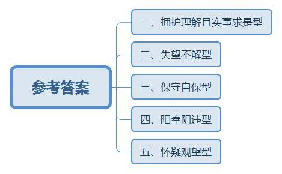
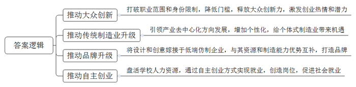
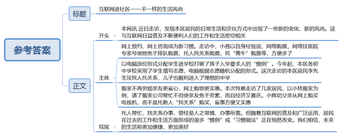
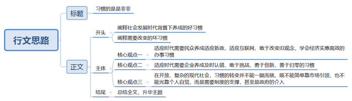

# 2015年公务员多省联考《申论》题（安徽B卷）

<!-- gwy:overview:start -->
> **安徽 · 2015 · 申论 · B类** ｜ 4 题 · 图片 4 处 · 答案随题折叠

导航：[题目](#题目) · [材料 1](#材料-1)
<!-- gwy:overview:end -->

> 候选采集稿。参考答案及解析来自粉笔页面，不代表官方答案或真实高分答卷；来源使用许可与原卷对应关系仍需人工核实。

## 给定材料

### 材料 1

创客是指利用开源硬件和互联网将各种创意变为实际产品的人，他们将制造业搬到了自己桌面上，电子服装、健康手环、智能手表、导电墨水、食物烹饪器等等，用户能想到的产品都有可能在创客手中实现。创客在带有加工车间和工作室功能的软硬件开放实验室（创客空间）将创意变成产品原型，实现从0到1。

对很多中国人而言，“创客”还是个较为陌生的概念，但凭借蓬勃生命力和强劲发展势头，创客正在悄然影响着传统制造业。许多创客空间在产品设计和原型创造基础上，还延伸了兼具产品孵化和企业孵化的功能，在这里不仅可以实现从0到1再到100，即从创意到产品原型再到小批量产品，还能给创客提供创业场地、管理咨询、投融资、渠道销售等服务，在用户体验和互联网推动下，创客产品成为热门的个性化定制商品；也有小部分创客产品经过市场检验获得大众需求的认可，成为工业化生产的大众商品。无论哪种形式，都完成了从创意向创业的转化过程，这种转化也正是创客文化繁荣发展的本质。

创客运动在中国的兴起时间虽短却发展迅猛，国内强大的制造业生态体系、丰富的人力资源、雄厚的资本和艺术积淀是创客扎根成长的肥沃土地，它所迸发出的潜力是未来工业体系和经济发展的重要机遇。深圳是国内创客产业链最完整的城市，被誉为创客天堂。创客在这里可以找到齐全的电子元器件、各类加工厂和技术工程人员，快速完成从创意到产品原型再到小批量生产的全过程；与深圳的务实高效相比，上海的创客显得气定神闲、回归本质，具有国外兴趣使然的创新氛围；北京创客则更具跨界协同创新及创业精神，因为北京是顶尖技术人才、文艺人才和资本机构云集的城市。

创客群体没有职业范围和身份限制，任何有创意且有激情将创意变为现实的人都能成为创客。在创客空间，既看不到高精端的大型仪器设备，也看不到众多发明专利和成果，创客空间里有的是热爱创造的人，他们以兴趣为导向，以创意为起点，以体验为动力，通过自我满足的创业方式将大众群体中蕴藏的巨大创新力挖掘和释放出来。

传统制造业以满足大众基本需求为目标，规模化生产出利润丰厚的热门产品。但随着热门产品的同质化发展和激烈竞争，大众需求会逐渐向个性化需求分解，这是经济发展给消费者选择产品带来的必然趋势。创客在这种趋势利导下产生，引领制造业从中心化和大规模形态朝着个体式和去中心化的方向发展，根据个性化需求来生产小众商品，给个体式制造业带来机遇。

2013年11月，英国《经济学家》刊发一篇题为《中国制造》的文章让“中国创客”成为焦点。该文指出，中国创客的力量不可小觑，其潜在优势就是他们与所谓的山寨制造体系密切联系。企业之所以山寨是因为没有设计和创意，依靠模仿他人产品来生产制造，而创客恰恰是设计和创意的源泉和载体。在互联网时代，软件开源和硬件开源给中国企业提供了难得的平等创新机会，若能将创客的设计和创意嫁接于低端仿造企业，让创客的巨大创造性和制造需求与山寨企业完备的供应链资源和制造能力优势互补，或许能迸发出惊人的能量，这未必不是山寨企业转型的一条出路。

2013年11月4日，清华大学启动创客驻校计划，计划每年聘请国内外知名创客进驻学校创客空间，鼓励学生主动参与创新实践，提升跨学科的技术与创意交流。此外，多所大学甚至一部分中学和职业院校也积极推动创客教育，各具特色、充满活力的教育创客空间盘活了院校科技资源，加强了教学与实践、教育与产业之间联动，培养出具有创新创业精神的一流人才。国内每年毕业的几百万大学生是创客运动的最佳人选，他们能将学业中萌发的创意思想和积累的研究成果衍变为创客项目，用自主创业的方式实现就业。这些创客项目转化为创业公司后，会吸引更多不同层次的社会人才加入其中。麦肯锡2013年研究报告指出，由于机器人和网络技术的突飞猛进，过去10年大型制造企业的雇佣人数持续减少，因为规模制造对自动化生产系统的紧密依赖逐步取代了人工参与。而创客运动引领的个体式制造业根据用户个性化需求来定制生产商品，对技术、工程、艺术等各行各业人工劳动力的需求巨大，必然创造出大量新的就业岗位。

有人感叹：创客啊，耗费了多少脑汁和心思，颠覆了多少传统和习惯，获得了多少惊喜和满足，蕴藏了多少期待和愿景？真让人“爱也难，不爱更难”！

### 材料 2

伴随着密集出台的反腐禁令，每逢佳节倍思“清”，渐渐成为中国官场的新常态，而不少事业单位基层员工和企业白领也没了以往的节日福利。不仅中秋节，过年也是“福利归零”。人们坚决支持中央反腐倡廉，但一些执行者借反腐之名拿掉职工应有福利的做法也引发了争议。以中秋节为例，在“节日反腐令”的背景下，月饼甚至成了一个敏感词。某单位员工小罗表示，往年单位在中秋节时还会给员工发月饼，从去年开始就什么都没有了。“没有就没有呗，我觉得无所谓啊。”今年他自己上网订了几盒月饼。在一家国企分公司工作的白领小姚说，以往过中秋节大家喜气洋洋地去领几盒月饼，今年就感觉冷冷清清的，“给多少是一回事，哪怕只是一份月饼，也感觉公司想着我们，有种大家庭的感觉，但现在什么都没有了，确实让人很失望。一盒月饼不在价值，没有了，就也没了人情味。”

“谁敢发啊，万一撞到枪口上怎么办？”一家事业单位的中层领导在接受记者采访的时候说，“其实我觉得发几盒月饼问题不算大，不过现在从中央到地方查得这么严，发了不一定有问题，不发肯定没问题，所以，多一事不如少一事啊！”

另一家国企单位领导则表示，反腐败跟发福利完全是两回事，不能泼脏水把孩子也倒掉了，该发的还是要发。记者反问他：如果有的领导趁机给自己多发福利呢？这位领导沉默了一下说：该抓的还是要抓。

### 材料 3

多年来，很多人已经习惯了到风景秀美的地方开会，并且冬天到南方暖和暖和，夏天到北方凉快凉快，人们形象地称之为“候鸟式开会”。早在1998年，中央就下发了《关于严禁党政机关到风景名胜区开会的通知》，2014年又再次出台规定，明令禁止到21个风景名胜区开会，并且加大监管力度，使不良会风明显好转。但是，仍有少数地方一时还不适应这种变化，仍习惯于“打擦边球”的老一套做法，比如有意选择在风景名胜区附近的地方开会，方便会后组织所谓的“文化考察”活动。比如为了到某个风景名胜区开会，有意将会议地点安排在途中需要在风景名胜所在地转车或飞机中转的地方，会议名称也可以改头换面，遮人耳目。还有的故意设分会场。如此煞费苦心，无非想借着开会的机会图点儿实惠。原计划明年将在一个旅游城市承办一届行业年会的某单位领导最近很犯难：如果真的能够常抓不懈，使清廉之风形成新的常态，当然很好。但是，冰冻三尺非一日之寒，长期形成的惯性，就像在高速公路上跑时速120公里的车，能一下子刹住吗？

### 材料 4

自从开展党的群众路线教育实践活动，贯彻执行中央“八项规定”，狠刹“四风”以来，各地公款消费现象得到有效遏制，以致一些酒店、歌厅的生意也大不如前，甚至门庭冷落，让经营者感到很纠结。

张某开了一家中等规模的海鲜饭店，生意一直都还不错。他最倚重的是每逢周末、节假日，各种同学聚会、生日宴请、结婚喜宴、活动庆典等等，虽然让他忙得不可开交，但也乐在其中，用他的话说，这是饭店的“经济支柱”。然而，这两年的情形有点不大对，这类生意量急剧下降。2014年夏天，高考成绩公布，张某以为一波接一波的“谢师宴”将会像往年一样闪亮登场，早早备好了每桌1888元到5888元不同档次的菜单，准备赚一笔。可奇怪的是，今年一桌也没有预订出去。一打听，不是学生和家长不请了，而是老师们都纷纷谢绝了。张某有点费解：“这谢师宴又不是公款消费，学生和家长掏自个儿的腰包感谢老师的培养，这种人之常情难道也有错儿？”

即使跟公款消费毫无关系的顾客自掏腰包的消费，也比过去有了很大改观。人少菜多、浪费严重的现象越来越少，饭后“打包”、“光盘”行动日益普遍。“这个嘛……唉！我的钱还怎么赚呐？”张某摇着头，心情颇为复杂。

### 材料 5

互联网的日益普及和开发利用，不断为人们的工作和生活提供方便，网上购物、网上预约、网上咨询等等风靡中国。尤其对年轻人来说，他们更习惯于依靠网络解决各种困难，24岁的小茜对此深有体会。以前逢年过节要回家探亲，买火车票是最让她头疼的事。裹着大衣在寒冷的夜里排队购票、托关系找人购票、买“黄牛党”高价票等等，这些都曾亲身经历过。现在有了网络购票，别提多方便省事了。前不久小茜跟母亲通电话，听说母亲想到当地一家医院看“专家门诊”，可是排队很长时间还不一定能挂上号。小茜立刻到网上替母亲挂上了专家号。

李先生一直为儿子小学毕业上哪所初中犯愁。同事给他支招，赶紧找人托关系打招呼，该花钱就花钱。李先生知道，这是多年来老百姓为孩子上学求人的“惯例”。即使心里一万个不乐意，可是为了孩子，求人花钱，也是正常。谁知今年区里实行了“新政”，学区内八成小学生通过电脑派位的形式进入学区初级中学学习。学生可填报两次志愿，第一批次可填报不少于4所学校，第二批次可填报不少于5所学校。第一批次志愿面对全区所有学生，不设身份限制，全区所有优质资源品牌学校将拿出15%的比例用于第一批次派位。第二批次志愿学生只可填报自己所在学区内的中学，电脑根据志愿随机分配。结果，李先生的儿子顺利进入一所理想的中学。

小林买了一套装修好的二手房，准备利用国庆假期搬家。他的父母特地从老家赶来，还带了舅舅、表哥等三四个人来帮忙。谁知小林早已请好了搬家公司，总共花了800元，半天时间东西全部搬上楼安置妥当。小林在楼下饭店请父母舅舅们吃饭，舅舅说：“没帮上忙，还害你花钱请吃饭。早知道这样我们就不来了。”表哥说：“你们长辈的老习惯今后可以改改了。找亲友帮忙搬家，人累得够呛不说，钱也不少花，光是一顿饭加上烟酒钱，就够付人家搬家费了。”父亲说：“搬新家是喜事，找人帮忙是老习惯，请人吃饭感谢感谢，也是人之常情嘛。不过，要是光算经济账，看来还真不如请搬家公司。”

小辉父母家里的一台老式电视机坏了，要买台新的。早已养成办事“找关系”习惯的小辉父亲，有个经常一起钓鱼的好朋友，儿子在家电商场工作。小辉父亲不知打哪儿听说商场职工买东西可以打九折，就打算请这位朋友吃顿饭，请他的儿子帮忙，能便宜一二百块钱。小辉听说后连忙阻止了父亲。他上网一查，同样一款电视机，网上价格比商场便宜300多块。他从网上订购了一台，第三天电视机就送到家里，父母非常高兴。小辉跟父亲说：“现在不比从前了，像电视机这样的东西，市场供应那么充足，还用得着找关系吗？”

### 材料 6

南方某城市环保志愿者小丽觉得自己每天都生活在苦恼中。她和其他志愿者每个月都会上门向小区居民发放垃圾袋并现场进行分类投放指导。“有督导的时候，分类效果明显就好，但往往过一段时间，乱丢混丢的又多起来。”

厨余垃圾处理是一道中国特色的垃圾难题。小丽说，中国菜中汤汤水水的厨余垃圾占垃圾总量的2/3，其中的有机物会使其变臭，而且会污染垃圾中的可回收物。为分出厨余垃圾，要鼓励居民家庭把垃圾分干湿两类。可是即便只分出湿垃圾，准确投放率也不到30%。小丽看过一则简报，其中提到呼和浩特年降雨量400毫米，年蒸发量却可达2000毫米，湿垃圾没等处理就干了。“唉，可惜我们市不是呼和浩特啊！”

小丽的母亲从老家来暂住，她把小丽家里阳台上一半的空间都堆放了废纸箱和废瓶子。“前段时间攒了一箱矿泉水瓶才卖1块多钱，卖废品现在太不划算，价格低还占地儿！”

据估算，目前我国每年再生资源回收量有1.6亿吨，其中约8000万吨来源于生活垃圾，而我国每年产生的生活垃圾有2.5亿吨，生活垃圾的资源回收率达到30%以上。作为垃圾分类的重要环节，废品回收却一直没有被重视。

小丽认为，居民把家中可回收利用的物品卖掉，是良好的生活习惯。但目前可回收物的价格较低，而又常常不能马上处理，居民无处存放，这影响了他们的积极性。由于干湿分类没有做好，被弃置的垃圾当中有很多可利用的资源被湿垃圾污染了，若再进行人工分类分拣，成本很高。

邻居张大妈刚刚把垃圾分类丢入垃圾箱，就看到收垃圾的环卫工人将“可回收”与“不可回收”两箱垃圾混倒进运输车。“分好了又被混运，还不如不分。”她对小丽说。

目前，多数地方对垃圾分类的投入很少，就连投入相对多的北京、上海、广州、杭州等地也难以满足需求。小丽以广州为例算了一笔账，“如果这样持续3至4年，仅垃圾袋就需14亿元，以200人配1名指导员计算，广州市1800万人，每年需花费40亿元。这样的投入显然不可持续。”小丽感叹，“唉，中国的垃圾分类到底有没有出路啊？”

### 材料 7

大学生小丽来自苏北农村，今年放暑假回家，发现家里跟其他村民一样将地里的秸秆放火烧了，跟父母争吵起来。

小丽：烧秸秆浪费资源，污染空气，又会破坏土壤结构，造成农田质量下降，你们不知道吗？

母亲：知道啊。县里乡里年年宣传，村里年年广播，怎么不知道呢。

小丽：那你们为什么明知故犯？

父亲：你这孩子，说得轻巧。不烧，你能怎样？每年农忙忙死人，哪有时间来捯饬那么多的秸秆？

小丽：不是有企业要回收秸秆吗？

母亲：那都是广播里说说的，到现在也没见有人来回收过。我们这里不沤沼气，又不养牛，那么多秸秆怎么办？现在搬进楼房住，家家户户也不烧锅灶了，当柴禾都没人要。

小丽：政府不是有专门补贴，用于秸秆加工还田吗？

父亲：要粉碎，买腐化剂，请人帮工，一亩地只补贴10元钱，够吗？

小丽沉默了。她感到很苦恼，在博客中写道：看来光埋怨农民是不能解决问题的，焚烧秸秆是村民多年的习惯做法，省时省力又省心，一时很难改掉。随着PM2.5环境监测的升级，焚烧对空气的负面影响日益显著，田间秸秆的出路究竟在哪里呢？

## 题目

### 第 1 题

**“给定资料2~3”反映了在反腐倡廉的背景下，对于改变过去工作生活中某些错误的习惯性做法，一些单位和个人态度不同、表现不一。请用精炼的语言依次将这些态度或表现归纳为若干类型。（15分）**

要求：

（1）准确全面；

（2）用“XXXX型；XXXX型……”这样的形式归纳；

（3）不超过40字。

\[备注：安徽A、安徽B、陕西卷第1题，湖北卷第2题\]

关联材料：材料 2、材料 3

第 1 题 · 答案与解析

**参考答案（粉笔题库参考内容）**

一、拥护理解且实事求是型；二、失望不解型；三、保守自保型；四、阳奉阴违型；五、怀疑观望型。

**解析**

**参考答案说明：**答案从五个不同的方面进行了分条撰写，每条要点之间内容上没有交叉，且严格按照题目要求，以“XXXX型；XXXX型……”的形式进行归纳。

**考点**：其他类

**来源**：2015年公务员多省联考《申论》题（安徽B卷）

### 第 2 题

**根据“给定资料1”，概括“创客运动”在中国迅猛发展所产生的积极效果。（18分）**

要求：全面、准确、简明、有条理。不超过200字。

\[备注：安徽B卷第2题，贵州、海南、宁夏、江西、湖南、广西、内蒙古、浙江b、辽宁、重庆、青海卷第1题\]

关联材料：材料 1

第 2 题 · 答案与解析

**参考答案（粉笔题库参考内容）**

1.推动大众创新。打破职业范围和身份限制，降低门槛，释放大众创新力，激发创业热情和潜力。

2.推动传统制造业升级。引领产业去中心化方向发展，增加个性化，给个体式制造业带来机遇。

3.推动品牌升级。将设计和创意嫁接于低端仿制企业，与其资源和制造能力优势互补，打造品牌。

4.推动自主创业。盘活学校人力资源，通过自主创业方式实现就业，创造岗位，促进社会就业。

**解析**

**参考答案说明：**本参考答案从“推动大众创新”“推动传统制造业升级”“推动品牌升级”“推动自主创业”这四个方面对“创客运动”在中国迅猛发展所产生的积极效果进行了分条撰写，各条答案要点之间在内容上是并列关系，没有交叉。

**考点**：影响类

**来源**：2015年公务员多省联考《申论》题（安徽B卷）

### 第 3 题

**某市XX区政府网站于近期开辟了一个“新变化，新风尚”专栏。假设你是该网站的一名工作人员，领导指派你去某居民小区进行采访，而“给定资料5”列举的事例是你采访所得的原始材料。请将此整理成一篇新闻稿，发表在区政府网站的该专栏里。（22分）**

要求：

（1）主题明确，重点突出；

（2）简明扼要，概括性强；

（3）标题自拟，结构完整；

（4）450-500字。

\[备注：安徽B、云南卷第3题，贵州、重庆卷第2题，陕西卷第5题\]

关联材料：材料 5

第 3 题 · 答案与解析

**参考答案（粉笔题库参考内容）**

互联网进社区——不一样的生活风尚

本网讯 近日走访，发现本区居民的日常生活和交往方式中出现了一些新的变化、新的风尚。这与互联网日益普及不断便利人们的工作和生活密切相关。

网上预约、网上咨询成为新习惯。走访中，小茜以自身经验说，网络购票，网络挂医院专家号使她免于排队购票，托人找关系购票，找“黄牛”购票等，方便多了。

以电脑派位形式分配学生进学校打破了孩子入学要求人的“惯例”。今年起，本区各初中学校采用了学生填写志愿，电脑根据志愿随机分配的形式。这次走访的本区居民李先生没找人托关系，儿子也顺利进入了理想的中学。

搬家不再劳烦亲友更省心，网上购物更实惠。本次特意走访了几家居民，以小林搬家为例，请了搬家公司帮忙不但使亲友免于劳累，而且经济又喜庆。小辉劝父亲从网上购买电视机，而不是托熟人“找关系”购买，省事方便又实惠。

托人帮忙、找关系办事，曾经是人之常情、办事所需。但随着互联网的普及和广泛运用，居民在过去的工作和生活方面形成的很多“惯例”或“习惯做法”正在悄然改变。我们相信，未来的生活将更加便捷，更加美好。

**解析**

**参考答案说明：**（1）格式方面，本参考答案写到了“标题”和“正文”两部分。（2）正文部分，一方面从内容来看，围绕着“新变化，新风尚”这一主题，本参考答案的开头先写到了社区出现了新风尚及其原因；主体部分从“网上预约、网上咨询成为新习惯”“电脑派位新政”“网上购物”等几个方面具体介绍了社区存在哪些新风尚。另一方面，形式上，本参考答案做到了分段、分条撰写，整体上条理较为清晰。

**考点**：总结类

**来源**：2015年公务员多省联考《申论》题（安徽B卷）

### 第 4 题

**从“给定资料”可以看出，随着社会发展进步，很多“习惯”发生了改变。请你以“习惯的是是非非”为题，撰写一篇不少于800字的文章。（45分）**

要求：

（1）中心明确，思想深刻；

（2）内容充实，论证有力；

（3）思路清晰，语言流畅。

\[备注：重庆、宁夏、浙江B、青海卷第3题，云南、贵州、内蒙古、江西、安徽B、辽宁卷第4题\]

关联材料：材料 1、材料 2、材料 3、材料 4、材料 5、材料 6、材料 7

第 4 题 · 答案与解析

**参考答案（粉笔题库参考内容）**

**习惯的是是非非**

哲学家休谟说：“习惯是人生的伟大指南。”面对各种生态保护政策的不断出台、面对互联网的普及与大数据时代的来临、面对创客运动高潮的到来，我们惊异地发现，原来旧时坏习惯已逐渐改善，部分民众改变了原来的办事模式，人之常情的日常行为习惯也有所革新；而企业更不断引领创新，培养了更多创新型人才。

然而，幸福始终充满缺陷，在养成良好习惯的对立面，仍存在部分老辈人习惯于花钱找人托关系办事；部分企业仍习惯于“我跟随”的角色，而缺少挑战与创新。可见，现代社会依然存在恶习，而不能适应社会发展的我行我素的坏习惯，会被时代所淘汰，那应该养成什么样的习惯才能顺应时代呢？

**适应时代需要民众养成适应新政、适应互联网、敢于改变旧观念，学会经济实惠高效的办事习惯**。新旧习惯的变革往往是前后辈的较量，以搬家、购物为例，父辈搬家习惯于找七大姑八大姨帮忙、托人找各种人情关系，看上去合情合理，实则效率低，成本还更高，更关键的是欠下人情债。而时下青年人则倾向于联系搬家公司，既方便又高效。可见，父辈的讲关系、讲人情已过时了，因此，作为新时代的民众，需要紧跟时代步伐，需要适应新政、适应互联网思维，抛弃人情观念，接受高效、自由的办事方式。

**适应时代需要企业养成及时认错、敢于挑战、勇于创新、善于归零的习惯**。在大众创业、万众创新的背景下，面对当前创业精神呈上升趋势，面对消费者对产品多元化的需求，面对亟待升级的产业结构……都需要企业具备创新思维，以提高自身竞争力，真正走向国际舞台。以马云为代表的互联网人，为适应消费需求，创造了双11购物节，刺激了需求，更带动了相关产业发展。可见，企业必须抛弃旧观念，走在创新的前沿，才能持续发展。

**在开放、复杂的现代社会，习惯的转变并不能一蹴而就，既不能简单靠市场引领，也不能光靠个人自觉，而是需要制度的支撑，甚至是政府的介入。**以垃圾分类为例，面对高昂的成本，面对回收技术的落后，面对循环利用设施的缺乏，仅靠一人之力是难以解决这些难题的，需要全社会重视宣传引导，提高对垃圾分类的认识；需要政府强化管理，加强科技创新，提高投入和补贴力度。可见，对于习惯，不能只是被动地迎合旧习惯，而需要社会全体主动参与、善于创新，让打破习惯成为习惯，让习惯创新成为习惯。

无论时代如何变迁，“习惯依然、始终、永久是人生的伟大指南”，习惯不会消失，只会变化。在这样的时代，必须不断地革除旧习惯、保持好习惯、创造新习惯，让优秀的习惯照亮前行的道路，为幸福生活保驾护航。

**文章分析：**

**习惯的是是非非**

【**标题的优点**：严格按照题目的要求，以“习惯的是是非非”为标题。】

哲学家休谟说：“习惯是人生的伟大指南。”面对各种（1）生态保护政策的不断出台、面对互联网的普及与大数据时代的来临、面对创客运动高潮的到来，我们惊异地发现，原来旧时（2）坏习惯已逐渐改善，部分民众改变了原来的办事模式，人之常情的日常行为习惯也有所革新；而企业更不断引领创新，培养了更多创新型人才。

然而，幸福始终充满缺陷，在养成良好习惯的对立面，（3）仍存在部分老辈人习惯于花钱找人托关系办事；部分企业仍习惯于“我跟随”的角色，而缺少挑战与创新。可见，现代社会依然存在恶习，而不能适应社会发展的我行我素的坏习惯，会被时代所淘汰，那应该养成什么样的习惯才能顺应时代呢？

【**开头的优点：**★内容方面：范文的开头是紧扣题目给定的“习惯的是是非非”这一标题展开的。首先，开头第一句话点出主题，做到了主题明确。其次，对“习惯”这一主题进行了分析阐述，指出了（1）当前的社会背景；（2）坏习惯得到改善；（3）仍然存在哪些坏习惯。注意以上三个方面的阐述在逻辑上有先后顺序：先写“当前的社会背景”，再写“有哪些好习惯”，最后写“仍然存在哪些坏习惯”。★文字表达方面：使用了“然而”“可见”等关联词，使语言表达有逻辑性，使语言表达有节奏感。】

**适应时代需要民众养成适应新政、适应互联网、敢于改变旧观念，学会经济实惠高效的办事习惯。**（1）新旧习惯的变革往往是前后辈的较量，以搬家、购物为例，父辈搬家习惯于找七大姑八大姨帮忙、托人找各种人情关系，看上去合情合理，实则效率低，成本还更高，更关键的是欠下人情债。而时下青年人则倾向于联系搬家公司，既方便又高效。可见，父辈的讲关系、讲人情已过时了，因此，（2）作为新时代的民众，需要紧跟时代步伐，需要适应新政、适应互联网思维，抛弃人情观念，接受高效、自由的办事方式。

【**论述段1的优点：**★观点句：范文的观点句是紧扣“习惯”这一文章主题提出的。形式上，它在段首处直接写出，位置突出，容易发现。内容上，关键词突出，内容要点明确，可以明显看出它是从“需要民众养成适应新政、适应互联网、敢于改变旧观念，学会经济实惠高效的办事习惯”入手，指出了“适应新政、互联网、改变旧观念”。★论述内容：（1）介绍了新旧习惯的变革；（2）介绍了民众应该怎么做。注意：以上几个方面的内容都是紧扣“适应时代需要民众养成适应新政、适应互联网、敢于改变旧观念，学会经济实惠高效的办事习惯”这个观点句进行分析论述的，论述的针对性强，内容层次丰富。最后，在论述方法和论据的选取上做到了讲道理与举例子相结合，做到了丰富多样。】

**适应时代需要企业养成及时认错、敢于挑战、勇于创新、善于归零的习惯**。在（1）大众创业、万众创新的背景下，面对当前创业精神呈上升趋势，面对消费者对产品多元化的需求，面对亟待升级的产业结构……都需要（2）企业具备创新思维，以提高自身竞争力，真正走向国际舞台。以马云为代表的互联网人，为适应消费需求，创造了双11购物节，刺激了需求，更带动了相关产业发展。可见，（3）企业必须抛弃旧观念，走在创新的前沿，才能持续发展。

【**论述段2的优点：**★观点句：范文的观点句是紧扣“习惯”这一文章主题提出的。形式上，它在段首处直接写出，位置突出，容易发现。内容上，关键词突出，内容要点明确，可以明显看出它是从“企业养成及时认错、敢于挑战、勇于创新、善于归零的习惯”入手，指出了“及时认错、敢于挑战、勇于创新、善于归零”。★论述内容：（1）介绍了企业当前面临的社会背景；（2）企业为什么具备好的习惯；（3）企业应该怎么做。注意：以上几个方面的内容都是紧扣“适应时代需要企业养成及时认错、敢于挑战、勇于创新、善于归零的习惯”这个观点句进行分析论述的，论述的针对性强，内容层次丰富。最后，在论述方法和论据的选取上做到了讲道理与举例子相结合，做到了丰富多样。】

**在开放、复杂的现代社会，习惯的转变并不能一蹴而就，既不能简单靠市场引领，也不能光靠个人自觉，而是需要制度的支撑，甚至是政府的介入**。以垃圾分类为例，面对高昂的成本，面对回收技术的落后，面对循环利用设施的缺乏，仅靠一人之力是难以解决这些难题的，（1）需要全社会重视宣传引导，提高对垃圾分类的认识；（2）需要政府强化管理，加强科技创新，提高投入和补贴力度。可见，对于习惯，不能只是被动地迎合旧习惯，而需要社会全体主动参与、善于创新，让打破习惯成为习惯，让习惯创新成为习惯。

【**论述段3的优点：**★观点句：范文的观点句是紧扣“习惯”这一文章主题提出的。形式上，它在段首处直接写出，位置突出，容易发现。内容上，关键词突出，内容要点明确，可以明显看出它是从“制度支撑，政府介入”入手，指出了“习惯的转变需要制度的支撑，甚至是政府的介入”。★论述内容：（1）介绍了社会应该加强宣传引导；（2）介绍了政府应强化管理和投入。注意：以上几个方面的内容都是紧扣“习惯的转变需要制度的支撑，甚至是政府的介入”这个观点句进行分析论述的，论述的针对性强，内容层次丰富。最后，在论述方法和论据的选取上做到了讲道理与举例子相结合，做到了丰富多样。】

【**论述段1、2、3之间的关系**：★内容的内在逻辑：范文的论述段之间是依照“主体”的逻辑展开的。论述段1先写了“民众应养成适应新政、适应互联网、敢于改变旧观念，学会经济实惠高效的办事习惯”。论述段2再写了“企业养成及时认错、敢于挑战、勇于创新、善于归零的习惯”。论述段3最后写了“习惯的转变需要制度的支撑，甚至是政府的介入”。】

无论时代如何变迁，（1）“习惯依然、始终、永久是人生的伟大指南”，习惯不会消失，只会变化。在这样的时代，（2）必须不断地革除旧习惯、保持好习惯、创造新习惯，让优秀的习惯照亮前行的道路，为幸福生活保驾护航。

【**结尾的优点：**范文的结尾回扣了“习惯”这一主题。（1）再次提到/总结了“习惯”；（2）发出了号召希望，阐述了深远意义。】

**解析状态：unknown（来源未提供）**

**考点**：文章写作题

**来源**：2015年公务员多省联考《申论》题（安徽B卷）

