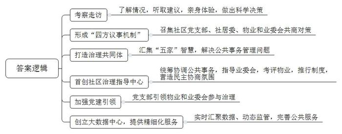
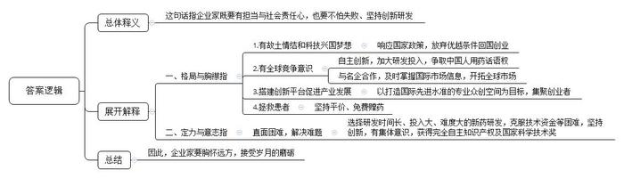
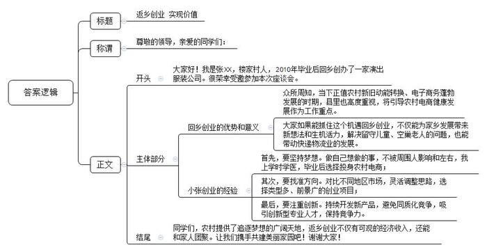

# 2020年0822公务员多省联考《申论》题（安徽A、普通选调卷）

> 候选采集稿。参考答案及解析来自粉笔页面，不代表官方答案或真实高分答卷；来源使用许可与原卷对应关系仍需人工核实。

## 给定材料

### 材料 material-e46f7df736a457fb

“我们真是社区治理的受益者，现在门口一点也不堵了，物业经理都亲自给我们站岗呢！”说到校门口的停车问题，A市第二小学的李校长如沐春风。第二小学位于Z小区旁，曾经因为管理混乱，小区乱停车拥堵了校门，连校车都进出困难，小区环境脏乱差，业主更是怨声载道。去年，Z小区业主委员会成立，目的是炒掉旧物业，换个新物业。街道和社区对此非常着急，“我们担心旧物业走了，按照现有的物业费标准，新物业又招不来，小区就乱套了。”H街道陈主任说。

为破解难题，陈主任带领工作人员到Z小区进行考察。他们了解了小区环境卫生状况，走访了物业公司、业委会和居民，又听取了几位居民的建议，在上下班高峰期等几个重要时间节点，亲身体验了小区道路拥堵、交通混乱的状况。经过调查，陈主任和街道工作人员一致认为，要解决Z小区管理中存在的问题，不能采取更换物业公司这种短效行为，必须创新工作思路，方能从根本上解决问题。

于是，H街道召集社区党支部、社居委、物业和业委会，四方齐聚一堂，心平气和地摆出问题，凝聚共识，共商对策，逐渐形成了“四方议事机制”。

经过商讨，H街道决定在Z小区创新社区治理模式，推动社区治理共同体的诞生。以社区“两委”为“本家”、社区全体业主为“主家”、物业服务企业为“管家”、辖区单位为“邻家”、专业规划团队为“专家”，汇集“五家”智慧参与社区治理，解决社区公共事务管理中的重点难点问题。

H街道在全市首创社区治理指导中心，负责对社区公共事务管理工作的统筹协调，指导业主大会召开及业委会成立，组织辖区物业服务企业的日常考评工作，全面推行社区议事委员制度，营造社区民主协商氛围。

新的社区治理模式让小区大“变脸”。过去Z小区大门破旧不堪，而且安全系数低，也影响车辆通行。新的社区治理模式启动后，社区党支部积极发挥“本家”的作用，引导“主家”“管家”“邻家”形成合力，共同推进小区大门整修工作。经小区半数以上“主家”投票选定大门设计方案，同时社区治理共同体成员针对整修资金筹措进行会商，最终业委会出资10万、物业出资3万，剩余部分由社区公益金、党组织服务群众经费补足。如今的小区大门焕然一新；青砖黄柱，一边是整洁的保安亭，一边是灰色大字的小区名，十分典雅。“回家顿时有了仪式感。”居民王先生感叹道。

小区的生态共治园占地600平方米，曾是物业公司的育种苗圃。业主们想给孩子打造一块种植园，让他们知道西红柿、草莓怎么开花结果。经社区居委会积极与物业公司沟通，物业同意将该处苗圃无偿打造成生态共治园。社区邀请种植专家和居民代表召开会议，制定生态共治园的建设方案。建成后，Z小区的生态共治园既有科普教学功能，又有美学价值，还能让居民体验农耕生活、感受种植乐趣。

如今，Z小区社区治理模式已基本成型。“今后，街道将总结社区党建引领物业和业委会参与社区治理的经验，向其他社区推广，扎实做好党建引领社区治理工作。”陈主任表示。

为了给社区居民提供更精细化的服务，H街道还创立了区域大数据中心。街道办事处社会服务管理指挥中心内，大屏幕上随时切换着辖区内商业街道的人流情况以及辖区内0至3岁幼儿分布、停车位使用情况等信息。依托大数据平台，辖区内“人、地、事、物”等数据都呈现在一张通过实景拍摄后制成的数字地图上，有效实现了数据的实时汇聚和动态监管。大数据就像一只“无形的手”，针对服务薄弱环节和突出问题精准发力，解决了百姓的许多难事和急事。

去年H街道召开居民代表大会，会上代表们反映最多的就是幼儿入园难的问题。“我们根据大数据平台掌握的实有人口和户籍人口信息，通过热力图表预测未来两年0至3岁幼儿的入园需求，从而根据幼儿分布状态选址建设幼儿园。”陈主任说，目前街道已与区教委达成一致意见，共同新建两个公立幼儿园，满足辖区内幼儿的入园需求。此外，街道年满60周岁的老年人信息会自动被大数据平台筛选出来。哪位居民年满60周岁该办理老年证了，大数据平台提前3个月自动为老人发送提示短信。证件办理成功后，不用老人去街道社区取，社区工作人员亲自送上门。

对此，陈主任坦言，社区就是我们的大家庭，我们的梦想就是打造一个共建共治共享的和谐家园。“大数据的运用让信息多跑路，让群众少跑腿，打通了公共服务的‘最后一米’。”

### 材料 material-502562f53b63df8b

BD药业是一家在全球肿瘤药物领域拥有多项核心自主知识产权的高科技公司。说起BD药业的故事和梦想，公司董事长兼首席执行官丁先生有很多的感慨。

2002年，借着国家鼓励大众创新创业的东风，留洋十年的丁先生背起行囊，与几位合伙人一道回国创业。就在第二年，BD药业成立，开始追逐“做创新药”的大梦想。有人说，丁先生身上有不少光环，比如国外著名大学的医学博士、执业医师等，回国创业就意味着放弃了优越的生活条件、高额的薪水，白手起家，这个抉择很有勇气。而在丁先生看来，这个选择顺理成章。“像我们这些知识分子，大多数还是有故土情结的，梦想着科技兴国。”除了游子的思乡情结，还有一点对丁先生来说非常重要——“国家鼓励海归创新创业，在国内可以做到在国外做不到的事”。他说，在国外，科学家只能做药物研发的某一部分工作，而只有在中国才有几个科学家合作完成一个新药所有的研究，并将其产业化的机会。

与很多企业选择做仿制药不同，BD药业一开始就立志做新药，要在全球药业竞争中拥有完全知识产权。虽然面临各种技术难题、无休止试药及资金链断裂等“生死劫”，但有志者事竟成，BD药业克服了重重困难，最终成功了。他们研制的抗癌药获得国家颁发的新药证书，成为我国首个具有完全自主知识产权的同类抗癌新药。该药还被列入国际权威机构发布的新药研发年度报告，成为第一个获得国际机构认可的中国创制新药。

2016年1月8日对于丁先生来说很特别，也很难忘。这一天他作为BD药业相关项目的第一完成人，在2015年度国家科学技术奖励大会上接受了表彰。“这是奋斗者的荣誉，这个荣誉不仅属于我，也属于我们团队，其实还属于国家。”当时，在深冬北京的暖阳中，丁先生手捧大红证书，站在人民大会堂前拍了一张照片。这是国家对BD药业创新能力的巨大肯定。

“只有自主创新，才能拥有话语权”，丁先生常说，“要真正把中国的医药产业发展起来，得把中国人用药的话语权掌握在自己手里。”

近年来，BD药业跑得飞快，源源不绝的动力就来自“创新”二字。自主研发是BD药业的看家本领，丁先生表示，截至目前，今年创新研发投入已经超过10亿元。“我们正不断加强自主研发这一块。有自主研发做保障，我们就有底气开拓市场和开展合作。”BD药业把眼光投向全球，通过与国际知名医药企业合作，及时掌握国际市场信息，在全球的抗肿瘤药物市场中奋勇开拓。

如今，BD药业又种下了一颗新的梦想种子——以自家企业为基础，打造一座“医药梦工场”，搭建更大的创新平台，为全国医药产业的快速发展打造新引擎。丁先生说，这是一个为科学家、创业者造梦圆梦的项目，目标是打造一个具有国际先进水准的生物医药专业众创空间。未来，这里也将集聚一批医药领域的创业者。

研制新药去拯救病患，搭建创新平台去服务全行业。丁先生说这些都是出自一个企业家的担当。“很多人说我一夜暴富，其实我们自己没什么特别的感觉，财富是创业创新水到渠成的结果。我们脑子里想的更多的还是新药研发，以及企业的未来发展。”作为过来人，丁先生还想告诉创业者的是，企业家要有企业家的担当，企业家既要有仰望星空的格局与胸襟，也要有坐住板凳的定力和意志。“就拿我们医药行业来说，与一般的制造业不同的是，医药行业一方面与老百姓的身体健康密切相关、另一方面新产品的研发时间长、投入大、失败的风险高，要成功很难。”经历了风风雨雨，丁先生一直坚持“做老百姓吃得起的好药”，还对符合相关条件的患者进行免费赠药，赠药数量甚至超过了销售数量，这就是一位企业家的社会责任心。胸怀远方，迎接岁月的磨砺，才有了如今的BD药业。

### 材料 material-c57a77c8d06b594f

2010年，因为敏锐地发现了农村创业的机遇，小张大学一毕业就果断选择了返乡创业，投身农村电商业务。如今小张已成为村里的“创业榜样”。

小张的父亲做了30多年的乡村医生，希望他能接班，所以把他送进了一所医学院。对自己的未来，小张有不一样的梦想，他觉得自己不适合做医生。其实在填高考志愿时，他就想学电子商务专业，但被父亲阻止了。毕业后，父亲没有再反对他干自己想干的事儿，他决定开网店。

小张的家乡N县楼家村，是个传统意义上的农业村。90年代后期，村子里有人开始做起影楼服饰的生意，以家庭作坊居多，并未规模化。销售方式也都是在村里做好后，送到城里去卖，这种上门推销的手工作坊模式发展非常缓慢。

小张大学毕业时，电子商务还没有那么火，整个村子接入宽带的都没有几户人家，也没有工业基础。

小张最初想把影楼服饰搬到网上去卖，于是，他租赁了房屋，购买了几台缝纫机，进行服装加工，又购买了一台电脑并在电商平台上注册了网店。刚开始，由于缺乏经验，生意并没有做起来。“我原来是学医的，专业离这个比较远。而且在学校也没学过如何创业，我对此非常陌生，完全是凭着一股热情闯进来的。”小张说，自己一开始并没有对影楼服饰的市场进行过调查，后来才发现影楼服饰市场很小，3个月下来，小张并没有赚到钱，还一度到了交不起房租的窘境。

不过，这个年轻人不服输，他决定去南方看看，了解不同地区的服装制造情况。经过考察，他发现相比于单一的影楼服饰市场，演出服装要好做得多，类型比较多样，市场能拓展开。就这样，小张调整思路，铆着一股劲，开始转做演出服装的生意。4年过去了，小张成立了自己的公司，建起了2000余平方米的车间，光各类服装设备就有106台。

小张点燃的星星之火逐渐发展成了燎原之势。眼看着小张生意越做越好，同村的年轻人纷纷向小张取经，也陆续开起了网店。目前，全村300户家庭大都开有网店，年销售收入超100万元的服饰加工户30多家，青年回乡创业，除了带来新想法，还有年轻人的生机和活力，留守儿童，空巢老人的问题不复存在。与电子商务相关的周边产业，配套设施也被带动起来，其中一大改变是快递物流的出现。一家大型物流公司在村里设点，每天定时收发快件，这也给村里人生活带来了极大的便利。回首过去，小张觉得当初返乡创业是一个非常正确的选择，顺应了农村新旧动能转换和电子商务蓬勃发展的时代潮流。他认为农村为大学生提供了追逐梦想的广阔天地，大学生返乡创业不仅经济收入可观，还能和家人团聚，同时也为农村带来了活力和人才。

不过，返乡创业的大学生们享受着家乡电子商务“野蛮发展”带来的红利时也有了新的烦恼。小张明显感觉生意没以前好做了。“前两年一套演出服装能赚20至30块钱，现在10块钱吧。”与其他村依山靠山卖土特产不同，楼家村村民开服装网店成本低，一台电脑，再找到家可靠的代工厂就可以“创业”了，很容易造成同质化竞争，小张认为目前保持竞争力的唯一方法就是不停地开发新品，让别人赶不上。“演出服装想创新很难，你得自己设计、打板，抄袭成本却很低。”凑巧的是，小张的妻子是服装学院毕业的，妻子便成为家里创新的主力。但小张说，“这显然是不够的，我现在迫切需要专业的设计师过来帮助做创新。”

N县也在类似楼家村这样的村子带动下，发展出了很多“网店村”。这种飞快的发展速度也引起了县委县政府的关注。县委县政府明确提出把引导“网店村”健康发展作为政府服务增效的重要工作内容。“我们正在联系一家大型电商平台，争取双方在跨境电子商务、人才培训、云计算和大数据应用等方面早日开展深入合作。”县委负责人说。

### 材料 material-e63543234b01c7ac

“我们都在努力奔跑，我们都是追梦人。”是的，我们都是追梦人，追梦，我们收获满满；追梦，我们希望满满。

正如习近平总书记所说，中国人民具有伟大梦想精神。改革开放40多年的征程，就是一个追梦之旅。改革开放之初，我们党以非凡的胆略、坚定的自信设计了用70多年、分三步走，基本实现社会主义现代化的宏伟蓝图。改革开放40多年的追梦路上，我们咬定青山不放松，风雨无阻朝着这个伟大目标前进。

从站起来、富起来到强起来，这是奋斗的力量，也是梦想的力量。

党的十九大对我国发展提出了更高的奋斗目标，形成了从全面建成小康社会到基本实现现代化、再到全面建成社会主义现代化强国的战略安排，发出了实现中华民族伟大复兴中国梦的最强音。

但是，船到中流浪更急，人到半山路更陡，并且“愈进愈难、愈进愈险而又不进则退、非进不可”。在这样的关键时刻，我们要心怀梦想、奋勇拼搏，一步一个脚印，一棒接着一棒，在新时代创造中华民族新的更大奇迹！

梦想是拼出来的，奇迹是干出来的。改革开放的辉煌成就背后，是40多年的不懈努力。未来中国梦的实现，同样需要汗水的浇灌。没有人能随随便便成功。改革开放40多年的历程告诉我们：伟大事业都始于梦想，基于创新，成于实干。梦想是激发活力的源泉，只要有梦想，就会有力量。只要有梦想，则时光不弃，未来可期。

## 题目

### 第 1 题

**根据给定资料**2**，概括H街道加强社区治理的主要措施。（15分）**

关联材料：material-e46f7df736a457fb

作答要求：

要求：

（1）准确、全面；

（2）分条概括；

（3）不超过200字。

### 第 2 题

**给定资料**3**中提出，****“企业家既要有仰望星空的格局与胸襟，也要有坐住板凳的定力和意志”，谈谈你对这句话的理解。（20分）**

关联材料：material-502562f53b63df8b

作答要求：

要求：

（1）紧扣资料，全面准确；

（2）分析透彻，条理清晰；

（3）不超过300字。

### 第 3 题

**N县县委县政府为鼓励大学生返乡创业，准备召集本县的应届大学毕业生，举办一场返乡创业座谈会，拟邀请小张出席。请根据给定资料**4**为小张写一篇发言提纲。（25分）**

关联材料：material-c57a77c8d06b594f

作答要求：

要求：

（1）紧扣资料，针对性强；

（2）层次分明，逻辑性强；

（3）格式规范，文体性强；

（4）正文部分400字左右。

### 第 4 题

**给定资料**5**中提到村民眼中的变和小孙心中的不变，根据你对此的理解，围绕****“变与不变”，联系实际，自拟题目，写一篇文章。（40分）**

关联材料：material-e63543234b01c7ac

作答要求：

要求：

（1）自选角度，立意明确；

（2）思路清晰，语言流畅；

（3）参考给定资料，但不拘泥于给定资料；

（4）总字数1000～1200字。

## 答案与解析

第 1 题

**参考答案（粉笔题库参考内容）**

1.考察走访。了解情况，听取建议，亲身体验，做出科学决策。

2.形成“四方议事机制”。召集社区党支部、社居委、物业和业委会共商对策。

3.打造治理共同体。汇集“五家”智慧，解决公共事务管理问题。

4.首创社区治理指导中心。统筹协调公共事务，指导业委会，考评物业，推行制度，营造民主协商氛围。

5.加强党建引领。党支部引领物业和业委会参与治理。

6.创立大数据中心，提供精细化服务。实时汇聚数据、动态监管，完善公共服务。

**解析**

**参考答案说明：**本参考答案从“考察走访”“形成‘四方议事机制’”“打造治理共同体”“首创社区治理指导中心”“加强党建引领”“创立大数据中心，提供精细化服务”这六个方面展开，对H街道加强社区治理的主要措施进行了分条撰写。各条要点之间在内容上相互并列，没有交叉。

**考点**：考点概括措施类

**来源**：来源2020年0822公务员多省联考《申论》题（安徽A、普通选调卷）

粉笔申论页面对本题只提供「解析视频」入口，该入口是会员推广位，页面无视频地址与文字解析。

第 2 题

**参考答案（粉笔题库参考内容）**

这句话指企业家既要有担当与社会责任心，也要不怕失败、坚持创新研发。

一、格局与胸襟指：1.有故土情结和科技兴国梦想。响应国家政策，放弃优越条件回国创业。2.有全球竞争意识。自主创新，加大研发投入，争取中国人用药话语权；与名企合作，及时掌握国际市场信息，开拓全球市场。3.搭建创新平台促进产业发展。以打造国际先进水准的专业众创空间为目标，集聚创业者。4.拯救患者。坚持平价、免费赠药。二、定力与意志指：直面困难，解决难题。选择研发时间长、投入大、难度大的新药研发，克服技术资金等困难，坚持创新，有集体意识，获得完全自主知识产权及国家科学技术奖。

因此，企业家要胸怀远方，接受岁月的磨砺。

**解析**

**参考答案说明：**（1）思路方面，本参考答案按照词句解释题“总体释义+展开解释+总结”的一般答题思路展开。（2）内容方面，本参考答案先解释了画线句的总体含义；“展开解释”部分再分别从“格局与胸襟”“定力与意志”两方面展开，最后在“总结”部分提出了对策。（3）词句表达方面，本参考答案加上了“这句话指”“因此”等逻辑连接词来承接上下文。

**考点**：考点词句解释类

**来源**：来源2020年0822公务员多省联考《申论》题（安徽A、普通选调卷）

粉笔申论页面对本题只提供「解析视频」入口，该入口是会员推广位，页面无视频地址与文字解析。

第 3 题

**参考答案（粉笔题库参考内容）**

返乡创业 实现价值

尊敬的领导，亲爱的同学们：

大家好！我是张XX，楼家村人，2010年毕业后回乡创办了一家演出服装公司。很荣幸受邀参加本次座谈会。

众所周知，当下正值农村新旧动能转换、电子商务蓬勃发展的时期，县里也高度重视，将引导农村电商健康发展作为工作重点。大家如果能抓住这个机遇回乡创业，不仅能为家乡发展带来新想法和生机活力，解决留守儿童、空巢老人的问题，也能带动快递物流业的发展。

创业需借“东风”，更需要个人的努力。接下来，我结合自身经历，跟大家分享一些创业经验和体会。首先，要坚持梦想。做自己想做的事，不被周围人影响和左右，我上学时学医，毕业后选择投身农村电商；其次，要找准方向。对比不同地区市场，灵活调整思路，选择类型多、前景广的创业项目；最后，要注重创新。持续开发新产品，避免同质化竞争，吸引创新型专业人才，保持竞争力。

同学们，农村提供了追逐梦想的广阔天地，返乡创业不仅有可观的经济收入，还能和家人团聚。让我们携手共建美丽家园吧！谢谢大家！

**解析**

**参考答案说明：**本参考答案形式上，包括标题、称谓、正文。内容上，从“小张的基本情况”“回乡创业的优势以及意义”“小张创业的经验”三个方面展开。其中“小张创业的经验”又从“坚持梦想”“找准方向”“注重创新”三个层面进行说明，各条答案要点之间在内容上相互并列，没有交叉。

**考点**：考点宣传类

**来源**：来源2020年0822公务员多省联考《申论》题（安徽A、普通选调卷）

粉笔申论页面对本题只提供「解析视频」入口，该入口是会员推广位，页面无视频地址与文字解析。

第 4 题

**参考答案（粉笔题库参考内容）**

**坚守为民初心 实现脱贫致富**

“草木蔓发，春山可望”，**从靠天吃饭到产业脱贫，变的不仅是农村的经济、农民的生活、农业的发展，也是听天由命向自力更生转变的观念**。这些“变化”的背后，则是“不变”的支撑。**这种****“不变”就是共产党人服务为民的信念，是基层干部扎根一线的情怀，更是千千万追梦人的拼搏底色**。

**基层干部应始终坚守带领群众脱贫致富的理想信念，保持干实事的初心情怀，深入基层、履职尽责，以民为本，解决群众****“燃眉”之事，不断拉近干群关系。**脱贫前，岩山村物质生活相对贫乏。面对村民的质疑与不信任，扶贫干部怀揣一颗真心，到田间地头了解情况，走家串户查找穷根。在了解了村里的“大事小情、家长里短”之后，因地制宜加强基础设施建设，完善生产条件，发展传统养殖业。与此同时，在扶贫中也重视扶技，根据当地产业特色，开设各种技能培训班，提升群众的生产发展水平。诸如此类，看似件件皆小事，可件件也都是群众心上事，一连串雪中送炭的实质性帮扶拉近了村民和工作队的距离，也带动了乡村经济发展，更是为村容村貌的改善和乡风文明的转变奠定了坚实的基础。

要想实现乡村的真正转变，实现脱贫致富梦，除了坚守初心，坚持实干导向，也需要坚持以增产增效增收，改变传统生产方式作为长远发展的目标。

**农村脱贫致富，最重要的就是物质经济条件的改善，这就需要我们不断加大产业开发力度，提高群众收入，确保脱贫效果的可持续性。**发展乡村产业是实现乡村发展的核心，亦是我们实现民族复兴的必由之路。但仅发展传统产业是远远不够的，我们还需要注重产业的融合发展，在依托当地特色产业的同时，招商引资，发展加工业，进行深加工，并将文化故事融入产品，提升产品附加值，开拓销路，提升收入。乡村经济的发展，不仅可以增加就业岗位，解决乡村人口流失的问题，还可以吸引更多人才返乡就业，反哺乡村自身，增加乡村的活力，从而真正找到穷根、治好穷病、摘掉穷帽。

**不变成就了乡村的改变，但脱贫致富的背后，是基层干部不断加强学习，创新工作方法，提升自身能力素质的实践。**“农村富不富，关键在支部”，发挥基层党组织的战斗堡垒作用是驻村帮扶的首要工作。在这一过程中，要积极开展学习教育活动，提升党员的先锋模范意识。正如“太行山愚公”李保国同志一样，他带领乡亲们脱贫致富的初心不动摇，带领村委班子不断开展学习先进农业知识，完成山区开发研究成果数十项，推广的林业技术更是极大地改善了当地生态环境。可以说，万亩荒地变绿洲，万千贫困人口变富裕，正是依靠李保国同志为首的基层干部们扎实的知识、先进的技术和坚持不懈的实践啊！

“船到中流浪更急，人到半山路更陡”。面对这迅猛变化的时代，我们需要主动求变以更好的适应时代，但更要坚持不变，坚守初心、坚定梦想、一心为民，才能够绘就出“全民奔小康”的蓝图，兑现“一个都不掉队”的誓言！

**解析**

**文章分析**

**坚守为民初心** **实现脱贫致富**

【**标题的优点**：首先，范文的标题“坚守为民初心”突出了“不变”这一主题词，“实现脱贫致富”体现了“变”这一主题词。其次，形式上，文字对称，具有美感。】

（1）“草木蔓发，春山可望”，**从靠天吃饭到产业脱贫，****变的不仅是农村的经济、农民的生活、农业的发展****，也是听天由命向自力更生转变的观念**。（2）这些“变化”的背后，则是“不变”的支撑。（3）**这种“不变”就是****共产党人服务为民的信念****，****是基层干部扎根一线的情怀****，****更是千千万追梦人的拼搏底色**。

【**开头的优点：**★内容方面：范文的开头是紧扣“变与不变”这一主题展开的。首先，开头第一句话解释了“变”的内涵；其次，指出了“变与不变”的关系，即“变是因为不变”；接着指出了“不变”的内涵。★文字表达方面：引用了“草木蔓发，春山可望”等古语，使文章开头显得较有文采，还使用了“也”“更”等并列和递进关联词，使语言表达有逻辑性。】

**基层干部应始终坚守带领群众脱贫致富的理想信念，保持干实事的初心情怀，深入基层、履职尽责，以民为本，解决群众“燃眉”之事，不断拉近干群关系。**（1）脱贫前，岩山村物质生活相对贫乏。面对村民的质疑与不信任，扶贫干部怀揣一颗真心，到田间地头了解情况，走家串户查找穷根。在了解了村里的“大事小情、家长里短”之后，因地制宜加强基础设施建设，完善生产条件，发展传统养殖业。（2）与此同时，在扶贫中也重视扶技，根据当地产业特色，开设各种技能培训班，提升群众的生产发展水平。（3）诸如此类，看似件件皆小事，可件件也都是群众心上事，一连串雪中送炭的实质性帮扶拉近了村民和工作队的距离，也带动了乡村经济发展，更是为村容村貌的改善和乡风文明的转变奠定了坚实的基础。

【**论述段****1****的优点**：★观点句：范文的观点句是紧扣“变与不变”这一文章主题提出的。形式上，它在段首处直接写出，位置突出，容易被发现；内容上，关键词突出，内容要点明确，可以明显看出它是从“基层干部坚守理想信念，保持干事初心”即“不变”这一角度展开论述。★论述内容：（1）基层干部进行实地调查，在扶贫上发力；（2）开展培训，在扶技上发力；（3）基层干部坚守信念、保持实干的意义。注意：以上三个方面的内容都是紧扣观点句“基层干部应始终坚守带领群众脱贫致富的理想信念，保持干实事的初心情怀，深入基层、履职尽责，以民为本，解决群众‘燃眉’之事，不断拉近干群关系”进行分析论述的，层次清晰、针对性强。在论证方法上采用了讲道理和举例子相结合的方式，使内容更加充实。】

要想实现乡村的真正转变，实现脱贫致富梦，除了坚守初心，坚持实干导向，也需要坚持以增产增效增收，改变传统生产方式作为长远发展的目标。

【**过渡段的优点：**过渡段承上启下，先通过“除了坚守初心，坚持实干导向”承接上文的“不变”，然后通过“也需要坚持以增产增效增收，改变传统生产方式作为长远发展的目标”引出“不变是为了更好的改变”，从而引出后文的主要观点。】

**农村脱贫致富，最重要的就是物质经济条件的改善，这就需要我们不断加大产业开发力度，提高群众收入，确保脱贫效果的可持续性。**（1）发展乡村产业是实现乡村发展的核心，亦是我们实现民族复兴的必由之路。（2）但仅发展传统产业是远远不够的，我们还需要注重产业的融合发展，在依托当地特色产业的同时，招商引资，发展加工业，进行深加工，并将文化故事融入产品，提升产品附加值，开拓销路，提升收入。（3）乡村经济的发展，不仅可以增加就业岗位，解决乡村人口流失的问题，还可以吸引更多人才返乡就业，反哺乡村自身，增加乡村的活力，从而真正找到穷根、治好穷病、摘掉穷帽。

【**论述段****2****的优点**：★观点句：范文的观点句是紧扣“变与不变”这一文章主题提出的。形式上，它在段首处直接写出，位置突出，容易被发现；内容上，关键词突出，内容要点明确，可以明显看出它是从如何实现经济上的“改变”这一角度展开论述。★论述内容：（1）发展乡村经济的重要性；（2）发展乡村经济的对策；（3）乡村经济发展带来的意义。注意：以上三个方面的内容都是紧扣观点句“农村脱贫致富，最重要的就是物质经济条件的改善，这就需要我们不断加大产业开发力度，提高群众收入，确保脱贫效果的可持续性”进行分析论述的，层次清晰、针对性强。在论证方法上以讲道理为主，增强了论证的说服力。】

**不变成就了乡村的改变，但脱贫致富的背后，是基层干部不断加强学习，创新工作方法，提升自身能力素质的实践。**（1）“农村富不富，关键在支部”，发挥基层党组织的战斗堡垒作用是驻村帮扶的首要工作。（2）在这一过程中，要积极开展学习教育活动，提升党员的先锋模范意识。正如“太行山愚公”李保国同志一样，他带领乡亲们脱贫致富的初心不动摇，带领村委班子不断开展学习先进农业知识，完成山区开发研究成果数十项，推广的林业技术更是极大地改善了当地生态环境。可以说，万亩荒地变绿洲，万千贫困人口变富裕，正是依靠李保国同志为首的基层干部们扎实的知识、先进的技术和坚持不懈的实践啊！

【**论述段****3****的优点**：★观点句：范文的观点句是紧扣“变与不变”这一文章主题提出的。形式上，它在段首处直接写出，位置突出，容易被发现；内容上，关键词突出，内容要点明确，可以明显看出它是从基层干部改变自身，即“不变”背后的“改变”这一角度展开论述。★论述内容：（1）基层党建的重要性；（2）举例说明基层干部如何提升自身能力以及提升自身能力的重要性。注意：以上两个方面的内容都是紧扣观点句“不变成就了乡村的改变，但脱贫致富的背后，是基层干部不断加强学习，创新工作方法，提升自身能力素质的实践”进行分析论述的，层次清晰、针对性强。在论证方法上采用了讲道理和举例子相结合的方式，使内容更加充实。】

【**论述段之间的关系**：★内在逻辑上：范文的论述段之间呈现递进关系，按照“先说基层干部坚守不变理念和实干，再说通过基层干部的‘不变’推进乡村经济的巨变，最后说基层干部‘不变’背后的‘改变’”的逻辑展开的。★外在衔接上：论述段1之后的过渡段“除了坚守初心，坚持实干导向，也需要坚持以增产增效增收，改变传统生产方式作为长远发展的目标”，起到了承接论述段1，引出论述段2的作用；论述段3开头处的“不变成就了乡村的改变，但脱贫致富的背后”，起到了承接论述段1、2的作用。】

“船到中流浪更急，人到半山路更陡”。面对这迅猛变化的时代，我们需要主动求变以更好的适应时代，但更要坚持不变，坚守初心、坚定梦想、一心为民，才能够绘就出“全民奔小康”的蓝图，兑现“一个都不掉队”的誓言！

【**结尾的优点：**范文的结尾回扣了“变与不变”这一主题，并发出了呼吁号召。结尾短小精悍，不拖沓。】

**考点**：考点文章写作题

**来源**：来源2020年0822公务员多省联考《申论》题（安徽A、普通选调卷）

粉笔申论页面对本题只提供「解析视频」入口，该入口是会员推广位，页面无视频地址与文字解析。

