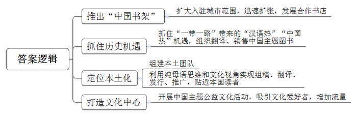
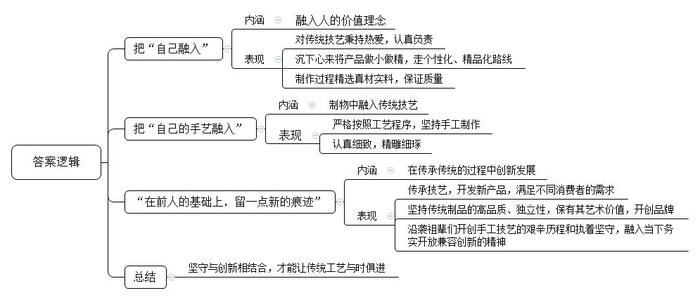
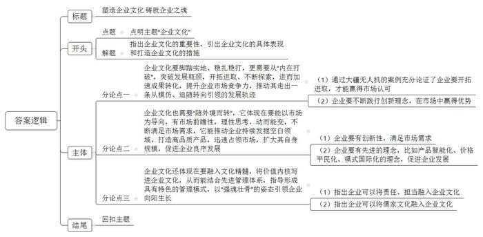

# 2020年0822公务员多省联考《申论》题（安徽B卷）

> 候选采集稿。参考答案及解析来自粉笔页面，不代表官方答案或真实高分答卷；来源使用许可与原卷对应关系仍需人工核实。

## 给定材料

### 材料 material-eb3dd39aa8efa342

2018年12月，虽正值寒冬，但对于Q集团俄罗斯分公司的陈总来说，却是“热浪”迭起。12月14日，由该公司出版的《中国民营企业四十年的风云激荡》俄文版新书发布会在其位于莫斯科的中国书店举行，受欢迎程度大大超出预期。与此同时，分公司推出的“中国书架”在俄罗斯两座城市挂牌，这意味着“中国书架”已入驻俄罗斯12个城市的22家书店。“照这个速度，用不了多久，‘中国书架’很有希望在俄罗斯发展出百家合作书店……”陈总在微信朋友圈中写道。

陈总所领导的俄罗斯分公司是中国著名民企Q集团的下属公司。2009年7月，Q集团开始走出国门进军国际市场。“集团一路摸爬滚打，是中国图书出海的一个缩影。”俄罗斯分公司成立之初，推出的第一本书是《快速学汉语》，首印1万本，卖得不好；组织翻译的一些在中国国内颇红的文化类、小说类图书，也只销售了个位数。几年过去了，库存积压，让原来挣的钱全赔了进去。2013年，“一带一路”的提出使得“汉语热”“中国热”迅速升温。中国图书在国外的需求量开始增大，国内的出版社主动上门寻求合作。该公司抓住了这一机遇。组织翻译、销售了大量中国主题图书，包括《历史的轨迹——中国共产党为什么能》《中国民营企业500强》等。经过短短数年发展，该公司成为了俄罗斯第三大中国主题图书出版商。

Q集团俄罗斯分公司共有员工268人，陈总是其中唯一的中国人。如此极致的本土化，缘于该公司的定位——通过纯母语思维和文化视角，实现对中国主题图书海外出版的组稿、翻译、发行和推广。几年前一家国内出版社组织翻译专家团队，将一本中文图书译成了俄文。另一家俄罗斯出版社得到授权后，也组织了当地的翻译人才进行翻译。两个俄文版本相比，后者页数远超前者。原来，俄罗斯本土化编辑翻译团队，为该书增加了大量的背景介绍与注释，语言风格也更贴近本国读者，受到了更多俄罗斯读者的欢迎。这些事让他深刻认识到，要想让世界了解中国，需要使用当地易于接受的思维和话语体系。

为了让中国文化更接地气，分公司还将一些书店打造为文化中心，开展围棋讲座、中国书法班、中国主题沙龙、趣谈中国文化爱好者等公益活动。“粉丝”的增多，也带来了“流量经济”。陈总说：“我对中国主题图书走出去，有了更多信心！”

### 材料 material-9740723ddeef6a8d

69岁的老林是位资深木雕艺人，被称为“最后的手工酸枝筷子传人”。他的店铺不过8平方米，在当地却小有名气。老林家的店铺是他爷爷在1889年创立的。近年来，各行各业飞速发展，市场化程度越来越高，但老林对这门家族生意和手艺有着自己的坚持，一直拒绝大批量生产，执着于手工制做每一双筷子。老林告诉记者，这些年来，不断有人想和他合作，希望形成规模生产，全都被他一口回绝。对方取笑他不会赚钱，他却说自己知足常乐，虽无大富大贵，但也丰衣足食，守着家族生意认真做好每一个产品。在老林看来，手工制筷工序复杂，没有捷径可走，每道工序都要求严格，稍有不慎，筷子就会走样。一双好筷子，真正检验它的只有漫长的岁月。做手艺，做生意，必须沉下心来，慢工出细活，而只要工艺精湛，总会有人来购买。正因如此，林家小店始终有一批熟客，“别人要做大做强，那是他们的事，我偏要做小做精，走个性化、精品化的路线。”

林家生产筷子的小作坊现在共有十多个工人，当中不少是跟随了他20多年的老师傅，每一双筷子经手工打磨，日均产量也难有标准数字，一天下来，大约能制成40多捆筷子。老林说：“本地早就没有人做手工筷子了，放眼全国，也没有人坚持手工制作了，都是机械化生产。”对于自己制做的筷子，老林相当自豪。他说，普通筷子使用了几个月后就得更换，而他家的筷子取材自缅甸坤甸木、老挝大红酸枝、泰国乌梅木、印度小叶紫檀等，真材实料质量过硬，只要避免高温消毒损耗木质，基本上可以用一辈子。去年开始，家族生意已由他唯一的女儿小林接手。面对自家的木筷生意，小林有自己的想法。除了传承父辈制筷技艺，她还有意开发新产品，满足不同消费者的需求。她说：“人在制物的过程中，总是要把自己和自己的手艺融到里头去，在前人的基础上，留一点新的痕迹，这样这门手艺才能历久弥新。”

如今，在国家政策指引下，许多老手艺又重现生机。它们还能再现昔日的辉煌吗？当前，工业产品已经占据了人类日常生活品的绝大部分，传统手工艺制品已经不大可能再重塑曾经的为大众制造日用品的历史。小林认为：“由于受原材料、制造技艺、生产工时等各种条件的限制，传统手工艺制品已经与奢侈品无异。就拿我家的筷子来说，投入成本较高、产品独立性较强，并带有一定的艺术价值，这些都具备了开创品牌的条件。”在小林看来，“林家筷子”不只是他们家赚钱谋生的商品，也不只是手艺人技艺的表现，祖辈们开创手工木艺的艰辛历程和执着坚守，与当下务实开放兼容创新的精神是非常契合的。

两代人经营理念的对接，或许还需要一些时日，不过，坚守传统手艺的本心一致。时代变迁自有节奏，哪怕只是手中一双小小的筷子，也要一点点打磨制作，方对得起“工艺”二字。

### 材料 material-3c729094e1073eb2

八月的H市，已进入高温炙烤模式。夜，却未因此而平静。晚上十点，市区最大商场的主体部分已经打烊，人们陆续从商场大门走出。与此同时，另一批“意犹未尽”的顾客走进了地下一层和地下二层东侧的“21街区”。这片主营餐饮的区域，营业时间一直会延长到凌晨两点，是名副其实的“深夜食堂”。人们在炸糕店前排队买着炸糕、在奶茶店外挑选着饮料、手捧着冰淇淋和炸鸡……街区内无论面条米饭、饺子煎包，中餐西餐种类都很丰富。

H市商务局的陈科长介绍说，所谓“夜间经济”，是指从当日下午6点到次日早上6点发生的经济文化活动。在不少人看来，夜间经济无非就是“啤酒烤串加唱歌”。事实上，夜间经济的内涵远比“吃吃喝喝”丰富得多。它已经由早期的灯光夜市转变为包括“食、游、购、娱、体、展、演”等在内的多元夜间消费市场。

H市一家著名的24小时书店，就给人们的夜生活增加了一种新的方式。位于临窗位置的阅读区，摆放着一张长桌和七把圆形座椅，其中六把已被读者占用。年轻姑娘小赵戴着耳机，全神贯注地看着手机播放的“中国会计网校”课程。休息间隙，小赵告诉记者，自己参加工作不到一年，打算自学考“注会”。合租环境比较吵闹，下班后就来书店学到10点多再回去。“这里学习环境好，图书资源多，渴了有饮料，饿了有点心，非常方便。”

“再来，加把劲儿！”听着一旁教练的口令，扎着马尾辫的女孩咬了下嘴唇，抹了下额头的汗珠，继续奋力向前推着沉重的哑铃。已是夜里九点半，位于H市南二环附近的一家健身工作室灯火通明。“每天人最多的时候是八点左右，现在好多人已经练完走了。”健身教练表示，“我们工作室成立近三年，明显感觉到健身的人在增多。来这里的大部分是附近的住户，下班之后过来健身。正常情况下，我们是晚上十点关门，但有的人下班晚，跟教练约了，过来练到十一点、十二点也没问题，我们都等。”

为了做好夜间经济这篇大文章，H市于2019年年初成立了由政府相关部门和行业协会组成的夜间工作委员会，拟定夜间经济发展目标。设计夜间经济空间布局，并通过与场地经营者、工作人员、夜间消费者以及周边居民对话的方式听取各方意见，平衡相关群体的利益诉求。同时，交通部门延长了地铁、公交夜间行车时间，为夜间经济的消费者和从业人员提供安全、便捷、舒适的交通工具。夜间经济的安全、噪音、垃圾等问题最为人们所诟病。H市成立专门机构加强公安、消防、城市管理等多部门联动，确保了夜市附近的公共安全、环境卫生。此外还推出了移动应用程序，供居民举报夜间滋扰情况，可通过网络联系所在区域社区的负责人，直接对问题进行处理。

“夜间经济提高了设施使用率、释放了消费需求，激发了文化创造、带动了区域发展。此外，由于夜间具有与常规工作时间错位的优势，更多的潜在劳动力也能够通过在夜间上岗解决就业问题，缓解社会就业压力。如何让夜间经济健康有序地发展，政府的顶层设计尤为关键。政策质量高了，服务品质好了，投资者信心才更强，夜间经济才会走得更好，走得更远。”陈科长感慨地说。某财经大学的张教授认为，当前，我国正处于新旧动能转换的关键时期，服务业具有吸引社会资本与居民消费的双重属性。以商务活动为主的夜间消费正好是服务业发展的最佳着力点。随着人民生活水平不断提高，对于消费的需求也更加多元化，在未来，夜间经济必将成为城市发展的重要源动力。

### 材料 material-500ba31bc40a3bb7

创新是推动经济发展的第一动力，没有科技创新的突破，就难以建成现代化经济体系，就难以实现高质量发展。众所周知，中国有着创新的历史和文化基因，中国古代的四大发明对世界文明发展进程产生了重要影响。今天，中国企业已经在全球科技领域激烈竞争中占有一席之地，有力地推动了经济发展方式的转变、经济结构的调整，中国在移动支付、无人机、生物医药、分享经济等方面有许多领先世界的科技成果，有着比国外同类产品更好的用户体验。

“我们实现了豆浆机、电饭煲等数十款智能厨电的物联网应用。”一家著名民营企业的负责人高总说。在用户需求倒逼之下，该企业对产品进行了智能化升级，目前产品已销售到世界50多个国家和地区，年销售额超过70亿元，拥有专利技术2047项。过去10多年，该企业凭借传感器等方面的制造优势，成为某些跨国大公司的重要供应商。“我们在产品的研发、设计等方面有长期积累，在创新中更容易将好点子转化为好产品。”高总说。

日前，清华大学陈教授在接受记者采访时说，中国的企业在世界经济舞台上走出了一条从模仿、追随到引领的发展轨迹，而这背后的“秘诀”便是创新。市场需求催生了中国企业对生产方式的创新、商业模式的创新，比如新零售、机器人、人工智能等等，这种创新不是短期的、偶然的、而是长期的、自发的，是一种迥然不同于欧美国家的创新路径，是深刻在中国经济肌体中独一无二的事实特征。

毋庸置疑的是，中国经历了40多年的高速发展，已经形成了经济、科研、人才等诸多方面雄厚的基础。特别是与第四次工业革命相关的技术，如数字技术、人工智能、量子技术、新能源、5G通信等方面，都走在了世界前头。此外，中国的移动互联网发达，拥有业态优势：网民群体庞大，比欧美日网民数量之和还多，拥有大数据优势。当前国家积极实施创新驱动战略，无疑为这场工业革命提供了良好的发展背景。

“风物长宜放眼量”，创新是百年大计。纵观世界经济发展史，技术进步和产业变革是经济增长的重要引擎。历次工业革命均因重大技术变革而兴起，逐渐催生了一大批新产业、新业态、新模式，进而大幅提高劳动生产率，推动经济持续健康稳定发展。有研究显示，以人工智能为代表的新技术革命，到2035年有望拉动中国经济年增长率明显提升，推动中国劳动生产率提高27%。一个经济体的底气，既要看眼前静态的“形”，更要看长远发展的“势”。

## 题目

### 第 1 题

**根据“给定资料**2**”概括Q集团俄罗斯公司成功打开国际市场的主要举措。（15分）**

关联材料：材料 material-eb3dd39aa8efa342

作答要求：

要求：

（1）准确全面；

（2）简明扼要；

（3）分条陈述；

（4）不超过200字。

### 第 2 题

**根据****“给定资料**3**”谈谈你对划线句子“人在制物的过程中，总是要把自己和自己的手艺融到里头去，在前人的基础上，留一点新的痕迹，这样这门手艺才能历久弥新”的理解****。****（20分）**

关联材料：材料 material-9740723ddeef6a8d

作答要求：

要求：

（1）紧扣资料；

（2）分析透彻；

（3）条理清楚；

（4）不超过300字。

### 第 3 题

**假如你随****C市商务局考察团到H市调研“夜间经济”发展情况，请结合“给定资料**4**”，写一份调研报告提纲****。****（25分）**

关联材料：材料 material-3c729094e1073eb2

作答要求：

要求：

（1）紧扣资料，内容全面；

（2）层次分明，逻辑性强；

（3）不超过500字。

### 第 4 题

**“给定资料**5**”中提到，“在企业发展的过程中，经营管理只是企业的骨架，文化才是一个企业的血脉****、****灵魂****”，请你根据对这句话的理解，联系实际，自拟题目，写一篇文章****。****（40分）**

关联材料：材料 material-500ba31bc40a3bb7

作答要求：

要求：

（1）自选角度，立意明确；

（2）思路清晰，语言流畅；

（3）参考“给定资料”，但不拘泥于“给定资料”；

（4）总字数800—1000字。

## 答案与解析

第 1 题

**参考答案（粉笔题库参考内容）**

一、推出“中国书架”。扩大入驻城市范围，迅速扩张，发展合作书店。

二、抓住历史机遇。抓住“一带一路”带来的“汉语热”“中国热”机遇，组织翻译、销售中国主题图书。

三、定位本土化。组建本土团队；利用纯母语思维和文化视角实现组稿、翻译、发行、推广，贴近本国读者。

四、打造文化中心。开展中国主题公益文化活动，吸引文化爱好者，增加流量。

**解析**

**参考答案说明：**本参考答案从“推出‘中国书架’”“抓住历史机遇”“定位本土化”“打造文化中心”四个方面展开，各条答案要点之间在内容上相互并列，没有交叉。

**考点**：考点概括措施类

**来源**：来源2020年0822公务员多省联考《申论》题（安徽B卷）

粉笔申论页面对本题只提供「解析视频」入口，该入口是会员推广位，页面无视频地址与文字解析。

第 2 题

**参考答案（粉笔题库参考内容）**

一、把“自己融入”指融入人的价值理念：对传统技艺秉持热爱，认真负责；沉下心来将产品做小做精，走个性化、精品化路线；制作过程精选真材实料，保证质量。

二、把“自己的手艺融入”指制物中融入传统技艺：严格按照工艺程序，坚持手工制作；认真细致，精雕细琢。

三、“在前人的基础上，留一点新的痕迹”指的是在传承传统的过程中创新发展：传承技艺，开发新产品，满足不同消费者的需求；坚持传统制品的高品质、独立性，保有其艺术价值，开创品牌；沿袭祖辈们开创手工技艺的艰辛历程和执着坚守，融入当下务实开放兼容创新的精神。

四、因此，坚守与创新相结合，才能让传统工艺与时俱进。

**解析**

**参考答案说明：**（1）思路方面，本参考答案按照词句解释题“总体释义+展开解释+总结”的一般答题思路展开。（2）内容方面，本参考答案先分别解释了“把自己融入”“把自己的手艺融入”“在前人的基础上，留一点新的痕迹”的内涵，接着分别分析了其具体表现，最后在“总结”部分给出了对策。（3）词句表达方面，本参考答案加上了“因此”等连接词来承接上下文。

**考点**：考点词句解释类

**来源**：来源2020年0822公务员多省联考《申论》题（安徽B卷）

粉笔申论页面对本题只提供「解析视频」入口，该入口是会员推广位，页面无视频地址与文字解析。

第 3 题

**参考答案（粉笔题库参考内容）**

关于H市夜间经济的调研报告提纲

调研背景：“夜间经济”是指从当日下午6点到次日早上6点发生的经济文化活动。我国处于新旧动能转换期，需要发展夜间经济，推动服务业和城市发展。为了推动我市夜间经济的发展，对H市相关情况进行调研。

调研方式、对象：走访“21街区”餐饮区、24小时书店、健身房等夜间消费市场，采访顾客、从业者等。

具体措施：1.加强组织领导。成立夜间工作委员会，拟定发展目标，设计空间布局；听取各方意见，平衡利益诉求。2.优化公共服务。延长公共交通出行时间；成立专门机构，加强部门联动，保障公共安全与环境卫生；推出移动应用程序，就近及时处理居民举报。

取得成绩：提高了设施使用率，释放了消费需求，激发了文化创造，带动了区域发展，解决了就业问题。

发展建议：我市应加强顶层设计，优化服务品质，促进夜间经济健康、长远发展。

**解析**

**参考答案说明：**（1）一方面，内容上，正文部分从调研背景，调研方式、对象，具体措施，取得成绩，发展建议五个方面介绍了H市发展夜间经济的具体情况。（2）另一方面，形式上，本参考答案做到了分段、分条撰写，整体上条理较为清晰。

**考点**：考点总结类

**来源**：来源2020年0822公务员多省联考《申论》题（安徽B卷）

粉笔申论页面对本题只提供「解析视频」入口，该入口是会员推广位，页面无视频地址与文字解析。

第 4 题

**参考答案（粉笔题库参考内容）**

**塑造企业文化 铸就企业之魂**

企业文化是企业的制胜之道，是推动企业发展的不竭动力。企业的发展不仅需要有先进的经营管理模式，搭建企业发展的骨架，更重要的是要具备优良的企业文化，提高整体素质和核心竞争力，让企业拥有血脉和灵魂。

**企业文化要脚踏实地、稳扎稳打，更需要从****“内在打破”，突破发展瓶颈，开拓进取、不断探索，进而加速成果转化，提升企业市场竞争力，推动其走出一条从模仿、追随转向引领的发展轨迹。**正如大疆无人机在发展初期，就将摄像功能作为发力点，将突破传统作为企业文化，研发出自带云台相机的无人机产品，不仅赢得市场认可，也引领无人机行业从生产领域转向了生活领域。在全球科技激烈竞争的环境中，企业只有不断践行创新突破的文化理念，更新科技成果，才能在市场中取得先发优势，打破边界，铸就辉煌。

**企业文化也需要****“随外境而转”，它体现在要能以市场为导向，有市场前瞻性，理性思考，动而能变，不断满足市场需求，它能推动企业持续发掘空白领域，打造高品质产品，迅速占领市场，扩大其自身规模，促进企业良序发展。**自上世纪90年代起，比亚迪便开启了充电电池自主研发、生产的道路。在新能源汽车发展的背景下，比亚迪以其创新优势，推出了“秦”、“宋”等新能源汽车，以产品智能化、价格平民化、模式国际化的理念，实现国产汽车出海销售的新突破，成为中国企业领军品牌。

企业文化不仅仅体现在创新发展，勇于探索，敢于挑战，更是精神的融溢和价值观的体现。

**企业文化还体现在要融入文化精髓，将价值内核写进企业文化，从而能结合先进管理体系，指导形成具有特色的管理模式，以****“强魂壮骨”的姿态引领企业向阳生长。**2018年，碧桂园宣布进军农业，其主席杨国强认为自己“有责任去为乡村振兴做些事情”。同年，完成新一轮融资后，美团创始人宣称美团已经进入“社会企业”阶段，将为社会做出更多的贡献，这都突出体现了儒家文化的仁义精神。理想的企业文化应当从善意出发，涵养出超越利润之上的企业文化与价值观，铸就新时代下的新商业文明，使我们的经济发展和企业管理更加稳定。

企业应当在实践中探索，探索中总结，善于经营，敢于创新，结合管理与文化，以文化助力管理，以管理支撑文化，方能乘风破浪、行稳致远！

**解析**

**文章分析**

**塑造企业文化 铸就企业之魂**

【**标题的优点：**标题中含有“企业文化”这一主题词，使文章主题更突出、清晰。】

（1）企业文化是企业的制胜之道，是推动企业发展的不竭动力。（2）企业的发展不仅需要有先进的经营管理模式，搭建企业发展的骨架，更重要的是要具备优良的企业文化，提高整体素质和核心竞争力，让企业拥有血脉和灵魂。

【**开头的优点：**★内容方面。范文的开头是紧扣题目给定的“企业文化”这一主题展开的。首先，指出企业文化的重要性；其次，引出论点，即企业需要打造优良的企业文化，为后文的分论点作铺垫。★文字表达方面。使用了“不仅”“更重要的是”等连接词，使语言表达有逻辑性。】

**企业文化要脚踏实地、稳扎稳打，更需要从****“内在打破”，突破发展瓶颈，开拓进取、不断探索，进而加速成果转化，提升企业市场竞争力，推动其走出一条从模仿、追随转向引领的发展轨迹****。**（1）正如大疆无人机在发展初期，就将摄像功能作为发力点，将突破传统作为企业文化，研发出自带云台相机的无人机产品，不仅赢得市场认可，也引领无人机行业从生产领域转向了生活领域。（2）在全球科技激烈竞争的环境中，企业只有不断践行创新突破的文化理念，更新科技成果，才能在市场中取得先发优势，打破边界，铸就辉煌。

【**论述段****1的优点：**★观点句：范文的观点句是紧扣“企业文化”这一文章主题提出的。形式上，它在段首处直接写出，位置突出，容易发现。内容上，关键词突出，内容要点明确，可以明显看出它侧重于“开拓进取、不断探索”。★论述内容：（1）通过大疆无人机的案例充分论证了企业要开拓进取，才能赢得市场认可；（2）企业要不断践行创新理念，在市场中赢得优势。内容紧扣观点，论述的针对性强，内容层次丰富。在论述方法上主要采用了讲道理、举例子相结合的方式。】

**企业文化也需要****“随外境而转”****，****它体现在要能以市场为导向，有市场前瞻性，理性思考，动而能变，不断满足市场需求，它能推动企业持续发掘空白领域，打造高品质产品，迅速占领市场，扩大其自身规模，促进企业良序发展****。**（1）自上世纪90年代起，比亚迪便开启了充电电池自主研发、生产的道路。在新能源汽车发展的背景下，比亚迪以其创新优势，推出了“秦”、“宋”等新能源汽车，（2）以产品智能化、价格平民化、模式国际化的理念，实现国产汽车出海销售的新突破，成为中国企业领军品牌。

【**论述段****2的优点：**★观点句：范文的观点句是紧扣“企业文化”这一文章主题提出的。形式上，它在段首处直接写出，位置突出，容易发现。内容上，关键词突出，内容要点明确。并且“随外境而转”呼应论证段1的从“内在打破”，加强论证段之间的衔接。★论述内容：通过比亚迪的案例充分论证了企业要有（1）创新性，满足市场需求；（2）先进的理念，比如产品智能化、价格平民化、模式国际化的理念，促进企业发展。内容紧扣观点，论述的针对性强，内容层次丰富。在论述方法上主要采用了讲道理、举例子相结合的方式。】

企业文化不仅仅体现在创新发展，勇于探索，敢于挑战，更是精神的融溢和价值观的体现。

【**过渡段的优点：**过渡段旨在指出企业文化不光需要创新和探索，还需要融入精神层面的内容，进而引出下文论证段。】

**企业文化还体现在要融入文化精髓，将价值内核写进企业文化，从而能结合先进管理体系，指导形成具有特色的管理模式，以****“强魂壮骨”的姿态引领企业向阳生长****。**（1）2018年，碧桂园宣布进军农业，其主席杨国强认为自己“有责任去为乡村振兴做些事情”。（2）同年，完成新一轮融资后，美团创始人宣称美团已经进入“社会企业”阶段，将为社会做出更多的贡献，这都突出体现了儒家文化的仁义精神。理想的企业文化应当从善意出发，涵养出超越利润之上的企业文化与价值观，铸就新时代下的新商业文明，使我们的经济发展和企业管理更加稳定。

【**论述段****3****的优点：**★观点句：范文的观点句是紧扣“企业文化”这一文章主题提出的。形式上，它在段首处直接写出，位置突出，容易发现。内容上，关键词突出，内容要点明确。★论述内容：（1）指出企业可以将责任、担当融入企业文化；（2）指出企业可以将儒家文化融入企业文化。注意：以上两个方面层次清晰，论述的针对性强。在论述方法上主要采用了讲道理、举例子相结合的方式。】

【论述段之间的关系：★内容的内在逻辑：论述段1从企业文化要“内在打破”，脚踏实地、开拓进取，论述段2从企业文化要“随外境而转”，以市场为导向，打造高品质产品，论述段3从企业文化要融入文化精髓，形成具有特色的管理模式。三个论述段相互并列，逻辑清晰。】

企业应当在实践中探索，探索中总结，善于经营，敢于创新，结合管理与文化，以文化助力管理，以管理支撑文化，方能乘风破浪、行稳致远！

【结尾的优点：范文的结尾回扣了“企业文化”这个主题词，语言精悍，不拖沓。】

**考点**：考点文章写作题

**来源**：来源2020年0822公务员多省联考《申论》题（安徽B卷）

粉笔申论页面对本题只提供「解析视频」入口，该入口是会员推广位，页面无视频地址与文字解析。

