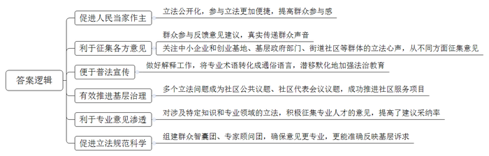
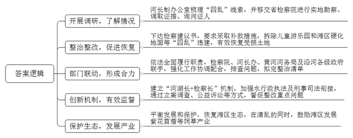
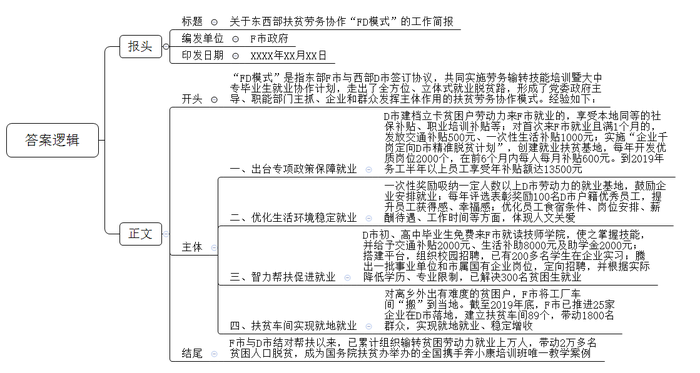

# 2020年0822公务员多省联考《申论》题（安徽C卷）

> 候选采集稿。参考答案及解析来自粉笔页面，不代表官方答案或真实高分答卷；来源使用许可与原卷对应关系仍需人工核实。

## 给定材料

### 材料 material-15f23dc0281c22f5

民警小童的微信头像，很是特别，除了一张工作照，还有姓名、联系电话、地址，以及以下文字：“如果你需要办理户口、居住证，或调解家庭、邻里纠纷，请添加此微信号进行咨询和预约办理。”

小童是云沟派出所的一名社区民警，他的日常工作内容都浓缩到这张小小的头像里了。“再以传统的思维方式工作，可就跟不上时代啦。现在大人小孩都会玩微信，辖区里越来越多的大爷大妈玩得比我还好！我的工作方式和方法必须有所改变。”小童手机里存着近5千个居民的手机号码，微信好友中有近3千名居民，几乎覆盖了整个辖区。

前不久，一位已经办理过居住证的居民，在微信上紧急呼叫小童。原来，他去车管所办理轿车年审业务，但由于忘了居住证年审而无法正常完成业务办理，按照过去的做法，要来回奔波50多公里。小童让他立即将居住证的正面通过微信拍照传回处理，只花了一分钟就解决了问题。还有一次，一位现住外地的本社区居民，需要开具无违法犯罪记录证明，但是不知具体该怎么办，最终，在小童的微信指点下，这位居民顺利办理了事项。

社区工作面广，事杂。一方面，群众临时有事或者出门在外，往往不知道如何联系上民警；另一方面，由于流动性大，民警在进行人口、房屋、场所、行业等信息登记时，也常联系不到人。怎样才能加强和居民的联系呢？“与群众一对一联系是最好的，虽然花的时间多，但是更到位。”小童利用上门签订治安管理责任书的机会，与居民见面时互加微信、留手机号，又“打入”小区所有微信群，凭借特点突出、颇具诚意的微信头像，一个个加好友。慢慢地，群众有事就直接通过微信联系他，小小的微信头像也成了一张为群众信任的名片。

通过微信，小童还建立了一些跟主体工作有关的微信群，翻开他的微信群，有社区治安群，社区意见箱群，还有“党声群”。小童说：“在‘党声群’中，我还可以将最新的党的方针政策，以最快的方式传给社区群众。”小童还聚拢了治安群内的热心居民，组建起“红袖标”队伍，现在这支队伍已经从最初的46人发展到了270人。当谈到花费大量的时间看微信群，会不会增加工作量时，他认为，“从表面上看花费时间是多了，实际上工作起来反而更加快捷。”他反问道：“有些问题，是发生了再去处理，还是将问题直接杜绝在萌芽状态？”

“创新，为了更贴心；贴心，才能够创新。”说到自己的工作秘笈，小童笑言都在微信头像里。基层警务人少事多，只有不断创新工作方式才能更好地为群众服务，而创新的动力恰恰来自于解决群众生活中痛点、堵点的责任感。将满足群众需求作为群众服务的落脚点，才能不断推陈出新，找到更准确、高效的服务路径，也才能赢得群众更多的满意回应。“我们都是小童的粉丝，社区好了大家都好！”居民张大姐说。

### 材料 material-56753ef338098ca7

从2015年9月开始，在S市H街道洪储小区当了近30年居委会主任的老朱，又多了一个新身份——基层立法联系点信息员。“立法的神秘感一下子被打破了，立法工作就在家门口，每个人都可以参与，这就是人民当家作主。”

2019年，垃圾分类成为百姓讨论的热点话题。“生活垃圾，究竟怎么分？垃圾分类标准不仅直接关系到管理效果，而且关乎民生，立法过程备受关注。在这一背景下，我们作为市人大常委会基层立法联系点，承担了《S市生活垃圾管理条例》制定的意见收集工作，目的就是要把老百姓的建议原汁原味地提上去。”朱主任说。

79岁的老夏是洪储社区的居民，对垃圾分类立法非常热心。“在条例草案的听证会上，关于垃圾分类标准的问题讨论十分热烈。”老夏记忆犹新，“我从老年人的视角发表了意见，建议按照大多数市民熟悉的四分法来分，分类搞得太复杂，老年人记不住。”“真没想到，我的建议最终被采纳入法了。”老夏激动地说，“这说明立法联系点的意见征集不是摆样子，老百姓的想法能在立法中切实得到体现。”

不仅要传递好群众声音，还要关注好不同群体的立法心声。“比如，在中小企业促进法修订草案征求意见阶段，对于中小企业和创业基地、基层政府部门、服务企业的街道社区等，都要从不同方面征集意见。”H街道人大工委龚主任介绍，基层立法联系点还要注重向人民群众做好解释工作，善于把“法言法语”转化成群众通俗易懂的语言，潜移默化地加强法治教育。“两年多来，1800余人次参与立法意见征询，10余个立法问题成为社区公共议题，其中两个进入2018年H街道社区代表会议议题，并成功推进了多个社区服务项目。”龚主任说。

“让专业的意见渗透到法律条款中。”S市人大常委会研究室刘主任表示，对于一些涉及特定知识和专业领域的立法，在广泛征集基层民意的同时，积极征集专业人才的意见，对于提高立法建议的采纳率大有益处。在制定反家庭暴力法时，某律师事务所的吴律师正好办理过一起老年人遭女儿虐待的案件。“反家庭暴力法草案中保护妇女、儿童权益的内容比较明显，而家庭还应该包括老年人，特别是与子女同居的老年人。”吴律师说，在基层立法联系点征集意见时，她提出了这项建议，最终被采纳。

作为基层立法联系点的S市C镇人大，共设立了36个采集点，各采集点着重吸纳退休或者在职法律工作者、教师、工程师等各行各业有一定专业知识储备的热心人，组建了群众智囊团。“目前，群众智囊团有150人，C镇人大还专门聘请了4位专家学者组成了专家顾问团。”C镇人大钱主席介绍，这样收集上来的意见更专业，也更能反映基层群众的诉求，促进立法工作更加规范、科学。“农村集体聚餐场所很多，如果发生食物中毒，处罚对象是谁？是聚餐的承办者、举办者，还是场所提供者？还要明确被追责主体的法律地位。”在《S市食品安全条例》征求意见时，C镇人大针对农村地区的实际情况提出了完善建议，并得到了采纳，促进了农村聚餐管理更加规范。

### 材料 material-a838e9c7cc08df36

曾经，黄河大堤向内500多米处，占地370多亩的儿童游乐园一片喧闹景象，蘑菇城堡、魔法屋五光十色，园里游客熙熙攘攘，停车场内停满密密麻麻的私家车。这幅景象，与黄河风光实在格格不入。

“开发商相中的就是黄河。”Z市水利局河长制办公室岳主任介绍，“黄河风景区风光优美，‘玩在黄河边’成为吸引游客的噱头。就这样，本应是防洪要地、生态重地的滩区，因为利益驱动，却成了用来‘生金’的工具。”

除了儿童游乐园，其他在黄河滩区“乱占、乱采、乱堆、乱建”的现象，危害也十分严重，岳主任说。滩区其实是黄河河道的组成部分，黄河进入下游后，河流流速放缓，裹挟泥沙大量沉积，河床抬升，河流向低洼处摆动，来回往复。为了给河流摆动预留足够空间，宽河固堤成为主要措施。面积广阔的滩区在行洪、蓄洪和沉沙等方面发挥重要作用。此外，滩区是动物栖息、植物生长的家园。滩区四乱现象，不仅影响了黄河自然景观，更破坏了脆弱的生态系统。

黄河滩区既是重要的生态保护区，又是百万群众生活的家园，L省黄河滩区宽520公里，涉及120多万人，滩区既有农田又有湿地保护区，人水争地矛盾突出。同时，有关滩区保护的法律法规比较分散，难以形成拳头效应。加之有些法规条款制定比较宽松，缺乏震慑力。岳主任说。“有条件的地区应有序引导滩区居民退出，不仅能缓解黄河防洪压力，还能还地于河。”他建议，列出黄河管理范围内产业发展负面清单，根据黄河生态保护要求，坚持绿色发展方向，明晰黄河滩地产业发展路子。河湖监管的背后，还有一道民生考题：位于滩区的村子有1000多个，如何平衡好发展和保护的关系？

“L省黄河滩区存在不少占地面积广、产业规模大、存留时间久的‘四乱’问题，利益主体多元，多头管理，职能分散，这是河湖乱象问题产生的原因之一。”L省检察院罗处长分析，多个部门都有黄河监管职能——黄河水利委员会的监督管理职能在堤坝以内，地方政府管理范围内又涉及多个部门：自然资源部门负责土地使用、河务部门负责河道行洪安全、生态环境部门负责环境保护、农业部门负责农用地保护……“条块分割造成执法力量分散，难以有效监管。”罗处长说。

2018年12月，一场清理黄河滩区“四乱”的战役在L省打响。河长制办公室把各种线索移交省检察院，由省检察院指定检察分院组织实地勘查，调取证据，询问证人……检察分院的王副检察长说：“我们随后向有关部门下达了检察建议书，要求全面履责，采取补救措施，拆除违建，有效恢复受损土地。”各地各部门依法全面履行职责，强化工作协调配合。检察院、河长办、黄河河务局及沿河各级政府联手，排查问题，拟定整治清单，建立“河湖长+检察长”机制，加强水行政执法及刑事司法衔接，通过立案调查、公益诉讼等方式，督促整改重点问题。

2019年3月，随着机械臂挥动，“四乱”典型的儿童游乐园轰然倒地；到6月底，滩区硬化地面全部拆除，此后，曾被乱建的滩区草木新发，滩区生态基本恢复。在清乱的同时，鼓励滩区村庄发展紫花苜蓿等饲草产业，目前优质牧草种植基地初具规模，预计到2025年可达100万亩。站在大堤上远眺，滩区草木葱葱，黄河掩映其间，静静流淌而过。

### 材料 material-6f8ca9413865a60f

2017年2月，东部F市与西部D市两地政府签订《东西部扶贫协作框架协议》，确定共同实施劳务输转技能培训暨大中专生就业协作计划。3年来，F市走出了一条帮助D市群众全方位、立体式的就业脱贫路，探索出FD两地扶贫劳务协作模式，入选了110个“全球减贫案例”。

32岁的小周与他的妻子小张，是D市建档立卡贫困户。在两地有关部门的组织下，夫妇俩于2019年年初来F市务工，现在是某塑胶有限公司的员工。“我一个月工资五六千元吧，我老婆也差不多。这样下去，我们的日子有奔头了！”说起这份工作，小周十分满意。他说，除了工资，只要务工半年以上，还可以享受到F市为每人发放的一万多元的各种补贴，十分可观。目前他们每人已经领取到了4500元补贴，其余补贴将陆续发放。此外，公司专门为他们安排了免费的夫妻房，洗手间、厨房、空调等配套设施一应俱全，让他们在F市安下了一个温暖的家。像小周夫妇这样的D市贫困劳动力，3年来，F市已输转了近万人次。

F市和D市相距2000多公里，为实现“输转一人、就业一人、脱贫一户”的目标，F市多措并举，从政策保障、薪酬待遇等方面，为务工人员提供良好的务工环境。针对D市建档立卡贫困户劳动力普遍年龄偏大、缺乏技能、工作效率低、工资待遇不高等实际情况，F市出台政策规定：D市建档立卡贫困户劳动力来F市就业的，认定为F市就业困难对象，享受F市本地建档贫困户同等的社保补贴、职业培训补贴等政策；首次来F市就业且就业满1个月的，发放交通补贴500元和一次性生活补贴1000元；借鉴公益性岗位开发扶贫经验，探索以劳务补助方式实施“企业千岗定向D市精准脱贫计划”，每年在F市扶贫就业基地，企业新开发2000个优质岗位，定向招聘D市建档立卡贫困户劳动力，除企业工资外，在最初6个月内每人每月补贴600元。到2019年，务工半年以上的D市贫困家庭劳动力，每人可享受F市各类补贴13500元。

为了鼓励企业安排D市户籍务工人员就业，F市遴选一批企业创建了就业扶贫示范基地，对吸纳一定人数以上D市劳动力的就业基地（企业），予以一次性奖励。F市还开展D市优秀员工评选表彰奖励，每年评选100名D市优秀员工并给予奖励，目前已有200名员工获评，进一步提升了他们的获得感、幸福感。为了让D市员工吃得惯、住得好、留得下，F市在食宿条件、岗位安排、薪酬待遇、工作时间等方面进一步提升优化，体现对他们的特别关爱，真正做到“感情留人、待遇留人、政策留人、环境留人”。

贫困劳动力可以到F市务工，他们的子女如何帮扶？F市坚持渔鱼兼授，实施智力扶贫。针对部分建档立卡户学生初中、高中毕业后辍学在家，缺乏技能等问题，F市发挥技师学院优势，资助D市户籍建档立卡贫困家庭初、高中毕业生到技师学院免费就读，使他们能够学到一技之长，更好地建设和服务家乡，帮助家乡人民早日脱贫。这些学生在F市上学期间，可以免交学费、学杂费和住宿费，每位学生每年还可以享受交通往返补贴2000元、生活补助8000元、国家助学金2000元。对于一些即将毕业的技校学子，F市积极搭建平台，组织多家企业开展校园招聘活动，为他们学习锻炼和就业创造条件。目前已有200多名学生在多家企业顶岗实习。F市每年还腾出一批事业单位和市属国有企业岗位，面向D市建档立卡贫困家庭高校毕业生招聘，并根据实际情况适当降低学历、放宽专业限制，目前已招聘近300名贫困学子来F市工作。“我要扎根F市努力工作，以良好的工作业绩回报当地人民的关爱。”D市贫困学子小黄感动地说。

对于离乡外出有难度的贫困户，F市将工厂车间“搬”到他们家门口，让他们实现就地就业、稳定增收。说起在某服装公司扶贫车间上班，贫困户小何满心欢喜，“原来出去打工，照顾不到家里，现在在家门口打工，每月4000多元工资，老婆也有2000多元，我们俩既赚了钱，也顾了家。”目前在这家服装公司的扶贫车间已安排了140名当地群众就业，其中建档立卡贫困户100人。截至2019年底，F市已推进25家企业在D市落地，建设“扶贫车间”89个，带动1800多名建档立卡贫困户就近就地就业。

F市与D市结对帮扶以来，两地扶贫劳务协作工作取得显著成效，初步形成了党委政府主导、职能部门主抓、企业和群众发挥主体作用的扶贫劳务协作“FD模式”。目前，已累计组织输转D市贫困劳动力就业上万人次，直接带动2万多名D市贫困人口脱贫，组织输转建档立卡贫困劳动力占东部地区帮扶贫困地区总数近一半。

FD扶贫劳务协作模式，成为国务院扶贫办举办的全国携手奔小康培训班唯一教学案例，为推动全国东西部扶贫工作优化升级贡献了“东部智慧”。

## 题目

### 第 1 题

**根据给定资料**1**，分析民警小童采用特别的微信头像的原因。（****20分）**

关联材料：材料 material-15f23dc0281c22f5、材料 material-56753ef338098ca7、材料 material-a838e9c7cc08df36、材料 material-6f8ca9413865a60f

作答要求：

要求：

（1）紧扣资料，全面准确；

（2）分析透彻，条理清晰；

（3）不超过300字。

### 第 2 题

**根据给定资料**2**，谈谈建立基层立法联系点制度在该市发挥了哪些积极作用？（20分）**

关联材料：材料 material-15f23dc0281c22f5、材料 material-56753ef338098ca7、材料 material-a838e9c7cc08df36、材料 material-6f8ca9413865a60f

作答要求：

要求：

（1）内容全面，概括准确，条理清晰；

（2）不超过300字。

### 第 3 题

**根据给定资料**3**，谈谈****L省是如何整治黄河滩区“四乱”现象的。（20分）**

关联材料：材料 material-15f23dc0281c22f5、材料 material-56753ef338098ca7、材料 material-a838e9c7cc08df36、材料 material-6f8ca9413865a60f

作答要求：

要求：

（1）全面准确，分条陈述；

（2）不超过300字。

### 第 4 题

**根据给定资料**4**，请就东西部扶贫劳务协作“FD模式”的基本做法拟写一份工作简报。（40分****）**

关联材料：材料 material-15f23dc0281c22f5、材料 material-56753ef338098ca7、材料 material-a838e9c7cc08df36、材料 material-6f8ca9413865a60f

作答要求：

要求：

（1）紧扣资料，内容完整；

（2）条理清晰，语言准确；

（3）字数在600～800字。

## 答案与解析

第 1 题

**参考答案（粉笔题库参考内容）**

1.利于警务公开。微信头像上有工作照，姓名、联系电话、地址，以及日常工作内容，便于群众进行咨询和预约办理。

2.方便群众办事。利用微信解决群众业务办理难题，提供线上指导，提高办事效率，省时省心。

3.加强警民联系。可与群众一对一加好友，并打入小区微信群，方便及时沟通，增加群众信任度，实现辖区居民全覆盖。

4.建立主体工作微信群。收集意见，快速传递党的最新方针政策；聚拢热心居民，组建治安队伍，有效化解群众矛盾。

5.满足群众需求。创新工作方式，找到更准确、高效的服务路径，解决群众的困难、问题，赢得更多满意回应。

**解析**

**参考答案说明：**本参考答案从“利于警务公开”“方便群众办事”“加强警民联系”“建立主体工作微信群”“满足群众需求”这五个方面进行了分条撰写。各条要点之间在内容上相互并列，没有交叉。

**考点**：考点原因类

**来源**：来源2020年0822公务员多省联考《申论》题（安徽C卷）

粉笔申论页面对本题只提供「解析视频」入口，该入口是会员推广位，页面无视频地址与文字解析。

第 2 题

**参考答案（粉笔题库参考内容）**

1.促进人民当家作主。立法公开化，参与立法更加便捷，提高群众参与感。

2.利于征集各方意见。群众参与反馈意见建议，真实传递群众声音；关注中小企业和创业基地、基层政府部门、街道社区等群体的立法心声，从不同方面征集意见。

3.便于普法宣传。做好解释工作，将专业术语转化成通俗语言，潜移默化地加强法治教育。

4.有效推进基层治理。多个立法问题成为社区公共议题、社区代表会议议题，成功推进社区服务项目。

5.利于专业意见渗透。对涉及特定知识和专业领域的立法，积极征集专业人才的意见，提高了建议采纳率。

6.促进立法规范科学。组建群众智囊团、专家顾问团，确保意见更专业，更能准确反映基层诉求。

**解析**

**参考答案说明：**本参考答案从“促进人民当家作主”“利于征集各方意见”“便于普法宣传”“有效推进基层治理”“利于专业意见渗透”“促进立法规范科学”六个方面展开。各条答案要点之间在内容上相互并列，没有交叉。

**考点**：考点影响类

**来源**：来源2020年0822公务员多省联考《申论》题（安徽C卷）

粉笔申论页面对本题只提供「解析视频」入口，该入口是会员推广位，页面无视频地址与文字解析。

第 3 题

**参考答案（粉笔题库参考内容）**

1.开展调研，了解情况。河长制办公室梳理“四乱”线索，并移交省检察院进行实地勘查、调取证据、询问证人。

2.整治整改，促进恢复。下达检察建议书，要求采取补救措施，拆除儿童游乐园和滩区硬化地面等“四乱”违建，有效恢复受损土地。

3.部门联动，形成合力。依法全面履行职责，检察院、河长办、黄河河务局及沿河各级政府联手，强化工作协调配合，排查问题，拟定整治清单。

4.创新机制，有效监督。建立“河湖长+检察长”机制，加强水行政执法及刑事司法衔接，通过立案调查、公益诉讼等方式，督促整改重点问题。

5.保护生态，发展产业。平衡发展和保护，恢复滩区生态，在清乱的同时，鼓励滩区发展紫花苜蓿等饲草产业。

**解析**

**参考答案说明：**本参考答案从“开展调研，了解情况”“整治整改，促进恢复”“部门联动，形成合力”“创新机制，有效监督”“保护生态，发展产业”五个方面展开。各条要点之间在内容上相互并列，没有交叉。并且撰写每条要点时，都提炼出了概括性强的总括词并前置，满足了题目中规定的“分条陈述”这一要求，并让答案更清晰、准确。

**考点**：考点概括措施类

**来源**：来源2020年0822公务员多省联考《申论》题（安徽C卷）

粉笔申论页面对本题只提供「解析视频」入口，该入口是会员推广位，页面无视频地址与文字解析。

第 4 题

**参考答案（粉笔题库参考内容）**

关于东西部扶贫劳务协作“FD模式”的工作简报

F市政府 XXXX年XX月XX日

“FD模式”是指东部F市与西部D市签订协议，共同实施劳务输转技能培训暨大中专毕业生就业协作计划，走出了全方位、立体式就业脱贫路，形成了党委政府主导、职能部门主抓、企业和群众发挥主体作用的扶贫劳务协作模式。经验如下：

一、出台专项政策保障就业。D市建档立卡贫困户劳动力来F市就业的，享受本地同等的社保补贴、职业培训补贴等；对首次来F市就业且满1个月的，发放交通补贴500元、一次性生活补贴1000元；实施“企业千岗定向D市精准脱贫计划”，创建就业扶贫基地，每年开发优质岗位2000个，在前6个月内每人每月补贴600元。到2019年务工半年以上员工享受年补贴额达13500元。

二、优化生活环境稳定就业。一次性奖励吸纳一定人数以上D市劳动力的就业基地，鼓励企业安排就业；每年评选表彰奖励100名D市户籍优秀员工，提升员工获得感、幸福感；优化员工食宿条件、岗位安排、薪酬待遇、工作时间等方面，体现人文关爱。

三、智力帮扶促进就业。D市初、高中毕业生免费来F市就读技师学院，使之掌握技能，并给予交通补贴2000元、生活补助8000元及助学金2000元；搭建平台，组织校园招聘，已有200多名学生在企业实习；腾出一批事业单位和市属国有企业岗位，定向招聘，并根据实际降低学历、专业限制，已解决300名贫困生就业。

四、扶贫车间实现就地就业。对离乡外出有难度的贫困户，F市将工厂车间“搬”到当地。截至2019年底，F市已推进25家企业在D市落地，建立扶贫车间89个，带动1800名群众，实现就地就业、稳定增收。

F市与D市结对帮扶以来，已累计组织输转贫困劳动力就业上万人，带动2万多名贫困人口脱贫，成为国务院扶贫办举办的全国携手奔小康培训班唯一教学案例。

**解析**

**参考答案说明：**（1）本题要求写“工作简报”，一般格式为：报头（包括标题、编发单位、印发日期等）+正文（一般包括开头、主体、结尾）。（2）正文部分，一方面从内容来看，围绕着“东西部扶贫劳务协作‘FD模式’”这一主题，本参考答案的开头先介绍了“FD模式”；主体部分分别从“专项政策保障就业”“优化生活环境稳定就业”“智力帮扶促进就业”“扶贫车间实现就地就业”四个方面写到了“FD模式”的基本做法；结尾对“FD模式”进行了总结。另一方面，形式上，本参考答案做到了分段、分条撰写，整体上条理较为清晰。

**参考答案二**

关于东西部扶贫劳务协作“FD模式”的工作简报

F市政府 XXXX年XX月XX日

“FD模式”是指东部F市与西部D市签订协议，共同实施劳务输转技能培训，走出了全方位、立体式就业脱贫路，形成了党委政府主导、职能部门主抓、企业和群众发挥主体作用的扶贫劳务协作模式。经验如下：

一、提供良好务工条件。出台扶持政策，规定D市建档立卡贫困户劳动力来F市就业的，享受本地同等补贴，对首次来就业且满1个月的，发放交通、生活补贴；实施“企业千岗定向D市精准脱贫计划”，创建扶贫基地，一次性奖励吸纳D市劳动力达标的就业基地，开发优质岗位；评选并表彰奖励优秀员工，提升其获得感、幸福感；优化员工生活和工作条件，体现人文关爱。

二、智力扶贫，帮扶D市贫困户子女。资助贫困家庭初、高中毕业生免费就读技师学院，给予交通、生活补贴及助学金；搭建平台，组织校园招聘，让技校生在企业实习；腾出事业单位和市属国有企业岗位，定向招聘，放宽学历、专业限制，解决贫困生就业。

三、帮助贫困户就近就地就业。F市推进企业在D市落地，建设扶贫车间，带动群众实现就地就业、稳定增收，使其兼顾家庭和就业。

F市与D市结对帮扶以来，已累计组织输转贫困劳动力就业上万人，带动2万多名贫困人口脱贫，成为国务院扶贫办举办的全国携手奔小康培训班唯一教学案例，也入选了全球减贫案例。

**考点**：考点总结类

**来源**：来源2020年0822公务员多省联考《申论》题（安徽C卷）

粉笔申论页面对本题只提供「解析视频」入口，该入口是会员推广位，页面无视频地址与文字解析。

