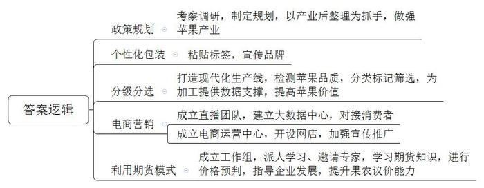
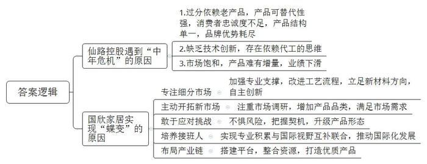
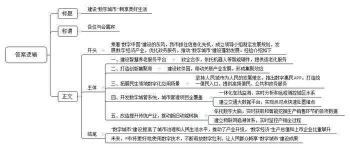

# 2021年公务员多省联考《申论》题（安徽A、普通选调卷）

<!-- gwy:overview:start -->
> **安徽 · 2021 · 申论 · A类** ｜ 4 题 · 图片 4 处 · 答案随题折叠

导航：[题目](#题目) · [材料 1](#材料-1)
<!-- gwy:overview:end -->

> 候选采集稿。参考答案及解析来自粉笔页面，不代表官方答案或真实高分答卷；来源使用许可与原卷对应关系仍需人工核实。

## 给定材料

### 材料 1

1949年3月23日下午，西柏坡阳光明媚，毛泽东同志从住了10个月的小院里走出来，正好碰到迎上来的周恩来同志。他望着远处连绵雄伟的太行山，意味深长地说：“今天是进京赶考的日子。”周恩来答道：“我们都应当考及格，不要退回来。”毛泽东坚定地说：“退回来就失败了。我们决不当李自成！我们共产党人进北平，是要继续革命，建设社会主义，直到实现共产主义。”

2013年7月，习近平总书记在河北省调研时指出：“当年党中央离开西柏坡时，毛泽东同志说是‘进京赶考’。60多年过去了，我们取得了巨大进步，中国人民站起来了，富起来了，但我们面临的挑战和问题依然严峻复杂，应该说，党面临的‘赶考’远未结束。”

2020年10月，党的十九届五中全会审议通过了《中共中央关于制定国民经济和社会发展第十四个五年规划和二〇三五年远景目标的建议》。2021年3月，十三届全国人大四次会议审议通过了《中华人民共和国国民经济和社会发展第十四个五年规划和二〇三五年远景目标纲要》。对于中国发展来说，“五年规划”是党治国理政的重要方式，也是量度中国步伐的显著路碑。从1953年新中国开始实行第一个“五年计划”，到2020年“十三五”规划完成，一个又一个五年，诠释了不同时期的历史标识，推动中华民族迎来了从站起来、富起来到强起来的伟大飞跃。

《管子·乘马》言：“<u>是故事者生于虑，成于务，失于傲。不虑则不生，不务则不成，不傲则不失</u>。”虽说前路并非一片坦途，但要坚信的是，一往无前、永不止步，戒骄戒躁，从来都是成就伟大事业的最正确姿态。

### 材料 2

永济村在解放前是“光山秃岭乱石沟，十人见了十人愁；旱涝风雹年年有，庄稼十年九不收”。全村有大大小小239条干涸贫瘠的沟壑，332座光秃秃的山头，森林覆盖率不到2%。50年代初，22岁的张一雁成为了永济村的党支部书记。为了改变生存环境，张一雁带着村民上山种树。由于经验不足，树的成活率极低，村民们泄了气。张一雁鼓励大家说：“我们改不了天，但我们可以换地！不管前方的路有多苦多难，只要方向正确，我们的日子一定会一天比一天红火。”

时光荏苒，转眼就到了2015年。这一年，从省里某部门退休的副厅级干部阎永强经过村党支部换届选举成为了永济村新一任村支书。阎永强带回来的不仅是身份，还有服务家乡的赤子之心。他把自己的党组织关系转回村里，“又成了一个真正的永济人”。阎永强说：“为了村里的发展，我不会领取任何工资报酬，只希望能像老书记一样，让家乡百姓的日子一天比一天好。”

阎永强向记者介绍起了永济村的致富史。1980年冬，张一雁率几名村干部到南方考察。所到之处，乡镇企业给农民带来的巨大变化令张一雁一行眼热心跳。经过慎重考虑，村里决定利用本地丰富的铁矿资源建一座钢铁厂，这也是省里当年的第一家村办企业。当第一炉火红的铁水滚滚流出的时候，许多党员激动得哭了。后来，永济村又先后创办了铝合金厂、石料厂等企业。张一雁说：“办企业不同于当年我们上山栽树，不是光有憨劲就行。企业需要的是懂技术、会管理的人才。”这以后，永济村与许多大学联系，送青年农民到那里学企业管理、财务、农作物栽培等科学技术。

阎永强说，老书记最爱说的一句话是“有了好头头，群众不发愁”。这好头头就是党支部，就是共产党员的先锋带头作用。在村办企业多年发展的背后，高耗能重污染的弊端日渐显现。2015年，村两委邀请省农业大学农村发展研究所的专家帮助完成了新的村级规划。根据新规划，要淘汰一批落后产能，当时许多村民都担心“下岗”，不太情愿。全体党员以身作则，并动员家属、亲戚支持村两委的决定。2016年，村两委引来了展望农业科技有限公司，在铝合金厂的旧址上，建起一条年产500吨食用保健油的冷榨加工生产线，同时建立了一个集餐饮、住宿、观光于一体的田园综合体。广大村民不仅实现了“再就业”，收入还比过去翻了一番。

“小时候村周围到处是荒山秃岭，现在满眼郁郁葱葱。”2020年春，在永济村外不远处的一座山坡上，阎永强正带队搞绿化工程。如今的永济村森林覆盖率超过87%，曾经的一座座荒山变成了一条条“绿龙”，成了村民的“绿色银行”。阎永强说：“看到村里环境一天天变美，老百姓日子一天天富裕，我耳边常常回响起老书记那句话，‘只要方向正确，我们的日子一定会一天比一天红火’。”

### 材料 3

“人畏冬山肃，我爱冬日丽”，这正是L县果农内心真实的写照。今年51岁的老李作为当地苹果种植大户，每到岁末就忙得不可开交。“今天下午要发5000件货，明天还有5000件……”他一边对着记者介绍，一边盘点着贴有鲜明的“L县苹果”“平安接福”等标签的苹果。

在日新鲜果公司车间里，多条现代化选果线依次排开，它们可以轻而易举地检测出每颗苹果的大小、糖度、瑕疵等。公司刘经理指着生产线上的机器介绍说：“这台机器堪称是整条选果线的中枢，如果苹果有瑕疵，它可以准确地标记并筛选出来，同时为后续选果提供数据支撑。”分级分选更好地提高了苹果价值，实现了优果优价、以质论价。

在金奇果业科技有限公司的车间，工人们正在紧张有序地进行从接收订单到装箱发货的“一站式”操作。“我们通过成立直播团队、建立大数据中心等措施，实现L县苹果和消费者无缝对接，同时也助推全县苹果电商和微商的快速发展。”公司赵经理说。目前公司在省城成立了电商运营中心，全网开设店铺40多家，目的就是要利用互联网宣传、推广特性，延伸L县苹果产业链条，让果农在苹果产业链的每个环节上都能获益、增收。

望着50万亩果园，红彤彤的苹果挂满枝头，L县县委曹书记向记者介绍，L县过去是省内出名的穷县，曾经有人带回100棵果树苗，但当时乡亲们并没认识到这是一座“金矿”。改革开放后，县委县政府经过考察调研，一致认为苹果是L县最具优势的产业。党的十九大以来，县委县政府制定了《苹果产业强县建设规划》，提出以“苹果产业后整理”为抓手，不断做大做强苹果产业，为巩固脱贫攻坚成果、促进乡村振兴奠定厚实的产业基础。

“虽然如今形势喜人，但L县苹果产业也曾出现过危机。”曹书记说，“每年10月至11月，当苹果集中上市时，能否卖上好价钱，既是老百姓心中的忧虑，也是干部们心中的挂念。过去，因为市场透明度不高，信息不对称，果农们在与贸易商的博弈中，吃亏是常有的事。”

2017年12月，苹果期货在Z商品交易所上市。“我们发现苹果期货的价格能够及时反映市场变化。”曹书记说，“这为我们帮助果农对价格进行预判、指导企业发展提供了一把金钥匙。”为此，县里成立了专门工作组，一方面派人到Z商品交易所学习，一方面请专家来县里普及苹果期货有关知识。

2018年初夏开始，经常见到一些做苹果期货的金融业人士来村里打听苹果长得怎么样，询问霜冻对果子的影响等。当地不少果农在从他们那里得到这些有用的信息之后，一改过去“听果商报价，自己估摸差不多就卖了”的做法，转而主动和果商议价。2019年，L县苹果总体减产8%，但整体销售价格同比提高30%，果农总收入增加了20%。

省农科院的王博士说：“‘产业后整理’对于农业产业发展而言，可以说是一场深刻的变革。过去老百姓只会种、不会卖。现在就是要解决这个问题，打通生产端和消费端通道，提高农产品市场化程度。”

### 材料 4

进工厂曾是一代人的梦想。时移世易。数据显示，2018年，外卖骑手平均月薪为7750元左右，制造业员工平均月薪6000元左右。23岁的小王，曾在一个工厂做过装卸工，近来转行外卖骑手，在他看来，工厂工人和外卖员的工作体验是完全不一样的。“每天都待在厂子里，搬东西很累，管理还很严格。”小王坦言，“我们这个年纪的，谁会喜欢这样的工作呢？”

今年33岁的小孙，曾是家乡县城一家汽车工厂的喷漆工人。小孙不是科班出身，最早由师傅带入行，工作四年，月工资从3500元涨到了5000元左右。2018年7月，小孙到省城当外卖员，每月到手收入一度维持在8000元到10000元之间。他满意地说：“这相当于我们当地一家4S店高级汽修技师的收入了。”当高级汽修技师曾是小孙的梦想，但由于理论知识、技能证书等门槛，初中文化的小孙并未选择这条路。不过，今年以来，小孙送外卖再没有回到从前的高收入水平。

转行两个月，作为外卖新手的小王并没有拿到传说中“月入过万”的收入。几乎无门槛的外卖行业正成为吸纳就业的重要蓄水池。小王很无奈地说：“5月份订单量刚涨起来，又新来了很多兼职外卖员。”数据显示，外卖骑手中56%的骑手有第二职业。“我们没有基本的社会保障，只能赚点算点，为以后早做打算。”在他看来，返乡是最后一条路，但也是最现实的一条路。“像我这样只有高中文化的人，在互联网时代很难在大城市找到满意的工作了。”

不过，时至今日，机器虽然已经替代了工厂流水线上的基础岗位，但并未能完全替代快递外卖配送线上的基础岗位。在配送线上的“最后一公里”，在面对面的服务环节，依然需要依赖人工。S大学林教授认为，未来中国服务业的增加值比重和就业份额将继续稳步提升。但一个残酷的现实是，服务业中的高端知识型岗位和低端劳动密集型岗位之间的收入差距将会进一步扩大。谈及未来，小孙说：“先干着，攒点钱，以后看看能不能返乡开个汽车美容店。”

相比小王和小孙，小李却为自己此前的决定感到庆幸，小李是一所知名大学财经专业的毕业生。两年前，他从深圳一家生产自动取款机的公司离职，回到家乡创业。“行业已经要变天了，我必须早做打算。公司当时营业收入、利润增长还不错，但我心里没底。移动支付发展太快了！”小李如此解释自己两年前的担忧。

现金时代，一台台自动取款机就是其生产厂商的“印钞机”。上世纪90年代，存取款都只能在固定的储蓄所；2005年前后，自动取款机开始遍布街头巷尾；2015年，中国成为全球最大的自动取款机销售市场。当年年末，全球自动取款机行业协会会长充满激情地预言，盛宴即将开始。但事后回看，这已是盛宴的尾声。

就在2015年，银行纷纷推出互联网金融战略，并开始减少自助银行、自动取款机，用户使用自动取款机的频次也大幅下滑。与此同时，各个银行的网络金融业务占比大幅提升。根据上市公司的财报显示，2018年多家自动取款机厂商从净利润下滑开始转向大幅度亏损，2019年亏损进一步加剧。小李感叹：“时代在抛弃你时，连一声招呼都不会打。”

### 材料 5

“刚和老婆谈恋爱时，我打趣说自己家是做罐头的，快结婚的时候才告诉她家里做的‘罐头’，其实是煤气罐。”小李介绍道。他羞于说出口的煤气罐，也有着辉煌的过往。不过，随着天然气管道开始进入千家万户，如果哪个小区还用煤气罐做饭，这个小区就显得不够上档次。

李家30多年前就和煤气罐结缘。上世纪90年代，小李的爷爷收购了一家集体企业，成立了鑫旺能源公司，开始生产煤气罐，一步步把公司做成了市里的知名企业。“2010年，煤气罐热销，爸爸眼红钱太好赚，赶紧扩大产能，但两年后产能扩大了，煤气罐需求和价格却是直线往下掉。”小李说。2010年的超级换瓶潮，成了这个行业最后的疯狂，也让公司“套在了高位”。小李回忆，他2015年大学毕业时，“煤气罐单个成本100多元，卖80元才能出手，做的越多，亏的越多。”

市场艰难，祖辈父辈一筹莫展，大学一毕业，小李不得不回家接手家族产业。“现在你很难找到国内煤气罐市场资料，因为已经没什么价值了。”小李说。跑遍了国内市场，他发现有同行通过网络往国外卖煤气罐。是啊，世界很大，中国市场萎缩，不代表国外也没人用。思考一番，他认定外贸是趋势，海外市场是多层次的，一些欠发达地区，一定需要煤气罐。

2015年10月，小李开通了第一个网上店铺，但忙活了5个月，期待中的滚滚订单并没有出现。国外市场，靠谱吗？小李的父亲对此表示怀疑。小李逐渐发现了门道：国内煤气罐只有4种型号，但全球有200多个型号，很多细节与使用习惯和国内不一样，必须根据国外市场的标准，做生产端的改造。再次摸索后，小李在2016年年底做成了第一笔外贸订单。他清楚地记得：“下单的人都没有询盘，直接打电话问我是不是一个真实的工厂。我打开直播在厂里转了一圈，当国外客户看到我们完整的生产线和各种型号的煤气罐成品后，对方立马签了一集装箱货的订单。”

鑫旺能源地处内陆，且长期专注本土加工制造，不像深圳等地的工厂国际视野较好，从建厂开始就做外贸订单。互联网的普及降低了外贸门槛，让鑫旺能源可以依靠优秀的产品，跨越式地拉平了与传统外贸工厂的距离。

小李对自己进军国际市场的决定感到庆幸。如今，他正在复制销售煤气罐的成功经验，开始通过网店售卖燃气灶等厨房用品。小李说，他很喜欢一句诗：“风后面是风，天空上面是天空，道路的前面还是道路。”

### 材料 6

仙路控股有限公司是H县的一家食品企业，曾有过很长一段的高光时刻。1992年创办后，业绩一路高歌，旗下仙路鲜汁成为当时整个饮品行业中为数不多的百亿大单品，缔造了“中国零食龙头企业”的神话。如今，仙路公司却面临着“中年危机”。记者调查发现，仙路近年来的增长基本来自于几款多年前的老产品，而非新产品。仙路鲜汁这个单品几乎撑起了仙路的大半个江山，但鲜汁属于可替代产品，消费者对此类产品容易喜新厌旧。一位消费品行业专家告诉记者，仙路的第一代产品主要来自外国技术转移，借助中国经济快速发展和繁荣的东风，大胆生产扩张才获得后来的成绩。遗憾的是，一直以来，它主要依赖代工思维做品牌。如今，旗下主要品类经过多年发展，市场已经接近饱和，产品很难再有增量，业绩下滑是在所难免。

为了摆脱品牌老化的尴尬处境，仙路开启了疯狂的“中年变形记”。2017年，仙路一度推出了50多个新产品，几乎每月都有新产品上线，覆盖了咖啡、果汁、能量饮料等大类。但分析所谓的新品，不难发现只是在原来的产品结构上换汤不换药。对于仙路来说，面对庞大的市场，如果不快速找到第二增长曲线，则很容易在品牌优势耗尽后，走入无可挽回的滑落之路。

同样位于H县的国欣家居用品有限公司，是一家老牌的制造企业，产品是家居行业极其细分的市场——化纤丝，董事长陆建国与总经理陆欣是一对父女。

“以前的牙刷，化纤丝都是圆柱形的，触感和舒适度都不好，我们将圆柱改成圆锥，变得更加柔软，且便于口腔清洁和牙龈保护。”陆建国说。从柱体到锥体并非靠磨，而是需要一系列复杂的工艺流程来打造，看似很小的行业，却需要很强的专业支撑。90年代初，国内市场对此类化纤丝的需求量非常大，但全部依赖进口，且价格昂贵。

1993年，陆建国毅然选择下海，创办了国欣家居，立足新材料方向，做国产化替代。经过不断学习、实践，陆建国终于让生产出来的牙刷丝更加柔软舒适，并先后拿下了许多知名公司的订单。

在牙刷丝领域站稳脚跟后，国欣家居将目光瞄向了原理相通的油漆刷丝市场。在做市场调研的时候，陆建国发现，质量好的油漆刷用的都是猪鬃、羊毛等天然材料，原材料比较匮乏。“当时的油漆刷使用场景相对单一，实际上油漆是水性还是油性，刷的是墙面还是地板，对油漆刷是有不同要求的。”陆建国说。沿着这一思路，国欣家居将产品从牙刷丝扩展到油漆刷丝，并拿下了油漆行业的数家大客户。

陆建国告诉记者：“公司每次产品的更新，都是有契机的。”2007年一家合作伙伴因企业战略变化，欲让国欣接管整个制刷项目。这对于迅速扩充公司实力无疑是良机，但是从只生产其中的丝，到生产整个刷具，这样的转型能否成功还是个未知数。经过反复的考量，国欣家居决定接受这个挑战。

陆建国告诉记者，国欣家居如今能够在市场如鱼得水，与女儿陆欣的接班助力有很大关联。“让女儿接班，并非我的本意，毕竟她会有更好的选择。”陆欣曾在一家世界500强企业工作，可是偶然间看到的一幕，让她改变了主意。“有一天下班已经很晚了，看到父亲戴着老花镜，还在跟客户打电话，说着并不流畅的英语，两鬓已经斑白，真的觉得我有责任回来帮助他。”国外的学习和工作经历，让陆欣跟着父亲一起在市场打拼时显得游刃有余。父亲专业积累过硬，女儿胜在国际视野，两人互补联合，拿下了不少国际大单。

对于国欣家居的未来发展，陆欣也有自己的考量：“之前提到中国制造，大家的第一反应就是价格便宜，实际上不是我们做不出好产品，而是好产品需要供应链上下游的共同发力。”通过在化纤丝行业的精耕细作，陆欣看到了匠心的价值，她希望自己将来能够搭建一个平台，把好的资源整合起来，共同打造优质的产品。从产品部件，到生产成品，再到布局产业链，国欣家居在父女二代接力中正发生着“蝶变”。

### 材料 7

“你好小福，我想订餐。”78岁的孙奶奶按下开关，向机器人小福发出语音指令。“有两荤两素加米饭13元的和两荤一素加米饭10元的两种，您选哪一种？”稚嫩的童声清脆悦耳。“13元的。”“好的，稍后会有工作人员与您联系。”不一会儿，福龄老年服务中心工作人员刘大姐拎着盒饭，一路小跑，来到孙奶奶的家。“对我们老人来说这个太好了！我不会用手机，现在只需要对机器人发个语音指令，立马有人上门。”孙奶奶说。

变化，缘于智慧养老服务平台的建成。2019年，坐落于F市北区物联网产业园的乐享科技有限公司利用物联网、云计算及大数据等技术打造了这一平台。该平台的建成是F市绘制“数字城市”蓝图的靓丽一笔。乘着“数字中国”建设的东风，F市抓住信息化先机，积极拥抱数字浪潮，从成立“数字城市”建设领导小组到制定“数字城市”中长期发展规划；从“一枝独秀”的软件园到“百花齐放”的数字经济产业；从最早的办事“跑多趟”到如今“一趟不用跑”……“数字城市”建设蓬勃发展。

2000年6月，F市东区软件园创业楼迎来首批入园企业。“当时，园区内的研发楼宇只有寥寥几栋，产业规模仅12.7亿元。”东区软件园管委会负责人回忆道。如今，东区软件园产业发展突飞猛进，总收入已超千亿元。据F市汪副市长介绍，在空间布局上，F市重点打造环中心城区“东区软件园——西区高新园——北区物联网产业园——南区大数据产业园”的数字经济创新集聚带，带动关联产业发展。

在推进“数字城市”建设过程中，F市坚持人民城市为人民的发展理念，不断拓展众多与百姓息息相关的数字化应用场景。“易民”APP是F市全力打造的数字惠民品牌，居民足不出户轻点手机APP，日常生活用品最快10多分钟送到家，出门购物、地铁进站，“刷脸”几秒钟即可完成付款。上线两年多来，该APP已发展成F市移动互联网的统一便民入口，为市民提供各类高频的便民服务、公共服务、政务服务等近80项。

打开F市数字城管系统，一张覆盖全市所有公用设施、道路交通、市容环境等城市管理项目的“电子地图”便呈现在眼前。在城区水系联排联调中心，工作人员可对城区上千个库、湖、池、河、闸、站实现一体化在线监测、实时分析和远程调控。超级“大脑”交通大数据平台则为全市交通编织了一张智慧大网，实现点对点快速处置堵点。

“数字城市”在提高城市治理和人民生活水平的同时，也为F市改造提升传统产业、推动新旧动能转换提供了新机遇。如锦绣家纺公司依托数字大脑，实现“产、供、销、人、财、物”数据的实时获取和智能挖掘，让生产更高效智能；福仙茶业集团建立了物联网追溯体系，对基地种植到终端销售全过程进行实时监控。

产业更兴旺，城市更智慧，生活更美好。F市市委李书记表示，目前，数字经济占地区生产总值的比重提高到45%，数字经济上市企业占全市上市企业的一半。展望未来，李书记说，F市将更好地使用数字技术，不断释放数字红利，让人民群众畅享数字城市建设成果。

## 题目

### 第 1 题

**根据给定资料**3**，请概括****L县“苹果产业后整理”的主要举措。（15分）**

关联材料：材料 3

作答要求：

要求：

（1）准确全面；

（2）分条概括；

（3）不超过200字。

第 1 题 · 答案与解析

**参考答案（粉笔题库参考内容）**

1.政策规划。考察调研，制定规划，以产业后整理为抓手，做强苹果产业。2.个性化包装。粘贴标签，宣传品牌。3.分级分选。打造现代化生产线，检测苹果品质，分类标记筛选，为加工提供数据支撑，提高苹果价值。4.电商营销。成立直播团队，建立大数据中心，对接消费者；成立电商运营中心，开设网店，加强宣传推广。5.利用期货模式。成立工作组，派人学习、邀请专家，学习期货知识，进行价格预判，指导企业发展，提升果农议价能力。

**参考答案说明：**本参考答案从“政策规划”“个性化包装”“分级分选”“电商营销”和“利用期货模式”这五个方面展开。各条答案要点在内容上相互并列，没有交叉。

**解析状态：unknown（来源未提供）**

### 第 2 题

**根据给定资料**6**，请分析为什么仙路控股有限公司遇到了****“中年危机”，而国欣家居却能实现“蝶变”。（20分）**

关联材料：材料 6

作答要求：

要求：

（1）紧扣资料，准确全面；

（2）分析透彻，条理清晰；

（3）不超过300字。

第 2 题 · 答案与解析

**参考答案（粉笔题库参考内容）**

仙路控股遇到“中年危机”的原因：

1.过分依赖老产品，产品可替代性强，消费者忠诚度不足，产品结构单一，品牌优势耗尽。2.缺乏技术创新，存在依赖代工的思维。3.市场饱和，产品难有增量，业绩下滑。

国欣家居实现“蝶变”的原因：

1.专注细分市场。加强专业支撑，改进工艺流程，立足新材料方向，自主创新。2.主动开拓新市场。注重市场调研，增加产品品类，满足市场需求。3.敢于应对挑战。不惧风险，把握契机，升级产品形态。4.培养接班人。实现专业积累与国际视野互补联合，推动国际化发展。5.布局产业链。搭建平台，整合资源，打造优质产品。

**参考答案说明：**本参考答案宏观上分成了“仙路控股遇到‘中年危机’的原因”和“国欣家居实现‘蝶变’的原因”两个方面。在“仙路控股遇到‘中年危机’的原因”内部，又从“过分依赖老产品，产品可替代性强”“缺乏技术创新”“市场饱和”这三个方面进行了分条撰写。各条要点之间在内容上相互并列，没有交叉。在“国欣家居实现‘蝶变’的原因”内部，又从“专注细分市场”“主动开拓新市场”“敢于应对挑战”“培养接班人”“布局产业链”这五个方面进行了分条撰写。各条要点之间在内容上相互并列，没有交叉。

**解析状态：unknown（来源未提供）**

### 第 3 题

**省里召开****“数字城市”建设座谈会，F市被邀请做经验介绍。假设汪副市长参加此次会议，请根据给定资料**7**，为汪副市长拟写一份发言提纲。（25分）**

关联材料：材料 7

作答要求：

要求：

（1）紧扣资料，针对性强；

（2）层次分明，逻辑性强；

（3）格式规范，文体性强；

（4）不超过500字。

第 3 题 · 答案与解析

**参考答案（粉笔题库参考内容）**

建设“数字城市” 畅享美好生活

各位与会嘉宾：

乘着“数字中国”建设的东风，我市抓住信息化先机，成立领导小组制定发展规划，发展数字经济产业，优化政务服务，推动“数字城市”建设蓬勃发展。经验介绍如下：

一、建设智慧养老服务平台。政企合作，依托机器人等智能硬件，提供适老化服务。二、打造创新集聚带。建设软件园，带动关联产业发展，形成集聚效应。三、拓展民生领域数字化应用场景。坚持人民城市为人民的发展理念，推出数字惠民APP，打造统一便民入口，提供高频便民、公共和政务服务。四、开发数字城管系统，城市管理项目全覆盖。一体化在线监测、实时分析和远程调控城区水系；建立交通大数据平台，实现点对点快速处置堵点。五、改造提升传统产业，推动新旧动能转换。依托数字大脑，实时获取和智能挖掘生产销售环节的各项数据；建立物联网追溯体系，实时监控产销全过程。

“数字城市”建设提高了城市治理和人民生活水平，推动了产业升级，“数字经济”生产总值和上市企业比重攀升。未来，F市将更好地使用数字技术，不断释放数字红利，让人民群众畅享“数字城市”建设成果。

**参考答案说明：**（1）格式方面，本参考答案写到了“标题”“称谓”“正文”三个部分。（2）正文部分，一方面，内容上，围绕着“F市‘数字城市’建设”这一主题，开头写到了F市“数字城市”建设的背景和宏观做法；主体部分从“建设智慧养老服务平台”“打造创新集聚带”“拓展民生领域数字化应用场景”“开发数字城管系统”“改造提升传统产业”五个方面介绍了经验；最后结尾部分总结了F市“数字城市”建设的意义以及对未来的展望。另一方面，形式上，本参考答案做到了分段、分条撰写，整体上条理较为清晰。

**解析状态：unknown（来源未提供）**

### 第 4 题

**请围绕划线句子****“是故事者生于虑，成于务，失于傲。不虑则不生，不务则不成，不傲则不失”，结合给定资料，联系实际，自选角度，自拟题目，写一篇议论文。（40分）**

关联材料：材料 1、材料 2、材料 3、材料 4、材料 5、材料 6、材料 7

作答要求：

要求：

（1）立意明确，观点正确；

（2）思路清晰，语言流畅；

（3）参考给定资料，但不拘泥于给定资料；

（4）1000～1200字。

第 4 题 · 答案与解析

**参考答案（粉笔题库参考内容）**

**事者** **谋定而动** **行且坚毅**

《管子·乘马》言：“是故事者生于虑，成于务，失于傲。不虑则不生，不务则不成，不傲则不失。”在庆祝改革开放40周年大会上，习近平总书记引用了这句古语，强调伟大的梦想与事业都是拼出来、干出来的，告诫我们无论是政府建设、企业突围、个人发展，**想成就一番事业都要用深谋远虑的眼光、真抓实干的行动和自我警醒的意识来干事创业，推动站起来、富起来、强起来的伟大飞跃**。

**成就伟大事业，实现伟大梦想要有规划，要全面性、系统性****地****规划，还要在规划中结合实际，兼具创新性和突破性。**谋定而动方能笃行致远，为了实现国家富强，我们深惟重虑，从对外开放到一带一路、从攻坚脱贫到乡村振兴、从服务型政府到数字化政府建设，在不同时期制定了不同的发展战略，不断突破自我，挑战自我，为国家建设提供指导性的政策规划。国家如此，企业亦如此。企业发展建设也要以市场为基、创新为源、技术为本，如华为在发展中，从生产用户交换机到发展智能移动通信设施，从安卓系统到鸿蒙系统，实现了自我的华丽转身。新时代的发展，需要我们不忘初心，砥砺前行，多一点从长计议、高瞻远瞩。

**成就伟大事业，实现伟大梦想要务实，需躬行实践、深耕细作，还需在过程中善于变通、与时俱进。**“制心一处，无事不办”。从卖油翁到庖丁解牛、再到百步穿杨，众多能工巧匠通过执著实践，实现游刃有余、技进乎道的精妙技艺。如果说秉承匠心的探索能展现格物致知的深刻哲学，那当下随着开放的发展，我们还要顺应需求，主动求变。改革开放初期，邓小平同志创新提出经济特区建设，使得南方小渔村深圳，成为改革开放的试验场；国际餐饮巨头肯德基在发展初期因错估市场情况无奈撤出香港市场，而后耗时5年，打造符合中国人口味特点的系列产品，最终实现发展蝶变。

面对新形势下的挑战，做成一件事的关键不仅在于谋划决策的战略眼光、真抓实干的精气神，还要时刻警惕“傲”这一顽疾，始终保持谦虚谨慎、戒骄戒躁的作风，强化谦逊的血脉传承。

**成就伟大事业，实现伟大梦想不能因傲而失****，****在功成名遂的时候，既不可满足已有成绩，固步自封，骄傲自满，失去忧患意识，亦不可丧失自我认识，盲目自信，莽撞冒进。**风靡一时的手机巨头诺基亚正是由于躺在过去的功劳簿上，安于现状、坐享其成，最终才会黯然退出手机市场。正所谓“生于忧患，死于安乐”，只有永葆危机意识，不断进行自我革新、挑战未来，才能取得最终的胜利。但是，在突破发展的道路上，也不能头脑发热、急于求成，照抄照搬他人经验，走上另一个极端。而是要明晰自我角色，利用自身优势，结合客观规律，稳扎稳打，积小胜为大胜，积跬步致千里。

“正入万山圈子里，一山放过一山拦。”追求成功的道路上布满荆棘坎坷，不仅要事前放宽视野、精心谋划，事中秉持匠心、抓住机遇，还需要时时小心在意、戒骄戒躁，方能成就伟大事业！

**文章分析**

**事者** **谋定而动** **行且坚毅**

【**标题****的****优点：**标题中含有“事者”，即指代“成事”这一主题词，文章主题突出、清晰。】

《管子·乘马》言：“是故事者生于虑，成于务，失于傲。不虑则不生，不务则不成，不傲则不失。”在庆祝改革开放40周年大会上，习近平总书记引用了这句古语，（1）<u>强调伟大的梦想与事业都是拼出来</u>、<u>干出来的</u>，告诫我们无论是政府建设、企业突围、个人发展，想成就一番事业都要用深谋远虑的眼光、<u>真抓实干的行动和自我警醒的意识来干事创业</u>，（2）<u>推动站起来</u>、<u>富起来</u>、<u>强起来的伟大飞跃</u>。

【**开头的优点：**★内容方面：范文的开头是紧扣“成事”这一主题展开的。首先，开头在段首处点出主题，做到了主题明确。其次，对“成事”这一主题进行了分析阐述，指出了（1）“如何成事”的对策；（2）“成事”的意义。**★**文字表达方面：使用了名言警句，增强了文章的说服力。】

**成就伟大事业，实现伟大梦想要有规划****，要全面性、系统性****地****规划，还要在规划中结合实际，兼具创新性和突破性。**（1）<u>谋定而动方能笃行致远</u>，为了实现国家富强，我们深惟重虑，从对外开放到一带一路、从攻坚脱贫到乡村振兴、从服务型政府到数字化政府建设，<u>在不同时期制定了不同的发展战略</u>，<u>不断突破自我</u>，<u>挑战自我</u>，为国家建设提供指导性的政策规划。国家如此，企业亦如此。（2）<u>企业发展建设也要以市场为基</u>、<u>创新为源</u>、<u>技术为本</u>，如华为在发展中，从生产用户交换机到发展智能移动通信设施，从安卓系统到鸿蒙系统，<u>实现了自我的华丽转身</u>。新时代的发展，需要我们不忘初心，砥砺前行，多一点从长计议、高瞻远瞩。

【**论述段****1的优点：**★观点句：范文的观点句是紧扣“成事”这一文章主题提出的。形式上，它在段首处直接写出，位置突出，容易发现。内容上，关键词突出，内容要点明确，可以明显看出它是从“全面性、系统性地规划”入手，指出了“成就伟大事业，实现伟大梦想要有规划”。★论述内容：（1）指出谋虑本身需要有全局意识；（2）指出谋划过程中还应因地制宜、顺应时机进行创新。注意：以上两个方面层次清晰，论述的针对性强。在论述方法上主要采用了讲道理、举例子相结合的方式。】

**成就伟大事业，实现伟大梦想要务实****，****需****躬行实践****、****深耕细作****，****还需在过程中善于变通、与时俱进****。**“<u>制心一处</u>，<u>无事不</u><u>办</u>”。（1）从卖油翁到庖丁解牛、再到百步穿杨，众多能工巧匠通过执著实践，实现游刃有余、技进乎道的精妙技艺。（2）<u>如果说秉承匠心的探索能展现格物致知的深刻哲学</u>，<u>那当下随着开放的发展</u>，<u>我们还要顺应需求</u>，<u>主动求变</u>。改革开放初期，邓小平同志创新提出经济特区建设，使得南方小渔村深圳，成为改革开放的试验场；国际餐饮巨头肯德基在发展初期因错估市场情况无奈撤出香港市场，而后耗时5年，打造符合中国人口味特点的系列产品，最终实现发展蝶变。

【**论述段****2****的优点：**★观点句：范文的观点句是紧扣“成事”这一文章主题提出的。形式上，它在段首处直接写出，位置突出，容易发现。内容上，关键词突出，内容要点明确，可以明显看出它从“躬行实践、深耕细作”入手，指出了“成就伟大事业，实现伟大梦想要务实”。★论述内容：（1）真抓实干应该专注于事物，强调实践；（2）在实践中也应掌握创新的方式方法。注意：以上两个方面“先坚守匠心、再进行方式创新”都是紧扣观点句进行分析论述展开，论述的针对性强，内容层次丰富。】

面对新形势下的挑战，做成一件事的关键不仅在于谋划决策的战略眼光、真抓实干的精气神，还要时刻警惕“傲”这一顽疾，始终保持谦虚谨慎、戒骄戒躁的作风，强化谦逊的血脉传承。

【**过渡段的优点：**★过渡段旨在指出能够成事不仅应当有谋略的眼光、真抓实干的实践，还不能有“傲”，进而引出下文我们应该如何不傲，清晰点明“不傲”就是谦虚谨慎、戒骄戒躁。★文字表达方面。使用了“而”“并”等连接词，使语言表达有逻辑性。】

**成就伟大事业，实现伟大梦想不能因傲而失****，****在功成名遂的时候，既不可满足已有成绩，固步自封，骄傲自满，失去忧患意识，亦不可丧失自我认识，盲目自信，莽撞冒进。**（1）风靡一时的手机巨头诺基亚正是由于躺在过去的功劳簿上，安于现状、坐享其成，最终才会黯然退出手机市场。正所谓“生于忧患，死于安乐”，<u>只有永葆危机意识</u>，<u>不断进行自我革新</u>、<u>挑战未来</u>，<u>才能取得最终的胜利</u>。（2）但是，在突破发展的道路上，也不能头脑发热、急于求成，照抄照搬他人经验，走上另一个极端。而是要<u>明晰自我角色</u>，<u>利用自身优势</u>，<u>结合客观规律</u>，<u>稳扎稳打</u>，积小胜为大胜，积跬步致千里。

【**论述段****3的优点：**★观点句：范文的观点句是紧扣“成事”这一文章主题提出的。形式上，它在段首处直接写出，位置突出，容易发现。内容上，关键词突出，内容要点明确，可以明显看出它是从“在获得一定成绩后应当戒骄戒躁”入手，指出了“成就伟大事业，实现伟大梦想不能因傲而失”。★论述内容：（1）不傲者应保持危机意识；（2）不傲者应清醒认知自身优劣势，正确对待下一步发展。注意：以上几个方面的内容都是紧扣观点句进行分析论述的，论述的针对性强，内容层次丰富。在论述方法上采用了讲道理、举例子相结合，做到了丰富多样。】

【**论述段之间的关系：**★内容的内在逻辑：按时间顺序展开，论述段1从谋略论证成事的前提，论述段2从实干层面论证成事的过程，论述段3从戒骄戒躁层面论证成事后的进一步延续。三个论述段相互并列，逻辑清晰。】

“正入万山圈子里，一山放过一山拦。”追求成功的道路上布满荆棘坎坷，不仅要事前放宽视野、精心谋划，事中秉持匠心、抓住机遇，还需要时时小心在意、戒骄戒躁，方能成就伟大事业！

【**结尾的优点**：范文的结尾回扣了“成事”这个主题词，语言精悍富有文采，不拖沓。】

**解析状态：unknown（来源未提供）**

