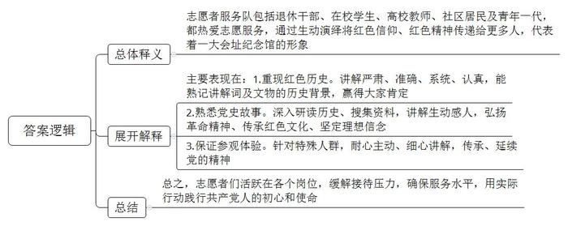
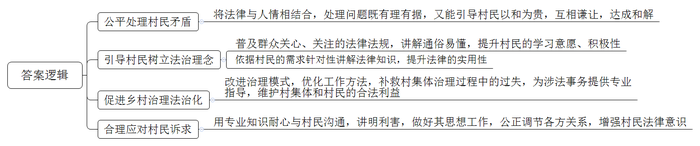
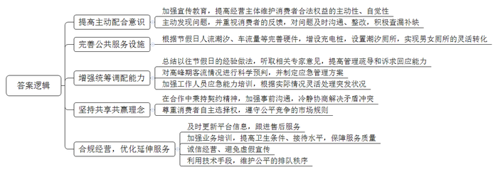
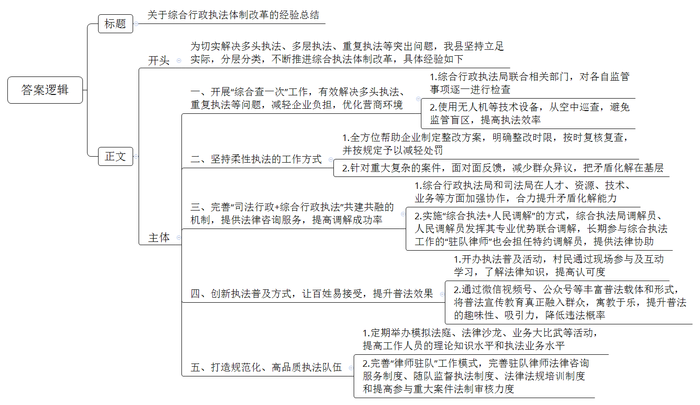

# 2021年公务员多省联考《申论》题（安徽C卷）

> 候选采集稿。参考答案及解析来自粉笔页面，不代表官方答案或真实高分答卷；来源使用许可与原卷对应关系仍需人工核实。

## 给定材料

### 材料 material-deb20e646a9d1407

上海兴业路76号，中共一大会址纪念馆大门上的铜环熠熠生辉，一层序厅内，巨幅党旗如鲜血浸染。这里，是中国共产党的诞生地。每天，无数参观者从各方涌来，瞻仰红色火种，探寻初心使命。如何将红色信仰、红色精神更生动地演绎、传递给更多人？有一支志愿者服务队始终在坚持义务为参观者讲解。他们之中既有退休干部，也有在校学生，既有高校教师，也有社区居民，还有面容稚嫩的“00后”，身份虽然不同，但对讲解的热爱却是一致的，成为一大会址纪念馆一张闪亮的名片。

“中国共产党在这里诞生，从这里出征，走向全国……”在刻画着中共一大代表形象的浮雕《起点》前，67岁的老沈又迎来新一批观众。每一次义务讲解，他都慷慨激昂，把参观者带进那个星火燎原的激荡岁月。老沈退休前是国企干部，做过多年党务工作。2018年，当中共一大会址纪念馆首次向社会招募志愿者时，老沈第一时间报名。他用了26天时间背下2万多字的讲解词，熟悉了278件馆藏文物的历史背景，最终顺利通过考试，成为一名志愿讲解员。“在一大会址讲解，不同于其他地方，要更严肃、更准确、更系统，更要注意不能有口误。”老沈认真地说。有一次，一名参观者在参观完毕时对他说：“您今天的讲解太好了，我们全程录音，拿回去做党史课程资料。”“那时我就觉得作为一名志愿者、一名党员，我实现了个人价值，特别自豪！”老沈笑着说。

小张读高中时就是一大会址的学生志愿者讲解员，考上大学后，他组织发动身边的同学一起来党的诞生地做志愿者。大学毕业后，他留校担任辅导员，又带领更多的大学生加入一大会址志愿者队伍。小张说：“我的成长和一大会址纪念馆密不可分。”正是通过在纪念馆担任讲解员，他对党史更加熟悉了，也更加深刻地理解了党的许多理论，于是，他在高三时就积极申请加入了中国共产党。小张说：“我还记得2009年除夕，我第一次为观众讲解时的情景，虽然早就把讲解词背得滚瓜烂熟，但面对四五十位参观者，我还是有些紧张。很多参观者年纪比我大，不少人是老教师、老干部，他们有时提出的问题，我回答不上来。”从那以后，他下功夫研读历史，搜集与馆藏文物相关的资料，不断学习。如今，对很多党史故事，他都能如数家珍，讲得生动感人，赢得了参观者的点赞。从2015年中共一大会址纪念馆成为上海市首批高中生社会实践基地以来，已有9所学校980多名中学生在党的诞生地参与志愿服务。很多同学就是在这里通过一次次的讲解，弘扬革命精神、传承红色文化、坚定理想信念。

某天，一位残疾女孩来参观，志愿者小程见她坐着轮椅行动不便，主动背着她上楼下楼，参观每个展室。为让她看清每件展物，小程不断调整姿势、变换角度、细心讲解，平时40分钟的工作量，这次整整用了两个小时。这位残疾女孩动情地对小程说：“我在一大会址看到了党的昨天，从你们身上看到了明天。”一位80多岁的老军人拄着拐杖听完小程的讲解后，向他敬了个军礼：“第一个100年的奋斗目标已经实现了，新的冲锋号又在你们这一代吹响了。”

党的十九大以来，千千万万参观者来到党的诞生地，会址的参观接待量连续两年超过140万人次。在接待量大幅增加的情况下，正是志愿者们的出色表现，有效缓解了场馆的接待压力，确保了服务水平不降低。志愿者小程说：“每当想起党员们在党旗下庄严宣誓的场景，我就浑身充满了力量。”如今，从讲解接待、宣誓教育到场馆服务、活动执行，各个岗位都活跃着志愿者的身影，他们用实际行动践行着中国共产党人的初心和使命。

### 材料 material-a36d8b22a6312a2b

随着城乡一体化发展加快，农村土地流转、房屋租赁等事项不断增加，拓宽了村民财产性收入来源。在这方面，田头村不少村民尝到了甜头，但也走过弯路。“吃的最多的亏，是不懂法的亏。”田头村村支书老陈坦言道。2017年11月，经当地相关部门牵线，T律师事务所钟律师和田头村签约，担任该村法律顾问，为村里提供法律咨询和法律服务。

田头村两个相邻村民小组，曾因交界处一块土地的权属问题引发纠纷，争执难解。“村两委在这件事上左右为难，怕一碗水端不平。”老陈为此头疼，于是向钟律师求助。钟律师建议他在村委会会议室召开一场协调会。协调会上，钟律师问道：“首先征求你们的意见，是否同意我介入协调？”见大家点头同意，他接着就直奔问题：“集体土地使用证是土地权属的重要依据，你们双方都说土地是自己的，能拿得出土地使用证吗？”由于历史原因，双方均未持有土地使用证，于是都没吭声。钟律师看到“法律牌”发挥了作用，又接着打出了“感情牌”：“大家都在一个村里，抬头不见低头见，还是要以和为贵、互相谦让。”最后，双方采纳了钟律师的建议，按土地面积平均分配。

钟律师到村后的“最重要的事”就是给村民上法制课。“有关民法的法律法规，大家都关心。特别是土地管理和婚姻等问题，村民关注度最高。”钟律师准备充分，讲得通俗，村民听得津津有味，没有一人中途退场。课后，还有不少村民围着他继续咨询。一堂法制课，让钟律师更加明白村民对法律知识的渴求。此后，在村委会换届期间，钟律师为村民、村干部讲授村民委员会组织法；在开展违法占地和违法建筑专项整治期间，为村民讲解土地管理相关法律法规。“法律顾问并非只是解决了一些矛盾纠纷，更主要的是，为村民带来了遇到问题依法解决的法治理念。”老陈感慨道。

2017年10月，S律师事务所张律师受聘为三水村法律顾问。起初，法律顾问的到来，让一些习惯于传统治理方式、工作简单生硬的村干部颇不适应。有些村干部担心他会干涉村务，还有点排斥心理。开始，每次下村向村干部“领活儿”，他得到的答复都是“没什么事”。直到一次紧急救助，才让张律师赢得了村里的信任。相关部门督查发现，三水村集体和村民签订的土地转让合同有问题，村两委一时不知所措，向张律师请教该如何处理。按照张律师的专业指导，村委会上报相关部门批准，与村民签订了收回土地使用权协议书，并参照征地补偿标准与村民重新商定补偿金额。经此事，村两委成员心服口服，村里处理涉法事务，都请张律师来把把关。

这天，家住三水村进村大路边的村民老文找到张律师求助。原来，为增加自家居住面积，老文在门口私搭乱建了房子，挤占了部分道路，被国土部门督查发现并要求拆除。村干部上门做工作，老文却不为所动。“我自己花钱建的，凭啥要拆？”老文找张律师帮忙，哪知了解情况后，张律师做起了老文的工作：“土地管理法规定，集体土地不得私自占用，而您的做法，就属于强占属于村集体的公共道路用地，村集体有权依法拆除。”村干部老曾说：“跟老文讲明利害的时候，张律师专门带了几本法律书，我们在旁边听，也学到很多东西。”像老曾一样，不少村民对法律顾问的态度转变经历了一个过程。这背后，法律顾问靠公正调解赢得了信任，更靠法律知识宣传潜移默化地增强了村民的法律意识。

### 材料 material-bd082b88a7d8239a

2020年国庆假期是国内疫情得到有效控制后的首个长假，公众出行、旅游和购物热情高涨，消费需求加快释放。不过，就在市场回暖升温的同时，公众对部分行业吐槽依旧，消费者维权事件频发。据S省市场监督执法总队近期的《消费维权情况反映》显示，9月30日至10月10日共收集“中秋国庆”相关“消费维权”类信息12万余条，其中，大多暴露出的是公共服务设施和服务水平的短板。

10月3日林湾景区官微发文称，近来林湾景区频繁接到游客反映，使用某地图导航至景区定位错误，造成严重交通拥堵，给游客和景区管理造成极大困扰。同时，该文还声称，错误导航问题已存在多年，景区多次与地图运营方联系，要求对景区导航路线进行修改优化，但均未果。现场的执法人员认为，景区和网络运营平台维护消费者合法权益的主动配合意识不强，积极查漏补缺举措明显不足。通过再次交涉后，地图运营方回应，目前误差已做修正。

不过让消费者堵心的，绝不仅仅是拥堵一项。长假期间，与堵车相关的各种“尬”态、“囧”类遭遇频现。比较典型的事例包括：电动汽车耗空电量后在高速上找不到充电桩，只能等待救援；多地高速服务区上演女性冲入男厕抢“坑”位景象等。“应对节假日人流潮汐、车流高峰，各类服务主体在管理疏导和诉求回应方面科学性较差、前瞻性不够、灵活性不足，导致消费者出行时‘囧’事不断、‘尬’态百出。”市场监督执法总队朱副队长认为，这其中既有公共服务设施硬件的短板，也有统筹调配软件的缺失。

10月4日，一场大型汉服秀临时取消，商家、模特与主办方在现场发生言语冲突。负责表演的模特公司发布声明称，因主办方在开始没有沟通好相关条件，造成了3日晚上无法彩排、4日晚上无法走秀这一情况的出现。让消费者不愉快的经历并非孤例，就在各地电影院营业创收的大好时机，某电影院却传来不太友好的消息：市民小王称与同伴在一家影城检票时遭阻拦，原因是携带了某品牌的奶茶。客服人员解释称，观众到影院对面新开的饮品店买饮料，会把自家饮料生意挤垮。朱副队长认为，这暴露出这些商家和平台在消费市场生态圈中严重缺乏共享共赢意识，损害了消费者合法权益。

在餐饮住宿方面，同样吐槽点多多——预订平台信息更新不及时，售后服务跟不上；卫生服务需提升，接待能力待加强；宣传与实际不符，履约存在瑕疵。假期品美食，原本十分愉快。不过，就餐能插队的现象，还是让许多人难以接受。10月6日晚，市民蒋女士来到某品牌海鲜火锅群升广场店，现场取号为179号，导台员告知大约需等待3个小时，但花费40元从号贩子手中购买插队服务后不到15分钟，便被顺利叫号，细一打听，原来号贩子使用了某抢号APP，科技手段成了他们的谋财工具。商家表示，对此他们也无可奈何。“候餐抢号插队不仅破坏了原本公平的排队秩序，而且让消费生态环境在新技术的参与下显得缺乏温度。”朱副队长指出，个别软件开发商对新技术使用的合规性认识不足，商家对线上线下“接合部”领域的服务延伸不够。

### 材料 material-5cdd1fbf9c4eba4c

“我们推进综合执法体制改革最大的特点，就是坚持立足实际，分层分类实施改革，切实解决多头执法、多层执法、重复执法等突出问题。”A县章副县长在介绍综合行政执法改革情况时表示。

2020年5月，A县综合行政执法局联合住建、生态环境等部门首次对县城在建工地开展“综合查一次”。联合检查执法队员重点围绕安全生产、规划建设、环境保护等，对各自监管事项逐一进行检查。执法队员使用无人机设备，从空中巡查在建工地的裸露土、工地围挡设置、物料堆放、扬尘治理措施等情况，有效避免监管盲区，提高执法效率。据了解，此次行动共检查在建工地39家，发现问题23处，现场整改13处，制发责令限期改正通知书10份，立案调查3起。推行“综合查一次”，真正实现多领域执法检查“一步到位”，既有效解决了多头执法、重复执法等问题，也切实减轻了企业的负担，优化了营商环境。截至2020年底，该局已累计开展“综合查一次”联合检查131次，检查市场主体683家，减少检查频次60%以上，范围拓展至全县15个乡镇街道。

同时，A县在综合行政执法过程中坚持柔性执法，全方位帮助企业制定整改方案，明确整改时限，按时复核复查，并按规定予以减轻处罚。还针对重大复杂的案件，采取面对面反馈，最大程度减少群众异议，将矛盾化解在基层。

“综合执法+人民调解”是A县“司法行政+综合行政执法”共建共融机制中的特色品牌。综合行政执法局和司法局在人才、资源、技术、业务等方面加强协作，合力提升基层矛盾纠纷化解能力。在遇到矛盾纠纷时，综合执法局调解员、人民调解员发挥各自专业优势进行联合调解，长期参与综合执法工作的“驻队律师”也会担任特约调解员，就相关法律问题提供协助。2020年8月，昌石街道一商业住宅的20户业主，与在一楼开店的万先生因店面装修时涉及到承重墙的问题产生纠纷，双方多次协商未果。了解到这个情况后，综合行政执法局和司法局主动介入调解。“了解双方分歧的焦点后，我们邀请第三方对房屋安全状况进行评估。结论是万先生的店面在装修中确有承重墙被破坏的情况，应予恢复。”司法局昌石执法所负责人介绍。在得到专业评估意见后，昌石执法所迅速组织召开专题调解会，除双方当事人外，参加调解的还有综合执法局调解员、人民调解员、特约调解员。经过三轮调解，双方的矛盾在一周内成功化解，由万先生尽快对受损承重墙予以恢复，承重墙恢复前楼上住户暂时到宾馆住宿，以确保安全。迅速化解纠纷正是他们打造“综合执法+人民调解”模式的初衷。在这种模式的作用下，目前累计提供法律咨询服务460余次，调解化解缓解纠纷103件次，调解成功率达到100%。

2020年国庆期间，一场“执法普及游园会”让赵家村老赵一家备感新鲜。一家三口现场学习法律知识、掷骰子答题闯关、扮演执法者模拟执法……“既放松身心又学到法律知识，有意义也有趣味，孩子很喜欢。”老赵说。“在普法宣传中，我们始终跟着‘热点’走，用老百姓最容易接受的方式去普法。”综合行政执法局政策法规科李科长说。去年以来，执法局创新普法模式，丰富普法载体和形式，将执法工作宣传教育真正融入群众生活、送到群众心里，在发动群众参与中提高普法效果。在微信视频号、微信公众号等媒体平台上，经常会看到由综合行政执法局执法队员自导自演的普法短视频。这些由执法队员在工作之余精心制作的短视频，寓教于乐，让宣传真正“活”了起来，也“火”了起来。特别是无人机小姐姐喊话、秸秆焚烧、垃圾分类等情景趣味短视频，点赞上万，阅读量破百万，有效降低了违法违规行为发生概率。

A县综合行政执法局以实现执法规范化、打造高品质执法队伍为目标，定期举办模拟法庭、法律沙龙、业务大比武等活动，不断提高执法人员的理论知识水平和执法业务水平。同时，优化“律师驻队”工作模式，完善驻队律师法律咨询服务制度、随队监督执法制度、法律法规培训制度，提高参与重大案件法制审核力度，进一步规范了执法行为，提升了执法人员的办案水平。

## 题目

### 第 1 题

**根据给定资料**1**，请阐述你对志愿者服务队是“一大会址纪念馆一张闪亮的名片”的理解。（20分）**

关联材料：material-deb20e646a9d1407、material-a36d8b22a6312a2b、material-bd082b88a7d8239a、material-5cdd1fbf9c4eba4c

作答要求：

要求：

（1）准确全面；

（2）逻辑性强；

（3）不超过300字。

### 第 2 题

**根据给定资料**2**，请你谈谈法律顾问在田头村和三水村发挥了哪些作用。（****20****分）**

关联材料：material-deb20e646a9d1407、material-a36d8b22a6312a2b、material-bd082b88a7d8239a、material-5cdd1fbf9c4eba4c

作答要求：

要求：

（1）准确全面；

（2）分条陈述；

（3）不超过300字。

### 第 3 题

**根据给定资料**3**，请你针对《消费维权情况反映》中的问题，提出对策建议。（****25****分）**

关联材料：material-deb20e646a9d1407、material-a36d8b22a6312a2b、material-bd082b88a7d8239a、material-5cdd1fbf9c4eba4c

作答要求：

要求：

（1）紧扣资料，内容完整；

（2）切实可行，针对性强；

（3）不超过400字。

### 第 4 题

**假如你是****A****县综合行政执法局的工作人员，请根据给定资料**4**，写一份****A****县综合行政执法体制改革的经验总结，供领导参阅。（****35****分）**

关联材料：material-deb20e646a9d1407、material-a36d8b22a6312a2b、material-bd082b88a7d8239a、material-5cdd1fbf9c4eba4c

作答要求：

要求：

（1）紧扣资料，内容完整；

（2）条理清晰，语言流畅；

（3）600~800字。

## 答案与解析

第 1 题

**参考答案（粉笔题库参考内容）**

志愿者服务队包括退休干部、在校学生、高校教师、社区居民及青年一代，都热爱志愿服务，通过生动演绎将红色信仰、红色精神传递给更多人，代表着一大会址纪念馆的形象。

主要表现在：1.重现红色历史。讲解严肃、准确、系统、认真，能熟记讲解词及文物的历史背景，赢得大家肯定。2.熟悉党史故事。深入研读历史、搜集资料，讲解生动感人，弘扬革命精神、传承红色文化、坚定理想信念。3.保证参观体验。针对特殊人群，耐心主动、细心讲解，传承、延续党的精神。

总之，志愿者们活跃在各个岗位，缓解接待压力，确保服务水平，用实际行动践行共产党人的初心和使命。

**解析**

**参考答案说明：**思路方面，本参考答案按照词句解释题的一般答题思路展开，即：总体释义+展开解释+总结。内容方面，本参考答案先对“志愿者服务队是‘一大会址纪念馆一张闪亮的名片’”进行了解释；“展开解释”部分主要介绍了志愿者服务队具体有哪些地方能代表一大会址形象，最后对这句话进行了简单总结。

**考点**：考点词句解释类

**来源**：来源2021年公务员多省联考《申论》题（安徽C卷）

粉笔申论页面对本题只提供「解析视频」入口，该入口是会员推广位，页面无视频地址与文字解析。

第 2 题

**参考答案（粉笔题库参考内容）**

一、公平处理村民矛盾。将法律与人情相结合，处理问题既有理有据，又能引导村民以和为贵，互相谦让，达成和解。

二、引导村民树立法治理念。普及群众关心、关注的法律法规，讲解通俗易懂，提升村民的学习意愿、积极性；依据村民的需求针对性讲解法律知识，提升法律的实用性。

三、促进乡村治理法治化。改进治理模式，优化工作方法，补救村集体治理过程中的过失，为涉法事务提供专业指导，维护村集体和村民的合法利益。

四、合理应对村民诉求。用专业知识耐心与村民沟通，讲明利害，做好其思想工作，公正调节各方关系，增强村民法律意识。

**解析**

**参考答案说明：**本参考答案从“公平处理村民矛盾”“引导村民树立法治理念”“促进乡村治理法治化”“合理应对村民诉求”这四个方面进行了分条撰写。各条要点之间在内容上是并列关系，没有交叉。

**考点**：考点影响类

**来源**：来源2021年公务员多省联考《申论》题（安徽C卷）

粉笔申论页面对本题只提供「解析视频」入口，该入口是会员推广位，页面无视频地址与文字解析。

第 3 题

**参考答案（粉笔题库参考内容）**

1.提高主动配合意识。加强宣传教育，提高经营主体维护消费者合法权益的主动性、自觉性；主动发现问题，并重视消费者的反馈，对问题及时沟通、整改，积极查漏补缺。

2.完善公共服务设施。根据节假日人流潮汐、车流量等完善硬件，增设充电桩，设置潮汐厕所，实现男女厕所的灵活转化。

3.增强统筹调配能力。总结以往节假日的经验做法，听取相关专家意见，提高管理疏导和诉求回应能力；对高峰期客流情况进行科学预判，并制定应急管理方案；加强工作人员应急能力培训，根据实际情况灵活处理突发状况。

4.坚持共享共赢理念。在合作中秉持契约精神，加强事前沟通，冷静协商解决矛盾冲突；尊重消费者自主选择权，遵守公平竞争的市场规则。

5.合规经营，优化延伸服务。及时更新平台信息，跟进售后服务；加强业务培训，提高卫生条件、接待水平，保障服务质量；诚信经营、避免虚假宣传；利用技术手段，维护公平的排队秩序。

**解析**

**参考答案说明：**本参考答案从“提高主动配合意识”“完善公共服务设施”“增强统筹调配能力”“坚持共享共赢理念”“合规经营，优化延伸服务”这五个方面进行了分条撰写。各条要点之间在内容上相互并列，没有交叉。

**考点**：考点提出对策类

**来源**：来源2021年公务员多省联考《申论》题（安徽C卷）

粉笔申论页面对本题只提供「解析视频」入口，该入口是会员推广位，页面无视频地址与文字解析。

第 4 题

**参考答案（粉笔题库参考内容）**

关于综合行政执法体制改革的经验总结

为切实解决多头执法、多层执法、重复执法等突出问题，我县坚持立足实际，分层分类，不断推进综合执法体制改革，具体经验如下：

一、开展“综合查一次”工作，有效解决多头执法、重复执法等问题，减轻企业负担，优化营商环境。1.综合行政执法局联合相关部门，对各自监管事项逐一进行检查；2.使用无人机等技术设备，从空中巡查，避免监管盲区，提高执法效率。

二、坚持柔性执法的工作方式。1.全方位帮助企业制定整改方案，明确整改时限，按时复核复查，并按规定予以减轻处罚；2.针对重大复杂的案件，面对面反馈，减少群众异议，把矛盾化解在基层。

三、完善“司法行政+综合行政执法”共建共融的机制，提供法律咨询服务，提高调解成功率。1.综合行政执法局和司法局在人才、资源、技术、业务等方面加强协作，合力提升矛盾化解能力；2.实施“综合执法+人民调解”的方式，综合执法局调解员、人民调解员发挥其专业优势联合调解，长期参与综合执法工作的“驻队律师”也会担任特约调解员，提供法律协助。

四、创新执法普及方式，让百姓易接受，提升普法效果。1.开办执法普及活动，村民通过现场参与及互动学习，了解法律知识，提高认可度；2.通过微信视频号、公众号等丰富普法载体和形式，将普法宣传教育真正融入群众，寓教于乐，提升普法的趣味性、吸引力，降低违法概率。

五、打造规范化、高品质执法队伍。1.定期举办模拟法庭、法律沙龙、业务大比武等活动，提高工作人员的理论知识水平和执法业务水平。2.完善“律师驻队”工作模式，完善驻队律师法律咨询服务制度、随队监督执法制度、法律法规培训制度和提高参与重大案件法制审核力度。

**解析**

**参考答案说明：**（1）本题要求写经验总结，一般思路为标题+正文。（2）正文部分，一方面从内容来看，围绕着“综合行政执法体制改革”这一主题，本参考答案的开头写到了“综合行政执法体制改革的总体规划与目的”；主体部分从“开展‘综合查一次’工作”“坚持柔性执法工作方式”“完善‘司法行政+综合行政执法’共建共融机制”“创新执法普及方式”“打造规范化、高品质执法队伍”五个方面进行书写。另一方面，形式上，本参考答案做到了分段、分条撰写，整体上条理较为清晰。

  

**考点**：考点总结类

**来源**：来源2021年公务员多省联考《申论》题（安徽C卷）

粉笔申论页面对本题只提供「解析视频」入口，该入口是会员推广位，页面无视频地址与文字解析。

