# 2021 安徽省公务员录用考试 行测（统考）

> 行测 · 110 题 · 安徽 2021

## 第 1 题　qid 3522334 · 时事政治

在2020年12月召开的中央农村工作会议上，习近平总书记强调，在向第二个百年奋斗目标迈进的历史关口，巩固和拓展脱贫攻坚成果，全面推进乡村振兴，加快农业农村现代化，是需要全党高度重视的一个关系大局的重大问题。下列有关会议主要内容表述正确的是：

- **A**. 脱贫攻坚目标完成后，对摆脱贫困的县，从脱贫之日起设立3年过渡期
- **B**. 要健全防止返贫动态监测和帮扶机制，对易返贫致贫人口实施常态化监测
- **C**. 构建新发展格局，把战略基点放在开源节流上，农村有巨大空间，可以大有作为
- **D**. 要牢牢把住粮食生产主动权，严防死守13亿亩耕地红线，落实最严格的耕地保护制度

## 第 2 题　qid 3522341 · 时事政治

碧空如洗，草木竞荣，2020年初夏召开的全国两会极不平凡。两会期间，习近平总书记多次“下团组”，对做好统筹疫情防控和经济社会发展工作、应对当前的风险和挑战、永远保持同人民群众的血肉联系等方面作出重要指示，传递出攻坚克难、化危为机的坚定信心和力量。以下选项对应关系不一致的是：

- **A**. 谈经济社会发展——“在危机中育新机、于变局中开新局”
- **B**. 谈生态文明建设——“坚定信心不动摇，咬定目标不放松”
- **C**. 谈疫情防控——“慎终如始、再接再厉”
- **D**. 谈执政为民——“人民至上、生命至上”

## 第 3 题　qid 3522343 · 新思想

下列选项，在国家主席习近平发表的2021年新年贺词中没有提到的是：

- **A**. 我们克服疫情影响，统筹疫情防控和经济社会发展取得重大成果
- **B**. 2020年，全面建成小康社会取得伟大历史性成就，决战脱贫攻坚取得决定性胜利
- **C**. 我国在世界主要经济体中率先实现正增长，预计2020年国内生产总值迈上百万亿元新台阶
- **D**. 京津冀协同发展、长江经济带发展、粤港澳大湾区建设、长三角一体化发展按下快进键，黄河流域生态保护和高质量发展成为国家战略

## 第 4 题　qid 3522336 · 人文常识

“十四五”时期是我国全面建成小康社会、实现第一个百年奋斗目标之后，乘势而上开启全面建设社会主义现代化国家新征程、向第二个百年奋斗目标进军的第一个五年。下列有关说法正确的是：

- **A**. 提出到本世纪中叶基本实现社会主义现代化远景目标，人均国内生产总值达到中等发达国家水平，中等收入群体显著扩大
- **B**. 坚持把发展经济着力点放在实体经济上，坚定不移建设制造强国、质量强国、网络强国、数字中国
- **C**. 坚持又快又好工作总基调，以推动高质量发展为主题，以深化供给侧结构性改革为主线
- **D**. “十四五”规划是在党的十九届四中全会上审议通过的，将于2021年开始实施

## 第 5 题　qid 3522338 · 法律常识

2020年底颁布的《政府督查工作条例》是我国政府督查领域的第一部行政法规，是政府督查工作长期实践的系统总结 。下列有关说法正确的是：

- **A**. 政府督查机构可以根据督查结论或者整改核查结果，直接对督查对象追究责任
- **B**. 应当严格控制督查频次和时限，科学运用督查方式，严肃督查纪律，提前培训督查人员
- **C**. 政府督查可以采取开展检查、访谈，组织座谈、听证的方式，但不可采取暗访的方式进行
- **D**. 督查对象对督查结论有异议的，可以自收到该督查结论之日起60天内，向作出该督查结论的人民政府申请复核

## 第 6 题　qid 3522346 · 法律常识

下列有关《中华人民共和国民法典》的说法不正确的是：

- **A**. 民法典将人格权独立成编，调整的是因人格权的享有和保护产生的民事关系
- **B**. 八周岁以上的未成年人为限制民事行为能力人，不可独立实施纯获利益的民事法律行为
- **C**. 民法典实施后，婚姻法、继承法、民法通则、收养法、担保法、合同法、物权法、侵权责任法、民法总则同时废止
- **D**. 民法典规定，自然人享有隐私权，隐私是自然人的私人生活安宁和不愿为他人知晓的私密空间、私密活动、私密信息

## 第 7 题　qid 3522349 · 法律常识

根据我国法律规定，下列表述正确的是：

- **A**. 甲应聘某基层人民法院陪审员，其就职时可以依照法律规定公开进行宪法宣誓
- **B**. 乙是某大型超市收银员，利用工作便利私自窃取货款5万元，其行为构成贪污罪
- **C**. 丙是某县负责抗洪指挥工作的领导，在救灾过程中带人打麻将，未及时检查造成垮堤，其行为构成玩忽职守罪
- **D**. 丁是某市电视台总导演，利用职务便利收受他人财物数额巨大，但因其不属于国家工作人员，因此不构成贪污罪

## 第 8 题　qid 3522335 · 经济常识

下列关于风险管理的做法合适的是：

- **A**. 某商业银行对不同信用等级的客户适用相同的贷款利率
- **B**. 李某担心家中古董被盗造成损失，向保险公司购买财产保险
- **C**. 考虑到大人和小孩风险承受力强弱不一，购买保险时小孩应优先于大人
- **D**. 某外贸公司将要进口一批美国货物，为规避美元升值风险，向银行申请开立保函

## 第 9 题　qid 3522337 · 法律常识

下列关于我国生态环境保护方面的说法不准确的是：

- **A**. 第二次全国污染源普查的结果显示，我国主要污染物排放量大幅下降
- **B**. 我国生态环境保护三大保卫战指的是蓝天保卫战、碧水保卫战和净土保卫战
- **C**. “无废城市”是一种先进的城市管理理念，实现了固体废物的完全资源化利用
- **D**. 新修订的《中华人民共和国森林法》自2020年7月1日起施行，此次修订将森林生态效益补偿写入了法律

## 第 10 题　qid 3522340 · 人文常识

下列关于第七次全国人口普查工作的表述不正确的是：

- **A**. 本次普查首次采集普查对象身份证号，以实现与公安、卫健等部门行政记录的比对核查
- **B**. 本次普查采用全面调查的方法，以人为单位进行登记，普查对象可通过互联网自主填报
- **C**. 普查短表包括反映人口基本状况的项目，由全部住户（不含港澳台居民和外籍人员）填报
- **D**. 根据《全国人口普查条例》，人口普查工作每10年进行一次，尾数逢0的年份为普查年度

## 第 11 题　qid 3522345 · 科技常识

下列有关我国2020年科技成就的说法正确的是：

- **A**. 2020年12月，嫦娥五号返回器成功着陆，这是我国首次完成月球采样返回任务
- **B**. 我国研制的“奋斗者”号载人潜水器于2020年11月坐底菲律宾海沟，创造了我国载人深潜新纪录
- **C**. 中国环流器二号M装置于2020年底建成并实现首次放电，为我国核裂变堆的设计建造打下了坚实基础
- **D**. 2020年7月，北斗三号全球卫星导航系统全面建成并开通服务，我国成为第四个独立拥有全球卫星导航系统的国家

## 第 12 题　qid 3522348 · 人文常识

下列四位作家原名与其作品、笔名对应错误的是：

- **A**. 李尧棠——《寒夜》——巴金
- **B**. 万家宝——《原野》——曹禺
- **C**. 舒庆春——《月牙儿》——老舍
- **D**. 郭开贞——《太阳照在桑干河上》——丁玲

## 第 13 题　qid 3522365 · 人文常识

下列表述按照所代表的年龄从小到大排序正确的是：

- **A**. 
从心之年舞勺之年知非之年期颐之年鲐背之年

- **B**. 
舞勺之年知非之年从心之年鲐背之年期颐之年

- **C**. 
舞勺之年从心之年知非之年期颐之年鲐背之年

- **D**. 
从心之年舞勺之年知非之年鲐背之年期颐之年

## 第 14 题　qid 3522367 · 人文常识

下列词语与“天干地支”无关的是：

- **A**. 寅吃卯粮
- **B**. 猴年马月
- **C**. 甲乙丙丁
- **D**. 龙马精神

## 第 15 题　qid 3522344 · 人文常识

下列谚语不涉及二十四节气的是：

- **A**. 花木管时令，鸟鸣报农时
- **B**. 白露身不露，寒露脚不露
- **C**. 日晕三更雨，月晕午时风
- **D**. 秋分早，霜降迟，寒露种麦正当时

## 第 16 题　qid 3522347 · 人文常识

生活中，厨师在烹饪过程中除了使用酱油调色上色外，还可以采用下列哪一食材来给食物上色：

- **A**. 食盐
- **B**. 冰糖
- **C**. 香叶
- **D**. 花椒

## 第 17 题　qid 3522355 · 科技常识

下列变化过程包含化学反应的有：
①鬼火
②光合作用
③水垢形成
④高粱酿酒
⑤舞台云雾的生成

- **A**. ②③④⑤
- **B**. ①②④⑤
- **C**. ①③④⑤
- **D**. ①②③④

## 第 18 题　qid 3522436 · 人文常识

混凝土搅拌车从泵站运输到工地期间，其罐体必须时刻保持低速转动。下列关于这一操作目的的说法错误的是：

- **A**. 加速混凝土凝结
- **B**. 促进混凝土充分搅拌
- **C**. 防止混凝土出现离析现象
- **D**. 保证混凝土性能达到施工要求

## 第 19 题　qid 3522439 · 人文常识

牙膏的主要成分包括摩擦剂、胶黏剂、洁净剂、保湿剂、防腐剂、芳香剂和水等，生产厂家有时会在其中添加相应成分来实现其特殊功效。下列关于牙膏成分作用的说法正确的是：

- **A**. 甘油在牙膏中起摩擦作用
- **B**. 含氟牙膏对防止龋齿没有效果
- **C**. 加入大量糖精可保持牙膏湿润
- **D**. 加入叶绿素可防止牙龈出血和口臭

## 第 20 题　qid 3522443 · 科技常识

优秀的足球运动员会利用技巧使踢出的足球在空中旋转，旋转的足球在行进过程中会突然改变原来的运动方向并转弯，这被称为“香蕉球”。
下列选项的物理原理与“香蕉球”原理不同的是：

- **A**. 飞机机翼通常设计为上沿是弧形，下沿是平的
- **B**. 用吸管喝袋装牛奶，喝完后用力吸一下，袋子瘪了
- **C**. 火车站台设置黄色安全线以警示乘客与列车保持距离
- **D**. 两张相距5厘米的A4纸垂直放置，往中间吹气，两张纸会互相吸引

## 第 21 题　qid 3522455 · 逻辑填空

现代体育比赛不仅是各国运动员速度与力量的竞技场，也是世界各国展示形象、尖端科技与体育融合的大舞台。随着人类对挑战自身的执着追求，各竞技项目的成绩不断        人体能力的极限，要想进一步提高比赛成绩，哪怕是提高百分之一甚至千分之一，教练与运动员都要竭尽全力采用各种方式和技术去实现，科技的赋能作用也就愈发重要。
填入划横线部分最恰当的一项是：

- **A**. 刷新
- **B**. 挑战
- **C**. 考验
- **D**. 逼近

## 第 22 题　qid 3522456 · 逻辑填空

《周书》曰：“小满之日苦菜秀。”小满时节，麦类、谷物等农作物子粒开始饱满，但尚未成熟，恰是青黄不接的时候。而田间地头的野菜正蓬勃生长，采食野菜来度过饥荒，自是            。
填入划横线部分最恰当的一项是：

- **A**. 不容置疑
- **B**. 顺理成章
- **C**. 水到渠成
- **D**. 理所当然

## 第 23 题　qid 3522459 · 逻辑填空

成年人总是认为孩子思维幼稚、理解力有限，这其实是一种        。得益于蓬勃发展的信息技术和日益便利的交通出行，如今的孩子比以往掌握更多知识，也更加渴望了解世界。阅读可以打开一扇扇门，让他们看见广阔的世界，了解活着的意义，也要面对死亡和失去。而友谊和爱，这些宝贵的品质犹如黑夜中的明灯，终将        他们面向世界，走向未来。
依次填入划横线部分最恰当的一项是：

- **A**. 成见 推动
- **B**. 偏见 引领
- **C**. 误读 促进
- **D**. 误解 带动

## 第 24 题　qid 3522458 · 逻辑填空

南音是中国现存最古老的乐种之一，以其大量的曲目、古老的乐器和自成体系的记谱方法，        着汉唐以来中国音乐的血脉。南音被誉为“中国音乐历史的活化石”，在中国音乐史中具有            的特殊地位，极具历史、文化、学术研究价值。
依次填入划横线部分最恰当的一项是：

- **A**. 贯通 独一无二
- **B**. 承载 举足轻重
- **C**. 延续 不可替代
- **D**. 沿袭 出类拔萃

## 第 25 题　qid 3522429 · 逻辑填空

实际上普通话和方言不是同一层次上的交际工具，普通话是全民共同语，是官方语言，而方言是区域性的，是民间语言。通过明确        ，普通话和方言可以做到并行不悖，甚至            ，相得益彰。
依次填入划横线部分最恰当的一项是：

- **A**. 规定  齐头并进
- **B**. 划分  互为表里
- **C**. 区分  珠联璧合
- **D**. 界定  相辅相成

## 第 26 题　qid 3522447 · 逻辑填空

当前，构建中国特色文艺理论体系已渐成学界共识，但在推进建设的道路上，            易，具体而微难；空喊口号易，付诸实践难。中国特色文艺理论体系建设，除了宏观维度的考量，更需要大功细作，从概念、范畴、术语及具体议题设置等微观层面入手，            ，聚沙成塔，一砖一瓦搭建大厦。
依次填入划横线部分最恰当的一项是：

- **A**. 大而化之    条分缕析
- **B**. 坐而论道    步步为营
- **C**. 小题大做    集腋成裘
- **D**. 通观大局    精雕细琢

## 第 27 题　qid 3522431 · 逻辑填空

野草属于乡间大地。在城市里被水泥丛林挤得难有            的野草，即便得到了点滴瘠薄的土地，也生长得            ，茎叶上积满了灰尘，一副失魂落魄的样子。那些生长在乡间大地上的野草，则        地在风中低语，在雨中吟唱。
依次填入划横线部分最恰当的一项是：

- **A**. 一席之地  没精打采  肆意
- **B**. 弹丸之地  垂头丧气  适意
- **C**. 一隅之地  奄奄一息  恣意
- **D**. 栖身之地  萎靡不振  惬意

## 第 28 题　qid 3522432 · 逻辑填空

颠覆性技术具有两面性，既可能产生正面结果，也可能带来负面影响。它可能对已有的技术和市场带来革命性        ，甚至改变世界力量        。通常，这类技术的出现没有规律，更难以        。
依次填入划横线部分最恰当的一项是：

- **A**. 作用 均衡 预料
- **B**. 影响 平衡 预测
- **C**. 变革 均匀 预想
- **D**. 改革 平均 预估

## 第 29 题　qid 3522401 · 逻辑填空

个人信息保护立法的优劣，最重要的评价标准就是科学而且精准地        两大法律价值，一方面是保障个人信息权益，同时又不能过度影响个人信息的合理利用。相信随着各方积极参与讨论，            ，最终一定会制定出一部良善的个人信息保护法，实现二者的        。
依次填入划横线部分最恰当的一项是：

- **A**. 平衡 集思广益 兼顾
- **B**. 权衡 齐心协力 融合
- **C**. 衡量 博采众长 统一
- **D**. 均衡 广开言路 两全

## 第 30 题　qid 3522410 · 逻辑填空

“回输”是细胞治疗需要        的主要手段之一。将细胞注射回人体，犹如将一艘艘小船放回航道，而人体内是一个密织交错的“航道网”，如果没有有效的、执行力强的“导航”设备，只能“            ”。无法到达指定位置的细胞治疗，功效将被大大        ，甚至不起作用。
依次填入划横线部分最恰当的一项是：

- **A**. 仰仗 随波逐流 稀释
- **B**. 凭借 离弦走板 侵蚀
- **C**. 依靠 返本还原 缩小
- **D**. 依仗 随俗浮沉 减弱

## 第 31 题　qid 3522414 · 语句表达

提到一座城市，人们往往会想到具有代表性的文化地标：600岁的紫禁城见证着北京城的过往，拓荒牛雕塑标记着深圳的开拓进取······城市文化地标                    ，成为一个城市的精神和文化象征，与人们产生紧密的情感连接、文化认同。文化地标是一个地方的文化名片，在传播城市形象方面有巨大的流量效应。近年来，文化旅游市场持续升温，各类文化地标成为热门参观地、网红打卡地。
填入划横线部分最恰当的一句是：

- **A**. 大都强调人文景观与自然环境和谐共生，以形神兼备的呈现方式
- **B**. 或深植于历史文化，或投射着时代风貌，以鲜明独特的符号形象
- **C**. 不是凭借炫目奇特的视觉效果，或各类时髦文化元素的简单堆砌
- **D**. 承载着无法替代的人文价值，满足着公众的审美旨趣和美好期待

## 第 32 题　qid 3522419 · 片段阅读

孔子以“有教无类”“因材施教”“教学相长”为方针，以培养“博学通才之士”为目标，对学生进行礼、乐、御、射、书、数“六艺”教育，其中，数即数学，乐和声学有关，御和力学有关，射和机械有关。《中庸》上说，“博学之，审问之，慎思之，明辨之，笃行之”，学、问、思、辨、行，完全符合认识过程和研究科学的方法，即获取信息、提出问题、思维推理、检验结果、躬身实践。在儒家崇尚务实和“经世致用”思想影响下，中国古代科技具有强烈的实用性，形成了以农、医、天、算四大学科和以“四大发明”为代表的技术发明创造。
这段文字意在说明：

- **A**. 中华古代文明具有文理交融的包容性
- **B**. 古代科技是传统儒家思想的实现途径
- **C**. 传统文化和古代科技存在必然的联系
- **D**. 传统文化对古代科技发展有积极影响

## 第 33 题　qid 3522549 · 片段阅读

为了进一步探索乌龙茶香气的酶促形成，团队成员系统研究了乌龙茶香气的酶促形成与胁迫的关联性。通过筛选各类胁迫因子，发现在乌龙茶加工过程中，损伤和低温胁迫是诱导茶叶香气酶促形成的关键胁迫因子。乌龙茶加工过程中做青阶段的连续损伤可诱导来自不同生物合成路径的香气物质合成关键基因的表达水平升高，进而促使这些香气物质的蓄积。此外，低温和损伤双胁迫对这些香气物质的合成具有显著协同效应。
这段文字意在说明：

- **A**. 乌龙茶香气的酶促形成主要与胁迫相关
- **B**. 做青阶段连续损伤可诱导香气物质的蓄积
- **C**. 胁迫使香气物质合成关键基因表达水平升高
- **D**. 损伤和低温是香气酶促形成的关键胁迫因子

## 第 34 题　qid 3522550 · 片段阅读

每一个民族的文化复兴，都是从总结自己的遗产开始的。在几千年历史长河中，我国各族人民创造了丰富的历史文化财富，留下了大量文物遗存。历史文物是传统文化的重要物质载体，记录着我们历史的光辉过去，延续着我们国家和民族的精神血脉，承载着我们民族的认同感和自豪感。保护历史文物和文化遗产，是传承中华优秀传统文化、坚定文化自信的必然要求。不断加大文物保护力度，让我们的城市建筑更好地体现地域特征、民族特色和时代风貌，有助于我们传承优秀传统文化，凝聚伟大民族精神，为实现民族复兴提供正确的精神指引和强大的精神动力。
这段文字意在强调：

- **A**. 民族文化复兴的途径
- **B**. 传统文化的物质载体
- **C**. 城市规划要富有特色
- **D**. 文物保护的深远意义

## 第 35 题　qid 3522420 · 片段阅读

捆扎蔬菜的胶带实际上是涂过粘合剂的塑料膜。虽然胶带不是食品，但由于会和食品接触，也要遵守食品安全标准。不过，在塑料膜和粘合剂的生产过程中，由于聚合不完全或溶剂挥发不完全，确实可能有少量甲醛等小分子残留。但捆扎蔬菜用的胶带在自然放置状态下很稳定，降解释放大量甲醛的可能性极小。同时，市面上用来捆绑蔬菜的不只是普通胶带，有的是由动物胶和植物胶制成的胶带，自然也不会对人体造成危害。另外，体重为60公斤的成年人，只要他每日甲醛摄入量不超过12毫克，就不会对健康产生影响。
根据这段文字，以下说法正确的是：

- **A**. 食用了胶带捆扎的蔬菜影响健康的概率小
- **B**. 捆扎蔬菜的胶带自然放置时并不产生甲醛
- **C**. 植物胶制成的胶带才不会对人体造成危害
- **D**. 60公斤成年人每天只应摄入12毫克甲醛

## 第 36 题　qid 3522424 · 片段阅读

公共健身器材主要由政府采购、体育部门赠予、开发商自行购置后投放。按规定，受赠单位负责管理和日常维护并承担经费；各单位自行购置的则由各单位负责管理、维修和承担费用。规定很明确，但执行中常常出现各种盲区。首先，受赠方往往无配套资金，需要维修时也一问三不知；其次，日常使用和维护往往需要出厂厂家，然而对厂家缺少专门监管，厂家常常敷衍售后服务；最后，公共健身器材超出使用期，未明确拆除更换的责任方。公共健身器材的设置本是便民利民的好事，但好的出发点也要有完善的配套制度。健身器材建设好了，服务和管理工作也应跟上。
这段文字意在强调：

- **A**. 受赠单位疏于管理公共健身器材
- **B**. 公共健身器材不能“重建轻管”
- **C**. 维护管理公共健身器材存在盲区
- **D**. 公共健身器材能让百姓切实受益

## 第 37 题　qid 3522403 · 片段阅读

高校设立家政本科专业受到舆论的质疑，因为在传统观念中，大学生是“天之骄子”，保姆似乎“低人一等”，二者难以画上等号。正是这样的错误观念，导致家政行业从业人员良莠不齐，整体素质不高。其实，家政行业是考验从业者综合素质的行业，高校设立家政专业，符合市场需求。当然，目前来看，家政专业培养出来的学生很少从事家政实务，不少都是从事家政企业管理和家政教育。要想真正吸引更多优秀人才进入家政行业，就要破除职业偏见，让家政服务从业人员能够获得应有的尊严，让他们的工作能够体现应有的劳动价值，让他们有良好的发展前景。
从这段文字可以看出，作者认为家政行业吸引优秀人才的关键在于：

- **A**. 增强家政专业“含金量”
- **B**. 提高从业者的综合素质
- **C**. 尊重从业人员劳动价值
- **D**. 破除家政专业职业偏见

## 第 38 题　qid 3522408 · 片段阅读

当血管壁被蚊子戳破时，血液会启动凝血机制，来修补血管壁的缺口，让血液在局部区域凝固。这不利于蚊子吸血，为此蚊子进化出了可以抗凝血的蛋白，只需在吸血之前注入血管组织中，就可以阻止血液凝固。但人体内的免疫系统会释放出组胺蛋白质来抵抗这种抗凝血蛋白，而这个免疫反应就会引起蚊子叮咬部位的过敏反应，让我们感觉痒。一旦开始痒了，我们的第一反应往往就是挠，但挠痒痒的时候，手指对皮肤的挤压会加速血液流动，使局部区域的抗凝血蛋白和身体分泌的组胺蛋白向更大区域扩散，自然也就越挠越痒了。
最适合做本段文字标题的是：

- **A**. 蚊子如何突破血液凝血机制吸血
- **B**. 被蚊子叮咬了为什么会越挠越痒
- **C**. 抗凝血蛋白助蚊子吸血一臂之力
- **D**. 组胺蛋白质可抗蚊子抗凝血蛋白

## 第 39 题　qid 3522413 · 片段阅读

机器学习的主旨是让计算机去模拟或实现人类的学习行为，是人工智能的核心。机器学习虽然可以在大数据训练中学到正确的工作方法，但它也很容易受到恶意干扰。通常攻击者是通过输入恶意数据来“欺骗”机器学习模型，导致其出现严重故障。近日，“Data61”机器学习小组研发出了一种机器学习的新算法。这种新算法通过类似疫苗接种的思路，帮助机器学习“修炼”出抗干扰能力。这是针对机器学习模型打造的防干扰训练，譬如，在图片识别领域，该算法能够对图片集合进行微小的修改或使其失真，激发出机器学习模型的抗干扰能力，并形成相关的自我抗干扰训练模型。
这段文字意在说明：

- **A**. 干扰机器识别图像的新方法
- **B**. 新算法助机器学习抵抗干扰
- **C**. 机器学习是人工智能的核心
- **D**. 机器学习大数据训练的方法

## 第 40 题　qid 3522417 · 片段阅读

地球上的地震发生在由板块运动产生的断层上，火星没有板块构造，但它持续的冷却和收缩过程会产生压力，当这种压力积累到足够大，就会引发火星地震。探测到火星地震是科学研究工作的一个里程碑。研究人员说，安放在火星表面的“内部结构地震实验仪”就像“贴着耳朵放了一部电话”，可以“听”到来自火星内部的震波。通过监测这些震波，研究人员了解到火星内部地震活动的强度和频度，从而分析出火星内部不同层级的深度和构成。科研人员通过对火星地震的研究，可以分析火星形成的历史，以增加人类对地球、月亮等星球起源的了解。
下列选项与这段文字意思相符的是：

- **A**. 内部结构地震实验仪探测到火星地震
- **B**. 火星地震研究是科学研究的全新领域
- **C**. 人类的耳朵可以听到火星的真实地震
- **D**. 通过研究火星地震才能了解月亮起源

## 第 41 题　qid 3522422 · 语句表达

①获得相对的自由，从而充分地达到自我实现的境界
②“美”是人生的最高境界
③人只有满足自己和社会的需要才能达到“善”
④“善”侧重于掌握人的需要
⑤而“美”则侧重于在“真”“善”的前提下，超越二者的局限性
⑥“真”侧重于人掌握客观规律
将以上6个句子重新排列，语序正确的是：

- **A**. ⑥④⑤③②①
- **B**. ④③⑥⑤①②
- **C**. ②④③⑤⑥①
- **D**. ②⑥④③⑤①

## 第 42 题　qid 3522409 · 片段阅读

有人是“早起鸟”，有人是“夜猫子”，每个人都有自己一套独特的生物钟。生物钟是体内控制日常生物节律的系统，帮助调整人体左右的基因活动，睡眠、进食、体温、血压等的“节奏编排”均与之相关。测量人体生物钟的常用方法是监测人体内褪黑素浓度的变化，不过此法要求研究对象长时间坐在暗室，每隔大约一小时采集一次血液或唾液的样本。目前，多国科研人员正尝试开发快速检测人体生物钟的新法，以期更好地了解人体，保障健康。研究人员表示，生物钟紊乱与糖尿病、心脏病、抑郁症等多种疾病相关，如能找到检测人体生物钟的简便方法，将有助于人们更好地了解并治疗这些疾病。

上述文字重在强调：

- **A**. 每个人都有一套属于自己的生物钟
- **B**. 研究生物钟可助于人们更好了解疾病
- **C**. 科研人员正探索人体生物钟检测新法
- **D**. 生物钟系统有助于调整人体基因活动

## 第 43 题　qid 3522416 · 片段阅读

大熊猫分布区内目前分布的4种大型食肉动物，即豺、狼、豹和雪豹，其分布区范围自20世纪中期以来均出现明显缩小，其中以豺最为严重——过去10年间，豺与狼在大熊猫分布区内均只有零星记录（豺仅被记录到4次，狼11次），在部分山系可能处于濒临消失的边缘。大型食肉动物的窘迫与大熊猫卓有成效的保护形成了明显反差，究其原因，可能主要是大型食肉动物处在食物链顶端，对栖息地面积和质量的要求远比其他动物苛刻。
根据上述文段，可以推出：

- **A**. 提供大面积、高质量的栖息地或是留住大型食肉动物的关键
- **B**. 对大熊猫保护的投入广泛惠及了跟它同区域分布的其他动物
- **C**. 对大熊猫的全面保护极大地挤压了大型食肉动物的生存空间
- **D**. 维护生态系统的完整性和原真性可使大型动物得到全面保护

## 第 44 题　qid 3522425 · 片段阅读

与数字应用相伴而生的是“数字鸿沟”难题。老龄群体在适应数字时代上的吃力，一方面是使用技能缺乏、文化程度限制或设备不足，另一方面许多数字产品在设计中忽视了老年人需求。我们正在步入老龄化社会，在线上线下日趋融合的当下，从立法规划、政府决策到产业发展都应该着眼长远，充分保障老年人的社会需求、权利和尊严，而不能仅仅把目光停留在年轻人身上。这就需要在科技进步的同时，兼顾消除老龄群体参与社区、社会生活的种种障碍，为他们提供一个安全、便捷、多彩、温暖的社会环境。
这段文字意在强调：

- **A**. 数字化生活应该重视老龄群体的需要
- **B**. 部分老龄群体适应数字时代存在困难
- **C**. 代际间的“数字鸿沟”现象如何产生
- **D**. 建设老年人友好型社会需要依靠数字技术

## 第 45 题　qid 3522426 · 片段阅读

退行心理是一种心理防御机制，是指人们在遭受挫折、面临困难时，以比较幼稚的态度，选择早期生活阶段的某种行为方式来应对当前情况。对于二三十岁的成年人来说，经常要面临来自各个方面的多重压力，于是在比较自由的环境中，很多人都会通过退行心理来调节情绪、释放压力，自称宝宝便是一种具体表现。事实上只要无伤大雅，这种暂时性的退行心理不仅是正常的，而且在某些情况下是极其有必要的。但如果一个人在遇到困难时，总利用退行心理去逃避现实问题或博取别人的同情，就很有可能发展成为某种心理疾病。
根据这段文字，下列说法正确的是：

- **A**. 经常自称宝宝会发展为某种心理疾病
- **B**. 时常回忆年幼时光是退行心理的表现
- **C**. 人不应沉溺于用退行心理来逃避现实
- **D**. 二三十岁的成年人自称宝宝极有必要

## 第 46 题　qid 3522354 · 数学运算

小明去某楼盘售楼部咨询售房情况。置业顾问告诉他，如果再卖出50套，则已卖出的数量与未卖出的数量相等；如果再卖出150套，则已卖出的数量比未卖出的数量多一半，问该楼盘目前还剩下多少套房子未卖出？

- **A**. 350套
- **B**. 450套
- **C**. 550套
- **D**. 650套

## 第 47 题　qid 3522371 · 数学运算

不超过100名的小朋友站成一列。如果从第一人开始依次按1，2，3，···，9的顺序循环报数，最后一名小朋友报的是7；如果按1，2，3，···，11的顺序循环报数，最后一名小朋友报的是9，那么一共有多少名小朋友？

- **A**. 98
- **B**. 97
- **C**. 96
- **D**. 95

## 第 48 题　qid 3522373 · 数学运算

随着人们生活水平的提高，汽车拥有量迅速增长，汽车牌照号码需要扩容。某地级市交通管理部门出台了一种小型汽车牌照组成办法，每个汽车牌照后五位的要求必须是：前三位为阿拉伯数字，后两位为两个不重复的英文字母（字母O、I不参与组牌），那么用这种方法可以给该地区汽车上牌照的数量为：

- **A**. 397440辆
- **B**. 402400辆
- **C**. 552000辆
- **D**. 576000辆

## 第 49 题　qid 3522376 · 数学运算

某高校开设A类选修课四门，B类选修课三门。小刘从中共选取四门课程，若要求两类课程各至少选一门，则选法有：

- **A**. 18种
- **B**. 22种
- **C**. 26种
- **D**. 34种

## 第 50 题　qid 3522392 · 数学运算

某商场为了促销，进行掷飞镖游戏。每位参与人员投掷一次，假设掷出的飞镖均扎在飞镖板上且位置完全随机，扎中阴影部分区域（含边线）即为中奖。该商场预设中奖概率约为，仅考虑中奖概率的前提下，以下四幅图形（图中的正三角形和正方形均与圆外切或内接）最适合作为飞镖板的是：

- **A**. 

- **B**. 

- **C**. 
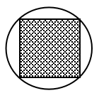

- **D**. 

## 第 51 题　qid 3522412 · 数学运算

大江两岸有两个正面相对的码头，可供客轮往返。如下图所示，根据河流水文情况，“幸福号”客轮星期一沿着河岸60度夹角方向前行，刚好达到对岸码头；星期二“幸福号”准备返回时，发现河流水文情况发生变化，船长调整航向，沿河岸30度夹角方向返回，顺利到达码头。假设客轮往返速度均是千米/小时，且行驶过程中河水流速是恒定的，问返程时河水流速是去程时的多少倍？

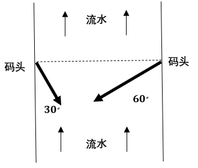

- **A**. 

- **B**. 
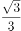

- **C**. 

- **D**. 
2

## 第 52 题　qid 3522421 · 数学运算

一个不计厚度的圆柱型无盖透明塑料桶，桶高2.5分米，底面周长为24分米，AB为底面直径。在塑料桶内壁桶底的B处有一只蚊子，此时，一只壁虎正好在塑料桶外壁的A处，则壁虎从外壁A处爬到内壁B处吃到蚊子所爬过的最短路径长约为：

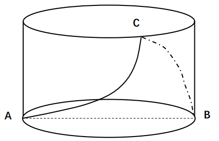

- **A**. 10分米
- **B**. 12.25分米
- **C**. 12.64分米
- **D**. 13分米

## 第 53 题　qid 3522372 · 数学运算

如下图1所示，在一个金字塔造型（底面为正方形，侧面为四个全等的等腰三角形）的铸造件内部挖空一个圆柱。现沿铸造件顶点A且垂直底面的方向切开，切开后的截面如下图2所示，已知DE、GF为圆柱的高，分米，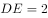分米，分米，那么挖后铸造件的体积是：

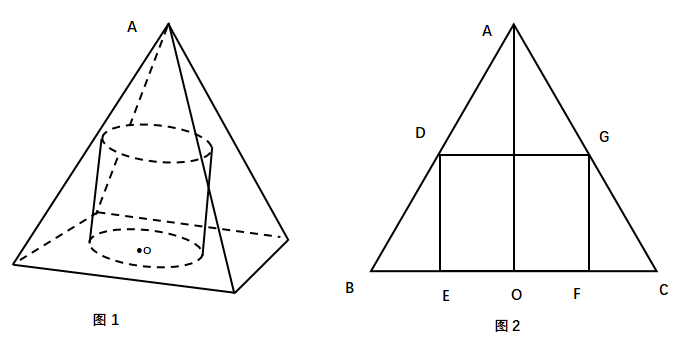

- **A**. 
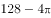立方分米

- **B**. 
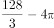立方分米

- **C**. 
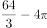立方分米

- **D**. 
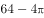立方分米

## 第 54 题　qid 3522375 · 数学运算

某装修公司订购了一条长为2.5m的长方体条形不锈钢管，要剪裁成60cm和43cm长的两种规格长度不锈钢管若干根，所裁钢管的横截面与原来一样，不考虑剪裁时材料的损耗，要使剩下的钢管尽量少，此时材料的利用率为：

- **A**. 0.998
- **B**. 0.996
- **C**. 0.928
- **D**. 0.824

## 第 55 题　qid 3522382 · 数学运算

某公司职员小王要乘坐公司班车上班，班车到站点的时间为上午7点到8点之间，班车接人后立刻开走；小王到站点的时间为上午6点半至7点半之间。假设班车和小王到站的概率是相等（均匀分布）的，那么小王能够坐上班车的概率为：

- **A**. 

- **B**. 

- **C**. 

- **D**. 

## 第 56 题　qid 3522397 · 数学运算

某果品公司急需将一批不易存放的水果从A市运到B市销售。现有四家运输公司可供选择，这四家运输公司提供的信息如下：

如果A、B两市的距离为S千米（千米），且这批水果在包装与装卸以及运输过程中的损耗为300元/小时，那么要使果品公司支付的总费用（包装与装卸费用、运输费用及损耗三项之和）最小，应选择哪家运输公司？

- **A**. 甲
- **B**. 乙
- **C**. 丙
- **D**. 丁

## 第 57 题　qid 3522399 · 数学运算

送奶工人给11楼住户送牛奶，由于小区停电导致电梯无法使用。如果他走楼梯从第1层到第2层需要5秒，以后每多走一层需多花2秒，其中走到5层以后每多走一层需多休息5秒，那么他走到11层需要多少秒？

- **A**. 210
- **B**. 215
- **C**. 220
- **D**. 235

## 第 58 题　qid 3522411 · 数学运算

我国一支工兵部队在某国执行维和任务，负责道路抢修工作。某天，该部队负责的道路被炮弹炸出一个球面形状的大坑。经测量，弹坑直径16m，深4m。现需用车辆运送混凝土填充弹坑，铺平道路，假设每车次可运输的混凝土，问抢修道路至少需要出动运输车多少车次？（球缺体积计算公式为，其中为球半径，为球缺高，为球缺体积）

- **A**. 65
- **B**. 66
- **C**. 67
- **D**. 68

## 第 59 题　qid 3522427 · 数学运算

太平洋上有一个圆形的平坦小岛，岛上遍布森林，闪电击中处于小岛边缘的树木引发森林火灾（如下图所示）。假设火线是以圆弧状往小岛深处推进，问当大火烧到小岛中心位置时，过火面积占全岛面积的比例大约是多少？

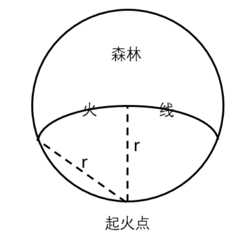

- **A**. 

- **B**. 

- **C**. 

- **D**. 

## 第 60 题　qid 3522433 · 数学运算

某市江滨有一处边长为50米的等边三角形广场。广场里设计有三个大小相等的圆环鹅卵石道路供市民散步。如下图所示，各圆相切，各圆与三角形也相切。问沿三个圆环外围石道（不含圆切点之间的弧）散步一圈约为多少米？

- **A**. 95
- **B**. 105
- **C**. 115
- **D**. 125

## 第 61 题　qid 3522378 · 类比推理

戊：己：庚

- **A**. 钠：镁：铝
- **B**. 寅：卯：巳
- **C**. 牛：虎：龙
- **D**. 秦：汉：隋

## 第 62 题　qid 3522379 · 类比推理

优雅：天鹅

- **A**. 风沙：塞外
- **B**. 高洁：梅花
- **C**. 友好：同窗
- **D**. 幽默：笑话

## 第 63 题　qid 3522384 · 类比推理

赫兹：频率

- **A**. 法拉：电容
- **B**. 焦耳：功率
- **C**. 牛顿：压强
- **D**. 电阻：欧姆

## 第 64 题　qid 3522388 · 类比推理

巴蜀：燕赵

- **A**. 京津：淮海
- **B**. 闽越：荆湘
- **C**. 齐鲁：秦晋
- **D**. 殷商：云贵

## 第 65 题　qid 3522390 · 类比推理

顿悟：醍醐灌顶

- **A**. 渴望：望梅止渴
- **B**. 移交：完璧归赵
- **C**. 消费：坐吃山空
- **D**. 孝顺：彩衣娱亲

## 第 66 题　qid 3522387 · 类比推理

超声波：次声波：军事

- **A**. 处女作：代表作：文学
- **B**. 路由器：隔离卡：网络
- **C**. 潜水艇：核潜艇：科技
- **D**. 北极星：北斗星：星辰

## 第 67 题　qid 3522391 · 类比推理

握瑜：怀瑾：美玉

- **A**. 南辕：北辙：马车
- **B**. 金戈：铁马：战争
- **C**. 敲金：击石：乐器
- **D**. 锦衣：玉食：珍馐

## 第 68 题　qid 3522395 · 类比推理

火箭筒 对于 （    ） 相当于 （    ） 对于 三节棍

- **A**. 发射  狼牙棒
- **B**. 手榴弹 方天戟
- **C**. 爆炸  软器械
- **D**. 热动力 锻造术

## 第 69 题　qid 3522400 · 类比推理

高屋建瓴 对于 （    ） 相当于 （    ） 对于 技艺

- **A**. 格局 左支右绌
- **B**. 形势 目无全牛
- **C**. 气势 天造地设
- **D**. 地势 逆水行舟

## 第 70 题　qid 3522404 · 类比推理

晕轮效应 对于 （    ） 相当于 （    ） 对于 变本加厉

- **A**. 扬长避短 墨菲定理
- **B**. 以偏概全 破窗效应
- **C**. 欲扬先抑 增减效应
- **D**. 举一反三 蝴蝶效应

## 第 71 题　qid 3522437 · 图形推理

从所给的四个选项中，选择最合适的一个填入问号处，使之呈现一定的规律性：

- **A**. A
- **B**. B
- **C**. C
- **D**. D

## 第 72 题　qid 3522441 · 图形推理

从所给的四个选项中，选择最合适的一个填入问号处，使之呈现一定的规律性：

- **A**. A
- **B**. B
- **C**. C
- **D**. D

## 第 73 题　qid 3522442 · 图形推理

把下面的六个图形分为两类，使每一类图形都有各自的共同特征或规律，分类正确的一项是：

- **A**. ①③⑥，②④⑤
- **B**. ①②⑤，③④⑥
- **C**. ①⑤⑥，②③④
- **D**. ①③⑤，②④⑥

## 第 74 题　qid 3522444 · 图形推理

从所给的四个选项中，选择最合适的一个填入问号处，使下列正方形图形呈现一定的规律性：

- **A**. A
- **B**. B
- **C**. C
- **D**. D

## 第 75 题　qid 3522445 · 类比推理

下图右侧四个选项中，哪一个不是左侧零件的立面？

- **A**. A
- **B**. B
- **C**. C
- **D**. D

## 第 76 题　qid 3522381 · 定义判断

单质是由同一种元素组成的纯净物。化合物是由两种或两种以上元素的原子（不同元素的原子）组成的纯净物。混合物是指由两种或两种以上不同的单质或化合物机械混合而成的物质，无固定化学式，混合物的各种成分之间没有发生化学反应，混合物可以用物理的方法将所含的物质分离。
根据上述定义，下列选项同时具有以上三类物质的是：

- **A**. 氮气、氧气、二氧化碳、空气
- **B**. 食盐水、盐酸、氨水、蒸馏水
- **C**. 氢气、氖气、水蒸气、汞蒸气
- **D**. 二氧化碳、水蒸气、矿泉水、天然气

## 第 77 题　qid 3522386 · 定义判断

先赋资本是指建立在血缘、遗传等先天条件下，不经过个人努力就可以拥有的资本。自致资本是指通过个人后天努力取得，为个人所支配的资本。
根据上述定义，下列选项中的内容均属于自致资本的是：

- **A**. 婚姻、职业、政治面貌
- **B**. 家世、民族、文化程度
- **C**. 国籍、收入、工作单位
- **D**. 种族、户口、父辈职业

## 第 78 题　qid 3522389 · 定义判断

虚假相关指的是两个没有因果关系的事件之间，基于一些其他未见的因素（潜在变量）而推断出因果关系，引致两个事件是“有所联系”的假象，但这种联系并不能通过客观的试验来证实。
根据上述定义，下列选项不属于虚假相关的是:

- **A**. 童鞋的大小与孩子的语言能力
- **B**. 冷饮的销量与泳池溺水的人数
- **C**. 惯性的大小与汽车的核载重量
- **D**. 网民的数量与房屋的折旧程度

## 第 79 题　qid 3522393 · 定义判断

色素色是指有机色素通过选择性地吸收、反射和投射特定频率的光线后直观呈现出的颜色。结构色又称物理色，是指通过可见光与物质物理上的微观结构（如物体表面或表层的纹、刻点、沟缝或颗粒等）发生相互作用，这些大量的微观有序结构对不同波长的光散射、衍射或干涉后产生的各种颜色。
根据上述定义，下列颜色属于色素色的是:

- **A**. 用激光束刻录的光盘上的彩色花纹
- **B**. 蝴蝶翅膀上的鳞片呈现出五颜六色
- **C**. 阳光下肥皂泡泡呈现缤纷的虹彩色
- **D**. 用乌饭树叶捣汁煮出的糯米饭呈现黑色

## 第 80 题　qid 3522398 · 定义判断

音爆是飞行器在突破音障时，由于对空气的压缩无法迅速传播，会逐渐形成激波面，激波面上高度集中的声学能量引起巨大响声，让人耳感受到短暂而极其强烈的爆炸声。音爆只有在突破音速即超音速飞行时才会产生。音爆云则是以飞行器为中心轴、从机翼前段开始向四周均匀扩散的圆锥状云团。其产生主要是由于气流流速突破音速时比空气传导速度更快，无法有效向下拉气流，导致密度减小，气压降低，水气凝结成微小的水珠，肉眼看来就像是云雾般的状态。音爆云在跨音速飞行时常常出现，但不仅在跨音速飞行时才能出现。
根据上述定义，下列说法正确的是：

- **A**. 音爆产生时就会出现音爆云
- **B**. 音爆云出现标志着音爆产生
- **C**. 音爆云出现说明突破了音障
- **D**. 音爆产生时是超音速飞行

## 第 81 题　qid 3522394 · 定义判断

迎臂效应也被称为“请到我家后院来”。从表面意思来看，迎臂就是张开双臂欢迎的意思，是指某个地区的居民认为相关机构、设施、景观具有正的外部效应，能给本社区发展带来好处，因此，不排斥甚至欢迎这些项目在本社区落地。
根据上述定义，下列选项属于迎臂效应的是：

- **A**. 群众深度参与，点赞街道残障康复中心成立
- **B**. 公司升级业态，积极在社区推广无人零售店
- **C**. 新设备耗电低，企业要求园区加快引进速度
- **D**. 加气站易漏气，附近居民担心火灾要求搬迁

## 第 82 题　qid 3522406 · 定义判断

人合公司是指以股东的个人信用为公司信用基础的公司；资合公司是指由公司股东分别出资而形成的财产作为信用基础的公司；人资兼合公司则同时具备上述两种性质的信用基础。
根据上述定义，下列哪个公司属于人合公司：

- **A**. 某公司注册资本为全体股东缴纳股本的总和，股东的出资以现金及财产为限，根据出资对公司负责
- **B**. 某公司的全部股份由公司独立创立者百分百持有，公司聘请多位经验丰富的职业经理人分管不同业务
- **C**. 某公司由于经营不善导致资金链断裂，在申请破产时以全部注册资本作数，股东个人财产并不受影响
- **D**. 某公司的资产以股东个人的所有财产为抵押，股东对公司经营负无限责任，并且不能任意地转让股份

## 第 83 题　qid 3522418 · 定义判断

文化挪用是指将本不属于本地的异域或其他民族的文化资源借用过来，从而对本地的文化形成影响，创造出新的文化产品的现象。
根据上述定义，下列属于文化挪用的是：

- **A**. 某苗族民间工艺组织设计制作的具有苗绣元素的彩绘玻璃、蜡染布等文创作品畅销全国
- **B**. 某法国女生在毕业舞会上穿着优雅别致的印度传统服装纱丽翩翩起舞，让大家大饱眼福
- **C**. 某荷兰社区大学为学生开设中华太极拳课程以增强他们的健身意识，受到学生普遍欢迎
- **D**. 世界之窗展示了众多全球著名景观和建筑成为深圳打卡的地标，是当地热门的旅游景点

## 第 84 题　qid 3522428 · 定义判断

价值链的数字重生指价值链的某个必要环节以数字化方式呈现，以数据实时在线为基础推动价值链的实现。价值链的数字新生是以新定义的用户价值为中心、数据实时在线为基础，融合新价值链要素，创造全新价值链结构。
根据上述定义，下列哪项属于价值链的数字重生？

- **A**. 为给用户带来全新的旅行前、旅行中和旅行后的服务体验，立体化整合旅游目的地的资源要素
- **B**. 依靠在线实时数据，使美食供应商更便利精准地了解用户的美食习惯，开拓新颖的服务渠道
- **C**. 电商平台通过发布商品信息和销售实时动态，使消费者在选购时可以查询货物即时情况
- **D**. 核电设备的数字三维模型可以为设计、制造、运行以及维护等多个环节带来价值增长点

## 第 85 题　qid 3522430 · 定义判断

拟剧理论指人与人在社会生活中的相互行为在某种程度上是一种表演。每一个人就像演员一样，在某种特定的场景下，按照一定的角色要求在舞台上表演给观众看。在整个表演过程中，人总是尽量使自己的行为更为接近想要呈现给观众的那个角色，观众看到的是那个表现出来的角色而不是演员本身。当表演结束，演员回到后台以后，他的真实面目才展现出来，演员才又恢复其本来的自我。
根据上述定义，下列选项不能印证拟剧理论的是：

- **A**. 小丽来找小明探讨功课，小明没有立刻开门，而是先把臭袜子藏到床下
- **B**. 在“国王的新装”故事里，新装展示游行时臣民交口称赞新装华贵美丽
- **C**. 小魏生活拮据但工作努力，老板不动声色地开豪车替其去机场接其父母
- **D**. 小菲通过盗图和拼接，天天在微信朋友圈发吃美食、健身、游玩的照片

## 第 86 题　qid 3522380 · 逻辑判断

如果一片森林的树木物种多样性非常丰富，那么这时缺失一个物种对于整个森林的生产力来讲，影响还并不是太大；但在物种多样性越稀缺的时候，树的种类继续变少，对整个森林生产力产生的打击就会越来越大。
由此可以推出：

- **A**. 除非树木物种多样性锐减，整个森林的生产力不会受到影响
- **B**. 只要森林的树木物种减少，整个森林的生产力就会受到影响
- **C**. 如果森林的生产力下降，那么森林的树木物种多样性就已经受损
- **D**. 要么森林的树木物种多样性非常丰富，要么森林的生产力非常可观

## 第 87 题　qid 3522385 · 逻辑判断

某科学家在一个宇宙科学网站上刊载了一项成果，该成果宣称找到了地球生命来自彗星的“证据”，引发了广泛关注。他声称在一块坠落到斯里兰卡的陨石里找到了微观硅藻化石，该石头有着疏松多孔的结构，密度比在地球上找到的所有东西都低。他推断这是一颗彗星的一部分，并指出样本中找到的微观硅藻化石与恐龙时代留存下来的化石中的微观有机体类似，从而为彗星胚种论提供了强有力的证据。
以下哪项如果为真，最能反驳该科学家的观点？

- **A**. 发表该成果的网站缺乏可信性，所载论文良莠不齐，有些曾沦为笑柄
- **B**. 该科学家是彗星胚种论的狂热支持者，曾宣称SARS和流感来自彗星
- **C**. 该成果配图中被标示成“丝状硅藻”的东西实际上只是硅藻细胞断片
- **D**. 该成果根本无法证明该石头是碳质球粒陨石，甚至难以确定其是陨石

## 第 88 题　qid 3522402 · 逻辑判断

最近有研究团队以问卷调查的方式，调查了519名从未吸过传统香烟，年龄在18岁至25岁间的年轻人，调查内容包括这些年轻人吸电子烟的情况和吸传统香烟的意向等，研究报告称，在从未吸过传统香烟的年轻人中，那些正在吸电子烟的人更可能尝试传统香烟，有关电子烟的监管政策要注意保护年轻人。
以下各项如果为真，最能支持上述结论的是：

- **A**. 受访者中有20%的人尝试过电子烟或未来很可能会尝试电子烟
- **B**. 即使只尝了两三口电子烟，也有可能提高吸传统香烟的可能性
- **C**. 受访者中正在吸电子烟的有60%表示未来一定会尝试传统香烟
- **D**. 电子烟对健康的危害比传统香烟小，但仍然含有很多有害物质

## 第 89 题　qid 3522405 · 逻辑判断

吴老师、张老师、孙老师、苏老师都是某校教师，分别教授语文、生物、物理、化学四门课程。
已知：
①如果吴老师教语文，那么张老师不教生物
②或者孙老师教语文，或者吴老师教语文
③如果张老师不教生物，那么苏老师不教物理
④或者吴老师不教化学，或者苏老师教物理
以下哪项如果为真，可以推出孙老师教语文：

- **A**. 吴老师教语文
- **B**. 张老师不教生物
- **C**. 吴老师教化学
- **D**. 苏老师不教物理

## 第 90 题　qid 3522407 · 逻辑判断

慢性疲劳综合征危害极大，它使人在正常的工作后感到极度疲劳，怎么休息也无济于事。这种疾病过去不能通过验血或其他检查得出明确的生物指标，因此其病因历来被归为心理因素。最近，研究人员对诊断为慢性疲劳综合征的48名患者和39名健康志愿者的大便和血液样本进行研究后得出结论：肠道细菌和血液中的致炎因子可能与该疾病有关。
以下哪项如果为真，最不能支持上述结论？

- **A**. 该疾病患者的大便样本中肠道细菌的多样性较低且抗炎细菌较少
- **B**. 该疾病患者的血液样本中被检测出致炎因子，而健康志愿者没有
- **C**. 目前不确定肠道细菌是导致该疾病的原因还是该疾病导致的结果
- **D**. 最新研究表明饮食治疗和益生菌等无助于为该疾病患者缓解疲劳

## 第 91 题　qid 3522415 · 逻辑判断

黑洞其实并不“黑”，它会以黑体热辐射的形式向外辐射能量，放出极其微弱的光（电磁波），这种光被称为“霍金辐射”。因为“霍金辐射”会释放出能量，所以黑洞会逐渐变小，直至最后消失（黑洞蒸发）。有科学家认为，“霍金辐射”中不含有信息，也就是说被黑洞吞噬的物体信息会消失。
以下说法如果为真，最能支持上述科学家观点的是：

- **A**. 黑洞的表面就像“全息图的底片”，保存着黑洞内部所含的一切信息
- **B**. 根据量子物理学的信息守恒定律，信息在任何条件下都不会完全消失
- **C**. 任何携带信息的物质被黑洞吞噬后，从黑洞释放出的热辐射不携带任何信息
- **D**. 黑洞引力极强，任何物质被它吞噬都无法逃逸，连光也不能幸免，因此无法确认被吞噬的物体信息

## 第 92 题　qid 3522461 · 逻辑判断

近几年，一些大城市的社区银行频频出现关门潮。与此同时，无人银行、5G银行、智能银行等一系列新概念银行不断出现，银行网点正在告别冷冰冰的玻璃柜台和金属板凳，传统网点交易处理的功能变弱了，定制服务、产品体验、社交互动等功能越来越突出。因此，有专家预测：二十年内，传统银行网点会消失。
以下各项如果为真，最能支持上述专家观点的是：

- **A**. 客户需进门取号、等待叫号，办理一项简单的业务耗费较长时间
- **B**. 人工智能等科技手段的引进，改变了人们对银行网点的固有印象
- **C**. 复杂业务必须到银行网点面签办理，如开户、销户等需本人办理且务必人工审核
- **D**. 网上银行、手机银行等接连涌现，银行网点作为服务主渠道的地位正在不断弱化

## 第 93 题　qid 3522462 · 逻辑判断

越来越多的人已经习惯于在“云端”漫步，享受快速发展带来的成果，却不见：德国正在推进“工业4.0”计划，美国正在呼唤“再工业化”；却不知：没有强大的生产制造能力、创新设计能力，国计民生就没有保障，国家实力就无从谈起，“互联网”也就只能是空中楼阁；却不思：只醉心于虚拟经济是靠不住的。越是在宏观层面，越要充分认识到互联网的诸多局限性。

如果以上为真，则以下哪项为真？

- **A**. 
“互联网”使很多人沉迷于虚拟经济

- **B**. 
“互联网”在微观层面的局限性更少

- **C**. 
只有国计民生得到保障，才能发展“互联网”

- **D**. 
只有提高生产制造和创新设计能力，才能发展“互联网”

## 第 94 题　qid 3522463 · 逻辑判断

长期生活不规律会导致免疫细胞和胆固醇积聚在血管壁上，变成粥样斑块。这些斑块破碎时会形成血栓，血栓有可能脱落，沿血管流动。由于牙周病菌是一种厌氧菌，而血管中有大量氧气，因此牙周病菌单独进入血管并不能存活。但是，因为免疫细胞能够有效隔绝血管中的氧气，所以人们认为牙周病菌能把免疫细胞当作交通工具，借此移动至身体各处。
以下哪项如果为真，最能加强上述论证？

- **A**. 生活不规律会使体内产生大量胆固醇和厌氧菌
- **B**. 血栓脱落会导致血管不通顺阻碍牙周病菌移动
- **C**. 免疫细胞的整体内环境不会造成牙周病菌失活
- **D**. 牙周病菌对身体血管健康的影响是公认的

## 第 95 题　qid 3522465 · 定义判断

气象研究团队开发出一种基于人工智能的计算模型，用以检测云的旋转运动。研究人员鉴定并标记了逗点状云系的形态和运动，并利用计算机视觉和机器学习技术，“教会”计算机自动识别和检测卫星图像中的逗点状云系，以帮助人们更高效地在海量天气数据中及时发现恶劣天气的“端倪”。该计算模型有助于更快、更准确地预测恶劣天气。
以下各项如果为真，不属于上述结论必要前提的是：

- **A**. 
该计算模型能检测出逗点状云系，准确率达，甚至在其完全形成前就能检测到

- **B**. 
从卫星图像中看，逗点状云系因其外形类似于逗号而得名，与气旋的形成密切相关

- **C**. 
该计算模型如与其他天气预报模型相结合，将能有效地预测出的恶劣天气事件

- **D**. 
气象学认为气旋的形成可导致冰雹雷暴、大风和暴风雨等各种恶劣天气事件发生

## 材料 1

        截至2019年3月31日，证券业协会对证券公司2019年第一季度经营数据进行了统计，131家证券公司当期实现营业收入1018.94亿元，同比增长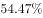。

        其中，各主营业务收入分别为代理买卖证券业务净收入（含席位租赁）221.49亿元，同比增长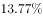；证券承销与保荐业务净收入66.73亿元，同比增长；财务顾问业务净收入20.95亿元，同比增长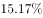；投资咨询业务净收入7.15亿元，同比增长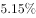；资产管理业务净收入57.33亿元，同比下降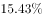；证券投资收益（含公允价值变动）514.05亿元，同比增长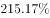；利息净收入69.04亿元，同比增长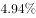；当期实现净利润440.16亿元，同比增长；119家公司实现盈利，同比增长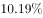。

        2019年第一季度，131家证券公司总资产为7.05万亿元，比上年一季度同期增加0.64万亿元；净资产为1.94万亿元，比上年一季度同期增加0.05万亿元；净资本为1.62万亿元，比上年一季度同期增加0.02万亿元。

        另外，2019年第一季度131家证券公司客户交易结算资金余额（含信用交易资金）1.50万亿元，比上年一季度同期增加0.32万亿元；受托管理资金本金总额14.11万亿元，比上年一季度同期下降2.82万亿元。

### 第 96 题　qid 3522358 · 综合

2018年第一季度，131家证券公司代理买卖证券业务净收入（含席位租赁）约为：

- **A**. 184.6亿元
- **B**. 190.1亿元
- **C**. 194.7亿元
- **D**. 204.2亿元

### 第 97 题　qid 3522362 · 平均数

131家证券公司中，平均每家证券公司在2018年第一季度实现营业收入约为：

- **A**. 659.4亿元
- **B**. 5.0亿元
- **C**. 669.5亿元
- **D**. 6.0亿元

### 第 98 题　qid 3522366 · 增长

2019年第一季度，131家证券公司总资产的同比增速约为：

- **A**. 

- **B**. 
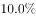

- **C**. 

- **D**. 
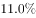

### 第 99 题　qid 3522370 · 综合

2018年第一季度，131家证券公司资产管理业务净收入与同期利息净收入相比约：

- **A**. 少了2.0亿元
- **B**. 多了2.0亿元
- **C**. 少了3.1亿元
- **D**. 多了3.1亿元

### 第 100 题　qid 3522377 · 综合

关于证券公司2019年第一季度经营数据，下列说法正确的是：

- **A**. 
131家证券公司总资产比净资产少了4.11亿元

- **B**. 
131家证券公司财务顾问业务净收入的同比增长率为

- **C**. 
131家证券公司净资产的同比增长金额低于净资本的同比增长金额

- **D**. 
131家证券公司资产管理业务净收入占当期实现营业收入的比重约为

## 材料 2

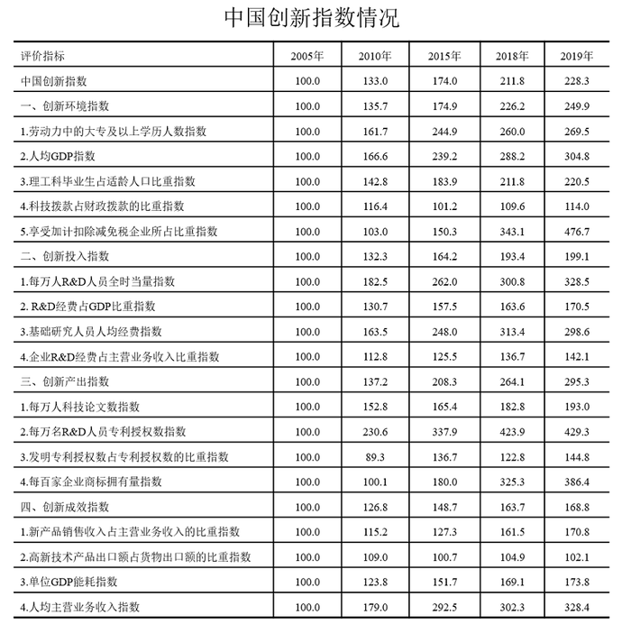

### 第 101 题　qid 3522350 · 增长

2019年中国创新指数比2010年约增长：

- **A**. 

- **B**. 
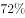

- **C**. 

- **D**. 
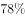

### 第 102 题　qid 3522353 · 增长

在2019年中国创新环境指数中，下列评价指标同比增速最慢的是：

- **A**. 人均GDP指数
- **B**. 科技拨款占财政拨款的比重指数
- **C**. 理工科毕业生占适龄人口比重指数
- **D**. 劳动力中的大专及以上学历人数指数

### 第 103 题　qid 3522359 · 增长

相比于2015年，2018年创新投入指数4个评价指标中增幅在与之间的有：

- **A**. 1个
- **B**. 2个
- **C**. 3个
- **D**. 4个

### 第 104 题　qid 3522361 · 增长

若保持2019年的同比增速不变，那么，2020年每百家企业商标拥有量指数将比2018年约多：

- **A**. 72.6
- **B**. 122.2
- **C**. 133.7
- **D**. 142.3

### 第 105 题　qid 3522368 · 综合

能够从上述资料中推出的是：

- **A**. 
2010年创新产出指数4个评价指标中超过150的有3个

- **B**. 
2019年创新成效指数4个评价指标中有2个同比增速高于

- **C**. 
2019年人均GDP指数同比增速高于每万人科技论文数指数同比增速

- **D**. 
2018年每万名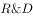人员专利授权数指数在表中同期全部评价指标指数中位居第二

## 材料 3

        截至2019年12月31日，中国共产党党员总数为9191.6万名，同比增长。在党员的性别、民族和学历上，女党员2559.9万名，少数民族党员680.3万名，大专及以上学历党员4661.5万名。在党员的入党时间上，新中国成立前入党的17.4万名，新中国成立后至党的十一届三中全会前入党的1550.9万名，党的十一届三中全会后至党的十八大前入党的6127.7万名，党的十八大以来入党的1495.6万名。在党员的职业上，工人（含工勤技能人员）644.5万名，农牧渔民2556.1万名，企事业单位、社会组织专业技术人员1440.3万名，企事业单位、社会组织管理人员1010.4万名，党政机关工作人员767.8万名，学生196.0万名，其他职业人员710.4万名，离退休人员1866.1万名。

        2019年共发展党员234.4万名，比上年增长。其中，发展女党员99.4万名，占；发展少数民族党员23.6万名，占；发展35岁及以下党员188.3万名，占；发展具有大专及以上学历的党员106.8万名，占。发展党员的职业上，工人（含工勤技能人员）14.3万名，企事业单位、社会组织专业技术人员31.6万名，企事业单位、社会组织管理人员25.3万名，农牧渔民42.4万名，党政机关工作人员13.4万名，学生84.4万名，其他职业人员22.9万名。

### 第 106 题　qid 3522352 · 比重

若阴影部分代表大专及以上学历党员人数，那么下列哪幅图最能反映截至2019年12月31日大专及以上学历党员占党员总数的比例？

- **A**. A
- **B**. B
- **C**. C
- **D**. D

### 第 107 题　qid 3522356 · 综合

截至2019年12月31日，新中国成立后至党的十八大前入党的人数约是其余时间入党人数的：

- **A**. 3.8倍
- **B**. 4.1倍
- **C**. 4.6倍
- **D**. 5.1倍

### 第 108 题　qid 3522360 · 比重

截至2019年12月31日，资料所列8种党员职业类型中，党员人数占比不低于的有：

- **A**. 3类
- **B**. 4类
- **C**. 5类
- **D**. 6类

### 第 109 题　qid 3522363 · 比重

2018年，发展党员数占同期党员总数的比例约为：

- **A**. 

- **B**. 

- **C**. 

- **D**. 
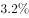

### 第 110 题　qid 3522369 · 综合

不能从上述资料中推出的是：

- **A**. 
2019年发展的党员人数中，学生党员占比超过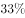

- **B**. 
截至2019年12月31日，55岁以下党员占党员总数的比不超过

- **C**. 
截至2019年12月31日，61岁及以上的党员人数中，新中国成立前入党的不超过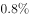

- **D**. 
截至2019年12月31日，从事农牧渔民职业的党员人数与工人（含工勤技能人员）党员人数之比超过

## 答案与解析

第 1 题

**答案**：B

**官方解析**

本题考查政治常识。中央农村工作会议于2020年12月28日至29日在北京举行。习近平出席会议并发表重要讲话强调，在向第二个百年奋斗目标迈进的历史关口，巩固和拓展脱贫攻坚成果，全面推进乡村振兴，加快农业农村现代化，是需要全党高度重视的一个关系大局的重大问题。
A项错误，习近平强调，党中央决定，脱贫攻坚目标任务完成后，对摆脱贫困的县，从脱贫之日起设立5年过渡期。过渡期内要保持主要帮扶政策总体稳定。
B项正确，习近平指出，要健全防止返贫动态监测和帮扶机制，对易返贫致贫人口实施常态化监测，重点监测收入水平变化和“两不愁三保障”巩固情况，继续精准施策。
C项错误，习近平强调，从中华民族伟大复兴战略全局看，民族要复兴，乡村必振兴。从世界百年未有之大变局看，稳住农业基本盘、守好“三农”基础是应变局、开新局的“压舱石”。构建新发展格局，把战略基点放在扩大内需上，农村有巨大空间，可以大有作为。
D项错误，习近平指出，要牢牢把住粮食安全主动权，粮食生产年年要抓紧。要严防死守18亿亩耕地红线，采取长牙齿的硬措施，落实最严格的耕地保护制度。
故正确答案为B。

---

第 2 题

**答案**：B

**官方解析**

本题考查政治常识。
A项正确，2020年5月23日，习近平总书记看望参加全国政协十三届三次会议的经济界委员，听取意见和建议。在讲话中，习近平用全面、辩证、长远的眼光分析当前全球经济形势，剖析我国经济的优势和潜力，强调“在危机中育新机、于变局中开新局”，要求“确保各项决策部署落地生根，确保完成决胜全面建成小康社会、决战脱贫攻坚目标任务”，推动我国经济乘风破浪、行稳致远。
B项错误，2019年3月7日，习近平总书记参加甘肃代表团审议时强调，要坚定信心不动摇，咬定目标不放松，整治问题不手软，落实责任不松劲，转变作风不懈怠，确保脱贫攻坚任务如期完成。
C项正确，2020年5月24日，习近平总书记来到十三届全国人大三次会议湖北代表团参加审议。习近平强调，要时刻绷紧疫情防控这根弦，慎终如始、再接再厉，持续抓好外防输入、内防反弹工作，决不能让来之不易的疫情防控成果前功尽弃。
D项正确，2020年5月22日，中共中央总书记、国家主席、中央军委主席习近平参加十三届全国人大三次会议内蒙古代表团的审议。他强调：“在全国范围调集最优秀的医生、最先进的设备、最急需的资源，全力以赴投入疫病救治，救治费用全部由国家承担。人民至上、生命至上，保护人民生命安全和身体健康可以不惜一切代价。”
本题为选非题，故正确答案为B。

---

第 3 题

**答案**：D

**官方解析**

本题考查政治常识。
A、C两项正确，国家主席习近平发表的2021年新年贺词指出，艰难方显勇毅，磨砺始得玉成。我们克服疫情影响，统筹疫情防控和经济社会发展取得重大成果。“十三五”圆满收官，“十四五”全面擘画。新发展格局加快构建，高质量发展深入实施。我国在世界主要经济体中率先实现正增长，预计2020年国内生产总值迈上百万亿元新台阶。
B项正确，国家主席习近平发表的2021年新年贺词指出，2020年，全面建成小康社会取得伟大历史性成就，决战脱贫攻坚取得决定性胜利。我们向深度贫困堡垒发起总攻，啃下了最难啃的“硬骨头”。历经8年，现行标准下近1亿农村贫困人口全部脱贫，832个贫困县全部摘帽。
D项错误，国家主席习近平发表的2020年新年贺词指出，2019年，我们用汗水浇灌收获，以实干笃定前行。京津冀协同发展、长江经济带发展、粤港澳大湾区建设、长三角一体化发展按下快进键，黄河流域生态保护和高质量发展成为国家战略。
本题为选非题，故正确答案为D。

---

第 4 题

**答案**：B

**官方解析**

本题考查政治常识。2020年10月29日，中国共产党第十九届中央委员会第五次全体会议通过了《中共中央关于制定国民经济和社会发展第十四个五年规划和二〇三五年远景目标的建议》（以下简称《建议》）。
A项错误：《建议》指出：“到二〇三五年基本实现社会主义现代化远景目标。党的十九大对实现第二个百年奋斗目标作出分两个阶段推进的战略安排，即到二〇三五年基本实现社会主义现代化，到本世纪中叶把我国建成富强民主文明和谐美丽的社会主义现代化强国。展望二〇三五年，······人均国内生产总值达到中等发达国家水平，中等收入群体显著扩大，基本公共服务实现均等化，城乡区域发展差距和居民生活水平差距显著缩小；平安中国建设达到更高水平，基本实现国防和军队现代化；人民生活更加美好，人的全面发展、全体人民共同富裕取得更为明显的实质性进展。”
B项正确：《建议》指出：“坚持把发展经济着力点放在实体经济上，坚定不移建设制造强国、质量强国、网络强国、数字中国，推进产业基础高级化、产业链现代化，提高经济质量效益和核心竞争力。”
C项错误：《建议》指出：“坚持稳中求进工作总基调，以推动高质量发展为主题，以深化供给侧结构性改革为主线，以改革创新为根本动力，以满足人民日益增长的美好生活需要为根本目的，统筹发展和安全，加快建设现代化经济体系，加快构建以国内大循环为主体、国内国际双循环相互促进的新发展格局，推进国家治理体系和治理能力现代化，实现经济行稳致远、社会安定和谐，为全面建设社会主义现代化国家开好局、起好步。”
D项错误，2021年3月11日，十三届全国人大四次会议表决通过了《中华人民共和国国民经济和社会发展第十四个五年规划和2035年远景目标纲要》（简称“十四五”规划）。“十四五”规划将于2021年开始实施。
故正确答案为B。

---

第 5 题

**答案**：B

**官方解析**

本题考查法律常识。
A项错误，根据《政府督查工作条例》第二十一条规定：“政府督查机构可以根据督查结论或者整改核查结果，提出对督查对象依法依规进行表扬、激励、批评等建议，经本级人民政府或者本级人民政府行政首长批准后组织实施。政府督查机构可以根据督查结论或者整改核查结果，提出对督查对象依法依规追究责任的建议，经本级人民政府或者本级人民政府行政首长批准后，交有权机关调查处理。”因此，政府督查机构不能直接对督查对象追究责任。
B项正确，根据《政府督查工作条例》第十五条第一款规定：“开展政府督查工作应当制定督查方案，明确督查内容、对象和范围；应当严格控制督查频次和时限，科学运用督查方式，严肃督查纪律，提前培训督查人员。”
C项错误，根据《政府督查工作条例》第十二条规定：“政府督查可以采取以下方式：（一）要求督查对象自查、说明情况；（二）听取督查对象汇报；（三）开展检查、访谈、暗访；（四）组织座谈、听证、统计、评估······”因此，可采取暗访的方式进行。
D项错误，根据《政府督查工作条例》第十七条规定：“督查对象对督查结论有异议的，可以自收到该督查结论之日起30日内，向作出该督查结论的人民政府申请复核。收到申请的人民政府应当在30日内作出复核决定。参与作出督查结论的工作人员在复核中应当回避。”
故正确答案为B。

---

第 6 题

**答案**：B

**官方解析**

本题考查法律常识。
A项正确，根据《中华人民共和国民法典》第九百八十九条规定：“本编调整因人格权的享有和保护产生的民事关系。”民法典将人格权独立成编，调整的是因人格权的享有和保护产生的民事关系。
B项错误，根据《中华人民共和国民法典》第十九条规定：“八周岁以上的未成年人为限制民事行为能力人，实施民事法律行为由其法定代理人代理或者经其法定代理人同意、追认；但是，可以独立实施纯获利益的民事法律行为或者与其年龄、智力相适应的民事法律行为。”因此，八周岁以上的未成年人可以独立实施纯获利益的民事法律行为或者与其年龄、智力相适应的民事法律行为。
C项正确，根据《中华人民共和国民法典》第一千二百六十条规定：“本法自2021年1月1日起施行。《中华人民共和国婚姻法》、《中华人民共和国继承法》、《中华人民共和国民法通则》、《中华人民共和国收养法》、《中华人民共和国担保法》、《中华人民共和国合同法》、《中华人民共和国物权法》、《中华人民共和国侵权责任法》、《中华人民共和国民法总则》同时废止。”
D项正确，根据《中华人民共和国民法典》第一千零三十二条规定：“自然人享有隐私权。任何组织或者个人不得以刺探、侵扰、泄露、公开等方式侵害他人的隐私权。隐私是自然人的私人生活安宁和不愿为他人知晓的私密空间、私密活动、私密信息。”
本题为选非题，故正确答案为B。

---

第 7 题

**答案**：C

**官方解析**

本题考查法律常识。
A项错误，根据《中华人民共和国人民陪审员法》第十二条规定：“人民陪审员经人民代表大会常务委员会任命后，应当公开进行就职宣誓。宣誓仪式由基层人民法院会同司法行政机关组织。”《全国人民代表大会常务委员会关于实行宪法宣誓制度的决定》指出：“一、各级人民代表大会及县级以上各级人民代表大会常务委员会选举或者决定任命的国家工作人员，以及各级人民政府、监察委员会、人民法院、人民检察院任命的国家工作人员，在就职时应当公开进行宪法宣誓。”本项中，甲就职时应当依照法律规定公开进行宪法宣誓，而非“可以”。
B项错误，贪污罪，是指国家工作人员和受国家机关、国有公司、企业、事业单位、人民团体委托管理、经营国有财产的人员，利用职务上的便利，侵吞、窃取、骗取或者以其他手段非法占有公共财物的行为。职务侵占罪，指公司、企业或者其他单位的人员，利用职务上的便利，将本单位财物非法占为己有，数额较大的行为。乙是超市的收银员，并非国家工作人员，不构成贪污罪，构成职务侵占罪。
C项正确，玩忽职守罪，是指国家机关工作人员严重不负责任，不履行或不正确地履行自己的工作职责，致使公共财产、国家和人民利益遭受重大损失的行为。因此，玩忽职守罪的主观方面是过失。丙作为某县负责抗洪指挥工作的领导，在救灾过程中带人打麻将，未及时检查造成垮堤就属于严重不负责任，构成玩忽职守罪。
D项错误，贪污罪，是指国家工作人员和受国家机关、国有公司、企业、事业单位、人民团体委托管理、经营国有财产的人员，利用职务上的便利，侵吞、窃取、骗取或者以其他手段非法占有公共财物的行为。受贿罪，指国家工作人员利用职务上的便利，索取他人财物，或者非法收受他人财物，为他人谋取利益的行为。《刑法》第九十三条规定：“本法所称国家工作人员，是指国家机关中从事公务的人员。国有公司、企业、事业单位、人民团体中从事公务的人员和国家机关、国有公司、企业、事业单位委派到非国有公司、企业、事业单位、社会团体从事公务的人员，以及其他依照法律从事公务的人员，以国家工作人员论。”丁是事业单位电视台总导演，属于国家工作人员，利用职务便利收受他人财物，不构成贪污罪，应当构成受贿罪。
故正确答案为C。

---

第 8 题

**答案**：B

**官方解析**

本题考查经济常识。风险管理流程主要包括风险识别、风险计量、风险监测和风险控制四个步骤，其中风险控制是对经过识别和计量的风险采取分散、对冲、转移、规避和补偿等措施，进行有效管理和控制的过程。
A项错误，商业银行可以预先在金融资产定价中充分考虑到各种风险因素，通过价格调整来获得合理的风险回报，而对于那些无法通过风险分散、风险对冲、风险转移或风险规避进行有效管理的风险，商业银行可以采取在交易价格上附加更高的风险溢价，即通过提高风险回报的方式，获得承担风险的价格补偿。不同的信用的等级的客户有着不同程度的违约风险，应该适用不同的贷款利率，而不是相同的贷款利率，低信用等级的贷款利率由于信用风险更高，银行为了获得风险的价格补偿，应提供相对较高的贷款利率。
B项正确，风险转移是指通过购买某种金融产品或采取其他合法的经济措施将风险转移给其他经济主体的一种策略性选择。风险转移可分为保险转移和非保险转移，其中保险转移是指通过买保险，以缴纳保险费为代价，将风险转移给承保人。李某担心家中古董被盗造成财产损失，可以通过向保险公司购买财产保险，将财产损失的风险转移给保险公司。
C项错误，根据购买保险的原则，大人应该优先于小孩。如果优先给小孩配置保险，一旦大人生病或发生意外事故，则家庭将失去主要的经济来源，同时还要负担大笔的医疗费用支出，小孩的生活、教育开支将同样受到影响。因此，在购买保险时应该优先考虑大人，尤其是家中的经济支柱。
D项错误，保函，又称保证书，是指银行、保险公司、担保公司或担保人应申请人的请求，向受益人开立的一种书面信用担保凭证。保证在申请人未能按双方协议履行其责任或义务时，由担保人代其履行一定金额、一定时限范围内的某种支付或经济赔偿责任。银行保函以银行为担保人转移违约风险，但并不能转移美元升值的外汇风险。进口商为了避免美元升值所带来的外汇风险，可以采取远期外汇交易的套期保值，买入远期美元，而不是找银行开立保函。
故正确答案为B。

---

第 9 题

**答案**：C

**官方解析**

本题考查政治常识。

A项正确，2020年6月10日，国务院新闻办举行发布会，生态环境部、国家统计局、农业农村部共同发布《第二次全国污染源普查公报》。生态环境部副部长赵英民在国务院新闻办当天举行的新闻发布会上指出，污染源整体情况有三方面的变化：一是主要污染物排放量大幅下降。与第一次全国污染源普查数据同口径相比，2017年二氧化硫、化学需氧量、氮氧化物等污染物排放量比2007年分别下降了、和。二是产业结构调整成效显著。三是污染治理能力明显提升。

B项正确，2018年6月24日公布的《中共中央国务院关于全面加强生态环境保护坚决打好污染防治攻坚战的意见》提出，坚决打赢蓝天保卫战，着力打好碧水保卫战，扎实推进净土保卫战。

C项错误，2019年1月21日，国务院办公厅发布了《“无废城市”建设试点工作方案》。指出，“无废城市”是以创新、协调、绿色、开放、共享的新发展理念为引领，通过推动形成绿色发展方式和生活方式，持续推进固体废物源头减量和资源化利用，最大限度减少填埋量，将固体废物环境影响降至最低的城市发展模式。“无废城市”并不是没有固体废物产生，也不意味着固体废物能完全资源化利用，而是一种先进的城市管理理念。

D项正确，中华人民共和国第十三届全国人民代表大会常务委员会第十五次会议于2019年12月28日修订通过《中华人民共和国森林法》。新修订的《中华人民共和国森林法》自2020年7月1日起施行。新修订的《中华人民共和国森林法》第七条指出：“国家建立森林生态效益补偿制度，加大公益林保护支持力度，完善重点生态功能区转移支付政策，指导受益地区和森林生态保护地区人民政府通过协商等方式进行生态效益补偿。”

本题为选非题，故正确答案为C。

---

第 10 题

**答案**：B

**官方解析**

本题考查政治常识。
A项正确，第七次全国人口普查工作首次采集普查对象身份证号，这主要是出于数据比对的目的。所填数据将实现与公安、卫健等部门行政记录的比对核查，为的就是确保数据的真实性和准确性，并会对身份证号信息进行保密处理，普查全流程加强对公民个人信息的保护，严禁泄露公民个人信息。
B项错误，根据《第七次全国人口普查方案》规定：普查采用全面调查的方法，以户为单位进行登记。普查数据采集原则上采用电子化的方式。采取普查员使用电子采集设备（PAD或智能手机）登记普查对象信息并联网实时上报，或由普查对象通过互联网自主填报等方式进行。
C项正确，根据《第七次全国人口普查方案》规定：普查短表包括反映人口基本状况的项目，由全部住户（不包括港澳台居民和外籍人员）填报。
D项正确，新中国成立以来，我国分别在1953年、1964年、1982年、1990年、2000年和2010年成功进行过六次全国人口普查。根据《全国人口普查条例》有关规定，人口普查工作每10年进行一次，尾数逢“0”的年份为普查年度。经国务院批准，2020年开展第七次全国人口普查。
本题为选非题，故正确答案为B。

---

第 11 题

**答案**：A

**官方解析**

本题考查科技常识。
A项正确，2020年12月17日，探月工程嫦娥五号返回器在内蒙古四子王旗预定区域成功着陆，标志着我国首次月球采样返回任务圆满完成。
B项错误，2020年11月10日8时12分，中国“奋斗者”号载人潜水器在马里亚纳海沟成功坐底，坐底深度10909米，创造了中国载人深潜的新纪录。
C项错误，2020年12月4日14时，新一代“人造太阳”装置——中国环流器二号M装置（HL-2M）在成都建成并实现首次放电，标志着中国自主掌握了大型先进托卡马克装置的设计、建造、运行技术，为我国核聚变堆的自主设计与建造打下坚实基础。
D项错误，北斗系统是党中央决策实施的国家重大科技工程。工程自1994年启动，2000年完成北斗一号系统建设，2012年完成北斗二号系统建设。北斗三号全球卫星导航系统全面建成并开通服务，标志着工程“三步走”发展战略取得决战决胜，我国成为世界上第三个独立拥有全球卫星导航系统的国家。目前，全球已有120余个国家和地区使用北斗系统。
故正确答案为A。

---

第 12 题

**答案**：D

**官方解析**

本题考查人文常识。
A项正确，巴金，原名李尧棠，字芾甘，代表作有《爱情三部曲》《寒夜》等。
B项正确，曹禺，原名万家宝，代表作有《雷雨》《日出》《原野》《北京人》等。
C项正确，老舍，原名舒庆春，字舍予，代表作有《骆驼祥子》《四世同堂》《月牙儿》等。
D项错误，丁玲，原名蒋伟，字冰之，代表作有《太阳照在桑干河上》等；郭沫若，本名郭开贞，代表作有《抱和儿浴博多湾中》《凤凰涅槃》等。
本题为选非题，故正确答案为D。

---

第 13 题

**答案**：B

**官方解析**

本题考查人文常识。

舞勺之年，出自《礼记·内则》，意为男孩子13至15岁期间学习舞勺。

知非之年，出自《淮南子·原道训》，意为到了五十岁，才知道以前四十九年中的错误，后人因此称五十岁为知非之年。

从心之年，出自《论语·为政》，意为随心所欲的年龄，后用为七十岁的称谓。

鲐背之年，出自《诗经·大雅·行苇》：“黄耇台背，以引以翼。”指九十岁高龄的时候，形容老人高寿。

期颐之年，出自《礼记·曲礼上》，用以指活到百岁之人。

正确顺序为：舞勺之年知非之年从心之年鲐背之年期颐之年。

故正确答案为B。

---

第 14 题

**答案**：D

**官方解析**

本题考查人文常识。
天干地支，简称为干支，源自中国远古时代对天象的观测。在中国历法中，“甲、乙、丙、丁、戊、己、庚、辛、壬、癸”称为十天干，“子、丑、寅、卯、辰、巳、午、未、申、酉、戌、亥”称为十二地支。十二生肖是十二地支的形象化代表，即子（鼠）、丑（牛）、寅（虎）、卯（兔）、辰（龙）、巳（蛇）、午（马）、未（羊）、申（猴）、酉（鸡）、戌（狗）、亥（猪）。
A项正确，寅吃卯粮，比喻入不敷出，财物亏空。寅、卯，与天干地支有关。
B项正确，猴年马月，泛指未来的岁月，和时间有关。午（马）、申（猴），与天干地支有关。
C项正确，甲乙丙丁，与天干地支有关。
D项错误，龙马精神，就是像龙马一样精神，形容健旺非凡的精神。根据《中国成语大词典》解释：龙马是指传说中的骏马，与时间无关，与天干地支无关。
本题为选非题，故正确答案为D。

---

第 15 题

**答案**：C

**官方解析**

本题考查人文常识。

二十四节气，是干支历中表示自然节律变化以及确立“十二月建”的特定节令。现行的“二十四节气”是依据太阳在回归黄道上的位置制定，即把太阳周年运动轨迹划分为24等份，每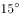为1等份，每1等份为一个节气，始于立春，终于大寒。“二十四节气”是中华民族悠久历史文化的重要组成部分。

A项正确，“花木管时令，鸟鸣报农时”，意为不管是花草也好，鸟兽也罢，它们的活动大多呈现出季节性以及规律性，因此，被当作区分时令的重要参考。该谚语涉及二十四节气。

B项正确，“白露身不露，寒露脚不露”，意为白露节气一过，穿衣服就不能再赤膊露体；寒露节气一过，应注重足部保暖。该谚语涉及二十四节气。

C项错误，“日晕三更雨，月晕午时风”，意为若出现日晕的话，夜半三更将有雨，若出现月晕，则次日中午会刮风。该谚语不涉及二十四节气。

D项正确，“秋分早，霜降迟，寒露种麦正当时”，意为把握种麦时间，秋分时种麦早了，霜降时种麦迟了，而寒露时种麦是最好的。该谚语涉及二十四节气。

本题为选非题，故正确答案为C。

---

第 16 题

**答案**：B

**官方解析**

本题考查科技常识。
B项正确，冰糖一般是以白砂糖为原料，溶成浓糖浆，倒入结晶容器中逐步制成的。冰糖可以用于做菜上色。例如：做红烧肉可采用冰糖上色，把油烧热后放入冰糖，使冰糖融化，冰糖融化后会出现焦糖色反应，此时放入用开水焯好的肉类，翻炒均匀后收汁即可。
故正确答案为B。

---

第 17 题

**答案**：D

**官方解析**

本题考查科技常识。
①正确，“鬼火”也被称为“磷火”，是化学中的自燃现象，常发生在农村，一般出现在夏季的坟墓周围。发生“鬼火”的原因是人的骨头里含有磷元素，尸体腐烂后经过变化会生成磷化氢，磷化氢的燃点很低，可以自燃。
②正确，光合作用是指含有叶绿素等光合色素的绿色植物和某些细菌，在可见光的照射下，经过光反应和碳反应，利用光合色素，将二氧化碳和水转化为有机物，并释放出氧气的生化过程。同时也有将光能转变为有机物中化学能的能量转化过程。
③正确，含有钙、镁等盐类杂质的水进入水壶后，在烧水时吸收了许多热量，钙、镁盐类杂质便会发生化学反应，生成难以溶解的物质，最后析出，析出物随着沸水的不断蒸发而逐渐浓缩，当达到一定浓度时，就会成为固体，并沉淀附着在水壶内壁上，形成一层白色的“膜”。这就是我们所说的水垢，它的主要成分是碳酸钙、碳酸镁等。
④正确，酿酒是利用微生物发酵生产含一定浓度酒精饮料的过程。高粱在微生物作用下，经过复杂的生物化学反应，产生乙醇和白酒中的香味物质。
⑤错误，干冰是固态的二氧化碳，其升华时吸收大量的热，使其周围的温度迅速降低。处于低温区内的水蒸气就会液化成小水珠，许多细小的水珠聚在一起，在空中飘浮，就成为舞台上的云雾，属于物理变化。
因此①②③④包含化学反应。
故正确答案为D。

---

第 18 题

**答案**：A

**官方解析**

本题考查科技常识。
A项错误、B项正确，混凝土搅拌车罐体时刻保持低速转动能够防止混凝土在运输过程中结块，让混凝土中的砂、石、水泥充分搅拌，混合更为均匀。
C、D两项正确，混凝土的离析是指混凝土拌合物组成材料之间的粘聚力不足以抵抗粗集料下沉，混凝土拌合物成分相互分离，造成内部组成和结构不均匀的现象。运输中混凝土搅拌车罐体时刻保持低速转动，可以防止混凝土出现离析现象，保证混凝土性能达到施工要求。
本题为选非题，故正确答案为A。

---

第 19 题

**答案**：D

**官方解析**

本题考查科技常识。

A项错误，牙膏中起摩擦作用的成分可以在刷牙时和牙刷一起通过摩擦清洁牙齿，但甘油有润滑作用，不能作摩擦剂。甘油是牙膏中常用的保湿剂，可防止牙膏在软管中固化变硬，并使膏体具有光泽等效能。用于牙膏中的保湿剂有甘油、丙二醇、山梨醇等多种。

B项错误，龋齿是一种常见的牙釉质受到腐蚀，变软、变色，逐渐发展为牙体硬组织缺损，形成龋洞的疾病。氟是增进牙齿抗龋能力的微量元素，含氟牙膏中有一定含量的氟，有利于牙齿组织钙化和代谢，增强牙齿的抗酸性能和抗龋能力，可有效地防止龋病的发生或使龋病趋愈。

C项错误，为改善牙膏的口感，牙膏中加了少量糖精。但由于用作保湿剂的甘油等也具有甜味，故糖精的配用量一般为～。

D项正确，叶绿素能保持细胞和体内钙的浓度，有利于坚固牙齿，防止牙龈出血，修复牙龈组织；此外，叶绿素的另一重要作用是脱臭，原因在于它可以抑制代谢过程中产生的硫化物。因此牙膏加入叶绿素，对防止牙龈出血及口腔异味有一定功效。

故正确答案为D。

---

第 20 题

**答案**：B

**官方解析**

本题考查科技常识。“香蕉球”之所以可以沿弧线飞行，主要是由于伯努利原理（流速越快，压强越小）。运动员踢出的“香蕉球”后，球会边旋转边前进，导致在球周围形成与球旋转方向一致的环形气流，环形气流与足球前进方向一致的一侧，流速会变快，压强减小，环形气流与足球前进方向相反的一侧，流速会变慢，压强增大。由于此时两侧受到的空气压强不相等，在压强作用下，球向压强小的一侧拐弯。
A项正确，根据伯努利原理，飞机飞行时，机翼将气流分为上下两个部分，上半部分走的路径为弧线，流速快，压强小，下半部分气流走直线，流速慢，压强大。正是由于机翼下侧压强大于机翼上侧，上下压强不相等，产生升力，使飞机能飞起来。
B项错误，当用吸管吸走袋中空气后，袋中气压瞬间减小，此时外界大气压并未减小，在内外压强差的作用下，袋子被压瘪。该过程并未涉及伯努利原理。
C项正确，根据伯努利原理，人若离列车太近时，列车高速行驶过程中，使人和列车之间的空气流动速度很快，压强很小，而人外侧的压强不变，人在内外压强差的作用下，被压向列车容易出现事故。因此火车站台设置黄色安全线以警示乘客与列车保持距离。
D项正确，根据伯努利原理，向两张相距5厘米的A4纸中间吹气时，两张纸中间空气流速快，压强小，而外侧空气基本静止，压强较大，在压力差的作用下，两张纸向中间靠拢。
本题为选非题，故正确答案为B。

---

第 21 题

**答案**：D

**官方解析**

根据“随着人类对挑战自身的执着追求”以及后文“要想进一步提高比赛成绩······都要竭尽全力······去实现”可知，横线处要体现在人类的执着追求下，竞技项目的成绩被不断地提高，越来越接近“人体能力极限”。A项“刷新”意思是刷洗之后使之变新，“刷新”成绩不一定能接近人体能力极限，与文意不符，排除；B项“挑战”一般搭配人，“人挑战极限”或“人挑战自身”等等，一般不与“成绩”搭配，排除；C项“考验”的常见搭配为“考验能力”，与“极限”搭配不当，排除；D项“逼近”意思是向前靠近，接近，能体现出成绩不断接近人体能力极限，符合文意，当选。
故正确答案为D。
【文段出处】光明日报《体育中的“黑科技”》

---

第 22 题

**答案**：B

**官方解析**

由“麦类、谷物······尚未成熟······而田间地头的野菜正蓬勃生长”可知，人们在谷物青黄不接时可食用野菜充饥，故横线处应表达在没有食物可吃的情况下，人们采食田间地头的野菜是自然而然发生的事情。B项“顺理成章”既指写文章或做事情，顺着条理就能做好，也指某种情况合乎情理，自然产生某种结果，符合文意，当选。A项“不容置疑”指不允许加以怀疑，形容绝对真实可信，强调论证严密，无可怀疑，程度过重，排除；C项“水到渠成”比喻条件成熟，事情自然成功，文段并未体现“条件成熟”之意，与文意不符，排除；D项“理所当然”指从道理上讲应当这样，强调应当如此，文段并未强调理应如此，而是强调顺应某种情况自然发生的结果，与文意不符，排除。
故正确答案为B。
【文段出处】《节气｜小满初晴麦气薰》

---

第 23 题

**答案**：B

**官方解析**

本题可从第二空入手，横线处所填词语搭配“黑夜中的明灯”和“他们”，且对应前文“宝贵的品质犹如黑夜中的明灯”，故横线处所填词语要体现品质如明灯一般，带领指引着孩子走向未来，B项“引领”指引导带领，且与“他们”搭配得当，保留；A项“推动”指使事物启动或前进，使工作展开，常搭配社会、经济等，如推动社会进步、推动经济发展等，一般不与人搭配，排除；C项“促进”指促使进步并推动发展，常见的搭配有促进生产等，且品质如明灯是没办法促进孩子面向世界的，排除；D项“带动”指引导着前进，常见的搭配有沿海带动内地、先进带动后进等，而品质如明灯是不能带头运动的，排除。
验证第一空，根据指代词“这”对应前文成年人的观点，且根据后文“如今的孩子比以往掌握更多知识，也更加渴望了解世界”可知，成年人对孩子的认识是错误的、片面的。B项“偏见”指片面的见解、成见，符合文意，当选。
故正确答案为B。
【文段出处】《儿童文学创作的重要主题》

---

第 24 题

**答案**：C

**官方解析**

本题可以从第二空入手，横线处搭配“南音”，根据“南音被誉为‘中国音乐历史的活化石’”“极具历史、文化、学术研究价值”可知，意在强调南音在中国音乐史中的重要地位。B项“举足轻重”比喻所处地位重要，一举一动对全局有重大影响、C项“不可替代”指不能被替换掉，很重要，均能体现出南音在中国音乐史的重要地位，符合文意，保留；A项“独一无二”形容唯一的，没有与之相同的或可以与之相比的，常用于对比的语境中，文段并未将南音与其他乐种相比，与文意不符，排除；D项“出类拔萃”指超出同类，多指人的品德才能，与“南音”搭配不当，排除。
第一空，横线处所填词语搭配“血脉”，且根据前文“南音是中国现存最古老的乐种之一”可知，横线处应表达南音一直体现着汉唐以来中国音乐的特点之意，C项“延续”指照着原来的样子继续下去，与“血脉”搭配恰当，符合文意，当选；B项“承载”指承受负载，不能表达出南音一直体现着汉唐以来中国音乐特点的这一含义，与文意不符，排除。
故正确答案为C。
【文段出处】人民网《从传承到发展 泉州南音走向世界》

---

第 25 题

**答案**：D

**官方解析**

第一空，根据文意可知，普通话和方言通过明确划定各自的使用范围可以同时使用，并不冲突。A项“规定”意为对事物的数量、质量或方式、方法等做出具有约束力的决定，D项“界定”意为划定界限，确定所属范围，置于此处均符合文意，保留；B项“划分”指把整体分成若干部分，文段未体现普通话和方言存在整体和部分的关系，排除；C项“区分”指辨别，分辨，文段并非强调普通话和方言相似，不好分辨，与文意不符，排除。
第二空，根据“甚至”可知，表达递进关系，横线处所填词语应比“并行不悖”程度更重。D项“相辅相成”意为两件事物相互补充，互相配合，缺一不可，可与“并行不悖”构成递进关系，符合文意，当选；A项“齐头并进”意为不分先后地一齐前进或同时进行，程度与“并行不悖”一致，无法构成递进关系，排除。
故正确答案为D。
【文段出处】《普通话与方言如何相得益彰》

---

第 26 题

**答案**：A

**官方解析**

第一空，由分号后的句子“空喊口号易，付诸实践难”可知，横线处所填词语应与“具体而微”构成反义并列，表达不具体、不细致的含义。A项“大而化之”形容做事情不小心谨慎，粗枝大叶，符合文意，保留；B项“坐而论道”指坐着空谈大道理，强调口头说说，不见行动，与文段想要表达的是否具体细致无关，排除；C项“小题大做”指拿小题目作大文章，比喻不恰当地把小事当作大事来处理，有故意夸张的意思，也与文意想表达的不具体不细致无关，排除；D项“通观大局”指通盘筹划，综合看待问题，侧重的是看待事情全面，有统筹协调的意识，文意想表达的是不够具体不够细致，与文意不符，排除。
第二空，代入验证，前文论述中国特色文艺理论体系建设需要大功细作，需要从微观层面入手，强调从细处入手，A项“条分缕析”指有条有理地细细分析，置于此处表达我们做事情需要有条有理地仔细地去分析梳理，符合文意，当选。
故正确答案为A。
【文段出处】《更好用中国文艺理论解读文艺实践》

---

第 27 题

**答案**：D

**官方解析**

本题可从第三空入手，由“野草属于乡间大地”“在城市里······那些生长在乡间大地上的野草”可知，“则”在此处表达转折关系，第三空所填词语应与前文的“失魂落魄”语义相反，体现出野草在乡间大地生长得比较舒适自在的含义。B项“适意”指自在合意，D项“惬意”形容心情感到愉快畅快，愉悦、舒畅或者是满意，均符合文意，保留；A项“肆意”指不顾一切由着自己的性子，C项“恣意”指放纵，不加限制，任意，均与后文的“低语”“吟唱”无法对应，程度过重，排除。
第二空，搭配“生长”，且由“一副失魂落魄的样子”可知，野草在城市中生长得并不好，D项“萎靡不振”形容精神不振，意志消沉，符合文意，保留；B项“垂头丧气”形容因失败或不顺利而情绪低落的样子，多与情绪搭配，置于此处与“生长”搭配不当，排除。
第一空，代入验证，根据“被水泥丛林挤得”可知，野草在城市中很难有生存之地，D项“栖身之地”指暂时居住的地方，符合文意，当选。
故正确答案为D。
【文段出处】《乡间野草》

---

第 28 题

**答案**：B

**官方解析**

此题可从第二空入手。横线处所填词语搭配“世界力量”，且根据前文“颠覆性技术······影响”可知，颠覆性技术可能会改变世界力量当前的状态。B项“平衡”与“世界力量”搭配恰当，符合文意，保留。A项“均衡”虽语义与“平衡”相近，但与之相比更侧重平均分配，如营养均衡，膳食均衡，“平衡”更侧重彼此协调。文段显然并非指“世界力量”分配较为平均，而是彼此协调，彼此制衡，故A项与文意不符，排除。C项“均匀”、D项“平均”均与“世界力量”搭配不当，排除。
验证第一空，颠覆性技术可能对已有的技术和市场带来革命性影响，能够体现“颠覆性技术具有两面性”，故B项“影响”符合文意，保留。
验证第三空，根据前文“这类技术的出现没有规律”可知，这类技术何时出现，人们是不清楚的。B项“预测”指预先测定或推测，置于此处可体现这类技术出现的规律难以提前预知，符合文意，当选。
故正确答案为B。
【文段出处】《颠覆性技术的预测与展望》

---

第 29 题

**答案**：A

**官方解析**

本题从第三空入手，由文段可知，横线处所填词语应体现出“个人信息权益的保障”和“个人信息的合理利用”两者都应当照顾得到，不能偏废的意思，A项“兼顾”指同时照顾几个方面，符合文意，保留。B项“融合”指几种不同的事物合成一体，C项“统一”指使成一体，文段并未体现使两者融为一体的意思，均排除；D项“两全”指顾全两个方面，与前文“二者”语义重复，排除。
第一空，代入验证。A项“平衡”指使平衡的意思，置于此处搭配恰当，且对应后文“一方面是保障个人信息权益，同时又不能过度影响个人信息的合理利用”，符合文意，保留。
第二空，代入验证。A项“集思广益”指集中众人的智慧，广泛吸取有益的意见，能够体现出“各方积极参与讨论”的意思，符合文意，当选。
故正确答案为A。
【文段出处】《一部建构个人信息保护制度体系的专门立法》

---

第 30 题

**答案**：A

**官方解析**

第一空，横线处搭配“手段”，A项“仰仗”指依靠、依赖、凭仗，B项“凭借”指依靠，C项“依靠”意为指望，D“依仗”指倚仗、依赖，均搭配得当，保留。
第二空，根据横线处的引号以及横线前的“航道网”“导航”等形象表达可知，横线处应表达出在没有导航设备的情况下只能没有方向地漂浮之意。A项“随波逐流”指随着波浪起伏，跟着流水漂荡。比喻没有坚定的立场，缺乏判断是非的能力，只能随着别人走，符合文意，且可以与横线前形象表达对应，保留。B项“离弦走板”原义指箭离开弓弦，唱戏不合板眼，用来比喻言行偏离公认的准则，C项“返本还原”指返回根本，恢复原样，后多指返回原来的状况，两项均不合符文意，且无法与横线前形象表达对应，排除；D项“随俗浮沉”与A项“随波逐流”对比，“随俗”指跟随世俗大众，不如“随波”与文段“航道”对应恰当，且“浮沉”指下沉上浮，而文段强调没有“导航”，即没有方向，与文意不符，排除。
第三空，代入验证。横线搭配“功效”且根据横线后“甚至不起作用”可知，横线处应程度较轻，即体现出起到作用不明显之意，A项“稀释”意为在原有的溶液中再加入溶剂使其浓度变小，可以体现出功效作用减弱之意，且能与前文的形象表达对应，当选。
故正确答案为A。
【文段出处】科技日报《放个微型机器人 让细胞“指哪打哪”》

---

第 31 题

**答案**：B

**官方解析**

横线出现在文段中间，需考虑与前后文的衔接。横线前文引出城市文化地标的话题，点出城市文化地标具有代表性，见证着一个地方的过去，标记着一个地方的风格，横线后指出城市文化地标是一个能让人们产生城市内情感连接、文化认同的精神、文化象征，是一个地方的名片，并举例说明当下很多城市文化地标成为名片的例子。因此横线处要承接前后文，表达城市文化地标代表了一个城市的过去及风格，且城市文化地标是一个具有城市地方特色的名片的语义，对应B项。
A项，“自然环境”无中生有，排除；
C项，“视觉效果”“各类时髦文化元素”无中生有，排除；
D项，“满足着公众的审美旨趣和美好期待”无中生有，且没有指出城市文化地标“是一个地方的文化名片”的独特象征地位，无法和后文衔接，排除。
故正确答案为B。
【文段出处】《打造有生命力的文化地标》

---

第 32 题

**答案**：D

**官方解析**

文段开篇指出孔子的教学方针和目标都具有一定的实用性，接着描述《中庸》中的思想也与实际实践中的认识过程和研究科学息息相关，最后“在······思想影响下”指代前文提到的思想，且引出结论，强调在传统文化的影响下中国古代科技形成“四大学科”和“四大发明”等技术的发明创造，故文段重点在尾句结论，强调传统文化对古代科技发展产生的积极影响，对应D项。
A项，文段并未提及“文理交融”，属无中生有，排除；
B项，文段强调的是在儒家思想影响下形成古代科技，而非儒家思想得以实现，排除；
C项，“必然的联系”表述不明确，文段强调产生了积极影响，排除。
故正确答案为D。
【文段出处】《国学与科学》

---

第 33 题

**答案**：A

**官方解析**

文段开头指出团队成员系统研究了乌龙茶香气的酶促形成与胁迫的关联性以探索乌龙茶香气的酶促形成，接着介绍了研究发现的内容，指出在“损伤和低温胁迫是诱导茶叶香气酶促形成的关键胁迫因子”，然后指出“连续损伤可促使香气物质的蓄积”以及“低温和损伤双胁迫对这些香气物质的合成具有显著协同效应”，都在说明胁迫因子中的“损伤和低温威胁”对乌龙茶的香气物质形成有一定的作用，故文段是通过后文的研究来说明乌龙茶香气的酶促形成与胁迫有关，对应A项。
B、C、D三项均为后文解释部分的内容，未包含文段主题词“乌龙茶”，排除。
故正确答案为A。
【文段出处】《研究发现中国乌龙茶香气酶促形成机制》

---

第 34 题

**答案**：D

**官方解析**

文段先介绍了民族复兴是从总结遗产开始，接着论述我国有大量的文物遗存，并强调“历史文物”对我国和民族的重要性。接着引出“保护文物”的话题，并通过“必然要求”强调保护文物和文化遗产的重要性。尾句进一步论证，论述了“加大文物保护力度”的好处，对应D项。
A项，“民族文化复兴的途径”，对应文段首句，起到引出话题的作用，非重点，且缺少文段主题词“文物保护”，排除；
B项，“传统文化的物质载体”对应文段中“历史文物是传统文化的重要物质载体”，非文段重点，且缺少文段主题词“文物保护”，排除；
C项，“城市规划”文段并未提及，无中生有，排除。
故正确答案为D。
【文段出处】人民网评：《&lt;《福州古厝》序&gt;回答了怎样的时代命题》

---

第 35 题

**答案**：A

**官方解析**

根据提问方式可知，本题为细节判断题。
A项，文段从自然放置状态下稳定、制作原料和摄入量三个角度论述了捆扎蔬菜的胶带的健康安全问题，即一般对人体健康不会产生影响，表述正确，当选；
B项，根据“捆扎蔬菜用的胶带在自然放置状态下很稳定，降解释放大量甲醛的可能性极小”可知，在自然状态下胶带释放甲醛的可能性极小，但并非不产生，绝对表述，排除；
C项，根据“有的是由动物胶和植物胶制成的胶带，自然也不会对人体造成危害”可知，由动物胶、植物胶制成的胶带都不会对人体造成危害，但该项表述为“只有植物胶制成的胶带才是安全的”，与原文不符，排除；
D项，根据“另外，体重为60公斤的成年人，只要他每日甲醛摄入量不超过12毫克，就不会对健康产生影响”可知，不超过12毫克是每日甲醛摄入量的安全阈值，而非每日推荐摄入量，表述错误，排除。
故正确答案为A。
【文段出处】《长期食用胶带捆扎的蔬菜可能致癌？这个真没有》

---

第 36 题

**答案**：B

**官方解析**

文段开篇引出公共健身器材这一话题，接着具体介绍不同情况下负责管理维护公共健身器材的责任主体。随后通过转折标志词“但”指出问题，即执行中出现盲区，并通过“首先”“其次”“最后”多角度分析问题。接着通过转折标志词“但”说明公共健身器材的设置缺少完善的配套制度。尾句则通过“应”提出对策，即要做好服务和管理工作，故文段意在强调对于公共健身器材要做好服务和管理工作，对应B项。
A项，“受赠单位”对应文段“首先”之后的内容，为解释说明的部分，且“疏于管理”为问题表述，非重点，排除；
C项，“存在盲区”为问题表述，非重点，排除；
D项，“让百姓切实受益”对应文段“便民利民”，为转折前内容，非重点，排除。
故正确答案为B。
【文段出处】《公共健身器材不能重建轻管》

---

第 37 题

**答案**：D

**官方解析**

文段开篇指出高校设立家政本科专业受到舆论的质疑，分析了其背后的错误观念，并指出家政行业从业人员整体素质不高这一问题，随后通过转折标志词“其实”说明高校设立家政专业，是符合市场需求的。接着再次说明目前家政实务方面缺少人才这一问题。文段结尾则通过对策标志词“要”提出对策，强调吸引优秀人才进入家政行业要破除职业偏见，并说明了对策带来的多重意义，故文段重在强调对策，即要破除家政专业职业偏见，对应D项。
A项，增强“含金量”即指提升家政专业的价值，文段并未提及，无中生有，排除；
B项，“从业者的综合素质”对应文段对策之前，为分析问题的部分，非重点，排除；
C项，“尊重从业人员劳动价值”对应文段对策带来的意义部分，非重点，排除。
故正确答案为D。
【文段出处】《“大学设家政专业”需破除职业偏见》

---

第 38 题

**答案**：B

**官方解析**

文段开篇介绍血液具备凝血机制，可让血液在局部区域凝固，并介绍蚊子为此进化出抗凝血蛋白来阻止血液凝固，接着通过转折标志词“但”强调人体的免疫反应会引起蚊子叮咬部位的过敏反应，让我们感觉痒。后文进一步解释相关原因，结尾则通过结论引导词“使”强调被蚊子叮咬部位越挠越痒这一结果，故文段重在强调被蚊子叮咬后为什么会越挠越痒，对应B项。
A项，“血液凝血机制”对应转折之前的内容，非重点，排除；
C项，“抗凝血蛋白助蚊子吸血”对应转折之前的内容，非重点，排除；
D项，“组胺蛋白质”对应文段结论之前的内容，非重点，且为具体原因之一，表述片面，排除。
故正确答案为B。
【文段出处】《蚊子叮你不是因为血型而是因为你太“活跃”》

---

第 39 题

**答案**：B

**官方解析**

文段开篇引出“机器学习”的话题，接着通过转折词“但”指出机器学习存在容易受到干扰的问题，随后通过学习小组的研究给出了对策，即“一种机器学习的新算法”，并对对策本身进行具体解释说明。故文段为提出问题解决问题解释说明的分总分文段，重点在于对策，即强调针对机器学习防干扰的新算法，对应B项。

A项，文段的重点在于“防干扰”的做法，不是“干扰”的方法，排除；

C项，“机器学习是人工智能的核心”对应文段开篇引出话题的部分，非重点，排除；

D项，“大数据训练”对应转折之前的内容，非重点，排除。

故正确答案为B。

【文段出处】《全新算法助机器学习抵抗干扰》

---

第 40 题

**答案**：A

**官方解析**

A项，根据“‘内部结构地震实验仪’就像‘贴着耳朵放了一部电话’，可以‘听’到来自火星内部的震波。通过监测这些震波，研究人员了解到火星内部地震活动的强度和频度”可知，说法正确，当选。
B项，文段中未提到火星地震研究是科学研究的全新领域，无中生有，排除。
C项，文段中只提到“内部结构地震实验仪”像“贴着耳朵放了一部电话”，未提到人类的耳朵可以听到火星的真实地震，无中生有，排除。
D项，根据“科研人员通过对火星地震的研究，可以分析火星形成的历史，以增加人类对地球、月亮等星球起源的了解”可知研究火星地震并非是了解月亮起源的唯一途径，“通过······才能······”表述绝对，排除。
故正确答案为A。
【文段出处】新华社《科普：人类首次探测到“火星地震”意味着什么》

---

第 41 题

**答案**：D

**官方解析**

根据选项判断首句，⑥句介绍了“真”的侧重，④句介绍了“善”的侧重，②句对美下定义，三者均可以作为首句，选择其他方法。⑤句强调“美”在“真”“善”的前提下能超越二者的局限性，因此⑤句在④句和⑥句之后，排除C项。②句最先引出“美”的定义，因此②句在⑤句之前，排除A项和B项。
故正确答案为D。
【文段出处】《美育需要每个家庭投入其中》

---

第 42 题

**答案**：C

**官方解析**

文段开篇引出生物钟的话题，具体介绍生物钟以及生物钟的功能，指出生物钟很重要。接着通过转折词“不过”引出问题，即常用于测量生物钟的方法比较复杂不够便利，随后给出解决的对策“多国科研人员正尝试开发快速检测人体生物钟的新法”并阐述其意义。最后引用研究人员的话通过正面论证强调前文“开发快速检测人体生物钟的新法”的必要性。故文段重点在对策，即强调要找到检测人体生物钟的新法，对应C项。
A项，对应文段引出话题部分，非文段重点，排除；
B项，对应尾句解释说明部分，且为意义表述，非文段重点；同时文段尾句为“检测人体生物钟的简便方法······”选项表述为“研究生物钟”，偏离文段核心，排除；
D项，“调整人体基因活动”对应生物钟的功能，话题引入，非文段重点，排除。
故正确答案为C。
【文段出处】《科研人员探索人体生物钟检测新法》

---

第 43 题

**答案**：A

**官方解析**

A项，根据“大型食肉动物的窘迫与大熊猫卓有成效的保护形成了明显反差，究其原因，可能主要是大型食肉动物处在食物链顶端，对栖息地面积和质量的要求远比其他动物苛刻”可知，大型食肉动物窘迫的原因在于：由于处于食物链顶端，对栖息地面积和质量的要求很高也很苛刻，故可以推出“提供大面积、高质量的栖息地或是留住大型食肉动物的关键”，当选；
B项，根据“大型食肉动物的窘迫与大熊猫卓有成效的保护形成了明显反差”可知，对大熊猫的保护并未提及惠及其他动物，无中生有，排除；
C项，原文并没有强调对大熊猫的保护会影响大型食肉动物的生存，两者没有必然联系，该项强加因果，排除；
D项，根据“大熊猫分布区内目前分布的4种大型食肉动物”及“大型食肉动物的窘迫与大熊猫卓有成效的保护形成了明显反差，究其原因，可能主要是大型食肉动物处在食物链顶端，对栖息地面积和质量的要求远比其他动物苛刻”可知，文段是围绕大型食肉动物展开论述，故“大型动物”范围扩大；且“维护生态系统的完整性和原真性”“全面保护”文段并未提及，该项无中生有，排除。
故正确答案为A。
【文段出处】《李晟研究组揭示大熊猫分布区内大型食肉动物分布与保护现状》

---

第 44 题

**答案**：A

**官方解析**

文段开篇提出在数字应用的背景下存在“数字鸿沟”这一问题，紧接着通过“一方面······另一方面······”论述老龄群体存在这一问题的具体原因，而后提出在老龄化社会的背景下，应从多个角度保障老年人的社会需求、权力和尊严，尾句通过“这”总结上文提出具体对策，应在发展科技的同时兼顾消除老龄群体的障碍，为其提供良好的社会环境。故文段重点强调在数字化生活的当下，要着重关注老龄群体的需求，对应A项。
B项，“存在困难”为问题表述，非文段重点，排除；
C项，“数字鸿沟”产生的原因对应文段开篇，非文段重点，排除；
D项，文段重在强调要关注老龄群体的需求，而非强调“数字技术"的重要性，排除。
故正确答案为A。
【文段出处】《互联网时代，助力解决老龄群体面临“数字鸿沟”难题》

---

第 45 题

**答案**：C

**官方解析**

A项，根据尾句“总利用退行心理去逃避现实问题或博取别人的同情，就很有可能发展成为某种心理疾病”可知，经常自称宝宝不一定会发展为某种心理疾病，表述过于绝对，排除；
B项，根据首句退行心理的定义“人们在遭受挫折、面临困难时，以比较幼稚的态度，选择早期生活阶段的某种行为方式来应对当前情况”可知，“回忆年幼时光”不一定是在“遭受挫折、面临困难”时的选择，且“回忆年幼时光”也不属于“幼稚的态度”“早期生活阶段的某种行为方式”，表述错误，排除；
C项，根据尾句“总利用退行心理去逃避现实问题或博取别人的同情，就很有可能发展成为某种心理疾病”可知，人不可过分沉溺于用退行心理逃避现实，表述正确，当选；
D项，根据文段后文介绍的退行心理的利弊影响可知，过于依赖退行心理逃避现实可能引发某种心理疾病，故“极有必要”表述错误，排除。
故正确答案为C。
【文段出处】《成年人总自称宝宝竟是种病！》

---

第 46 题

**答案**：C

**官方解析**

设目前已卖、未卖分别为、套，根据题意列方程组：

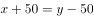······①

······②

联立①②求解可得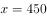，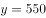，即目前还剩下550套房子未卖出。

故正确答案为C。

---

第 47 题

**答案**：B

**官方解析**

根据题意，总人数余7、总人数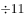余9，代入排除：

A项，余8，不满足题意，排除；B项，余7，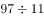余9，满足题意，当选；C项，余6，不满足题意，排除；D项，余5，不满足题意，排除。所以只有B项满足，则共有97名小朋友。

故正确答案为B。

---

第 48 题

**答案**：C

**官方解析**

先安排前三位，0-9共10个数字，所以前三位排法有种；再安排后两位，英文字母共26个，字母O、I不参与组牌，剩24个，且不重复，所以后两位排法有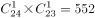种。可以给该地区汽车上牌照的数量为辆。

故正确答案为C。

---

第 49 题

**答案**：D

**官方解析**

方法一：根据题意，两类课程各至少选一门，有三种情况：

（1）A类选一门，B类选三门，有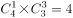种；

（2）A类选两门，B类选两门，有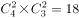种；

（3）A类选三门，B类选一门，有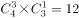种；

则选法共有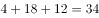种。

方法二：要求两类课程各至少选一门，正向情况数较多，从反面考虑。总情况为七门课程中选择四门，为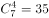种情况；不满足要求的情况为选择四门课程都为一类，只有A类四门都选、B类不选1种情况。满足情况数总情况数不满足要求情况数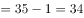种。

故正确答案为D。

---

第 50 题

**答案**：B

**官方解析**

最适合作为飞镖板即阴影部分所占面积比例约为，故需分别求出四个选项阴影所占面积比例。

A项，赋值圆半径为1，则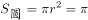，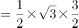，阴影面积所占比例（，）；

B项，赋值圆半径为1，则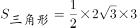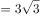，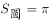，阴影面积所占比例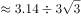；

C项，赋值圆半径为1，则，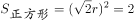，阴影面积所占比例；

D项，赋值圆半径为1，，，阴影面积所占比例。

B选项最接近。

故正确答案为B。

---

第 51 题

**答案**：A

**官方解析**

由题干可知船最终都是到达正对岸，说明船速与水速的合成速度的方向均在虚线上。假设去程的水速为千米/小时，去程时间为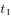小时；返程的水速为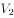 千米/小时，返程时间为小时。如图所示，由题干可推出，，。根据直角三角形EFD的三边关系则有：，化简得，；同理在直角三角形ABC中，，化简得，。则倍。

故正确答案为A。

---

第 52 题

**答案**：C

**官方解析**

本题要求表面的最短路径，可考虑两种方式。第一种可在A点沿着外壁直上直下爬入桶内部，由于不考虑桶厚度，所以壁虎依然在A点位置，此时走了分米，接下来壁虎只需沿直径从A爬到B即可，即又走了分米，此时从A到B共爬了分米。

第二种可将图形进行展开，如图所示。原图中AB为直径，则在展开图中AB的距离底面周长分米，分米。所求为最小值，延长AD，使，则，在直角三角形A&#39;AB中，分米，分米，根据勾股定理分米。

综上，第一种的距离更短，为12.64分米。

故正确答案为C。

---

第 53 题

**答案**：B

**官方解析**

由题意可知，所求体积。

四棱锥：由题干可知四棱锥的底面为正方形，且边长分米，高分米，那么立方分米。

圆柱：由题干可知四棱柱侧面均为等腰三角形，即三角形ABC为等腰三角形，又从A点垂直底面切开，所以AO既是垂线也是平分线，那么分米，又因为三角形DBE与三角形ABO是相似三角形，所以，所以，则圆柱底面半径，那么立方分米。则题干所求立方分米。

故正确答案为B。

备注：考试过程中由于选项后半部分都是，故算出四棱锥的体积后即可选择B项。

---

第 54 题

**答案**：B

**官方解析**

设剪裁成60cm的不锈钢管根，剪裁成43cm的不锈钢管根，根据题意，长方体条形不锈钢管长为2.5m，单位统一为250cm，即：；

当时，解得，cm，剩cm；

当时，解得，cm，剩cm；

当时，解得，cm，剩cm。

由此可知剩下的钢管最少为1cm，利用率。

故正确答案为B。

---

第 55 题

**答案**：D

**官方解析**

设小王到的时间为，班车到的时间为，则只有当，小王能够坐上班车。即直线、、围成的区域；如下图所示，只有在阴影部分区域小王能够坐上班车，本题所求概率即求阴影部分面积占整个图形ABCD面积的比例。由图可得，假设边长为1，则面积，空白部分为一个等腰直角三角形，面积为，则阴影部分面积，占总面积的。

故正确答案为D。

---

第 56 题

**答案**：C

**官方解析**

根据运输时间，各公司运输费用情况如下：

甲公司与丁公司总运费相同，因此二者均不可能为最小，排除A、D两项，丙公司总费用小于乙公司，可知丙公司总费用最小。

故正确答案为C。

---

第 57 题

**答案**：B

**官方解析**

根据题意可知，走各层楼梯用时是公差为2的等差数列。从第1层走到第2层用时秒，根据，从第十层走到第十一层用时秒，再根据等差数列求和公式：，可得走楼梯用时为秒；休息用时是公差为5的等差数列，秒，到第十层休息用时秒，中途休息总用时秒；总用时秒。

故正确答案为B。

---

第 58 题

**答案**：C

**官方解析**

球缺是指球被平面截下的部分，题干中的大坑即为一个球缺。如图所示，球缺高即为BD线段长，m；在直角三角形OCD中，根据“弹坑直径16m”，可知截面半径CDm，ODm，OCm，依据勾股定理，，解得；将球的半径与球缺高代入球缺体积公式，可得球缺体积，所需车次，即66车次不够，至少需要67车次。

故正确答案为C。

【备注】本题不严谨，题干所给公式中的，理论上应为球缺底面的半径，但在考场上，按照命题人所给的公式及字母含义解题即可。

---

第 59 题

**答案**：B

**官方解析**

由题图可知，大火烧到岛中心时，刚好圆弧状的火线最中间点在圆心位置。如图所示：

假设圆心为O点，起火点为A点，起火点到圆弧状火线与森林边缘的交点分别为B、C两点，连接OB和OC、AB和AC，OA、OB、OC恰好都为圆形小岛的半径，则。同时由题图可知，则三角形BAO和三角形CAO均为等边三角形，即，同时高均为。由扇形面积可知，；过火面积，，圆形小岛面积。故过火面积所占比例为。

故正确答案为B。

---

第 60 题

**答案**：B

**官方解析**

如图所示：

假设等边三角形的三个顶点分别为A、B、C，三个圆的圆心分别为、、，且圆与BC相切于D点，圆和圆相切为E点，连接AD、、、、、以及CE。因三个圆大小相同，则，同时，故三角形为等边三角形，令其中心为o，则三段不含圆切点之间的弧对应的圆心角均为。令三个圆的半径为r，故所求距离。

方法一：O点即为等边三角形ABC与等边三角形共同的中心，在三角形ABC中高，则（参考备注）。同理，在三角形中，其高为，则。故，解得，故所求距离。

备注：1.等边三角形的中心即为三角形的重心，连接重心与顶点到对边的线段被重心分成2：1的比例，而这条边恰好就是等边三角形的高，于是中心到顶点距离为，高，于是中心到顶点距离为。

方法二：如图所示：

连接三个顶点与中心O点，形成三个全等的等腰三角形：△BOC、△AOB、△COA，圆、、分别为它们的内切圆。在△ABC中高，则AO=BO=CO（参考备注1），则，。根据三角形内切圆半径公式（参考备注2）（S为三角形面积，C为三角形周长），故所求距离。

备注2：

在任意△ABC中有内切圆O，令其半径为r，连接三角形顶点与圆心O点可将△ABC分割为三个小三角形，每个小三角形的高均为内切圆半径。则，则三角形内切圆半径。

---

第 61 题

**答案**：A

**官方解析**

第一步：判断题干词语间逻辑关系。
天干是中国古代的一种文字计序符号，其包括：甲、乙、丙、丁、戊、己、庚、辛、壬、癸，被称为“十天干”。戊、己、庚是“十天干”中的三个，三者是并列关系，且三者在天干中排列紧密连续。
第二步：判断选项词语间逻辑关系。
A项：钠、镁、铝是元素周期表中的三个元素，三者是并列关系，且三者在元素周期表中排列紧密连续，与题干逻辑关系一致，当选；
B项：寅、卯、巳是古代十二地支中的三个地支，三者是并列关系，但三者在十二地支中的排列并不是紧密连续的，与题干逻辑关系不一致，排除；
C项：牛、虎、龙是十二生肖中的三个生肖，三者是并列关系，但三者在十二生肖中的排列并不是紧密连续的，与题干逻辑关系不一致，排除；
D项：秦、汉、隋是我国古代的三个朝代，三者是并列关系，但三者在古代朝代中的排列并不是紧密连续的，与题干逻辑关系不一致，排除。
故正确答案为A。

---

第 62 题

**答案**：B

**官方解析**

第一步：判断题干词语间逻辑关系。
天鹅象征着优雅，二者为比喻象征关系。
第二步：判断选项词语间逻辑关系。
A项：塞外有风沙，二者为地点对应关系，与题干逻辑关系不一致，排除；
B项：梅花象征着高洁的品质，二者为比喻象征关系，与题干逻辑关系一致，当选；
C项：同窗是指同在一个学校学习的人，同窗之间的关系可以是友好的，二者为对应关系，与题干逻辑关系不一致，排除；
D项：“笑话”是“幽默”的一种表现形式，二者为属性对应关系，与题干逻辑关系不一致，排除。
故正确答案为B。

---

第 63 题

**答案**：A

**官方解析**

第一步：判断题干词语间逻辑关系。
“赫兹”是国际单位制中“频率”的单位，二者为对应关系。
第二步：判断选项词语间逻辑关系。
A项：“法拉”是国际单位制中“电容”的单位，二者为对应关系，与题干逻辑关系一致，当选；
B项：“焦耳”是“能量和做功”的国际单位，“瓦特”是国际单位制中“功率”的单位，焦耳和功率二者无明显逻辑关系，与题干逻辑关系不一致，排除；
C项：“牛顿”是“力”的国际单位，“帕斯卡”（简称帕）是国际单位制中表示“压强”的基本单位，牛顿和压强二者无明显逻辑关系，与题干逻辑关系不一致，排除；
D项：“欧姆”是“电阻”的国际单位，但二者与题干顺序相反，与题干逻辑关系不一致，排除。
故正确答案为A。

---

第 64 题

**答案**：C

**官方解析**

第一步：判断题干词语间逻辑关系。
“巴蜀”指的是巴国和蜀国，“燕赵”指的是燕国和赵国，四者都属于中国历史上存在的国家，为并列关系中的反对关系。
第二步：判断选项词语间逻辑关系。
A项：“京津”指的是北京和天津，“淮海”指的是以徐州为中心的淮河以北及海州（今连云港市西南）一带的地区，并不是国家，与题干逻辑关系不一致，排除；
B项：“闽越”指的是闽越国，“荆湘”指的是长江中游地区的江汉—洞庭湖平原，并不全是国家，与题干逻辑关系不一致，排除；
C项：“齐鲁”指的是齐国和鲁国，“秦晋”指的是秦国和晋国，四者都属于中国历史上存在的国家，为并列关系中的反对关系，与题干逻辑关系一致，当选；
D项：“殷商”指的商朝，“云贵”指的是云南和贵州地区，并不是国家，与题干逻辑关系不一致，排除。
故正确答案为C。

---

第 65 题

**答案**：D

**官方解析**

第一步：判断题干词语间逻辑关系。
醍醐灌顶意思是将牛奶中精炼出来的乳酪浇到头上，比喻灌输智慧，使人得到启发，彻底醒悟，与顿悟是近义关系。
第二步：判断选项词语间逻辑关系。
A项：望梅止渴意思是梅子酸，人想吃梅子就会流涎，因而止渴，比喻愿望无法实现，用空想安慰自己。与渴望不是近义关系，与题干逻辑关系不一致，排除；
B项：完璧归赵意思是蔺相如将完美无瑕的和氏璧，完好地从秦国带回赵国，后比喻把物品完好地归还给物品的主人。与移交不是近义关系，与题干逻辑关系不一致，排除；
C项：坐吃山空意思是只坐着吃，山也要空，指光是消费而不从事生产，即使有堆积如山的财富，也要耗尽。与消费不是近义关系，与题干逻辑关系不一致，排除；
D项：彩衣娱亲意思是传说春秋时有个老莱子，很孝顺，七十岁了还穿着彩色衣服扮成幼儿，引父母发笑，后作为孝顺父母的典故。与孝顺是近义关系，与题干逻辑关系一致，当选。
故正确答案为D。

---

第 66 题

**答案**：B

**官方解析**

第一步：判断题干词语间逻辑关系。
超声波是指频率高于20000赫兹的声波，次声波是指频率小于20赫兹的声波，二者为并列关系；且超声波和次声波都可以运用在军事上，为对应关系。
第二步：判断选项词语间逻辑关系。
A项：有的处女作是代表作，有的处女作不是代表作，有的代表作是处女作，有的代表作不是处女作，二者为交叉关系，与题干逻辑关系不一致，排除；
B项：路由器是连接两个或多个网络的硬件设备，在网络间起网关的作用；隔离卡是一种应用在计算机上的硬件，使得计算机在完全安全状态下联结内网和外网，二者均为电脑硬件设备，为并列关系。且路由器和隔离卡都可以运用在网络连接上，为对应关系，与题干逻辑关系一致，当选；
C项：核潜艇是潜水艇的一种，二者为种属关系，与题干逻辑关系不一致，排除；
D项：北极星又称北辰、紫微星，指的是最靠近北天极的一颗恒星；北斗星又称北斗七星，是大熊座的组成部分，属于紫微垣的一个星官。二者不是并列关系，但二者都是星辰，前两词分别与第三词构成种属关系，与题干逻辑关系不一致，排除。
故正确答案为B。

---

第 67 题

**答案**：C

**官方解析**

第一步：判断题干词语间逻辑关系。
“瑜”和“瑾”指美玉，且握瑜和怀瑾都是动宾结构。
第二步：判断选项词语间逻辑关系。
A项：“辕”指车前驾牲畜的两根直木，“辙”指车轮压的痕迹，二者均不能用来指马车，且南辕和北辙都不是动宾结构，与题干逻辑关系不一致，排除；
B项：“戈”指古代的一种兵器，“马”指马匹，二者均不能直接指战争，且金戈和铁马都不是动宾结构，与题干逻辑关系不一致，排除；
C项：“金”和“石”指钟磬一类的乐器，且敲金和击石均为动宾结构，与题干逻辑关系一致，当选；
D项：“衣”指衣服，“食”指食物，二者均不能用来指珍馐，且锦衣和玉食都不是动宾结构，与题干逻辑关系不一致，排除。
故正确答案为C。

---

第 68 题

**答案**：B

**官方解析**

逐一代入选项。
A项：“火箭筒”具有“发射”火箭弹的功能，二者属于功能对应关系，狼牙棒和三节棍都是用于攻击的工具，二者为并列关系，前后逻辑关系不一致，排除；
B项：火箭筒和手榴弹都是武器，二者为并列关系，方天戟和三节棍都是兵器，二者为并列关系，前后逻辑关系一致，当选；
C项：火箭筒发射的火箭弹能够爆炸，二者为对应关系，三节棍是软器械的一种，二者为种属关系，前后逻辑关系不一致，排除；
D项：火箭筒的工作原理是利用了热动力，二者为原理对应关系，三节棍经过锻造术锻造而成，二者为工艺对应关系，前后逻辑关系不一致，排除。
故正确答案为B。

---

第 69 题

**答案**：B

**官方解析**

逐一代入选项。
A项：高屋建瓴意思是把瓶子里的水从高层顶上倾倒，形容居高临下的形势，与格局无必然联系；左支右绌意思是力量不足，应付了这一方面，那一方面又有了问题，与技艺无必然联系，前后逻辑关系不一致，排除；
B项：高屋建瓴意思是把瓶子里的水从高层顶上倾倒，形容居高临下的形势，高屋建瓴形容形势；目无全牛意思是眼中没有完整的牛，只有牛的筋骨结构，形容人的技艺高超，得心应手，已经到达非常纯熟的地步，目无全牛形容技艺，前后逻辑关系一致，当选；
C项：高屋建瓴意思是把瓶子里的水从高层顶上倾倒，形容居高临下的形势，与气势无必然联系；天造地设意思是自然形成而合乎理想，不必再加工，与技艺无必然联系，前后逻辑关系不一致，排除；
D项：高屋建瓴意思是把瓶子里的水从高层顶上倾倒，形容居高临下的形势，与地势无必然联系；逆水行舟意思是比喻学习或做事就好像逆水行船，不努力就要退步，与技艺无必然联系，前后逻辑关系不一致，排除。
故正确答案为B。

---

第 70 题

**答案**：B

**官方解析**

逐一代入选项。
A项：“晕轮效应”是指在人际知觉中所形成的以点概面或以偏概全的主观印象，其本质是一种用片面的观点看待整体问题的认知偏误；“扬长避短”是指发扬优点、回避缺点，二者没有明显逻辑关系。“墨菲定理”的根本内容是：如果事情有变坏的可能，不管这种可能性有多小，它总会发生；“变本加厉”指情况变得比本来更加严重，二者没有明显逻辑关系。前后逻辑关系不一致，排除；
B项：“以偏概全”是指片面地根据局部现象来推论整体，得出错误的结论，是“晕轮效应”的本质；“破窗效应”是指环境中的不良现象如果被放任存在，会诱使人们仿效，甚至变本加厉，“变本加厉”是其本质，前后逻辑关系一致，当选；
C项：“欲扬先抑”是指要发扬、放开，就要先控制、压抑，与“晕轮效应”之间没有明显逻辑关系；“增减效应”是指人们最喜欢那些对自己的喜欢显得不断增加的人，最不喜欢那些对自己的喜欢显得不断减少的人，与“变本加厉”之间没有明显逻辑关系，前后逻辑关系不一致，排除；
D项：“举一反三”是指从懂得的一点，类推而知道其他，与“晕轮效应”之间没有明显逻辑关系；“蝴蝶效应”是指初始条件下微小的变化能带动整个系统的长期的巨大的连锁反应，与“变本加厉”之间没有明显逻辑关系，前后逻辑关系不一致，排除。
故正确答案为B。

---

第 71 题

**答案**：B

**官方解析**

元素组成相似，优先考虑样式规律，经过验证无规律。继续观察发现，图形均明显被分割，考虑数量规律中的面数量。第一行图形中面的数量满足：，第二行图形中面的数量满足：，则第三行图形中面的数量应满足：，A、C、D三项均不满足，B项当选。

故正确答案为B。

---

第 72 题

**答案**：D

**官方解析**

元素组成相同，优先考虑位置规律。观察发现，题干第一组图形中的两个白球在九宫格外圈整体顺时针平移2格，而两个“十字”在九宫格外圈整体顺/逆时针平移4格。第二组图形应遵循同样规律，只有D项满足。
故正确答案为D。

---

第 73 题

**答案**：D

**官方解析**

本题为分组分类题目。观察发现，题干图形均出现多个封闭面连在一起，考虑图形间关系。图①③⑤中封闭面之间有公共边，图②④⑥中封闭面之间没有公共边（通过点或线连接），即图①③⑤为一组，图②④⑥为一组。
故正确答案为D。

---

第 74 题

**答案**：B

**官方解析**

元素组成不同，且无明显属性规律，优先考虑数量规律。观察题干图形，发现图形分割明显，可考虑面数量，但面数量无规律。再次观察发现，分割后的图形三角形较多，且明显存在直角，可考虑单一直角数。题干图形的单一直角数分别为2、3、？、5、6，故？处图形的单一直角数应为4，只有B项符合。
故正确答案为B。

---

第 75 题

**答案**：A

**官方解析**

本题考查三视图。如下图所示，B、C、D三项按图中箭头方向观察，均可看到，排除；A项最上面凹槽处缺少一根线，无法看到，当选。

本题为选非题，故正确答案为A。

---

第 76 题

**答案**：A

**官方解析**

第一步：找出定义关键词。
单质：“由同一种元素组成的纯净物”；
化合物：“由两种或两种以上元素的原子（不同元素的原子）组成的纯净物”；
混合物：“由两种或两种以上不同的单质或化合物机械混合而成”、“无固定化学式”。
第二步：逐一分析选项。
A项：氮气是由氮元素组成的纯净物，氧气是由氧元素组成的纯净物，均符合“由同一种元素组成的纯净物”，符合单质的定义；二氧化碳是由碳元素和氧元素组成的纯净物，符合“由两种或两种以上元素的原子（不同元素的原子）组成的纯净物”，符合化合物的定义；空气由氮气、氧气、二氧化碳等物质组成，符合“由两种或两种以上不同的单质或化合物机械混合而成”、“无固定化学式”，符合混合物的定义。选项同时具有三类物质，符合题干要求，当选； 
B项：食盐水是由氯化钠和水等组成的溶液，盐酸是氯化氢和水组成的溶液，氨水是氨和水组成的溶液，均符合“由两种或两种以上不同的单质或化合物机械混合而成”、“无固定化学式”，符合混合物的定义；蒸馏水是由氢元素和氧元素组成的纯净物，符合“由两种或两种以上元素的原子（不同元素的原子）组成的纯净物”，符合化合物的定义。选项缺少单质，不符合题干要求，排除；
C项：氢气是由氢元素组成的纯净物，氖气是由氖元素组成的纯净物，汞蒸气是汞蒸发而成的纯净物，均符合“由同一种元素组成的纯净物”，符合单质的定义；水蒸气是由氢元素和氧元素组成的纯净物，符合“由两种或两种以上元素的原子（不同元素的原子）组成的纯净物组成的纯净物”，符合化合物的定义。选项缺少混合物，不符合题干要求，排除；
D项：二氧化碳是由碳元素和氧元素组成的纯净物，水蒸气是由氢元素和氧元素组成的纯净物，均符合“由两种或两种以上元素的原子（不同元素的原子）组成的纯净物”，符合化合物的定义；矿泉水由水、矿物盐、二氧化碳等物质组成，天然气由烃类和非烃类气体混合而成，均符合“由两种或两种以上不同的单质或化合物机械混合而成”、“无固定化学式”，符合混合物的定义。选项缺少单质，不符合题干要求，排除。
故正确答案为A。

---

第 77 题

**答案**：A

**官方解析**

第一步：找出定义关键词。
先赋资本：“建立在血缘、遗传等先天条件下”、“不经过个人努力就可以拥有”；
自致资本：“通过个人后天努力取得”、“为个人所支配”。
第二步：逐一分析选项。
A项：婚姻、职业、政治面貌都是通过后天努力取得的，均符合自致资本的定义，当选； 
B项：家世、民族是建立在遗传的先天条件下，不经过个人努力就可以拥有的，符合先赋资本的定义；文化程度是通过后天努力取得的，符合自致资本的定义，排除；
C项：国籍是建立在遗传的先天条件下，不经过个人努力就可以拥有的，符合先赋资本的定义；收入和工作单位是通过后天努力取得的，均符合自致资本的定义，排除；
D项：种族、户口和父辈职业都是建立在血缘、遗传等先天条件下，不经过个人努力就可以拥有的，均符合先赋资本的定义，排除。
故正确答案为A。

---

第 78 题

**答案**：C

**官方解析**

第一步：找出定义关键词。
“两个没有因果关系的事件”、“基于一些其他未见的因素（潜在变量）而推断出因果关系”、“引致两个事件是‘有所联系’的假象，但这种联系并不能通过客观的试验来证实”。
第二步：逐一分析选项。
A项：童鞋的大小与孩子的语言能力不存在直接联系，二者没有因果关系，符合关键词“两个没有因果关系的事件”，但二者可能都与“年龄”相关，年龄大可能导致童鞋大，同时导致语言能力较强，基于“年龄”这一潜在变量，二者之间“有所联系”，符合关键词“基于一些其他未见的因素（潜在变量）而推断出因果关系”、“引致两个事件是‘有所联系’的假象，但这种联系并不能通过客观的试验来证实”，符合定义，排除；
B项：冷饮的销量与泳池溺水的人数不存在直接联系，二者没有因果关系，符合关键词“两个没有因果关系的事件”，但二者可能都是由于“天气炎热”引起的，基于“天气炎热”这一潜在变量，二者之间“有所联系”，符合关键词“基于一些其他未见的因素（潜在变量）而推断出因果关系”、“引致两个事件是‘有所联系’的假象，但这种联系并不能通过客观的试验来证实”，符合定义，排除；
C项：惯性与物体的质量有关，物体的质量越大则惯性越大，而汽车核载重量与汽车质量成正比，所以惯性的大小与汽车的核载重量存在因果关系，不符合关键词“两个没有因果关系的事件”，且惯性和物体重量之间的关系可通过实验来证实，不符合关键词“引致两个事件是‘有所联系’的假象，但这种联系并不能通过客观的试验来证实”，不符合定义，当选；
D项：网民的数量与房屋的折旧程度不存在直接联系，二者没有因果关系，符合关键词“两个没有因果关系的事件”，但二者可能都与“时间”相关，随着时间推移，网民数量逐渐增多，同时房屋折旧程度越高，基于“时间”这一潜在变量，二者之间“有所联系”，符合关键词“基于一些其他未见的因素（潜在变量）而推断出因果关系”、“引致两个事件是‘有所联系’的假象，但这种联系并不能通过客观的试验来证实”，符合定义，排除。
本题为选非题，故正确答案为C。

---

第 79 题

**答案**：D

**官方解析**

第一步：找出定义关键词。
色素色：“有机色素”、“通过选择性地吸收、反射和投射特定频率的光线后直观呈现出的颜色”；
结构色：“通过可见光与物质物理上的微观结构（如物体表面或表层的纹、刻点、沟缝或颗粒等）发生相互作用”、“这些大量的微观有序结构对不同波长的光散射、衍射或干涉后产生的各种颜色”。
第二步：逐一分析选项。
A项：用激光束刻录的光盘上的彩色花纹，光盘本身的颜色是单一色，而光盘上的彩色花纹是由于光盘表面的特殊结构对光散射、衍射或干涉形成的，符合“通过可见光与物质物理上的微观结构（如物体表面或表层的纹、刻点、沟缝或颗粒等）发生相互作用”、“这些大量的微观有序结构对不同波长的光散射、衍射或干涉后产生的各种颜色”，符合结构色的定义，不符合色素色的定义，排除；
B项：蝴蝶翅膀上的鳞片呈现出五颜六色，主要是由于鳞片表面凹凸不平的奇特构造，使光线发生反射、折射或干涉等光学作用而产生，符合“通过可见光与物质物理上的微观结构（如物体表面或表层的纹、刻点、沟缝或颗粒等）发生相互作用”、“这些大量的微观有序结构对不同波长的光散射、衍射或干涉后产生的各种颜色”，符合结构色的定义，不符合色素色的定义，排除；
C项：阳光下肥皂泡泡呈现缤纷的虹彩色，肥皂泡本身是无色的，在阳光的照耀下呈现出虹彩色是由于肥皂泡表面的膜产生的，符合“通过可见光与物质物理上的微观结构（如物体表面或表层的纹、刻点、沟缝或颗粒等）发生相互作用”、“这些大量的微观有序结构对不同波长的光散射、衍射或干涉后产生的各种颜色”，符合结构色的定义，不符合色素色的定义，排除；
D项：用乌饭树叶捣汁煮出的糯米饭呈现黑色，主要是因为乌饭树叶中的色素与糯米饭中的蛋白质发生了一系列复杂反应，生成物可以吸收绝大部分光，所以呈现出来是黑色的，符合“有机色素”、“通过选择性地吸收、反射和投射特定频率的光线后直观呈现出的颜色”，符合色素色的定义，当选。
故正确答案为D。

---

第 80 题

**答案**：D

**官方解析**

第一步：找出定义关键词。
音爆：“飞行器在突破音障时”、“对空气的压缩无法迅速传播，会逐渐形成激波面”、“激波面上高度集中的声学能量引起巨大响声，让人耳感受到短暂而极其强烈的爆炸声”、“只有在突破音速即超音速飞行时才会产生”；
音爆云：“以飞行器为中心轴、从机翼前段开始向四周均匀扩散的圆锥状云团”、“产生主要是由于气流流速突破音速时比空气传导速度更快，无法有效向下拉气流，导致密度减小，气压降低，水气凝结成微小的水珠，肉眼看来就像是云雾般的状态”、“在跨音速飞行时常常出现，但不仅在跨音速飞行时才能出现”。
第二步：逐一分析选项。
A项：音爆云在跨音速飞行时常常出现，说明在跨音速飞行时也可能不会产生音爆云，而音爆只有在突破音速即超音速飞行时才会产生，说明音爆产生时也有可能不会产生音爆云，因此“音爆产生时就会出现音爆云”的说法不正确，排除；
B项：音爆云不仅在跨音速飞行时才能出现，意味着音爆云可能在非跨音速飞行时产生，而音爆只有在突破音速即超音速飞行时才会产生，因此可能出现有音爆云但没有音爆的情况，因此“音爆云出现标志着音爆产生”的说法不正确，排除；
C项：说的是音爆云出现说明突破了音障，音爆是飞行器在突破音障时产生的，而音爆云的出现并不能说明突破了音障，因此“音爆云出现说明突破了音障”的说法不正确，排除；
D项：说的是音爆产生时是超音速飞行，符合音爆“只有在突破音速即超音速飞行时才会产生”，符合定义，当选。
故正确答案为D。

---

第 81 题

**答案**：A

**官方解析**

第一步：找出定义关键词。
“某个地区的居民”、“认为相关机构、设施、景观具有正的外部效应，能给本社区发展带来好处”、“不排斥甚至欢迎这些项目在本社区落地”。
第二步：逐一分析选项。
A项：群众深度参与，符合“某个地区的居民”，点赞街道残障康复中心成立，说明群众认可、十分欢迎，符合“认为相关机构、设施、景观具有正的外部效应，能给本社区发展带来好处”，也符合“不排斥甚至欢迎这些项目在本社区落地”，符合定义，当选；
B项：公司升级业态，积极在社区推广无人零售店，没有体现出被推广社区居民的态度，是否欢迎，不符合定义，排除；
C项：新设备耗电低，企业要求园区加快引进速度，园区不是社区，企业也不是社区居民，不符合“某个地区的居民”，不符合定义，排除；
D项：加气站易漏气，附近居民担心火灾要求搬迁，是居民害怕带来危险，不符合“认为相关机构、设施、景观具有正的外部效应，能给本社区发展带来好处”、“不排斥甚至欢迎这些项目在本社区落地”，不符合定义，排除。
故正确答案为A。

---

第 82 题

**答案**：D

**官方解析**

第一步：找出定义关键词。
人合公司：“以股东的个人信用为公司信用基础”；
资合公司：“由公司股东分别出资而形成的财产作为信用基础”；
人资兼合公司：同时以“股东的个人信用”和“股东分别出资而形成的财产”作为信用基础。
第二步：逐一分析选项。
A项：某公司注册资本为全体股东缴纳股本的总和，符合“公司股东分别出资而形成的财产”，属于资合公司，不属于人合公司，排除；
B项：某公司的全部股份由公司独立创立者百分百持有，但是公司聘请多位经验丰富的职业经理人分管不同业务，不符合“以股东的个人信用为公司信用基础”，不属于人合公司，排除；
C项：股东个人财产并不受影响，说明不符合“以股东的个人信用为公司信用基础”，不属于人合公司，排除；
D项：以股东个人的所有财产为抵押，股东对公司经营负无限责任，符合“以股东的个人信用为公司信用基础”，属于人合公司，当选。
故正确答案为D。

---

第 83 题

**答案**：D

**官方解析**

第一步：找出定义关键词。
“将本不属于本地的异域或其他民族的文化资源借用过来”、“对本地的文化形成影响”、“创造出新的文化产品”。
第二步：逐一分析选项。
A项：某苗族民间工艺组织设计制作的具有苗绣元素的文创作品，不符合“将本不属于本地的异域或其他民族的文化资源借用过来”，不符合定义，排除；
B项：某法国女生穿着印度传统服装纱丽翩翩起舞，符合“将本不属于本地的异域或其他民族的文化资源借用过来”，但让大家大饱眼福，不符合“创造出新的文化产品”，不符合定义，排除；
C项：某荷兰社区大学为学生开设中华太极拳课程，符合“将本不属于本地的异域或其他民族的文化资源借用过来”，但是并没有“对本地的文化形成影响”、“创造出新的文化产品”，不符合定义，排除；
D项：世界之窗展示了众多全球著名景观和建筑，符合“将本不属于本地的异域或其他民族的文化资源借用过来”，成为当地热门的旅游景点，符合“对本地的文化形成影响”、“创造出新的文化产品”，符合定义，当选。
故正确答案为D。

---

第 84 题

**答案**：C

**官方解析**

第一步：找出定义关键词。
价值链的数字重生：“某个必要环节以数字化方式呈现”、“数据实时在线为基础”、“推动价值链的实现”；
价值链的数字新生：“用户价值为中心”、“数据实时在线为基础”、“融合新价值链要素”、“创造全新价值链结构”。
第二步：逐一分析选项。
A项：整合资源给用户带来全新的旅行前、旅行中和旅行后的服务体验，不符合“某个必要环节以数字化方式呈现”，且没有提到“数据的实时在线”，不符合价值链的数字重生的定义，排除；
B项：依靠在线实时数据，符合“数据实时在线为基础”，开拓新颖的服务渠道，是对价值链的创新，不符合“推动价值链的实现”，不符合价值链的数字重生的定义，排除；
C项：电商平台发布商品信息和销售实时动态，符合“数据实时在线为基础”，消费者在选购时可以查询货物即时情况，符合“某个必要环节以数字化方式呈现”，符合价值链的数字重生的定义，当选；
D项：核电设备的数字三维模型可以为多个环节带来价值增长点，不符合“数据实时在线为基础”，不符合价值链的数字重生的定义，排除。
故正确答案为C。

---

第 85 题

**答案**：C

**官方解析**

第一步：找出定义关键词。
“人与人的相互行为某种程度上是种表演”、“使自己的行为接近想要呈现的角色”、“观众看到的是角色而不是演员本身”、“表演结束后，恢复本来的自我”。
第二步：逐一分析选项。
A项：小明没有立刻开门，而是先把臭袜子藏到床下，说明他不想被小丽看到自己邋遢的一面，符合“使自己的行为接近想要呈现的角色”、“观众看到的是角色而不是演员本身”，符合定义，排除；
B项：在“国王的新装”故事里，国王实际没有穿衣服，但是臣民交口称赞新装华贵美丽，符合“人与人的相互行为某种程度上是种表演”，符合定义，排除；
C项：小魏生活拮据工作努力，但是开豪车接父母的人是老板不是小魏，没有体现二者的行为是表演出来的，不符合“人与人的相互行为某种程度上是种表演”，不符合定义，当选；
D项：小菲天天在微信朋友圈发照片是通过盗图和拼接，说明朋友圈呈现的并非她的真实生活，符合“使自己的行为接近想要呈现的角色”、“观众看到的是角色而不是演员本身”，符合定义，排除。
本题为选非题，故正确答案为C。

---

第 86 题

**答案**：C

**官方解析**

第一步：翻译题干。

①物种多样性丰富对森林生产力影响不大

注：题干第一句话可以理解为“如果一片森林的树木物种多样性非常丰富，（即使缺失一个物种），对于整个森林的生产力影响还并不是太大”

如果A，即使B，那么C。此处的“即使B”不是充要条件，可以忽略，最后翻译为AC即可。例.如果你不好好学习，即使你再聪明，也不能圆梦，翻译为好好学习圆梦。

第二步：逐一分析选项。 

A项：翻译为森林生产力受影响物种多样性锐减（即“物种多样性丰富”），仅根据“森林生产力受影响”无法判断影响的大小，无法推出，排除；

B项：翻译为树木物种减少森林生产力受影响，仅根据“树木物种减少”无法判断是减少一种还是多种，是否影响树木物种丰富性，无法推出，排除；

C项：翻译为森林的生产力下降（即“对森林生产力影响大”）树木物种多样性受损（即“树木物种多样性不丰富”），是对题干①的否后推否前，可以推出，当选；

D项：“要么···要么···”表示两者之间只能成立一个且必须成立一个，题干重点论述的是“树木物种多样性”对“森林的生产力”的影响，而不是二者只能有一种情况发生，无法推出，排除。

故正确答案为C。

---

第 87 题

**答案**：D

**官方解析**

第一步：找出论点和论据。
论点：地球生命来自彗星。
论据：一块坠落到斯里兰卡的陨石里找到了微观硅藻化石，该石头有着疏松多孔的结构，密度比在地球上找到的所有东西都低。他推断这是一颗彗星的一部分，并指出样本中找到的微观硅藻化石与恐龙时代留存下来的化石中的微观有机体类似，从而为彗星胚种论提供了强有力的证据。
本题的论据说的是陨石找到的微观硅藻化石与恐龙时代留存下来的化石中的微观有机体类似，同时该研究还推断该陨石是一颗彗星的一部分，即说明该陨石（彗星的一部分）与生命有关系，而论点说的是地球生命来自彗星，所以，二者讨论话题一致，削弱可以考虑削弱论点，也可以考虑削弱论据。
第二步：逐一分析选项。
A项：该成果的网站缺乏可信性，所载论文良莠不齐，代表不了这次实验成果的可靠性，属于无关项，排除；
B项：只是说该科学家是彗星胚种论的狂热支持者，支持者说的话无法辨别真假，同时即便SARS和流感来自彗星，也无法判断生命是否来源于彗星，不明确选项，排除；
C项：选项是说配图中的东西本质是硅藻细胞断片，一定程度上质疑了题干研究成果的可信性，可能削弱论据，保留；
D项：该成果根本无法证明该石头是陨石，直接质疑了论据的研究成果，直接削弱论据，保留。
对比C、D两项：C项为可能削弱论据，D项为直接削弱论据，D项当选。
故正确答案为D。

---

第 88 题

**答案**：C

**官方解析**

第一步：找出论点和论据。

论点：在从未吸过传统香烟的年轻人中，那些正在吸电子烟的人更可能尝试传统香烟，有关电子烟的监管政策要注意保护年轻人。

论据：无。

本题只有论点，没有论据，优先考虑补充论据加强，即解释或举例证明“正在吸电子烟的年轻人更可能尝试传统香烟”。

第二步：逐一分析选项。

A项：论点说的是更可能尝试传统香烟，该项说的是有多少人尝试过电子烟，以及未来可能会尝试，话题不一致，无法加强，排除；

B项：选项表明吸电子烟的人相比于不吸电子烟的人而言，更可能吸传统香烟，该项是针对论点的可能性加强，属于补充论据，保留；

C项：该项表明受访者中正在吸电子烟的有60%表示未来一定会尝试传统香烟，该项比B项加强力度更大，原因有二：

一是题干论点强调保护年轻人，而C项的受试者正是年轻人，表明的是吸电子烟的年轻人的意愿，B项没分，年纪大小都可以，那为什么不保护年纪大的，而要特别保护年轻人呢？

二是如下图原文所示，C项把原文中的“可能或肯定”，改为“一定”，应该是为了区分B的可能，综上C项更有可能是出题人想设置的正确答案；

D项：论点说的是正在吸电子烟的年轻人更可能尝试传统香烟，该项说的是电子烟的危害，话题不一致，无法加强，排除。

故正确答案为C。

---

第 89 题

**答案**：C

**官方解析**

第一步：翻译题干。

①吴老师教语文张老师教生物；

②孙老师教语文或者吴老师教语文；

③张老师教生物苏老师教物理；

④吴老师教化学或者苏老师教物理。

第二步：逐一分析选项。

提问为“推出孙老师教语文”，本题是给出了结论，需要从结论出发倒推条件。

根据条件②可知：想要推出“孙老师教语文”，需要吴老师不教语文；

根据条件①可知：想要得到“吴老师不教语文”，需要张老师教生物；

根据条件③可知：想要得到“张老师教生物”，需要苏老师教物理；

根据条件④可知：想要得到“苏老师教物理”，需要吴老师教化学。

即：想要推出“孙老师教语文”，需要吴老师教化学。

故正确答案为C。

---

第 90 题

**答案**：D

**官方解析**

第一步：找出论点和论据。
论点：肠道细菌和血液中的致炎因子可能与慢性疲劳综合征有关。
论据：无。
首先注意本题问的是“······最不能支持上述结论？”，我们的做题思路是找出哪些是能支持的排除，如果不能支持的选项中出现无关选项，不明确选项和削弱选项，首选削弱项。
第二步：逐一分析选项。
A项：患者的肠道细菌多样性低且抗炎细菌较少，说明了肠道细菌可能与该疾病有关，为题干中论点补充了论据，属于加强选项。题干问的是最不能支持的，排除；
B项：患者的血液样本中有致炎因子，而健康志愿者没有，说明了血液中的致炎因子可能与该疾病有关，补充论据，属于加强选项。题干问的是最不能支持的，排除；
C项：不确定肠道细菌是病因还是该疾病导致的结果，但无论是原因还是结果，都能证明肠道细菌与该疾病确实有关，属于加强选项，题干问的是最不能支持的，排除；
D项：饮食治疗和益生菌对缓解患者疲劳无用，与题干论点无关，不能加强，当选。 
本题为选非题，故正确答案为D。

---

第 91 题

**答案**：C

**官方解析**

第一步：找出论点和论据。
论点：“霍金辐射”中不含有信息，也就是说被黑洞吞噬的物体信息会消失。
论据：无。
本文只有论点，因此优先考虑补充论据的形式来加强，考虑原因解释或举例子。
第二步：逐一分析选项。
A项：黑洞表面保存着黑洞内部的所有信息，说明被黑洞吞噬的物体信息不会消失，为削弱项，无法加强，排除；
B项：选项说信息不会完全消失，否定论点中的被黑洞吞噬的物体信息会消失，削弱项，无法加强，排除；
C项：选项解释了被黑洞吞噬的物体信息会消失，补充论据进行加强，当选；
D项：选项说明无法明确物体信息，属于不明确选项，无法加强，排除。
故正确答案为C。

---

第 92 题

**答案**：D

**官方解析**

第一步：找出论点和论据。
论点：二十年内，传统银行网点会消失。
论据：近几年，一些大城市的社区银行频频出现关门潮。与此同时，无人银行、5G银行、智能银行等一系列新概念银行不断出现，银行网点正在告别冷冰冰的玻璃柜台和金属板凳，传统网点交易处理的功能变弱了，定制服务、产品体验、社交互动等功能越来越突出。
本题论点讨论的是传统银行网点会消失，论据陈述了传统银行的一些现状，论点和论据讨论的话题一致，加强可以考虑补充论据。
第二步：逐一分析选项。
A项：办理一项简单的业务耗费较长时间，讨论的是办理业务时间长短的问题，不能得出传统银行网点会消失的结论，无法加强，排除；
B项：人工智能等科技手段改变了人们对银行网点的固有印象，和论点讨论的传统银行网点是否会消失无关，无法加强，排除；
C项：复杂业务必须到银行网点面签办理，说明传统银行网点很重要，不会消失，削弱论点，无法加强，排除；
D项：银行网点地位弱化，补充论据解释了传统银行网点会消失的原因，可以加强，当选。
故正确答案为D。

---

第 93 题

**答案**：D

**官方解析**

第一步：翻译题干。

①强大的生产制造能力、创新设计能力国计民生有保障

②强大的生产制造能力、创新设计能力国家实力

③强大的生产制造能力、创新设计能力“互联网”

第二步：逐一分析选项。

A项：题干只涉及醉心于虚拟经济靠不住，并不涉及“互联网”和使很多人沉迷于虚拟经济的关系，无法推出，排除；

B项：题干只涉及在宏观层面要充分认识到互联网的局限性，并不涉及“互联网”在微观层面的局限性，无法推出，排除；

C项：翻译为发展“互联网”国计民生有保障，两者不存在推出关系，排除；

D项：翻译为发展“互联网”提高生产制造、创新设计能力，是对③的否后，否后必否前，可以推出，当选。

故正确答案为D。

---

第 94 题

**答案**：C

**官方解析**

第一步：找出论点和论据。
论点：牙周病菌能把免疫细胞当作交通工具，借此移动至身体各处。
论据：牙周病菌是一种厌氧菌，而血管中有大量氧气，免疫细胞能够有效隔绝血管中的氧气。
本题论点讨论的是免疫细胞帮助牙周病菌移动至身体各处，论据讨论的是免疫细胞帮助牙周病菌隔绝血管中的氧气，都在讨论免疫细胞帮助牙周病菌移动，话题一致，且问法为“加强论证”，加强优先考虑必要条件。
第二步：逐一分析选项。
A项：论点说的是免疫细胞帮助牙周病菌移动至身体各处，该项说的是生活不规律的危害，话题不一致，无法加强，排除；
B项：血栓脱落会导致血管不通顺阻碍牙周病菌移动，血栓阻碍了流通，那牙周病菌也无法移动，免疫细胞就无法帮助牙周病菌移动至身体各处，削弱项，无法加强，排除；
C项：免疫细胞的整体内环境不会造成牙周病菌失活，如果免疫细胞的整体内环境会造成牙周病菌失活，那免疫细胞就无法帮助牙周病菌移动至身体各处，因此该项是题干结论能够成立的必要条件，可以加强，当选；
D项：论点说的是免疫细胞帮助牙周病菌移动至身体各处，该项说的是牙周病菌对身体血管健康的影响，话题不一致，无法加强，排除。
故正确答案为C。

---

第 95 题

**答案**：C

**官方解析**

第一步：找出论点和论据。

论点：基于人工智能的计算模型有助于更快、更准确地预测恶劣天气。

论据：研究人员鉴定并标记了逗点状云系的形态和运动，并利用计算机视觉和机器学习技术，“教会”计算机自动识别和检测卫星图像中的逗点状云系，以帮助人们更高效地在海量天气数据中及时发现恶劣天气的“端倪”。

本题论点和论据都在讨论该计算模型有助于发现、预测恶劣天气，二者话题一致，必要前提优先考虑必要条件。本题为选非题，找出结论成立的必要条件排除即可。

第二步：逐一分析选项。

A项：选项说明该计算模型准确率达，甚至在其完全形成前就能检测到，若该计算模型准确率低或者不能检测出逗点状云系，则该计算模型就无法预测恶劣天气，是上述结论的必要前提，排除；

B项：选项说明逗点状云系与气旋形成密切相关，若逗点状云系与气旋形成无关，则不能根据逗点状云系预测恶劣天气，是上述结论的必要前提，排除；

C项：选项说明该计算模型如果与其他天气预报模型结合，能有效预测出的恶劣天气事件，但是有效地预测情况是否为该计算模型的作用，不能确定，不是上述结论的必要前提，当选；

D项：论点是通过检测气旋的形成来预测恶劣天气的，选项说气旋的形成可导致恶劣天气，是上述结论的必要前提，排除。

本题为选非题，故正确答案为C。

---

第 96 题

**答案**：C

**官方解析**

根据题干“2018年第一季度······代理买卖证券业务净收入（含席位租赁）约为”，结合材料时间为2019年第一季度，可判定本题为基期计算问题。定位文字材料第二段可得“代理买卖证券业务净收入（含席位租赁）221.49亿元，同比增长”。根据基期量，故2018年第一季度，131家证券公司代理买卖证券业务净收入（含席位租赁）亿元，与C项最接近。

故正确答案为C。

---

第 97 题

**答案**：B

**官方解析**

根据题干“······平均每家证券公司在2018年第一季度实现营业收入约为”，结合材料时间为2019年第一季度，可判定本题为基期平均数问题。定位文字材料第一段可得，2019年第一季度，131家证券公司当期实现营业收入1018.94亿元，同比增长。根据基期量，则2018年一季度，平均每家证券公司实现营业收入亿元。

故正确答案为B。

---

第 98 题

**答案**：B

**官方解析**

根据题干“2019年第一季度······同比增速约为”，可判定本题为一般增长率问题。定位文字材料第三段可得“2019年第一季度，131家证券公司总资产为7.05万亿元，比上年一季度同期增加0.64万亿元”。根据增长率，则2019年第一季度，131家证券公司总资产的同比增速。

故正确答案为B。

---

第 99 题

**答案**：B

**官方解析**

根据题干“2018年第一季度······业务净收入与······利息净收入相比约”，结合选项为“多了/少了······亿元”，材料时间为2019年第一季度，可判定本题为基期和差问题。定位文字材料第二段可得“资产管理业务净收入57.33亿元，同比下降······利息净收入69.04亿元，同比增长”。根据基期量，则2018年第一季度，131家证券公司资产管理业务净收入与同期利息净收入的差值为亿元，与B项最接近。

故正确答案为B。

---

第 100 题

**答案**：D

**官方解析**

A项：定位文字材料第三段可得，2019年第一季度，131家证券公司总资产为7.05万亿元，净资产为1.94万亿元。故131家证券公司总资产比净资产多万亿元，非少了4.11亿元，错误；

B项：定位文字材料第二段可得，财务顾问业务净收入同比增长，故增长率不是，错误；

C项：定位文字材料第三段可得，2019年第一季度，131家证券公司净资产为1.94万亿元，比上年一季度同期增加0.05万亿元；净资本为1.62万亿元，比上年一季度同期增加0.02万亿元。0.05万亿元0.02万亿元，故131家证券公司净资产的同比增长金额高于净资本的同比增长金额，错误；

D项：定位文字材料第一段和第二段可得，2019年第一季度，131家证券公司当期实现营业收入1018.94亿元，资产管理业务净收入57.33亿元。则131家证券公司资产管理业务净收入占当期实现营业收入的比重，正确。

故正确答案为D。

---

第 101 题

**答案**：B

**官方解析**

根据题干“······约增长”，结合选项为百分数，可判定本题为一般增长率问题。定位表格材料可得：2019年中国创新指数为228.3，2010年为133.0。故2019年中国创新指数相对于2010年的增长率。

故正确答案为B。

---

第 102 题

**答案**：D

**官方解析**

根据题干“······同比增速最慢的是”，可判定本题为一般增长率问题。根据增长率，定位表格材料可得：

人均GDP指数同比增速；

科技拨款占财政拨款的比重指数同比增速；

理工科毕业生占适龄人口比重指数同比增速；

劳动力中的大专及以上学历人数指数同比增速。

可见增速最慢的是劳动力中的大专及以上学历人数指数。

故正确答案为D。

---

第 103 题

**答案**：A

**官方解析**

根据题干“······增幅······”，可判定本题为一般增长率问题。根据增长率，定位表格材料可得，相比于2015年，2018年创新投入指数4个评价指标的增长率分别为：

每万人人员全时当量指数：；

经费占GDP比重指数：；

基础研究人员人均经费指数：；

企业经费占主营业务收入比重指数：。

可见增幅在与之间的仅有基础研究人员人均经费指数，共1个。

故正确答案为A。

---

第 104 题

**答案**：C

**官方解析**

根据题干所求“2020年每百家企业商标拥有量指数将比2018年约多······”，可判定本题为增长量计算问题。定位表格材料，2018年每百家企业商标拥有量指数为325.3，2019年每百家企业商标拥有量指数为386.4。则2019年每百家企业商标拥有量指数的同比增长率。根据现期量，2020年每百家企业商标拥有量指数约为，比2018年约多， 与C项最接近。 

故正确答案为C。

---

第 105 题

**答案**：C

**官方解析**

A项：2010年创新产出指数中，超过150的评价指标只有每万人科技论文数指数（152.8）、每万人人员专利授权数指数（230.6）2个，错误；

B项：2019年创新成效指数的评价指标中，新产品销售收入占主营业务收入的比重指数的同比增速；高新技术产品出口额占货物出口额的比重指数中，2019年的为102.1，小于2018年的104.9，增长率为负数，同比增速；单位GDP能耗指数的同比增速；人均主营业务收入指数的同比增速，故只有1个指标同比增速高于，错误；

C项：2019年人均GDP指数的同比增速，每万人科技论文数指数的同比增速，故2019年人均GDP指数的同比增速高于每万人科技论文数指数的同比增速，正确；

D项：2018年每万名人员专利授权数指数为423.9，在2018年全部评价指标指数位列第一，并非第二，错误。

故正确答案为C。

---

第 106 题

**答案**：C

**官方解析**

根据题干“······2019年12月31日······占······的比例”，结合材料时间为2019年12月31日，可判定本题为现期比重问题。定位文字材料第一段可得“截至2019年12月31日，中国共产党党员总数为9191.6万名，······大专及以上学历党员4661.5万名。”故2019年12月31日大专及以上学历党员占党员总数的比例。结合饼状图，阴影部分代表大专及以上学历党员人数，所占比例约等于一半，C项满足。

故正确答案为C。

---

第 107 题

**答案**：D

**官方解析**

根据题干“2019年12月31日······是······”，结合选项求倍数，且材料时间为2019年12月31日，可判定本题为现期倍数问题。定位文字材料第一段可得“在党员的入党时间上，新中国成立前入党的17.4万名，新中国成立后至党的十一届三中全会前入党的1550.9万名，党的十一届三中全会后至党的十八大前入党的6127.7万名，党的十八大以来入党的1495.6万名。”则新中国成立后至党的十八大前入党的人数为，其余时间入党人数为，故新中国成立后至党的十八大前入党的人数约是其余时间入党人数的。

故正确答案为D。

---

第 108 题

**答案**：A

**官方解析**

根据题干“2019年12月31日······占比不低于······”，结合材料时间为2019年12月31日，可判定本题为现期比重问题。定位文字材料第一段可得“中国共产党党员总数为9191.6万名，…在党员的职业上，工人（含工勤技能人员）644.5万名，农牧渔民2556.1万名，企事业单位、社会组织专业技术人员1440.3万名，企事业单位、社会组织管理人员1010.4万名，党政机关工作人员767.8万名，学生196.0万名，其他职业人员710.4万名，离退休人员1866.1万名。”则2019年12月31日中国共产党党员总数的。故党员人数占比不低于的有农牧渔民2556.1万名，企事业单位、社会组织专业技术人员1440.3万名，离退休人员1866.1万名，共3类。

故正确答案为A。

---

第 109 题

**答案**：B

**官方解析**

根据题干“2018年······占······的比例约为”，结合材料时间为2019年，可判定本题为基期比重问题。定位文字材料第一段可得“截至2019年12月31日，中国共产党党员总数为9191.6万名（B），同比增长（b）”，定位文字材料第二段可得“2019年共发展党员234.4万名（A），比上年增长（a）”。根据基期比重公式可得：。

故正确答案为B。

---

第 110 题

**答案**：D

**官方解析**

A项：定位文字材料第二段：“2019年共发展党员234.4万名，……发展学生84.4万名”，则2019年发展的党员人数中，学生党员占比为，说法正确，排除；

B项：定位图1，截至2019年12月31日，55岁以上党员人数，则55岁及以下党员占党员总数的比55岁以上党员占党员总数的比，故55岁以下党员占党员总数的比不超过，说法正确，排除；

C项：定位文字材料第一段，新中国成立前入党的17.4万名；定位图1，截至2019年12月31日61岁以上党员人数为2657.7万名。而截至2019年12月31日，新中国成立前入党的人员都已满61岁。故61岁及以上的党员人数中，新中国成立前入党的人数占比为，说法正确，排除；

D项：定位文字材料第一段：“在党员的职业上，工人（含工勤技能人员）644.5万名，农牧渔民2556.1万名”，则从事农牧渔民职业的党员人数与工人（含工勤技能人员）党员人数之比为，说法错误，当选。

本题为选非题，故正确答案为D。

---

